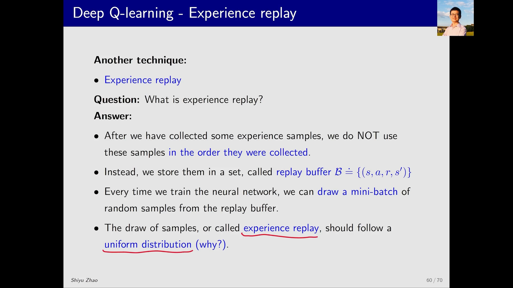
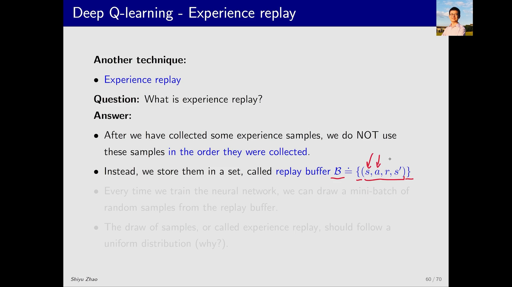
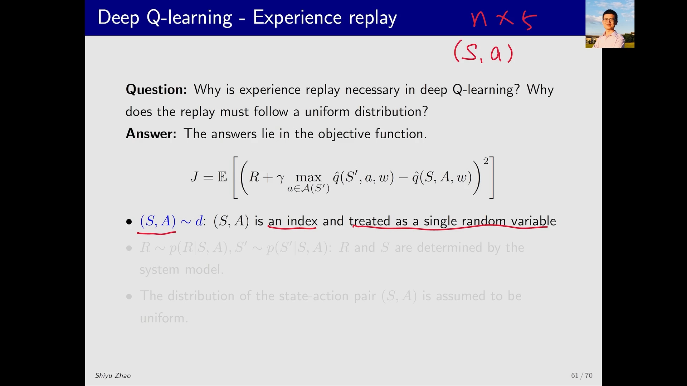
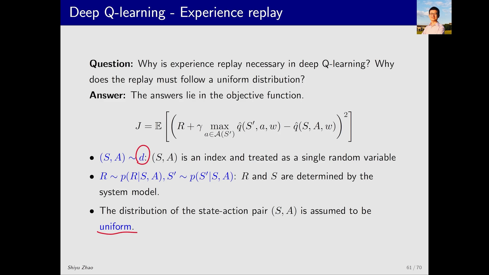
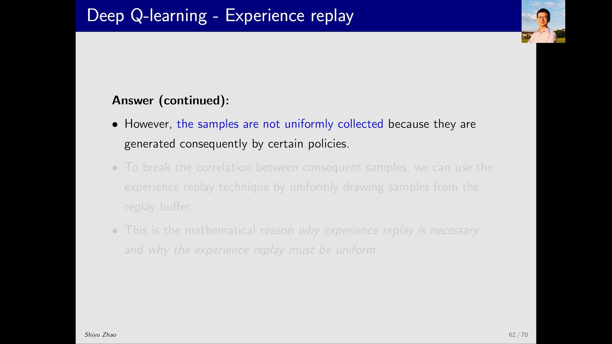
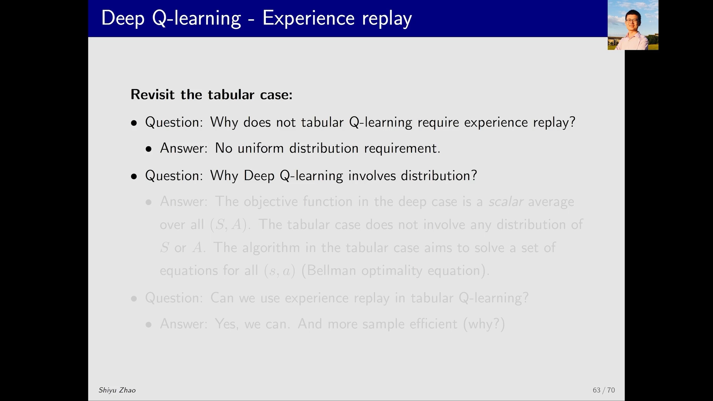

# 经验回放：为什么必须打乱样本顺序

> 本篇整理自赵世钰《强化学习的数学原理》第 8 课「值函数近似」Part 7：Deep Q-learning — experience replay。视频地址：[BV1kg411q7JG](https://www.bilibili.com/video/BV1kg411q7JG/)。同一条目下的另一篇《DQN 基本原理：为什么需要「主网络 + 目标网络」两套参数》整理自 Part 6，两篇合起来才是完整的 DQN。

## 本讲要解决的核心问题（SCQA）

**背景**：DQN 的第一个技巧是「主网络 + 目标网络」，它解决的是「目标函数里 $w$ 出现两次」的问题。但那个目标函数还有一个没处理的东西——它是对随机变量 $S, A, R, S'$ 的**期望**。

**冲突**：期望要求我们知道这些随机变量的**分布**。而智能体采集数据的方式是「一步接一步地走」：$s_t \to a_t \to r_{t+1} \to s_{t+1} \to a_{t+1} \to \cdots$。这样采出来的样本**彼此高度相关**，而且先后顺序固定——它服从的分布是策略和环境的分布，不是我们想要的那个分布。

**疑问**：既然目标函数要求的是「对 $(S,A)$ 的某个分布求期望」，而实际采到的样本根本不是按这个分布来的，那这个期望还算得对吗？要怎么才能算对？

**回答（中心思想）**：把采到的所有样本**先存起来、再打散、然后均匀地抽**——这就是**经验回放（experience replay）**。存样本的集合叫**回放缓冲区（replay buffer）** $\mathcal{B}$。打散重抽的目的有两个：一是让抽样服从目标函数要求的**均匀分布**，二是**打破样本之间的相关性**。讲者强调，经验回放不是「工程上的小技巧」，而是由目标函数的数学形式**逼出来的必需品**——也正因为如此，表格型 Q-Learning 不需要它，而 DQN 需要。

---

## 一、经验回放是什么：先存起来，再打散重抽

定义只有一句话：

> 收集到经验样本之后，**不按采集的先后顺序**使用它们；而是把它们全部放进一个集合，每次训练时从这个集合里**随机**抽一批出来用。

这个集合就是回放缓冲区：

$$
\mathcal{B} \doteq \{(s,a,r,s')\}
$$

花体的 $\mathcal{B}$ 表示一个集合，花括号里的每个元素是一个**经验样本（experience sample）**：从状态 $s$ 出发、执行动作 $a$、得到奖励 $r$、跳到下一个状态 $s'$。

「回放（replay）」这个词很形象：那些经验**已经发生过了**，躺在缓冲区里，现在我把它们**再拿出来用一次**——这不就是「回放」吗？

这里有一个容易被忽略的细节：**采样必须服从均匀分布（uniform distribution）**，即缓冲区里每一个样本被抽到的概率相同。为什么偏偏是均匀分布？这是本讲后半段要回答的核心问题。

[【跳转到 00:05】](https://www.bilibili.com/video/BV1kg411q7JG/?t=5) · [【跳转到 00:30】](https://www.bilibili.com/video/BV1kg411q7JG/?t=30) · [【跳转到 01:20】](https://www.bilibili.com/video/BV1kg411q7JG/?t=80)

---

## 二、为什么必须：目标函数里藏着一个 $(S,A)$ 的分布

讲者的回答很干脆：**答案就在目标函数里**。

回看 DQN 的目标函数：

$$
J(w) = \mathbb{E}\left[\left( R + \gamma \max_{a\in\mathcal{A}(S')} \hat{q}(S', a, w) - \hat{q}(S, A, w) \right)^2\right]
$$

这个期望里有四个随机变量：$R$、$S'$、$S$、$A$。要求期望，就得知道它们的分布。逐个看：

- **$R$ 和 $S'$**：当 $S$ 和 $A$ 给定之后，它们服从**系统模型**（状态转移与奖励函数），这部分不需要额外讨论；
- **$(S,A)$**：它俩要服从某个分布 $d$，即 $(S,A) \sim d$。

$(S,A)$ 被当成**一个**随机变量，这一点值得解释一下。讲者的类比是：假设有 $n$ 个状态、每个状态 5 个动作，那么一共有 $5n$ 个「状态-动作对」。要索引其中某一个，需要同时给出 $s$ 和 $a$——就像平面上的一个点虽然是一个点，却要用 $x$、$y$ 两个坐标来定位。所以 $(S,A)$ 是一个**联合随机变量**，它服从分布 $d$。

**关键就在这个 $d$ 上。** 目标函数是对 $(S,A)\sim d$ 求期望，而智能体采数据时，$(S,A)$ 的分布是由策略和轨迹决定的——它既不是均匀的，也不是独立同分布的。**你喂给优化的样本分布，和目标函数要求的分布，不是同一个分布。**

[【跳转到 01:45】](https://www.bilibili.com/video/BV1kg411q7JG/?t=105) · [【跳转到 02:10】](https://www.bilibili.com/video/BV1kg411q7JG/?t=130)

---

## 三、为什么一定是均匀分布：没有先验知识，就一视同仁

讲者在这里假设 $d$ 是**均匀分布**，并立刻自问：为什么非得是均匀的？其它分布行不行？

他的回答是：**行，但你需要先验知识**。比如你想用高斯分布，给某些 $(S,A)$ 更大的权重——那你在采样时就得更多地用到它们。可问题在于：**你得先知道哪些 $(S,A)$ 是重要的、哪些不是**。如果没有这个先验知识，唯一公平的做法就是**一视同仁**：所有 $(S,A)$ 对应的概率相同，也就是均匀分布。

这个「没有先验知识」的立场，恰好也解释了后来为什么会出现**优先经验回放（prioritized experience replay）**：一旦能用 TD 误差之类的信号估计出「哪些样本更值得学」，就可以**故意打破均匀性**、给重要样本更高的抽样概率。换句话说，均匀采样是「无信息时的默认选择」，而 6.4 节要讲的 PER 正是「有信息之后的加权选择」。两者不是矛盾的，而是同一个框架下的两种 $d$。

[【跳转到 03:00】](https://www.bilibili.com/video/BV1kg411q7JG/?t=180) · [【跳转到 03:25】](https://www.bilibili.com/video/BV1kg411q7JG/?t=205)

---

## 四、采集一定有序，使用必须无序

现在矛盾摆明了：

- **数学上要求**：$(S,A)$ 服从均匀分布；
- **实际采集时**：样本一定有先后顺序，而且是按策略产生的、彼此相关的。

怎么办？讲者的回答轻描淡写却切中要害：**「我就不按照它的先后顺序使用就行了。」**

具体做法就是经验回放：把所有样本拿到一起、**打散**、然后**均匀地抽**。这样做的直接效果是**打破不同样本之间的相关性（correlation）**。

为什么「相关性」在这里是个真问题？因为连续采集的样本是同一条轨迹上的邻居：$s_{t+1}$ 就是 $s_t$ 执行 $a_t$ 之后的结果。拿这样一串高度相关的样本去算梯度，相当于**用一个样本的信息反复说服自己**，梯度方向会被这条轨迹的局部特征带偏。打散之后，一个 mini-batch 里的样本来自轨迹的不同位置、不同 episode，梯度才是对「整体分布」的估计，而不是对「最近这一段经历」的估计。

讲者的总结是：**这就是经验回放为什么是必须的、以及为什么采样必须均匀的数学原因。**

[【跳转到 03:50】](https://www.bilibili.com/video/BV1kg411q7JG/?t=230) · [【跳转到 04:15】](https://www.bilibili.com/video/BV1kg411q7JG/?t=255)

---

## 五、回头看表格型 Q-Learning：三个问题

讲完技巧，讲者没有急着往下走，而是回头问了一串问题。他的说法是：**这几个问题你都能答好，说明你对 Q-Learning（无论表格形式还是函数形式）都有比较好的理解。**

### 5.1 表格型 Q-Learning 为什么不需要经验回放？

因为**它没有「均匀分布」这个要求**。前面 5.4 节那些表格型算法，从头到尾没有对 $(s,a)$ 的分布提出过任何要求，自然也就不需要打散重抽。

### 5.2 那为什么 DQN 就涉及分布了？

因为**两者在做的事情不一样**：

- **DQN 属于值函数近似这一大类，做的是优化（optimization）**：它要最小化一个**标量（scalar）**的目标函数，而这个标量是「对很多东西的平均」，其中就包括 $(S,A)$。既然要对 $(S,A)$ 求平均，就必须指定它的分布——分布就这样被引了进来。
- **表格型 Q-Learning 做的是解方程**：它求解的是贝尔曼最优方程，对**每一个** $(s,a)$ 都有一个式子，这些式子组成一个方程组，解出来就得到最优动作价值。解方程组不需要「对 $(s,a)$ 求平均」，也就不需要 $(s,a)$ 的分布。

一句话概括：**「最小化一个期望」会引入分布，「解一组方程」不会。** 这是本讲最值得带走的判断。

### 5.3 那表格型 Q-Learning 能不能用经验回放？

**能。** 因为表格型 Q-Learning 也是**离轨（off-policy）**算法：它不关心数据是哪个策略、按什么顺序采出来的——你给我哪个 $(s,a)$，我就更新那个 $(s,a)$ 对应的 $q$。既然对数据来源无所谓，那当然可以先存起来再打乱用。

[【跳转到 04:40】](https://www.bilibili.com/video/BV1kg411q7JG/?t=280) · [【跳转到 05:05】](https://www.bilibili.com/video/BV1kg411q7JG/?t=305) · [【跳转到 05:55】](https://www.bilibili.com/video/BV1kg411q7JG/?t=355) · [【跳转到 07:10】](https://www.bilibili.com/video/BV1kg411q7JG/?t=430)

---

## 六、附带的好处：样本效率

「必须」讲完了，讲者补了一个「好处」：经验回放让样本**更高效（sample efficient）**。

原因很直接：**同一个样本可以被用很多次**。在缓冲区里均匀采样，一个样本被反复抽到是完全可能的，于是这份经验被充分利用了。

反过来看，前面基于表格的 Q-Learning 其实**有点浪费数据**。第 5 章那个仿真的例子，跑一个 episode 用了 10 万步——但讲者指出，其实根本不需要这么多步：**只要每一个状态-动作对都被访问到就够了**。在确定性环境里，访问很多次和访问一次没什么区别（随机环境另当别论）。既然访问一次就够，那这份经验就应该被反复使用；而按时序在线更新的做法，用一次就把之前的经验丢掉了，这在某种程度是一种浪费。

[【跳转到 07:35】](https://www.bilibili.com/video/BV1kg411q7JG/?t=455) · [【跳转到 08:00】](https://www.bilibili.com/video/BV1kg411q7JG/?t=480) · [【跳转到 08:25】](https://www.bilibili.com/video/BV1kg411q7JG/?t=505)

---

## 小结

- **经验回放 = 存起来 + 打散 + 均匀抽**。样本存进回放缓冲区 $\mathcal{B}=\{(s,a,r,s')\}$，每次训练从中抽一个 mini-batch，抽样服从均匀分布。
- **它是被目标函数逼出来的，不是工程小技巧**。DQN 的目标函数是「对 $(S,A)\sim d$ 的期望」，而在线采集的样本既相关又不均匀，分布对不上。
- **均匀分布是「无先验知识」时的默认选择**。若知道哪些 $(S,A)$ 更重要，就可以故意加权——这正是优先经验回放（PER）的出发点。
- **打散的直接作用是打破相关性**。连续样本是同一条轨迹上的邻居，直接拿来算梯度会让梯度被最近这段经历带偏。
- **表格型不需要、深度情形需要**，差别在于「解方程组」还是「最小化一个标量期望」：前者不涉及 $(s,a)$ 的分布，后者必然涉及。
- **表格型也能用经验回放**，因为 Q-Learning 是离轨算法，对数据从哪来、按什么顺序来都无所谓。
- **附带好处是样本效率**：同一条经验可以被反复抽样使用，而按时序在线更新用一次就丢，是一种浪费。

## 关键术语速查

| 术语 | 一句话解释 |
| :-- | :-- |
| 经验回放（experience replay） | 把历史经验样本存起来，训练时随机抽样复用，而不是按采集顺序使用 |
| 回放缓冲区（replay buffer）$\mathcal{B}$ | 存放经验样本 $(s,a,r,s')$ 的集合 |
| 经验样本（experience sample） | 一次转移 $(s,a,r,s')$：从 $s$ 执行 $a$、得到 $r$、到达 $s'$ |
| 均匀分布（uniform distribution） | 缓冲区里每个样本被抽到的概率相同；无先验知识时的默认选择 |
| 样本相关性（correlation） | 相邻时刻的样本来自同一条轨迹、彼此高度相关，直接使用会让梯度有偏 |
| mini-batch | 每次训练从缓冲区里随机抽出的一小批样本 |
| 样本效率（sample efficiency） | 同样的经验数据能被利用到什么程度；经验回放通过重复使用提高它 |
| 离轨（off-policy） | 更新时不需要数据来自当前策略，因此可以任意打乱、重复使用历史数据 |