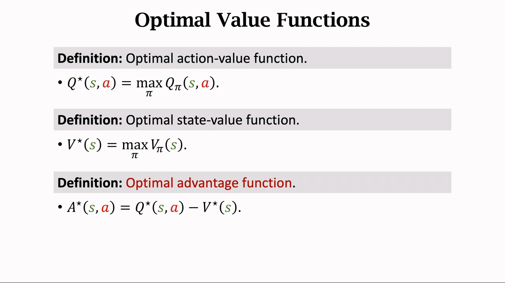
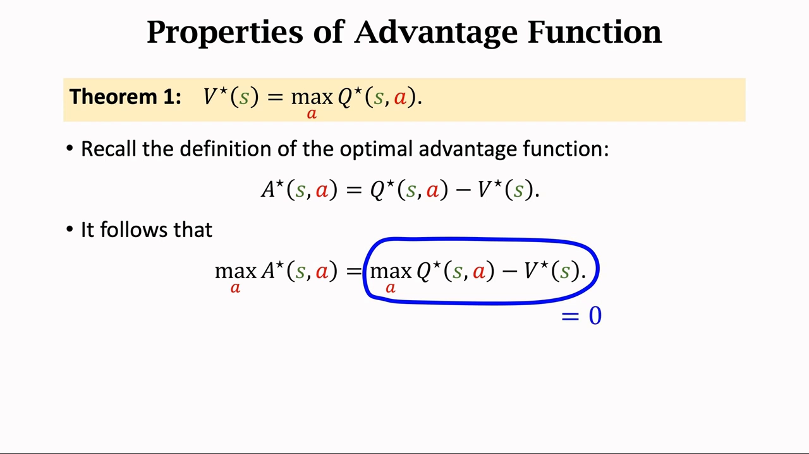
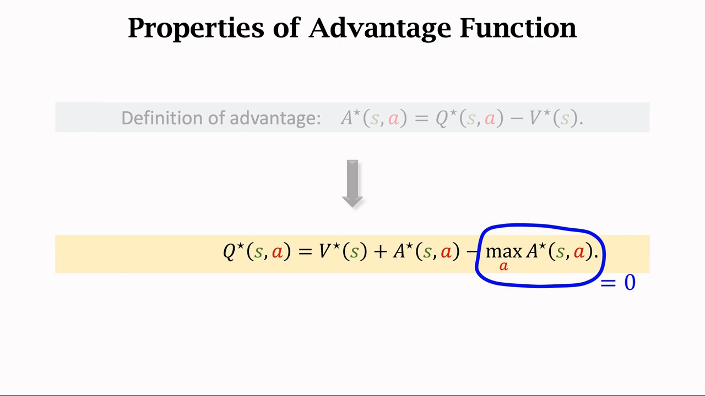
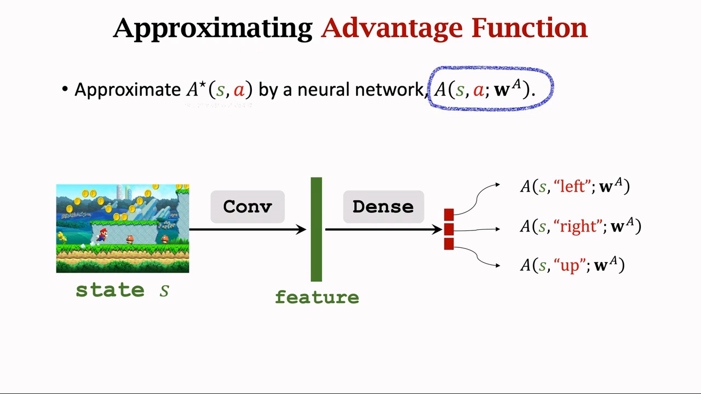
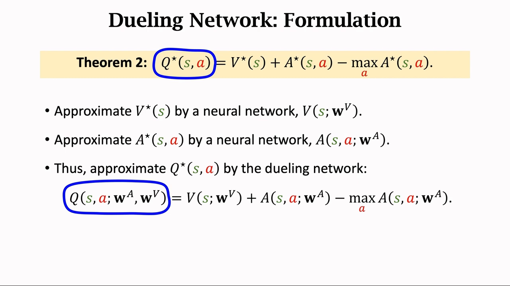
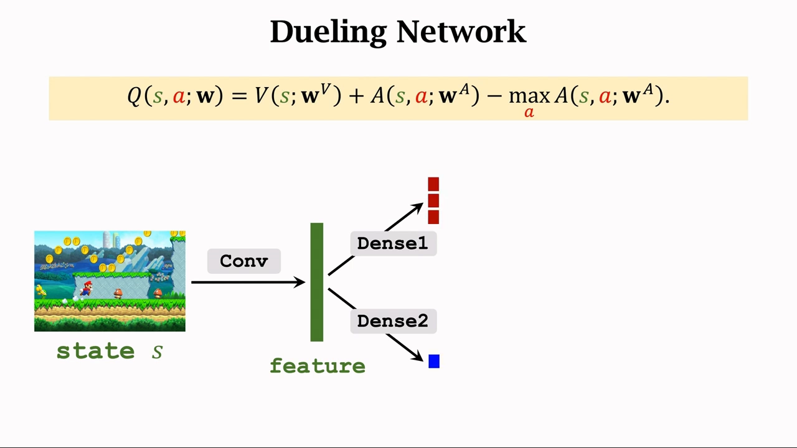
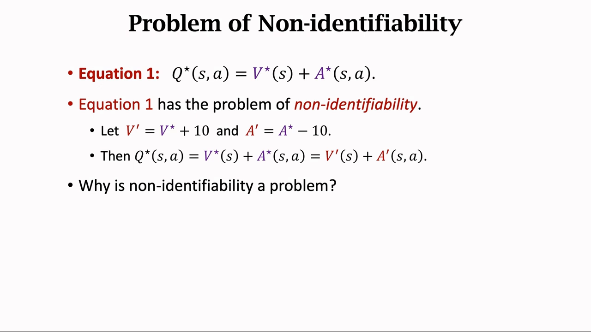
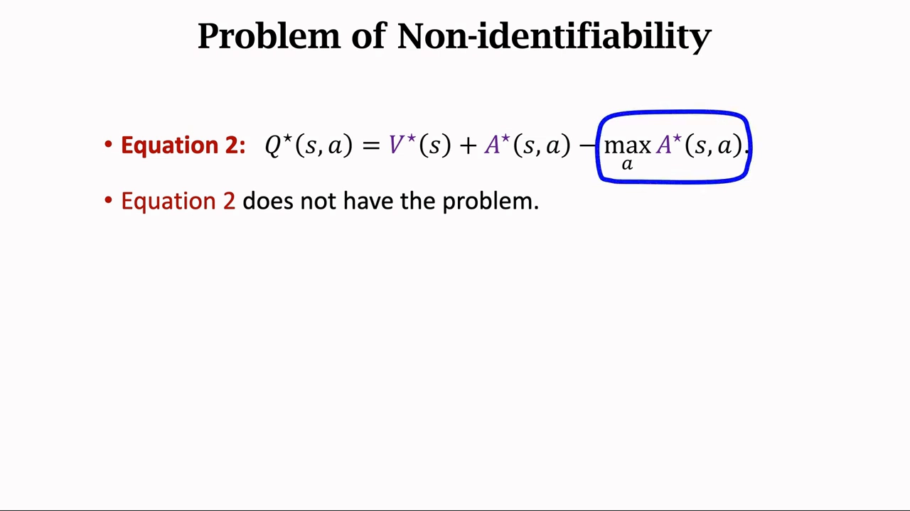
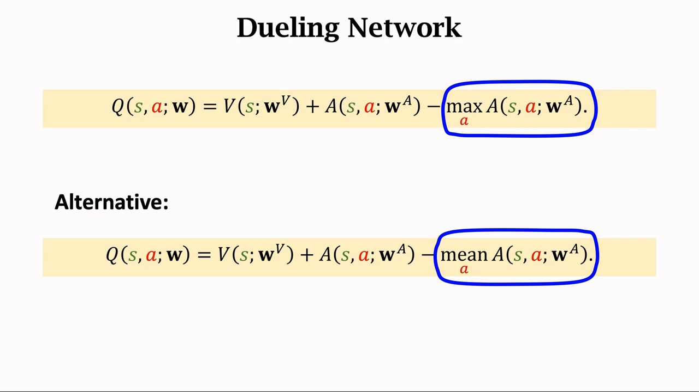

# Dueling Network：把 $Q$ 拆成 $V$ 加优势 $A$

> 本篇整理自王树森《深度强化学习》第 13 讲「Dueling Network（价值学习高级技巧 3/3）」。视频地址：[BV12o4y197US 第 13 P](https://www.bilibili.com/video/BV12o4y197US/?p=13)。同一条目下的另两篇分别整理第 11 讲（经验回放与优先经验回放）与第 12 讲（高估问题与 Double DQN）。

## 本讲要解决的核心问题（SCQA）

**背景**：前两讲的改进都作用在**训练方式**上——优先经验回放改的是「怎么抽样本」，Double DQN 改的是「TD 目标怎么算」。而网络本身一直是同一个样子：输入状态 $s$，输出一个向量，每个元素给一个动作打分。

**冲突**：这种「直接输出每个动作分数」的结构，把两件性质完全不同的事**混在了一起**：这个状态本身好不好（比如「快赢了」还是「快输了」），以及在这个状态下某个动作相对其他动作好多少。在很多状态里，动作之间的差别其实很小——此时再逐个动作去估，等于把大量容量浪费在几乎相同的数值上。

**疑问**：能不能让网络结构本身就体现这种分解——先估「状态有多好」，再估「每个动作相对好多少」，最后合成动作价值？这样拆开之后，训练会不会变得不唯一、不稳定？

**回答（中心思想）**：**Dueling Network**（Wang et al., ICML 2016）把最优动作价值拆成

$$
Q^\star(s,a) = V^\star(s) + A^\star(s,a) - \max_{a} A^\star(s,a)
$$

即「状态价值 + 优势 − 优势的最大值」。网络结构上，两个分支**共享卷积层**，一支输出标量 $V$、一支输出向量 $A$，再按上式合成 $Q$。它和 DQN 的输入、输出、训练方式**完全一样**，唯一区别是网络结构；而那个看起来多余的「减最大值」正是保证 $V$ 与 $A$ 能被唯一确定、从而训练稳定的关键——实际实现中常把 $\max$ 换成 $\mathrm{mean}$，效果更好。

---

## 一、先把记号理清：四个价值函数与优势函数

要理解 Dueling，必须先把这几个函数摆在一起。讲者按「从回报出发、逐步消掉随机变量」的顺序复习。

**折扣回报** $U_t$：从 $t$ 时刻开始，未来所有奖励的加权和。在 $t$ 时刻它是未知的，依赖于未来所有的状态和动作。

**动作价值函数** $Q_\pi(s,a)$：回报 $U_t$ 的条件期望。期望把 $t+1$ 时刻以后的状态和动作都消掉了，于是 $Q_\pi$ 只依赖当前的状态 $s$、动作 $a$ 和策略 $\pi$。换一个策略 $\pi$，得到的 $Q_\pi$ 就不一样。

**状态价值函数** $V_\pi(s)$：$Q_\pi$ 对动作 $a$ 的期望。动作被消掉，于是 $V_\pi$ 只依赖策略 $\pi$ 和当前状态 $s$。

**最优动作价值** $Q^\star(s,a)$ 与**最优状态价值** $V^\star(s)$：分别对 $Q_\pi$、$V_\pi$ 关于 $\pi$ 求最大值，把 $\pi$ 消掉。于是 $Q^\star$ 只依赖 $s,a$，$V^\star$ 只依赖 $s$。$V^\star$ 评价「状态 $s$ 有多好」——是快赢了还是快输了。

最后是这节课的主角**优势函数（advantage function）**：

$$
A^\star(s,a) = Q^\star(s,a) - V^\star(s)
$$

它把 $V^\star$ 当作 **baseline**，衡量「在状态 $s$ 下做动作 $a$，比这个状态能做到的最好水平差多少」。动作越好，优势越大；优势为负，说明这个动作不如在该状态下的最优动作。

[【跳转到 01:40】](https://www.bilibili.com/video/BV12o4y197US/?p=13&t=100) · [【跳转到 02:30】](https://www.bilibili.com/video/BV12o4y197US/?p=13&t=150)

---

## 二、优势函数的一个性质：它的最大值恒等于零

要推导 Dueling 的公式，需要一个定理（讲者直接引用，不在这里证明）：

$$
\text{Theorem 1: } V^\star(s) = \max_{a} Q^\star(s,a)
$$

含义很直白：状态的最优价值，就等于「在这个状态下挑最好的动作」能拿到的价值。

把它和优势函数的定义放在一起，就能推出关键性质。对 $A^\star(s,a) = Q^\star(s,a) - V^\star(s)$ 两边同时关于 $a$ 求最大值：

$$
\max_{a} A^\star(s,a) = \max_{a} Q^\star(s,a) - V^\star(s)
$$

右边这一项由定理一保证等于零，于是

$$
\max_{a} A^\star(s,a) = 0
$$

直观理解：优势是「相对平均水平好多少」，而**最好的那个动作**的优势，就是它能比平均水平好多少——这个量按定义就是状态价值的基准线本身，所以最优动作的优势恰好为零。其余动作的优势都是负数或零。

[【跳转到 03:00】](https://www.bilibili.com/video/BV12o4y197US/?p=13&t=180) · [【跳转到 03:25】](https://www.bilibili.com/video/BV12o4y197US/?p=13&t=205)

---

## 三、定理二：为什么非要多减一个「最大值」

把定义式反过来写，得到 $Q^\star(s,a) = V^\star(s) + A^\star(s,a)$。这已经是一个合法的分解了，那为什么 Dueling 还要**再减去一项**？

$$
\text{Theorem 2: } Q^\star(s,a) = V^\star(s) + A^\star(s,a) - \max_{a} A^\star(s,a)
$$

因为 $\max_a A^\star(s,a) = 0$，减掉它**不影响正确性**。既然不影响，为什么要多此一举？讲者说：**这一项很重要，不能去掉**——理由留到第六节讲，先按它把网络搭起来。

[【跳转到 03:50】](https://www.bilibili.com/video/BV12o4y197US/?p=13&t=230) · [【跳转到 04:40】](https://www.bilibili.com/video/BV12o4y197US/?p=13&t=280)

---

## 四、搭网络：两个分支 + 一个共享的卷积层

传统 DQN 记作 $\hat{q}(s,a,w)$：输入状态 $s$（比如游戏画面），经过若干卷积层变成特征向量，再经过若干全连接层变成一个输出向量，每个元素对应一个动作的打分。

Dueling 换掉了后半段。它用**两个**神经网络：

- $A(s,a,w^A)$ 近似最优优势函数 $A^\star$，输出是**向量**——每个动作一个优势分数；
- $V(s,w^V)$ 近似最优状态价值 $V^\star$，输出是**一个实数**——给状态 $s$ 打的分。

这两个网络结构相似，都是先用卷积层从输入中提取特征。**实现时可以让它们共享卷积层的参数**——这是 Dueling 的招牌设计：特征提取只做一次，后面再分成两支。

把定理二里的 $V^\star$、$A^\star$ 都替换成神经网络，就得到 Dueling Network：

$$
Q(s,a;w^A,w^V) = V(s;w^V) + A(s,a;w^A) - \max_{a} A(s,a;w^A)
$$

为了方便，后面把 $w^A$ 与 $w^V$ 合起来记作 $w$，于是它和 DQN 用同一个符号 $Q(s,a,w)$。

### 4.1 一次前向传播到底做了什么

把结构画完整，就是这样一条流水线：

1. 输入状态 $s$，用卷积层处理，得到**特征向量**；
2. 特征分两支：一支经 Dense1 得到**优势向量**（大小等于动作数，如 $3\times 1$）；另一支经 Dense2 得到**一个实数**，即状态价值；
3. 把这个实数**加到优势向量的每个元素上**，再**减去优势向量中的最大值**；
4. 得到最终的输出向量——每个元素是一个动作的价值，做决策时取最大的那个。

**输入输出和 DQN 完全一样，功能也完全一样**，唯一区别就是网络结构。讲者的说法是：Dueling 网络结构更好，所以表现比 DQN 更好。

[【跳转到 05:05】](https://www.bilibili.com/video/BV12o4y197US/?p=13&t=305) · [【跳转到 06:13】](https://www.bilibili.com/video/BV12o4y197US/?p=13&t=373) · [【跳转到 09:08】](https://www.bilibili.com/video/BV12o4y197US/?p=13&t=548)

---

## 五、训练方式：一个字都不用改

既然 Dueling Network 也是对 $Q^\star$ 的近似，那么**怎么训练 DQN，就怎么训练它**：用 TD 算法（Q-learning）学参数 $w$，具体流程没有任何区别。Dueling 只改架构，不影响 TD 算法的使用。

更重要的是，前面所有改进都能**叠加**上去：优先经验回放、Double DQN、multi-step TD target，全都可以用来训练 Dueling Network，全部用上效果最好。

还有一个容易被误解的点：**训练时把 Dueling Network 当成一个整体 $Q(s,a,w)$ 直接训练**，而不是分别训练 $V$ 和 $A$ 两个网络。$V$ 和 $A$ 只是中间产物，没有各自的损失函数。

[【跳转到 10:18】](https://www.bilibili.com/video/BV12o4y197US/?p=13&t=618) · [【跳转到 10:43】](https://www.bilibili.com/video/BV12o4y197US/?p=13&t=643)

---

## 六、回头看：那个「减最大值」治的是不唯一性

现在回答第三节留下的问题。把两个等式并排看：

$$
\text{Equation 1: } Q^\star(s,a) = V^\star(s) + A^\star(s,a)
$$

$$
\text{Equation 2: } Q^\star(s,a) = V^\star(s) + A^\star(s,a) - \max_{a} A^\star(s,a)
$$

两个都成立。等式二多出来的那一项恒等于零，所以数学上等价。**但等式一有个致命缺点：给定 $Q^\star$，$V^\star$ 和 $A^\star$ 不是唯一的。**

举个具体的例子：令 $V' = V^\star + 10$、$A' = A^\star - 10$，那么

$$
Q^\star(s,a) = V^\star(s) + A^\star(s,a) = V'(s) + A'(s,a)
$$

同一个 $Q^\star$，可以由完全不同的 $(V^\star, A^\star)$ 组合出来。

### 6.1 为什么这不唯一性很要命

因为训练时 $V$ 和 $A$ 是两个独立的神经网络。如果 $V$ 往上波动 10、$A$ 同时往下波动 10，**Dueling Network 的输出 $Q$ 毫无变化**——损失函数看不出任何异常，梯度也不会纠正它。于是这两个网络可以随意上下漂移，谁都训不好，训练过程不稳定。

### 6.2 减去最大值就消除了这种自由度

换成等式二之后，这种「一个加、一个减」的把戏就失效了：你把 $V^\star$ 加十、$A^\star$ 减十，再代进等式二算 $Q^\star$，会发现 $Q^\star$ **变了**（因为 $\max_a A^\star$ 也跟着变了）。于是 $Q$ 就能反过来唯一地确定 $V$ 与 $A$，两个分支不再能随意漂移。

讲者的总结是：**这一项对训练中保持神经网络的稳定很重要**，它避免了 $V$ 和 $A$ 的输出随意上下波动。

### 6.3 工程实践：把 max 换成 mean

最后是一个「没有理论依据但有效」的细节。按数学推导，Dueling Network 里应该是 $-\max_a A$；但实际中把它换成 $-\operatorname{mean}_a A$，**效果更好、更稳定**。讲者的原话是「这种替换没有任何理论依据，就是实验效果好」——简单粗暴有效。

[【跳转到 11:58】](https://www.bilibili.com/video/BV12o4y197US/?p=13&t=718) · [【跳转到 12:48】](https://www.bilibili.com/video/BV12o4y197US/?p=13&t=768) · [【跳转到 13:38】](https://www.bilibili.com/video/BV12o4y197US/?p=13&t=818)

---

## 小结

- **Dueling Network 改的是网络结构**，不是训练算法：输入输出与 DQN 完全相同，功能完全相同。
- **核心公式**：$Q^\star(s,a) = V^\star(s) + A^\star(s,a) - \max_a A^\star(s,a)$，即「状态价值 + 优势 − 优势最大值」。
- **推导靠两个事实**：定理一 $V^\star(s)=\max_a Q^\star(s,a)$，以及由它推出的 $\max_a A^\star(s,a)=0$。
- **结构上共享卷积层**：Conv 提取特征后分两支，一支出优势向量（每个动作一个数），一支出状态价值标量，再相加并减去最大值。
- **训练方式一字不改**：把整个 Dueling Network 当成 $Q(s,a,w)$ 用 TD 算法训练；PER、Double DQN、multi-step 都能叠加。
- **「减最大值」不是多余的**：没有它，$V$ 与 $A$ 的分解不唯一，两个分支可以一升一降互相抵消，训练不稳定。
- **实践中用 mean 代替 max**：没有理论依据，但实验效果更好、更稳定。

## 关键术语速查

| 术语 | 一句话解释 |
| :-- | :-- |
| 优势函数（advantage function）$A^\star(s,a)$ | $Q^\star(s,a)-V^\star(s)$，衡量动作 $a$ 相对状态平均水平的优势 |
| 最优状态价值 $V^\star(s)$ | 状态 $s$ 有多好；等于 $\max_a Q^\star(s,a)$ |
| 定理一 | $V^\star(s) = \max_a Q^\star(s,a)$，由此可得 $\max_a A^\star(s,a)=0$ |
| 定理二 | $Q^\star(s,a) = V^\star(s) + A^\star(s,a) - \max_a A^\star(s,a)$，Dueling 的公式来源 |
| Dueling Network | 用两个分支分别近似 $V^\star$ 与 $A^\star$、再合成 $Q$ 的网络结构 |
| 共享卷积层 | 两个分支共用特征提取部分，只做一次卷积，后面再分叉 |
| 不唯一性（non-identifiability） | 仅凭 $Q^\star$ 无法唯一确定 $V^\star$ 与 $A^\star$，会让两个分支随意漂移 |
| mean 替换 | 实践中把 $-\max_a A$ 换成 $-\operatorname{mean}_a A$，无理论依据但更稳定 |