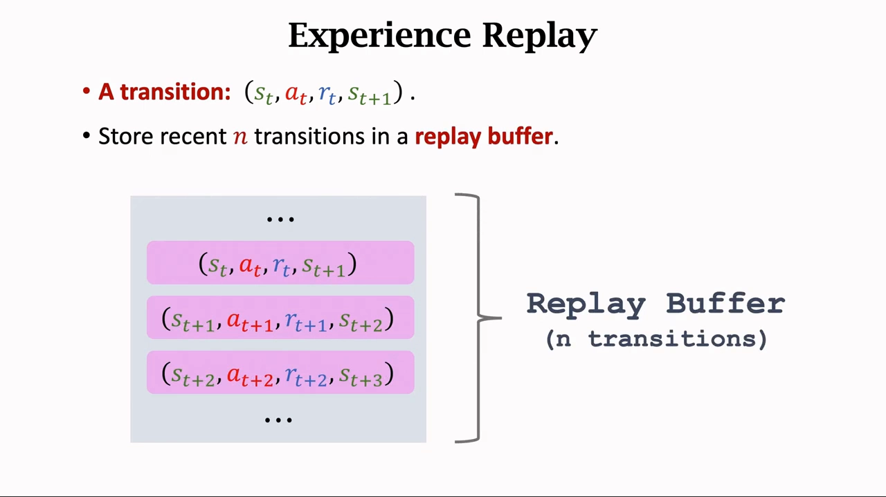
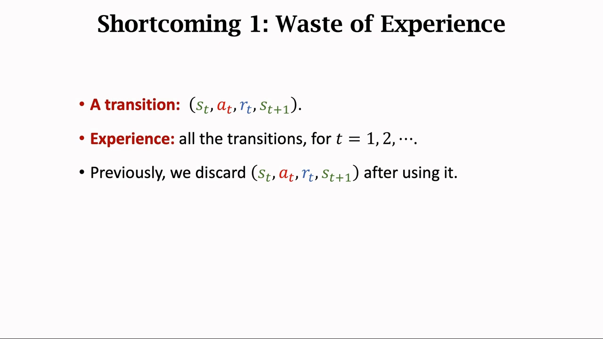
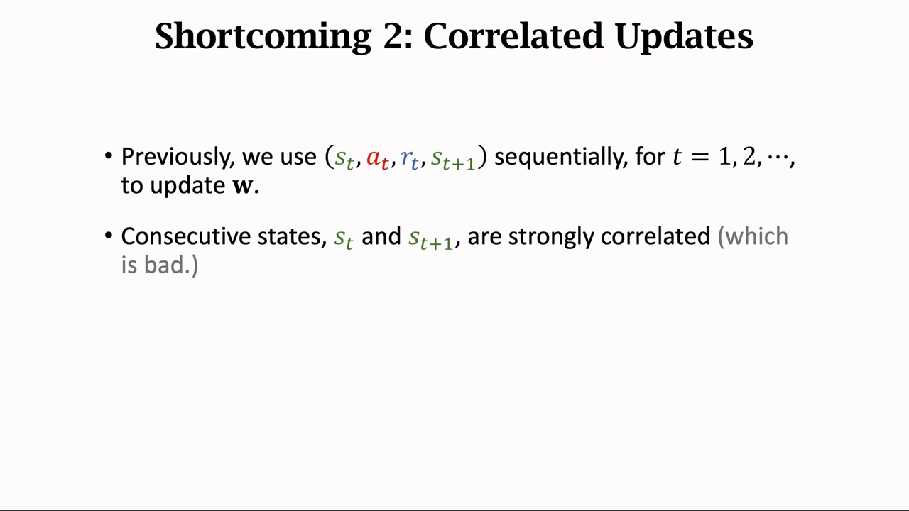
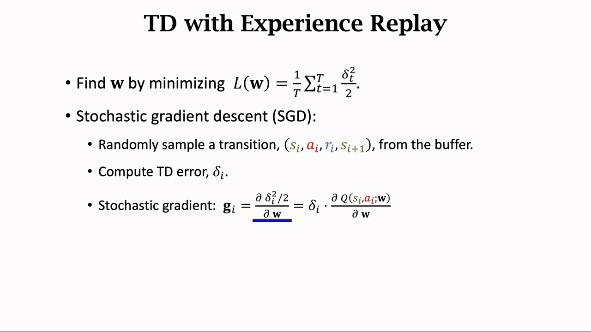
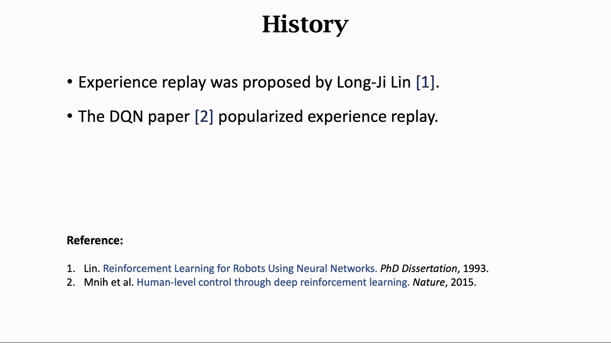
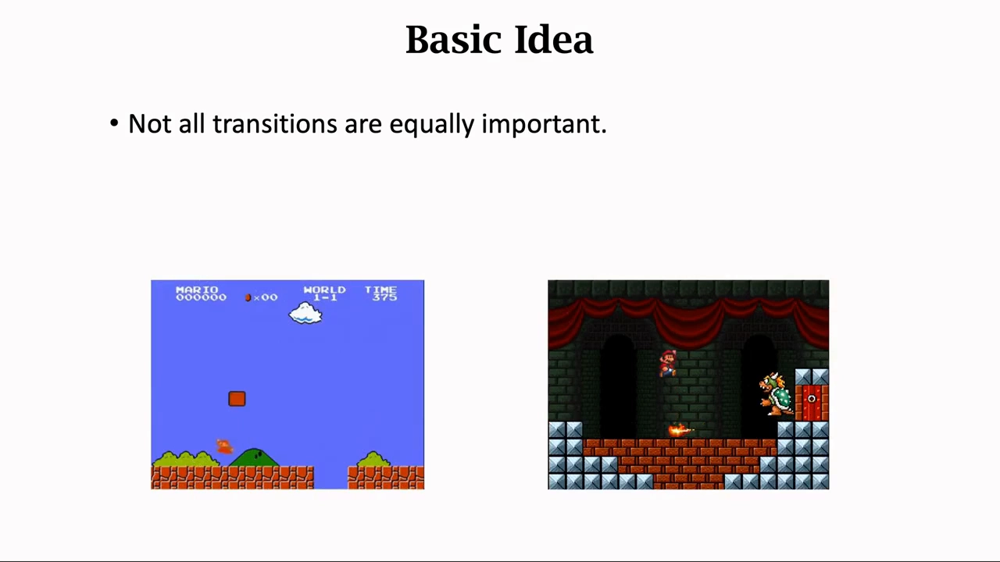
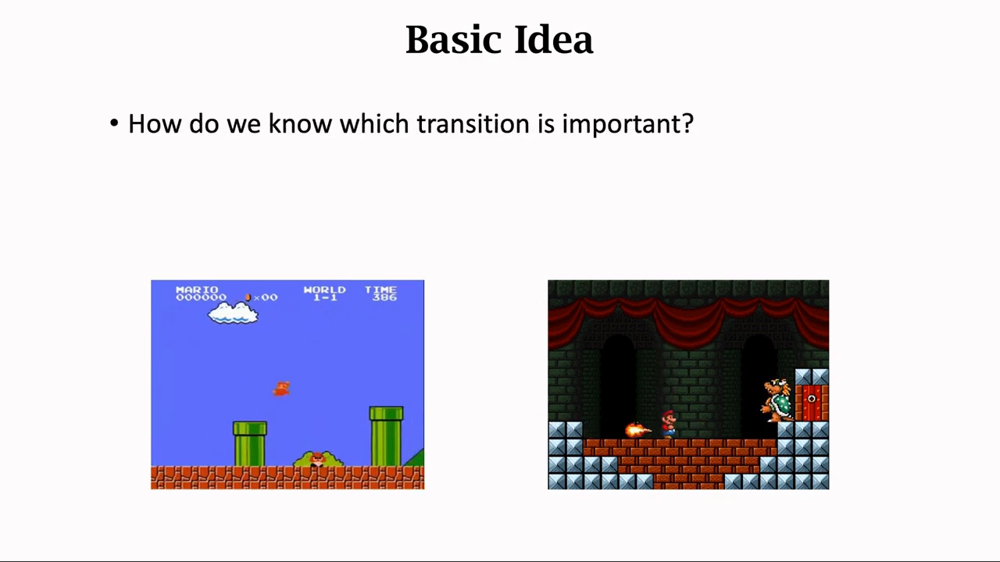
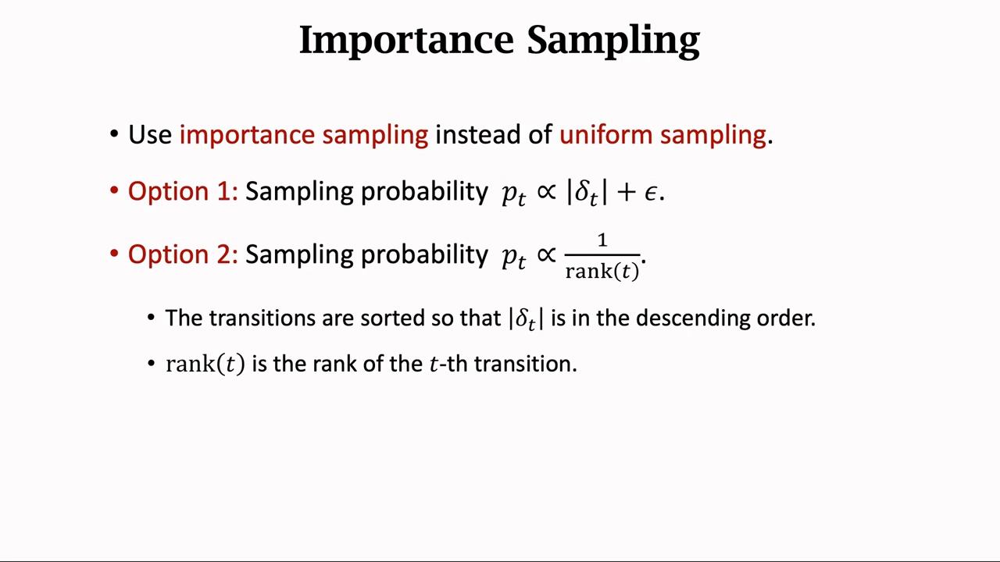
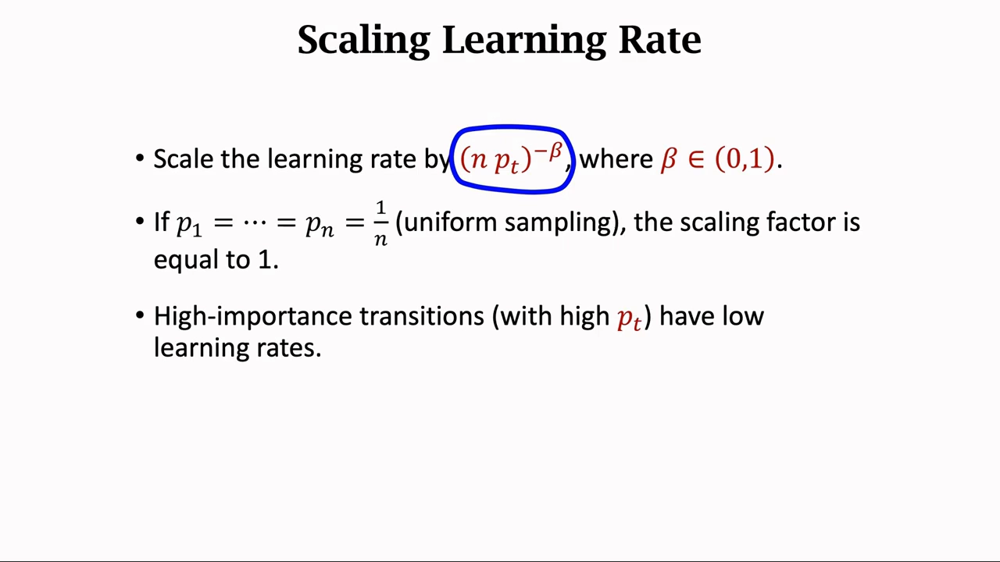
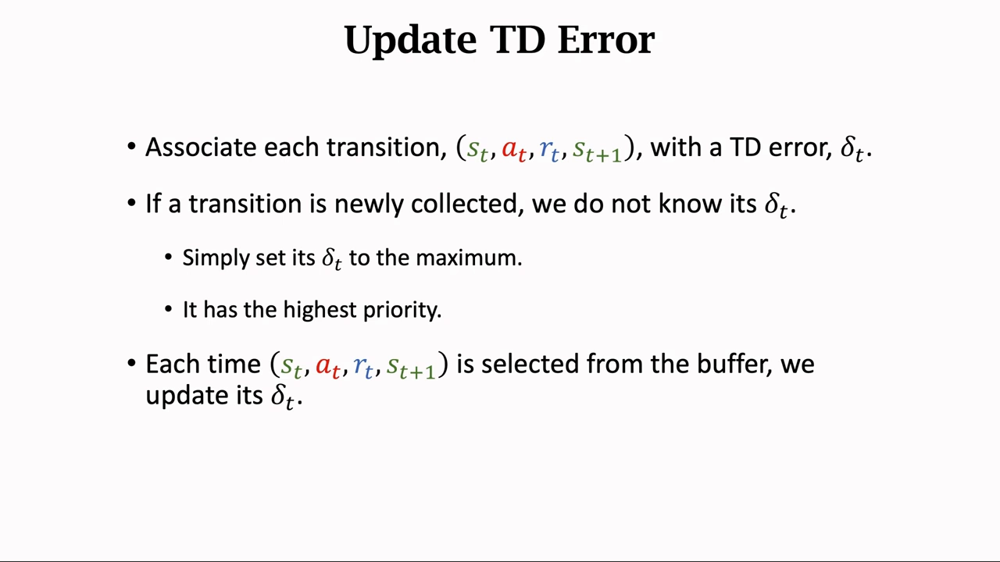

# 优先经验回放：把均匀抽样换成按 TD 误差加权

> 本篇整理自王树森《深度强化学习》第 11 讲「经验回放 Experience Replay（价值学习高级技巧 1/3）」。视频地址：[BV12o4y197US 第 11 P](https://www.bilibili.com/video/BV12o4y197US/?p=11)。同一条目下的另两篇分别整理第 12 讲（高估问题与 Double DQN）与第 13 讲（Dueling Network）。

## 本讲要解决的核心问题（SCQA）

**背景**：6.3 节已经讲过经验回放——把 transition 存进回放缓冲区 $\mathcal{B}$，训练时**随机均匀**地抽 mini-batch，好处是重复利用经验、打破样本相关性。

**冲突**：均匀抽样隐含了一个假设：**缓冲区里每条 transition 一样重要**。但现实明显不是这样。玩超级马里奥，90% 的时间都在普通关卡里跑跳，而对决 boss 的场景几百条 transition 里才有一条。均匀抽样会让 DQN 把绝大多数训练预算花在「已经会了」的普通场景上，稀缺的 boss 经验反而很少被抽到。

**疑问**：算法怎么知道哪条 transition 更重要？知道之后怎么按重要性去抽？抽得不均匀，会不会把 DQN 的预测搞出偏差？

**回答（中心思想）**：**优先经验回放（prioritized experience replay, PER）** 用 **TD 误差的绝对值** $\lvert\delta_t\rvert$ 当优先级——预测错得越多，说明这条经验越值得学。抽样概率正比于 $\lvert\delta_t\rvert$（或反比于它的排名），于是重要样本被抽得更频繁。但非均匀抽样会让梯度估计有偏，所以还要**按抽样概率缩放学习率**：$\alpha \cdot (n p_t)^{-\beta}$。一句话概括本讲的取舍——**重要的样本多抽几次，但每次少学一点**。

---

## 一、先回顾：原始 TD 算法的两个缺点

讲者先复习了最朴素的 TD 训练方式：观测到 $(s_t,a_t,r_t,s_{t+1})$，算出 TD 误差 $\delta_t$，对 $\delta_t^2/2$ 关于 $w$ 求梯度，做一步梯度下降，**然后把这条四元组丢掉**。这个做法有两个缺点。

### 1.1 缺点一：浪费经验

一条四元组叫一个 **transition**，而「经验」指的是从开始到结束的**所有** transition。原始 TD 算法用完一条就丢，而经验其实是可以**重复利用**的——这是做经验回放最主要的原因。

### 1.2 缺点二：相邻样本高度相关

原始做法是**按时间顺序**一条一条地用。但前后两条 transition 之间有很强的关联：玩超级马里奥时，当前画面和下一帧几乎一样，$s_t$ 和 $s_{t+1}$ 非常接近。实验证明这种相关性是**有害的**；把序列打散、消除相关性，才有利于把 DQN 训好。

### 1.3 经验回放怎么同时解决这两点

做法：把最新的 transition 存进一个**队列**，这个队列就是 **replay buffer**，容量为 $n$（最多存 $n$ 条，满了就删最老的一条）。$n$ 是超参数，很多实验表明它的大小会影响训练结果，通常设得很大——**十万到百万**量级，具体要按应用调。

训练时最小化

$$
L(w) = \frac{1}{T}\sum_{t=1}^{T} \frac{\delta_t^2}{2}
$$

用 SGD 来做：每次从 buffer 里**随机均匀**抽一条 $(s_i,a_i,r_i,s_{i+1})$，算 TD 误差 $\delta_i$，得到随机梯度

$$
g_i = \frac{\partial\, \delta_i^2/2}{\partial w} = \delta_i \cdot \frac{\partial\, \hat{q}(s_i,a_i,w)}{\partial w}
$$

再用它更新 $w$。实践中通常用 **mini-batch SGD**：一次抽多条，用梯度的平均来更新。

这样就同时拿到了两个好处：**打破序列相关性**、**重复利用过去的经验**。

[【跳转到 04:10】](https://www.bilibili.com/video/BV12o4y197US/?p=11&t=250) · [【跳转到 05:00】](https://www.bilibili.com/video/BV12o4y197US/?p=11&t=300) · [【跳转到 06:38】](https://www.bilibili.com/video/BV12o4y197US/?p=11&t=398)

### 1.4 一点历史

经验回放不是 DQN 发明的：它由 **Long-Ji Lin 在 1993 年**提出，而 **2015 年的 DQN 论文**（Mnih et al., *Nature*）让它流行起来。此后经验回放成了深度强化学习的**标准技巧**，也衍生出各种改进——本讲要讲的 PER 就是其中之一。

[【跳转到 07:28】](https://www.bilibili.com/video/BV12o4y197US/?p=11&t=448) · [【跳转到 07:53】](https://www.bilibili.com/video/BV12o4y197US/?p=11&t=473)

---

## 二、PER 的基本想法：不是所有 transition 都一样重要

PER 与普通经验回放的区别只有一句话：**用非均匀抽样代替均匀抽样**。

讲者用超级马里奥举例。左边是游戏里最常见的场景，可能 90% 的 transition 都长这样；右边是对决 boss，很多关才出现一次，几百条 transition 里可能才有一条。

哪种更重要？**右边**。左边的经验要多少有多少，训练出的 DQN 早就轻松过关；右边的经验非常稀缺，DQN 没怎么见过，就不知道该怎么打 boss，很可能卡在 boss 关过不去。所以要把有限的学习机会**多分一点给稀缺经验**。

### 2.1 怎么量化「重要」：用 TD 误差

讲者的答案是：**用 TD 误差 $\delta_t$ 判断**。$\lvert\delta_t\rvert$ 越大，这条 transition 越重要，应该给越高的优先级。

道理很自然：DQN 不熟悉 boss 场景，预测就会偏离 TD 目标，$\delta_t$ 自然就大；而 $\delta_t$ 大，正说明这里还有东西没学会。反过来，普通场景的预测已经很准，$\delta_t$ 很小，再学也学不到什么。

[【跳转到 08:29】](https://www.bilibili.com/video/BV12o4y197US/?p=11&t=509) · [【跳转到 09:19】](https://www.bilibili.com/video/BV12o4y197US/?p=11&t=559)

---

## 三、两种抽样方式：正比于 TD 误差，或反比于排名

有了优先级，抽样概率怎么定？讲者给了两种做法：

$$
\text{Option 1: } p_t \propto \lvert\delta_t\rvert + \epsilon, \qquad\qquad \text{Option 2: } p_t \propto \frac{1}{\operatorname{rank}(t)}
$$

- **Option 1**：抽样概率正比于 $\lvert\delta_t\rvert$ 加一个很小的常数 $\epsilon$，$\epsilon$ 的作用是**避免概率变成零**（$\delta_t=0$ 的样本也要有一点点被抽到的机会）。
- **Option 2**：把 transition 按 $\lvert\delta_t\rvert$ 从大到小排序，$\operatorname{rank}(t)$ 是第 $t$ 条 transition 的序号，抽样概率反比于序号——$\lvert\delta_t\rvert$ 越大、序号越小、概率越大。

两种方式的原理一致：**TD 误差越大，被抽中的概率越大**。区别在于 Option 1 用的是具体数值（受离群值影响），Option 2 只用排名（更稳健）。

[【跳转到 09:52】](https://www.bilibili.com/video/BV12o4y197US/?p=11&t=592) · [【跳转到 10:17】](https://www.bilibili.com/video/BV12o4y197US/?p=11&t=617)

---

## 四、代价与补偿：按抽样概率缩放学习率

非均匀抽样不是免费的。它会让 DQN 的预测**有偏差**：某些样本被反复抽到，梯度就被它们主导了，而目标函数 $L(w)$ 本意是**对所有 transition 一视同仁地平均**。所以必须做补偿。

补偿的办法是在学习率上动手。均匀抽样时，所有 transition 用同一个学习率 $\alpha$；非均匀抽样时，把学习率改成

$$
\alpha \cdot (n\, p_t)^{-\beta}, \qquad \beta \in (0,1)
$$

即用**抽样概率的倒数**去缩放学习率。这是**重要性采样（importance sampling）**的标准做法：抽得越频繁的样本，每次更新时步子迈得越小。

两个端点值得检查一下：

- **均匀抽样是特例**：此时 $p_1=\cdots=p_n=\frac{1}{n}$，于是 $n p_t = 1$，缩放因子等于 1，学习率不变——公式与原来的算法完全兼容。
- **重要样本学得慢**：$p_t$ 大 → $(n p_t)^{-\beta}$ 小 → 学习率小。这正好抵消「被抽得太多」造成的影响。

$\beta$ 是个超参数，需要调。论文的建议是**一开始让 $\beta$ 很小，逐渐增长到 1**——训练初期允许一点偏差以换取快速推进，后期再收紧、把偏差补回来。

[【跳转到 10:42】](https://www.bilibili.com/video/BV12o4y197US/?p=11&t=642) · [【跳转到 11:32】](https://www.bilibili.com/video/BV12o4y197US/?p=11&t=692)

---

## 五、实现细节：每条 transition 都要带一个 $\delta_t$

要把 PER 跑起来，缓冲区里存的东西要比原来多一个字段：**每条 transition 都标记上它的 TD 误差 $\delta_t$**，这个 $\delta_t$ 决定它的优先级、也就决定了它的抽样概率。由此带来两个必须处理的细节。

### 5.1 新来的 transition 没有 $\delta_t$，怎么办？

刚收集到、还没被用来训练过的 transition，我们**不知道**它的 $\delta_t$。讲者的处理很干脆：**直接把它的 $\delta_t$ 设为最大值**，也就是给它最高的优先级。理由不难理解——从没学过的经验，默认最值得学。

### 5.2 $\delta_t$ 要跟着训练一起更新

$\delta_t$ 不是一次算完就固定的。每次一条 transition 被从 buffer 里抽出来使用时，都要**重新计算它的 $\delta_t$**，于是它就有了新的权重。这样优先级会随着 DQN 的进步而动态变化：一条样本学得差不多了，$\delta_t$ 变小，自然就被抽得少了。

[【跳转到 12:22】](https://www.bilibili.com/video/BV12o4y197US/?p=11&t=742) · [【跳转到 12:47】](https://www.bilibili.com/video/BV12o4y197US/?p=11&t=767)

---

## 六、把 PER 的完整流程串起来

讲者的总结可以整理成一张「存什么、怎么抽、怎么学」的清单：

1. **存**：replay buffer 里存 $n$ 条 transition，每条是四元组 $(s_t,a_t,r_t,s_{t+1})$，**外加**它的 TD 误差 $\delta_t$；
2. **抽**：抽样概率 $p_t$ 正比于 $\lvert\delta_t\rvert$——TD 误差越大，越容易被抽到；
3. **学**：学习率不再是常数 $\alpha$，而是 $\alpha \cdot (n p_t)^{-\beta}$，用来抵消非均匀抽样造成的偏差。

一句话概括这个取舍：**一条 transition 的 TD 误差越大，说明它越重要，抽样概率应该大、要频繁用；但它的学习率要小，用来抵消大抽样概率带来的偏差。**

[【跳转到 13:20】](https://www.bilibili.com/video/BV12o4y197US/?p=11&t=800) · [【跳转到 13:45】](https://www.bilibili.com/video/BV12o4y197US/?p=11&t=825)

---

## 小结

- **原始 TD 的两个缺点**：用完就丢（浪费经验）、按顺序使用（样本高度相关）。经验回放用「存进 buffer + 随机抽」同时解决这两点。
- **replay buffer 的容量 $n$ 是超参数**，通常取十万到百万量级，需要按应用调。
- **PER 的唯一改动是「非均匀抽样」**：不再是每条 transition 等概率，而是按重要性加权。
- **重要性用 TD 误差衡量**：$\lvert\delta_t\rvert$ 大说明这里还没学会，应该多抽。
- **两种抽样方式**：$p_t\propto \lvert\delta_t\rvert+\epsilon$（用数值）或 $p_t \propto 1/\operatorname{rank}(t)$（用排名）。
- **非均匀抽样会引入偏差**，用学习率 $\alpha\cdot(n p_t)^{-\beta}$ 补偿；均匀抽样时 $n p_t=1$，公式退化为原算法。
- **$\beta$ 从 0 逐渐涨到 1**：前期容忍偏差换速度，后期收紧补回偏差。
- **实现上每条 transition 都要带 $\delta_t$**：新样本的 $\delta_t$ 设为最大，每次被使用后重新计算。

## 关键术语速查

| 术语 | 一句话解释 |
| :-- | :-- |
| transition | 一条经验四元组 $(s_t,a_t,r_t,s_{t+1})$，相当于一条训练数据 |
| 经验回放（experience replay） | 把历史 transition 存进 buffer，训练时随机抽样复用 |
| 回放缓冲区（replay buffer） | 容量为 $n$ 的队列，存最近 $n$ 条 transition，满了删最老的 |
| 优先经验回放（PER） | 用非均匀抽样代替均匀抽样的经验回放，按重要性加权抽样 |
| 优先级 / TD 误差 $\delta_t$ | 衡量 transition 重要性的量；$\lvert\delta_t\rvert$ 越大越重要 |
| 重要性采样（importance sampling） | 用抽样概率的倒数修正非均匀抽样带来的偏差，这里体现为缩放学习率 |
| 缩放因子 $(n p_t)^{-\beta}$ | 乘在学习率上的系数；$p_t$ 越大因子越小，重要样本学得越慢 |
| $\beta$ | 缩放强度的超参数，取值 $(0,1)$，论文建议从 0 逐渐增长到 1 |
| mini-batch SGD | 一次抽多条 transition，用梯度的平均更新参数 |