# 高估问题与 Double DQN：Target Network 为什么不够

> 本篇整理自王树森《深度强化学习》第 12 讲「高估问题、Target Network、Double DQN（价值学习高级技巧 2/3）」。视频地址：[BV12o4y197US 第 12 P](https://www.bilibili.com/video/BV12o4y197US/?p=12)。同一条目下的另两篇分别整理第 11 讲（经验回放与优先经验回放）与第 13 讲（Dueling Network）。

## 本讲要解决的核心问题（SCQA）

**背景**：6.3 节已经把 DQN 讲清楚了——用神经网络 $\hat{q}(s,a,w)$ 近似最优动作价值，用 TD 误差的平方做目标函数，再用**目标网络**（target network）把 TD 目标里的参数暂时固定住，让梯度有一个不动的靶子。

**冲突**：即使加上了目标网络，DQN 训练出来的价值仍然是**系统性偏高**的。它不是「随机地估不准」，而是几乎总是往大了估，而且**各个动作被高估的幅度还不一样**。

**疑问**：这个高估是从哪来的？为什么「估高一点」会真的害了决策？目标网络既然已经切断了「用自己更新自己」的回路，为什么还是治不好它？

**回答（中心思想）**：高估有两个来源——**最大化（max）**和**自举（bootstrapping）**，两者叠在一起形成正反馈。目标网络只切断了自举的一半（因为它的参数 $w^-$ 仍然来自 $w$），而 max 完全没被动过。**Double DQN** 的做法是把「选动作」和「给这个动作打分」这两件事**拆给两个不同的网络**去做，于是 TD 目标天然不会超过目标网络自己的最大值，高估被显著缓解——注意只是缓解，不是根除。

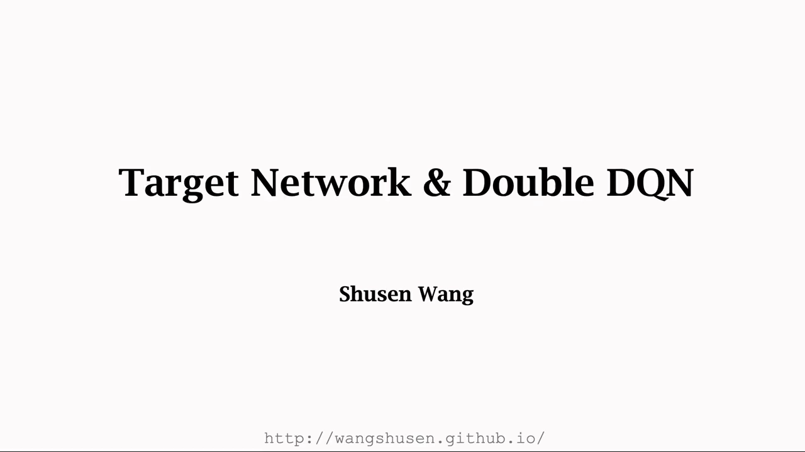

---

## 一、先补一个概念：什么叫 bootstrapping（自举）

讲者在进入正题前先解释了 bootstrapping，因为整节课的两个主角都和它有关。

字面意思是「用自己的鞋带把自己举起来」，中文译作**自举**。听起来像武侠小说里的轻功——左脚踩右脚飞上山，纯属无稽之谈。但在统计和机器学习里，这件事**真的能做到**，而且非常常用。

在强化学习里，自举的含义很具体：

> **用一个估算去更新同类的估算。**

看 TD 算法就明白了。用一条 transition $(s_t,a_t,r_t,s_{t+1})$ 更新参数 $w$ 时，TD 目标是

$$
y_t = r_t + \gamma \cdot \max_{a} \hat{q}(s_{t+1},a,w)
$$

它一部分来自**真实观测**到的奖励 $r_t$，另一部分来自 DQN 自己在 $t+1$ 时刻的**预测**。也就是说：为了更新 DQN 在 $t$ 时刻的估计，我们用了 DQN 在 $t+1$ 时刻的估计——**用一个估计值去更新它本身**，这就是自举。

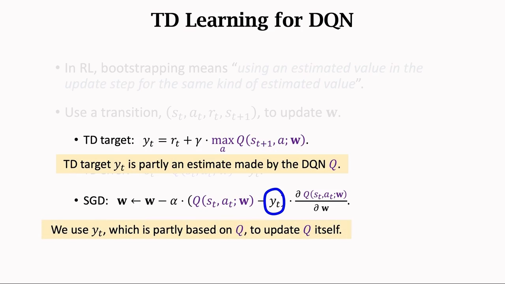

[【跳转到 00:13】](https://www.bilibili.com/video/BV12o4y197US/?p=12&t=13) · [【跳转到 01:24】](https://www.bilibili.com/video/BV12o4y197US/?p=12&t=84) · [【跳转到 02:14】](https://www.bilibili.com/video/BV12o4y197US/?p=12&t=134)

---

## 二、高估的两个来源：最大化与自举的正反馈

用 TD 算法训练 DQN，会导致 DQN **高估真实的动作价值**。原因有两个，讲者逐个拆开讲。

### 2.1 来源一：max 会把噪声「挑」成高估

先看一个纯数学的事实。设 $x_1,\dots,x_n$ 是任意 $n$ 个实数，往它们身上加**均值为零**的随机噪声，得到 $Q_1,\dots,Q_n$。

因为噪声均值为零，它不影响**均值**：

$$
\mathbb{E}\Big[\operatorname{mean}_i(Q_i)\Big] = \operatorname{mean}_i(x_i)
$$

但**最大值**就不一样了：噪声会把最大的那个往上顶，也会把最小的那个往下压。于是

$$
\mathbb{E}\Big[\max_i(Q_i)\Big] \ge \max_i(x_i), \qquad \mathbb{E}\Big[\min_i(Q_i)\Big] \le \min_i(x_i)
$$

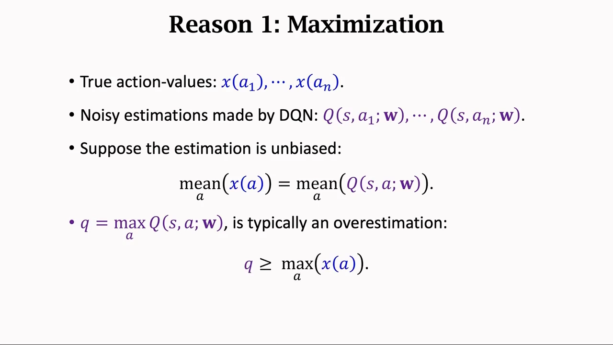

直觉是：最大值这个操作**专门挑那个被噪声抬得最高的样本**，所以它系统性地偏高。这就是「最大化偏差」——5.4 节讲表格型 Q-Learning 时已经见过它，只不过那里的噪声来自采样，这里的噪声来自神经网络的估计误差。

把这件事搬到 DQN 上：真实动作价值是 $x(a_1),\dots,x(a_n)$，我们不知道它们，只能用 DQN 的估计 $q(s,a_1,w),\dots,q(s,a_n,w)$ 去替代。估计必然有误差，不妨假设估计是**无偏**的（误差均值为零，相当于纯噪声）。那么

$$
q = \max_{a} \hat{q}(s,a,w) \ \ge\ \max_{a} x(a)
$$

也就是说：**对 DQN 的输出求最大值，得到的结果往往大于真实的最大动作价值**。而这个 $q$ 正是 TD 目标 $y_t$ 的一部分，所以 $y_t$ 偏高；TD 算法又鼓励 DQN 的预测向 $y_t$ 靠拢，于是更新之后的 DQN 也偏高。**这就是高估的第一个来源。**

[【跳转到 02:39】](https://www.bilibili.com/video/BV12o4y197US/?p=12&t=159) · [【跳转到 03:29】](https://www.bilibili.com/video/BV12o4y197US/?p=12&t=209) · [【跳转到 04:44】](https://www.bilibili.com/video/BV12o4y197US/?p=12&t=284)

### 2.2 来源二：自举把高估「还」给自己，形成正反馈

第二个来源是自举本身。TD 目标里含有 $q_{t+1}=\max_a \hat{q}(s_{t+1},a,w)$，而 $q_{t+1}$ 已经是高估的了；用这个 $y_t$ 去更新 DQN，等于**把高估原封不动地送回 DQN 自己**。

更糟的是这个过程会自我加强：

1. DQN 现在高估了动作价值；
2. 算 TD 目标时仍然要做 max，而 max 又会进一步推高估计；
3. 于是算出的 TD 目标是**比原先更严重**的高估；
4. 再做自举，把这个更严重的高估传回 DQN……

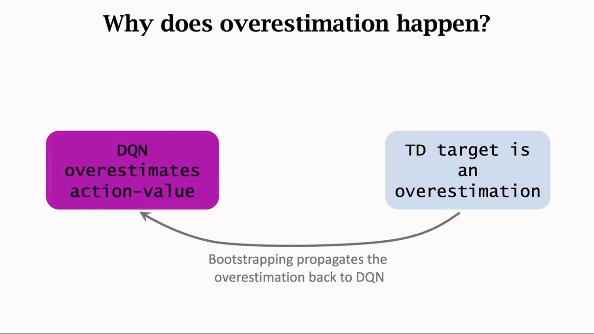

一旦 DQN 出现高估，高估就会不断被反馈给自己，越来越严重。**max 提供偏差，自举提供放大器**——两者合起来才是完整的高估机制。

[【跳转到 05:34】](https://www.bilibili.com/video/BV12o4y197US/?p=12&t=334) · [【跳转到 06:49】](https://www.bilibili.com/video/BV12o4y197US/?p=12&t=409) · [【跳转到 07:36】](https://www.bilibili.com/video/BV12o4y197US/?p=12&t=456)

---

## 三、为什么高估有害：均匀的高估其实无所谓

讲者在这里问了一个很关键的问题：**估高了又怎样？** 答案分两半。

DQN 控制 agent 的方式是 $a_t = \arg\max_a \hat{q}(s_t,a,w)$——**只看价值的相对大小，不看绝对大小**。只要一个动作的分数比其他动作都高，它就会被选中。所以：

- **均匀的高估不是问题**。真实价值是 $Q^\star(s,a^1)=200$、$Q^\star(s,a^2)=100$、$Q^\star(s,a^3)=230$，$a^3$ 最优。假设 DQN 给每个动作都多加 100，$a^3$ 仍然最大，选择不变。
- **非均匀的高估才致命**。同样是这三个真实价值，如果 DQN 输出的是 $q(s,a^1,w)=280$、$q(s,a^2,w)=300$、$q(s,a^3,w)=240$，那么它会认为 $a^2$ 最好——而 $a^2$ 的真实价值只有 100，是三个里最差的。基于错误的价值做决策，动作自然选错。

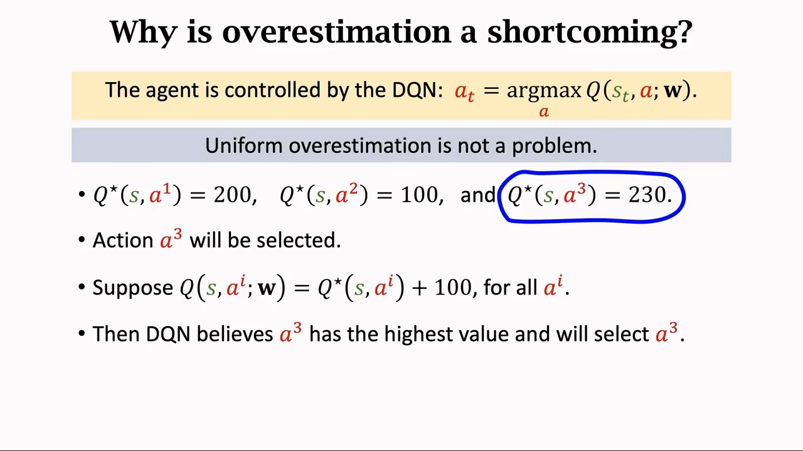

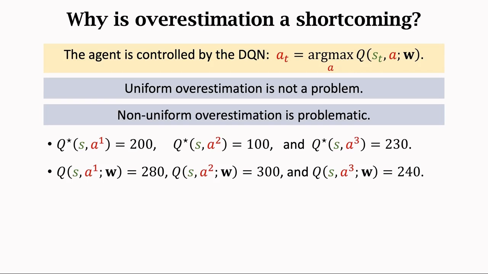

**而 DQN 的高估恰恰是非均匀的。** 道理在于更新机制：TD 算法每次从 replay buffer 里取一条 transition $(s_t,a_t,r_t,s_{t+1})$ 来更新 $w$，这次更新会把 $\hat{q}(s_t,a_t,w)$ 往偏高的 $y_t$ 推。于是**某个 $(s,a)$ 被用来更新的次数越多，它被高估得就越厉害**。而不同 $(s,a)$ 在 replay buffer 里出现的频率显然不一样——频繁出现的被高估很多，罕见的被高估一点，高估自然就不均匀了。

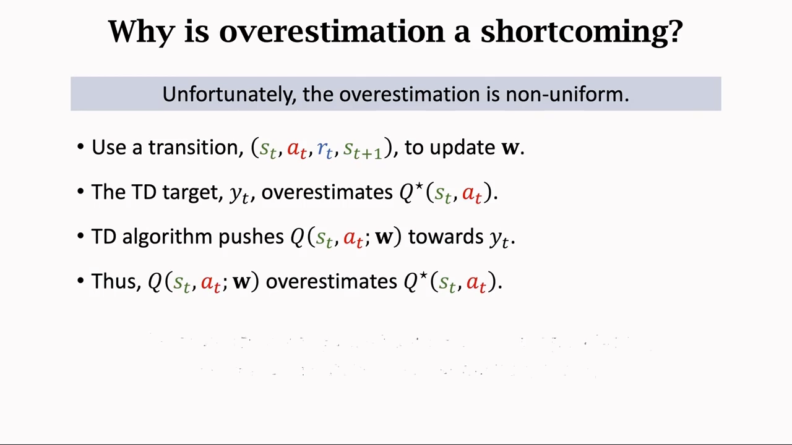

[【跳转到 07:46】](https://www.bilibili.com/video/BV12o4y197US/?p=12&t=466) · [【跳转到 08:59】](https://www.bilibili.com/video/BV12o4y197US/?p=12&t=539) · [【跳转到 10:14】](https://www.bilibili.com/video/BV12o4y197US/?p=12&t=614)

---

## 四、Target Network：先切断自举这一半

既然有两个来源，就对应两种解法。**Target Network** 针对的是**自举**：不要用 DQN 自己算出的 TD 目标来更新 DQN，而是**另找一个神经网络来算 TD 目标**。

6.3 节介绍过目标网络，那里是从「目标函数里 $w$ 出现两次」的角度切入的；这里换个角度再看一遍，会更容易理解它为什么**只能缓解一半**。

做法是：两个结构相同、参数不同的网络。DQN 的参数记作 $w$，目标网络的参数记作 $w^-$。分工是——

- **DQN**：控制 agent、收集经验；
- **目标网络**：唯一的用途是计算 TD 目标。

于是 TD 目标和 TD 误差变成

$$
y_t = r_t + \gamma \cdot \max_{a} \hat{q}(s_{t+1},a,w^-), \qquad \delta_t = \hat{q}(s_t,a_t,w) - y_t
$$

SGD 只更新 $w$，不动 $w^-$。$w^-$ 隔一段时间才更新一次，有两种常见做法：**直接把 $w$ 拷贝给 $w^-$**，或者**把 $w$ 与 $w^-$ 做加权平均再赋给 $w^-$**。

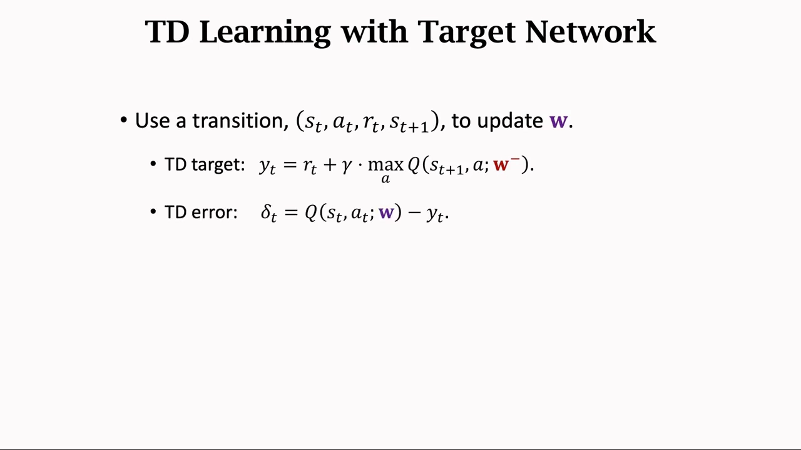

**为什么它治不好高估？** 两个理由：

1. **max 还在**。目标网络只是换了参数，TD 目标里仍然有 $\max_a$，最大化偏差一分没少；
2. **$w^-$ 终究来自 $w$**。目标网络无法独立于 DQN，所以自举只是被**推迟**了，没有被消除。

所以讲者的结论是：用了目标网络，DQN 的高估会**减小**、表现会**变好**，但高估依然存在。

[【跳转到 11:10】](https://www.bilibili.com/video/BV12o4y197US/?p=12&t=670) · [【跳转到 12:50】](https://www.bilibili.com/video/BV12o4y197US/?p=12&t=770) · [【跳转到 13:40】](https://www.bilibili.com/video/BV12o4y197US/?p=12&t=820)

---

## 五、Double DQN：把「选动作」和「打分」拆给两个网络

2016 年的 **Double DQN** 针对的是另一个来源——**最大化**。它的改动小到令人意外：只是把计算 TD 目标的过程拆成**两步**，两步用**不同的网络**。

### 5.1 三种算法其实是同一件事的三种分工

讲者把 $\max_a$ 拆成两步来看：

- **Selection（选择）**：选出能让 $Q$ 最大的动作 $a^\star = \arg\max_a Q(s_{t+1},a;\cdot)$；
- **Evaluation（求值）**：把 $a^\star$ 代回 $Q$ 函数，算出 $y_t = r_t + \gamma \cdot Q(s_{t+1},a^\star;\cdot)$。

三种算法的差别，只在于这两步分别交给谁做：

| 算法 | Selection（选动作） | Evaluation（求值） | 效果 |
| :-- | :-- | :-- | :-- |
| 原始方法（Naive Update） | DQN | DQN | 最差，严重高估 |
| Target Network | 目标网络 | 目标网络 | 好很多，仍明显高估 |
| Double DQN | DQN | 目标网络 | 三者中最好 |

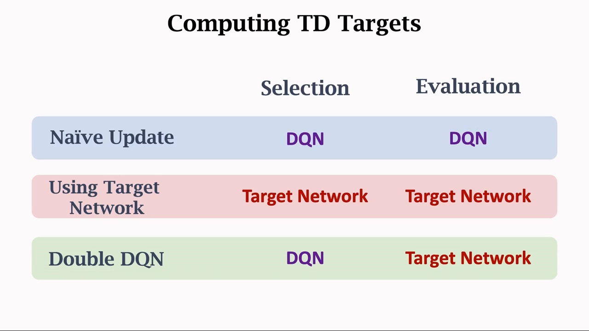

原始方法的 TD 目标是

$$
y_t = r_t + \gamma \cdot \max_{a} \hat{q}(s_{t+1},a,w)
$$

两步都用 DQN，效果最差。

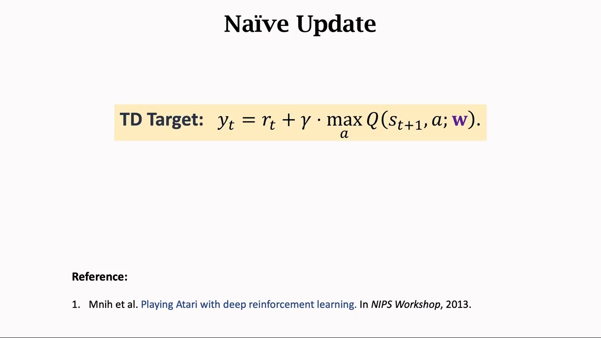

Target Network 的 TD 目标是

$$
y_t = r_t + \gamma \cdot \max_{a} \hat{q}(s_{t+1},a,w^-)
$$

两步都用目标网络，效果比原始方法好很多——因为部分避免了自举。

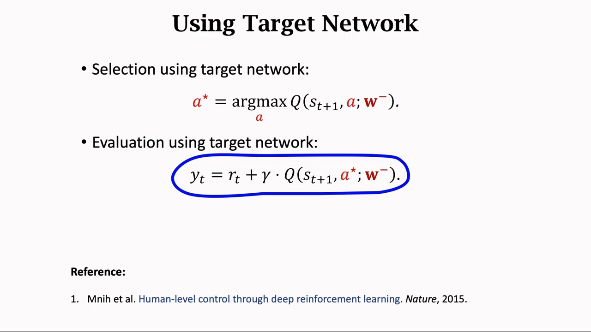

Double DQN 的 TD 目标是

$$
a^\star = \arg\max_{a} \hat{q}(s_{t+1},a,w), \qquad y_t = r_t + \gamma \cdot \hat{q}(s_{t+1},a^\star,w^-)
$$

**用 DQN 选动作，用目标网络给这个动作打分。**

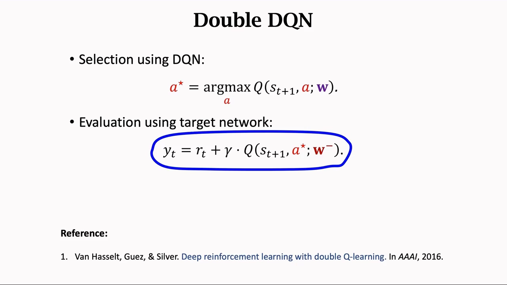

### 5.2 为什么这样就更小：一行不等式

Double DQN 之所以能缓解高估，理由非常干净。注意

$$
\hat{q}(s_{t+1},a^\star,w^-) \ \le\ \max_{a} \hat{q}(s_{t+1},a,w^-)
$$

右边是对 $a$ 求最大值，而左边只是把其中一个动作 $a^\star$ 代进去——**最大值一定不小于其中任何一项**，无论 $a^\star$ 是怎么选出来的。

而右边那一项，正是 Target Network 的 TD 目标里用的量。所以：**Double DQN 做出的估计 ≤ Target Network 做出的估计**，高估被压低了。

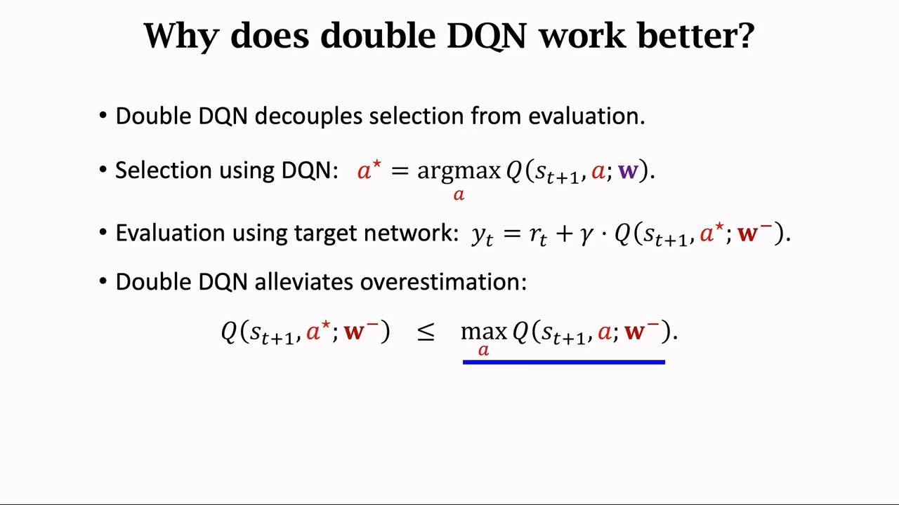

这个论证还有一层直觉：$a^\star$ 是 DQN 选的，它可能恰好是「被 DQN 的噪声抬得最高」的那个动作；但**打分的是另一个网络**，那个网络没见过这个噪声，所以不会替它背书。噪声造成的虚高被挡在了门外。

讲者特别强调：**Double DQN 没有彻底根除高估**，只是高估没那么严重。另外它本身也用了目标网络，所以自举也被部分避免了——**两个来源各缓解一点，效果自然最好**。

[【跳转到 14:30】](https://www.bilibili.com/video/BV12o4y197US/?p=12&t=870) · [【跳转到 16:10】](https://www.bilibili.com/video/BV12o4y197US/?p=12&t=970) · [【跳转到 17:00】](https://www.bilibili.com/video/BV12o4y197US/?p=12&t=1020)

---

## 六、把整节课串起来

讲者说自己「花了一半的时间来分析 DQN 的缺点」，这个安排值得留意：**先看清病，再谈药**。

- **病**：TD 训练让 DQN 高估动作价值；
- **病因一**：max 把噪声挑成高估；
- **病因二**：自举把高估送回 DQN，形成正反馈；
- **药一（Target Network）**：换一个网络算 TD 目标，部分切断自举，但 max 还在、$w^-$ 仍依赖 $w$；
- **药二（Double DQN）**：选择与求值分家，缓解 max 造成的高估，同时也部分避免了自举。

[【跳转到 17:30】](https://www.bilibili.com/video/BV12o4y197US/?p=12&t=1050) · [【跳转到 18:20】](https://www.bilibili.com/video/BV12o4y197US/?p=12&t=1100) · [【跳转到 19:08】](https://www.bilibili.com/video/BV12o4y197US/?p=12&t=1148)

---

## 小结

- **自举（bootstrapping）= 用一个估算去更新同类的估算**。TD 目标里含有 DQN 自己的预测，所以 TD 学习天然是自举的。
- **高估有两个来源**：一是 TD 目标里的 $\max$（加零均值噪声后 $\mathbb{E}[\max Q]\ge \max x$），二是自举把高估送回 DQN 形成正反馈。
- **均匀的高估无害，非均匀的高估才致命**。DQN 只看相对大小，只要排序不变，整体抬高不影响决策；但高估幅度不一致时会选错动作。
- **高估为什么非均匀**：$(s,a)$ 在 replay buffer 里出现得越频繁，被推高的次数越多。
- **Target Network 只治自举**：用 $w^-$ 算 TD 目标、SGD 只更新 $w$；但 max 没动，$w^-$ 又依赖 $w$，所以高估只是减轻。
- **Double DQN 治 max**：把 TD 目标拆成 selection 与 evaluation，用 DQN 选动作 $a^\star$、用目标网络打分，于是 $\hat{q}(s',a^\star,w^-)\le \max_a \hat{q}(s',a,w^-)$，估计更小。
- **三者排序**：Double DQN > Target Network > 原始方法。Double DQN 同时缓解两个来源，但也没有根除高估。

## 关键术语速查

| 术语 | 一句话解释 |
| :-- | :-- |
| 自举（bootstrapping） | 用一个估算去更新同类的估算；TD 目标含 DQN 自己的预测，所以 TD 学习是自举的 |
| 高估（overestimation） | DQN 输出的动作价值系统性高于真实的最优动作价值 |
| 最大化偏差 | 对带噪声的估计求 $\max$，结果期望上大于对真实值求 $\max$ |
| 非均匀高估 | 不同 $(s,a)$ 被高估的幅度不同；会改变动作的相对排序，因而有害 |
| 目标网络（target network） | 参数为 $w^-$、专门用来算 TD 目标的第二个网络，隔一段时间从 $w$ 同步 |
| Selection | 计算 TD 目标的第一步：选出让 $Q$ 最大的动作 $a^\star$ |
| Evaluation | 计算 TD 目标的第二步：把 $a^\star$ 代回 $Q$ 函数算出目标值 |
| Double DQN | 用 DQN 做 selection、用目标网络做 evaluation，从而缓解最大化造成的高估 |