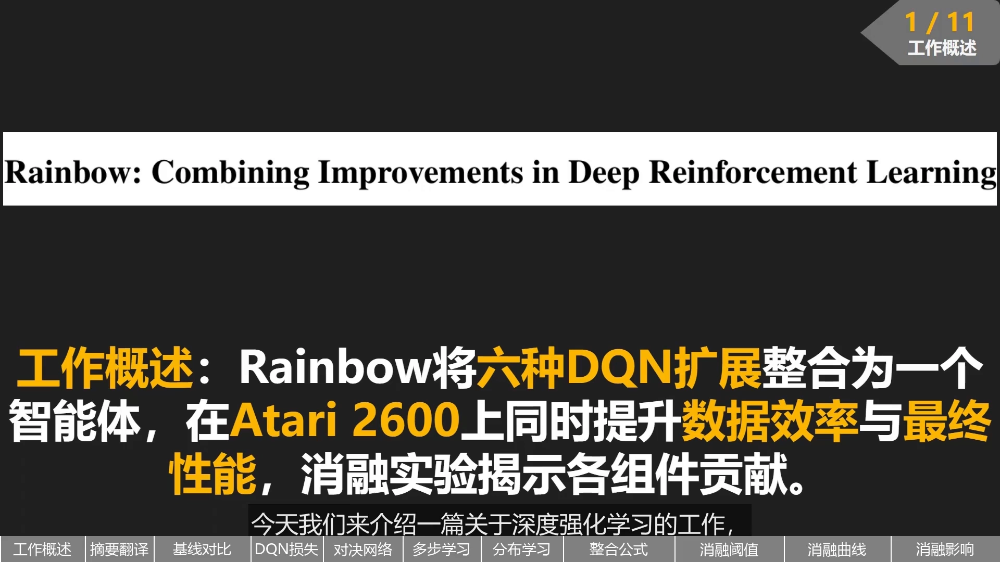
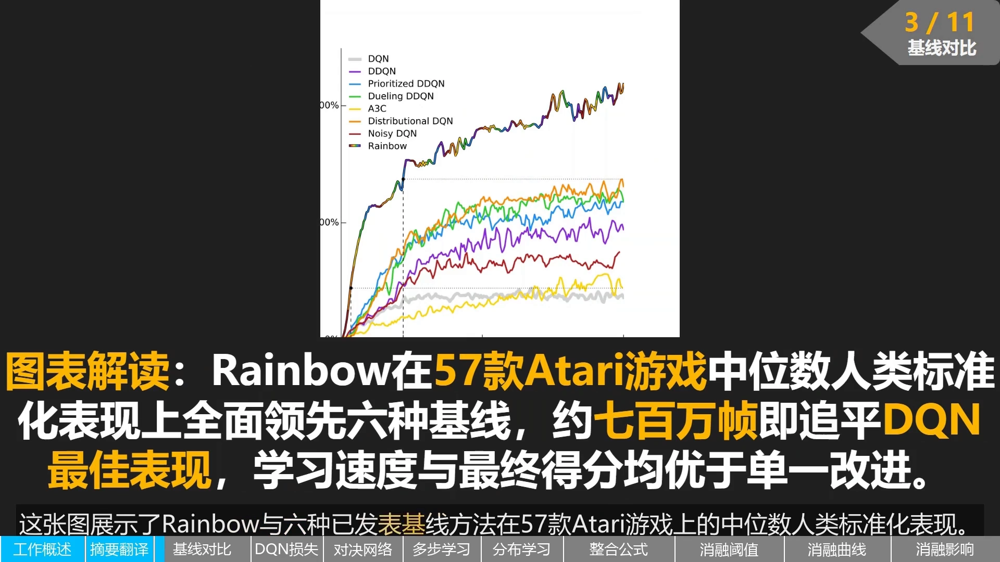
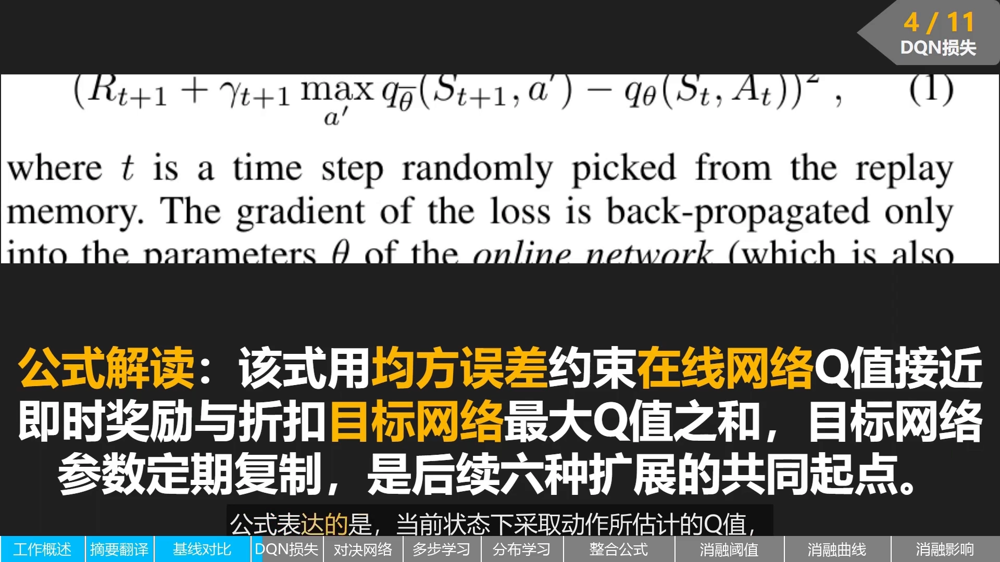
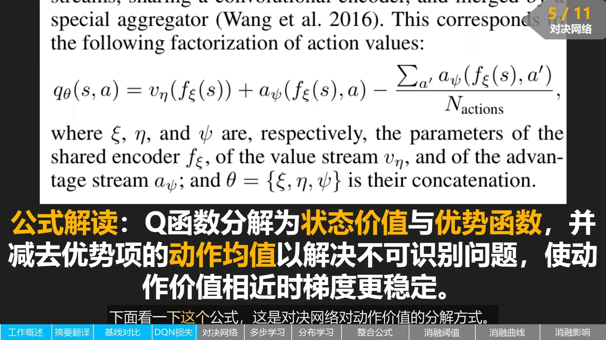
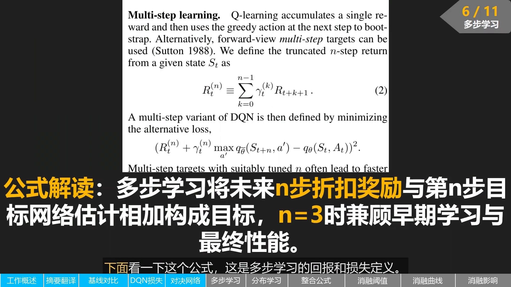
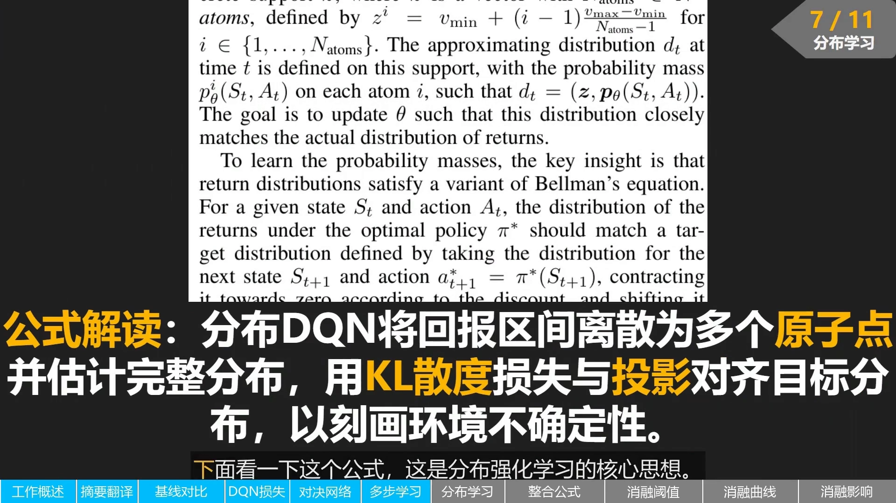
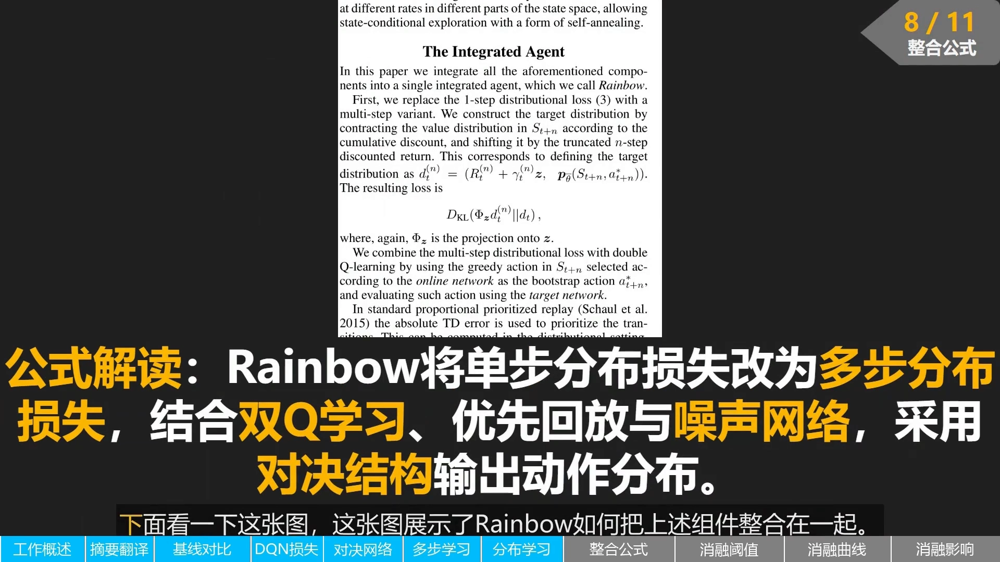
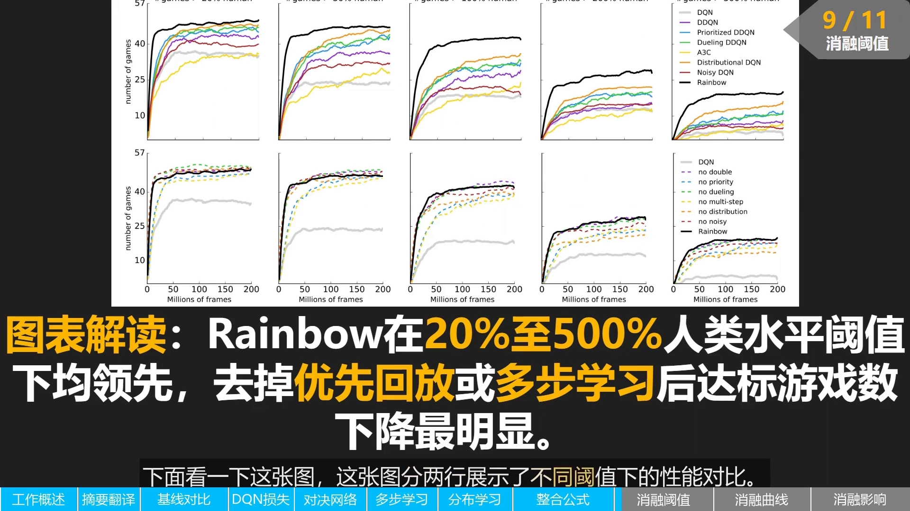
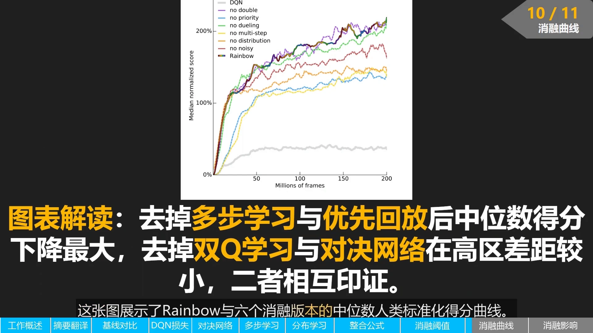
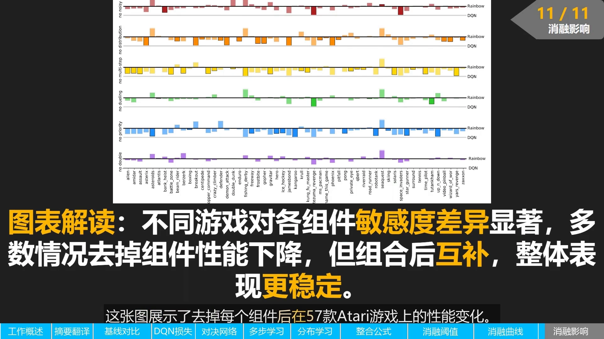

# Rainbow：把六种 DQN 改进拼成一个智能体

> 本篇整理自论文精读视频《[141]. Rainbow：把 DQN 的六大改进一次拼完》（UP 主：海安雨），逐页讲解 Hessel et al. 的 *Rainbow: Combining Improvements in Deep Reinforcement Learning*。视频地址：[BV1BtbY6PEfW](https://www.bilibili.com/video/BV1BtbY6PEfW/)。同一条目下的另一篇《分布式强化学习：从学期望到学分布（C51 与 QR-DQN）》讲了六种改进里的「分布式」这一支，两篇合起来才是完整的图景。

## 本讲要解决的核心问题（SCQA）

**背景**：6.3 节讲了 DQN 的两个稳定化技巧（经验回放 + 目标网络）；6.4 节讲它的三个核心改进（Double DQN、优先经验回放、Dueling DQN）；6.5 的上一篇讲了分布式 RL。到这一步，DQN 的改进已经散落成好几篇论文。

**冲突**：这些改进是**各自独立发表**的——每篇论文都只证明「我这一招比原始 DQN 好」。但**它们之间是否互补、能不能有效结合，并不清楚**。两个改进可能在做同一件事（那就白叠了），也可能互相冲突（那就更糟）。

**疑问**：如果把这六种改进**全部塞进一个智能体**，会得到什么？性能是简单相加、还是互相打架？如果只能保留几个，该保留哪几个？

**回答（中心思想）**：这就是 **Rainbow**。它本身**不是**一个新算法，而是一次**系统集成 + 系统消融**：把六种 DQN 扩展整合进同一个智能体，在 Atari 2600 基准上同时提升**数据效率**与**最终性能**，再用消融实验（每次去掉一个组件）量化每个组件的贡献。结论是六个组件都带来正向贡献，其中**优先回放**与**多步学习**最关键。

---

## 一、Rainbow 的定位：一次「集成 + 消融」，而不是新发明

视频开篇就点明了论文的要点：DQN 之后，研究者提出了许多独立的改进，例如**双 Q 学习**（Double Q-learning）、**优先回放**（prioritized replay）、**对决网络**（dueling network）、**多步学习**（multi-step learning）、**分布式强化学习**（distributional RL）和**噪声网络**（noisy nets）。Rainbow 做的事情是：

1. 把这**六种扩展整合到一个智能体**里；
2. **系统研究它们组合后的效果**；
3. 用**消融实验**揭示每个组件的具体贡献。

视频把论文摘要翻译了一遍，值得原样记住这段话的逻辑：深度强化学习社区已经对 DQN 提出了多种独立的改进，**但这些扩展之间是否互补、能否有效结合并不清楚**；这篇论文研究六种 DQN 扩展并实证检验它们的组合效果，结果表明这种组合在 Atari 2600 基准上**无论数据效率还是最终性能**都达到了很好的效果，论文还提供了一个详细的消融研究来展示每个组件对整体性能的贡献。

[【跳转到 00:00】](https://www.bilibili.com/video/BV1BtbY6PEfW/?t=0) · [【跳转到 00:40】](https://www.bilibili.com/video/BV1BtbY6PEfW/?t=40)

---

## 二、先看结果：整合体的曲线在最上方

论文的第一张图就是「谁更强」的答案。它展示了 Rainbow 与六种已发表的基线方法在 **57 款 Atari 游戏**上的**中位数人类标准化表现**：横轴是训练帧数，纵轴是相对于人类水平的中位数得分。

读图要点（讲者逐条点过）：灰色的 **DQN** 和黄色的 **A3C** 处于较低位置；紫色的 **DDQN**、蓝色的**优先回放 DDQN**、绿色的**对决 DDQN**、橙色的**分布式 DQN**、棕色的**噪声 DQN** 依次有所提升；而**黑色的 Rainbow 曲线位于最上方**，大约在 **700 万帧**时就追平了 DQN 的最好表现，随后继续上升。

这说明：把这六种扩展整合在一起后，**学习速度**和**最终得分**都优于单独使用任何一种改进。

[【跳转到 01:16】](https://www.bilibili.com/video/BV1BtbY6PEfW/?t=76) · [【跳转到 01:41】](https://www.bilibili.com/video/BV1BtbY6PEfW/?t=101)

---

## 三、六个组件逐个看，起点是同一个损失函数

视频接下来按「共同起点 → 逐个组件 → 怎么拼」的顺序讲，这个顺序本身就是理解 Rainbow 的骨架。

### 3.1 共同起点：DQN 的均方误差损失

Rainbow 所有后续改进的出发点，就是 DQN 的基础损失：

$$
\Big(R_{t+1} + \gamma_{t+1}\max_{a'} q_{\bar\theta}(S_{t+1}, a') - q_{\theta}(S_t, A_t)\Big)^2
$$

其中 $t$ 是从经验回放中随机抽取的时间步；**梯度只回传进在线网络（online network）的参数 $\theta$**，而目标网络（target network）的参数 $\bar\theta$ 是定期从 $\theta$ 复制过来的。用讲者的话说：这个式子表达的是「当前状态下采取动作所估计的 Q 值，应该接近下一步的即时奖励加上折扣后的目标网络最大 Q 值」。

为什么强调这是「起点」？因为后续六种扩展**都是围绕同一批问题展开的**：如何更准确地估计目标、如何更高效地采样、如何更好地探索。这句话可以当作后面六节的目录。

[【跳转到 01:56】](https://www.bilibili.com/video/BV1BtbY6PEfW/?t=116) · [【跳转到 02:01】](https://www.bilibili.com/video/BV1BtbY6PEfW/?t=121) · [【跳转到 02:26】](https://www.bilibili.com/video/BV1BtbY6PEfW/?t=146)

### 3.2 对决网络（Dueling DQN）：把 Q 拆成状态价值 + 优势

对决网络对动作价值做如下分解：

$$
q_\theta(s,a) = v_\eta\big(f_\xi(s)\big) + a_\psi\big(f_\xi(s), a\big) - \frac{\sum_{a'} a_\psi\big(f_\xi(s), a'\big)}{N_{\text{actions}}}
$$

其中 $\xi$、$\eta$、$\psi$ 分别是**共享编码器** $f_\xi$、**价值流** $v_\eta$、**优势流** $a_\psi$ 的参数，$\theta = \{\xi, \eta, \psi\}$ 是它们的拼接。

这个式子里的两个设计各解决一个问题：

- **拆成两部分**：一部分是状态价值函数，表示「处于某个状态本身的好坏」；另一部分是优势函数，表示「在这个状态下选择某个动作、相对于平均动作的优势」。这样网络在某些状态下更容易判断哪些动作更好。
- **减去优势的均值**：如果只写 $v + a$，那么给 $v$ 加一个常数、给 $a$ 减同一个常数，$q$ 完全不变——这叫**不可识别**（unidentifiable）。减去 $\frac{1}{N_{\text{actions}}}\sum_{a'} a_\psi(\cdot, a')$ 就把这个自由度钉死了。

讲者补充的收益是：**尤其当很多动作价值相近时，对决结构能提供更稳定的梯度信号**。（Dueling DQN 的来龙去脉见 6.4 节，这里只取 Rainbow 用到的这一条式子。）

### 3.3 多步学习：把目标从 1 步拉到 $n$ 步

DQN 通常只用**单步奖励**来更新，多步学习则累加未来 $n$ 步的折扣奖励。论文定义的**截断 $n$ 步回报**是

$$
R_t^{(n)} \equiv \sum_{k=0}^{n-1}\gamma_t^{(k)} R_{t+k+1}
$$

相应的损失变成

$$
\Big(R_t^{(n)} + \gamma_t^{(n)}\max_{a'} q_{\bar\theta}(S_{t+n}, a') - q_\theta(S_t, A_t)\Big)^2
$$

公式里第一项是**截断的 $n$ 步回报**，第二项是**第 $n$ 步之后的折扣 bootstrap 值**（用目标网络估）。讲者给的理由是：多步目标让**信用分配传播得更快**，适合需要长期规划的任务。Rainbow 最终选了 $n = 3$，因为实验里这个值兼顾了早期学习与最终性能。

### 3.4 分布式学习：学回报的分布而不是期望

这是六种改进里唯一「换了学习目标」的一个。传统 DQN 只估计回报的**期望**，而分布 DQN 估计的是**完整回报分布**：把回报区间**离散化成多个原子点**，每个原子对应一个概率质量，学习的思路是让当前估计的分布**经过一个类似贝尔曼算子的变换后与目标分布尽可能接近**。

Rainbow 用的是 C51 那一套：以 **KL 散度**作损失，并通过**投影**把目标分布对齐到固定的原子支撑集上。

讲者对它的评价是：这种分布视角能**更精细地刻画环境的不确定性**，也能帮助缓解某些估计偏差。C51 的原子怎么摆、投影怎么做、以及后来 QR-DQN 如何用分位数回归改进它，见同条目的另一篇。

### 3.5 双 Q 学习与优先回放（详见 6.4）

这两个组件 Rainbow 直接沿用，视频只点到它们在整合体里的**形态变化**：

- **双 Q 学习**：用**在线网络选动作**、用**目标网络评估**这个动作，从而缓解 $\max$ 带来的过估计；
- **优先回放**：仍然按优先级采样，但**优先级从「绝对 TD 误差」换成了分布式设定下的 KL 损失**——因为一旦目标变成分布，衡量「这条样本有多意外」的量自然也就变成了分布之间的距离。

两者的原理与实现细节见 6.4 节，这里不展开。

### 3.6 噪声网络：把 $\epsilon$-greedy 换成可学习的噪声

最后一个组件解决的是**探索**。Rainbow 用**噪声网络**替代传统的 $\epsilon$-greedy 探索：在网络的**权重和偏置**上加入**可学习的参数化噪声**，让探索程度**随训练自适应调整**——不再需要一个手工设定、随时间衰减的 $\epsilon$。

[【跳转到 02:31】](https://www.bilibili.com/video/BV1BtbY6PEfW/?t=151) · [【跳转到 03:07】](https://www.bilibili.com/video/BV1BtbY6PEfW/?t=187) · [【跳转到 03:43】](https://www.bilibili.com/video/BV1BtbY6PEfW/?t=223) · [【跳转到 04:46】](https://www.bilibili.com/video/BV1BtbY6PEfW/?t=286)

---

## 四、整合：六个组件怎么拼成一个网络

论文的「The Integrated Agent」一节说明了拼装方式。视频把它归纳成四条：

1. **把单步的分布式损失换成多步的分布式损失**：目标分布由 $n$ 步折扣回报加上第 $n$ 步的**分布式投影**构成，损失写成 $D_{\mathrm{KL}}\big(\Phi_z d_t^{(n)} \,\|\, d_t\big)$，其中 $\Phi_z$ 是投影到原子集合 $z$ 上的算子；
2. **把双 Q 学习接进来**：用**在线网络**在 $S_{t+n}$ 上选贪心动作作为 bootstrap 动作 $a^*_{t+n}$，再用**目标网络**评估它；
3. **保留优先回放，但换优先级**：优先级从绝对 TD 误差改成分布式设定下的 KL 损失；
4. **用噪声网络替代 $\epsilon$-greedy**：探索程度随训练自适应。

整合后的网络架构**采用对决结构输出每个动作对应的分布**，因此可以**同时容纳价值分解与回报分布估计**——这是整个拼装里最巧妙的一点：Dueling 的「价值流 + 优势流」输出的不再是一个标量 Q，而是每个动作的一整条分布。

[【跳转到 04:21】](https://www.bilibili.com/video/BV1BtbY6PEfW/?t=261) · [【跳转到 04:46】](https://www.bilibili.com/video/BV1BtbY6PEfW/?t=286)

---

## 五、消融实验：六个组件里谁最关键

Rainbow 论文的另一半价值在消融。视频用了三张图来讲，分别回答「在不同达标阈值上谁领先」「中位数得分曲线上谁掉得最多」「逐游戏看敏感度差异有多大」。

### 5.1 不同人类水平阈值下达标的游戏数

这张图分两行。**第一行**把 Rainbow 与六种基线比较：横轴是训练帧数，纵轴是在不同人类水平阈值下**达标的游戏数量**，从左到右分别是超过人类 **20%、50%、100%、200%、500%** 的阈值。Rainbow 在几乎所有阈值下都领先，**尤其在 100% 到 500% 的高阈值区间优势明显**。

**第二行**是 Rainbow 的消融版本（每次去掉一个组件）：去掉**优先回放**或**多步学习**时，达标游戏数量**明显下降**，说明这两个组件对整体性能影响最大；去掉对决网络、分布式学习、噪声网络或双 Q 学习也会造成不同程度的下降，但**幅度相对较小**。

### 5.2 中位数人类标准化得分曲线

这张图画的是 Rainbow 与六个消融版本的中位数人类标准化得分：横轴训练帧数，纵轴中位数得分。灰色 DQN 作为参考明显低于其他曲线；紫色（去掉双 Q 学习）、蓝色（去掉优先回放）、绿色（去掉对决网络）、黄色（去掉多步学习）、橙色（去掉分布式学习）、棕色（去掉噪声网络）的曲线**都位于黑色 Rainbow 曲线下方**。

其中**去掉多步学习和优先回放后下降幅度较大**，而去掉双 Q 学习和对决网络在**高分区**的差距较小。讲者的结论是：这张图和上一张图**相互印证**——六个组件虽然都带来正向贡献，但**优先回放和多步学习对最终中位数性能的贡献最为关键**。

### 5.3 逐游戏看：不同游戏对组件的敏感度差异很大

第三张图把 57 款 Atari 游戏逐个拆开：每一行对应一种消融，横轴是不同的游戏，纵轴是相对于完整 Rainbow 的**性能差距**。大部分柱子向下，说明去掉组件通常会导致性能下降，但**不同游戏对不同组件的敏感程度差异很大**：

- 去掉**噪声网络**在某些游戏上会造成明显下降，在另一些游戏上影响很小；
- 去掉**分布式学习**在部分游戏上甚至带来**轻微提升**。

这说明六个扩展**并非在所有任务上都同等重要**，但**组合在一起时能够互补**，从而在整体上取得更稳定的表现。论文正是通过这组消融实验，回答了「为什么把这些看似独立的改进整合起来是有效的」。

[【跳转到 05:16】](https://www.bilibili.com/video/BV1BtbY6PEfW/?t=316) · [【跳转到 06:08】](https://www.bilibili.com/video/BV1BtbY6PEfW/?t=368) · [【跳转到 06:57】](https://www.bilibili.com/video/BV1BtbY6PEfW/?t=417)

---

## 小结

- **Rainbow 不是新算法**，而是一次系统集成：把双 Q 学习、优先回放、对决网络、多步学习、分布式 RL、噪声网络六种 DQN 扩展拼进同一个智能体，并系统检验它们是否互补。
- **共同起点是 DQN 的均方误差损失**：$\big(R_{t+1} + \gamma\max_{a'} q_{\bar\theta}(S_{t+1},a') - q_\theta(S_t,A_t)\big)^2$，梯度只回传在线网络，目标网络定期复制。
- **六个组件分别对应三类问题**：更准确地估计目标（双 Q、多步、分布式）、更高效地采样（优先回放）、更好地探索（噪声网络），外加一个更好的网络结构（对决）。
- **拼装的关键是「分布式 + 对决」能共存**：对决结构输出的是每个动作的一整条分布，而不是一个标量 Q；多步的分布式投影给出目标分布，双 Q 决定 bootstrap 动作，优先回放的优先级换成 KL 损失。
- **消融结论**：六个组件都有正向贡献，但**优先回放与多步学习贡献最大**；不同游戏对组件的敏感度差异很大，组合起来才稳定。
- **量化结果**：在 57 款 Atari 游戏上，Rainbow 约 700 万帧就追平 DQN 的最好表现，最终中位数人类标准化得分位于所有基线之上。

## 关键术语速查

| 术语 | 一句话解释 |
| :-- | :-- |
| Rainbow | 把六种 DQN 扩展整合进同一智能体的集成工作，附带完整消融 |
| 在线网络 / 目标网络 | 前者参数 $\theta$ 持续更新，后者参数 $\bar\theta$ 定期复制，提供稳定的 TD 目标 |
| 对决网络（Dueling） | 把 $q(s,a)$ 拆成状态价值 $v$ 与优势 $a$，并减去优势均值以消除不可识别性 |
| 多步学习（multi-step） | 用截断 $n$ 步折扣回报加第 $n$ 步 bootstrap 作目标，让信用分配传播更快 |
| 分布式 RL（C51） | 学回报的完整分布而非期望，用 KL 散度拟合投影后的目标分布 |
| 双 Q 学习（Double Q） | 在线网络选动作、目标网络评估，缓解 $\max$ 造成的过估计 |
| 优先回放（prioritized replay） | 按优先级采样样本；Rainbow 里优先级改用 KL 损失 |
| 噪声网络（noisy nets） | 在权重与偏置上加可学习噪声，替代 $\epsilon$-greedy 的自适应探索 |
| 消融实验（ablation） | 每次去掉一个组件，量化它对整体性能的贡献 |
| 人类标准化得分（human normalized score） | 以人类水平为 100%、随机策略为 0% 折算出的得分 |