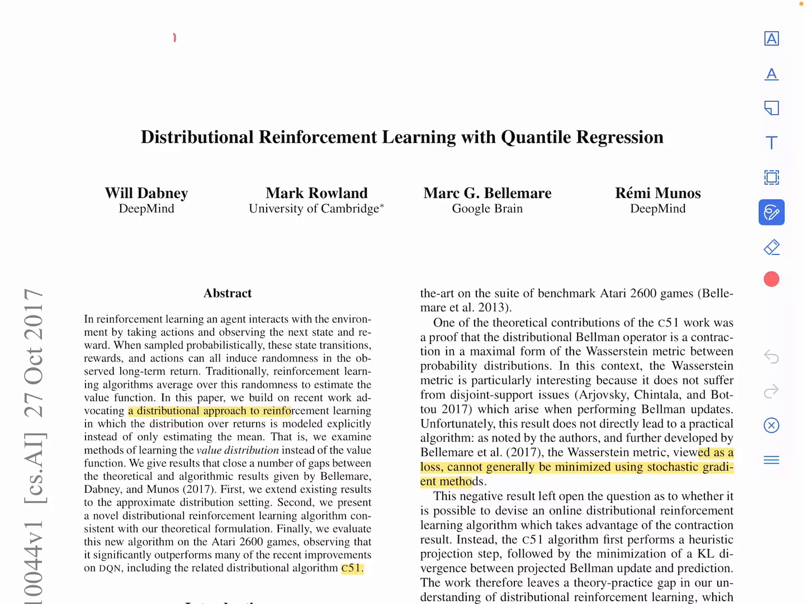
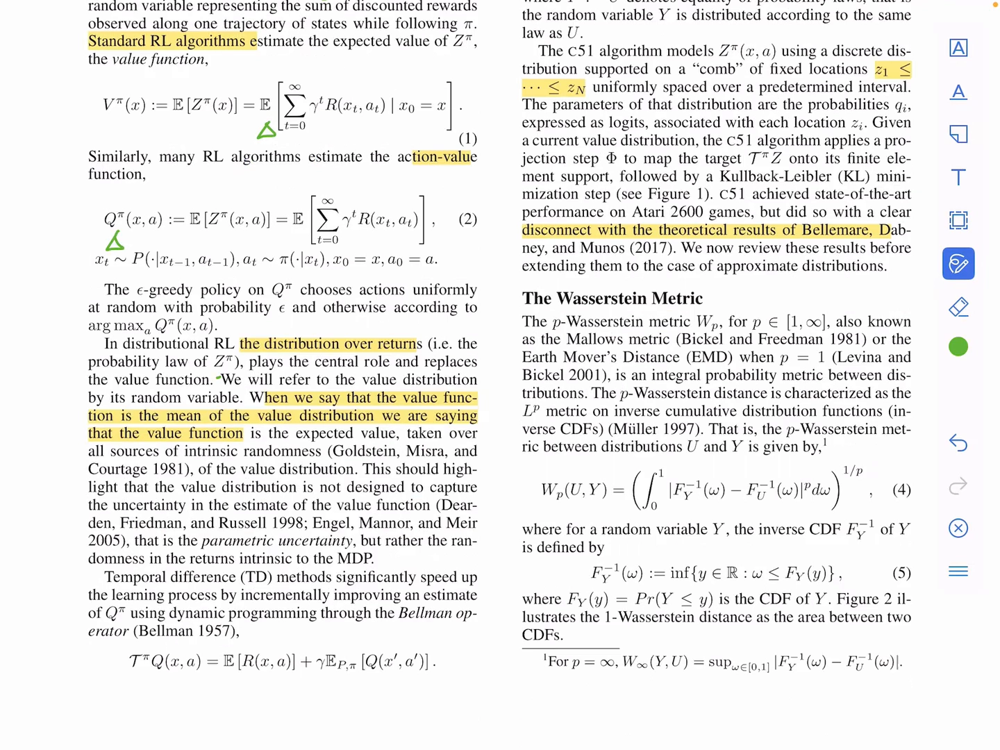
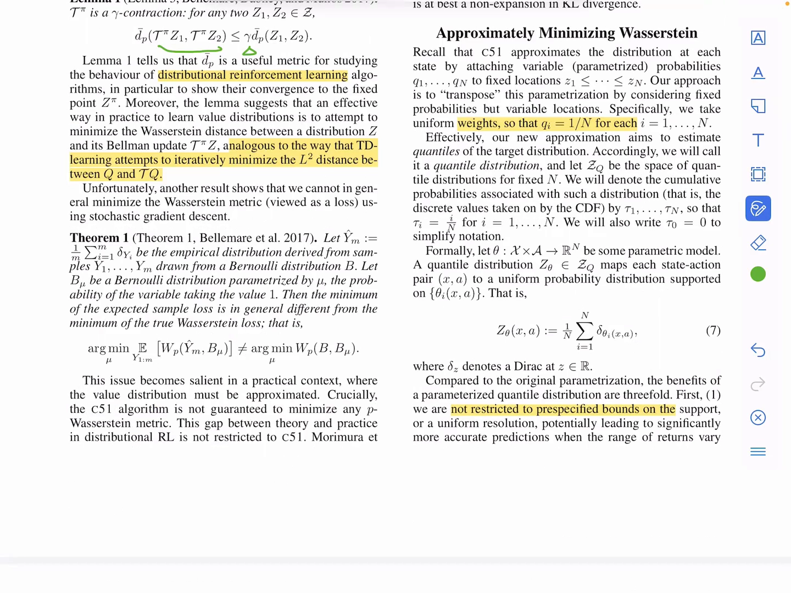
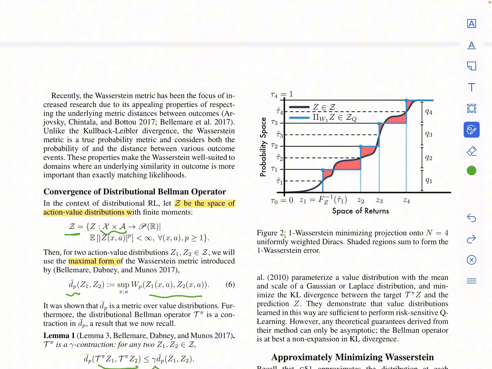
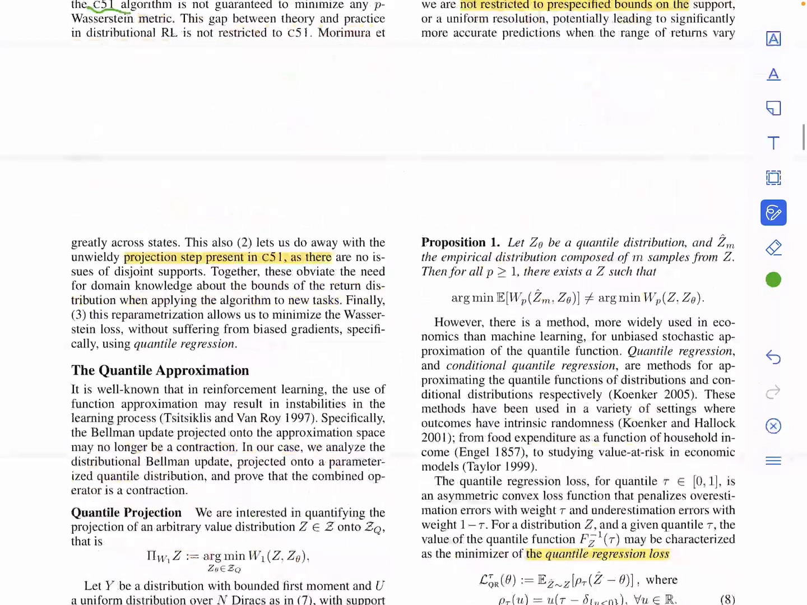
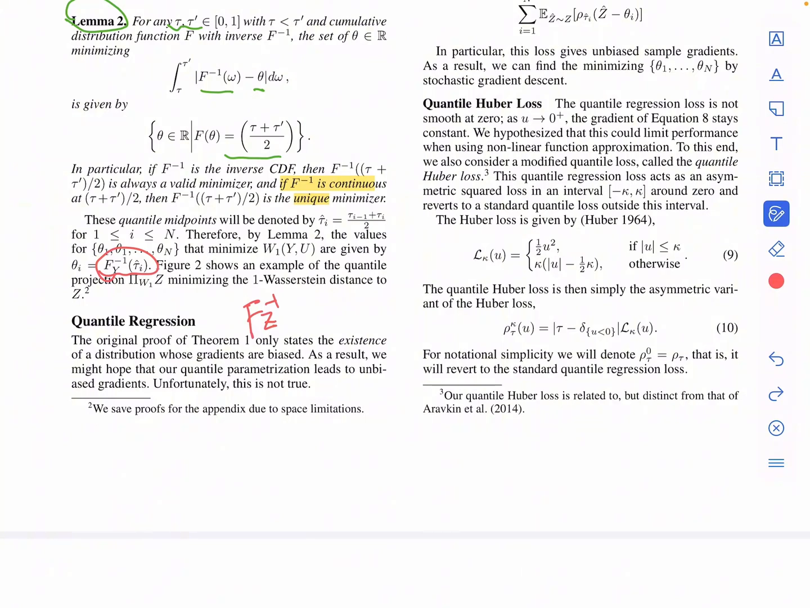
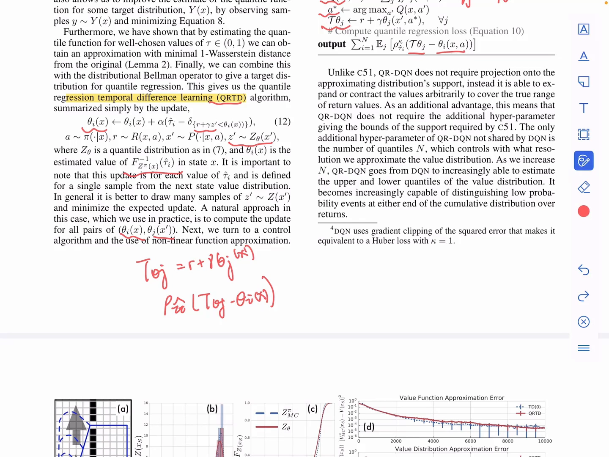
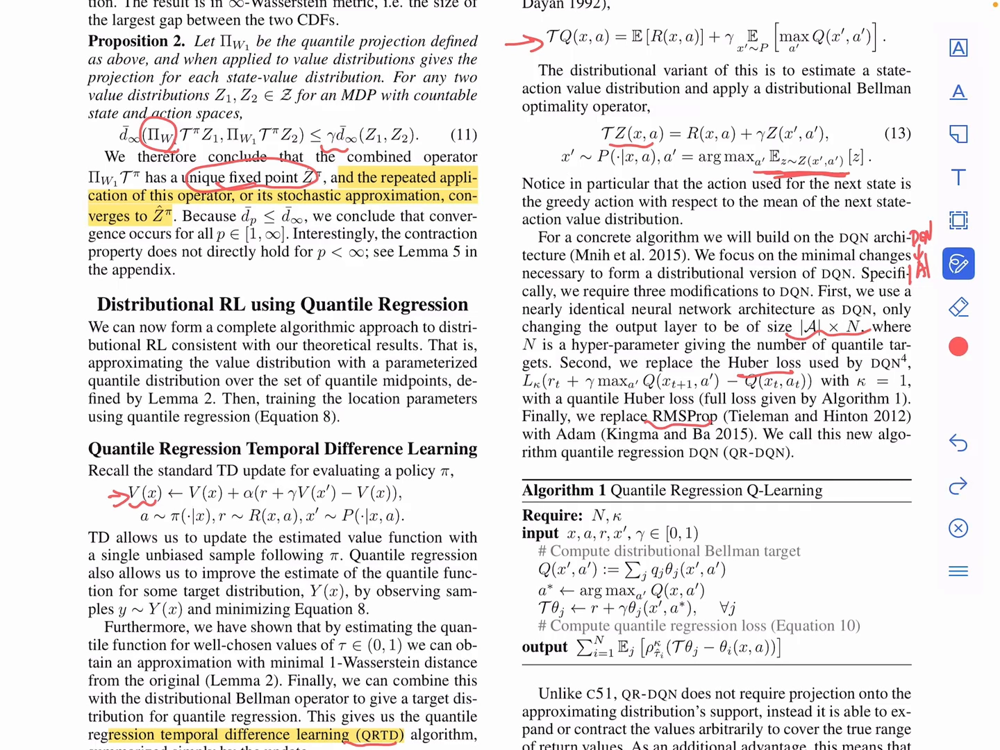
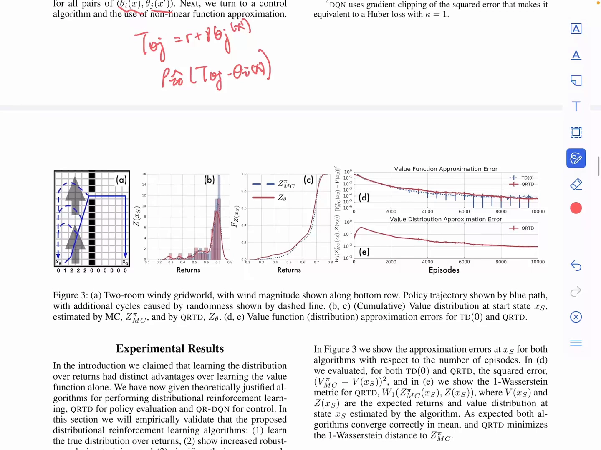
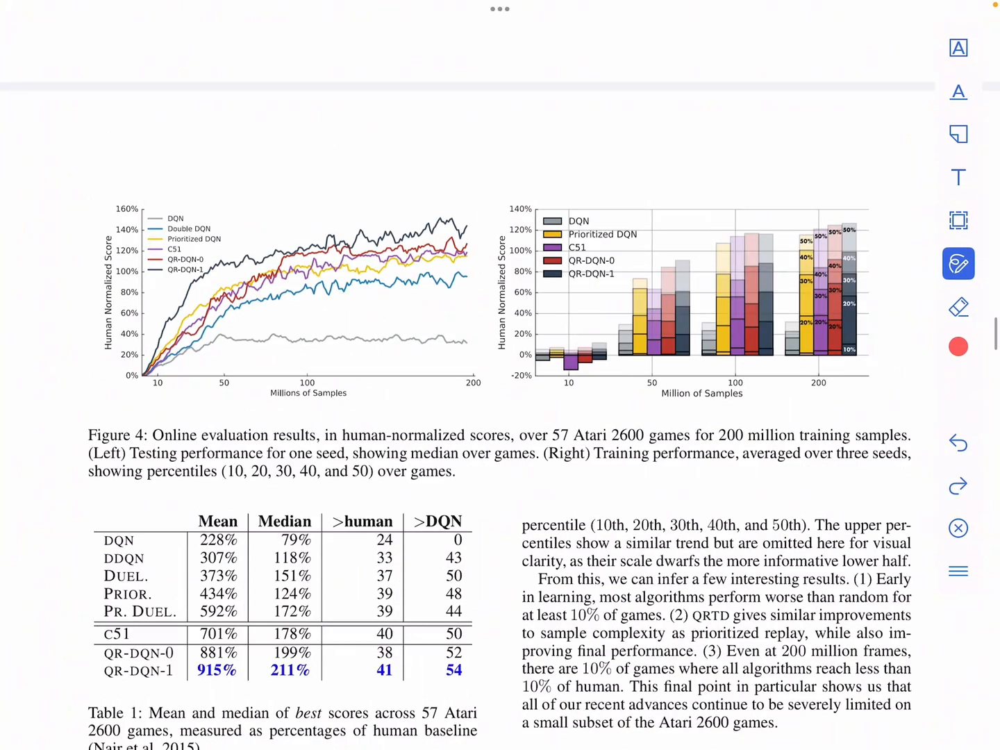

# 分布式强化学习：从「学期望」到「学分布」（C51 与 QR-DQN）

> 本篇整理自论文精读视频《QR-DQN》（UP 主：萝卜汁MeMo），逐页讲解 Dabney et al. 的 *Distributional Reinforcement Learning with Quantile Regression*。视频地址：[BV1XjG76BEby](https://www.bilibili.com/video/BV1XjG76BEby/)。同一条目下的另一篇《Rainbow：把六种 DQN 改进拼成一个智能体》整理自 Rainbow 论文精读，两篇合起来才是「分布式 RL + Rainbow」的完整图景。

## 本讲要解决的核心问题（SCQA）

**背景**：6.3 节的 DQN 学的是动作价值 $Q(s,a)$，也就是**回报的期望**；6.4 节的三个改进（Double DQN、优先经验回放、Dueling DQN）也都是在「学期望」这个框架里做修补。

**冲突**：可是回报本身是随机的。同一个状态、同一个动作，环境的下一次转移可能是这样、也可能是那样，未来的轨迹因此有无穷多种可能，回报是一个**随机变量**而不是一个数。把随机变量压成一个期望，等于把「最坏情况有多坏、最好情况有多好」这些信息全部丢掉，只留下一个平均数。

**疑问**：能不能不学期望，而是**直接学回报的整个概率分布**？如果学的是分布，贝尔曼方程该怎么改写？损失函数又该怎么定义——毕竟两个分布之间的「距离」不像两个数相减那么直接。

**回答（中心思想）**：这就是**分布式强化学习**（Distributional RL）。它把要学的对象从 $Q(s,a)$ 换成一个随机变量 $Z(s,a)$，把贝尔曼方程从「期望的等式」升级为「分布的等式」。理论上最自然的度量是 **Wasserstein 距离**，但视频里反复强调的一个坏消息是：**Wasserstein 距离不能直接当 loss 用随机梯度下降去优化**。C51 因此绕道「投影 + KL 散度」，留下了理论与实践的 gap；QR-DQN 则用**分位数回归**绕开了这个障碍，把「学分布」变成「学一组分位点」。



---

## 一、为什么值得学分布：它建模的是回报本身的随机性

视频先用一句话定位了这条技术线：**Q-Learning 和 DQN 直接学动作价值的期望**——Q-Learning 学的是表格形式的动作价值，DQN 用神经网络来学，从而能处理图像这类高维输入。而分布式 RL 换了个学习目标：**学未来回报的分布**。

这里有一个必须澄清的误解，讲者专门强调：分布式 RL **不是**说「我们对 Q 值的估计不确定」，而是说「真实的未来回报本来就有随机性」。前者是**参数估计的不确定性**（parametric uncertainty，多采点数据就能减小），后者是**环境与轨迹内禀的随机性**（intrinsic randomness，数据再多也不会消失）。分布式 RL 建模的是后者。



用式子写出来最清楚。设 $Z^\pi(x,a)$ 是从 $(x,a)$ 出发、之后按策略 $\pi$ 行动所得到的**折扣回报**这个随机变量，那么传统 RL 学的值函数就是它的期望：

$$
V^\pi(x) := \mathbb{E}\big[Z^\pi(x)\big] = \mathbb{E}\Big[\sum_{t=0}^{\infty}\gamma^t R(x_t, a_t) \;\Big|\; x_0 = x\Big]
$$

$$
Q^\pi(x,a) := \mathbb{E}\big[Z^\pi(x,a)\big] = \mathbb{E}\Big[\sum_{t=0}^{\infty}\gamma^t R(x_t, a_t)\Big], \quad x_t \sim P(\cdot\mid x_{t-1}, a_{t-1}),\ a_t \sim \pi(\cdot\mid x_t)
$$

分布式 RL 做的事，就是**把最外层的 $\mathbb{E}[\cdot]$ 去掉**，直接去逼近 $Z^\pi(x,a)$ 的概率分布本身。用讲者的说法：传统做法相当于把未来所有可能的回报结果压缩成一个平均数，所以 $Q$ 值只表示「平均意义下」这个动作的好坏；分布式 RL 学的是从状态动作出发、未来累计回报的**整个概率分布**。

[【跳转到 03:37】](https://www.bilibili.com/video/BV1XjG76BEby/?t=217) · [【跳转到 03:54】](https://www.bilibili.com/video/BV1XjG76BEby/?t=234) · [【跳转到 04:19】](https://www.bilibili.com/video/BV1XjG76BEby/?t=259)

---

## 二、分布的贝尔曼方程，以及「分布之间的距离」

既然要学分布，就得有分布版本的贝尔曼更新。视频给出的对照非常干净：传统贝尔曼算子更新的是**平均回报** $Q$，

$$
\mathcal{T}^\pi Q(x,a) = \mathbb{E}\big[R(x,a)\big] + \gamma\,\mathbb{E}_{P,\pi}\big[Q(x',a')\big]
$$

而分布式版本把等式两边都换成随机变量，**直接更新整个随机回报**：

$$
\mathcal{T}^\pi Z(x,a) := R(x,a) + \gamma\, Z(x', a'), \qquad x' \sim P(\cdot\mid x,a),\ a' \sim \pi(\cdot\mid x')
$$

注意这里的等号是**分布意义下的相等**（两边作为随机变量同分布），而不是数值相等。C51 和 QR-DQN 的目标，都是设计不同的近似方式去学习这个随机回报 $Z$。

接下来是关键的度量问题。两个分布怎么比远近？论文用的是 **Wasserstein 距离**。它的定义建立在**逆累积分布函数**（分位数函数）上：

$$
W_p(U, Y) = \left(\int_0^1 \big|F_Y^{-1}(\omega) - F_U^{-1}(\omega)\big|^p \,\mathrm{d}\omega\right)^{1/p}
$$

$$
F_Y^{-1}(\omega) := \inf\{\,y \in \mathbb{R} : \omega \le F_Y(y)\,\}
$$

讲者对逆 CDF 的解释值得记住：**累积分布函数**问的是「回报小于等于某个值 $z$ 的概率是多少」；**分位数函数**反过来问「要找一个回报值 $z$，使得大约有 $\omega$ 的概率落在它左边」。$\omega = 0.5$ 时得到的就是中位数。所以 $W_p$ 做的事情是：**对每一个概率位置 $\omega$，比较两个分布在该分位位置上的取值差距，再把这个差距沿 $\omega$ 积分起来**。$p=1$ 时它还有个直观的名字——推土机距离（Earth Mover's Distance）。

为什么分布式 RL 偏爱 Wasserstein 而不是 KL 散度？视频引的论文原话是：Wasserstein 是真正的**度量**（metric），它同时考虑「概率差多少」和「结果本身相距多远」；而 KL 散度在两个分布支撑集不相交（disjoint supports）时会失效，而贝尔曼更新恰恰经常制造这种不相交。

[【跳转到 04:44】](https://www.bilibili.com/video/BV1XjG76BEby/?t=284) · [【跳转到 05:26】](https://www.bilibili.com/video/BV1XjG76BEby/?t=326) · [【跳转到 06:16】](https://www.bilibili.com/video/BV1XjG76BEby/?t=376)

---

## 三、收敛性：分布式贝尔曼算子是 $\gamma$-收缩

传统 RL 里已经证明，不断做贝尔曼更新最终会收敛。那么对**回报分布** $Z$ 反复做贝尔曼更新，它也会收敛吗？

论文先定义了**值分布的空间** $\mathcal{Z}$：它把每个状态动作对映射到实数轴上的一个概率分布（且要求有限阶矩）。然后定义两个值分布之间的距离，取的是「最坏的那个状态动作对」：

$$
\bar d_p(Z_1, Z_2) := \sup_{x,a} W_p\big(Z_1(x,a),\, Z_2(x,a)\big)
$$

有了这个度量，**引理一**（Lemma 1）给出收缩性：

$$
\bar d_p\big(\mathcal{T}^\pi Z_1,\ \mathcal{T}^\pi Z_2\big) \le \gamma\, \bar d_p(Z_1, Z_2)
$$

也就是：两个回报分布估计 $Z_1$、$Z_2$ 现在可能相差很远，但分别对它们做一次分布式贝尔曼更新之后，它们之间的距离会**缩小到原来的 $\gamma$ 倍以内**。这和传统 TD learning 的收敛基础是同一套逻辑——讲者的说法是，这给分布式 RL 提供了「和传统 TD learning 类似的收敛基础」。



---

## 四、坏消息：Wasserstein 距离不能直接当 loss

既然在 Wasserstein 度量下有收缩性，最自然的想法就是：**像 DQN 最小化 TD 误差那样，去最小化当前分布 $Z$ 与贝尔曼 target 之间的 Wasserstein 距离**。视频里讲者明确说：**结论是不行**。

原因是**定理一**（Theorem 1）：设 $\hat Y_m = \frac{1}{m}\sum_{i=1}^{m}\delta_{Y_i}$ 是从伯努利分布 $B$ 中采 $m$ 个样本得到的经验分布，$B_\mu$ 是以 $\mu$ 为参数的伯努利分布，那么一般来说

$$
\arg\min_{\mu}\ \mathbb{E}\big[W_p(\hat Y_m, B_\mu)\big] \;\ne\; \arg\min_{\mu}\ W_p(B, B_\mu)
$$

直观地说：**用有限样本估计出来的 Wasserstein loss，它的优化方向可能会跑偏**，沿着它的梯度走，不保证能到达真实分布下的最优解。讲者用「伯努利分布的解释」带过了证明，但结论要记住：Wasserstein 距离**不能**直接拿来做随机梯度下降的损失函数。

这也解释了 C51 为什么绕道。C51 的做法是：

1. 把回报区间 $[v_{\min}, v_{\max}]$ 均匀切成一组固定位置的**原子**（atoms）$z_1 \le \cdots \le z_N$；
2. 网络输出每个原子上的**概率质量** $q_i$（用 logits 表示）；
3. 对贝尔曼 target 做一步**投影** $\Phi$，把它压回这组固定支撑集上；
4. 再用 **KL 散度**去拟合投影后的分布。

C51 在 Atari 2600 上拿到了当时最好的成绩，但它和 Bellmare、Dabney、Munos 的理论结果之间存在**明显的脱节**（论文原话是 a clear disconnect with the theoretical results）。具体有两个毛病：

- **理论与实践的 gap**：理论保证是 Wasserstein 距离下的收缩性，实际优化的却是「投影 + KL 散度」，两者不是一回事；
- **support 固定、近似不灵活**：回报一旦超出 $[v_{\min}, v_{\max}]$，超出的部分会被**截断**，而且 $v_{\min}$、$v_{\max}$ 是需要按任务调的边界超参数。

[【跳转到 08:09】](https://www.bilibili.com/video/BV1XjG76BEby/?t=489) · [【跳转到 08:34】](https://www.bilibili.com/video/BV1XjG76BEby/?t=514) · [【跳转到 08:59】](https://www.bilibili.com/video/BV1XjG76BEby/?t=539)

---

## 五、QR-DQN 的第一步：把分布参数化成「等概率的狄拉克点」

QR-DQN 的思路是**把 C51 的参数化方式反过来**：C51 固定**位置**、学**概率**；QR-DQN 固定**概率**、学**位置**。具体地，取 $N$ 个等权重的位置，每个位置的概率质量都是 $1/N$：

$$
Z_\theta(x,a) := \frac{1}{N}\sum_{i=1}^{N}\delta_{\theta_i(x,a)}
$$

这里的 $\delta_z$ 表示在 $z$ 处的一个**狄拉克点**——所有概率都集中在 $z$ 这一个取值上。比如 $\delta_5$ 就是「100% 取值为 5」的分布；而 $0.3\,\delta_1 + 0.7\,\delta_4$ 表示「有 0.3 的概率取 1、0.7 的概率取 4」，概率和仍为 1。所以 $Z_\theta$ 就是 $N$ 个等权狄拉克点的叠加，网络要学的参数就是这 $N$ 个位置 $\theta_1,\dots,\theta_N$。



图 2 是理解 QR-DQN 的核心图。横轴是回报值，纵轴是累计概率；黑线是真实的回报分布（的逆 CDF），蓝色阶梯是投影到 $N=4$ 的近似空间后得到的分布。概率空间被平均分成四段 $\tau_1,\tau_2,\tau_3,\tau_4$，每段概率都是 $0.25$；图里的虚线标出的是**每个概率区间的中点**，即 $\hat\tau_1 = 0.125$、$\hat\tau_2 = 0.375$，依次累加。红色阴影就是真实分布与近似分布之间的误差，四段加起来就是总的 1-Wasserstein 误差。**QR-DQN 要做的事情，就是调整 $z_i$（即 $\theta_i$）的位置，让这块面积尽可能小。**

那为什么偏偏取**区间中点**？这是**引理二**（Lemma 2）的结论：对任意 $\tau < \tau'$，最小化

$$
\int_{\tau}^{\tau'} \big|F^{-1}(\omega) - \theta\big|\,\mathrm{d}\omega
$$

的最优 $\theta$ 集合是 $\big\{\theta \in \mathbb{R} : F(\theta) = \frac{\tau+\tau'}{2}\big\}$；若 $F^{-1}$ 连续，则唯一最优解就是**中点概率对应的分位数** $\theta = F^{-1}\big(\frac{\tau+\tau'}{2}\big)$。所以取 $\hat\tau_i = \frac{\tau_{i-1}+\tau_i}{2}$、令 $\theta_i = F_Y^{-1}(\hat\tau_i)$，就是在 1-Wasserstein 距离下最优的 $N$ 点近似。



---

## 六、分位数回归：用一个不对称的 L1 损失学分位数

上一节回答了「最优的 $N$ 个等概率回报点应该放在哪里」，但训练时我们**并没有完整的分布函数** $F$，只能从环境中采样拿到一个个具体的回报样本。所以需要一个**基于采样的 loss**，让模型从样本中学出指定概率位置的分位数——这就是**分位数回归**（quantile regression）在做的事。

论文给出的损失是：

$$
\mathcal{L}^{\mathrm{QR}}_{\tau}(\theta) := \mathbb{E}_{\hat Z \sim Z}\big[\rho_\tau(\hat Z - \theta)\big], \qquad \rho_\tau(u) = u\big(\tau - \delta_{\{u<0\}}\big)
$$

其中 $u = \hat Z - \theta$ 是「目标样本减去当前预测的分位点」，$\delta_{\{u<0\}}$ 在 $u<0$ 时取 1、否则取 0。这是一个**不对称的 L1 损失**：$u>0$（预测值太低）时权重是 $\tau$，$u<0$（预测值太高）时权重是 $\tau - 1$（即负的 $1-\tau$，把梯度方向反过来）。

**为什么不对称就能学分位数？** 讲者的例子最好用：假设要学 90% 分位数（$\tau = 0.9$）。如果预测值 $\theta$ 太低，说明很多样本都比它大（$\hat Z > \theta$），此时 loss 的权重是 $0.9$，惩罚很大，会把模型推着往上走；如果预测值太高，说明样本大多小于它，此时惩罚只有 $0.1$。最后达到平衡时，$\theta$ 会停在这样一个位置：**大约 90% 的样本在它左边**。这正是 90% 分位数的定义。

普通的分位数 loss 有个工程问题：它在零点附近**不够光滑**——$u$ 穿过 0 时梯度会突然跳变，对神经网络训练不够稳定。所以论文又引入了**分位数 Huber loss**：误差小的区间用平方损失（更平滑），误差大的区间退回线性损失（避免异常值影响过大）：

$$
\mathcal{L}_\kappa(u) =
\begin{cases}
\frac{1}{2}u^2, & \lvert u\rvert \le \kappa \\[4pt]
\kappa\big(\lvert u\rvert - \frac{1}{2}\kappa\big), & \text{otherwise}
\end{cases}
\qquad
\rho^{\kappa}_{\tau}(u) = \big\lvert \tau - \delta_{\{u<0\}}\big\rvert\,\mathcal{L}_\kappa(u)
$$



---

## 七、从 QR-TD 到 QR-DQN：把分位数回归接进贝尔曼更新

理论部分讲完，接下来是「怎么落成一个算法」。论文先给了一个过渡算法 **QR-TD**，它是**策略评估**版本——策略固定，只需要学它对应的回报分布。

普通 TD learning 更新的是一个数值 $V(x)$；QR-TD 把它换成**一组分位点**，每个 $\theta_i(x)$ 估计状态 $x$ 下回报分布的一个分位数。目标样本是 $r + \gamma z'$（其中 $z' \sim Z_\theta(x')$），更新式是

$$
\theta_i(x) \leftarrow \theta_i(x) + \alpha\Big(\hat\tau_i - \delta_{\{r + \gamma z' < \theta_i(x)\}}\Big)
$$

这是分位数回归 loss 的梯度形式：如果目标比预测大，就往大推 $\hat\tau_i$；如果目标比预测小，就往小推 $1 - \hat\tau_i$。实际实现中，可以对**当前分位点与下一状态的分位点做两两配对**，一次算 $N \times N$ 组误差，而不是每次只采一个样本——这样能更充分地利用 $N$ 个分位点。

再往上就是 **QR-DQN**（控制版本）。这里有一个容易被忽略但很关键的细节：**虽然 QR-DQN 学的是分布，选动作时用的仍然是平均 $Q$ 值**。因为

$$
Q(x,a) = \frac{1}{N}\sum_{i=1}^{N}\theta_i(x,a)
$$

就是把 $N$ 个分位点取平均，正好回到期望。所以「学分布」并不妨碍「按期望选动作」。



讲者把 QR-DQN 相对 DQN 的改动总结成三条：

1. **输出变了**：DQN 对每个动作只输出一个 Q 值，QR-DQN 对每个动作输出 $N$ 个分位点（输出层大小从 $\lvert\mathcal{A}\rvert$ 变成 $\lvert\mathcal{A}\rvert \times N$）；
2. **loss 变了**：从 TD loss（Huber loss）变成分位数 Huber loss；
3. **优化器变了**：DQN 用 RMSprop，QR-DQN 用 Adam。

完整的训练流程（论文 Algorithm 1）是：

```
输入：N（分位数个数）、κ（Huber 阈值）、样本 (x, a, r, x')、γ
1. 计算下一状态每个动作的平均 Q 值：Q(x', a') = (1/N) Σ_j θ_j(x', a')
2. 选贪心动作：a* = argmax_{a'} Q(x', a')
3. 构造分布式贝尔曼 target：Tθ_j = r + γ θ_j(x', a*)，对每个 j
4. 计算分位数回归损失：Σ_i E_j [ ρ^κ_{τ̂_i}( Tθ_j − θ_i(x, a) ) ]
```



相对 C51，QR-DQN 的好处也总结成三条：**不需要把贝尔曼 target 投影回固定的 support**；**不需要边界超参数** $v_{\min}$、$v_{\max}$；**唯一的额外超参数就是分位数数量 $N$**。而且 $N$ 越大，QR-DQN 越有能力估计价值分布的上下分位数，也越能区分两端的低概率事件——这正是分布式 RL 想要的能力。

---

## 八、实验：先看一个「回报本来就多峰」的网格世界

论文的第一个实验是一个**两房间的 windy gridworld**（图 3a）：agent 从 $x_S$ 出发，目标是到达 $x_G$；到达终点前 reward 都是 0，到达终点后得到 reward 1，折扣因子 $\gamma = 0.99$；每一步有 0.1 的概率随机移动，否则会被风向上吹（图里的箭头表示风向）。

这个环境的重点在于：**从起点到终点所花的时间有多种可能**——有时很快到达，有时绕路，有时被风吹偏。因此回报应该形成**多个峰**，而不是一个简单的单峰分布。这正是分布式 RL 该发挥作用的场景，也是「只学期望」会丢掉信息的地方。



做法是：先用 policy iteration 得到策略，从起点做 1000 次蒙特卡罗 rollout 记录 return，作为「近似真实分布」的经验估计；再让 TD(0) 和 QR-TD 在同一个策略下训练 1 万个 episode。结论有三条：

- **(b)(c) 形状对得上**：QR-TD 学到的分布与蒙特卡罗估计出来的真实分布形状很接近；
- **(d) 没有牺牲均值**：QR-TD 并没有因为学整个分布而丢掉对均值的学习能力，它仍然能像普通 TD 一样把 value function 的均值学对；
- **(e) 分布误差在下降**：QR-TD 学到的分布与蒙特卡罗分布之间的 Wasserstein 距离随 episode 增加不断下降。

---

## 九、Atari 上的整体结果

最后是在 57 个 Atari 2600 游戏上的评估。对比对象包括 DQN、C51，以及叠加了其他技巧的 DQN；QR-DQN 自己对比了两个版本——严格的分位数 loss 与更平滑的分位数 Huber loss。讲者先给了一个结论：**Huber loss 确实带来提升**，整体上也比其他 DQN 和 C51 更好。



表 1 的四个指标分别是：**mean**（57 个游戏的平均 human normalized score，人类水平记为 100%、随机策略记为 0%）、**median**（中位数得分）、**>human**（有多少个游戏超过人类水平）、**>DQN**（有多少个游戏超过原始 DQN）。讲者的结论是：QR-DQN 这四个指标**都优于 C51**，也超过了之前几个 DQN 的改进方法。

---

## 小结

- **分布式 RL 换的是学习目标**：从学期望 $Q(s,a) = \mathbb{E}[Z(s,a)]$ 换成学回报的整个分布 $Z(s,a)$。它建模的是**环境与轨迹内禀的随机性**，不是参数估计的不确定性。
- **贝尔曼方程有分布版本**：$\mathcal{T}^\pi Z(x,a) = R(x,a) + \gamma Z(x',a')$，等号是「同分布」意义下的相等。度量两个分布用 **Wasserstein 距离**，它建立在逆 CDF（分位数函数）上。
- **理论很漂亮**：在最大形式 $\bar d_p$ 下，分布式贝尔曼算子是 $\gamma$-收缩（引理一），所以反复更新会收敛到唯一不动点。
- **但 Wasserstein 不能直接当 loss**：定理一说明，用有限样本估计出来的 Wasserstein loss，其最优解一般不等于真实 Wasserstein 的最优解，梯度方向会跑偏。
- **C51 的绕道**：固定一组原子位置、学概率质量，target 先投影再用 KL 拟合。代价是与理论脱节，且 support 固定、需要边界超参数。
- **QR-DQN 的解法**：把参数化反过来——**固定概率、学位置**，用 $N$ 个等权狄拉克点近似分布；最优点由引理二给出（取区间中点对应的分位数）；用**不对称 L1 的分位数回归 loss**（工程上用分位数 Huber loss）从样本中学这些分位数。
- **QR-DQN 相对 DQN 只改三处**：输出 $N$ 个分位点、换 loss、换优化器；选动作仍用 $N$ 个分位点的平均值。相对 C51 则省掉了投影与边界超参数，只多一个超参数 $N$。

## 关键术语速查

| 术语 | 一句话解释 |
| :-- | :-- |
| 分布式强化学习（Distributional RL） | 学习回报的整个概率分布 $Z(s,a)$，而不是它的期望 $Q(s,a)$ |
| 回报随机变量 $Z^\pi(x,a)$ | 从 $(x,a)$ 出发按 $\pi$ 行动得到的折扣回报，是一个随机变量 |
| 分布式贝尔曼算子 $\mathcal{T}^\pi$ | $\mathcal{T}^\pi Z(x,a) = R(x,a) + \gamma Z(x',a')$，把分布映射成新分布 |
| Wasserstein 距离 $W_p$ | 基于逆 CDF 的积分度量，$p=1$ 时即推土机距离 |
| 逆 CDF / 分位数函数 $F^{-1}(\omega)$ | 使得约 $\omega$ 概率落在其左边的那个回报值 |
| 收缩性（contraction） | 更新后两分布的距离不超过更新前的 $\gamma$ 倍，是收敛的根据 |
| C51 | 固定 51 个原子位置、学概率质量，target 投影后用 KL 散度拟合 |
| 支撑集（support） | 分布真正覆盖的取值范围；C51 里指那组固定原子 |
| 分位分布 $Z_\theta$ | $N$ 个等权狄拉克点的叠加，网络学的是这些点的位置 $\theta_i$ |
| 狄拉克点 $\delta_z$ | 全部概率集中在 $z$ 一个取值上的分布 |
| 分位数回归（quantile regression） | 用不对称 L1 损失从样本中学指定概率位置的分位数 |
| 分位数 Huber loss | 零点附近用平方、远处用线性，缓解分位数 loss 在零点不光滑的问题 |
| QR-TD | 策略评估版本：用分位数回归做分布式 TD 更新 |
| QR-DQN | 控制版本：在 DQN 框架里用分位数回归学回报分布，选动作仍用平均 Q |
| human normalized score | 把人类水平记为 100%、随机策略记为 0% 的标准化得分 |