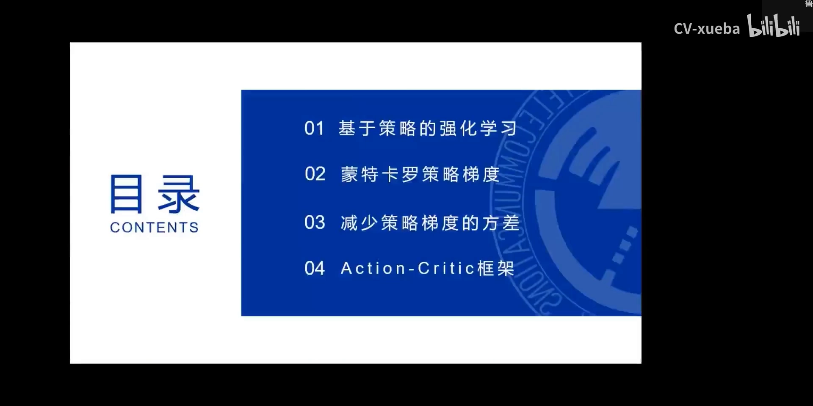
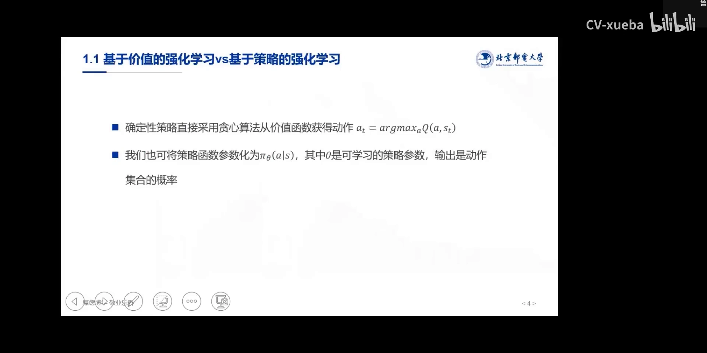
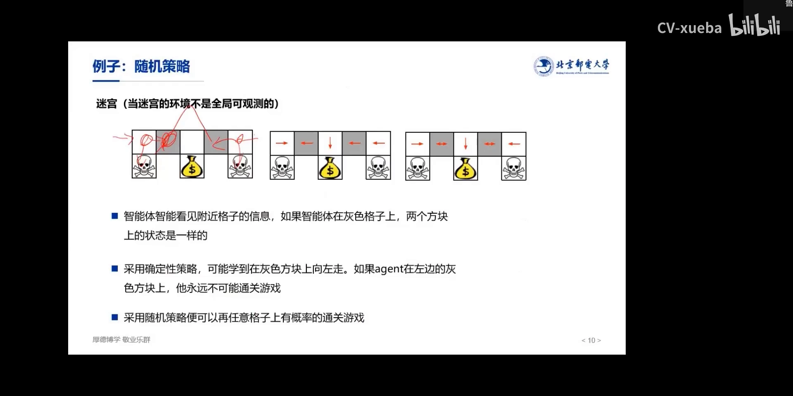
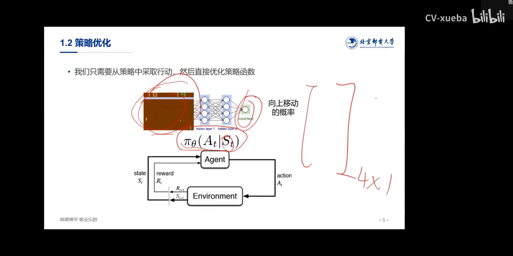
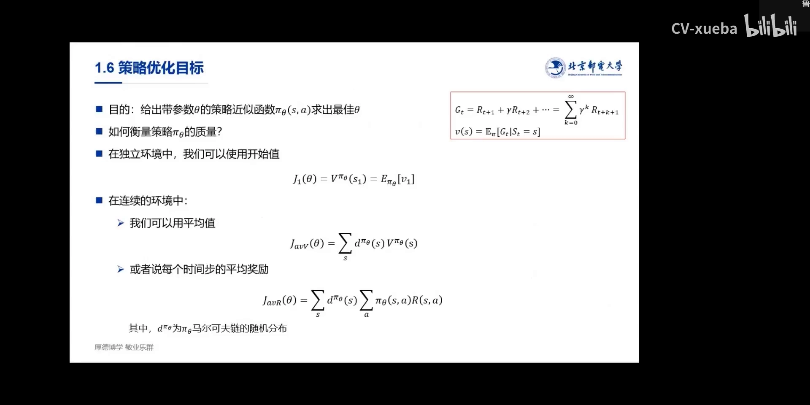
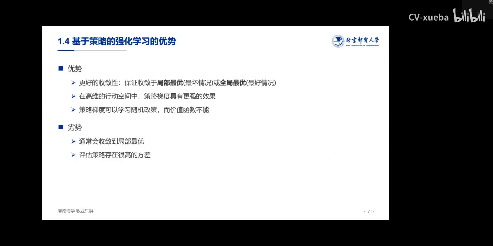
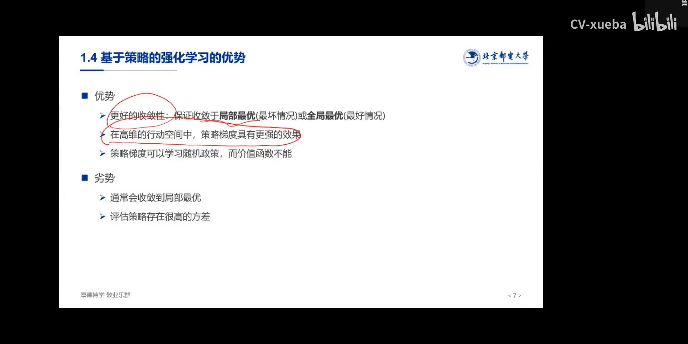

# 为什么需要策略梯度：价值方法的两道坎

> 本篇整理自王树森《深度强化学习》第 7 讲「策略梯度」的开头部分（约 0:00–16:20，讲完「基于策略的强化学习」这一节）。视频地址：[BV16Y411f7Hp](https://www.bilibili.com/video/BV16Y411f7Hp/)。同一条目下的另一篇《策略为什么要参数化：从查表到带参数的策略函数》整理自赵世钰《强化学习的数学原理》第 9 课 Part 1，两篇合起来才是「基于价值 vs. 基于策略」的完整图景。

## 本讲要解决的核心问题（SCQA）

**背景**：到这里为止，我们学过的所有方法——Q-Learning、SARSA、DQN 家族——都是**基于价值的（value-based）**。它们学的是动作价值 $Q(s,a)$，然后在每个状态下用 $\arg\max$ 把价值翻译成动作。策略本身从来没有被显式表示过，它只是价值函数的副产品。

**冲突**：这套做法在两个地方会直接卡死。第一，$\arg\max_a Q(s,a)$ 要求把动作**逐个枚举**出来比大小，一旦动作是连续的（取值有无穷多个），这个 $\max$ 根本算不出来。第二，$\arg\max$ 天生只会输出**确定性**策略，而很多任务的最优策略本身就是随机的——石头剪刀布里最好的策略是「三分之一出石头、三分之一出剪刀、三分之一出布」，任何确定性策略都会被对手打爆。

**疑问**：既然价值只是一个中间人，能不能**跳过它**，直接用一个带参数的函数 $\pi_\theta(a\mid s)$ 表示策略，然后想办法把它的参数调好？如果可以，那「策略好不好」又该怎么衡量？

**回答（中心思想）**：可以，这就是**基于策略的（policy-based）**方法，也是策略梯度的出发点。做法分两步：先把策略参数化成 $\pi_\theta(a\mid s)$（输入状态、输出动作的概率分布），再定义一个标量目标函数 $J(\theta)$ 来衡量「这套参数有多好」，最后用**梯度上升**去最大化它。这样既绕开了对动作的枚举，也天然支持随机策略——代价是收敛到局部最优的风险，以及很高的梯度方差。

[【跳转到 00:00】](https://www.bilibili.com/video/BV16Y411f7Hp/?t=0) · [【跳转到 00:23】](https://www.bilibili.com/video/BV16Y411f7Hp/?t=23)

---

## 一、价值方法的本质：先算价值，再从价值里「挑」动作

讲者一上来先给这门课划了条线：前面的价值函数方法主要是 DeepMind 那一拨人在做，而基于策略梯度的这一块，主要是 OpenAI 和伯克利在做。这条技术线的分歧不在工程细节，而在**要不要引入「价值」这个中间概念**。

他把它讲得很朴素：打游戏的本质就是「我的策略能让这个游戏得分最高」。价值函数的方法在这中间插了一根拐杖——先学一个价值函数，用它来评估你这个策略打得好不好；而策略梯度更多的是**直接回归原始目标**，不引入价值这个概念。

具体到动作是怎么选出来的，基于价值的方法写出来只有一行：

$$
a_t = \arg\max_{a} Q(a, s_t)
$$

这就是我们前面反复用的**确定性策略**，也就是贪婪策略：拿当前状态去 Q 表里查，哪个动作的分值最高就把那个动作取出来。所以动作的随机性完全来自价值函数之外的附加机制，比如 $\epsilon$-greedy。

而基于策略的方法把这两行掉了个个儿：不再学 $Q$，而是直接学策略函数 $\pi_\theta(a\mid s)$，其中 $\theta$ 是可学习的策略参数，**输出是动作集合上的概率**。

[【跳转到 01:02】](https://www.bilibili.com/video/BV16Y411f7Hp/?t=62) · [【跳转到 01:27】](https://www.bilibili.com/video/BV16Y411f7Hp/?t=87)

### 1.1 $\epsilon$-greedy 的「随机」不是真正的随机

讲者专门澄清了一个容易混淆的点。前面讲确定性策略时，我们给它加过一个改进——$\epsilon$-greedy：每个状态都以一个相同的、很小的概率去执行别的动作，而利用的那个动作概率最大。

这种随机**不是我们这里要的那种随机**。它只有一个动作是大概率，其余全是小概率，是「一家独大、其余很小」的形状；它的目的是**探索**（让智能体有机会试到别的动作），而不是表达「这个动作该以 0.6 的概率执行、那个动作该以 0.3 的概率执行」这样的分布。

而策略梯度要学的恰恰是后者。用 4 个离散动作 $a,b,c,d$ 举例，策略网络可以返回

$$
\pi_\theta(\cdot\mid s) = (0.2,\; 0.5,\; 0.3,\; 0)
$$

也就是 $a$ 的概率 0.2、$b$ 的概率 0.5、$c$ 的概率 0.3、$d$ 的概率 0。这里有两个硬约束：**每个元素非负**，**求和为 1**——因为它是一个概率分布。讲者强调，$\pi(a\mid s)$ 或 $\pi(s,a)$ 这种写法里的 $\pi$，本质上就是一个概率分布 $p$，只是用 $\pi$ 这个符号和普通的概率区分一下、顺便标明它的行为含义。

[【跳转到 02:02】](https://www.bilibili.com/video/BV16Y411f7Hp/?t=122) · [【跳转到 02:37】](https://www.bilibili.com/video/BV16Y411f7Hp/?t=157)

---

## 二、第一道坎：连续动作空间里，$\arg\max$ 算不出来

讲者把「为什么还要研究策略方法」拆成了三条理由，其中第二条是这一节的重点。

第一条是**收敛性**：策略梯度不管怎么样总能收敛到局部最优。第三条是**随机策略**（下一节展开）。第二条则直接指向动作空间：**当动作空间非常庞大时，用梯度、用策略的方式会更有效**。

他给了一个极端例子：如果动作变成**连续的**，取值就有无穷多个。这时候前面那套 Q 表的方法还能用吗？Q 表要取值，总得先告诉它一个 $s$、再告诉它一个 $a$ 吧？可这个连续的 $a$ 你怎么给？你不可能穷举所有的 $a$ 去找一个最大的 $Q$。

$$
a_t = \arg\max_{a \in \mathcal{A}} Q(a, s_t), \qquad \mathcal{A} \subset \mathbb{R}^d \ \text{（不可数）}
$$

这个式子在离散动作下是一句 `for` 循环，在连续动作下就变成了一个**必须现场求解的优化问题**：每选一次动作，都得先解一次 $\max$。所以讲者的结论很干脆：**这个时候之前的 Q 就不好用了**。

而策略函数 $\pi_\theta(a\mid s)$ 完全不需要做这件事。它的输出直接就是一个分布，采样一次就得到一个动作，中间没有任何 $\max$。讲者后面总结这一条时说得很形象：原来必须用 Q 去找一个 Q max 才能做，现在不需要了——神经网络把函数给我输出来就行。

[【跳转到 03:27】](https://www.bilibili.com/video/BV16Y411f7Hp/?t=207) · [【跳转到 04:18】](https://www.bilibili.com/video/BV16Y411f7Hp/?t=258)

---

## 三、第二道坎：最优策略本身可能就是随机的

这是策略梯度**最有优势**的地方：它能解决随机策略，而不是只能解决确定性策略。

讲者提醒，这里要和上一节的「连续/离散」区分开——**连续 vs 离散**说的是动作空间的形状，**随机 vs 确定**说的是策略的输出形式，这是两个不一样的概念。

### 3.1 石头剪刀布：最优策略就是均匀随机

第一个例子是石头剪刀布。什么样的玩家最厉害？**让人琢磨不透的**。如果你每次出的东西是固定的（确定性策略），对手摸清规律之后你就必输；如果你以 $\tfrac13$ 的概率随机出石头、剪刀、布，对手就永远没有可利用的规律。

$$
\pi^\star(\text{石头}) = \pi^\star(\text{剪刀}) = \pi^\star(\text{布}) = \frac{1}{3}
$$

这就是这个博弈的**纳什均衡**，也是一个最简单的、必须用随机策略才能表达的最优解。

### 3.2 不可全局观测的迷宫：状态撞车了

第二个例子更贴近强化学习的语境：一个**环境不是全局可观测**的迷宫。智能体只能看见邻近格子的信息，于是**左右两个灰色格子上的状态是一模一样的**——它分不清自己在左边那个灰格还是右边那个灰格。

后果是：如果用确定性策略，它可能学到「在灰色方块上向左走」。在右边那个灰格上这是对的（左边就是钱袋），但在左边那个灰格上，向左走会直接撞上骷髅；而如果学到「向右走」，就反过来在右边灰格上撞骷髅。**两个状态在智能体眼里一样，却需要相反的动作**，确定性策略在这里无解——它要么永远过不了关，要么陷入左右来回的无限循环。

随机策略则给出了出路：在这个状态下以 0.5 的概率向左、0.5 的概率向右。这一次可能走错，但下一次能转出来，长期看才有通关的概率。

### 3.3 $\epsilon$-greedy 为什么补不上这个洞

讲者把话收回到价值方法上：这类随机策略，**我们的 Q 解决得不好**，只能靠 $\epsilon$-greedy 去做，而 $\epsilon$-greedy 只能造出「一个大概率 + 一堆小概率」，表达不了 0.6/0.3/0.1 这种真正的分布。所以我们需要策略梯度来解决这个问题。

[【跳转到 05:07】](https://www.bilibili.com/video/BV16Y411f7Hp/?t=307) · [【跳转到 05:52】](https://www.bilibili.com/video/BV16Y411f7Hp/?t=352) · [【跳转到 07:02】](https://www.bilibili.com/video/BV16Y411f7Hp/?t=422)

---

## 四、把策略直接写成一个函数：$\pi_\theta(a\mid s)$

两道坎摆清楚之后，策略梯度的思想反而简单得有点出乎意料：**你给我一个输入（状态），我给你输出一个概率分布就好了**。就这么一个函数。

函数的形式通常是我们给定的——你搭一个神经网络，网络搭好，函数形式就确定了；唯一不确定的是网络里面的参数 $\theta$。于是「学一个策略」就变成了「**找一组最好的参数**」：参数一旦确定，这个「人」就定型了，他打这个游戏总会得到很高的分。

对输出的要求只有两条，前面已经说过：**每个元素非负**、**求和为 1**。以 4 个动作为例，只要输出一个 $4\times 1$ 的向量，元素都大于等于 0、加起来等于 1，就 OK 了。讲者特意点出这个对比：**我们再不需要「必须输出确定性动作」这个约束**，也就不再需要 $\arg\max$。

[【跳转到 08:37】](https://www.bilibili.com/video/BV16Y411f7Hp/?t=517) · [【跳转到 09:32】](https://www.bilibili.com/video/BV16Y411f7Hp/?t=572)

---

## 五、怎么衡量「这组参数好不好」：目标函数 $J(\theta)$

有了参数，就得有指标。什么叫最好的 $\theta$？总得定义一个标量目标函数 $J(\theta)$，让「$\theta$ 越优，$J$ 越大」。

### 5.1 有始有终的任务：用第一个状态的价值

讲者先借用了价值函数：$v_{\pi_\theta}(s_1)$ 表示第一个状态的价值。回想价值函数的定义，第一个状态的价值就是从这个状态开始、把之后所有收益按折扣累加起来再求期望：

$$
G_t = R_{t+1} + \gamma R_{t+2} + \cdots = \sum_{k=0}^{\infty} \gamma^{k} R_{t+k+1}, \qquad v(s) = \mathbb{E}_{\pi}\left[G_t \mid S_t = s\right]
$$

所以第一个状态的价值，就代表这个人打这一局游戏能拿到的（期望）总分，也就是这个 $\pi$、这个人的水平。于是目标函数可以定义成

$$
J_1(\theta) = V^{\pi_\theta}(s_1) = \mathbb{E}_{\pi_\theta}\left[v_1\right]
$$

**为什么偏偏用第一个状态？** 讲者自问自答：最后一个时间步并不代表他前面最牛。你要说这个人这一盘打得牛，得从他出发的那一刻算起，所以定义在起点上就够了。

### 5.2 没有终点的任务：用平均价值或平均奖励

可有些任务没有「一局」的概念——比如倒立摆，只要立起来、不倒，就可以一直保持下去，这种环境是连续的。这时没有头也没有尾，$J_1$ 就无从谈起，只能**全平均**：

$$
J_{AVV}(\theta) = \sum_{s} d^{\pi_\theta}(s)\, V^{\pi_\theta}(s)
$$

也就是「每个状态发生的概率 × 这个状态的价值」再求和。另一种写法是把价值换成即时奖励：

$$
J_{AVR}(\theta) = \sum_{s} d^{\pi_\theta}(s) \sum_{a} \pi_\theta(s,a)\, R(s,a)
$$

其中 $d^{\pi_\theta}$ 是策略 $\pi_\theta$ 诱导的马尔可夫链的**平稳分布**（幻灯片上写作「$\pi_\theta$ 马尔可夫链的随机分布」），表示在这个策略下状态 $s$ 出现的概率。讲者补充说，这个分布很多时候是由环境决定的——初始状态怎么来，往往是环境说了算。

讲者在这里还留了一个伏笔：上面这些写法都建立在「价值」或「单步奖励」上，而本课后面要用的其实是**轨迹**的形式——把一条完整的游戏轨迹记作 $\tau$，这条轨迹的回报记作 $R(\tau)$，目标函数就写成对轨迹的期望。这条路线才是第 02 节「蒙特卡罗策略梯度」的入口。

[【跳转到 09:55】](https://www.bilibili.com/video/BV16Y411f7Hp/?t=595) · [【跳转到 10:45】](https://www.bilibili.com/video/BV16Y411f7Hp/?t=645) · [【跳转到 12:20】](https://www.bilibili.com/video/BV16Y411f7Hp/?t=740)

---

## 六、代价是什么：局部最优与高方差

讲者没有把策略方法说成银弹。同一张幻灯片上，优势和劣势是并排列出来的：

| 类别 | 内容 |
| :-- | :-- |
| 优势 | 更好的收敛性：保证收敛于局部最优（最坏情况）或全局最优（最好情况） |
| 优势 | 在高维的动作空间中，策略梯度具有更强的效果 |
| 优势 | 策略梯度可以学习随机策略，而价值函数不能 |
| 劣势 | 通常会收敛到局部最优 |
| 劣势 | 评估策略存在很高的方差 |

讲者对着这张表把「方差」讲得更具体：策略梯度是一个**随机性很高**的东西，虽然算出来的梯度是**无偏**的，但**方差特别大**，训练起来就会飘忽——一会儿好、一会儿坏，很不稳定。他还提到，方差大往往伴随着「高估」的嫌疑：你以为这个动作好，但方差偏差很大，可能高估得很厉害。数据量足够大的话它一定能靠近真解，但在数据有限的情况下，输出的解就不太稳定。

也正因为如此，第 03 节整节都在讲怎么减小方差（时序因果性、减去基线），那是后话。

[【跳转到 04:42】](https://www.bilibili.com/video/BV16Y411f7Hp/?t=282) · [【跳转到 04:58】](https://www.bilibili.com/video/BV16Y411f7Hp/?t=298)

---

## 小结

- **基于价值**的方法学 $Q(s,a)$，再用 $a_t=\arg\max_a Q(a,s_t)$ 把价值翻译成动作；策略是价值函数的副产品，本身没有被显式表示。
- **第一道坎（连续动作空间）**：$\arg\max$ 要枚举动作，动作连续时取值无穷多，不可能穷举；每选一次动作都要解一次 $\max$，Q 表在这里失效。
- **第二道坎（随机策略）**：$\arg\max$ 只能输出确定性策略，而石头剪刀布（均匀随机是纳什均衡）、不可全局观测的迷宫（两个状态在智能体眼里相同、却需要相反动作）都要求最优策略是随机的。
- $\epsilon$-greedy 的随机只是探索用的「一家独大 + 一堆小概率」，表达不了 0.6/0.3/0.1 这样的真分布。
- **基于策略**的做法：把策略参数化成 $\pi_\theta(a\mid s)$，输出动作上的概率分布（非负、求和为 1），只优化参数 $\theta$，不再需要 $\arg\max$。
- **目标函数**：有始有终的任务用开始值 $J_1(\theta)=V^{\pi_\theta}(s_1)$；连续任务用平均价值 $J_{AVV}$ 或平均奖励 $J_{AVR}$，权重是策略诱导的平稳分布 $d^{\pi_\theta}$。
- **代价**：通常只收敛到局部最优；梯度无偏但方差很大，训练不稳定。

## 关键术语速查

| 术语 | 一句话解释 |
| :-- | :-- |
| 基于价值（value-based） | 学 $Q$ 或 $V$，再从价值里用 $\arg\max$ 导出动作的方法，如 Q-Learning、DQN |
| 基于策略（policy-based） | 不学价值，直接参数化并优化策略函数 $\pi_\theta(a\mid s)$ |
| 确定性策略 | 给定状态只输出一个动作，典型形式是 $a_t=\arg\max_a Q(a,s_t)$ |
| 随机策略 | 给定状态输出动作上的概率分布，按分布采样得到动作 |
| $\epsilon$-greedy | 以 $1-\epsilon$ 选当前最优动作、以 $\epsilon$ 随机探索的策略，其随机性只是探索噪声 |
| 策略网络 | 用神经网络实现的 $\pi_\theta(a\mid s)$，输入状态、输出动作概率 |
| 目标函数 $J(\theta)$ | 衡量策略参数好坏的标量指标，策略梯度就是最大化它 |
| $d^{\pi_\theta}(s)$ | 策略 $\pi_\theta$ 诱导的马尔可夫链的平稳分布，即状态 $s$ 长期出现的概率 |
| 纳什均衡 | 双方都无法单方面改变策略而获益的稳定策略组合；石头剪刀布里是各 $1/3$ |