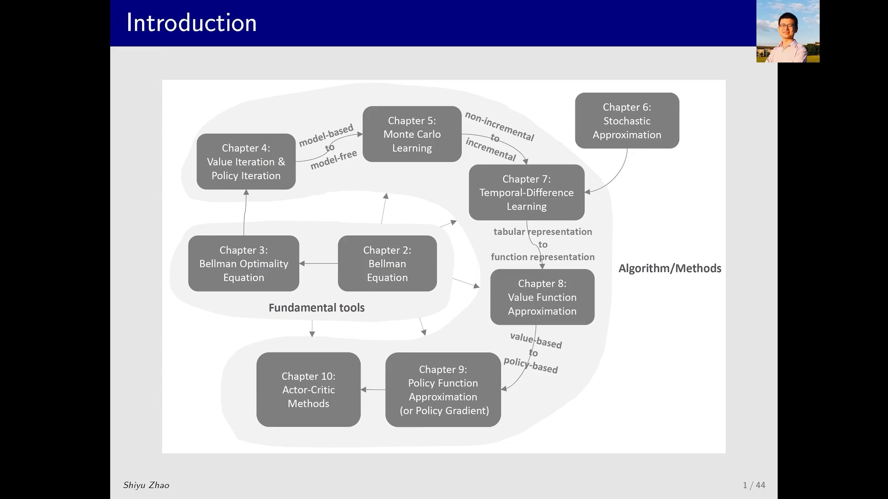
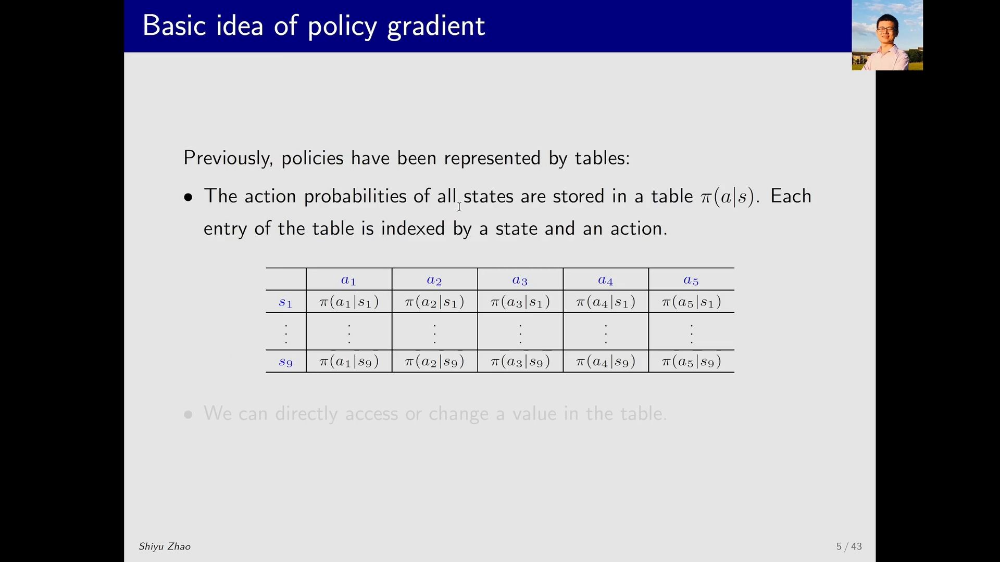
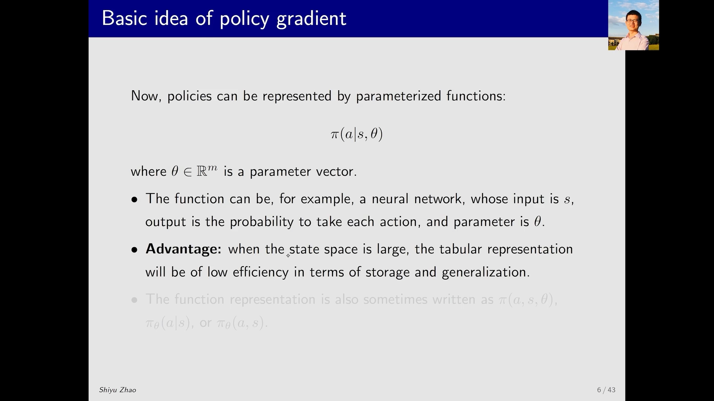
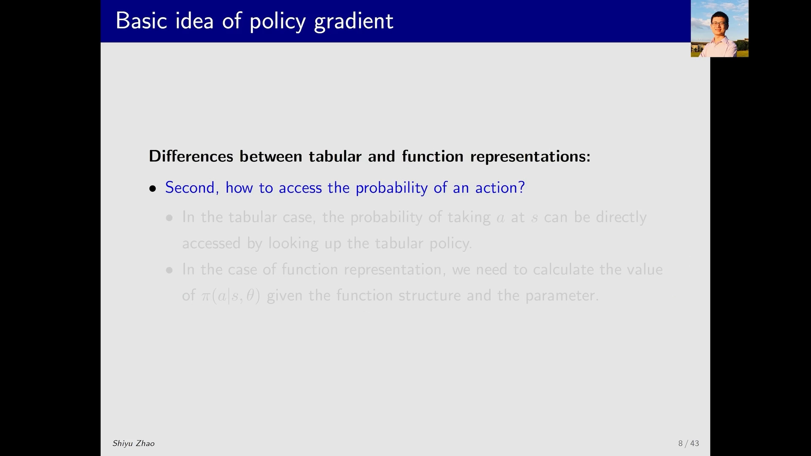
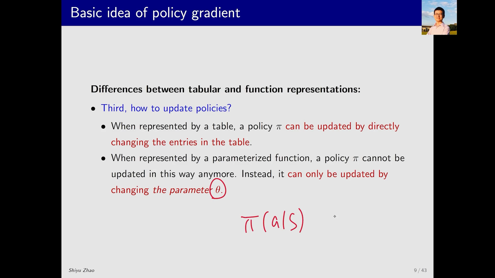
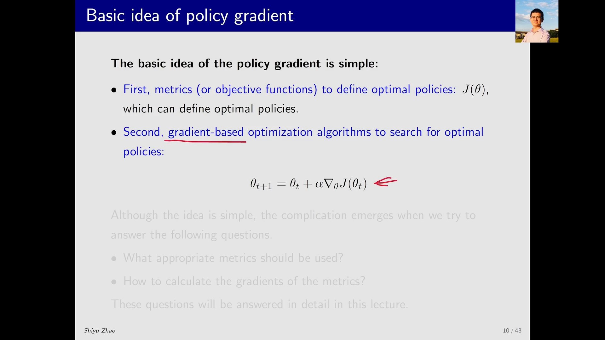

# 策略为什么要参数化：从查表到带参数的策略函数

> 本篇整理自赵世钰《强化学习的数学原理》第 9 课「策略梯度方法」Part 1：该方法的基本思路。视频地址：[BV1sD4y1v7Qw](https://www.bilibili.com/video/BV1sD4y1v7Qw/)。同一条目下的另一篇《为什么需要策略梯度：价值方法的两道坎》整理自王树森《深度强化学习》第 7 讲，讲的是「为什么必须换一条路」；本篇讲的是「换了路之后，策略长什么样、又该怎么优化」。

## 本讲要解决的核心问题（SCQA）

**背景**：上一课我们做了一次表示的跳跃——把价值函数从**表格**换成了**参数化函数**，于是 $q_\pi(s,a)$ 不再需要一格一格地存，而是用少量参数拟合出来。

**冲突**：可是策略本身还停在表格里。$\pi(a\mid s)$ 依然是一张「行是状态、列是动作」的表，要取某个状态下的动作概率就去查表，要改就直接改表里那一格。状态一多，这张表和 Q 表一样存不下；更关键的是，**表格里的每一格是独立的**，要更新 $\pi(a\mid s)$ 就必须真的访问到 $(s,a)$。

**疑问**：价值函数能换成函数，策略能不能也换成函数？如果策略变成一个带参数的函数 $\pi(a\mid s,\theta)$，那么「定义最优策略」「取动作概率」「更新策略」这三件最基本的事，会分别变成什么样？

**回答（中心思想）**：能，而且这正是 policy-based 方法与之前所有 value-based 方法的分水岭。策略参数化之后，三件事都换了一种做法：最优策略不再用「逐状态地压过所有其它策略」来定义，而是定义成**一个标量目标函数 $J(\theta)$ 的最大值**；取概率从查表变成**一次前向传播**；更新策略从改表项变成**只能改参数 $\theta$、间接地改 $\pi$**。于是整个策略梯度方法的基本思路就一句话：**找到使 $J(\theta)$ 最大的 $\theta$，用梯度上升迭代**。

[【跳转到 00:00】](https://www.bilibili.com/video/BV1sD4y1v7Qw/?t=0) · [【跳转到 00:14】](https://www.bilibili.com/video/BV1sD4y1v7Qw/?t=14)

---

## 一、这一步跳跃：从 value-based 到 policy-based

讲者先把这节课放在整门课的地图上：经过长途跋涉，我们来到了第 9 次课、第 9 章，已经接近课程的尾声。但快到最后并不意味着内容不重要——恰恰相反，policy gradient 以及下一课的 actor-critic，是现在最流行、性能也相对最好的方法。

它和上一课的关系，讲者用一句话点明：上次课把 **action value / state value** 从表格换成了函数，这次课的思想是**类似的**——之前我们用表格来表达策略，现在也可以用函数来表达策略。

但这一步跳跃的性质变了。之前所有的方法都叫 **value-based**：先估计一个策略的 action value（这就是 policy evaluation），再在这个基础上选一个更好的策略，然后采样、迭代循环，整个过程里 value 是绝对的核心。而这次课（以及下次课）的方法都是 **policy-based**：**直接建立一个目标函数，这个目标函数就是策略的函数**，通过优化它直接得到最优策略。

讲者还预告了下次课：actor-critic 实际上是把 policy gradient 和基于 value function approximation 的这两种方法**结合起来**——策略和价值各管一段。

[【跳转到 00:39】](https://www.bilibili.com/video/BV1sD4y1v7Qw/?t=39) · [【跳转到 01:04】](https://www.bilibili.com/video/BV1sD4y1v7Qw/?t=64) · [【跳转到 01:14】](https://www.bilibili.com/video/BV1sD4y1v7Qw/?t=74)

---

## 二、策略一直是一张表

到目前为止，我们所有的策略都是用**表格**表示的：行是状态，列是动作，格子里是 $\pi(a_j\mid s_i)$——也就是在状态 $s_i$ 下采取动作 $a_j$ 的概率。

表格的好处是操作简单：想访问一个量、想改一个量，**直接通过索引**就能实现。这也正是前面几课能一路推下来的原因。但它的适用边界和 Q 表完全一样。

[【跳转到 02:12】](https://www.bilibili.com/video/BV1sD4y1v7Qw/?t=132)

---

## 三、把表换成函数：$\pi(a\mid s,\theta)$

现在把表格改成函数。$\pi$ 的写法也随之改变：和之前很类似，唯一的区别是后面多了一个 $\theta$——一个向量，表示 $\pi$ 这个函数里的**参数**：

$$
\pi(a\mid s,\theta), \qquad \theta \in \mathbb{R}^{m}
$$

现在用得最广泛的函数形式就是**神经网络**：参数是 $\theta$，输入是 $s$，输出是所有动作的概率，比如 $\pi(a_1\mid s,\theta)$ 一直到 $\pi(a_5\mid s,\theta)$（假设有 5 个动作）。

讲者特意强调了一个记号上的分工：上一课介绍 value function approximation 时，价值函数的参数用 $w$ 表示；而**策略函数的参数用 $\theta$** 表示。

函数表示也可以写成别的等价形式，比如把竖线去掉写成 $\pi(a,s,\theta)$，或者把 $\theta$ 放到下标上写成 $\pi_\theta(a\mid s)$、$\pi_\theta(a,s)$，都行。

### 3.1 好处和上一课一样：省存储、能泛化

用函数代替表格的好处，和 value function approximation 是同一套说辞，讲者只简单复述：

- **存储**：state space 非常大、甚至状态连续变化有无穷多个时，表格要存非常多的数值，函数只需要存参数。
- **泛化**：这是更本质的一条。比如要更新 $\pi(a\mid s)$，如果用表格，**必须访问到 $s$ 和 $a$** 才能改那一格；如果用函数就不需要——我访问了 $(s,a)$ 旁边的那个 $(s,a)$，因为改的是函数的参数，参数一动，现在我感兴趣的 $(s,a)$ 也跟着变了。**用更少的访问和数据，就能得到比较好的效果**。

[【跳转到 03:12】](https://www.bilibili.com/video/BV1sD4y1v7Qw/?t=192) · [【跳转到 03:37】](https://www.bilibili.com/video/BV1sD4y1v7Qw/?t=217) · [【跳转到 04:47】](https://www.bilibili.com/video/BV1sD4y1v7Qw/?t=287)

---

## 四、表格 vs 函数：三个基本的不同点

讲者把两者的差别正式归纳成三条。这三条不是细节差异，而是**后面所有算法推导的起点**。

### 4.1 第一，怎么定义一个最优策略

**表格的情况**，最优策略的定义我们早就学过：如果 $\pi^\star$ 是最优策略，那么它在**每一个状态**上的 state value 都必须不小于任何其它策略的 state value：

$$
v_{\pi^\star}(s) \ge v_{\pi}(s), \qquad \forall s \in \mathcal{S},\ \forall \pi
$$

**函数的情况**就不一样了。这时我们不再逐状态地比较，而是定义一个**标量目标函数（scalar metric）**，然后去优化它——「哪个 $\theta$ 让这个标量最大，哪个 $\theta$ 对应的策略就最好」。这个标量具体怎么取，是第 2、3 节的内容。

讲者提醒，正因为「最优」的定义变了，后面很多细节都会跟着变。

### 4.2 第二，怎么取一个动作的概率

**表格**：想获取在 $s$ 下采取动作 $a$ 的概率，直接查表就可以了，非常简单。

**函数**：也很简单，只不过稍微麻烦一点——**不能直接索引了**，因为不是表格，得算一下。比如它是神经网络，我得把 $s$ 输进去**前向传播一次**，得到输出 $\pi(a_1\mid s,\theta),\dots,\pi(a_5\mid s,\theta)$，才能知道概率是多少。

### 4.3 第三，怎么更新策略

第三个不同和第二点类似，但后果更深远。

**表格**：$\pi(a\mid s)$ 想改成多少就改成多少，直接去表格里改那一格，非常直截了当。

**函数**：不能这么做了。因为函数是用 $\theta$ 表示的，你希望改变 $\pi(a\mid s)$，**不能直接赋值**，只能通过一定的规则去改变 $\theta$，**间接地**改变 $\pi(a\mid s)$。

这一条其实就是「为什么要梯度」的全部理由：既然只能通过 $\theta$ 间接地改策略，那就得知道「$\theta$ 往哪个方向动，能让策略变好」——这正是梯度的含义。

[【跳转到 05:37】](https://www.bilibili.com/video/BV1sD4y1v7Qw/?t=337) · [【跳转到 06:27】](https://www.bilibili.com/video/BV1sD4y1v7Qw/?t=387) · [【跳转到 07:42】](https://www.bilibili.com/video/BV1sD4y1v7Qw/?t=462) · [【跳转到 08:32】](https://www.bilibili.com/video/BV1sD4y1v7Qw/?t=512)

---

## 五、策略梯度的基本思路：定义 $J(\theta)$，然后梯度上升

三条不同点讲完，policy gradient 的基本思路就可以用两行字概括。

**第一步，定义目标函数。** 我们需要一个目标函数来定义「什么是最优策略」，这里取 $J(\theta)$，其中 $\theta$ 是策略对应的参数。不同的策略、不同的参数，就有不同的 $J(\theta)$ 值。我们希望 $J(\theta)$ 能被最大化，对应的参数就是

$$
\theta^\star = \arg\max_{\theta} J(\theta)
$$

**第二步，做优化。** 有了目标函数，最简单的优化算法就是基于梯度的方法——因为要最大化，所以是**梯度上升**：

$$
\theta_{t+1} = \theta_t + \alpha \nabla_\theta J(\theta_t)
$$

讲者说，整个思路其实**非常简单**。复杂的东西出现在两个地方：

1. **$J(\theta)$ 到底该取什么？** 这里面还是有些学问的——取第一个状态的价值、取平均价值、还是取平均奖励，会导出不同的算法。
2. **$\nabla_\theta J(\theta)$ 怎么算？** 这是本课后面的大头，会引出一个非常著名的定理——**policy gradient 定理**。

这也对应了本课的大纲结构：先定义 metric（第 2、3 节），再算梯度（第 4 节），最后给出梯度上升的具体算法，其中会涉及一些技巧，并给出一个非常早期但很经典的算法 **REINFORCE**，在此基础之上可以推广出很多现在最流行的方法（第 5 节）。

[【跳转到 08:57】](https://www.bilibili.com/video/BV1sD4y1v7Qw/?t=537) · [【跳转到 09:22】](https://www.bilibili.com/video/BV1sD4y1v7Qw/?t=562) · [【跳转到 09:47】](https://www.bilibili.com/video/BV1sD4y1v7Qw/?t=587) · [【跳转到 10:12】](https://www.bilibili.com/video/BV1sD4y1v7Qw/?t=612)

---

## 小结

- 第 9 课是课程地图上 **value-based → policy-based** 的那一步：上一课把价值从表格换成函数，这一课把**策略**从表格换成函数。
- 表格策略 $\pi(a\mid s)$ 的优点是可以直接索引；缺点是状态一多就存不下，而且每格独立、不访问到 $(s,a)$ 就更新不了。
- 参数化策略 $\pi(a\mid s,\theta)$ 用 $\theta$ 表示参数（价值函数用 $w$，策略用 $\theta$，这个分工要记住），最常用的函数形式是神经网络。
- 泛化是函数表示的核心好处：改参数会同时改变一片 $(s,a)$ 上的概率，不需要逐个访问。
- 表格与函数有三个基本不同点：**最优策略的定义**（逐状态比较 vs 最大化一个标量指标）、**取动作概率的方式**（查表 vs 前向传播）、**更新策略的方式**（改表项 vs 改 $\theta$ 间接改 $\pi$）。
- 基本思路只有两步：定义 $J(\theta)$ 并求 $\theta^\star=\arg\max_\theta J(\theta)$，再用梯度上升 $\theta_{t+1}=\theta_t+\alpha\nabla_\theta J(\theta_t)$ 迭代。
- 真正的难点是两个：$J(\theta)$ 怎么选、$\nabla_\theta J(\theta)$ 怎么算（后者就是 policy gradient 定理）。

## 关键术语速查

| 术语 | 一句话解释 |
| :-- | :-- |
| value-based | 以价值为核心的方法：先估计 action value，再据此改进策略 |
| policy-based | 直接建立并优化策略本身的方法，policy gradient 属于这一类 |
| 策略参数化 | 把 $\pi(a\mid s)$ 写成带参数 $\theta$ 的函数 $\pi(a\mid s,\theta)$，用少量参数表示整张策略表 |
| 策略网络 | 用神经网络实现策略函数，输入状态、输出各动作的概率 |
| 泛化（generalization） | 更新一个 $(s,a)$ 会顺带改变邻近 $(s,a)$ 的概率，用更少数据得到更好效果 |
| 标量目标函数 $J(\theta)$ | 函数表示下「最优策略」的定义载体，$\theta$ 越优 $J$ 越大 |
| 梯度上升 | $\theta_{t+1}=\theta_t+\alpha\nabla_\theta J(\theta_t)$，用于最大化目标函数 |
| policy gradient 定理 | 把 $\nabla_\theta J(\theta)$ 化成可采样估计形式的定理，是后续所有算法的推导基础 |
| REINFORCE | 最早期的 policy gradient 算法，经典且可推广到很多现代方法 |