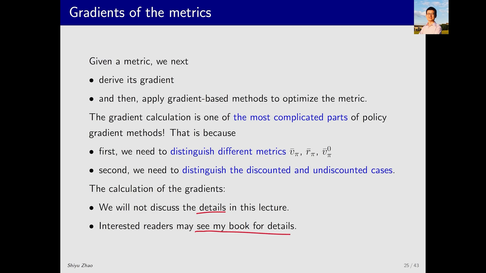
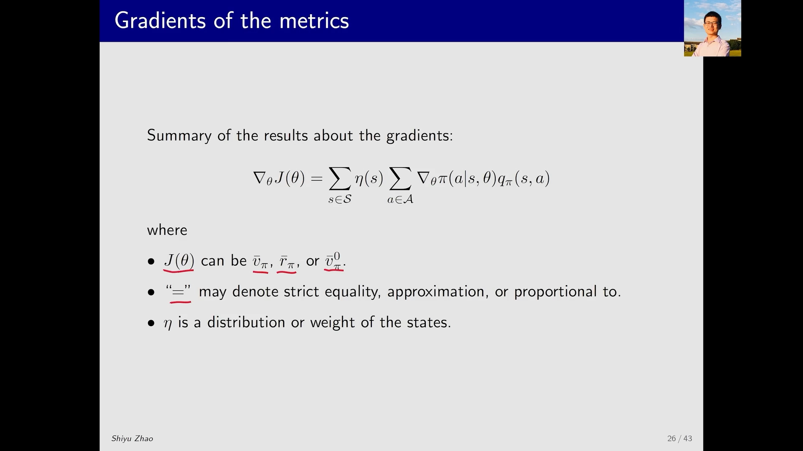
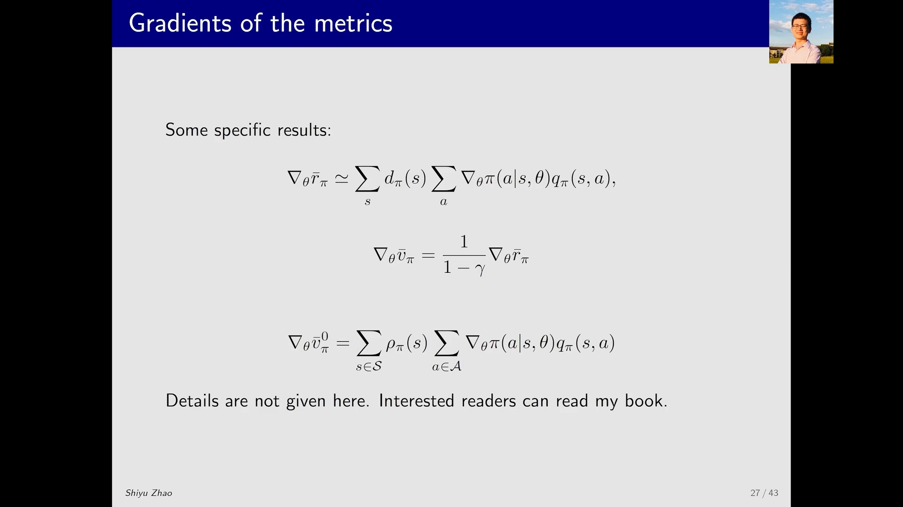
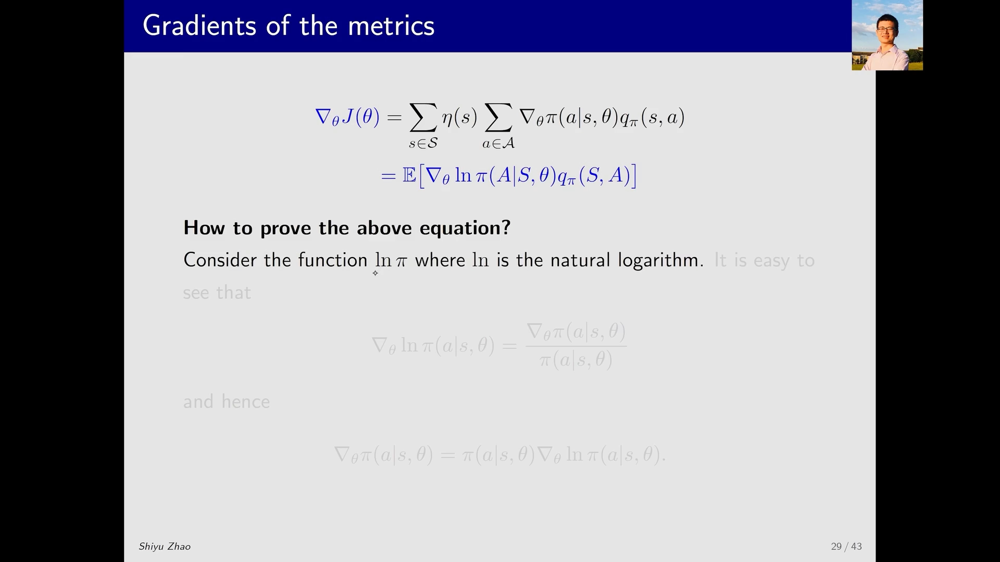
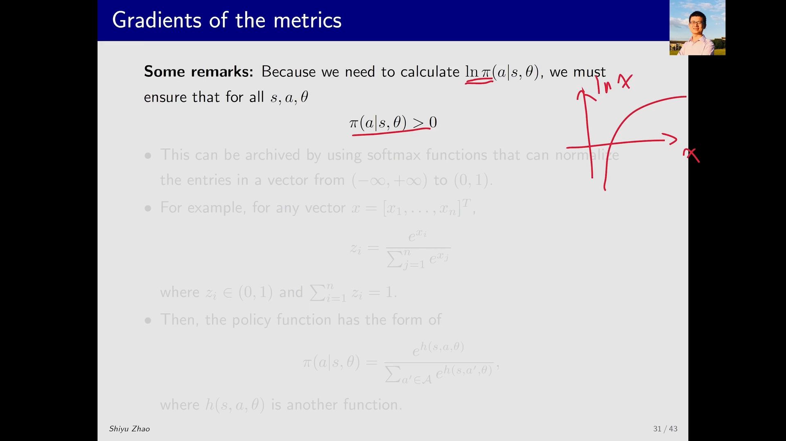

# 策略梯度定理：目标函数的梯度到底长什么样

> 本篇整理自赵世钰《强化学习的数学原理》第 9 课「策略梯度方法」Part 4：目标函数的梯度计算。视频地址：[BV15D4y1v7fj](https://www.bilibili.com/video/BV15D4y1v7fj/)。前两篇《策略目标函数：平均价值的定义》《策略目标函数：平均奖励与两种度量的等价》定义了要优化的 metric，本篇给出它们的梯度——也就是**策略梯度定理**。下一篇的 REINFORCE 算法，就是把这个定理直接拿来用。

## 本讲要解决的核心问题（SCQA）

**背景**：前两篇已经把目标函数定下来了。两个 metric——平均价值 $\bar v_\pi$ 和平均奖励 $\bar r_\pi$——都是 $\theta$ 的函数，而且只差一个比例因子。要做的就是用**梯度上升**最大化它们：$\theta \leftarrow \theta + \alpha \nabla_\theta J(\theta)$。

**冲突**：定义有了，梯度还是算不出来。麻烦在于 $J(\theta)$ 里不只有策略 $\pi(a\mid s,\theta)$，还有**由策略诱导出来的状态分布**——而状态分布是通过状态转移矩阵 $P_\pi$ 定义的，$P_\pi$ 又依赖 $\pi$，$\pi$ 又依赖 $\theta$。这条依赖链很长，而且 metric 有好几个、每个还分折扣与非折扣两种情形，排列组合下来每种情况求导都不一样。

**疑问**：有没有一个**统一的公式**能覆盖所有这些情况？这个公式里为什么只出现策略的梯度 $\nabla_\theta\pi$ 和行动价值 $q_\pi$，**却没有对状态分布求导的项**？

**回答（中心思想）**：有的，这就是**策略梯度定理**（policy gradient theorem）：

$$
\nabla_\theta J(\theta) \;=\; \sum_{s\in\mathcal{S}}\eta(s)\sum_{a\in\mathcal{A}}\nabla_\theta\pi(a\mid s,\theta)\,q_\pi(s,a)
$$

其中 $J$ 可以是 $\bar v_\pi$、$\bar r_\pi$ 或 $\bar v_\pi^{0}$；等号可能是**严格相等、约等于、或成比例**；$\eta$ 是状态的分布或权重。把它再写成**期望**的形式 $\nabla_\theta J=\mathbb{E}\big[\nabla_\theta\ln\pi(A\mid S,\theta)q_\pi(S,A)\big]$，就能用**采样**来近似——这正是所有策略梯度算法能落地的原因。

---

## 一、为什么「求梯度」是 policy gradient 里最复杂的一步

讲者开门见山：**计算这些 metric 的梯度，是整个 policy gradient 方法当中最复杂的一部分**。复杂在两个地方：

1. **metric 不止一个**。有 $\bar v_\pi$、$\bar r_\pi$，还有 $\bar v_\pi^{0}$——后者指的是「状态的分布和 $\pi$ 没有关系」的那种平均价值，它是 $\bar v_\pi$ 的一个特殊情况。
2. **要区分折扣情形与非折扣情形**（discounted / undiscounted case）。

不同的目标函数配上不同的情形，排列组合一下，**每一种情况计算梯度都是不同的**。虽然不同，但**大同小异**。所以讲者的处理方式是：详细的细节课程里不介绍（这部分内容在书里比较多、也比较复杂），课上只做**简要介绍**——直接给出一个统一的公式。

[【跳转到 00:05】](https://www.bilibili.com/video/BV15D4y1v7fj/?t=5) · [【跳转到 00:55】](https://www.bilibili.com/video/BV15D4y1v7fj/?t=55)

---

## 二、定理本体：一个式子统一三种 metric

讲者给出的统一公式是：

$$
\nabla_\theta J(\theta) \;=\; \sum_{s\in\mathcal{S}}\eta(s)\sum_{a\in\mathcal{A}}\nabla_\theta\pi(a\mid s,\theta)\,q_\pi(s,a)
$$

右边怎么读？**先对状态 $s$ 求和**，每个状态有一个权重（或者说概率分布）$\eta(s)$；**再对状态里的动作 $a$ 求和**，每一项是「策略的梯度」乘上「这个状态动作对的行动价值 $q_\pi(s,a)$」。

这个式子有意思的地方在于，它要同时承担三件事：

- **$J(\theta)$ 可以是 $\bar v_\pi$、$\bar r_\pi$ 或 $\bar v_\pi^{0}$** 中的任何一个；
- **等号分三种情况**：第一种是**严格相等**，第二种是**约等于**，第三种是**成比例地相等**——也就是中间差一个比例因子；
- **$\eta$ 对于不同的目标函数、在不同的情况下会呈现出不同的分布**。

总而言之，所有这些情况求出来的梯度**大同小异**，所以就用这一个式子来表示。讲者的态度很坦诚：**对绝大多数同学来说这个式子就够了**，除非你要研究、创新新的算法，那才需要到书里去看详细内容。

[【跳转到 01:20】](https://www.bilibili.com/video/BV15D4y1v7fj/?t=80) · [【跳转到 02:10】](https://www.bilibili.com/video/BV15D4y1v7fj/?t=130)

---

## 三、三种 metric 的具体结果

讲者「蜻蜓点水」地把三种情况分别交代了一遍，它们都对应上面那个统一式子，区别只在**等号的含义**和**$\eta$ 取哪个分布**：

**（1）平均奖励 $\bar r_\pi$**：在折扣情形下是**约等于**，在非折扣情形下是**严格等于**，

$$
\nabla_\theta\bar r_\pi \;\simeq\; \sum_{s} d_\pi(s)\sum_{a}\nabla_\theta\pi(a\mid s,\theta)\,q_\pi(s,a)
$$

这里的 $\eta$ 取 $d_\pi$，也就是**平稳分布**。

**（2）平均价值 $\bar v_\pi$**：在折扣情形下，它和平均奖励的梯度是**成比例**的，

$$
\nabla_\theta\bar v_\pi \;=\; \frac{1}{1-\gamma}\,\nabla_\theta\bar r_\pi
$$

比例因子就是 $\frac{1}{1-\gamma}$。这和上一篇的 $\bar r_\pi=(1-\gamma)\bar v_\pi$ 是同一件事的两面——既然两个 metric 只差一个常数因子，它们的梯度自然也差同一个因子。

**（3）带下标 0 的平均价值 $\bar v_\pi^{0}$**：这是**最简单的情况**（因为 $d$ 与 $\pi$ 无关），

$$
\nabla_\theta\bar v_\pi^{0} \;=\; \sum_{s\in\mathcal{S}}\rho_\pi(s)\sum_{a\in\mathcal{A}}\nabla_\theta\pi(a\mid s,\theta)\,q_\pi(s,a)
$$

形式完全一样，区别只是 $\eta$ 换成了另一个分布 $\rho_\pi$。讲者没有在这里给出 $\rho_\pi$ 的细节，只说「书里面会给出」。

[【跳转到 02:35】](https://www.bilibili.com/video/BV15D4y1v7fj/?t=155) · [【跳转到 03:25】](https://www.bilibili.com/video/BV15D4y1v7fj/?t=205)

---

## 四、一个容易误读的点：式子里为什么没有 $\nabla_\theta d_\pi$

第一次看到这个定理，最容易产生的疑问是：目标函数里明明含状态分布（$\bar v_\pi=\sum_s d(s)v_\pi(s)$，$\bar r_\pi=\sum_s d_\pi(s)r_\pi(s)$），而且 $d_\pi$ 也依赖 $\theta$，**为什么梯度式子里只有 $\nabla_\theta\pi$ 和 $q_\pi$，看不到对状态分布求导的项？**

讲者在课上的态度很明确：**这一点的严格推导属于「细节」，他只给结论，证明留给书**。所以这里只能确定地讲两件事，不要过度发挥：

**第一，当 $d$ 与 $\pi$ 无关时，这个问题根本不存在。** 这正是 $\bar v_\pi^{0}$ 被称为「最简单的情况」的原因：$J$ 里那个 $d$ 是常数向量，**它压根不依赖 $\theta$**，所以 $\nabla_\theta J=\sum_s d(s)\nabla_\theta v_\pi(s)$，式子里不会、也不该出现 $\nabla_\theta d$。

**第二，定理里出现的那个分布，不是「被求导的对象」，而是「权重」。** 无论是 $d_\pi$ 还是 $\rho_\pi$，它们在公式里的角色和上一篇的 $d(s)$ 完全一样——只是告诉我们对每个状态该给多大的权重。这个权重来自**「未来会走到哪些状态」**：从某个状态出发，走一步、两步、三步……每一步落在各个状态的概率累积起来，就形成了这个分布。所以它是推导的**产物**，而不是求导的**对象**。

至于 $d$ 依赖 $\pi$ 的那种情形（$J$ 里显含 $d_\pi$），讲者的处理方式是**把它吸收进「等号的含义」里**：结论写成「严格相等 / 约等于 / 成比例」三种，形式不变。为什么那个「多出来的项」能被消化掉，属于书里的内容，课程里不展开。

**一句话总结**：定理之所以这么「干净」，是因为它把「状态分布也随 $\theta$ 变化」这件麻烦事，整体打包进了权重 $\eta$ 和等号的三种含义里；你只需要记住右边的形状——**权重 $\times$ 策略梯度 $\times$ 行动价值**。

---

## 五、从求和到期望：定理最有用的形式

定理给出来之后，讲者强调它**最重要的一个性质**：可以把所有的求和号都去掉，写成一个**期望**的形式。

$$
\nabla_\theta J(\theta) \;=\; \mathbb{E}\Big[\nabla_\theta\ln\pi(A\mid S,\theta)\,q_\pi(S,A)\Big],
\qquad S\sim\eta,\quad A\sim\pi(\cdot\mid S,\theta)
$$

这里 $(S,A)$ 是随机变量：$S$ 服从 $\eta$ 的分布，$A$ 服从 $\pi(\cdot\mid S,\theta)$ 的分布。

**为什么需要这个形式？** 讲者说，有的同学可能已经意识到了：因为这是一个**真实的梯度**，而真实的梯度里含有**期望**，我不知道这个期望是多少，所以就可以**用采样来近似这个期望**——这就是随机梯度下降（或者上升）的基本思路。待会就会用这个随机梯度来做优化。**这就是为什么这个式子非常重要。**

![定理的紧凑形式：∇_θ J(θ) = 𝔼[∇_θ ln π(A|S,θ) q_π(S,A)]，其中 S ~ η、A ~ π(A|S,θ)；幻灯片点明它有用的原因是我们可以用采样来近似梯度，即 ∇_θ J ≈ ∇_θ ln π(a|s,θ) q_π(s,a)](assets/策略梯度定理：目标函数的梯度/00230.webp)

[【跳转到 03:50】](https://www.bilibili.com/video/BV15D4y1v7fj/?t=230) · [【跳转到 04:15】](https://www.bilibili.com/video/BV15D4y1v7fj/?t=255)

---

## 六、怎么得到期望形式：一个对数求导的小技巧

从求和形式变到期望形式，只用了一个恒等式。讲者说这一步「其实也是比较简单的」。

**第一步：对数函数的求导性质。** 注意式子里出现的是 $\ln\pi$，也就是 $\pi$ 的**自然对数**（自然对数也常被写成 $\log$，为了强调底数是 $e$，这里写成 $\ln$）。它满足

$$
\nabla_\theta\ln\pi(a\mid s,\theta) \;=\; \frac{\nabla_\theta\pi(a\mid s,\theta)}{\pi(a\mid s,\theta)}
$$

为什么？因为 $\log x$ 对 $x$ 求导是 $\frac{1}{x}$；那么对 $\log f(x)$ 求梯度，先出来一个 $\frac{1}{f(x)}$，再乘上里面 $f(x)$ 的梯度——这里 $f(x)$ 对应的就是我们的 $\pi$。

**第二步：把式子反过来用。** 把上式两边乘上 $\pi(a\mid s,\theta)$，再左右调换，就得到一个非常简洁的式子：

$$
\nabla_\theta\pi(a\mid s,\theta) \;=\; \pi(a\mid s,\theta)\,\nabla_\theta\ln\pi(a\mid s,\theta)
$$

**第三步：代回定理。** 定理里原本是 $\nabla_\theta\pi$，现在替换成 $\pi\nabla_\theta\ln\pi$。为什么要做这个替换？**因为它能写成期望的形式**：

- 第一个求和（对 $s$）写成期望：$S$ 服从 $d$ 的分布，$\eta(s)$ 就是它的概率；
- 第二个求和（对 $a$）也写成期望：$A$ 服从 $\pi(\cdot\mid S,\theta)$ 的分布，而 $\pi(a\mid s,\theta)$ 正好就是它的概率。

两个求和都变成期望，合起来就是第五节那个式子。我们经常把下边的下标省略掉，直接写成 $\nabla_\theta J=\mathbb{E}[\nabla_\theta\ln\pi(A\mid S,\theta)q_\pi(S,A)]$。

[【跳转到 04:40】](https://www.bilibili.com/video/BV15D4y1v7fj/?t=280) · [【跳转到 05:55】](https://www.bilibili.com/video/BV15D4y1v7fj/?t=355) · [【跳转到 06:20】](https://www.bilibili.com/video/BV15D4y1v7fj/?t=380)

---

## 七、补充说明：$\pi$ 必须大于 $0$，所以要用 softmax

讲完了梯度，讲者补了三条说明，第一条是**技术前提**：

**因为要计算 $\ln\pi(a\mid s,\theta)$，所以必须保证对所有的 $s,a,\theta$ 都有**

$$
\pi(a\mid s,\theta) \;>\; 0
$$

为什么？看 $\ln x$ 这条曲线就知道：横坐标 $x$ 必须大于 $0$，$x=0$ 时对数不存在。而我们之前介绍过很多策略，比如**贪心（greedy）策略**或者**确定性（deterministic）策略**，它们对某些动作的 $\pi$ 值就是等于 $0$ 的——在这里不能这样。

**怎么保证所有的 $\pi$ 都大于 $0$？用 softmax 函数。** softmax 的作用是**归一化**：把 $(-\infty,+\infty)$ 上的一组数映射到 $(0,1)$ 区间，而且**不会严格等于 $0$，也不会严格等于 $1$**。具体来说，对任意向量 $x=[x_1,\dots,x_n]^{T}$，

$$
z_i \;=\; \frac{e^{x_i}}{\sum_{j=1}^{n}e^{x_j}},
\qquad z_i\in(0,1),\quad \sum_{i=1}^{n}z_i=1
$$

有了 softmax，就可以把策略写成这种形式：

$$
\pi(a\mid s,\theta) \;=\; \frac{e^{h(s,a,\theta)}}{\sum_{a'\in\mathcal{A}}e^{h(s,a',\theta)}}
$$

其中 $h(s,a,\theta)$ 是另外一个函数——这类似于我们之前在**价值函数近似**（value function approximation）里介绍过的**特征向量**：对应每个状态动作对，都有一个特征函数。

**现在这个 $h$ 不用手工设计了，直接用神经网络。** 假如我有一个神经网络，参数是 $\theta$、输入是 $s$，它可以直接把 $\pi(a_1\mid s,\theta)$ 一直到 $\pi(a_{|\mathcal{A}|}\mid s,\theta)$ 输出出来；只要**输出层用 softmax** 做激活，得到的这些数就都在 $(0,1)$ 区间，并且相加等于 $1$。

**这个前提带来一个额外的好处**：因为 $\pi$ 对每一个 $a$ 都大于 $0$，所以这个策略是**随机（stochastic）**的，自然地它也是**探索性**的——所有动作都保留了一点被选中的概率。

**代价是动作不能无穷多。** 讲者顺带提了一句：如果动作是无穷多个，这种「输出每个动作的概率」的方法就不行了；不过**确定性策略梯度（DPG）**的方法可以处理这种情况（下一课会介绍），那时候也不需要 $\pi>0$ 这个条件。

[【跳转到 07:10】](https://www.bilibili.com/video/BV15D4y1v7fj/?t=430) · [【跳转到 08:00】](https://www.bilibili.com/video/BV15D4y1v7fj/?t=480) · [【跳转到 09:15】](https://www.bilibili.com/video/BV15D4y1v7fj/?t=555)

---

## 小结

1. **求梯度是 policy gradient 里最复杂的一步**：metric 有多个、每个还分折扣与非折扣情形，排列组合后每种情况都不同，但大同小异。
2. **策略梯度定理的统一形式**：$\nabla_\theta J(\theta)=\sum_s\eta(s)\sum_a\nabla_\theta\pi(a\mid s,\theta)q_\pi(s,a)$；$J$ 可以是 $\bar v_\pi$、$\bar r_\pi$、$\bar v_\pi^{0}$，等号可表示严格相等 / 约等于 / 成比例，$\eta$ 是状态分布或权重。
3. **三种情形的具体结果**：$\nabla\bar r_\pi\simeq\sum_s d_\pi\sum_a\nabla\pi\,q_\pi$；$\nabla\bar v_\pi=\frac{1}{1-\gamma}\nabla\bar r_\pi$；$\nabla\bar v_\pi^{0}=\sum_s\rho_\pi\sum_a\nabla\pi\,q_\pi$。
4. **式子里没有 $\nabla_\theta d_\pi$**：状态分布在公式里只是**权重**（来自「未来会走到哪些状态」的访问频率），不是被求导的对象；$d$ 与 $\pi$ 无关时这一点最清楚，$d$ 依赖 $\pi$ 的严格推导讲者留给了书。
5. **最有用的形式是期望**：$\nabla_\theta J=\mathbb{E}[\nabla_\theta\ln\pi(A\mid S,\theta)q_\pi(S,A)]$，因为期望可以用**采样**近似，从而做随机梯度上升。
6. **对数技巧是唯一的技术手段**：$\nabla_\theta\pi=\pi\nabla_\theta\ln\pi$，把两个求和变成两个期望。
7. **前提与参数化**：要求 $\pi(a\mid s,\theta)>0$，所以用 softmax（神经网络输出层即可），顺带得到随机、可探索的策略；动作无穷多时改用确定性策略梯度。

## 关键术语速查

| 术语 | 一句话解释 |
| --- | --- |
| 策略梯度定理 | $\nabla_\theta J=\sum_s\eta(s)\sum_a\nabla_\theta\pi(a\mid s,\theta)q_\pi(s,a)$，把目标函数的梯度写成「权重 $\times$ 策略梯度 $\times$ 行动价值」 |
| $\eta(s)$ | 定理中的状态权重/分布；依情形取 $d_\pi$、$\rho_\pi$ 等 |
| $q_\pi(s,a)$ | 在状态 $s$ 执行动作 $a$、此后按 $\pi$ 行动所得折扣回报的期望（行动价值） |
| 等号的三种含义 | 严格相等、约等于、成比例——对应不同的 metric 与折扣/非折扣情形 |
| 对数求导技巧 | $\nabla_\theta\ln\pi=\nabla_\theta\pi/\pi$，等价于 $\nabla_\theta\pi=\pi\nabla_\theta\ln\pi$ |
| 随机梯度上升 | 用采样估计期望梯度，$\theta\leftarrow\theta+\alpha\nabla_\theta J$ 的随机版本 |
| softmax | 把任意实数向量归一化到 $(0,1)$ 且和为 $1$，保证 $\pi(a\mid s,\theta)>0$ |
| 确定性策略梯度（DPG） | 直接输出确定性动作的策略梯度方法，不需要 $\pi>0$，可处理连续/无穷动作 |