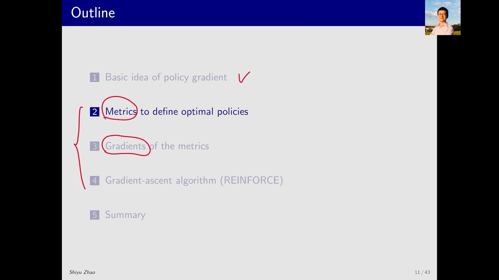
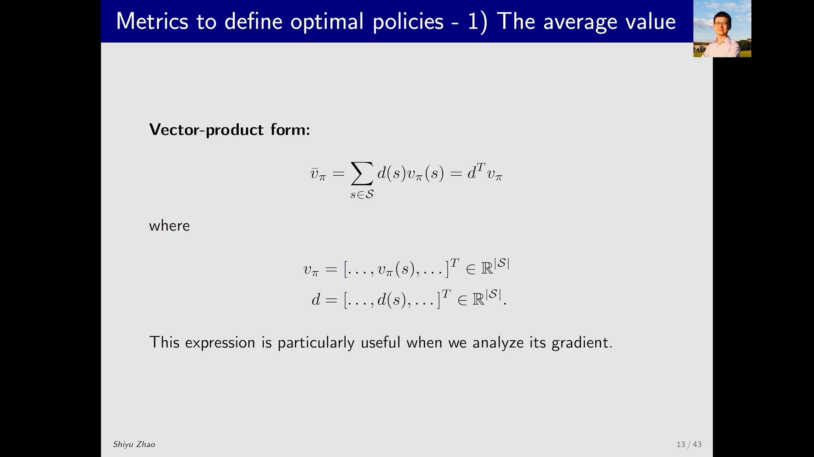
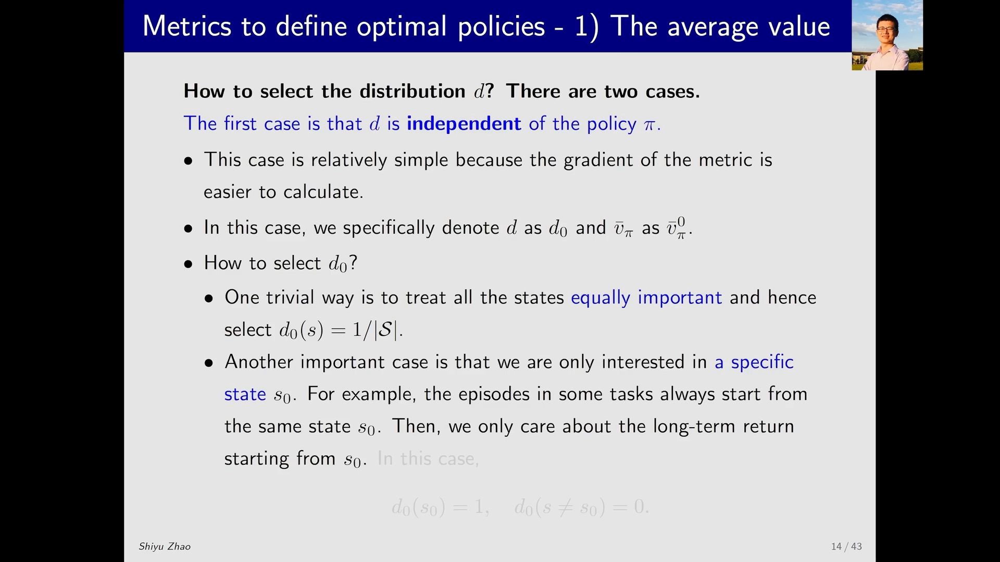
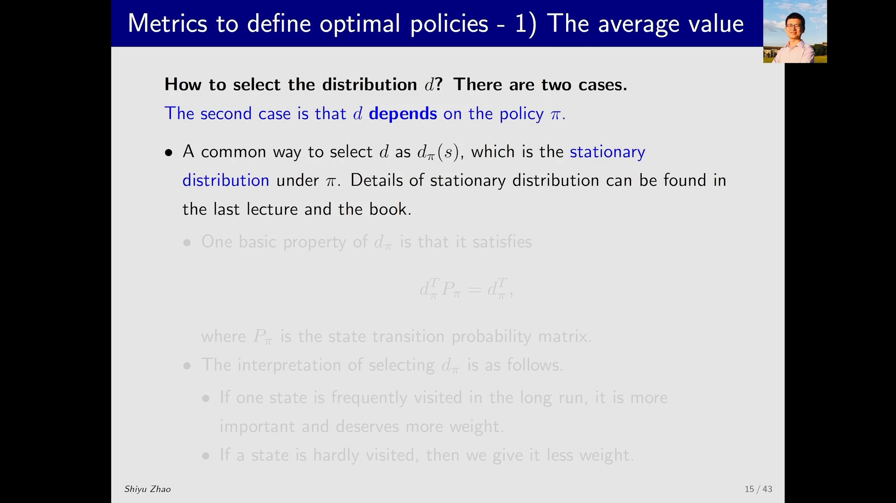

# 策略目标函数之一：平均价值——把「策略好不好」压成一个数

> 本篇整理自赵世钰《强化学习的数学原理》第 9 课「策略梯度方法」Part 2：该方法的目标函数 1（Average value）。视频地址：[BV1ve4y1g7aH](https://www.bilibili.com/video/BV1ve4y1g7aH/)。同一条目下还有两篇：《策略目标函数：平均奖励与两种度量的等价》讲第二个 metric，《策略梯度定理：目标函数的梯度》讲这两个 metric 怎么求梯度。三篇合起来才是「策略目标函数 + 策略梯度定理」的完整链条。

## 本讲要解决的核心问题（SCQA）

**背景**：上一篇（7.1）的结论是：不要再用价值函数间接地导出策略，而是把策略本身参数化成一个带参数 $\theta$ 的函数 $\pi(a\mid s,\theta)$，然后直接改进 $\theta$。改进的办法是**梯度上升**——沿着让目标变大的方向挪动 $\theta$。

**冲突**：梯度上升要求有一个**能对 $\theta$ 求导的数** $J(\theta)$。可「一个策略好不好」本身不是一个数，而是一整张表：每个状态 $s$ 都有一个状态价值 $v_\pi(s)$。有的状态变好了、有的变差了，到底算变好还是变差？

**疑问**：怎么把整张 $v_\pi(s)$ 压缩成一个标量，让它既能代表「这个策略的整体水平」，又能对 $\theta$ 求梯度？压缩时每个状态该占多少权重？这个权重能不能依赖于策略本身？

**回答（中心思想）**：这就是**策略目标函数**（metric / objective function）要干的事。最自然的选择是**平均价值**（average value）：把状态价值按权重 $d(s)$ 加权平均，得到一个标量 $\bar v_\pi = \sum_s d(s) v_\pi(s)$。而权重的选法只有两大类——**与策略无关**（例如均匀分布，或者只关心某个起始状态 $s_0$）和**与策略有关**（取平稳分布 $d_\pi$）。这个「有关 / 无关」的区分不是学术洁癖：**它直接决定了下一篇求梯度有多麻烦**——$d$ 若不依赖 $\pi$，求梯度时就不用对 $d$ 求导。

---

## 一、整条路线只有三步：定目标、求梯度、做优化

讲者一上来先把 policy gradient 的框架摆清楚，它分为三个部分：

1. 介绍所选中的这个 **metric**，也就是目标函数（objective function）到底是什么；
2. 这个目标函数对应的 **gradient** 是什么；
3. 怎么用这个 gradient 做优化，得到最优的策略。

本讲只做第 1 步，但讲者提醒：**这一步内容其实不少**，因为「metric」在教材和论文里有好几种写法，而且每一种写法下面还分情况。

[【跳转到 00:05】](https://www.bilibili.com/video/BV1ve4y1g7aH/?t=5) · [【跳转到 00:30】](https://www.bilibili.com/video/BV1ve4y1g7aH/?t=30)

---

## 二、第一个 metric：状态价值的加权平均

大家在读书或者看论文的时候，经常会遇到两大类的 metric。第一大类叫 **average state value**，或者简称 **average value**（平均价值），它其实就是**状态价值的一个加权平均**：

$$
\bar v_\pi \;=\; \sum_{s\in\mathcal{S}} d(s)\, v_\pi(s)
$$

式子里有两个角色：

- $v_\pi(s)$：在状态 $s$ 上的**状态价值**（state value），也就是从 $s$ 出发、之后一直按策略 $\pi$ 行动所能拿到的折扣回报的期望；
- $d(s)$：给状态 $s$ 的**权重**，要求 $d(s)\ge 0$，并且所有状态的权重之和等于 $1$。

既然权重非负、加起来等于 $1$，那 $d(s)$ 就不只是「权重」，它完全可以理解成一个**概率分布**（probability distribution）：$d(s)$ 代表状态 $s$ 被选中的概率。于是目标函数又可以写成完全依赖于**期望**（expectation）的形式：

$$
\bar v_\pi \;=\; \mathbb{E}_{S\sim d}\big[v_\pi(S)\big] \;=\; \sum_{s\in\mathcal{S}} p(s)\, v_\pi(s)
$$

这里的 $p(s)$ 对应的就是我们的 $d(s)$，所以这两个式子是同一件事。

![平均价值的定义：v̄_π = Σ_s d(s) v_π(s)，其中 d(s) ≥ 0 且 Σ_s d(s) = 1，因此 d 可以理解成概率分布，目标函数可写成期望 𝔼[v_π(S)]，S ~ d](assets/策略目标函数：平均价值的定义/00130.webp)

注意「上面加一横」这个记号的含义：**横线代表平均**。所以 $\bar v_\pi$ 读作「$v_\pi$ 的平均」。显然它是**策略的函数**——不同的策略对应不同的值，所以我们可以去优化，找到一个最优的策略让这个值达到最大。

### 2.1 写成向量内积，是为了后面求梯度

「相乘再相加」这种式子，显然可以写得更简洁：它就是两个向量的**内积**。

$$
\bar v_\pi \;=\; \sum_{s\in\mathcal{S}} d(s)\, v_\pi(s) \;=\; d^{T} v_\pi
$$

其中 $d$ 和 $v_\pi$ 都是 $|\mathcal{S}|$ 维向量，每一个元素对应一个状态：

$$
v_\pi = \big[\cdots,\ v_\pi(s),\ \cdots\big]^{T}\in\mathbb{R}^{|\mathcal{S}|},
\qquad
d = \big[\cdots,\ d(s),\ \cdots\big]^{T}\in\mathbb{R}^{|\mathcal{S}|}
$$

讲者专门点了一句：**这个向量内积形式在我们分析怎么求解 $\bar v_\pi$ 的梯度时会很有用**。原因很直白——内积对其中一个因子求导，另一个因子就原样保留下来；下一篇里「梯度 $=$ 权重 $\times$ 策略梯度 $\times$ 行动价值」的形状，就是从这儿来的。

[【跳转到 01:30】](https://www.bilibili.com/video/BV1ve4y1g7aH/?t=130) · [【跳转到 02:35】](https://www.bilibili.com/video/BV1ve4y1g7aH/?t=155) · [【跳转到 03:00】](https://www.bilibili.com/video/BV1ve4y1g7aH/?t=180)

---

## 三、权重 $d$ 怎么选：先看与策略无关的两种

第一个 metric 介绍到这里还没完——因为式子里那个 $d(s)$ 我们还没说怎么选。讲者把它分成两种情况，**第一种是 $d$ 与 $\pi$ 没有关系（独立）**，第二种是 $d$ 依赖于 $\pi$。

为什么先看「无关」的情形？因为简单。$\bar v_\pi = d^{T}v_\pi$，如果 $d$ 和 $\pi$ 没有关系，那么**待会求梯度的时候，这个 $d$ 就不涉及任何梯度**，我只需要求一个 $v_\pi$ 的梯度；如果 $d$ 和 $\pi$ 有关系，那求梯度时当然也要把 $d$ 关于 $\pi$ 的梯度一起求，相对来说会麻烦一点。

为了表明 $d$ 和 $\pi$ 没有关系，讲者把这种情形下的 $d$ 记作 $d_0$，对应的 metric 记作 $\bar v_\pi^{0}$。那 $d_0$ 具体怎么选？讲者给了两个典型：

**（1）所有状态一视同仁**：认为每个状态**同等重要**（equally important），于是取

$$
d_0(s) = \frac{1}{|\mathcal{S}|}
$$

也就是一个**均匀分布**：一共 $|\mathcal{S}|$ 个状态，每个状态的权重都是 $|\mathcal{S}|$ 分之一，加起来正好等于 $1$。

**（2）只关心某一个起始状态 $s_0$**：这个情形其实非常重要。比如某些游戏里，每一局总是从同一个画面开始，那个画面就对应一个特定的状态 $s_0$，从那出发我希望能够得到的奖励越大越好。这时就不能对所有状态一视同仁了，极端情况下就是**只关心 $s_0$**：

$$
d_0(s_0) = 1, \qquad d_0(s\neq s_0) = 0
$$

在这种权重下，$\bar v_\pi$ 就退化成了 $v_\pi(s_0)$——最大化这个 metric，实际上就是最大化「从 $s_0$ 出发我能拿到多大的回报」。这也正是很多教材里最常见的写法：$J(\theta)=v_\pi(s_0)$。

---

## 四、权重与策略有关：平稳分布 $d_\pi$

第二种情况是 $d$ **依赖于**策略 $\pi$，而且这是一种非常常见的选择：取 $d$ 为 $d_\pi(s)$，也就是策略 $\pi$ 下的**平稳分布**（stationary distribution）。

平稳分布在上一课（值函数近似）里已经详细讲过，这里只做一句话回顾：我有一个策略，然后跟随这个策略不断地和环境交互，执行很多很多次之后，智能体落在某个状态的概率会逐渐稳定下来，达到一个**平稳的状态**。这个概率可以直接由下式求出：

$$
d_\pi^{T} P_\pi \;=\; d_\pi^{T}
$$

其中 $P_\pi$ 是**状态转移概率矩阵**（state transition probability matrix）。也就是说，只要知道了 $P_\pi$，就可以把 $d_\pi$ 解出来（它是 $P_\pi$ 对应特征值 $1$ 的左特征向量）。当然，$P_\pi$ 我们其实是不知道的，这里只是用它说明 $d_\pi$ 满足什么关系。

用一句话概括这个选择的含义：**$d_\pi$ 是依赖于 $\pi$ 的一个分布**。按照某个策略执行时，有的状态访问得多一点、有的状态访问得少一点；访问多的那个状态，$d_\pi(s)$ 相对大一点，我给它的权重也就大一点；访问少的那些状态，权重自然就少一点。换句话说，**权重来自「你实际会走到哪里」**。

[【跳转到 04:40】](https://www.bilibili.com/video/BV1ve4y1g7aH/?t=280) · [【跳转到 06:20】](https://www.bilibili.com/video/BV1ve4y1g7aH/?t=380) · [【跳转到 07:10】](https://www.bilibili.com/video/BV1ve4y1g7aH/?t=430)

---

## 五、为什么「$d$ 是否依赖 $\pi$」值得单独拎出来讲

讲者在讲 $d_0$ 的时候，把「简单 / 麻烦」的差别说得很直白，这句话其实是整个第 9 课的枢纽：

- $d$ 与 $\pi$ 无关 $\Rightarrow$ 求 $\bar v_\pi$ 的梯度时，$d$ 是**常数向量**，只需要处理 $\nabla_\theta v_\pi$；
- $d$ 与 $\pi$ 有关（取 $d_\pi$）$\Rightarrow$ 求梯度时，$d_\pi$ 本身也含 $\theta$，形式上还要多出一项。

记住这个分岔，下一篇就能看懂策略梯度定理为什么长成那个样子：定理右边只有一个状态分布 $\eta(s)$ 当权重，**这个 $\eta$ 就是本讲的 $d$**——在「与策略无关」的情形里取 $d_0$，在「与策略有关」的情形里取 $d_\pi$（或者与之成比例的另一个分布）。而定理的结论之所以能写得这么干净，正是因为那个「多出来的项」在推导中被消化掉了。

---

## 小结

1. **目标函数是策略梯度的前提**：梯度上升需要一个能对 $\theta$ 求导的标量，所以必须先把整张 $v_\pi(s)$ 压成一个数。
2. **平均价值是最自然的选择**：$\bar v_\pi=\sum_s d(s)v_\pi(s)=d^{T}v_\pi=\mathbb{E}_{S\sim d}[v_\pi(S)]$，其中 $d(s)\ge 0$ 且 $\sum_s d(s)=1$，可以当作概率分布。
3. **权重有两种选法**：与策略无关的 $d_0$（均匀分布 $1/\lvert\mathcal{S}\rvert$，或只关心起始状态 $s_0$ 时取 $v_\pi(s_0)$）；与策略有关的 $d_\pi$（平稳分布，满足 $d_\pi^{T}P_\pi=d_\pi^{T}$，按长期访问频率加权）。
4. **区分这两种情形的意义**：$d$ 与 $\pi$ 无关时求梯度只需处理 $\nabla_\theta v_\pi$，与 $\pi$ 有关时还要处理 $d_\pi$ 的导数——这正是下一篇「策略梯度定理」要统一处理的麻烦。
5. **向量内积形式是为求梯度准备的**：$\bar v_\pi=d^{T}v_\pi$ 让「权重」和「价值」分离，梯度自然长成「权重 $\times$ 价值梯度」的形状。

## 关键术语速查

| 术语 | 一句话解释 |
| --- | --- |
| metric / objective function | 用来衡量「一个策略有多好」的标量函数，写成 $\theta$ 的函数后就是策略梯度的优化目标 |
| 平均价值 $\bar v_\pi$ | 状态价值按权重 $d(s)$ 的加权平均，$\bar v_\pi=\sum_s d(s)v_\pi(s)$ |
| 权重 / 概率分布 $d(s)$ | 每个状态在平均值里占的比重，$d(s)\ge 0$ 且 $\sum_s d(s)=1$ |
| $d_0$（与策略无关） | 不随策略变化的权重，典型取法是均匀分布 $1/\lvert\mathcal{S}\rvert$，或只在 $s_0$ 处取 $1$ |
| 平稳分布 $d_\pi$ | 长期按 $\pi$ 行动时各状态被访问的概率，满足 $d_\pi^{T}P_\pi=d_\pi^{T}$ |
| 状态转移概率矩阵 $P_\pi$ | 元素 $p(s'\mid s)$ 表示在策略 $\pi$ 下从 $s$ 转移到 $s'$ 的概率 |
| 策略参数 $\theta$ | 策略函数 $\pi(a\mid s,\theta)$ 里可学习的参数，梯度上升就是更新它 |