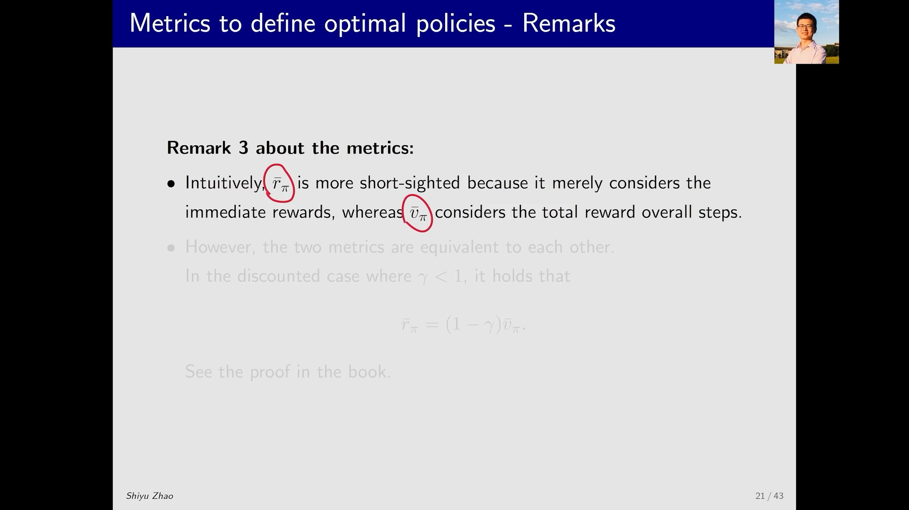

# 策略目标函数之二：平均奖励，以及两种度量的等价

> 本篇整理自赵世钰《强化学习的数学原理》第 9 课「策略梯度方法」Part 3：该方法的目标函数 2（Average reward）。视频地址：[BV1w44y1Q7AB](https://www.bilibili.com/video/BV1w44y1Q7AB/)。上一篇《策略目标函数：平均价值的定义》讲第一个 metric，本篇讲第二个 metric、两者的等价关系，以及论文里最常见那个 $J(\theta)$ 到底是谁。

## 本讲要解决的核心问题（SCQA）

**背景**：上一篇给了第一个 metric——平均价值 $\bar v_\pi=\sum_s d(s)v_\pi(s)$，它是**状态价值的加权平均**，也就是「整条轨迹上折扣回报之和」的平均。

**冲突**：这个定义有两处别扭。第一，它衡量的是**回报**（return），折扣因子 $\gamma$ 一出现，量纲上就带着一个 $1/(1-\gamma)$ 的缩放，不同策略之间比较起来不够直观；第二，它必须先选一个状态分布 $d$，而 $d$ 一旦取平稳分布，就又和策略绑在一起了。**有没有一个更直接、只问「平均每一步能拿多少奖励」的指标？**

**疑问**：如果按「每步奖励的平均」来定义目标函数，它和平均价值是什么关系？优化其中一个，是不是等于优化另一个？另外，论文里到处出现的那个 $J(\theta)=\mathbb{E}\big[\sum_{t=0}^{\infty}\gamma^{t}R_{t+1}\big]$，和我们讲的这两个 metric 又是谁？

**回答（中心思想）**：第二个 metric 叫**平均奖励**（average reward / average one-step reward）：$\bar r_\pi=\sum_s d_\pi(s)r_\pi(s)$，即**单步即时奖励按平稳分布加权平均**。它还有另一个等价定义——沿轨迹跑无穷多步、取奖励的**长期平均**，而且这个定义**与起点 $s_0$ 无关**。更关键的是：在折扣情形下两个 metric **等价**，满足 $\bar r_\pi=(1-\gamma)\bar v_\pi$，所以优化其中任何一个，另一个也同时达到极值。至于论文里那个 $J(\theta)$，讲者留了一道练习，答案是——**它就是平均价值**。

![平均奖励的定义：r̄_π = Σ_s d_π(s) r_π(s) = 𝔼[r_π(S)]，其中 S ~ d_π，r_π(s) = Σ_a π(a|s) r(s,a) 是从状态 s 出发所得单步即时奖励的平均，r(s,a) = 𝔼[R|s,a] = Σ_r r·p(r|s,a)](assets/策略目标函数：平均奖励与两种度量的等价/00005.webp)

---

## 一、第二个 metric：平均奖励

刚才的 metric 是 average value，现在是 **average reward**，或者叫 **average one-step reward**（平均单步奖励），简称平均奖励：

$$
\bar r_\pi \;\doteq\; \sum_{s\in\mathcal{S}} d_\pi(s)\, r_\pi(s) \;=\; \mathbb{E}\big[r_\pi(S)\big], \qquad S\sim d_\pi
$$

式子里有三层，从里往外看最清楚：

**（1）最里层是 $r(s,a)$**：在状态 $s$ 采取动作 $a$ 之后所得到的**即时奖励的平均值**。因为环境的奖励本身可能是随机的，所以要对奖励求期望：

$$
r(s,a) \;=\; \mathbb{E}\big[R\mid s,a\big] \;=\; \sum_{r} r\, p(r\mid s,a)
$$

**（2）中间层是 $r_\pi(s)$**：在状态 $s$ 能得到的**即时奖励的平均值**。在 $s$ 处我有很多个动作可以选，选动作 $a$ 的概率是 $\pi(a\mid s)$，选完之后得到的奖励是 $r(s,a)$，把它们按概率加起来：

$$
r_\pi(s) \;\doteq\; \sum_{a\in\mathcal{A}} \pi(a\mid s)\, r(s,a)
$$

也就是说，先对动作 $a$ 求加权平均（求期望），得到 $r_\pi(s)$。

**（3）最外层是 $\bar r_\pi$**：再对状态 $s$ 求加权平均，权重是**平稳分布** $d_\pi(s)$。因为 $d_\pi$ 是一个概率分布，所以这个和式可以直接写成期望的形式 $\mathbb{E}[r_\pi(S)]$。

用一句话概括：**平均奖励就是「单步即时奖励」的加权平均**——先对动作平均，再对状态平均。注意这里的权重 $d_\pi$ 一定是平稳分布，也就是说，**它必然依赖于策略**——这一点和上一篇里可以取 $d_0$ 的平均价值不同。

[【跳转到 00:30】](https://www.bilibili.com/video/BV1w44y1Q7AB/?t=30) · [【跳转到 01:05】](https://www.bilibili.com/video/BV1w44y1Q7AB/?t=105) · [【跳转到 02:10】](https://www.bilibili.com/video/BV1w44y1Q7AB/?t=130)

---

## 二、平均奖励的另一个定义：沿轨迹的长期平均

上面那个定义是「按状态分布加权」。讲者接着给了第二个定义，它在论文和书籍里出现得同样频繁。

假设有一个策略，我根据这个策略形成了一条**轨迹**（trajectory），沿着这条轨迹得到很多奖励 $R_{t+1},R_{t+2},\dots$。把这些奖励加起来求期望，再除以步数 $n$，最后让 $n$ 趋向于无穷：

$$
\bar r_\pi \;=\; \lim_{n\to\infty}\frac{1}{n}\,\mathbb{E}\Big[\,R_{t+1}+R_{t+2}+\cdots+R_{t+n}\;\Big|\;S_t=s_0\Big]
\;=\;\lim_{n\to\infty}\frac{1}{n}\,\mathbb{E}\Big[\sum_{k=1}^{n}R_{t+k}\;\Big|\;S_t=s_0\Big]
$$

它代表什么呢？代表我从某一个状态出发跑**无穷多步**，但**不是求所有奖励的和，而是求奖励的平均**。注意这里是「除以 $n$ 再取极限」，所以它不会像折扣回报那样收敛到一个有限值再被 $\gamma$ 压小，它衡量的是**长期的平均每步收益**。

![平均奖励的等价定义：沿轨迹的奖励序列 (R_{t+1}, R_{t+2}, …)，其单步平均为 lim_{n→∞} (1/n)𝔼[Σ_{k=1}^n R_{t+k} | S_t = s_0]，其中 s_0 是轨迹的起始状态](assets/策略目标函数：平均奖励与两种度量的等价/00180.webp)

### 2.1 一个漂亮的性质：起点 $s_0$ 不起作用

讲者强调了这个式子的一个重要性质：条件里那个 $S_t=s_0$ **可以去掉**，

$$
\lim_{n\to\infty}\frac{1}{n}\,\mathbb{E}\Big[\sum_{k=1}^{n}R_{t+k}\;\Big|\;S_t=s_0\Big]
\;=\;
\lim_{n\to\infty}\frac{1}{n}\,\mathbb{E}\Big[\sum_{k=1}^{n}R_{t+k}\Big]
$$

为什么？因为**你跑了无穷多步之后，最开始从哪开始的其实已经不再重要了**。起点的影响被无穷多步平均掉了，剩下的只取决于策略本身诱导出的长期访问频率——也就是平稳分布 $d_\pi$。所以这两个定义（按 $d_\pi$ 加权、沿轨迹长期平均）是**等价的**，讲者把证明留给了书，但结论要记住：**看到这个极限式子，就要知道它就是平均奖励**。

[【跳转到 02:35】](https://www.bilibili.com/video/BV1w44y1Q7AB/?t=155) · [【跳转到 03:50】](https://www.bilibili.com/video/BV1w44y1Q7AB/?t=230) · [【跳转到 04:15】](https://www.bilibili.com/video/BV1w44y1Q7AB/?t=255)

---

## 三、关于这两个 metric 的三点补充

讲者随后对两个 metric 做了三点补充说明，第三点最关键。

### 3.1 它们都是 $\theta$ 的函数

无论是平均价值 $\bar v_\pi$ 还是平均奖励 $\bar r_\pi$，它们**全都是策略的函数**；而策略是一个参数为 $\theta$ 的函数，所以它们都是 $\theta$ 的函数。不同的 $\theta$ 会得到不同的 metric 值，其中就存在一个最优的 $\theta$——**找到这个最优的 $\theta$ 去最大化 metric，这就是 policy gradient 的基本思路**。

### 3.2 每个 metric 都要区分「折扣」与「非折扣」两种情形

第一个 metric 分两种情况：**折扣情形**（discounted case）里 $\gamma<1$；**非折扣情形**（undiscounted case）里 $\gamma=1$。

为什么会出现非折扣情形？因为平均奖励这个 metric 是**对即时奖励求平均**，不是对回报求平均；既然不求回报，也就不需要考虑折扣率，所以它对非折扣情形和折扣情形**都成立**。讲者提醒：这个情况比较复杂，课程里不再展开，感兴趣可以到书里看。**但请记住这个划分**——下一篇求梯度时，「不同目标函数 $\times$ 两种情形」的排列组合，正是梯度计算被称为「policy gradient 里最复杂的一部分」的原因。

### 3.3 两个 metric 是等价的：$\bar r_\pi=(1-\gamma)\bar v_\pi$

直观上，平均奖励好像比平均价值更**近视**（short sighted）：它只关心即时奖励，而平均价值关心的是回报——跑很多步之后把所有奖励加起来。实际情况是不是这样呢？

**实际上这两个 metric 是等价的。** 具体来说，在折扣情形下可以证明：

$$
\bar r_\pi \;=\; (1-\gamma)\,\bar v_\pi
$$

讲者特别澄清了「等价」的含义：**不是说这俩相等**，而是说它们满足上面这个等式，中间差一个比例因子 $(1-\gamma)$。既然只差一个正的常数，那么**我对其中一个做优化的时候，另外一个也同时达到了极值**——优化哪个都行。

[【跳转到 05:05】](https://www.bilibili.com/video/BV1w44y1Q7AB/?t=305) · [【跳转到 06:00】](https://www.bilibili.com/video/BV1w44y1Q7AB/?t=360) · [【跳转到 07:10】](https://www.bilibili.com/video/BV1w44y1Q7AB/?t=430)

---

## 四、一道练习：论文里那个 $J(\theta)$ 到底是谁

讲者留了一道小练习，专门解决「读论文时最常见的困惑」。在 policy gradient 的问题里，你会经常见到这个 metric：

$$
J(\theta) \;=\; \mathbb{E}\left[\sum_{t=0}^{\infty}\gamma^{t}R_{t+1}\right]
$$

它和我们刚才介绍的 metric 有什么联系？

![练习题：J(θ) = 𝔼[Σ_{t=0}^∞ γ^t R_{t+1}] 是文献里常见的 metric，它与本课介绍的 metric 是什么关系](assets/策略目标函数：平均奖励与两种度量的等价/00505.webp)

**答案：它就是平均价值 $\bar v_\pi$。** 推导只有两步，讲者说「实际上非常简单，这会儿你可能会被蒙住」：

**第一步，把轨迹的生成过程说清楚。** 这个期望里其实隐含了一条轨迹：它从状态 $S_0$ 出发，而 $S_0$ 服从分布 $d$；然后得到 $A_0,R_1,S_1,A_1,R_2,S_2,\dots$。其中动作按策略选，$A_t\sim\pi(\cdot\mid S_t)$；而奖励和下一个状态由环境决定，$R_{t+1},S_{t+1}\sim p(R_{t+1}\mid S_t,A_t)\,p(S_{t+1}\mid S_t,A_t)$。

**第二步，用全期望公式（total expectation）按起点拆开。** 轨迹可以从不同的 $s$ 出发，从 $s$ 出发的概率是 $d(s)$，从 $s$ 出发得到的值是那个条件期望，加权相加就等于原来的期望：

$$
J(\theta) \;=\; \mathbb{E}\left[\sum_{t=0}^{\infty}\gamma^{t}R_{t+1}\right]
\;=\; \sum_{s\in\mathcal{S}} d(s)\,\mathbb{E}\left[\sum_{t=0}^{\infty}\gamma^{t}R_{t+1}\;\Big|\;S_0=s\right]
$$

而里面那个条件期望是什么？它就是**从状态 $s$ 出发得到的所有折扣奖励之和**，也就是折扣回报 $G_t$ 的期望——**这正是 $v_\pi(s)$**。于是

$$
J(\theta) \;=\; \sum_{s\in\mathcal{S}} d(s)\, v_\pi(s) \;=\; \bar v_\pi
$$

就是这么简单。讲者的用意很明确：**读 policy gradient 或 actor-critic 的论文时，你见到的 metric 要么是这个，要么是另一个，它们在本课里都讲过**——见到的时候要能立刻认出它是谁。

![练习的解答：先明确轨迹从 S_0 ~ d 出发、A_t ~ π(S_t)、R_{t+1} 与 S_{t+1} 由环境决定；再用全期望公式写成 Σ_s d(s)𝔼[Σ_t γ^t R_{t+1} | S_0 = s]，从而说明它就是平均价值](assets/策略目标函数：平均奖励与两种度量的等价/00605.webp)

---

## 小结

1. **平均奖励的定义**：$\bar r_\pi=\sum_s d_\pi(s)r_\pi(s)=\mathbb{E}[r_\pi(S)]$，权重必须是平稳分布 $d_\pi$；其中 $r_\pi(s)=\sum_a\pi(a\mid s)r(s,a)$ 是「先对动作平均」，$r(s,a)=\mathbb{E}[R\mid s,a]$ 是「对环境的随机奖励平均」。
2. **平均奖励的等价定义**：沿轨迹跑无穷多步取奖励的长期平均，$\lim_{n\to\infty}\frac{1}{n}\mathbb{E}\big[\sum_{k=1}^{n}R_{t+k}\big]$；起点 $s_0$ 在无穷多步后被平均掉，所以不影响结果。
3. **两个 metric 等价**：折扣情形下 $\bar r_\pi=(1-\gamma)\bar v_\pi$，只差一个比例因子，优化任何一个另一个也达到极值。
4. **两种情形要分清**：折扣（$\gamma<1$）与非折扣（$\gamma=1$）；平均奖励是对即时奖励求平均，两种情形都成立。
5. **论文里的 $J(\theta)=\mathbb{E}[\sum_t\gamma^{t}R_{t+1}]$ 就是平均价值**：用全期望公式按起点 $S_0\sim d$ 拆开，内层条件期望就是 $v_\pi(s)$，加权求和即 $\bar v_\pi$。

## 关键术语速查

| 术语 | 一句话解释 |
| --- | --- |
| 平均奖励 $\bar r_\pi$ | 单步即时奖励按平稳分布加权平均，$\bar r_\pi=\sum_s d_\pi(s)r_\pi(s)$ |
| $r(s,a)$ | 在状态 $s$ 执行动作 $a$ 后即时奖励的期望 |
| $r_\pi(s)$ | 在状态 $s$ 处按策略 $\pi$ 选动作后即时奖励的期望，$r_\pi(s)=\sum_a\pi(a\mid s)r(s,a)$ |
| 折扣情形 / 非折扣情形 | $\gamma<1$ 时称折扣情形；$\gamma=1$ 时称非折扣情形，此时回报可能发散，故改用平均奖励 |
| 等价（$\bar r_\pi=(1-\gamma)\bar v_\pi$） | 两个 metric 只差一个正的常数因子，优化目标一致 |
| 全期望公式 | $\mathbb{E}[X]=\sum_s d(s)\,\mathbb{E}[X\mid S_0=s]$，按起点分布把期望拆成加权和 |