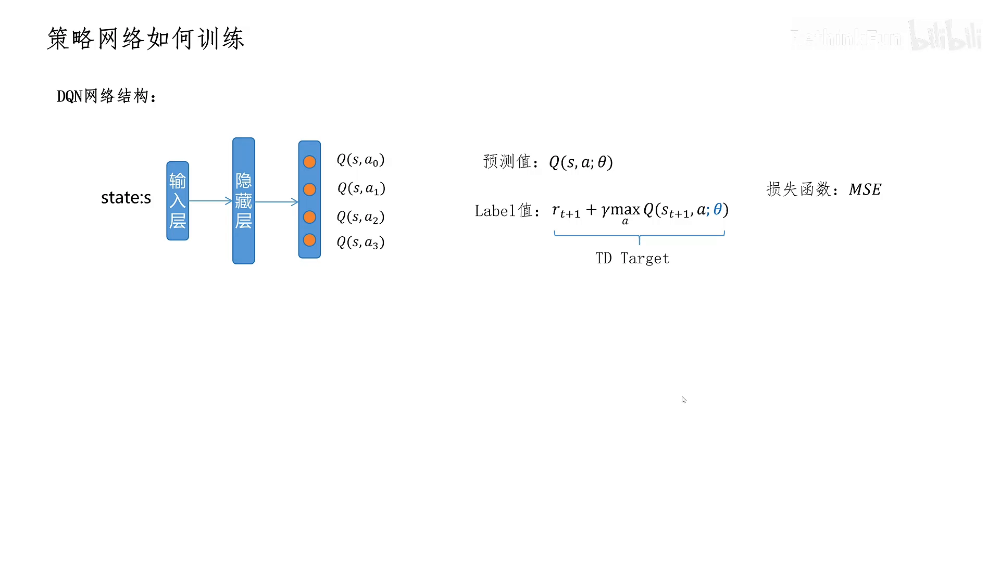
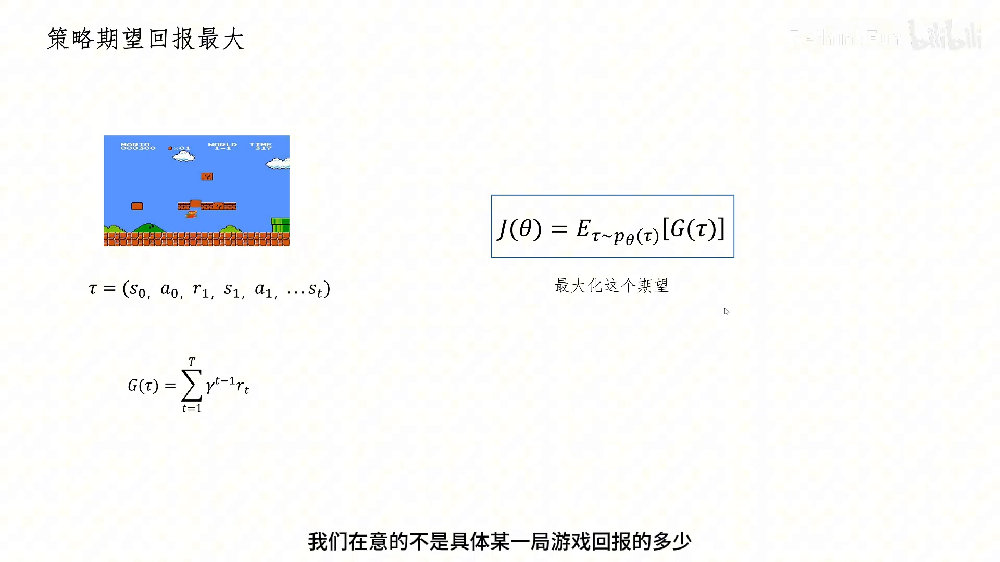
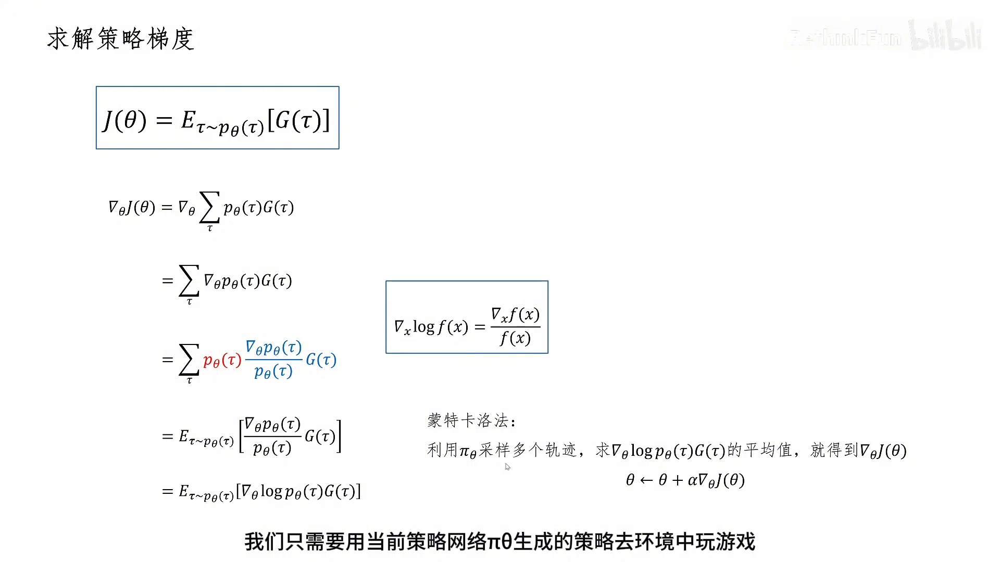
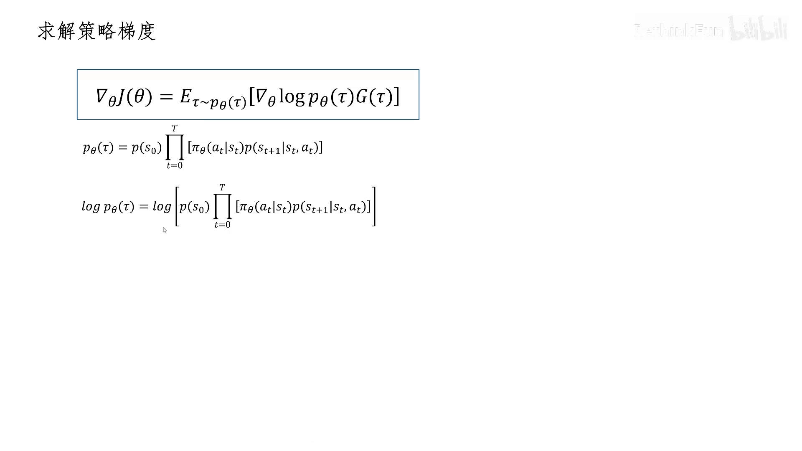
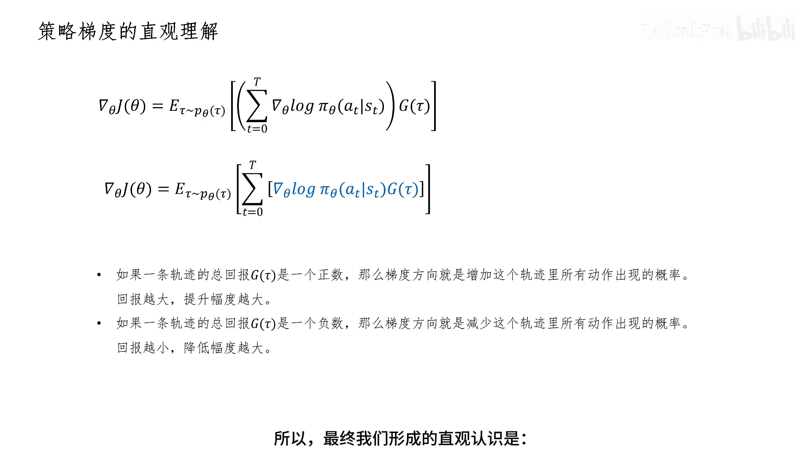

# REINFORCE 的轨迹视角：回报为什么能当梯度的权重

> 本篇整理自 RethinkFun《强化学习策略梯度算法原理》。视频地址：[BV1nz5t6nEyE](https://www.bilibili.com/video/BV1nz5t6nEyE/)。上一篇《REINFORCE：把策略梯度定理里的期望换成一次采样》走的是赵世钰的路线——从策略梯度定理出发，把 $q_\pi$ 换成蒙特卡洛回报。本篇换一个入口：**从「策略网络没有 label」这个困境出发，直接对轨迹概率求导**，最后落到同一个更新式。两条路得到的结论一样，但这一条更能看清「回报」在式子里到底扮演什么角色。

## 本讲要解决的核心问题（SCQA）

**背景**：在 DQN 里，训练网络的路子很清楚——用 TD target 当 label，用 MSE 当损失函数。策略网络看起来也该照这个套路训练。

**冲突**：可是**策略网络没有 label**。它输出的是「在状态 $s$ 下各个动作的概率」，而「状态 $s$ 下的最优动作」我们并不知道，也就没有东西可以当 label。**没有 label，损失函数就无从定义**，参数也就无从更新。

**疑问**：那策略网络到底该怎么训练？没有损失函数，梯度从哪来？

**回答（中心思想）**：换一个目标——不去拟合某个 label，而是**让期望回报最大**。目标函数写成 $J(\theta)=\mathbb{E}_{\tau\sim p_\theta(\tau)}[G(\tau)]$，然后直接对它求梯度。用一个对数求导技巧，梯度会变成「$\nabla_\theta\log\pi_\theta(a_t\mid s_t)$ 乘上这条轨迹的回报 $G(\tau)$」的期望。**回报在这里不是被优化的对象，而是梯度的权重（缩放系数）**：回报大，就往「多做这些动作」的方向推得多；回报小甚至是负的，就往反方向推。

---

## 一、没有 label，就把目标换成「期望回报最大」

先看策略网络的处境。DQN 的网络结构是：输入状态 $s$，输出每个动作的 $Q(s,a;\theta)$；训练时预测值是 $Q(s,a;\theta)$，label 值是 TD target $r_{t+1}+\gamma\max_a Q(s_{t+1},a;\theta)$，损失函数用 MSE。**这套流程成立的前提是「有 label」**。

策略网络没有这个前提。它输出的是动作的概率分布，我们手上没有「最优动作」这个标准答案，所以既定义不出损失函数，也就谈不上反向传播。

出路是换目标函数。假设智能体用策略网络输出的策略去玩超级马里奥，每玩一局就得到一条轨迹 $\tau=(s_0,a_0,r_1,s_1,a_1,\dots,s_T)$，这条轨迹的总折扣回报是

$$
G(\tau)=\sum_{t=1}^{T}\gamma^{t-1}r_t
$$

那么策略网络的目标就是：**用这个策略玩游戏，拿到的总回报的期望越大越好**。

$$
J(\theta)=\mathbb{E}_{\tau\sim p_\theta(\tau)}\big[G(\tau)\big]
$$

这里 $p_\theta(\tau)$ 表示在策略 $\pi_\theta$ 下产生轨迹 $\tau$ 的概率。讲者特别强调了一个容易被忽略的点：**我们在意的不是具体某一局游戏的回报是多少，而是「用这个策略玩游戏，获得回报的期望」是多少**。

[【跳转到 00:10】](https://www.bilibili.com/video/BV1nz5t6nEyE/?t=10)

[【跳转到 01:00】](https://www.bilibili.com/video/BV1nz5t6nEyE/?t=60) · [【跳转到 01:25】](https://www.bilibili.com/video/BV1nz5t6nEyE/?t=85)

**为什么最大化期望回报，等价于「调整轨迹出现的概率」？** 对具体的轨迹 $\tau$，它的回报 $G(\tau)$ 是确定的——这是环境决定的，我们改不了。我们能改的是策略，也就是通过改参数 $\theta$，**让高回报的轨迹出现的概率高一些、低回报的轨迹出现的概率低一些**。这样回报的期望 $J(\theta)$ 自然就变大了。

数学上的做法还是老一套：让 $J(\theta)$ 对 $\theta$ 求梯度，沿梯度方向改变 $\theta$（梯度方向是 $J(\theta)$ 增长最快的方向），用梯度上升 $\theta\leftarrow\theta+\alpha\nabla_\theta J(\theta)$ 就能让 $J(\theta)$ 变大，$\alpha$ 是学习率。所以**核心任务变成一件事：把 $\nabla_\theta J(\theta)$ 求出来**。

---

## 二、对轨迹概率求导：一个「乘一除一」加一个 log 技巧

先把期望写成对所有轨迹求和，再把求导符号移进求和号里面：

$$
\nabla_\theta J(\theta)=\nabla_\theta\sum_{\tau}p_\theta(\tau)G(\tau)=\sum_{\tau}\nabla_\theta p_\theta(\tau)\,G(\tau)
$$

其中只有 $p_\theta(\tau)$ 和 $\theta$ 有关，$G(\tau)$ 可以看作常数。但这样还是算不了：**求和号要求我们把所有可能的轨迹都找出来、分别算再累加，这不现实**。

这里就要用蒙特卡洛方法的思想。讲者用了一个很生活化的比喻：想求「一个餐厅里每人消费金额的期望」，按定义得穷尽所有可能的消费金额和对应概率再累加；但也可以简单地从所有客户里采样一批数据，用他们的平均值作为期望的近似值。**期望算不出来，就用样本平均去近似它**。

所以目标是把上面的求和**改造成一个期望的形式**。做法是经典的「乘一除一」——乘上 $p_\theta(\tau)$ 再除以 $p_\theta(\tau)$，值不变：

$$
\nabla_\theta J(\theta)=\sum_{\tau}p_\theta(\tau)\cdot\frac{\nabla_\theta p_\theta(\tau)}{p_\theta(\tau)}\cdot G(\tau)
=\mathbb{E}_{\tau\sim p_\theta(\tau)}\left[\frac{\nabla_\theta p_\theta(\tau)}{p_\theta(\tau)}G(\tau)\right]
$$

式子里 $p_\theta(\tau)$ 是概率值（图上标红），$\frac{\nabla_\theta p_\theta(\tau)}{p_\theta(\tau)}G(\tau)$ 是统计量（图上标蓝）。再用对数求导法则把那个分式收掉——$\nabla_x\log f(x)=\nabla_x f(x)/f(x)$，所以

$$
\nabla_\theta J(\theta)=\mathbb{E}_{\tau\sim p_\theta(\tau)}\Big[\nabla_\theta\log p_\theta(\tau)\,G(\tau)\Big]
$$

**这就是策略梯度的期望形式**。它立刻变得可计算：用当前策略 $\pi_\theta$ 去环境里玩几局、采样多条轨迹，把每条轨迹的 $\nabla_\theta\log p_\theta(\tau)G(\tau)$ 算出来求平均，就得到梯度的估计，然后 $\theta\leftarrow\theta+\alpha\nabla_\theta J(\theta)$ 更新参数。

[【跳转到 05:35】](https://www.bilibili.com/video/BV1nz5t6nEyE/?t=335) · [【跳转到 05:50】](https://www.bilibili.com/video/BV1nz5t6nEyE/?t=350)

---

## 三、把 $\log p_\theta(\tau)$ 拆开：环境那一半会被求导消掉

$\nabla_\theta\log p_\theta(\tau)$ 还是抽象的，得把 $p_\theta(\tau)$ 展开。一条轨迹的概率由「初始状态概率」乘上「每一步的（选动作概率 × 状态转移概率）」连乘而成：

$$
p_\theta(\tau)=p(s_0)\prod_{t=0}^{T}\Big[\pi_\theta(a_t\mid s_t)\,p(s_{t+1}\mid s_t,a_t)\Big]
$$

其中 $\pi_\theta(a_t\mid s_t)$ 是神经网络的输出，这个我们知道；但初始状态概率 $p(s_0)$ 和状态转移概率 $p(s_{t+1}\mid s_t,a_t)$ 我们不知道——**因为我们没有环境模型**。不过不用担心，接着往下推就会发现它们会被消掉。

对两边取 log，连乘变成连加：

$$
\log p_\theta(\tau)=\log p(s_0)+\sum_{t=0}^{T}\Big[\log\pi_\theta(a_t\mid s_t)+\log p(s_{t+1}\mid s_t,a_t)\Big]
$$

再对 $\theta$ 求梯度。**第一项 $\log p(s_0)$ 和第三项 $\log p(s_{t+1}\mid s_t,a_t)$ 都与 $\theta$ 无关，求导为零**，于是只剩下中间那一项：

$$
\nabla_\theta\log p_\theta(\tau)=\sum_{t=0}^{T}\nabla_\theta\log\pi_\theta(a_t\mid s_t)
$$

代回上一节的期望形式，就得到了最终那个可以真正落地的式子：

$$
\nabla_\theta J(\theta)=\mathbb{E}_{\tau\sim p_\theta(\tau)}\left[\sum_{t=0}^{T}\nabla_\theta\log\pi_\theta(a_t\mid s_t)\,G(\tau)\right]
$$

**式子里只剩两样东西**：神经网络自己输出的动作概率，以及和环境交互拿到的折扣回报。环境模型、初始状态分布，统统不见了。

[【跳转到 07:15】](https://www.bilibili.com/video/BV1nz5t6nEyE/?t=435) · [【跳转到 07:40】](https://www.bilibili.com/video/BV1nz5t6nEyE/?t=460)

---

## 四、直观理解：$G(\tau)$ 是梯度的缩放系数

式子推完了，讲者又花时间做了一件更重要的事——**解释这个式子在干什么**。

先看 $\nabla_\theta\log\pi_\theta(a_t\mid s_t)$ 这一项。log 是单调递增的函数，所以它的梯度方向，就是**让 $\pi_\theta(a_t\mid s_t)$ 增大**的方向；而 $\pi_\theta(a_t\mid s_t)$ 增大，意思是「策略网络在状态 $s_t$ 下做出动作 $a_t$ 的概率变大」。

再看 $G(\tau)$。它对于整条轨迹里的一系列动作决策**都是同一个数**，所以它扮演的角色是**梯度的缩放系数**：

- 如果一条轨迹的总回报 $G(\tau)$ 是**正数**，梯度方向就是**增加这条轨迹里所有动作出现的概率**，而且**回报越大，提升幅度越大**；
- 如果一条轨迹的总回报 $G(\tau)$ 是**负数**，乘以负数就翻转了方向，梯度方向变成**减小这条轨迹里所有动作出现的概率**，回报越小，降低幅度越大。

一句话概括：**好的一局，就把它用过的所有动作都变常见一点；坏的一局，就把它用过的所有动作都变罕见一点，好坏的程度由回报大小决定。**

[【跳转到 09:45】](https://www.bilibili.com/video/BV1nz5t6nEyE/?t=585) · [【跳转到 10:10】](https://www.bilibili.com/video/BV1nz5t6nEyE/?t=610)

---

## 五、这个算法的「美妙之处」

讲者在结尾总结了一句话，值得单独拎出来：**策略梯度方法不需要 label、不需要损失函数**——仅仅利用策略网络自己输出的概率，取对数求导，再乘以实际拿到手的回报值，就可以完成参数的更新。

对比一下开头那个困境就很清楚了：DQN 必须有一个 TD target 当 label 才能算 MSE；策略网络没有 label，于是它干脆**把「回报」本身当成了训练信号**。回报不是被拟合的目标，而是**乘在梯度上的权重**。

---

## 小结

1. **策略网络没有 label**：它输出动作概率，没有「最优动作」可以对照，所以 MSE 那套损失函数用不上。
2. **换目标**：不去拟合 label，而是最大化期望回报 $J(\theta)=\mathbb{E}_{\tau\sim p_\theta(\tau)}[G(\tau)]$；改不了回报 $G(\tau)$，就改「高回报轨迹出现的概率」。
3. **求梯度的三步**：把期望展开成对轨迹求和 → 求导移入求和号 → 乘一除一造出期望，再用 $\nabla\log f=\nabla f/f$ 收掉分式，得到 $\nabla_\theta J=\mathbb{E}[\nabla_\theta\log p_\theta(\tau)G(\tau)]$。
4. **求和算不了，就用采样**：用当前策略玩几局、采样多条轨迹求平均，就是梯度的蒙特卡洛估计。
5. **展开 $p_\theta(\tau)$ 后环境项消失**：$\log p_\theta(\tau)$ 里只有 $\sum_t\log\pi_\theta(a_t\mid s_t)$ 与 $\theta$ 有关，初始状态概率与状态转移概率求导为零。
6. **最终式子**：$\nabla_\theta J(\theta)=\mathbb{E}\big[\sum_t\nabla_\theta\log\pi_\theta(a_t\mid s_t)G(\tau)\big]$，只剩网络输出的概率和环境给的回报。
7. **回报是缩放系数**：$G(\tau)>0$ 就把整条轨迹的动作概率推高（越大推得越多），$G(\tau)<0$ 就压低。
8. **不需要 label、不需要损失函数**：回报本身就是训练信号——这正是 REINFORCE 的「美妙之处」。

## 关键术语速查

| 术语 | 一句话解释 |
| --- | --- |
| 轨迹（trajectory）$\tau$ | 一局完整的交互序列 $(s_0,a_0,r_1,s_1,\dots,s_T)$ |
| $p_\theta(\tau)$ | 在策略 $\pi_\theta$ 下产生轨迹 $\tau$ 的概率，等于初始状态概率与各步「选动作概率 × 状态转移概率」的连乘 |
| $G(\tau)$ | 一条轨迹的总折扣回报 $\sum_t\gamma^{t-1}r_t$ |
| 对数求导技巧 | $\nabla_\theta\log p_\theta(\tau)=\nabla_\theta p_\theta(\tau)/p_\theta(\tau)$，把「概率的梯度」变成「log 概率的梯度」 |
| 似然比（likelihood ratio） | 上面那个分式 $\nabla p/p$ 的别名；它让梯度只依赖策略本身，不依赖环境模型 |
| 蒙特卡洛估计 | 用采样轨迹的平均值近似期望，从而绕开「对所有轨迹求和」 |
| 缩放系数 | $G(\tau)$ 在梯度里的角色：决定把这条轨迹的动作概率推高还是压低、推多少 |
| label-free | 策略梯度不需要「最优动作」标签，也不需要显式损失函数 |