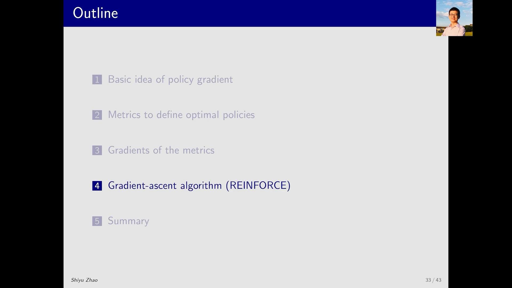
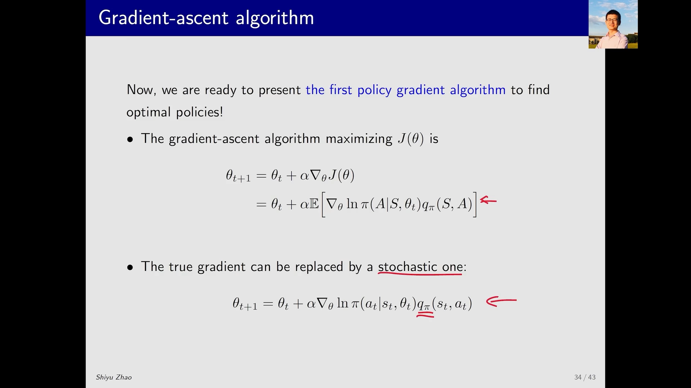
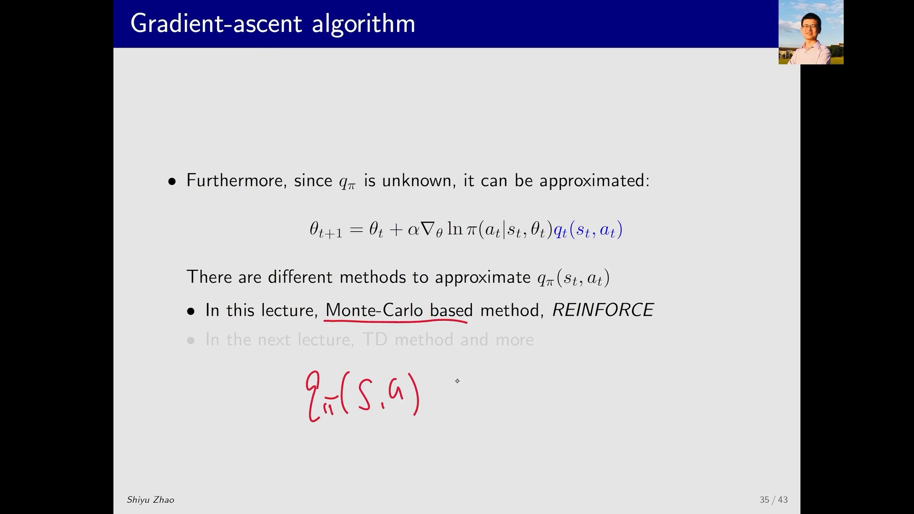
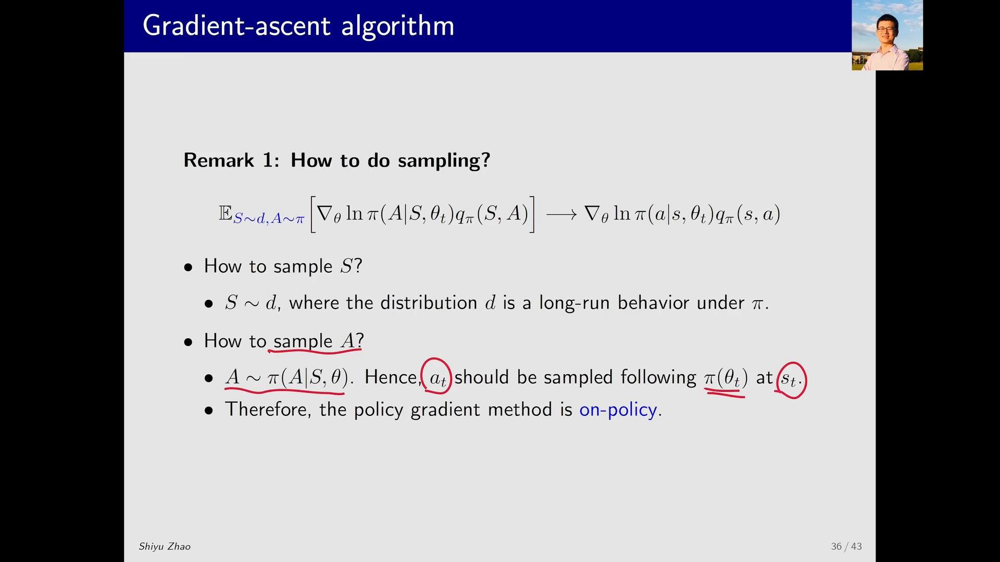
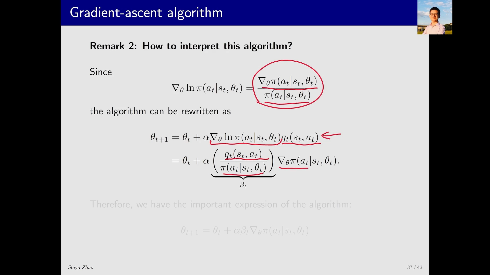
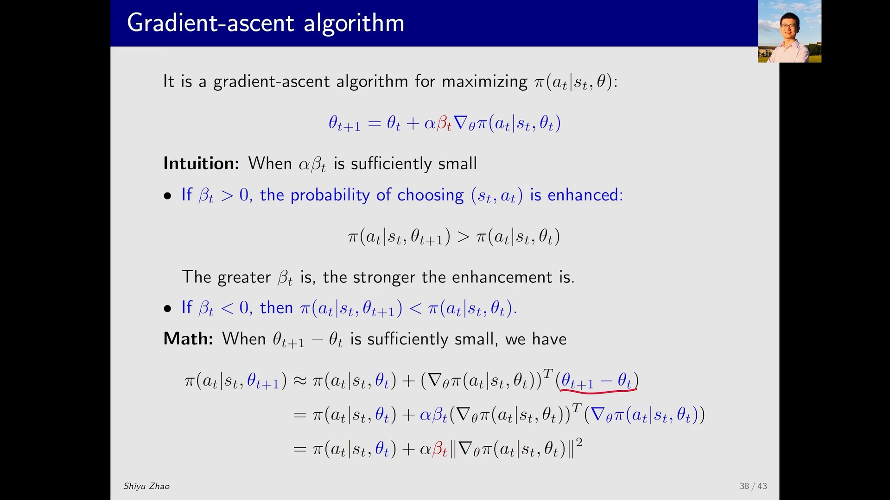
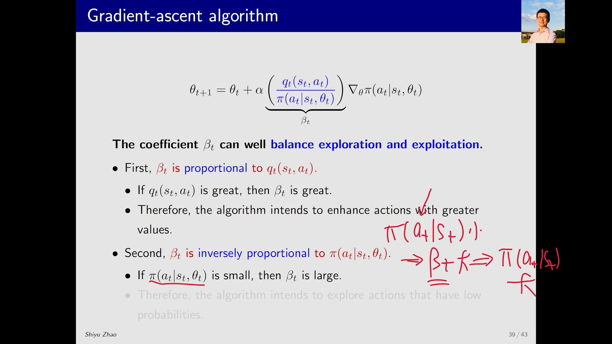
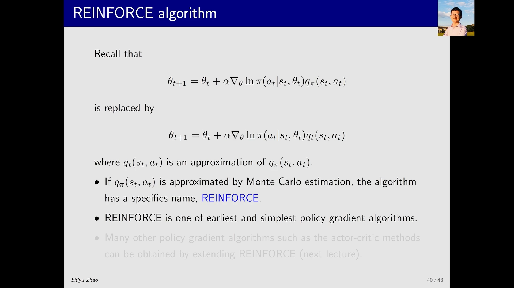
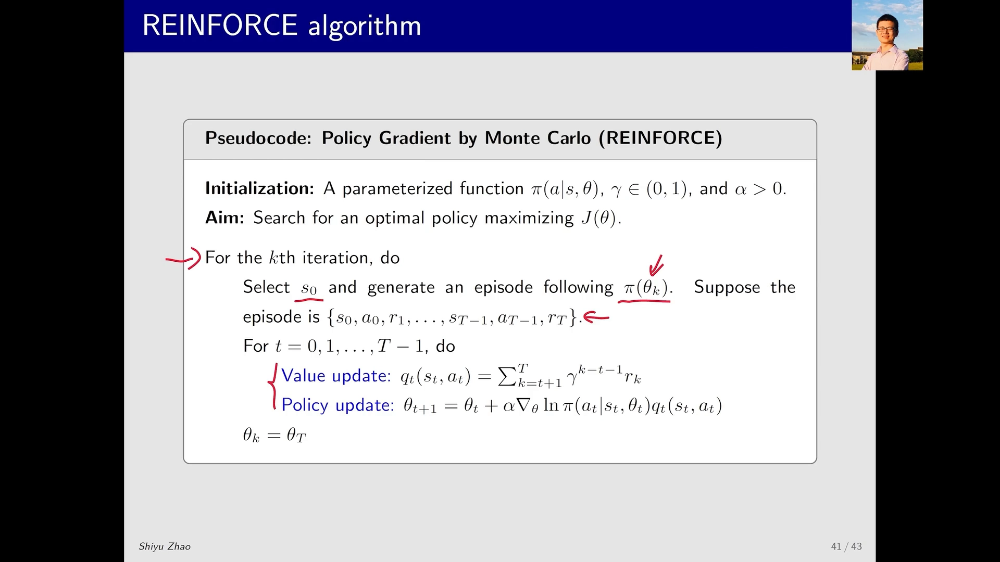
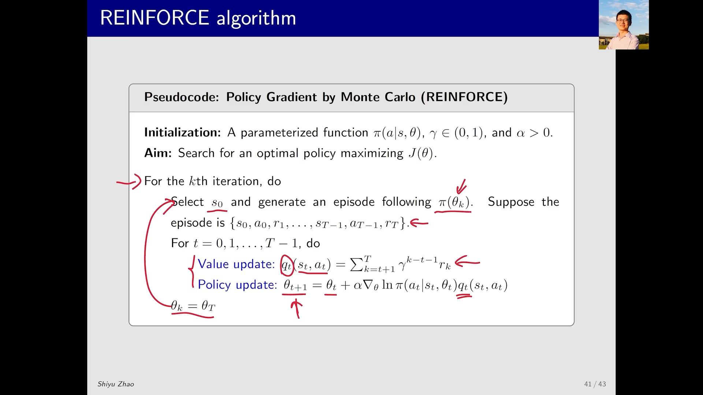

# REINFORCE：把策略梯度定理里的期望换成一次采样

> 本篇整理自赵世钰《强化学习的数学原理》第 9 课「策略梯度方法」Part 5：梯度上升算法和 REINFORCE。视频地址：[BV1gM41167Lz](https://www.bilibili.com/video/BV1gM41167Lz/)。上一篇《策略梯度定理：目标函数的梯度》已经把目标函数的梯度写成了期望 $\nabla_\theta J=\mathbb{E}[\nabla_\theta\ln\pi(A\mid S,\theta)q_\pi(S,A)]$，但期望是算不出来的。本篇要把这个期望用**采样**替换掉，得到第一个、也是最简单的策略梯度算法——REINFORCE。

## 本讲要解决的核心问题（SCQA）

**背景**：策略梯度定理给出了目标函数的梯度，而且是一个漂亮的期望形式。接下来顺理成章的一步，就是把它塞进梯度上升的迭代式 $\theta_{t+1}=\theta_t+\alpha\nabla_\theta J(\theta_t)$ 里去优化策略。

**冲突**：这个迭代式**在实际当中是不能用的**，卡在两处「不知道」上。第一处，梯度里有一个 expectation，它对状态 $S$ 的分布（也就是 $d$ 或 $\eta$）求期望，而这个分布要靠环境模型才能算出来——环境模型我们不知道。第二处，就算把期望换成一次采样，式子里还留着一个 $q_\pi$，它是策略 $\pi$ 下**真实的**行动价值，同样不知道。

**疑问**：这两处「不知道」分别怎么绕过去？绕过去之后，算法长什么样，还能不能保证在改进策略？

**回答（中心思想）**：两次都用**近似**绕过去——第一处用**随机梯度**替换真实梯度，第二处用**估计值 $q_t$ 替换 $q_\pi$**。如果 $q_t$ 取成「从 $(s_t,a_t)$ 出发跑完一个 episode 得到的回报」，这个算法就叫 **REINFORCE**：它是 policy gradient 家族里最早、也最简单的一个成员。

---



[【跳转到 00:05】](https://www.bilibili.com/video/BV1gM41167Lz/?t=5)

## 一、第一步：真实梯度算不出来，换成随机梯度

梯度上升算法的骨架是

$$
\theta_{t+1}=\theta_t+\alpha\nabla_\theta J(\theta_t)
$$

把上一篇的定理代进去，梯度那一项展开成期望：

$$
\theta_{t+1}=\theta_t+\alpha\,\mathbb{E}\Big[\nabla_\theta\ln\pi(A\mid S,\theta_t)\,q_\pi(S,A)\Big]
$$

讲者在这里画了一个箭头，直接点出问题：**这个期望在实际当中算不出来**，因为里面涉及状态的分布；只有当我们知道所有信息（比如环境的模型）时，才能把这个分布确定下来，而这在现实中是不成立的。



[【跳转到 01:20】](https://www.bilibili.com/video/BV1gM41167Lz/?t=80) · [【跳转到 01:45】](https://www.bilibili.com/video/BV1gM41167Lz/?t=105)

于是做法就是策略梯度里最标准的那一手：**用随机梯度（stochastic gradient）替换真实梯度**。把期望符号去掉，把随机变量 $(S,A)$ 换成它的一次实现 $(s_t,a_t)$：

$$
\theta_{t+1}=\theta_t+\alpha\,\nabla_\theta\ln\pi(a_t\mid s_t,\theta_t)\,q_\pi(s_t,a_t)
$$

这就是「采样近似期望」的全部内容——和随机梯度下降里用一个小批量估计真实梯度是同一件事，只不过这里的样本是「在状态 $s_t$ 下按策略采到的动作 $a_t$」。

---

## 二、第二步：$q_\pi$ 还是不知道，换成 $q_t$

上面那个式子其实**仍然不能用**：因为里面有一个 $q_\pi$，它是策略 $\pi$ 所对应的**真实的** action value。讲者的处理办法同样简单粗暴——用一个方法来近似、或者说对 $q_\pi$ 采样，把它换成 $q_t$：

$$
\theta_{t+1}=\theta_t+\alpha\,\nabla_\theta\ln\pi(a_t\mid s_t,\theta_t)\,q_t(s_t,a_t)
$$

其中 $q_t(s_t,a_t)$ 是 $q_\pi(s_t,a_t)$ 的一个近似值。**怎么求这个 $q_t$，有好几种方法**，而选哪种方法，就决定了你得到的是哪个算法：

- **蒙特卡洛方法**（最直观的一种）：要估计 $q_\pi(s,a)$，就从 $(s,a)$ 出发跑一个 episode，把这个 episode 的 return（记为 $g$）当作 $q_t(s,a)$。用这个方法配上策略梯度，得到的算法就叫 **REINFORCE**。
- **时序差分（TD）方法**：用它来估计 $q_t$，得到的是一整族 **actor-critic** 算法，下一课再讲。



[【跳转到 01:45】](https://www.bilibili.com/video/BV1gM41167Lz/?t=105) · [【跳转到 02:10】](https://www.bilibili.com/video/BV1gM41167Lz/?t=130)

**到这里，policy gradient 的算法其实就介绍完了，思路非常简单**：目标函数 → 它的梯度 → 把梯度里的两样未知量分别换成采样值和估计值 → 梯度上升。剩下的时间，讲者补了几个非常重要的说明。

---

## 三、采样怎么做：$S$ 怎么采、$A$ 怎么采

既然要用采样替换期望，就得说清楚 $(S,A)$ 到底怎么采。

**先看 $S$。** 理论上 $S$ 服从分布 $d$（或 $\eta$），这个分布代表「跑了很久之后」对状态的长期分布。但讲者说得很实在：**实际当中我们一般都不这么做**——「我们有数据就不错了」，不会为了等它达到平稳状态而先跑很久再去用数据。所以这一点在实际中一般不太考虑。

**再看 $A$。** 这里没有商量的余地：理论上要求 $A\sim\pi(A\mid S,\theta)$，所以在 $s_t$ 处，$a_t$ **必须按当前这个 $\pi(\theta_t)$ 来采**。

这一条直接决定了算法的一个性质：**policy gradient 是 on-policy 的**。因为它的 behavior policy 是这个 $\pi$，target policy 也是这个 $\pi$——改进完了之后立刻要用它生成新数据，再用新数据改进自己。讲者也提到，off-policy 的情况是存在的，但需要额外的技巧，留到下一课。



[【跳转到 03:50】](https://www.bilibili.com/video/BV1gM41167Lz/?t=230) · [【跳转到 04:15】](https://www.bilibili.com/video/BV1gM41167Lz/?t=255)

---

## 四、换个写法看这个算法：它其实在直接优化 $\pi(a_t\mid s_t)$

有同学可能会说：这不就是一个梯度上升算法吗？它在做的事情不就是优化目标函数吗？讲者说这点没错，但**把算法重新组织一下、以另一种形式呈现出来，会发现很多有意思的地方**。

用的还是上一篇那个对数求导恒等式：

$$
\nabla_\theta\ln\pi(a_t\mid s_t,\theta_t)=\frac{\nabla_\theta\pi(a_t\mid s_t,\theta_t)}{\pi(a_t\mid s_t,\theta_t)}
$$

把算法里的 $\nabla_\theta\ln\pi$ 换成右边这个分式，把分母挪到 $q_t$ 下面、分子单独拿出来，再把整个分式记成一个系数 $\beta_t$：

$$
\theta_{t+1}=\theta_t+\alpha\,\beta_t\,\nabla_\theta\pi(a_t\mid s_t,\theta_t),
\qquad
\beta_t=\frac{q_t(s_t,a_t)}{\pi(a_t\mid s_t,\theta_t)}
$$

**这个式子一眼就能读懂**：它就是一个以 $\pi(a_t\mid s_t,\theta)$ 为目标函数、以 $\alpha\beta_t$ 为步长的梯度上升。换句话说，**这个算法是在直接优化「在 $s_t$ 处选择 $a_t$ 的概率」这个值**。



[【跳转到 05:05】](https://www.bilibili.com/video/BV1gM41167Lz/?t=305) · [【跳转到 05:55】](https://www.bilibili.com/video/BV1gM41167Lz/?t=355)

有了这个视角，就能得到两条直观结论（前提是步长 $\alpha\beta_t$ 足够小）：

- **$\beta_t>0$ 时**，更新后的概率变大：$\pi(a_t\mid s_t,\theta_{t+1})>\pi(a_t\mid s_t,\theta_t)$；而且 $\beta_t$ 越大，提升越强。
- **$\beta_t<0$ 时**，方向反过来，做的是梯度下降：$\pi(a_t\mid s_t,\theta_{t+1})<\pi(a_t\mid s_t,\theta_t)$。

**为什么一定要「步长足够小」？** 讲者画了一条曲线解释：假如那里是一个极值，从一侧出发沿着梯度确实能朝极值方向前进；但步长太大会直接冲过头，那就不能保证还在上升了。只有在足够小的范围内，才能确保沿着梯度方向函数确实在上升（或下降）。

---

## 五、把直觉写成数学：一次一阶泰勒展开

上面那两条结论不是「看着像」，而是可以推出来的。讲者的推导只用了一阶泰勒展开：当 $\theta_{t+1}-\theta_t$ 足够小时，

$$
\pi(a_t\mid s_t,\theta_{t+1})\approx\pi(a_t\mid s_t,\theta_t)+\big(\nabla_\theta\pi(a_t\mid s_t,\theta_t)\big)^{T}(\theta_{t+1}-\theta_t)
$$

把 $\theta_{t+1}-\theta_t=\alpha\beta_t\nabla_\theta\pi(a_t\mid s_t,\theta_t)$ 代进最后一项，两个梯度向量相乘就变成梯度的模的平方：

$$
\pi(a_t\mid s_t,\theta_{t+1})\approx\pi(a_t\mid s_t,\theta_t)+\alpha\beta_t\big\|\nabla_\theta\pi(a_t\mid s_t,\theta_t)\big\|^{2}
$$

第二项里的 $\|\cdot\|^2\ge 0$，所以**符号完全由 $\beta_t$ 决定**：$\beta_t>0$ 就增大，$\beta_t<0$ 就减小。讲者的原话是「这个就是刚才那个直觉的一个数学表示，仅此而已」。



[【跳转到 08:50】](https://www.bilibili.com/video/BV1gM41167Lz/?t=530) · [【跳转到 09:15】](https://www.bilibili.com/video/BV1gM41167Lz/?t=555)

---

## 六、$\beta_t$ 的两副面孔：一边 exploitation，一边 exploration

系数 $\beta_t$ 值得单独讲，因为它同时承担了两件方向相反的事，**很好地平衡了 exploration 和 exploitation**。

**看分子：$\beta_t$ 与 $q_t(s_t,a_t)$ 成正比。** $q_t$ 大 → $\beta_t$ 大 → $\pi(a_t\mid s_t)$ 被增大。翻译成一句话：**如果这个动作之前的 action value 比较大，那就给它更大的概率去选它**。这是在 exploitation——我都知道那个动作能给我更大的价值了，为什么不多选它？

**看分母：$\beta_t$ 与 $\pi(a_t\mid s_t,\theta_t)$ 成反比。** $\pi(a_t\mid s_t)$ 小 → $\beta_t$ 大 → 更新后 $\pi(a_t\mid s_t)$ 被抬高。翻译成一句话：**如果之前选 $a_t$ 的概率很小，那就在下一时刻给它更大的概率**。这是在 exploration——把冷门动作的概率顶上来。

一个系数，分子负责「往好的动作上加码」，分母负责「把冷门的动作抬起来」。这正是策略梯度方法自带探索性的来源：它不像 $\epsilon$-greedy 那样外挂一个随机扰动，而是**内建在更新式里**。



[【跳转到 11:45】](https://www.bilibili.com/video/BV1gM41167Lz/?t=705) · [【跳转到 12:10】](https://www.bilibili.com/video/BV1gM41167Lz/?t=730)

---

## 七、把 $q_t$ 取成蒙特卡洛回报：REINFORCE 登场

回到那个待定的 $q_t$。如果**用蒙特卡洛方法**：从 $(s_t,a_t)$ 出发跑一个 episode，把这个 episode 的 return $g_t$ 赋给 $q_t$，那么

$$
q_t(s_t,a_t)=g_t
$$

这样得到的 policy gradient 算法有一个专门的名称：**REINFORCE**。讲者强调，它是 policy gradient 家族里**最早、也最简单**的一个；后面更多的算法（尤其是下一课的 actor-critic）都是在它基础上扩展出来的。



[【跳转到 13:00】](https://www.bilibili.com/video/BV1gM41167Lz/?t=780) · [【跳转到 13:20】](https://www.bilibili.com/video/BV1gM41167Lz/?t=800)

完整的流程是：在第 $k$ 次迭代里选一个初始状态 $s_0$，用当前策略 $\pi(\theta_k)$ 和环境交互得到一个 episode；然后对 episode 里的**每一个** $(s_t,a_t)$ 做两步操作——先做 **value update**（从 $(s_t,a_t)$ 出发把后面所有 reward 折扣相加，得到 $q_t$），再做 **policy update**（把 $q_t$ 代进更新式，立刻得到新的 $\theta_{t+1}$）。整个 episode 走完，把最后的 $\theta_T$ 作为下一轮的 $\theta_k$。

```text
Pseudocode: Policy Gradient by Monte Carlo (REINFORCE)

Initialization: A parameterized function π(a|s,θ), γ ∈ (0,1), and α > 0.
Aim: Search for an optimal policy maximizing J(θ).

For the kth iteration, do
    Select s0 and generate an episode following π(θ_k).
    Suppose the episode is {s0, a0, r1, ..., s_{T-1}, a_{T-1}, r_T}.
    For t = 0, 1, ..., T-1, do
        Value update:  q_t(s_t,a_t) = Σ_{k=t+1}^{T} γ^{k-t-1} r_k
        Policy update: θ_{t+1} = θ_t + α ∇_θ ln π(a_t|s_t,θ_t) q_t(s_t,a_t)
    θ_k = θ_T
```



[【跳转到 13:50】](https://www.bilibili.com/video/BV1gM41167Lz/?t=830) · [【跳转到 14:30】](https://www.bilibili.com/video/BV1gM41167Lz/?t=870)

---

## 八、一个容易被追问的细节：为什么 $\theta_{t+1}$ 不立刻去采样？

看伪代码会发现一件怪事：$\theta_t$ 已经更新成 $\theta_{t+1}$ 了，但**它并没有立刻拿去生成新数据**，而是要等整个 episode 走完、把 $\theta_T$ 定下来，才用它去采下一轮数据。

原因就在于这个方法是**基于蒙特卡洛**的：蒙特卡洛是 offline（离线的）——你必须把一个 episode 全部采集完毕，才能开始算回报、开始更新。所以它做不到「边更新 $\theta_t$ 边采集」。讲者说，等到后面介绍基于 TD 的方法时，就可以变成 online 的：拿到新的 $\theta_t$ 立刻就能用来生成数据。



[【跳转到 14:40】](https://www.bilibili.com/video/BV1gM41167Lz/?t=880)

---

## 小结

1. **梯度上升的骨架**是 $\theta_{t+1}=\theta_t+\alpha\nabla_\theta J(\theta_t)$，把定理代进去就得到一个含期望的式子——**它在实际中不能用**，因为状态分布要靠环境模型才能算。
2. **第一处近似**：用随机梯度替换真实梯度，把期望换成一次实现 $(s_t,a_t)$，得到 $\theta_{t+1}=\theta_t+\alpha\nabla_\theta\ln\pi(a_t\mid s_t,\theta_t)q_\pi(s_t,a_t)$。
3. **第二处近似**：$q_\pi$ 也不知道，换成估计值 $q_t$。用**蒙特卡洛**估计 $q_t$（即 $q_t=g_t$）得到 **REINFORCE**；用 **TD** 估计则通向 actor-critic。
4. **采样规则决定了 on-policy**：$S$ 的长期分布 $d$ 在实际中不太考虑，但 $A$ 必须按当前 $\pi(\theta_t)$ 采，所以 behavior policy 与 target policy 是同一个。
5. **换个写法更好懂**：把 $\nabla\ln\pi$ 展开成 $\nabla\pi/\pi$，算法变成 $\theta_{t+1}=\theta_t+\alpha\beta_t\nabla_\theta\pi(a_t\mid s_t,\theta_t)$，$\beta_t=q_t/\pi$——它就是在直接优化 $\pi(a_t\mid s_t,\theta)$。
6. **小步长下结论明确**：一阶泰勒展开给出 $\pi(\theta_{t+1})\approx\pi(\theta_t)+\alpha\beta_t\|\nabla_\theta\pi\|^2$，符号由 $\beta_t$ 决定。
7. **$\beta_t$ 同时管两件事**：分子 $q_t$ 大就加码（exploitation），分母 $\pi$ 小就抬高（exploration）——探索性内建在更新式里。
8. **REINFORCE 是离线（offline）的**：必须采完整个 episode 才能更新，因为它的 $q_t$ 来自蒙特卡洛回报；改成 TD 估计才能变成 online。

## 关键术语速查

| 术语 | 一句话解释 |
| --- | --- |
| 随机梯度（stochastic gradient） | 用一次采样 $(s_t,a_t)$ 代替期望，得到真实梯度的无偏估计 |
| $q_t(s_t,a_t)$ | 对真实行动价值 $q_\pi(s_t,a_t)$ 的估计；REINFORCE 里取成蒙特卡洛回报 $g_t$ |
| REINFORCE | 用蒙特卡洛回报估计 $q_t$ 的策略梯度算法，最早、最简单的 policy gradient 方法 |
| on-policy | 采样用的策略与正在改进的策略是同一个 $\pi$，policy gradient 属于这一类 |
| $\beta_t$ | 系数 $q_t(s_t,a_t)/\pi(a_t\mid s_t,\theta_t)$，同时承担 exploitation 与 exploration |
| 一阶泰勒展开 | 用 $\pi(\theta_t)+(\nabla\pi)^T\Delta\theta$ 近似 $\pi(\theta_{t+1})$，从而判断概率的增减 |
| offline（离线） | 必须采完整个 episode 才能更新；蒙特卡洛方法的固有约束 |
| actor-critic | 用 TD 等方法估计 $q_t$ 的策略梯度算法族，下一课的主题 |