# REINFORCE with Baseline：用价值网络给策略梯度当基线

> 本篇整理自王树森《深度强化学习》「REINFORCE with Baseline（2/4）」。视频地址：[BV12o4y197US 第 15 P](https://www.bilibili.com/video/BV12o4y197US/?p=15)。上一篇《策略梯度中的 Baseline：为什么不改变期望却能降方差》只做了数学推导；这一篇把它变成能跑的算法——**用状态价值 $V_\pi(s_t)$ 当基线**，并解决「$V_\pi$ 本身也不知道」的问题。

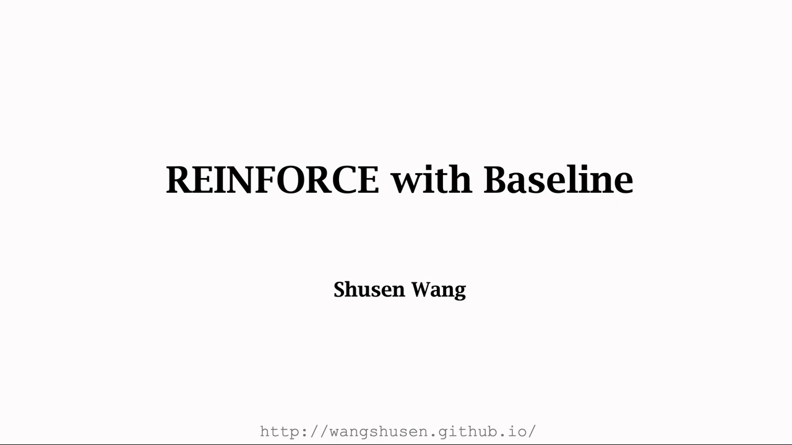

[【跳转到 00:00】](https://www.bilibili.com/video/BV12o4y197US/?p=15&t=0)

## 本讲要解决的核心问题（SCQA）

**背景**：上一篇得到了带 baseline 的策略梯度定理——只要 $b$ 与动作 $A_t$ 无关，就可以把 $Q_\pi(s_t,A_t)$ 换成 $Q_\pi(s_t,A_t)-b$，梯度期望不变、方差变小。最自然的取法是 $b=V_\pi(s_t)$。

**冲突**：这个定理**还不能直接用**。式子里有两个未知量：动作价值 $Q_\pi(s_t,A_t)$ 和状态价值 $V_\pi(s_t)$。真实环境里我们既没有环境模型、也没有价值函数，只有一条条玩出来的轨迹。

**疑问**：能不能只用**观测到的数据**，把这两个未知量都换掉，得到一个能实际迭代的算法？

**回答（中心思想）**：能。做**三次近似**——用蒙特卡洛把期望换成一条样本、用观测到的回报 $u_t$ 近似 $Q_\pi$、用价值网络 $v(s;w)$ 近似 $V_\pi$——就得到 **REINFORCE with Baseline**：一个策略网络 $\pi(a\mid s;\theta)$ 负责控制 agent，一个价值网络 $v(s;w)$ 专门提供 baseline，两个网络各有一套参数、各有一个更新式。

---

## 一、先复习三个函数：$U_t$、$Q_\pi$、$V_\pi$

这三个量是层层嵌套的关系，后面每一次近似都对应拆掉其中一层。

### 1.1 折扣回报 $U_t$

在 $t$ 时刻，从这一刻起直到游戏结束，把收到的奖励按折扣率加权求和，就是**折扣回报**（discount return）：

$$
U_t \;=\; \sum_{i=t}^{n}\gamma^{\,i-t}\cdot R_i
$$

其中 $R_i$ 是环境在第 $i$ 步给的奖励，$\gamma\in[0,1]$ 是折扣率。**关键一点**：在 $t$ 时刻，未来的奖励 $R_{t+1},\dots,R_n$ 都还没发生、带有随机性，所以用大写字母表示；既然奖励是随机的，**回报 $U_t$ 也是随机变量**。

### 1.2 $Q_\pi$ 与 $V_\pi$：两次「消掉随机性」

**动作价值函数** $Q_\pi(s_t,a_t)$ 是回报 $U_t$ 的**条件期望**——条件是在 $s_t$ 处执行了 $a_t$：

$$
Q_\pi(s_t,a_t) \;=\; \mathbb{E}\big[U_t \mid s_t, a_t\big]
$$

取期望等于把未来所有状态和动作的随机性都消掉了，所以 $Q_\pi$ 只依赖当前的状态 $s_t$ 和动作 $a_t$。

**状态价值函数** $V_\pi(s_t)$ 再对动作求一次期望，把当前动作 $a$ 也消掉：

$$
V_\pi(s_t) \;=\; \mathbb{E}_{A_t\sim\pi}\big[Q_\pi(s_t,A_t)\big]
$$

**这三层关系要记住**：$U_t$ 是随机的观测值，$Q_\pi$ 是它关于未来的期望，$V_\pi$ 是 $Q_\pi$ 关于动作的期望。**每往外一层，随机性就少一层。**

---

## 二、出发点是带 baseline 的策略梯度

上一篇推导出的公式，这里把 baseline 直接取成 $V_\pi(s_t)$：

$$
\frac{\partial V_\pi(s_t)}{\partial \theta} \;=\; \mathbb{E}_{A_t\sim\pi}\left[\frac{\partial \ln \pi(A_t\mid s_t;\theta)}{\partial \theta}\cdot\Big(Q_\pi(s_t,A_t)-V_\pi(s_t)\Big)\right]
$$

**这个式子的合法性来自上一篇的引理**：$V_\pi(s_t)$ 只依赖 $s_t$，而 $s_t$ 是先于 $A_t$ 被观测到的，所以 $V_\pi(s_t)$ 与 $A_t$ 无关，可以作为 baseline——用它、或者把它去掉，期望值完全一样。区别只在**做蒙特卡洛近似时，它能把方差压小、加速收敛**。

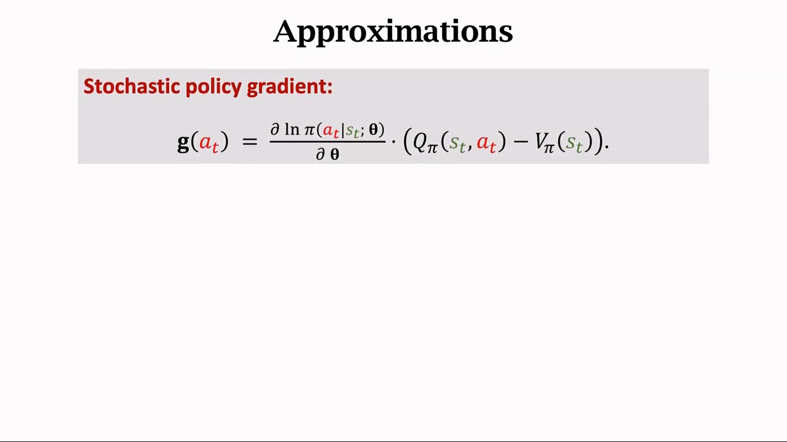

[【跳转到 01:15】](https://www.bilibili.com/video/BV12o4y197US/?p=15&t=75) · [【跳转到 02:29】](https://www.bilibili.com/video/BV12o4y197US/?p=15&t=149)

把期望里的整块内容记作 $g(A_t)$：

$$
g(A_t) \;=\; \frac{\partial \ln \pi(A_t\mid s_t;\theta)}{\partial \theta}\cdot\Big(Q_\pi(s_t,A_t)-V_\pi(s_t)\Big)
$$

按策略网络抽一个动作 $a_t$，算出的 $g(a_t)$ 就是**随机策略梯度**，它是策略梯度的无偏估计——这是**第一次蒙特卡洛**。

**但公式里还有未知项**：$Q_\pi$ 和 $V_\pi$ 都不知道。所以还得继续近似它们。

---

## 三、三次近似：把不可观测量换成可计算量

讲者把整条近似链拆得很清楚，一共三次。

### 3.1 近似二：用观测到的回报 $u_t$ 近似 $Q_\pi$

回忆定义 $Q_\pi(s_t,a_t)=\mathbb{E}[U_t\mid s_t,a_t]$——**$Q_\pi$ 是一个期望**。既然拿不到期望，就拿一个观测值去近似它：玩一局游戏到结束，观测到一条轨迹 $s_t,a_t,r_t,\dots,s_n,a_n,r_n$，把 $t$ 时刻之后的奖励加权求和得到 $u_t$，就用 $u_t$ 近似 $Q_\pi(s_t,a_t)$。

$$
Q_\pi(s_t,a_t) \;\approx\; u_t
$$

这仍然是**用观测值近似期望**，所以还是蒙特卡洛——这是**第二次蒙特卡洛**。拿 $u_t$ 近似 $Q_\pi$ 之后，算法就有了名字：**REINFORCE**。

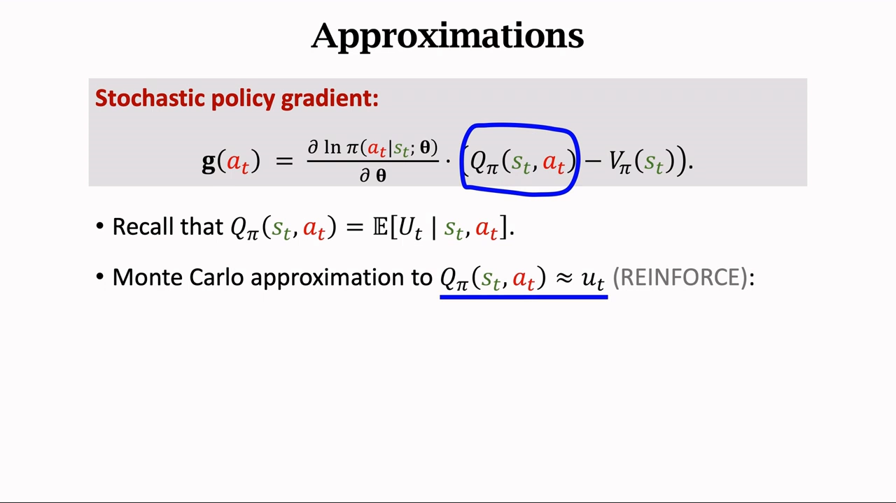

[【跳转到 02:54】](https://www.bilibili.com/video/BV12o4y197US/?p=15&t=174)

### 3.2 近似三：用价值网络 $v(s;w)$ 近似 $V_\pi$

公式里还有一项状态价值 $V_\pi(s_t)$，我们同样不知道它是什么。这一次不用采样，改用**函数近似**：拿一个神经网络去拟合它，记作 $v(s;w)$，$w$ 是它的参数。这个网络有个专门的名字——**价值网络**（value network）。

$$
V_\pi(s_t) \;\approx\; v(s_t;w)
$$

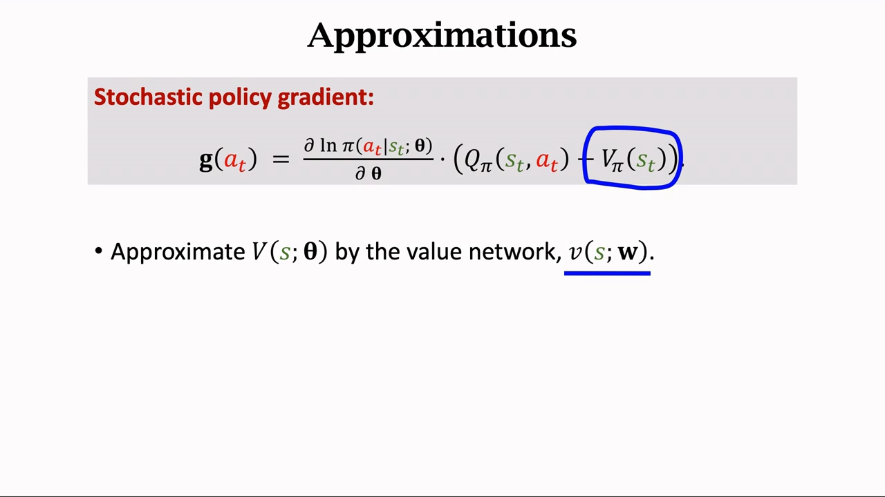

[【跳转到 03:44】](https://www.bilibili.com/video/BV12o4y197US/?p=15&t=224)

### 3.3 三次近似合起来

把三处替换代回原式，就得到**真正能算的**策略梯度：

$$
\frac{\partial V_\pi(s_t)}{\partial \theta} \;\approx\; g(a_t) \;\approx\; \frac{\partial \ln \pi(a_t\mid s_t;\theta)}{\partial \theta}\cdot\Big(u_t - v(s_t;w)\Big)
$$

讲者的清单是这样的：

1. **用一条样本近似期望**（蒙特卡洛）——把策略梯度近似成随机梯度 $g_t$；
2. **用回报 $u_t$ 近似 $Q_\pi$**（也是蒙特卡洛）——所以一共用了两次蒙特卡洛；
3. **用价值网络 $v(s;w)$ 近似 $V_\pi$**（函数近似）——这是第三次。

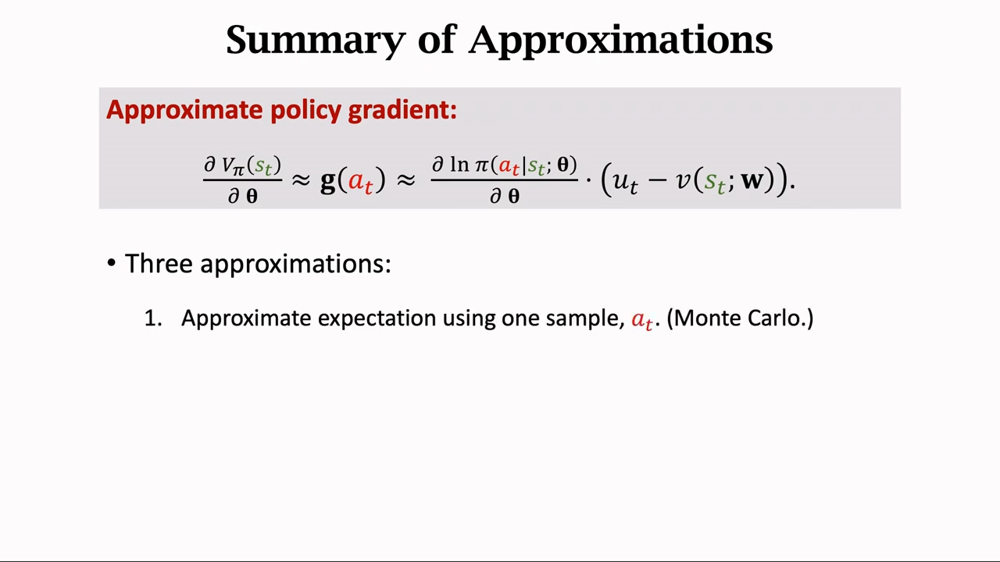

[【跳转到 04:09】](https://www.bilibili.com/video/BV12o4y197US/?p=15&t=249) · [【跳转到 04:34】](https://www.bilibili.com/video/BV12o4y197US/?p=15&t=274)

**现在公式里全是可计算的东西**：$\pi$ 是策略网络（已知），$u_t$ 是从轨迹里算出来的（已知），$v(s_t;w)$ 是价值网络（已知）。剩下的问题只有一个：**这两个网络怎么训练？**

---

## 四、两个网络：一个控制 agent，一个提供基线

### 4.1 策略网络 $\pi(a\mid s;\theta)$

它是对策略函数 $\pi(a\mid s)$ 的近似。结构是：输入状态 $s$（比如游戏画面），卷积层提取特征得到特征向量，再用若干全连接层映射成向量；**如果有 3 个动作，这个向量就是 $3\times 1$**；最后接一个 **softmax** 激活函数。

softmax 保证输出是一个**概率分布**：每个元素都是正数、并且相加等于 $1$。比如输出向量是「向左 $0.2$、向右 $0.1$、向上 $0.7$」——这就是在状态 $s$ 下三个动作的概率。训练时按这个分布抽样决定动作。

### 4.2 价值网络 $v(s;w)$

它是对状态价值 $V_\pi(s)$ 的近似。输入同样是状态 $s$，用卷积层提取特征，再用全连接层把特征映射成**一个实数**——这个实数就是 $v(s;w)$，它被用作策略梯度里的 baseline。

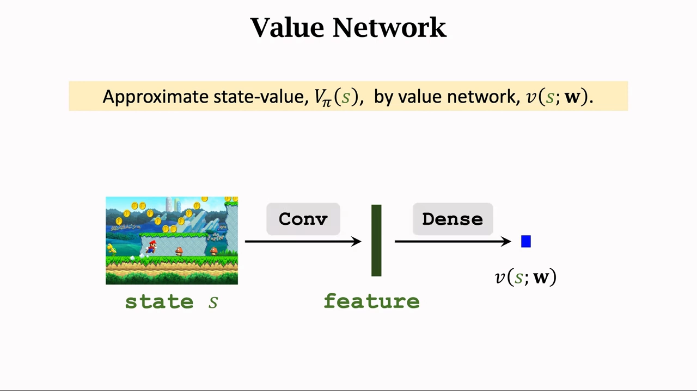

[【跳转到 06:07】](https://www.bilibili.com/video/BV12o4y197US/?p=15&t=367)

### 4.3 共享卷积层

两个网络的输入**完全相同**，都是状态 $s$；而且都要用卷积层提取特征。所以显然可以让它们**共享卷积层的参数**：

- 共享的卷积层负责把状态变成特征向量；
- 之后分两路：一路接全连接层 + softmax，输出动作概率（策略网络）；另一路接全连接层，输出一个实数（价值网络）。

这样做既省参数、又省计算，而且特征对两个任务都有用。**注意两个网络的参数是分开的**：策略网络的参数是 $\theta$，价值网络的参数是 $w$，更新时各更各的。

---

## 五、训练：两个网络、两个更新式

### 5.1 更新策略网络：梯度上升

有了近似出的策略梯度，就可以做**梯度上升**让状态价值变大（也就是让策略更好）：

$$
\theta \;\leftarrow\; \theta + \beta\cdot\frac{\partial \ln \pi(a_t\mid s_t;\theta)}{\partial \theta}\cdot\Big(u_t - v(s_t;w)\Big)
$$

其中 $\beta$ 是学习率，是个需要调的超参数。

**这里有个符号上的小技巧**。把「价值网络的预测与真实观测回报之差」定义为**预测误差**：

$$
\delta_t \;=\; v(s_t;w) - u_t
$$

那么 $u_t-v(s_t;w)=-\delta_t$，更新式可以写成更紧凑的形式：

$$
\theta \;\leftarrow\; \theta - \beta\cdot\delta_t\cdot\frac{\partial \ln \pi(a_t\mid s_t;\theta)}{\partial \theta}
$$

**为什么这个形式好记**：$\delta_t>0$ 意味着「实际拿到的回报比价值网络预期的**差**」，此时 $\theta$ 沿着**负**梯度方向走，即**降低**这条动作的概率；$\delta_t<0$ 则相反，**提高**它的概率。**这正是「比预期好就多做、比预期差就少做」的直觉**，而 $v(s_t;w)$ 恰好就是那个「预期」。

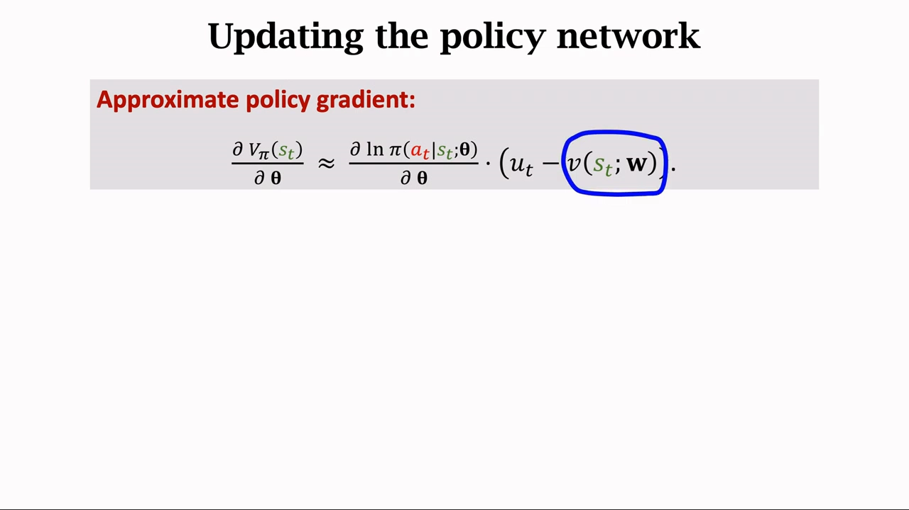

[【跳转到 07:17】](https://www.bilibili.com/video/BV12o4y197US/?p=15&t=437) · [【跳转到 07:29】](https://www.bilibili.com/video/BV12o4y197US/?p=15&t=449)

### 5.2 更新价值网络：做回归

价值网络的训练目标很直接：**让它去接近真实的状态价值 $V_\pi(s_t)$**。而

$$
V_\pi(s_t) \;=\; \mathbb{E}\big[U_t \mid s_t\big]
$$

既然想让 $v(s_t;w)$ 接近 $U_t$ 的期望，那就用观测到的回报 $u_t$ 当标签，让 $v$ 去**拟合** $u_t$——这就是一个标准的**回归**问题。

用预测误差 $\delta_t=v(s_t;w)-u_t$ 做损失函数：

$$
L \;=\; \frac{1}{2}\delta_t^{2}
$$

对参数 $w$ 求导：

$$
\frac{\partial L}{\partial w} \;=\; \delta_t\cdot\frac{\partial v(s_t;w)}{\partial w}
$$

然后做**梯度下降**：

$$
w \;\leftarrow\; w - \alpha\cdot\delta_t\cdot\frac{\partial v(s_t;w)}{\partial w}
$$

其中 $\alpha$ 是学习率。这样更新能让 $\delta_t^2$ 变小，也就是让价值网络的预测更接近观测到的回报 $u_t$，从而更接近真正的状态价值。

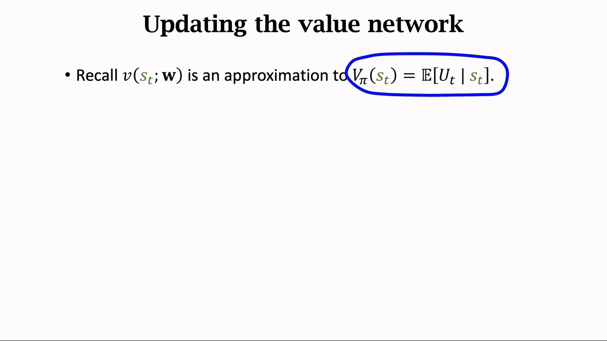

[【跳转到 07:54】](https://www.bilibili.com/video/BV12o4y197US/?p=15&t=474) · [【跳转到 08:19】](https://www.bilibili.com/video/BV12o4y197US/?p=15&t=499)

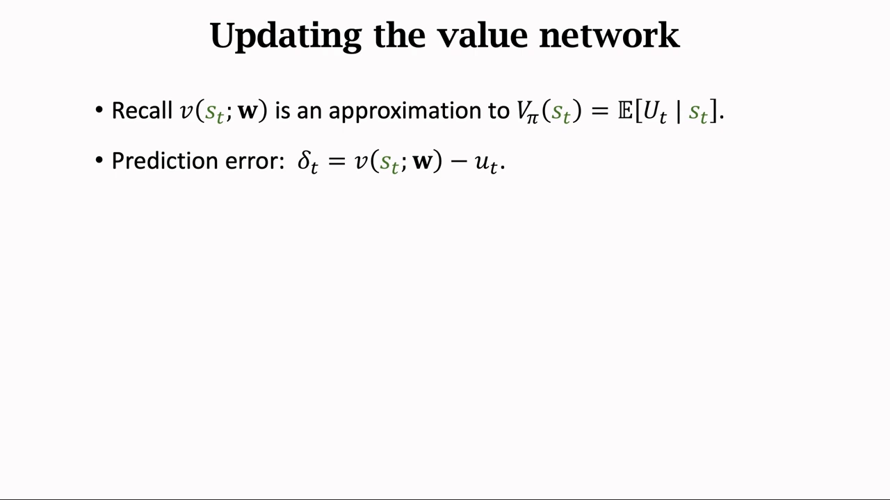

[【跳转到 08:44】](https://www.bilibili.com/video/BV12o4y197US/?p=15&t=524)

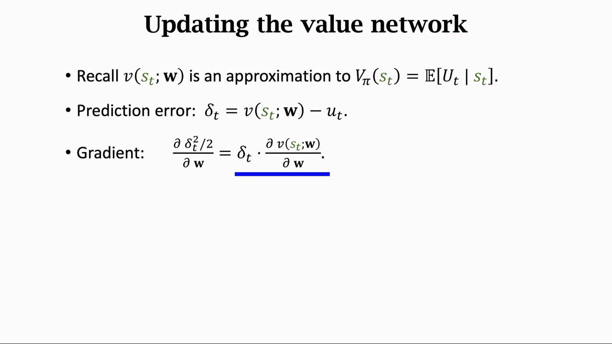

[【跳转到 09:09】](https://www.bilibili.com/video/BV12o4y197US/?p=15&t=549)

---

## 六、完整算法

把上面几节拼起来，就是 **REINFORCE with Baseline**：

```text
用随机参数初始化策略网络 π(a|s;θ) 和价值网络 v(s;w)
对每一局游戏：
    1. 玩到游戏结束，观测一条完整轨迹
       s_1, a_1, r_1, s_2, a_2, r_2, ..., s_n, a_n, r_n
    2. 对每个时刻 t = 1, 2, ..., n：
         a. 计算折扣回报  u_t = Σ_{i=t}^{n} γ^{i-t} · r_i
         b. 计算预测误差  δ_t = v(s_t;w) - u_t
         c. 更新策略网络  θ ← θ - β · δ_t · ∂ln π(a_t|s_t;θ)/∂θ
         d. 更新价值网络  w ← w - α · δ_t · ∂v(s_t;w)/∂w
```

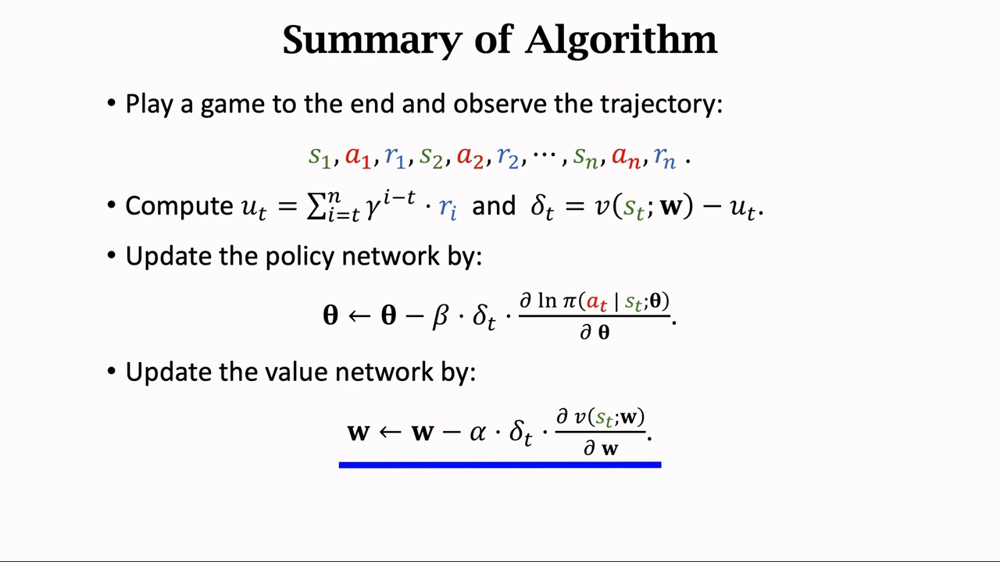

[【跳转到 09:34】](https://www.bilibili.com/video/BV12o4y197US/?p=15&t=574) · [【跳转到 10:24】](https://www.bilibili.com/video/BV12o4y197US/?p=15&t=624)

**两个容易忽略的细节**：

1. **必须玩到一局结束**。因为 $u_t$ 要把 $t$ 时刻之后的**所有**奖励加起来，中途截断就算不出真实回报——这是 REINFORCE 作为**蒙特卡洛方法**的固有特点（也是它方差大、只能离线更新的原因）。
2. **一局游戏能做 $n$ 轮更新，不是一轮**。玩完一局，从初始时刻到结束时刻的 $n$ 个状态动作奖励全都观测到了，于是可以算出 $n$ 个回报 $u_1,\dots,u_n$，对每个 $t$ 都重复一遍「算 $u_t$、算 $\delta_t$、更新两个网络」。轨迹长度是 $n$，就对两个网络做 $n$ 轮更新。

---

## 小结

1. **三个函数层层嵌套**：$U_t$ 是随机回报，$Q_\pi=\mathbb{E}[U_t\mid s_t,a_t]$ 对它关于未来求期望，$V_\pi=\mathbb{E}_{A_t}[Q_\pi]$ 再对动作求期望。
2. **出发点是带 baseline 的策略梯度**：$\nabla_\theta V_\pi(s_t)=\mathbb{E}\big[\nabla_\theta\ln\pi\cdot(Q_\pi-V_\pi)\big]$，其中 $V_\pi(s_t)$ 就是 baseline，不影响期望但能降方差。
3. **三次近似**：① 蒙特卡洛把期望换成一条样本 $g(a_t)$；② 用观测回报 $u_t$ 近似 $Q_\pi$（第二次蒙特卡洛，这就是 REINFORCE）；③ 用价值网络 $v(s;w)$ 近似 $V_\pi$。
4. **近似后的策略梯度**：$\nabla_\theta V_\pi(s_t)\approx\dfrac{\partial\ln\pi(a_t\mid s_t;\theta)}{\partial\theta}\cdot(u_t-v(s_t;w))$。
5. **两个网络**：策略网络输出动作概率（softmax），价值网络输出一个实数当 baseline；输入都是状态 $s$，可以共享卷积层，但参数 $\theta$ 与 $w$ 分开更新。
6. **两个更新式**：策略网络做梯度上升（用 $-\beta\delta_t$ 的形式），价值网络做回归（拟合 $u_t$，损失 $\delta_t^2/2$）。
7. **$\delta_t$ 是枢纽**：它既衡量「实际比预期好多少」，又同时出现在两个更新式里；$\delta_t<0$ 就提高该动作概率，$\delta_t>0$ 就降低。

## 关键术语速查

| 术语 | 一句话解释 |
| --- | --- |
| 折扣回报 $U_t$ | $\sum_{i=t}^{n}\gamma^{i-t}R_i$，从 $t$ 时刻起的加权奖励和，是随机变量 |
| 动作价值 $Q_\pi(s_t,a_t)$ | $\mathbb{E}[U_t\mid s_t,a_t]$，回报的条件期望 |
| 状态价值 $V_\pi(s_t)$ | $\mathbb{E}_{A_t}[Q_\pi(s_t,A_t)]$，$Q_\pi$ 关于动作的期望，本篇用作 baseline |
| 随机策略梯度 $g(a_t)$ | 用一条采样动作算出的梯度样本，是策略梯度的无偏估计 |
| 蒙特卡洛近似 | 用观测值（一条样本、一个回报）去近似期望，本篇用了两次 |
| 价值网络 $v(s;w)$ | 拟合状态价值的神经网络，参数 $w$，作用是提供 baseline |
| 预测误差 $\delta_t$ | $v(s_t;w)-u_t$，价值网络的预测减真实观测回报 |
| 共享卷积层 | 策略网络与价值网络输入相同，共用卷积层提特征以省参数 |
| REINFORCE with Baseline | 用价值网络做基线的蒙特卡洛策略梯度算法，两个网络、两个更新式 |
| 优势的雏形 | $u_t-v(s_t;w)$ 近似 $Q_\pi-V_\pi$，即「这个动作比平均水平好多少」 |