# 策略梯度中的 Baseline：减去一个与动作无关的量，期望不变而方差变小

> 本篇整理自王树森《深度强化学习》「策略梯度中的 Baseline（1/4）」。视频地址：[BV12o4y197US 第 14 P](https://www.bilibili.com/video/BV12o4y197US/?p=14)。这是「策略梯度中的 Baseline」四讲中的第一讲，只做数学推导：证明**减去一个与动作无关的 $b$ 不改变策略梯度的期望**，并解释**为什么这样能让方差变小**。下一篇《REINFORCE with Baseline：用价值网络做基线的算法》把这里的结论落到具体算法上。

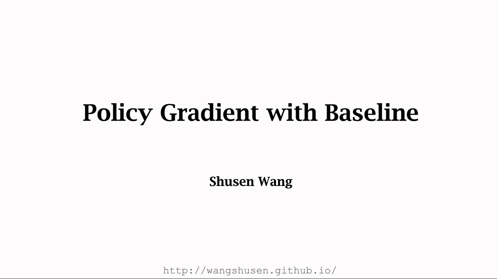

[【跳转到 00:00】](https://www.bilibili.com/video/BV12o4y197US/?p=14&t=0)

## 本讲要解决的核心问题（SCQA）

**背景**：策略梯度（policy gradient）把「让策略变好」写成了一个可以采样估计的期望：

$$
\nabla_\theta V_\pi(s) \;=\; \mathbb{E}_{A\sim\pi}\left[\frac{\partial \ln \pi(A\mid s;\theta)}{\partial \theta}\cdot Q_\pi(s,A)\right]
$$

实际训练时算不出这个期望，只能按策略网络抽一个动作 $a_t$，用一条样本去近似它。

**冲突**：一条样本估计一个期望，估计值会**抖**。抖得厉害就意味着方差大——梯度方向时准时不准，参数更新来回摇摆，收敛很慢。

**疑问**：有没有办法在**完全不改变梯度期望**（也就是不改变算法最终要收敛到的方向）的前提下，把这条样本的方差压下去？

**回答（中心思想）**：有的。只要从括号里减去一个**与动作 $A_t$ 无关**的函数 $b$，即把 $Q_\pi(s_t,A_t)$ 换成 $Q_\pi(s_t,A_t)-b$，策略梯度的**期望一字不变**，但**方差会变小**。这个 $b$ 就叫**基线**（baseline）。最常用的基线是状态价值 $V_\pi(s_t)$——因为它是 $Q_\pi$ 关于动作的期望，天然「离 $Q_\pi$ 很近」。

---

## 一、先复习：策略梯度在优化什么

### 1.1 策略网络与状态价值

**策略网络**（policy network）$\pi(a\mid s;\theta)$ 是一个神经网络：输入状态 $s$，输出每个动作的概率，参数是 $\theta$。我们用它在环境里控制 agent 做动作。

**状态价值函数**（state-value function）$V_\pi(s)$ 衡量「在状态 $s$、此后一直按 $\pi$ 行动」有多好。它等于动作价值 $Q_\pi(s,a)$ 关于动作 $a$ 的期望——把 $a$ 当作随机变量，它的概率密度就是策略网络：

$$
V_\pi(s) \;=\; \mathbb{E}_{A\sim\pi}\big[Q_\pi(s,A)\big] \;=\; \sum_{a}\pi(a\mid s;\theta)\cdot Q_\pi(s,a)
$$

因为期望里出现了带参数 $\theta$ 的策略网络，所以 $V_\pi(s)$ 也依赖 $\theta$。**策略梯度就是 $V_\pi(s)$ 关于 $\theta$ 的导数。**

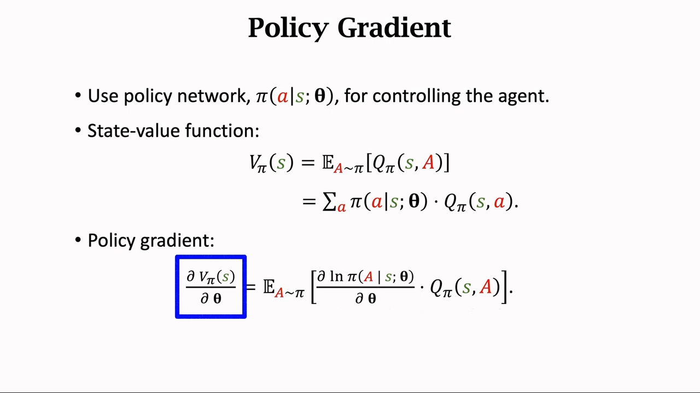

[【跳转到 01:15】](https://www.bilibili.com/video/BV12o4y197US/?p=14&t=75)

### 1.2 策略梯度的期望形式

以前推导过的结论是：策略梯度可以写成「对数策略的梯度 $\times$ 动作价值」的期望。

$$
\frac{\partial V_\pi(s)}{\partial \theta} \;=\; \mathbb{E}_{A\sim\pi}\left[\frac{\partial \ln \pi(A\mid s;\theta)}{\partial \theta}\cdot Q_\pi(s,A)\right]
$$

这个式子的关键特征是：**期望里面是一整块东西**。后面所有推导都围绕「往这一块里加减什么，期望会变、什么不会变」展开。

[【跳转到 00:50】](https://www.bilibili.com/video/BV12o4y197US/?p=14&t=50)

---

## 二、Baseline 是什么：一个「与动作无关」的函数

讲者给 baseline 的定义非常宽松：

> **基线 $b$ 可以是任何东西，只要它不依赖于动作 $A$。**

注意这里说的是**不依赖动作**，不是「不依赖状态」。$b$ 完全可以依赖当前状态 $s$（比如 $b=V_\pi(s)$），因为 $s$ 是先于动作被观测到的、在选动作之前就定下来了；它甚至可以是一个常数。唯一的禁区是：**不能偷偷依赖 $A$**。

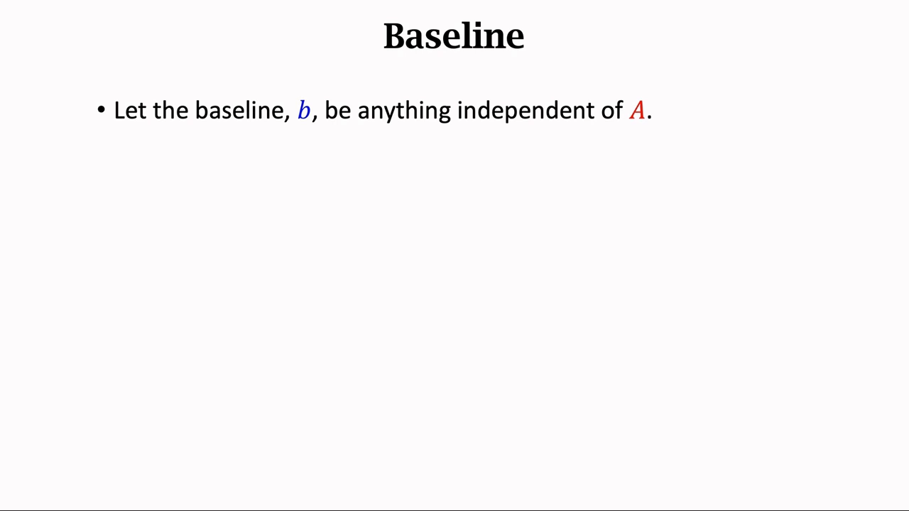

[【跳转到 01:40】](https://www.bilibili.com/video/BV12o4y197US/?p=14&t=100)

讲者要证明的，是这样一条性质：

$$
\text{若 } b \text{ 与 } A \text{ 无关，则}\quad \mathbb{E}_{A\sim\pi}\left[b\cdot\frac{\partial \ln \pi(A\mid s;\theta)}{\partial \theta}\right] \;=\; 0
$$

**这条性质是整个 baseline 方法的全部数学基础**：一个期望为零的项，加进梯度里、从梯度里减掉，都不会改变梯度。下面四步把它证完。

---

## 三、关键引理：$\mathbb{E}[b\cdot\nabla_\theta\ln\pi]=0$ 的证明

### 3.1 第一步：把 $b$ 提到期望外面

期望是关于动作 $A$ 求的，而 $b$ 不依赖 $A$，所以 $b$ 对「对 $A$ 求期望」这个操作来说就是个常数，可以直接提到期望外面：

$$
\mathbb{E}_{A\sim\pi}\left[b\cdot\frac{\partial \ln \pi(A\mid s;\theta)}{\partial \theta}\right] \;=\; b\cdot\mathbb{E}_{A\sim\pi}\left[\frac{\partial \ln \pi(A\mid s;\theta)}{\partial \theta}\right]
$$

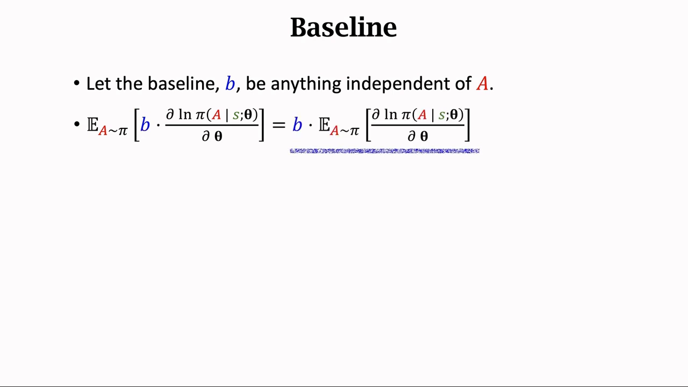

[【跳转到 02:05】](https://www.bilibili.com/video/BV12o4y197US/?p=14&t=125)

### 3.2 第二步：把期望展开成连加

剩下的这个期望，按定义就是对所有动作求和、每项乘上该动作的概率。这一步把「期望」翻译成「连加」：

$$
b\cdot\mathbb{E}_{A\sim\pi}\left[\frac{\partial \ln \pi(A\mid s;\theta)}{\partial \theta}\right] \;=\; b\cdot\sum_{a}\pi(a\mid s;\theta)\cdot\frac{\partial \ln \pi(a\mid s;\theta)}{\partial \theta}
$$

式子里有两块：$\pi(a\mid s;\theta)$ 是**策略网络**（动作 $a$ 的概率密度），$\dfrac{\partial \ln \pi(a\mid s;\theta)}{\partial \theta}$ 是**对数策略的导数**。

### 3.3 第三步：链式法则展开，然后约分

对 $\ln$ 求导用链式法则：先对外面的 $\ln$ 求导得到 $\dfrac{1}{\pi}$，再乘上里面 $\pi$ 关于 $\theta$ 的导数。

$$
\frac{\partial \ln \pi(a\mid s;\theta)}{\partial \theta} \;=\; \frac{1}{\pi(a\mid s;\theta)}\cdot\frac{\partial \pi(a\mid s;\theta)}{\partial \theta}
$$

代回去，连加里就出现了 $\pi(a\mid s;\theta)\cdot\dfrac{1}{\pi(a\mid s;\theta)}$——**一个在分子、一个在分母，直接约掉**：

$$
b\cdot\sum_{a}\pi(a\mid s;\theta)\cdot\frac{1}{\pi(a\mid s;\theta)}\cdot\frac{\partial \pi(a\mid s;\theta)}{\partial \theta} \;=\; b\cdot\sum_{a}\frac{\partial \pi(a\mid s;\theta)}{\partial \theta}
$$

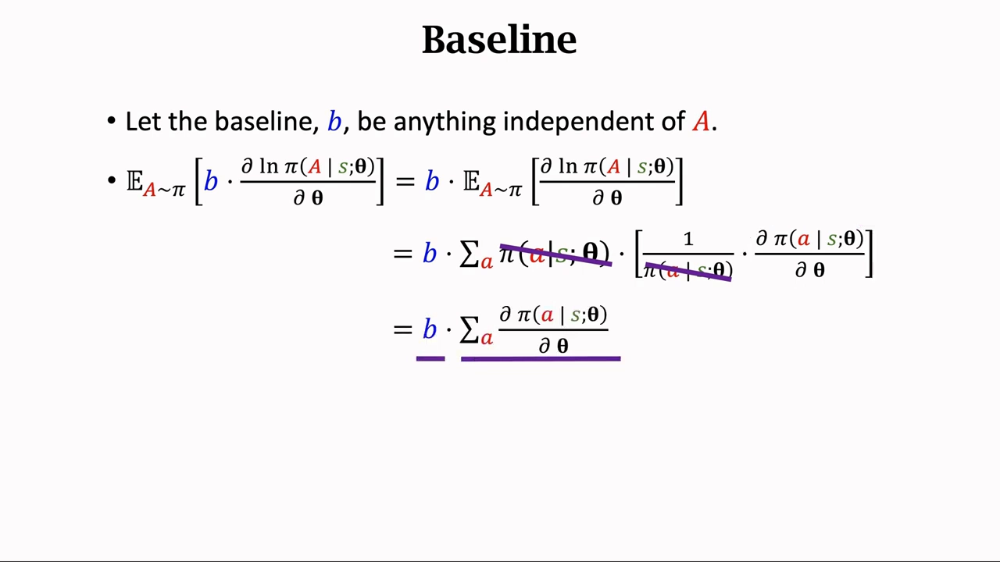

[【跳转到 02:30】](https://www.bilibili.com/video/BV12o4y197US/?p=14&t=150)

### 3.4 第四步：连加搬进导数，得到 $\partial 1/\partial\theta=0$

现在连加是关于动作 $a$ 求的，连加里面的导数是关于 $\theta$ 求的，**两者求的对象不同，互不干扰**，所以可以把连加符号搬进导数里面：

$$
b\cdot\sum_{a}\frac{\partial \pi(a\mid s;\theta)}{\partial \theta} \;=\; b\cdot\frac{\partial}{\partial \theta}\sum_{a}\pi(a\mid s;\theta) \;=\; b\cdot\frac{\partial\, 1}{\partial \theta} \;=\; 0
$$

最后一步是全部推导里最漂亮的地方：$\pi(\cdot\mid s;\theta)$ 是一个**概率分布**，对所有动作求和必然等于 $1$；而**常数 $1$ 关于 $\theta$ 求导，结果显然是零**。于是整个期望等于零。

$$
\boxed{\;\text{若 } b \text{ 与 } A \text{ 无关，则}\ \mathbb{E}_{A\sim\pi}\left[b\cdot\frac{\partial \ln \pi(A\mid s;\theta)}{\partial \theta}\right] = 0\;}
$$

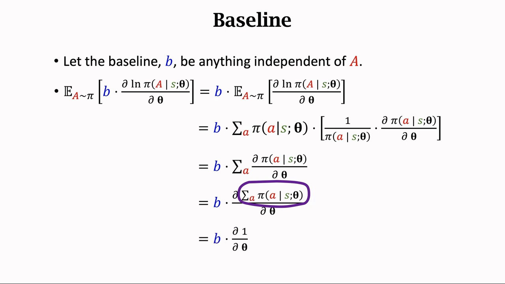

[【跳转到 02:55】](https://www.bilibili.com/video/BV12o4y197US/?p=14&t=175) · [【跳转到 03:20】](https://www.bilibili.com/video/BV12o4y197US/?p=14&t=200)

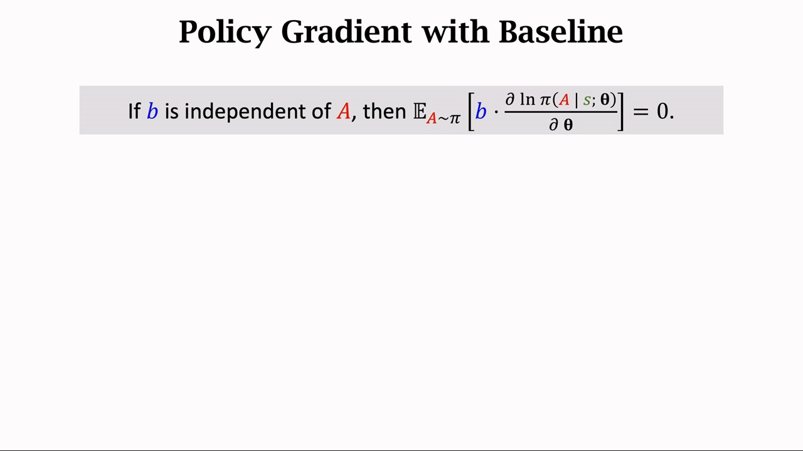

[【跳转到 03:45】](https://www.bilibili.com/video/BV12o4y197US/?p=14&t=225)

---

## 四、把引理用上去：带 baseline 的策略梯度定理

有了「减去这一项等于零」，就可以放心地在策略梯度里**减**它：

$$
\frac{\partial V_\pi(s_t)}{\partial \theta} \;=\; \mathbb{E}_{A_t\sim\pi}\left[\frac{\partial \ln \pi(A_t\mid s_t;\theta)}{\partial \theta}\cdot Q_\pi(s_t,A_t)\right] - \underbrace{\mathbb{E}_{A_t\sim\pi}\left[\frac{\partial \ln \pi(A_t\mid s_t;\theta)}{\partial \theta}\cdot b\right]}_{=\,0}
$$

把两个期望合并成一个，括号里就出现了 $Q_\pi(s_t,A_t)-b$：

$$
\frac{\partial V_\pi(s_t)}{\partial \theta} \;=\; \mathbb{E}_{A_t\sim\pi}\left[\frac{\partial \ln \pi(A_t\mid s_t;\theta)}{\partial \theta}\cdot\big(Q_\pi(s_t,A_t)-b\big)\right]
$$

这就是**带 baseline 的策略梯度定理**：

> **定理**：若 $b$ 与 $A_t$ 无关，则策略梯度可以写成上面这个带 baseline 的形式。

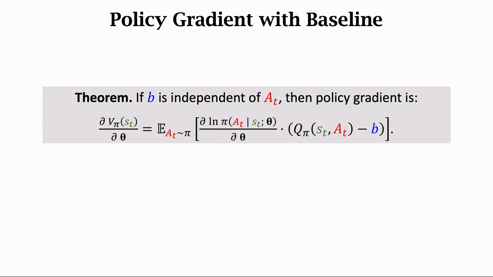

[【跳转到 04:48】](https://www.bilibili.com/video/BV12o4y197US/?p=14&t=288)

**这里有个容易想歪的地方，讲者专门点出来了**：既然用任何 $b$ 都不影响策略梯度，那用不用 $b$ 岂不是毫无差别？——不是。**不影响的是「期望」，而算法真正在用的不是期望，是期望的蒙特卡洛近似。** 下一节就讲这件事。

---

## 五、期望不变，方差为什么会变小

### 5.1 随机策略梯度：把期望换成一条样本

期望里的整块东西记作 $g(A_t)$，它只通过随机变量 $A_t$ 依赖动作：

$$
g(A_t) \;=\; \frac{\partial \ln \pi(A_t\mid s_t;\theta)}{\partial \theta}\cdot\big(Q_\pi(s_t,A_t)-b\big)
$$

按策略网络抽一个动作 $a_t$，算出来的 $g(a_t)$ 就是**随机策略梯度**（stochastic policy gradient）。它是策略梯度的**无偏估计**，因为

$$
\mathbb{E}_{A_t\sim\pi}\big[g(A_t)\big] \;=\; \frac{\partial V_\pi(s_t)}{\partial \theta}
$$

训练时用的就是这个随机梯度，做**随机梯度上升**：

$$
\theta \;\leftarrow\; \theta + \beta\cdot g(a_t)
$$

其中 $\beta$ 是学习率。**注意：实际训练从来不用真正的策略梯度，用的都是这条含噪的样本。**

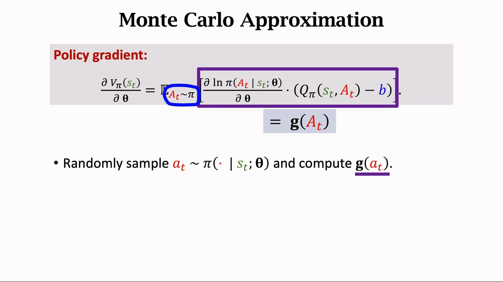

[【跳转到 06:03】](https://www.bilibili.com/video/BV12o4y197US/?p=14&t=363)

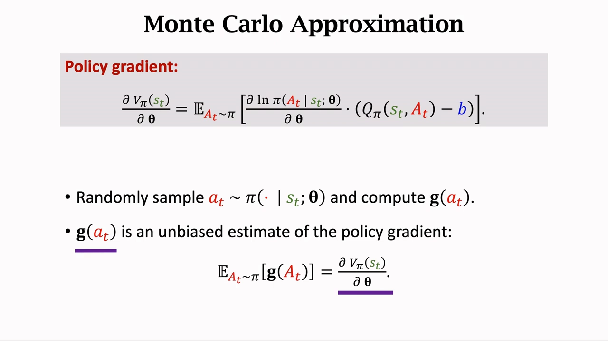

[【跳转到 06:28】](https://www.bilibili.com/video/BV12o4y197US/?p=14&t=388)

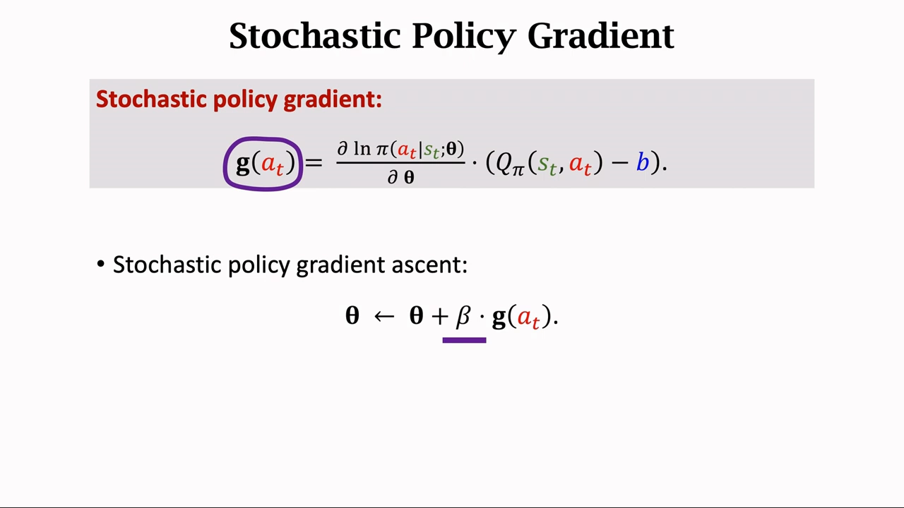

[【跳转到 06:53】](https://www.bilibili.com/video/BV12o4y197US/?p=14&t=413) · [【跳转到 07:18】](https://www.bilibili.com/video/BV12o4y197US/?p=14&t=438)

### 5.2 $b$ 不动期望，但动样本

把两件事分开看，就是整个 baseline 方法的全部逻辑：

- **$b$ 不影响期望**：只要 $b$ 与 $A_t$ 无关，$\mathbb{E}[g(A_t)]$ 就完全一样，算法收敛到的方向不变、正确性不受影响。
- **$b$ 显然影响 $g(a_t)$ 本身**：换一个 $b$，每条样本算出来的数值都变了，样本的**散布程度**也就变了。

于是问题变成：**挑一个 $b$，让样本围绕期望散得最开还是最紧？** 讲者给的判断标准是——

> **如果选的 $b$ 很好、很接近 $Q_\pi$，那么随机策略梯度 $g(A_t)$ 的方差就会变小，算法收敛得更快。**

道理很直白：$g(a_t)$ 的「抖动」主要来自括号里那一项 $Q_\pi(s_t,a_t)-b$。如果 $b$ 已经把 $Q_\pi$ 的大致水平抵消掉，剩下的就是一个**围绕零波动的小量**；如果 $b$ 离 $Q_\pi$ 很远（比如 $b=0$），括号里就是 $Q_\pi$ 本身，不同动作之间差多少，样本就差多少。

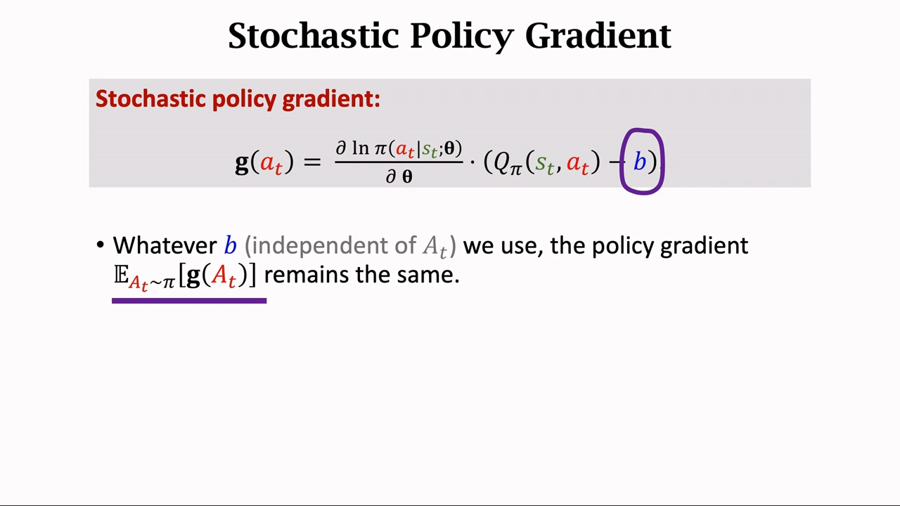

[【跳转到 07:43】](https://www.bilibili.com/video/BV12o4y197US/?p=14&t=463)

**一句话总结这一节**：baseline 不是「让梯度更准」，而是「让梯度的估计更稳」——它拿走了方差，没动偏差。

---

## 六、两种常见的 baseline

讲者给了两个具体选择，一个用来对照、一个用来实用。

### 6.1 选择一：$b=0$（就是不用 baseline）

最平凡的选择是让 $b=0$，此时 $Q_\pi(s_t,A_t)-b$ 退化成 $Q_\pi(s_t,A_t)$，得到的正是**标准的策略梯度**，也就是不带 baseline 的版本。所以「不用 baseline」只是 baseline 方法的一个特例，不是另一套东西。

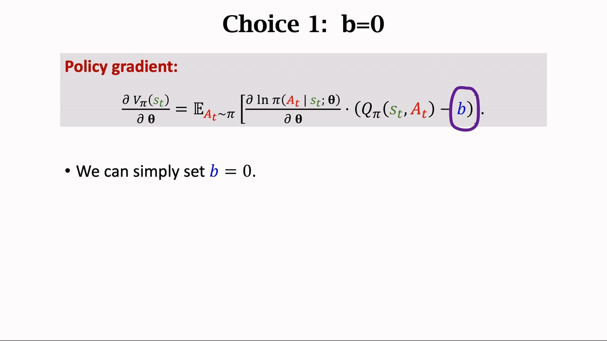

[【跳转到 08:13】](https://www.bilibili.com/video/BV12o4y197US/?p=14&t=493)

### 6.2 选择二：$b=V_\pi(s_t)$（最常用）

一个很自然的想法是拿**状态价值**当基线。它合法，因为：

- $V_\pi(s_t)$ 只依赖状态 $s_t$；
- 而 $s_t$ 是**先于** $a_t$ 被观测到的——动作还没选，状态就已经定了；
- 所以 $V_\pi(s_t)$ 是 $s_t$ 的函数，与 $A_t$ 无关，满足 baseline 的全部要求。

**为什么它合适？** 回到判断标准：baseline 越接近 $Q_\pi$，方差越小。而按定义，

$$
V_\pi(s_t) \;=\; \mathbb{E}_{A_t}\big[Q_\pi(s_t,A_t)\big]
$$

**$V_\pi$ 就是 $Q_\pi$ 关于动作的期望**，作为「期望」，它天然落在 $Q_\pi$ 取值的中间位置、离各个 $Q_\pi(s_t,a)$ 都不远。所以用 $V_\pi(s_t)$ 做 baseline 非常合适。

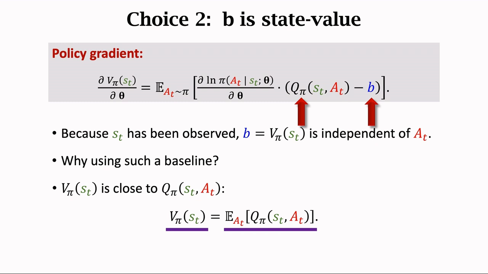

[【跳转到 09:03】](https://www.bilibili.com/video/BV12o4y197US/?p=14&t=543)

**顺带一个直觉**：$Q_\pi(s_t,a_t)-V_\pi(s_t)$ 正是「这个动作比平均水平好多少」——这个量在后面的课程里有个正式名字叫**优势函数**（advantage function），而 A2C 就是围绕它展开的。

---

## 小结

1. **baseline 的定义极宽**：$b$ 可以是任何东西，唯一要求是**不依赖动作 $A_t$**（可以依赖状态 $s_t$，也可以是常数）。
2. **核心引理**：若 $b$ 与 $A$ 无关，则 $\mathbb{E}_{A\sim\pi}\big[b\cdot\partial\ln\pi(A\mid s;\theta)/\partial\theta\big]=0$。证明四步——提出 $b$、展开成连加、链式法则约掉 $\pi$、把连加搬进导数得到 $\partial 1/\partial\theta=0$。
3. **带 baseline 的策略梯度定理**：$\nabla_\theta V_\pi(s_t)=\mathbb{E}\big[\nabla_\theta\ln\pi(A_t\mid s_t;\theta)\cdot(Q_\pi(s_t,A_t)-b)\big]$，减去一个期望为零的项，等号照旧成立。
4. **期望不变、方差变小**：算法实际用的是蒙特卡洛近似 $g(a_t)$，$b$ 不改变 $\mathbb{E}[g(A_t)]$，但会改变每条样本 $g(a_t)$ 的散布。
5. **好的 baseline 要接近 $Q_\pi$**：$b$ 越接近 $Q_\pi$，括号里剩下的波动越小，方差越小，收敛越快。
6. **两种选择**：$b=0$ 退化为标准策略梯度；$b=V_\pi(s_t)$ 最常用，因为 $V_\pi$ 就是 $Q_\pi$ 关于动作的期望，天然离 $Q_\pi$ 近。

## 关键术语速查

| 术语 | 一句话解释 |
| --- | --- |
| 基线（baseline） | 从 $Q_\pi(s_t,A_t)$ 里减掉的一个函数 $b$，要求与动作 $A_t$ 无关；不改变梯度期望，但能降低方差 |
| 策略网络 $\pi(a\vert s;\theta)$ | 输入状态、输出动作概率分布的神经网络，参数为 $\theta$ |
| 状态价值 $V_\pi(s)$ | $\mathbb{E}_{A\sim\pi}[Q_\pi(s,A)]$，即「在状态 $s$ 按 $\pi$ 行动」的平均好坏 |
| 动作价值 $Q_\pi(s,a)$ | 在 $s$ 执行 $a$、此后按 $\pi$ 行动所得折扣回报的期望 |
| 随机策略梯度 $g(a_t)$ | 用一条采样动作算出的梯度样本，是策略梯度的无偏估计 |
| 无偏估计 | 期望等于真值的估计；baseline 不破坏这一点 |
| 方差（variance） | 样本围绕期望的散布程度；baseline 通过让 $b$ 接近 $Q_\pi$ 把它压小 |
| $b=0$ | 最平凡的选择，等价于不用 baseline，即标准策略梯度 |
| $b=V_\pi(s_t)$ | 最常用的 baseline；因 $s_t$ 先于 $A_t$ 被观测而合法，因 $V_\pi=\mathbb{E}[Q_\pi]$ 而接近 $Q_\pi$ |
| 优势函数（advantage） | $Q_\pi(s,a)-V_\pi(s)$，衡量某动作比平均水平好多少；baseline 取 $V_\pi$ 时括号里正是它 |