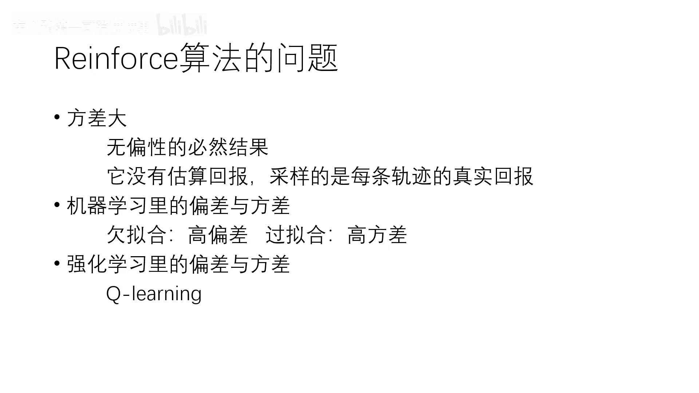
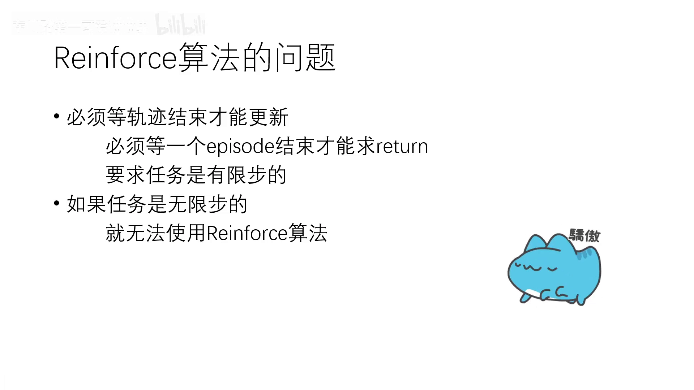
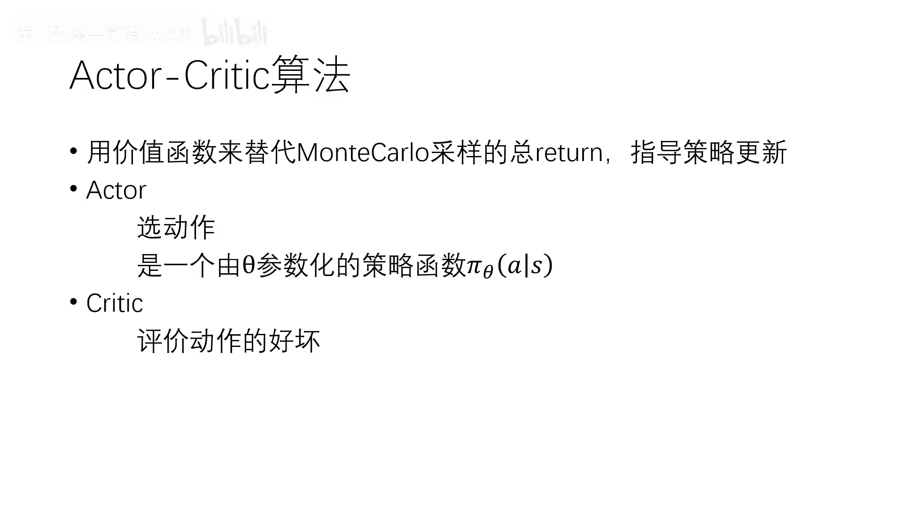
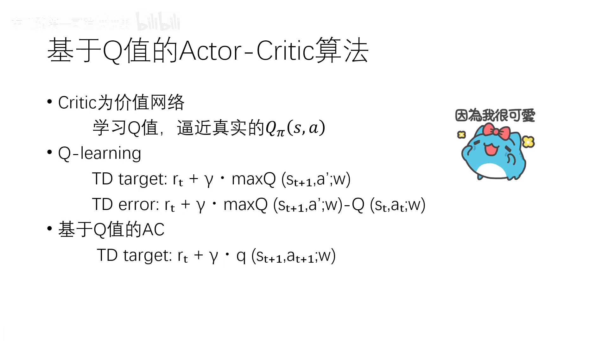
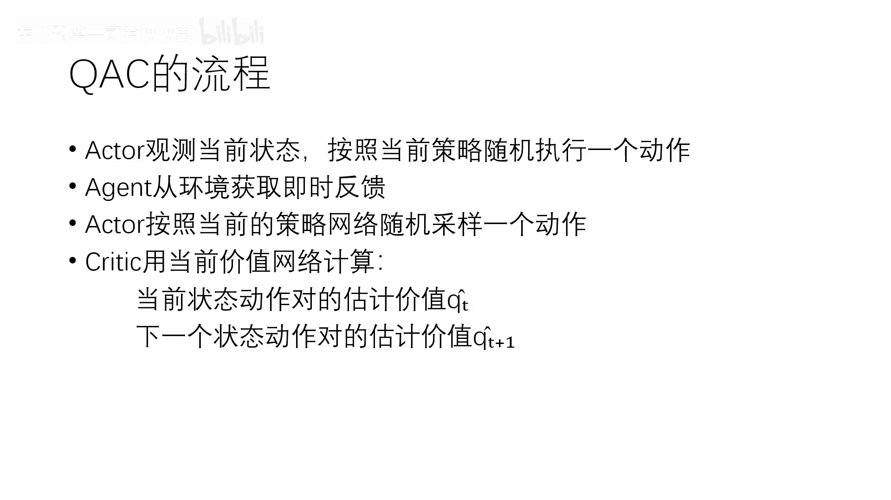
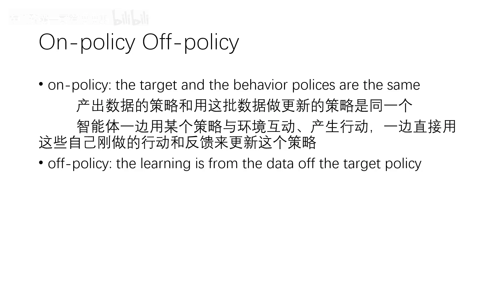

# 从 REINFORCE 到 Actor-Critic：为什么用价值函数替代整条轨迹的回报

> 本篇整理自 B 站 UP 主「东川路第一可爱猫猫虫」的《【零基础友好】【Actor-Critic】【强化学习】20 分钟速通 Actor-Critic 算法与 Advantage Actor-Critic 算法》。视频地址：[BV1vXWYzbE31](https://www.bilibili.com/video/BV1vXWYzbE31/)。上一篇《最简单的 Actor-Critic：QAC》是从策略梯度的式子里「读出」actor 和 critic；这一篇换个角度，从**REINFORCE 的两个毛病**出发，看 actor-critic 到底在修什么。

## 本讲要解决的核心问题（SCQA）

**背景**：REINFORCE 是策略梯度里最直白的算法——跑完一条轨迹，把这条轨迹的真实回报当成权重，去放大或缩小这条轨迹上每个动作的概率。

**冲突**：这个「真实」既是优点也是缺点。它没有做任何估算，所以梯度是无偏的；但也正因为完全不做估算，它继承了采样带来的巨大方差，而且必须等一整条轨迹结束才能算出回报。

**疑问**：能不能既保留策略梯度的骨架，又把「等一整条轨迹的回报」这件事换掉？换掉之后会付出什么代价？

**回答（中心思想）**：能——用**价值函数**去替代那条要采样的总回报。这就是 actor-critic：一个模块（actor）按策略选动作，另一个模块（critic）用价值网络给这个动作打分，用打分结果去指导 actor 改进策略。代价是引入了偏差：**REINFORCE 高方差、零偏差，actor-critic 方差小、但有偏差**。

---

## 一、REINFORCE 的两个毛病

### 1.1 毛病一：方差大，而且这是无偏的必然结果

REINFORCE 对每一条轨迹的真实回报（视频里口语称「套」，即 trajectory）进行计算，它**只采样、不估算**。正因为没有 estimate 这个 return、所有回报都是真实采到的，所以它是无偏的；而方差大正是无偏的必然结果。

### 1.2 毛病二：必须等轨迹结束才能更新

既然用的是「整条轨迹的真实回报」，那么轨迹不结束，这个回报就算不出来。于是算法必须等到一个 episode 走完才能更新一次。这带来两个限制：

- 任务必须是**有限步**的；
- 如果是无限步的任务（比如持续与环境交互、永不终止），REINFORCE 根本没法用。

[【跳转到 02:52】](https://www.bilibili.com/video/BV1vXWYzbE31/?t=172)

[【跳转到 03:17】](https://www.bilibili.com/video/BV1vXWYzbE31/?t=197)

---

## 二、偏差与方差：一张必须背下来的对照表

讲者在这里插了一段机器学习里的常识，用来给强化学习的算法定位。

在散点图上拟合数据：如果用一条直线 $y=\omega x+b$ 去拟合一堆散点，很多点并不在直线上，**偏差很大、但方差很小**——这是欠拟合。反过来，如果用一条弯弯拐拐、穿过所有散点的曲线，它可能是无偏的，但**方差很大**——这是过拟合。偏差和方差是一个 trade-off 的过程，是一个动态的平衡：**方差大则偏差小，方差小则偏差大**。

把这条规律搬到强化学习里，就能给几个算法排座次：

| 算法 | 偏差 | 方差 | 原因 |
| --- | --- | --- | --- |
| Q-Learning / DQN | 有偏 | 较小 | 在「猜」未来的 Q 值，这是一个不准确的过程；DQN 还额外引入了 target 目标网络，本身就有偏差 |
| REINFORCE | 无偏 | 很大 | 计算的是每条轨迹的真实回报，不做任何估算 |

**所以 actor-critic 要做的，就是往中间挪一格**：用价值函数（有偏的估计）替代真实回报（无偏但高方差的采样），把方差压下来。这和第 7.4 条用 baseline 降方差是同一个方向上的努力，只是手段不同——baseline 是「减掉一个与动作无关的量」，actor-critic 是「换掉权重本身的来源」。

---

## 三、actor-critic 的做法：用价值函数替代整条轨迹的 return

讲者用一句话概括：actor-critic 是**用一个价值函数来替代本来要采样的那一整条轨迹的 return**，用这个价值函数来指导策略更新。

这里用的价值函数如果取 $Q$，那么这样的 actor-critic 就称为 **QAC**，或者叫基于 Q 值的 actor-critic。

### 3.1 两大模块

- **actor（演员 / 动作的选取者）**：负责选动作。它是一个以 $\theta$ 参数化的策略函数 $\pi_\theta(a\mid s)$，输入状态 $s$，输出选取不同动作 $a$ 的条件概率。
- **critic（评论家）**：负责评论演员选动作的好坏，用评估的结果指导 actor 改进策略，以期让策略变得更好。

[【跳转到 04:57】](https://www.bilibili.com/video/BV1vXWYzbE31/?t=297)

### 3.2 一个常见的困惑：到底哪种才算 actor-critic？

讲者在这里做了一个很有用的辨析，因为不同教材里 actor-critic 长得不一样：

- 如果 critic **用 Q 值**来计算误差、反馈给 actor，这叫**基于 Q 值的 actor-critic**，也就是 QAC。王树森《深度强化学习》课程里讲的就是这一种。
- 如果 critic **用 V 值**，那其实已经引入了**优势函数** $A(s,a)=Q(s,a)-V(s)$，并且用 $r+\gamma V$ 去近似 $Q$；这样的算法叫**基于优势函数的 actor-critic**，也就是 **advantage actor-critic（A2C）**。

所以严格地说：**QAC 是「原本的」actor-critic，A2C 是在它之上引入优势函数之后的产物**。优势函数与 GAE 是下一条（8.2）的主题，本篇只走到 QAC 为止。

---

## 四、QAC 的 critic：和 Q-Learning 差在哪一步

critic 是一个价值网络，负责学习 Q 值来逼近真实的 $q_\pi(s,a)$。一看到这里就会发现它和 Q-Learning 很像——Q-Learning 也是在用 Q 值逼近 $q_\pi(s,a)$。把两者的 TD 目标与 TD 误差并排写出来，差别一目了然。

**Q-Learning**（第 5.4 条）：

$$
\text{TD target}=r_t+\gamma\max_{a'}Q(s_{t+1},a';w)
$$

$$
\text{TD error}=r_t+\gamma\max_{a'}Q(s_{t+1},a';w)-Q(s_t,a_t;w)
$$

这里的 $\max$ 表示在当前状态下挑 Q 值最大的那个动作——最优性正是通过「取最大」体现出来的。实际执行时用 $\epsilon$-greedy：以很大的概率选这个最优动作，以小概率 $\epsilon$ 随机探索。

**QAC**：

$$
\text{TD target}=r_t+\gamma\,q(s_{t+1},a_{t+1};w)
$$

$$
\text{TD error}=r_t+\gamma\,q(s_{t+1},a_{t+1};w)-q(s_t,a_t;w)
$$

**唯一的区别就是那个 $\max$ 被换成了「按策略采一个动作」**。减号后面那一项两者完全一样，都是当前状态动作对的估计价值。

[【跳转到 07:27】](https://www.bilibili.com/video/BV1vXWYzbE31/?t=447)

为什么 QAC 要采样 $a_{t+1}$？因为 critic 评估的是**当前策略 $\pi$ 的价值**，而不是最优策略的价值：$q_\pi$ 的定义里，下一步动作本来就该服从 $\pi$。取 $\max$ 等于在评估贪心策略，那就不是「评估当前这个演员」了。

---

## 五、QAC 的流程：采样一个动作，但不执行它

把上面的式子串成一个循环，就是 QAC 的流程：

1. **actor 观测当前状态**，按照当前策略随机执行一个动作 $a_t$；
2. **agent 从环境获取即时反馈**：奖励 $r_t$（一个实数）和下一步状态 $s_{t+1}$，可能还包括是否终止；
3. **actor 按当前的策略网络再随机采样一个动作** $a_{t+1}$——注意，**这个动作不执行**，它只是用来算 TD 目标；
4. **critic 用当前价值网络计算两个量**：当前状态动作对的估计价值 $\hat q_t$ 和下一个状态动作对的估计价值 $\hat q_{t+1}$；
5. 用这两个量算出 TD target 与 TD error，做梯度下降更新价值网络的参数 $w$；
6. 用 TD error 更新 actor 的策略网络参数 $\theta$，回到第 1 步。

[【跳转到 09:32】](https://www.bilibili.com/video/BV1vXWYzbE31/?t=572)

**「采样但不执行」这一点最容易看漏**，而它恰恰是把 actor 和 critic 缝在一起的那根线：采样用的策略就是 actor 正在改进的那个策略，所以 critic 评估的永远是「当前的演员」。这也是为什么 QAC 天然是 on-policy。

---

## 六、on-policy 与 off-policy：一条分界线

讲者用一句话给出定义：

- **on-policy**：the target and the behavior policies are the same。**产出数据的策略，和用这批数据做更新的策略，是同一个**。智能体一边用某个策略与环境互动、产生行动，一边直接用自己刚做的行动和反馈来更新这个策略。
- **off-policy**：learning is from the data **off** the target policy。学习所用的数据不是当前正在运行的策略产生的——可能来自其他智能体，也可能来自以前的经验。

按这条线划分：**QAC 属于 on-policy**（采样的策略就是正在更新的 $\pi$），而 **Q-Learning、DQN 属于 off-policy**（用 $\epsilon$-greedy 采数据，却朝着贪心目标更新）。

[【跳转到 12:02】](https://www.bilibili.com/video/BV1vXWYzbE31/?t=722)

on-policy 的代价是数据只能用一次、样本效率低；好处是更新方向始终对准当前策略，不需要重要性采样去纠正分布。想把 actor-critic 变成 off-policy，就得引入重要性采样——那是第 10 课 Part 3 的内容。

---

## 小结

1. **REINFORCE 的两个毛病**：方差大（无偏的必然结果）、必须等轨迹结束才能更新（因此只适用于有限步任务）。
2. **偏差与方差是一对跷跷板**：Q-Learning / DQN 有偏但方差小，REINFORCE 无偏但方差大，actor-critic 往中间挪一格。
3. **actor-critic 的核心动作**：用价值函数替代整条轨迹的 return，用价值估计指导策略更新。
4. **两大模块**：actor 是以 $\theta$ 参数化的策略 $\pi_\theta(a\mid s)$，负责选动作；critic 是价值网络，负责评价动作好坏。
5. **命名辨析**：critic 用 Q 值 → QAC（原本的 actor-critic）；critic 用 V 值并引入优势函数 → A2C。
6. **QAC 与 Q-Learning 只差一个 $\max$**：TD target 从「取最大」换成「按策略采样」，因为 critic 评估的是当前策略而不是最优策略。
7. **流程里最易漏的一步**：$a_{t+1}$ 只采样、不执行，专门用来算 TD 目标。
8. **on-policy 的分界**：产出数据的策略与更新用的策略是否同一个——QAC 是，Q-Learning / DQN 不是。

## 关键术语速查

| 术语 | 一句话解释 |
| --- | --- |
| actor | 以 $\theta$ 参数化的策略 $\pi_\theta(a\mid s)$，负责选动作 |
| critic | 价值网络，负责评价动作好坏并给出误差信号 |
| QAC | 基于 Q 值的 actor-critic，critic 用 $q(s,a;w)$ |
| A2C | 基于优势函数的 actor-critic，critic 用 $V$ 并引入 $A=Q-V$ |
| TD target（QAC） | $r_t+\gamma q(s_{t+1},a_{t+1};w)$，与 Q-Learning 的差别仅在采样 vs 取最大 |
| 偏差与方差 | 估算换来的低方差 vs 真实采样带来的无偏高方差，二者此消彼长 |
| on-policy | 目标策略与行为策略相同，QAC 属于这一类 |
| off-policy | 学习数据来自目标策略之外，Q-Learning / DQN 属于这一类 |