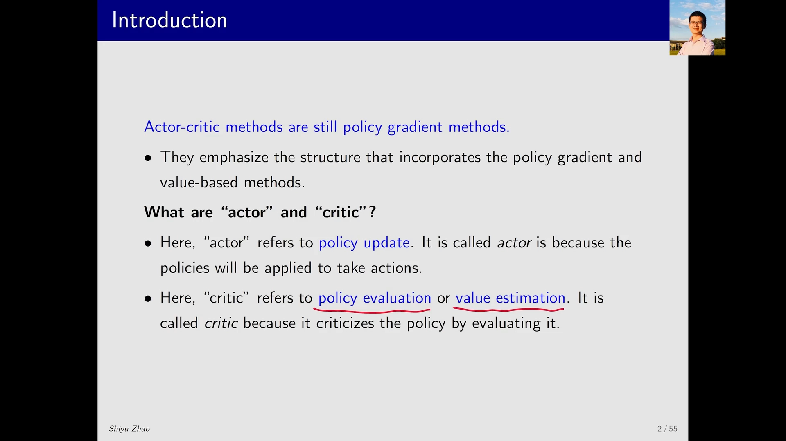
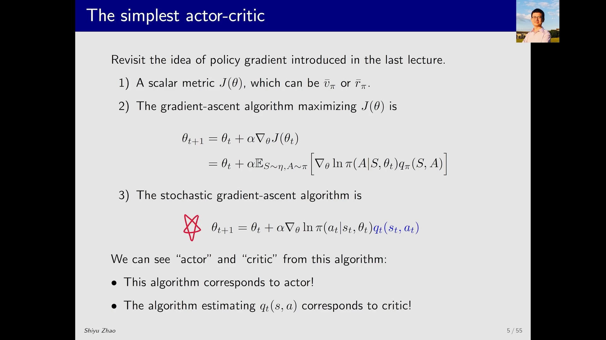
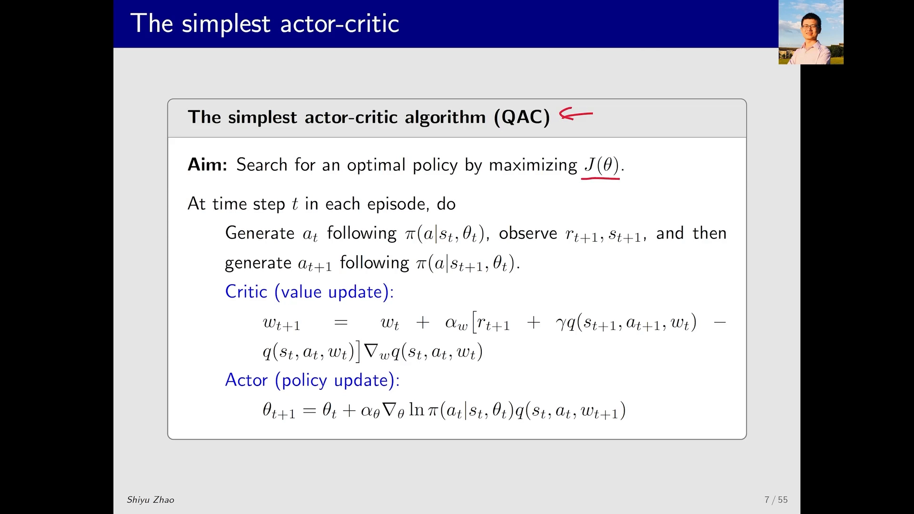
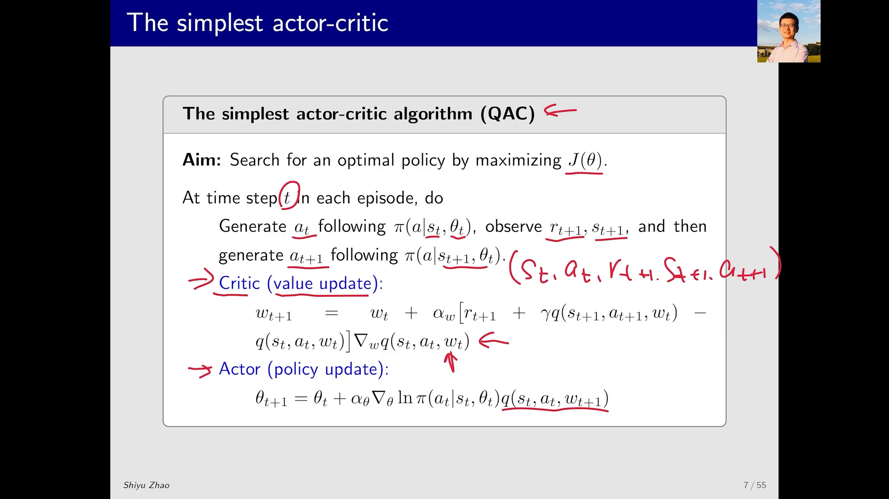
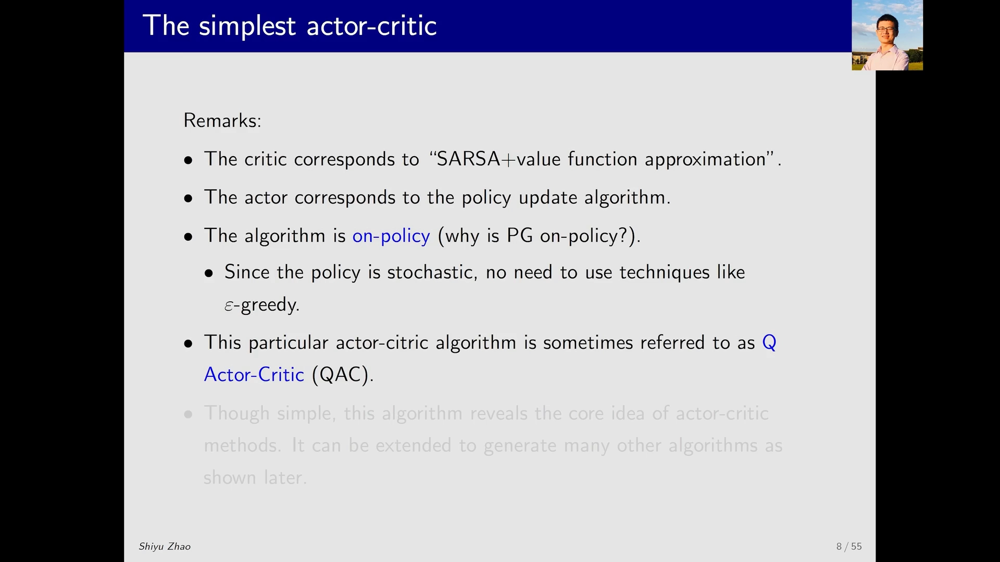

# 最简单的 Actor-Critic：把 REINFORCE 里的回报换成 TD 目标

> 本篇整理自赵世钰《强化学习的数学原理》第 10 课「Actor-Critic 方法」Part 1：最简单的 Actor-Critic（QAC）。视频地址：[BV1A44y1U7Bz](https://www.bilibili.com/video/BV1A44y1U7Bz/)。上一篇《REINFORCE：把策略梯度定理里的期望换成一次采样》留下了一个悬念：策略梯度算法里那个 $q_t$ 如果改用 **TD** 而不是蒙特卡洛来估计，得到的算法就叫 actor-critic。本篇把这个说法兑现成一个完整的算法。

## 本讲要解决的核心问题（SCQA）

**背景**：第 7 章把策略梯度做成了一条可以执行的流水线——写出目标函数 $J(\theta)$，求它的梯度，用随机梯度上升迭代；梯度里那个未知的 $q_\pi$ 用估计值 $q_t$ 顶替。REINFORCE 的做法是：从 $(s_t,a_t)$ 出发跑完整个 episode，用折扣回报 $g_t$ 当 $q_t$。

**冲突**：REINFORCE 只是「$q_t$ 的一种取法」，而且是最笨的一种——它必须等一整条轨迹结束才能算出回报。既然第 5 章已经有时序差分（TD）这套**边交互边估计**的工具，为什么不用它来算 $q_t$？

**疑问**：把 $q_t$ 换成 TD 目标之后，算法长什么样？它和原来的策略梯度算法是什么关系？名字里的 actor 和 critic 又分别指哪一部分？

**回答（中心思想）**：**actor-critic 不是一种新方法，它就是 policy gradient**——只不过把「基于 value 的方法」，特别是价值函数近似，塞进了策略梯度里。塞进去之后，一条更新式自然地裂成两半：**更新策略参数 $\theta$ 的那一半叫 actor，估计动作价值 $q_t$ 的那一半叫 critic**。用 TD（具体说是 Sarsa 加价值函数近似）当 critic，得到的就是最简单的 actor-critic 算法 **QAC**（Q Actor-Critic）。

---



[【跳转到 02:02】](https://www.bilibili.com/video/BV1A44y1U7Bz/?t=122)

## 一、先摆正位置：actor-critic 仍然是策略梯度

课程走到第 10 课，讲者把它称作「最后一站」，并特意强调：越靠后的内容越接近前沿、越接近实践，而 actor-critic 正是**现在强化学习当中最流行的方法之一**。

但它的出身并不神秘。讲者的原话是：它和我们上节课学的 policy gradient **实际上是同一种方法**，之所以换了个名字，是因为它把基于 value 的方法、特别是 value function approximation 引入到了 policy gradient 当中。

那 actor 和 critic 这两个词各指什么？

- **actor（演员）对应策略更新**。策略是用来 take action、采取行动的，所以「采取行动的那个东西」就被叫作 actor。它之所以叫 actor，是因为策略最终会被拿去执行动作。
- **critic（评论家）对应策略评估、也就是价值估计**。它之所以叫 critic，是因为它通过**评价**一个策略来「批评」它——评价的依据就是估计这个策略对应的动作价值 $q_\pi(s,a)$ 或状态价值 $v_\pi(s)$。

一句话记住：**actor 负责改策略，critic 负责给这个策略打分。**

---

## 二、从策略梯度的式子里直接读出 actor 和 critic

要看清两者怎么结合，只要把第 7 章那条随机梯度上升的式子重写一遍。policy gradient 的三步走是：

1. 有一个标量目标函数 $J(\theta)$，它可以是平均价值 $\bar v_\pi$，也可以是平均奖励 $\bar r_\pi$；
2. 用梯度上升最大化它：

$$
\theta_{t+1}=\theta_t+\alpha\nabla_\theta J(\theta_t)
$$

3. 把梯度里的期望用采样替换掉，得到随机梯度上升算法：

$$
\theta_{t+1}=\theta_t+\alpha\,\nabla_\theta\ln\pi(a_t\mid s_t,\theta_t)\,q_t(s_t,a_t)
$$

其中 $q_t(s_t,a_t)$ 是对真实动作价值 $q_\pi(s_t,a_t)$ 的估计。

**关键的一步就在这条式子上**：讲者说，通过这个表达式就能非常清晰地看出哪些是 actor、哪些是 critic。

- 这条式子**本身就是 actor**：它在更新 $\theta$，而 $\theta$ 是策略的参数，$\theta$ 一变，策略就变。
- 式子里的 $q_t(s_t,a_t)$ **要靠另一个算法来提供**，那个算法就是 critic：它的职责是对当前这个策略做评估，算出它对应的动作价值。



[【跳转到 05:22】](https://www.bilibili.com/video/BV1A44y1U7Bz/?t=322)

所以「actor-critic 是怎么结合 policy based 和 value based 的」这个问题，答案就一句话：**策略梯度提供骨架，价值估计提供权重**。骨架那一半是 actor，权重那一半是 critic。

---

## 三、$q_t$ 怎么算，决定了你得到哪个算法

到目前为止，$q_t$ 还只是一个占位符。讲者提醒：估计一个动作价值，我们已经学过**两种**方法，选哪一种，就决定了算法叫什么名字。

**第一种：蒙特卡洛。** 要从 $(s_t,a_t)$ 出发估计 $q_\pi(s_t,a_t)$，就跑完一个 episode，把这个 episode 的回报当作 $q_t(s_t,a_t)$ 的近似值。用这种 $q_t$ 配上策略梯度，得到的算法叫 **REINFORCE**，或者叫蒙特卡洛 policy gradient——这是第 7 章的内容。

**第二种：时序差分。** 用 TD 方法来估计 $q_t$，这时得到的算法**一般就被称为 actor-critic**。

这就是本篇与上一篇的分界线：**REINFORCE 用「跑完一局算出来的回报」当权重，actor-critic 用「TD 目标」当权重**。前者无偏但方差大、而且必须等轨迹结束；后者引入自举（bootstrapping），用当前的价值估计去估计下一步的价值，方差小、并且可以边交互边更新——代价是有了偏差。

---

## 四、把 TD 估计塞进去：QAC 算法

### 4.1 一步交互能拿到五个量

在第 $t$ 步，假设当前状态是 $s_t$、当前策略参数是 $\theta_t$：

1. 按当前策略采样动作 $a_t$，与环境交互，观察到奖励 $r_{t+1}$ 和下一个状态 $s_{t+1}$；
2. 在 $s_{t+1}$ 处再按当前策略采样一个动作 $a_{t+1}$。

于是手里就有了五个量：$s_t,\ a_t,\ r_{t+1},\ s_{t+1},\ a_{t+1}$。讲者说，看到这五个量就应该反应过来——**这是一个 experience sample，正好是 Sarsa 算法要的输入**。

### 4.2 critic = Sarsa + 价值函数近似

把动作价值用带参数 $w$ 的函数 $q(s,a;w)$ 近似（可以是线性函数，也可以是神经网络），Sarsa 的更新就是

$$
w_{t+1}=w_t+\alpha_w\Big[r_{t+1}+\gamma\,q(s_{t+1},a_{t+1};w_t)-q(s_t,a_t;w_t)\Big]\nabla_w q(s_t,a_t;w_t)
$$

方括号里那一项就是 **TD 误差**：

$$
\delta_t=r_{t+1}+\gamma\,q(s_{t+1},a_{t+1};w_t)-q(s_t,a_t;w_t)
$$

它衡量的是「TD 目标」比「当前估计」好多少。乘上 $\nabla_w q$ 做梯度上升，就是让 $q(s_t,a_t;w)$ 朝 TD 目标靠拢。

### 4.3 actor = 用更新后的 critic 做策略更新

critic 更新完得到 $w_{t+1}$，马上把它代进 actor 的更新式：

$$
\theta_{t+1}=\theta_t+\alpha_\theta\nabla_\theta\ln\pi(a_t\mid s_t,\theta_t)\,q(s_t,a_t;w_{t+1})
$$

注意这里用的是**刚更新过的** $w_{t+1}$，而不是旧的 $w_t$：先让评论家把这一小步的价值估准一点，再让演员按这个更准的评分改进策略。



[【跳转到 07:02】](https://www.bilibili.com/video/BV1A44y1U7Bz/?t=422)

### 4.4 伪代码

```text
Pseudocode: The simplest actor-critic (QAC)

Initialization: 参数化策略 π(a|s,θ)、参数化动作价值 q(s,a;w)、步长 α_θ > 0、α_w > 0
Aim: 通过最大化 J(θ) 搜索最优策略

每个 episode 的每个时间步 t：
    1. 按 π(a|s_t,θ_t) 采样 a_t，与环境交互，观察 r_{t+1} 与 s_{t+1}
    2. 按 π(a|s_{t+1},θ_t) 采样 a_{t+1}（只采样，不执行）
    3. Critic（value update）：
         δ_t = r_{t+1} + γ·q(s_{t+1},a_{t+1};w_t) - q(s_t,a_t;w_t)
         w_{t+1} = w_t + α_w·δ_t·∇_w q(s_t,a_t;w_t)
    4. Actor（policy update）：
         θ_{t+1} = θ_t + α_θ·∇_θ ln π(a_t|s_t,θ_t)·q(s_t,a_t;w_{t+1})
```



[【跳转到 08:17】](https://www.bilibili.com/video/BV1A44y1U7Bz/?t=497)

**为什么第 2 步要「采样但不执行」？** 因为 TD 目标里需要 $q(s_{t+1},a_{t+1};w)$，而 $a_{t+1}$ 必须按策略 $\pi$ 采出来，才能让这个估计对应「策略 $\pi$ 的动作价值」。但这一步只是为了算目标值，动作本身在下一轮才真正执行（那时它会成为新的 $a_t$）。

---

## 五、三条补充说明

讲者在算法之后给了三条 remark，每一条都值得单独记。

### 5.1 critic 就是「Sarsa + 价值函数近似」

这不是类比，而是字面意义上的等价：critic 用的正是 Sarsa 的更新式，只是把表格形式的 $q(s,a)$ 换成了带参数 $w$ 的函数近似。actor 则对应那条 policy update 的式子。**所以 QAC 可以读成「Sarsa 当评论家、策略梯度当演员」。**

### 5.2 它是 on-policy 的，原因和策略梯度一样

为什么 actor-critic 是 on-policy？讲者把理由落回到梯度的期望上：

$$
\nabla_\theta J(\theta)=\mathbb{E}_{S\sim\eta,\ A\sim\pi}\big[\cdots\big]
$$

随机梯度上升要对这个期望做采样，采样就必须服从这些分布，所以**动作 $A$ 一定要按 $\pi$ 采**。于是 $\pi$ 既是生成数据的 behavior policy，又是我们不断改进的 target policy——两者是同一个，这就是 on-policy。

### 5.3 不需要 $\epsilon$-greedy

有人会问：既然是 on-policy，要不要像 Q-Learning 那样外挂一个 $\epsilon$-greedy 来保证探索？讲者的回答是不用。因为 policy gradient 里的策略本来就是 **stochastic** 的：$\pi(a\mid s,\theta)$ 必须大于 $0$、不能等于 $0$，也就是说每个动作都保留了一点被选中的概率。**探索性已经内建在策略里了**，不需要再额外扰动。



[【跳转到 10:22】](https://www.bilibili.com/video/BV1A44y1U7Bz/?t=622)

---

## 六、QAC 的位置：一个「最小可运行」的骨架

讲者对这个算法的评价很克制：它**非常简单**，但揭示了 actor-critic **非常本质的想法**。本质的想法就是那个双人结构——

- 一个网络（或一张表）输出动作价值，负责评估当前策略；
- 另一个网络输出动作概率，负责按评估结果改进策略；
- 两者交替更新，互相喂饭。

后面几节的内容都是在这个骨架上做推广：把 critic 从 $q$ 换成优势函数 $A=q-v$ 就得到 A2C（第 8.2、8.3 条），用重要性采样把它从 on-policy 推到 off-policy，把随机策略换成确定性策略就得到 DPG（第 8.4 条的 DDPG 正是它的深度版本）。

---

## 小结

1. **actor-critic 不是新方法**，它就是 policy gradient 加上 value function approximation；换名字只是因为它强调了「策略梯度 + 基于价值」这个结构。
2. **actor 指策略更新，critic 指策略评估**。actor 叫 actor 是因为策略要拿去采取行动；critic 叫 critic 是因为它靠评价策略来「批评」它。
3. **从随机梯度上升的式子里能直接读出两者**：整条更新式是 actor，式中的 $q_t(s_t,a_t)$ 由 critic 提供。
4. **$q_t$ 的取法决定算法名字**：用蒙特卡洛回报 → REINFORCE；用 TD 估计 → actor-critic。
5. **一步交互给出五元组** $(s_t,a_t,r_{t+1},s_{t+1},a_{t+1})$，正好是 Sarsa 的输入，所以 QAC 的 critic 就是「Sarsa + 价值函数近似」。
6. **两个更新式**：critic 用 TD 误差 $\delta_t$ 做梯度上升更新 $w$；actor 用更新后的 $q(s_t,a_t;w_{t+1})$ 做梯度上升更新 $\theta$。
7. **它是 on-policy**，因为 $A$ 必须按 $\pi$ 采；也**不需要 $\epsilon$-greedy**，因为随机策略本身就有探索性。
8. **QAC 是最小骨架**：把 critic 从 $q$ 换成优势函数、把 on-policy 换成 off-policy、把随机策略换成确定性策略，就长出了后面一整族算法。

## 关键术语速查

| 术语 | 一句话解释 |
| --- | --- |
| actor | 更新策略参数 $\theta$ 的那一半，负责「采取行动」 |
| critic | 估计动作价值的那一半，负责策略评估（policy evaluation） |
| QAC（Q Actor-Critic） | 用 $q(s,a;w)$ 当 critic 的最简 actor-critic 算法 |
| TD 误差 $\delta_t$ | $r_{t+1}+\gamma q(s_{t+1},a_{t+1};w)-q(s_t,a_t;w)$，critic 的更新信号 |
| 五元组 $(s_t,a_t,r_{t+1},s_{t+1},a_{t+1})$ | 一步交互加一次额外采样得到的 experience sample，Sarsa 的输入 |
| 自举（bootstrapping） | 用当前的价值估计去构造更新目标，TD 与蒙特卡洛的分水岭 |
| on-policy | 采样策略与改进策略是同一个 $\pi$；actor-critic 属于这一类 |
| $\bar v_\pi$ / $\bar r_\pi$ | 平均价值 / 平均奖励，policy gradient 的两个标量目标函数 |