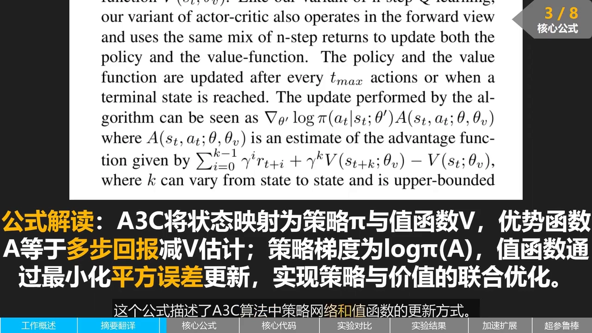
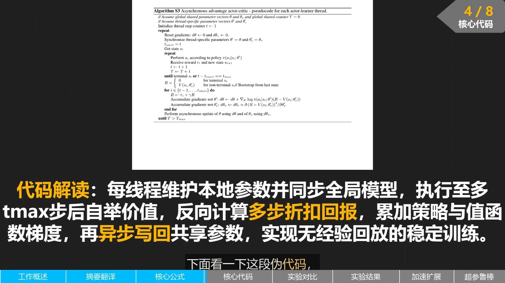
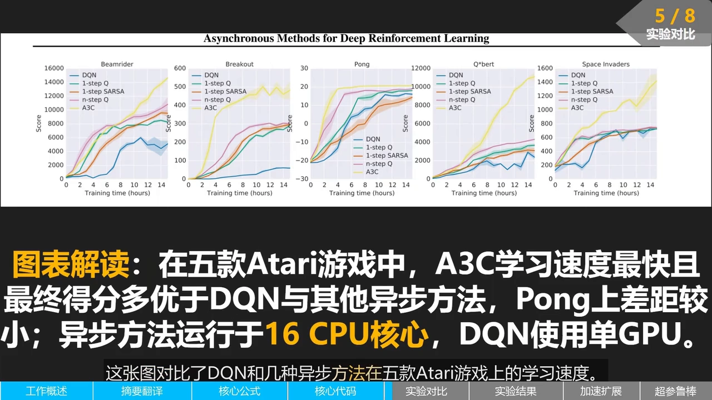
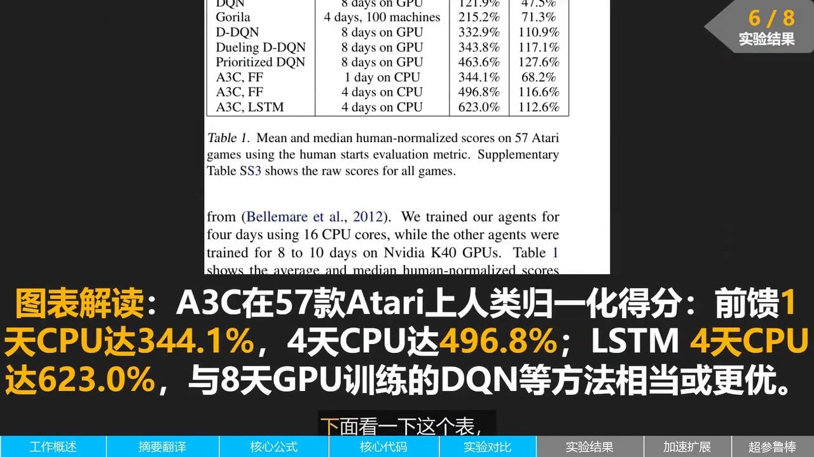
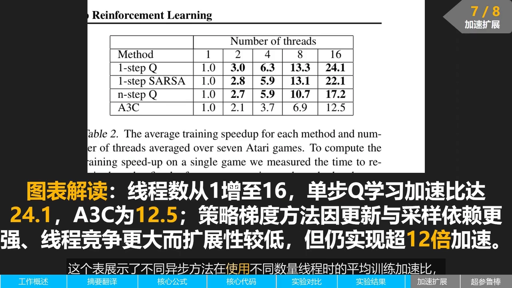

# A3C 论文精读：用「多线程异步」替掉经验回放

> 本篇整理自「海安雨」《[131]. A3C：首次用异步 actor-critic 把深度 RL 做稳定，是 PPO 的基石，论文精读》。视频地址：[BV1MYuG6rETy](https://www.bilibili.com/video/BV1MYuG6rETy/)。这是 8.3 条目下的第二篇：同目录的《分布式强化学习：A2C 与 A3C 的同步与异步》讲的是一堂课上的**工程机制**（多 worker 怎么采样、梯度怎么汇总、同步与异步差在哪），本篇则回到 **A3C 原论文**（*Asynchronous Methods for Deep Reinforcement Learning*），按论文自己的顺序把「动机 → 公式 → 伪代码 → 实验」过一遍。



[【跳转到 01:56】](https://www.bilibili.com/video/BV1MYuG6rETy/?t=116)

## 本讲要解决的核心问题（SCQA）

**背景**：第 6 章讲过，DQN 之所以能把神经网络和强化学习捏在一起，靠的是**经验回放**：把历史经验存进一个缓冲区，再从中随机抽 batch，用「打乱顺序」来打断样本之间的时间相关性。8.1、8.2 又把策略梯度、优势函数讲完了。

**冲突**：经验回放有两个代价——**要占大量内存**存离线数据，而且**采样和训练是分离的**（先采一批、再回放训练）。有没有办法不要缓冲区，也能让神经网络看到「不相关」的数据？

**疑问**：如果同时开很多个智能体副本、各自在自己的环境里跑，它们的经验天然就是「同时产生、互不相关」的，那还需要回放吗？多份经验又该怎么合并到同一个模型上？

**回答（中心思想）**：A3C 的答案是**用并行代替回放**。多个演员-学习器（actor-learner）线程各自持有一份参数副本、各自在自己的环境里跑，算完梯度后**异步地**写回一份共享的全局参数——不需要锁，也不需要经验回放。论文把这件事做成了四种标准强化学习算法的异步变体，其中效果最好的是**异步优势演员-评论家（A3C）**：它在 Atari 上只用单机多核 CPU、训练一天就超过了当时用 GPU 训练数天的水平。

---

## 一、论文的三个核心动作：并行、异步、多步优势

讲者开篇就把 A3C 的核心思路压缩成三条，这三条正好对应论文标题里的三个词。

**第一，多个智能体副本在各自环境中并行交互，代替经验回放缓冲区。** 这是「*Asynchronous*」在数据层面的含义：不是把旧数据存起来反复用，而是**同时**产生很多条互不相同的新数据。

**第二，异步更新共享模型参数，不需要锁机制。** 每个线程算完自己的梯度就直接往全局参数上写，不等别人，也不加锁。这是「异步」在更新层面的含义，也是 A3C 名字的由来。

**第三，用多步回报来估计优势函数，降低方差。** 这是「*Advantage*」的含义——critic 不再是单步 TD，而是往前看好几步再自举。

三条合起来的效果，论文摘要里说得很直白：在 Atari 上仅用 CPU、一天训练内达到当时领先的结果，同时还能扩展到连续控制任务和三维迷宫导航。

[【跳转到 00:00】](https://www.bilibili.com/video/BV1MYuG6rETy/?t=0)

### 1.1 为什么「并行」能顶替「回放」

要理解这一点，得先回忆经验回放**为什么存在**。神经网络训练假设样本独立同分布，而强化学习在线采样得到的相邻样本高度相关（同一个 episode 里前后几步几乎一模一样），直接拿去训练会让网络不稳定。DQN 的解法是存下来、随机抽，用抽样的随机性制造「伪独立」。

A3C 换了个思路：**如果同时有 $N$ 个线程在各自的环境里跑，那么同一时刻收集到的 $N$ 份经验本来就来自 $N$ 条不同的轨迹**，它们之间没有时间相关性。论文摘要的原话是「在多个智能体并行与环境交互的过程中实现去相关（decorrelate）」，于是**既不需要大内存的缓冲区，也不需要离线数据**。

一句话对比：DQN 是「**把相关的数据存起来，靠随机抽样去相关**」；A3C 是「**让数据从一开始就来自不同的世界，天然不相关**」。

---

## 二、公式：A3C 到底在更新什么

论文里那条更新式，讲者拆成了三块看。

### 2.1 一个网络，两个输出

算法的输入是当前状态 $s_t$，输出分成两部分：

- 一部分是**策略** $\pi(a_t \mid s_t;\theta')$，表示在给定状态下选每个动作的概率；
- 另一部分是**值函数** $V(s_t;\theta_v')$，用来估计当前状态的期望回报。

也就是说，actor 和 critic 共用同一个网络主体，只是最后分两个头输出。这和第 8 章前面讲的「策略网络 + 价值网络」是一回事，只是实现上共享了特征提取部分。

### 2.2 优势函数用 $k$ 步回报来估

论文里的优势估计是：

$$
A(s_t,a_t;\theta,\theta_v) \;=\; \sum_{i=0}^{k-1}\gamma^{i} r_{t+i} \;+\; \gamma^{k} V(s_{t+k};\theta_v) \;-\; V(s_t;\theta_v)
$$

拆开看就是「**往后真实走 $k$ 步拿到的折扣奖励之和**」加上「**第 $k$ 步那个状态的价值估计**」，再减去「**当前状态的价值估计**」。前两项合起来正是 $k$ 步回报 $\hat{R}_t$，所以这条式子也可以读成

$$
A(s_t,a_t) \;=\; \hat{R}_t \;-\; V(s_t;\theta_v)
$$

也就是 8.2 讲过的「优势 = 比平均水平好多少」，只不过这里的 $Q$ 用 $k$ 步回报顶替了。

**为什么不用一步？** 一步 TD 偏差大但方差小，蒙特卡洛无偏但方差大——$k$ 步正好在中间（第 5.5 条讲过 n 步 TD 的这套权衡）。论文里 $k$ 不是固定的：它随状态而变，上限是 $t_{\max}$。

### 2.3 两个梯度，一个方向

有了优势，两个网络的更新方向就定了：

- **策略网络**朝 $\nabla_{\theta'}\log \pi(a_t\mid s_t;\theta')\,A(s_t,a_t;\theta,\theta_v)$ 的方向走。优势为正，说明这个动作比平均好，就**增大**它的概率；优势为负就**减小**。这正是第 7 章策略梯度的形状，只是权重从回报换成了优势。
- **值函数**则通过最小化「预测值与多步回报之间的平方误差」来更新，让价值估计更准。

整个框架把策略梯度和值函数估计**联合**在一起，共同指导智能体学习。

---

## 三、伪代码：一个线程的一轮完整生命周期

论文的 Algorithm S3 只有二十来行，讲者逐句过了一遍。



[【跳转到 02:56】](https://www.bilibili.com/video/BV1MYuG6rETy/?t=176)

一个线程的一轮是这样走的：

1. **维护本地副本**。线程有自己的参数 $\theta'$、$\theta_v'$，还有全局共享的参数 $\theta$、$\theta_v$，以及一个全局共享的计数器 $T$。
2. **从全局同步**。每轮开始时把全局参数拷到本地：$\theta' \leftarrow \theta$，$\theta_v' \leftarrow \theta_v$。
3. **本地采样**。用本地策略 $\pi(a_t\mid s_t;\theta')$ 在环境里执行动作，收集状态、动作、奖励序列，最多走 $t_{\max}$ 步（或走到终止状态）。
4. **自举收尾**。序列结束时，如果最后是终止状态就取 $R=0$；否则用本地值函数自举一下 $R \leftarrow V(s_t;\theta_v')$。
5. **从后往前算回报、累加梯度**。对序列里的每一步，先更新 $R \leftarrow r_t + \gamma R$（这就是逐步倒推的多步回报），再把策略梯度和值函数梯度**累加**到本地梯度 $d\theta$、$d\theta_v$ 上。
6. **异步写回**。把本地梯度异步地写回全局参数，然后开始下一轮。

```text
每个 actor-learner 线程重复：
  重置本地梯度 dθ ← 0, dθ_v ← 0
  从全局同步：θ' ← θ, θ_v' ← θ_v
  采样至多 t_max 步，得到 s_t, a_t, r_t 序列
  R ← 0（终止）或 V(s_t; θ_v')（自举）
  对序列每一步倒序：
      R ← r_t + γR
      dθ   += ∇_θ' log π(a_t|s_t;θ') (R - V(s_t;θ_v'))
      dθ_v += ∂(R - V(s_t;θ_v'))²/∂θ_v'
  异步更新全局参数 θ, θ_v（不加锁）
```

关键就在最后一步：**多个线程独立探索不同的状态序列，同时异步更新同一组共享参数**，于是即使没有经验回放，训练也是稳定的。

---

## 四、实验：CPU 一天，打平 GPU 八天

论文的实验部分，讲者按「学习曲线 → 总成绩表 → 加速比表 → 超参鲁棒性」四块讲。

### 4.1 学习曲线：A3C 上升最快



[【跳转到 03:57】](https://www.bilibili.com/video/BV1MYuG6rETy/?t=237)

图中横轴是训练时间（小时），纵轴是得分。蓝色曲线是 DQN，其余四条分别是**异步单步 Q 学习、异步单步 SARSA、异步 n 步 Q 学习、A3C**。

可以看到在 Beam Rider、Breakout、Q\*bert 和 Space Invaders 上，**A3C 的曲线上升最快，最终得分也最高**；几种异步方法之间的差距相对较小，但都明显快于 DQN。要注意两者的资源不对等：**异步方法跑在 16 个 CPU 核心上，DQN 跑在单块 GPU 上**。

### 4.2 总成绩表：人类归一化得分



[【跳转到 04:44】](https://www.bilibili.com/video/BV1MYuG6rETy/?t=284)

「人类归一化得分」是把各游戏的原始得分按人类玩家的水平做归一化，这样不同难度的游戏才能放在一起求平均。表里的对比是：

| 方法 | 训练开销 | 得分均值 |
| --- | --- | --- |
| DQN | 8 天 GPU | 121.9% |
| Gorila | 4 天、100 台机器 | 215.2% |
| Dueling DQN | 8 天 GPU | 343.8% |
| 优先 DQN | 8 天 GPU | 463.6% |
| A3C，前馈网络 | 1 天 CPU | 344.1% |
| A3C，前馈网络 | 4 天 CPU | 496.8% |
| A3C，LSTM | 4 天 CPU | 623.0% |

结论很清楚：**A3C 在 CPU 上训练几天，就能达到甚至超过当时用 GPU 训练八天的水平**。而且 A3C 的 LSTM 版本比前馈版本更好，说明循环结构对部分可观测的游戏是有帮助的。

### 4.3 加速比：为什么 A3C 的扩展性不如单步 Q



[【跳转到 05:45】](https://www.bilibili.com/video/BV1MYuG6rETy/?t=345)

这张表统计的是七款 Atari 游戏上的平均加速比。线程数从 1 加到 16 时：

- 异步单步 Q 学习：$1.0 \to 24.1$（超过线性，因为单线程时还有别的瓶颈）；
- 异步单步 SARSA：$1.0 \to 22.1$；
- 异步 n 步 Q 学习：$1.0 \to 17.2$；
- **A3C：$1.0 \to 12.5$**。

A3C 的加速比明显偏低。论文给的解释是：**策略梯度方法在「参数更新」和「样本生成」之间有更复杂的依赖关系**——策略一变，后续采样的分布就变，线程之间的竞争也就更大。但即便如此，16 线程下 A3C 仍拿到了 **超过 12 倍**的加速，说明这个异步框架在多核 CPU 上扩展性良好。

### 4.4 超参鲁棒性：学习率窗口很宽

最后一个实验是学习率扫描：横轴是学习率（对数尺度），纵轴是最终得分，每个点是一次独立实验。在 Beam Rider、Breakout、Pong、Q\*bert、Space Invaders 五款游戏上，A3C 都能在**一段较宽的学习率范围内**拿到好成绩，没有出现「只有极窄参数区间才有效」的情况。得分在学习率过小（更新太慢）或过大（训练不稳定）时下降，这是符合预期的。结论是 A3C 对超参不十分敏感，实际使用中更容易调参。

[【跳转到 06:27】](https://www.bilibili.com/video/BV1MYuG6rETy/?t=387)

---

## 五、这篇论文留下的东西：为什么说它是 PPO 的基石

把上面的内容收拢一下，A3C 的历史位置可以概括成三句话：

1. **它证明了「不需要经验回放也能训稳深度 RL」**。此前大家默认深度 RL 必须配一个大的回放池，A3C 用并行采样把这个前提去掉了。
2. **它把 actor-critic 做成了工程上可扩展的形态**。共享参数、多线程、异步更新，这套骨架后来被各种并行实现沿用。
3. **它把「多步优势」变成了默认配置**。策略梯度的权重从蒙特卡洛回报换成 $k$ 步优势，方差降下来，训练才稳得住——这正是后面 PPO 里广义优势估计（GAE）的直接前身。

至于 A3C 的**同步版本 A2C**（等所有 worker 的梯度到齐、求平均、再更新）为什么在后来反而更常用，本篇不展开，同目录的《分布式强化学习：A2C 与 A3C 的同步与异步》用一堂课的时间把这件事讲透了。

---

## 小结

1. **A3C 的三个核心动作**：多副本并行交互代替经验回放；异步更新共享参数、不加锁；用多步回报估计优势降低方差。
2. **并行为什么能顶替回放**：$N$ 个线程同时采集的 $N$ 份经验天然来自不同轨迹，已经去相关，不需要靠随机抽样去相关，也就不需要大内存缓冲区。
3. **公式三件套**：一个网络两个输出（$\pi$ 和 $V$）；优势 $A=\hat{R}_t - V(s_t)$，其中 $\hat{R}_t$ 是 $k$ 步折扣回报加自举；策略梯度是 $\log\pi$ 乘 $A$，值函数是最小化平方误差。
4. **伪代码六步**：本地参数副本 → 从全局同步 → 采样至多 $t_{\max}$ 步 → 自举收尾 → 倒序累加梯度 → 异步写回全局。
5. **实验结论**：五款游戏上 A3C 学习最快；57 款游戏上 A3C 前馈版一天 CPU 得 344.1%、四天 496.8%，LSTM 版四天 623.0%，超过 DQN 八天 GPU 的 121.9%。
6. **加速比**：16 线程下 A3C 只有 12.5 倍，低于单步 Q 学习的 24.1 倍，因为策略梯度里「更新」与「采样」的依赖更强、线程竞争更大。
7. **鲁棒性**：学习率窗口宽，对超参不敏感，好调。
8. **历史意义**：证明深度 RL 可以不要经验回放，把 actor-critic 做成可扩展形态，并把多步优势变成默认配置，是 PPO 的直接前身。

## 关键术语速查

| 术语 | 一句话解释 |
| --- | --- |
| A3C（Asynchronous Advantage Actor-Critic） | 异步优势演员-评论家，多线程各自采样、异步更新共享参数的 actor-critic |
| actor-learner（演员-学习器） | 论文里对一个工作线程的称呼：既采样又学习 |
| 去相关（decorrelate） | 打断样本之间的时间相关性；DQN 靠随机抽样，A3C 靠多线程并行采样 |
| 共享参数 $\theta,\theta_v$ | 全局的、所有线程共同更新的策略与值函数参数 |
| 本地参数 $\theta',\theta_v'$ | 每个线程自己的参数副本，每轮从全局同步一次 |
| $t_{\max}$ | 一次本地采样最多走多少步，也是多步回报的步数上限 |
| $k$ 步回报 | 往后真实走 $k$ 步的折扣奖励之和，加上第 $k$ 步的价值自举 |
| 自举（bootstrapping） | 用当前的价值估计充当「后面的回报」，$R \leftarrow V(s_t;\theta_v')$ |
| 人类归一化得分 | 把各游戏原始得分按人类玩家水平归一化，使不同游戏可以放在一起平均 |
| 加速比（speedup） | 多线程相对单线程的训练提速倍数 |