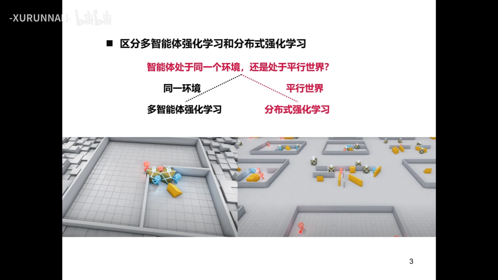
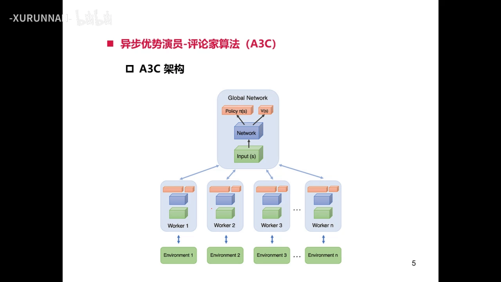
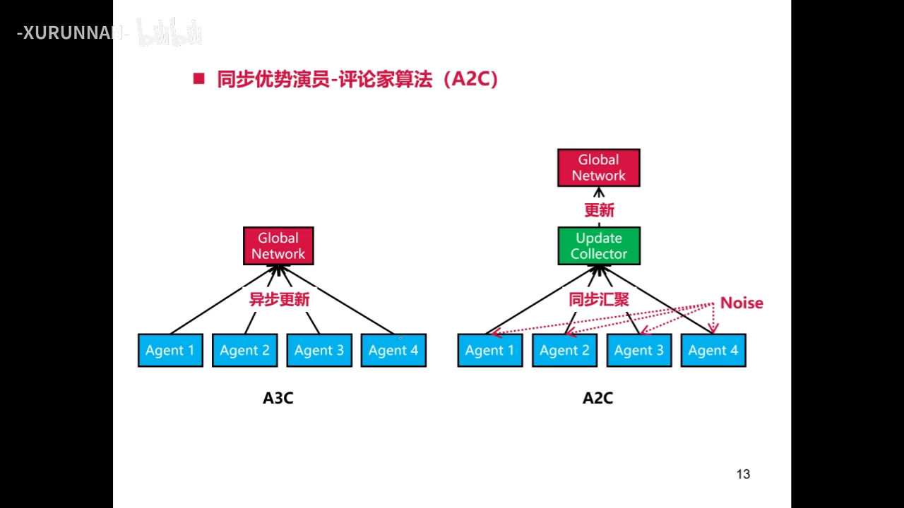
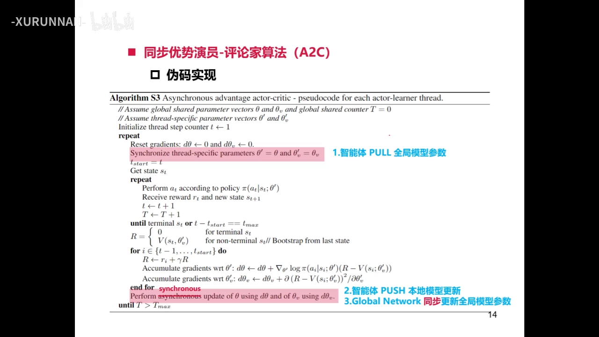
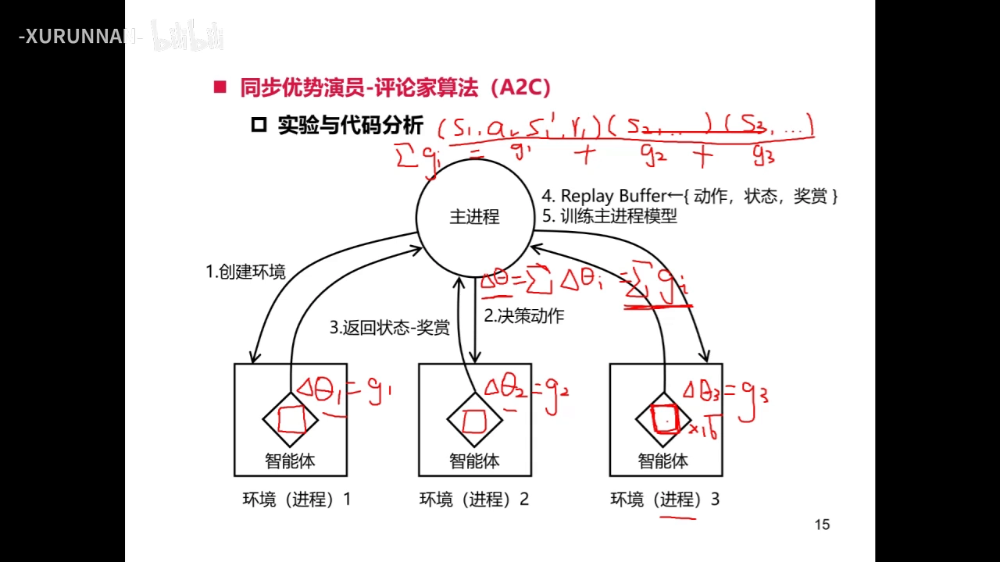
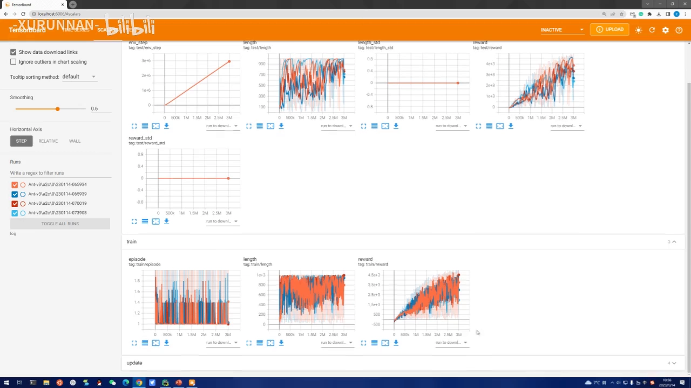
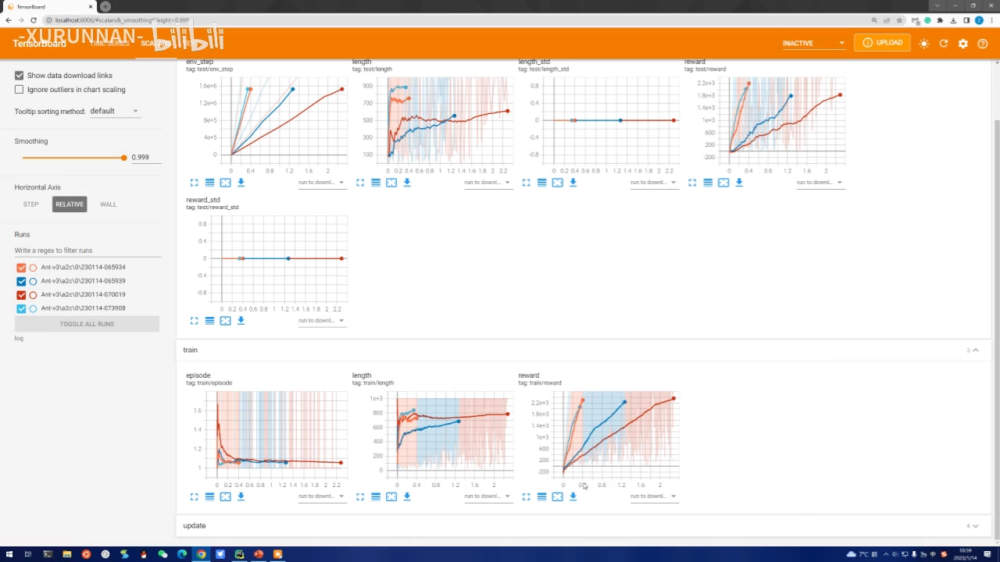
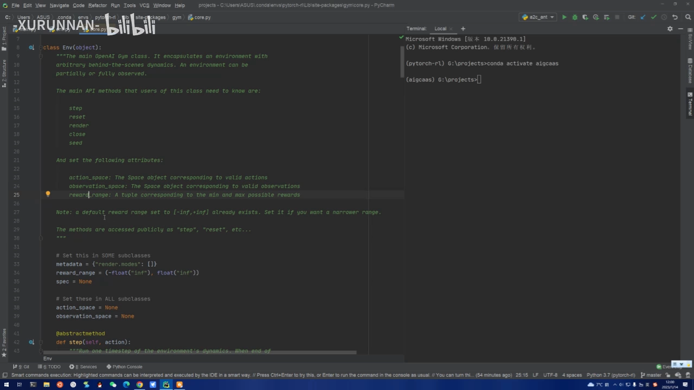

# 分布式强化学习：A2C 与 A3C 的同步与异步

> 本篇整理自「-xurunnan-」《深度强化学习与多智能体强化学习 第九课：分布式强化学习 A2C & A3C》。视频地址：[BV1514y1M76w](https://www.bilibili.com/video/BV1514y1M76w/)。8.1 讲清了 actor-critic 的双网络骨架（QAC），8.2 讲清了优势函数与 GAE。本篇不再重复这些推导，只回答一个**工程问题**：既然优势 actor-critic 的更新式已经写好了，为什么还要开一堆进程去跑它？开多进程之后，「同步」和「异步」两种汇总方式又差在哪？

## 本讲要解决的核心问题（SCQA）

**背景**：到 8.2 为止，actor-critic 家族的「算法」已经齐了——策略网络按优势函数的方向更新，价值网络按 TD 误差更新。但这类算法有个绕不开的工程问题：**采样太慢**。强化学习必须和环境实时交互，一个进程一次只能走一步，而神经网络训练要的是成千上万条轨迹。

**冲突**：最直接的想法是「多开几个进程一起采」。可是进程一多，就冒出一堆新问题：多个 worker 采到的数据怎么合并到同一个模型上？合并时要不要等所有人？如果某个 worker 特别慢，大家是不是都得干等？而且强化学习还有个老毛病——相邻样本高度相关，神经网络会被这种相关性带偏。

**疑问**：多进程并行到底能带来什么？「异步更新」和「同步更新」这两种汇总方式该选哪个？为什么论文里先提出的是异步的 A3C，后来大家却更常用同步的 A2C？

**回答（中心思想）**：多进程并行同时解决了两件事——**加速采样**，以及**用「来自不同世界的数据」天然打断时间相关性**（于是可以扔掉经验回放）。两种汇总方式的分界线只有一条：**全局网络要不要等所有 worker 交完梯度**。不等，就是 A3C 的异步更新；等齐了求平均再更新，就是 A2C 的同步更新。**在单机多进程这种资源同构的场景里，A2C 更稳、更快，所以它是默认选择；A3C 的价值要等到跨机器、算力异构、慢机器会拖死全局的时候才体现出来。**

---

## 一、先分清两个概念：多智能体 ≠ 分布式

课程一上来先做了一个概念切割，因为这两个词经常被混着用。

讲者给出一句判据：**问自己「智能体是处在同一个环境里，还是处在平行的世界里？」**

- **同一个环境** → 智能体之间会相互影响，要学的是「它们如何交互、如何相互建模、最后达到什么均衡」——这是**多智能体强化学习**（比如四个小孩下飞行棋，或者 hide-and-seek 里两组智能体追逃）。
- **平行世界** → 每个智能体在自己的环境里做任何动作、处于任何状态，都和其他世界毫无关系——这是**分布式强化学习**。它的目的不是研究交互，而是**用并行计算加速训练**。

[【跳转到 10:36】](https://www.bilibili.com/video/BV1514y1M76w/?t=636)

这个区分不是文字游戏，它决定了两件事：

1. **模型结构是否同构**。分布式场景里，全局模型和每个 worker 的模型**结构完全一致**，因为只有一致才能做参数共享；而多智能体场景里（比如王者荣耀的不同角色），状态空间、动作空间都可能不同，模型是异构的，往全局汇聚时会很麻烦（要靠蒸馏、迁移学习、多任务学习之类的办法）。
2. **平行世界之间到底交换什么**。**环境里发生的事（状态、动作）完全不交互，但「智能体的知识」可以共享**——这一点正是后面「全局网络」的立足点。

---

## 二、异步从哪来：打破数据相关性的第二条路

### 2.1 经验回放不是唯一解

讲者先复习了那个老问题：监督学习假设数据独立同分布，而强化学习在线采样出来的相邻样本**时间相关性极强**（同一个 episode 里前后几步几乎一样），直接拿去训练神经网络，网络会不稳定。

DQN、DDPG 的解法是**经验回放**：把历史经验存进 replay buffer，更新时随机抽一批出来，用抽样的随机性制造「伪独立」。

但回放只是**一条**路。另一条路就是**异步**：让多个智能体在不同的环境里同时探索，**数据不是同时同地产生的**——有的智能体正在探索环境，有的智能体正在更新网络。这样收集到的数据天然来自不同轨迹，相关性被并行本身打断了。

### 2.2 A3C 的架构：一个全局网络 + N 个 worker

[【跳转到 18:25】](https://www.bilibili.com/video/BV1514y1M76w/?t=1105)

这张图讲者特意提醒：如果你接触过分布式机器学习，会发现它和**参数服务器（parameter server）**架构长得几乎一样——中间一个「全局大脑」，下面挂一串 worker。A3C 是一个**中心化**的架构：

- 中间是 **global network**，持有全局的策略参数 $\theta$ 和价值参数 $\theta_v$；
- 下面是 $N$ 个 worker，每个 worker 对应一个环境，环境之间是平行世界、互不影响；
- 每个 worker 内部都有一套**结构完全相同**的 $\theta'$、$\theta_v'$（这就是第 1 节说的「同构」的意义）；
- 中间的箭头可以理解成一条通信隧道：可以是同机多进程之间的队列，也可以是跨机器的 TCP/IP 连接。

### 2.3 共享权重：一个网络，两个头

图里还有一个细节：policy 和 value 不是两个独立网络，而是**共享一个主干**。讲者解释了这个 trick 为什么成立：actor 和 critic 的输入都是状态 $s$，输入神经元数量一致；只要中间层的设计也保持一致，浅层的特征提取部分就完全一样，于是可以复用——把它单独提出来做特征提取网络，再分两个头，一个输出动作策略，一个输出状态价值。

好处有两个：**降低计算开销**，**提高收敛性**。这也是 8.1 里 actor-critic 双网络骨架在工程上的常见落地方式。

### 2.4 local update：worker 交上去的到底是什么

worker 在本地按单智能体强化学习算法跑一段，更新自己的策略网络和价值网络，参数从 $\theta'$ 变成新的 $\theta'$。它交给全局的东西是**这次更新的变化量**：

$$
\Delta\theta' \;=\; \theta'_{\text{new}} \;-\; \theta'_{\text{old}}
$$

这个量就叫 **local update（本地更新）**。讲者强调：**一个 local update 只反映那个 agent 自己的知识变化**，它和其他 agent 没有关系。全局网络做的事，就是把这些「各自的知识」汇总起来，再把汇总后的最新参数发回给每个 worker——**环境互不交互，但知识在平行世界之间流动**。

---

## 三、A3C 的一轮更新：pull → 本地跑 → push

把上面几块拼起来，A3C 里一个 worker 的一轮是这样走的：

1. **pull**：从 global network 拉取最新的全局参数，覆盖自己的本地副本（$\theta' \leftarrow \theta$，$\theta_v' \leftarrow \theta_v$）；
2. **本地探索 + 本地更新**：在自己的环境里按 $\pi(a\mid s;\theta')$ 采样，算优势、算梯度，更新本地的 actor 和 critic；
3. **push**：把本地更新的变化量（梯度）推给 global network；
4. **全局更新**：全局网络**收到任意一个 worker 的更新，就立刻更新自己的参数**——不等别人。

第 4 步就是「异步」的全部含义。讲者用一句话概括了 A3C 相比普通优势 actor-critic 的区别：**每轮开始拉一次全局参数、本地跑一段、把变化量推回去**，别的都一样。

**为什么异步能加速？** 讲者给了 A3C 原论文里的对比：DQN 系列（含 Double DQN、Dueling DQN、优先采样 DQN）都是在 GPU 上训练八天；而 A3C 开多个进程，**即使在 CPU 上训练**也能取得明显的加速——GPU 是用上万个核并行，多进程则是用多个 CPU 核并行，进程数足够多时加速效果甚至更明显。

**为什么值得这么折腾？** 因为强化学习本来就训练得很慢：简单任务可能要一天，复杂任务训练几个月都不一定有明显效果。分布式强化学习存在的意义，就是**把「拿到一个可用智能体」的时间压短**。

（A3C 原论文的公式、伪代码与四组实验表格，见同目录的《A3C 论文精读：用「多线程异步」替掉经验回放》。）

---

## 四、A2C：把「异步更新」换成「同步等梯度」

### 4.1 唯一的区别：加一个等待

讲者说得很直接：**A2C 和 A3C 的伪代码唯一的区别就在一行**。

[【跳转到 40:55】](https://www.bilibili.com/video/BV1514y1M76w/?t=2455)

- **A3C**：worker 有本地更新就马上传给 global network，global network 立刻更新。图上表现为四根箭头直接汇聚到 Global Network，标注「异步更新」。
- **A2C**：在中间插一个**收集器（Update Collector）**，**必须等 N 个 worker 的更新全部到齐**，做一次同步汇聚，再把汇聚结果交给 global network 更新。

[【跳转到 42:44】](https://www.bilibili.com/video/BV1514y1M76w/?t=2564)

注意这里有个命名上的坑，讲者专门澄清：A2C 里的那个「A」还是 **advantage（优势）**的意思；它**严格来说应该叫 synchronous A2C**（同步优势演员-评论家），只是业界习惯把「同步」这个词省掉，直接叫 A2C。所以本篇沿用这个习惯：**A2C = 同步并行的优势 actor-critic**。

### 4.2 为什么「聚合」天然要求同步

这一步值得停一下：为什么不能「异步地聚合」？

因为**聚合操作的数学形式就要求输入齐全**。最常见的聚合是**求和/求平均**：

$$
\Delta\theta \;=\; \frac{1}{N}\sum_{i=1}^{N}\Delta\theta_i
$$

加法你得先把所有元素都拿到手才能加。所以「聚合」这个动作本身就等价于「同步」——**要等所有输入到齐，才能执行**。讲者也提到，其他论文可能用求中值之类的聚合方式，但只要是聚合，就有这个「必须收齐」的性质。

### 4.3 为什么同步反而更稳

讲者给出的结论很干脆：**从效果上看，A2C 因为同步，训练会更稳定**。原因不难想：异步更新时，全局参数在任意时刻都可能被某个 worker 的「陈旧梯度」改写——你算梯度时用的是 $\theta'$ 的旧副本，等你 push 上去时全局参数已经被别人改过好几轮了；同步聚合则保证**这一批梯度都是基于同一份参数算出来的**，方向更一致。

代价也是显然的：**同步要等最慢的那个**。这一点在第 5 节会变成 A3C 唯一的翻盘点。

---

## 五、适用边界：同构资源用 A2C，异构资源才用 A3C

这是整堂课里最实用的一个判断，讲者把它讲得很清楚。

### 5.1 同构资源：A2C 占绝对优势

**单台机器多进程**的场景下，各个进程的算力、通信速度基本一致，可以认为这些环境之间是**同构**的——每个智能体的进度差不多。这时候同步的等待成本很小，而同步带来的稳定性是白拿的，所以**A2C 占绝对优势**。

讲者甚至说得更直白：在单机多进程这个任务里，**同步 A2C 的性能比 A3C 好**，所以课程代码只分析 A2C，A3C 留作课后练习。

### 5.2 异构资源：同步瓶颈才是 A3C 的舞台

反过来，如果各个 worker 的算力**不一样**（比如跨机器部署时，有的机器是 2080、有的是 3080、有的 CPU 更弱），同步就会撞上**同步瓶颈**：

> agent 1 很慢，agent 2、3、4 早就跑到聚合点了，但 agent 1 迟迟不到——整个集群被卡住，所有人都在等 agent 1。

这时候 A3C 的价值就出来了：**agent 2、3、4 直接更新 global network，不用等 agent 1**。

所以选型可以总结成一句话：**资源同构 → A2C（稳、快、简单）；资源异构 → A3C（不让慢机器拖死全局）**。而天授（Tianshou）实现的是单机多进程，基本不存在异构，所以它默认用 A2C。

---

## 六、工程实现：天授是怎么把 A2C 跑起来的

理论讲完，讲者用天授框架的 `module/A2C` 讲了实现。这里有一个**关键的等价 trick**，值得单独说清楚。

### 6.1 一个等价的 trick：决策和更新都搬到主进程

标准 A2C 里，每个 worker 自己做三件事：**决策动作、探索环境、更新参数**。天授把它们拆开了：

- **留在 worker 的**：只有「把动作丢进环境、拿回状态和奖赏」这一件事；
- **搬到主进程的**：决策动作（策略网络前向）、更新参数（反向传播）。

[【跳转到 58:34】](https://www.bilibili.com/video/BV1514y1M76w/?t=3514)

**为什么可以这么搬？** 讲者给了两条论证。

**第一条：同步保证了「动作决策」可以搬。** 因为 A2C 是同步的，每一轮开始时所有 worker 的参数都被同步成同一份，所以「用状态 $s_i$ 决策出动作 $a_i$」这件事，无论在主进程算还是在 worker 算，结果**完全一样**。既然如此，不如统一放到主进程算。

**第二条：梯度累加保证了「参数更新」可以搬。** 原来每个 worker 本地算出 $\Delta\theta_1,\Delta\theta_2,\Delta\theta_3$，主进程再做聚合 $\Delta\theta=\sum_i \Delta\theta_i$。现在把更新搬到主进程：主进程手里有一个 batch，里面是 $(s_1,a_1,s_1',r_1),(s_2,a_2,\dots),(s_3,\dots)$ 三个样本，对它做一次反向传播——在 PyTorch 里，**不清零梯度的话，梯度默认是累积的**，所以这一次反传得到的梯度正好就是三个梯度的和。

$$
\Delta\theta \;=\; \sum_i \Delta\theta_i \;=\; \sum_i g_i
$$

**两条路在物理含义上是等价的**，这就是天授敢把模型全放在主进程的前提。

**为什么要这么搬？** 讲者算了一笔账：如果每个 worker 都维护一份模型，开 16 个进程就要有 16 份网络参数。假设网络 500 MB，光显存就吃掉约 8 GB；而且 worker 和主进程之间还要传模型，进程越多、传的数据越大、占用时间越多。**结论是：模型放在 worker 上，分布式扩展能力会被显存和通信吃掉。** 把模型收归主进程之后，worker 变成了纯粹的「轨迹采样器」。

### 6.2 共享内存：状态不走通信队列

worker 采完一步要返回什么？**下一时刻的状态和奖赏**。这里有个坑：有的任务状态空间很大（讲者举例：现在这个任务观测是 111 维，但有的任务能到上百万维），如果状态也走进程间通信，开销会很大。

天授的做法是**共享内存**（shared memory）：主进程在物理空间上开一片内存，worker 进程虽然独立，但同样可以访问这片物理空间、往里写数据。于是：

- **状态**写进共享内存，通信队列里只传一个 `None`，主进程自己去共享内存里读；
- **奖赏**是个标量，直接放进通信队列，几乎不占开销；
- 终止标志、`info` 这些小的信息原封不动地传回去。

### 6.3 那个 replay buffer 不是经验回放

天授里确实有一个 replay buffer，但讲者特意提醒：**它不是用来做随机采样的**，只是一个**临时存储**。

证据在代码里：更新时 `policy.update` 的 `batch_size` 设成 999999 这种远超 buffer 容量的数，意思是**把 buffer 里的数据全部取出来用，然后清空**。既然没有随机抽样，也就没有「用抽样打断相关性」这回事——**所以分布式 A2C 依然是一个 on-policy 算法**（这一点和 8.1 讲的 QAC 一致）。

### 6.4 一条超参开启分布式

用户侧代码的改动小到出乎意料：**主体代码一行都不用改**，只需要把两个超参从 1 调大：

- `training_num`：并行训练环境数量（= worker 数量）；
- `test_num`：并行测试环境数量。

讲者现场演示：把 `training_num` 设成 16、`test_num` 设成 10，几秒钟就得到一个分布式同步 A2C；同样的改法套到 SAC、TD3 上，几秒钟就能得到分布式的 SAC、分布式的 TD3。**换算法、换策略、换网络、并行化，都只需要很少的改动**——这也是讲者反复推荐这个框架的原因。

---

## 七、实验：并行不改变收敛曲线，只压缩墙钟时间

讲者用 Ant-v3 环境跑了四组实验：`training_num` 分别取 1、2、16、32，横轴是**步数**，共 300 万步。

[【跳转到 2:00:45】](https://www.bilibili.com/video/BV1514y1M76w/?t=7245)

把平滑调到最大后可以看到：**四条曲线基本重叠**。为什么？

因为天授用的那个 trick 决定了：**采样是并行的，但更新仍然是集中的，而且用来更新的 batch size 没变**。从理论上讲，算法并行或不并行，**收敛性质保持不变**——你只是把「采样本」这个过程用多进程加速了，对「更新/最优化」这一步没有影响。所以横轴是步数时，这四条曲线就是同一条收敛曲线。

**那加速体现在哪？** 体现在把横轴换成**时间**。

[【跳转到 2:03:48】](https://www.bilibili.com/video/BV1514y1M76w/?t=7428)

切到相对时间轴后差别一目了然：**环境数越多，达到同一精度所需的墙钟时间越短**。以 1800 这条线为例，最先收敛的是 32 环境并行的实验，然后是 16、2、1。讲者还提到，单环境那条曲线训练了两个多小时，而 32 环境的那条只用了不到半小时。

这就是分布式强化学习的两个性质，讲者把它们对着讲：

- **收敛曲线**（横轴步数）**不变** —— 算法本身没变；
- **时间效率曲线**（横轴时间）**明显变快** —— 并行把采样加速了。

### 7.1 并行数量的上限：内存和 CPU

讲者顺手给了一个实践边界：`training_num` 不是越大越好。

- **内存是瓶颈**：他试过设成 64，直接报「内存不足」。单机多进程一般到 32~50 就到头了；工作站上也许能到 200 多，但不确定。
- **CPU 核数也是上限**：CPU 最多只能开 8 个进程，你设 32 就是极高负荷。建议设成 CPU 的最大进程数，`test_num` 也不要超过它。

`test_num` 还有另一个用处：配合 `render` 可以**同时开多个测试窗口**，用不同随机种子跑同一个策略，看哪一个表现最好（讲者演示时开了十个窗口，有的机器人跑得很远，有的直接崩了——**环境本身有随机性，预训练好的模型也可能崩**）。

---

## 八、从 A2C 到 A3C：只需要改两处

课程最后把「怎么把 A2C 改成 A3C」讲完了，结论是**只改两处**。

### 8.1 第一处：让环境变成异步的

天授的 `step` 里有一个 if-else 分支，判断依据是一个 flag：`cf.is_async`。这个 flag 由环境决定，而环境的行为由两个参数控制：

- **`wait_num`**：一次要等多少个 worker 返回。
  - 设成**环境总数**（比如 16）→ 全同步，is_async 为 false，就是 A2C；
  - 设成 **1** → 完全异步：**只要收到一个 worker 的结果就立刻更新**，其他的一律不等，超时没到的直接丢弃；
  - 设成中间值（比如 15）→ 半同步半异步：等到 15 个就更新，丢掉最后一个。
- **`timeout`**：等多久算超时。设了 timeout，可能只等到 8 个、9 个就用这几个更新；不设就一直等够 `wait_num` 个。

`wait_num` 和 `timeout` 是配套出现的。具体写法是在实例化共享内存 vector env 时把参数传进去（比如 wait_num 取 1；或者 wait_num 取 10、timeout 取 1）。

代码里 `wait` 的实现就是一个 while 循环，有三个退出条件：

1. **要等的 worker 已经没有了**（所有 worker 都返回了）；
2. **已完成的智能体数量达到了 `wait_num` 上限**；
3. **超时**。

否则就一直监听，看哪个 worker 做了 send 操作，把它的结果收下来。

### 8.2 第二处：把同步 collector 换成异步 collector

原来 import 的是同步 collector，改成异步 collector，把主代码里那一处替换掉即可。**测试用的 collector 不用改**——测试不涉及训练过程的聚合，继续用同步的没问题。

讲者总结：**A2C → A3C 一共两个操作**——创建环境时给共享内存 vector 传 `wait_num`/`timeout`；用户侧把同步 collector 换成异步 collector。其他地方不用动。反过来，把 A2C 换成 DDPG 也是同样的套路：换 policy、换 trainer、改 `max_size` 和 `batch_size`、把 on-policy 改成 off-policy，几处小改动就得到分布式 DDPG；再加 `is_async` 就变成异步 DDPG。

---

## 九、顺带一提：怎么自己写一个环境

课程末尾还讲了「如何写自己的环境」，因为真正做研究时不可能一直用 gym 提供的环境。规则很简单：**继承 `gym.Env`，复写五个方法、定义三个属性**。

[【跳转到 3:05:32】](https://www.bilibili.com/video/BV1514y1M76w/?t=11132)

**五个方法**：

- `step(action)`：把动作作用到环境上，做状态迁移，返回**下一时刻状态、奖赏、终止标志、（可选）info**；
- `reset()`：重置环境、计数器、终止 flag 等；
- `render()`：渲染。讲者特别提到，**渲染不一定要开窗口画动画**——他演示了一个「终端监控板」：加载预训练策略、不训练、只跑测试环境，然后在终端里 print 集群状态（20 个 service provider、1000 个 user、任务分配情况），效果等同于动画；
- `close()`：配合 `render` 关窗口（不画窗口就不用实现）；
- `seed()`：设置环境种子，让环境以确定状态初始化。

**三个属性**：`action_space`、`observation_space`、`reward_range`。把这八个东西定义好，天授的整条 pipeline 就能跑通——**跑不通才是 bug，跑得不好是设计问题**。

讲者花了不小篇幅强调**观测空间和奖赏的设计**，因为这是环境设计里最难的部分：

- **观测空间必须和动作有关联**。他举了个反例：观测是「我今年工资涨了」，动作是「我今天回去洗澡」——这两者毫无关联，强化学习等于在瞎猜，效果和随机差不多。很多同学只是把手头的信息简单拼成观测向量，但这些维度**推导不出动作**。
- **奖赏要有正有负、要减掉 baseline**。如果所有奖赏都设成正的，会直接影响性能。原因就是 7.4 讲过的：动作价值最高的动作如果总没被采样到，就会被其他劣质动作抑制；减掉 baseline 之后，没被选中的动作概率会上升，被惩罚的动作没被选中、能拿奖赏的动作被选中，它以后被选中的概率也会增加。

---

## 小结

1. **多智能体 ≠ 分布式**。判据是「同一个环境」还是「平行世界」：前者研究智能体之间的交互与均衡，后者只为并行加速。平行世界里环境不交互，但**知识可以共享**。
2. **异步是打破数据相关性的第二条路**。经验回放靠随机抽样去相关，A3C 靠「多个 worker 在不同环境同时采样」天然去相关，于是可以不要 replay buffer。
3. **A3C 的骨架是参数服务器式的中心化结构**：一个 global network，挂 $N$ 个 worker，每个 worker 连一个独立环境；actor 和 critic 共享主干、分两个头输出。
4. **local update 是 worker 交上去的变化量** $\Delta\theta'=\theta'_{\text{new}}-\theta'_{\text{old}}$，它只反映那个 agent 自己的知识。
5. **A3C 一轮 = pull 全局参数 → 本地探索与更新 → push 变化量 → 全局立刻更新（不等）**。
6. **A2C 和 A3C 的唯一区别是一行**：A2C 在中间加一个收集器，**等所有 worker 的梯度到齐再聚合**。聚合（求和/求平均）本身要求输入齐全，所以聚合天然等于同步。
7. **同步更稳**：A2C 保证一批梯度基于同一份参数算出；异步则会拿陈旧梯度去改全局参数。
8. **选型看资源是否同构**：同构（单机多进程）用 A2C，稳且快；异构（跨机器、算力不一）用 A3C，避免慢机器造成同步瓶颈。
9. **天授的实现靠一个等价 trick**：决策动作和更新参数都搬到主进程，worker 只采样——因为同步保证决策结果一致，而 PyTorch 的梯度累积保证 $\sum_i g_i$ 等价于本地更新之和。这样模型只存一份，扩展性不被显存和通信吃掉。
10. **并行的收益体现在时间轴上**：横轴是步数时四条曲线重叠（收敛性质不变），横轴是墙钟时间时环境越多收敛越快。
11. **A2C → A3C 只改两处**：环境传 wait_num 与 timeout（wait_num 取 1 即完全异步），用户侧把同步 collector 换成异步 collector。
12. **自己写环境 = 五个方法 + 三个属性**（step/reset/render/close/seed 与 action_space/observation_space/reward_range），难点在观测空间与奖赏的设计。

## 关键术语速查

| 术语 | 一句话解释 |
| --- | --- |
| 多智能体强化学习 | 多个智能体在**同一个环境**里交互，学的是交互方式与均衡 |
| 分布式强化学习 | 多个智能体在**平行世界**里各自探索，目的是并行加速训练 |
| A3C（Asynchronous Advantage Actor-Critic） | 异步优势演员-评论家：worker 交一个更新就立刻改全局参数 |
| A2C（同步优势演员-评论家） | 等所有 worker 的梯度到齐、聚合后再更新全局参数 |
| global network | 全局网络，持有全局的 $\theta$、$\theta_v$，是知识汇聚处 |
| local update | worker 本地更新产生的参数变化量 $\Delta\theta'$ |
| pull / push | worker 从全局拉参数 / 把本地更新推回全局 |
| 共享权重 | actor 与 critic 共用一个特征提取主干，分两个头输出 |
| 聚合（aggregation） | 把多个 worker 的梯度合成一个，常用求和/求平均；要求输入齐全，故等价于同步 |
| 同步瓶颈 | 同步更新时最慢的 worker 拖住整个集群 |
| 同构 / 异构资源 | 各 worker 算力与通信速度是否一致；同构用 A2C，异构用 A3C |
| `wait_num` | 一次要等多少个 worker 返回；等于环境总数即同步，等于 1 即完全异步 |
| `timeout` | 等待超时时间，与 `wait_num` 配套使用 |
| `is_async` | 环境是否异步的标志，由 `wait_num` 是否等于环境数决定 |
| `training_num` / `test_num` | 并行训练环境数 / 并行测试环境数 |
| 共享内存（shared memory） | 主进程开辟、worker 可直接写的物理内存，用来传大块状态，避免通信开销 |
| 向量化环境（vector env） | 把多个独立环境包装成一个接口，一次 step 返回一批结果 |