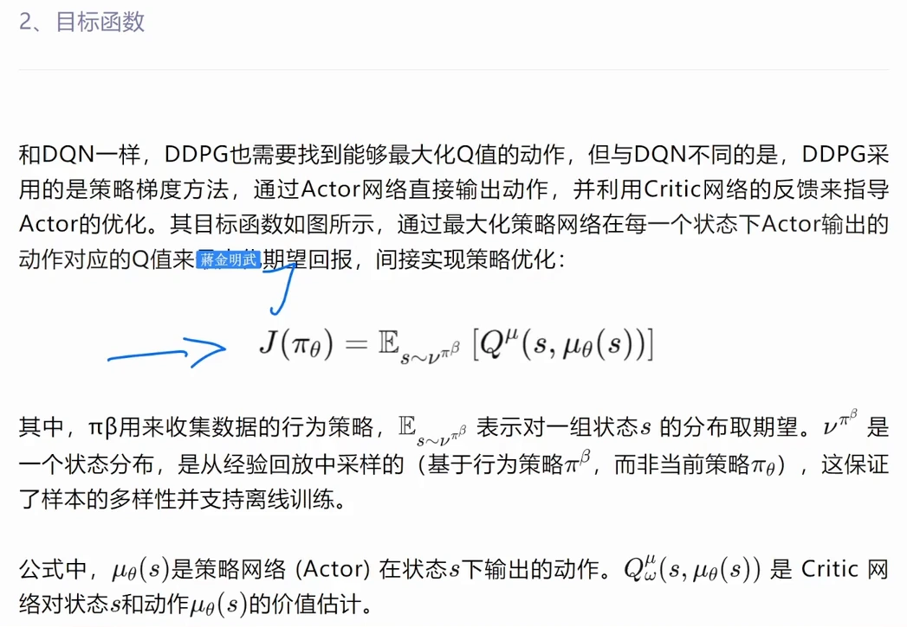
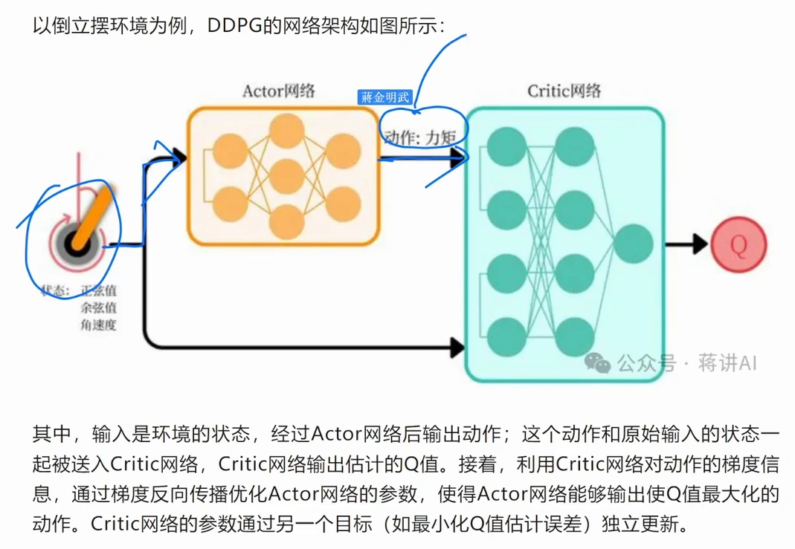
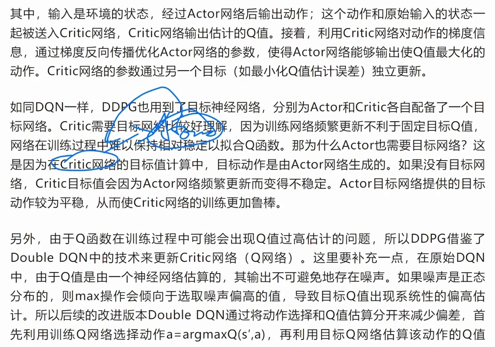
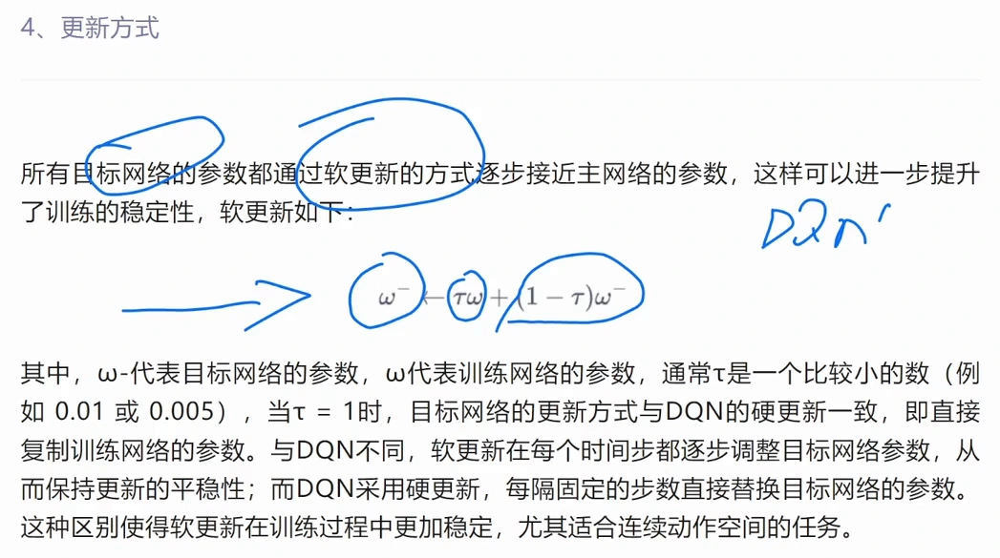
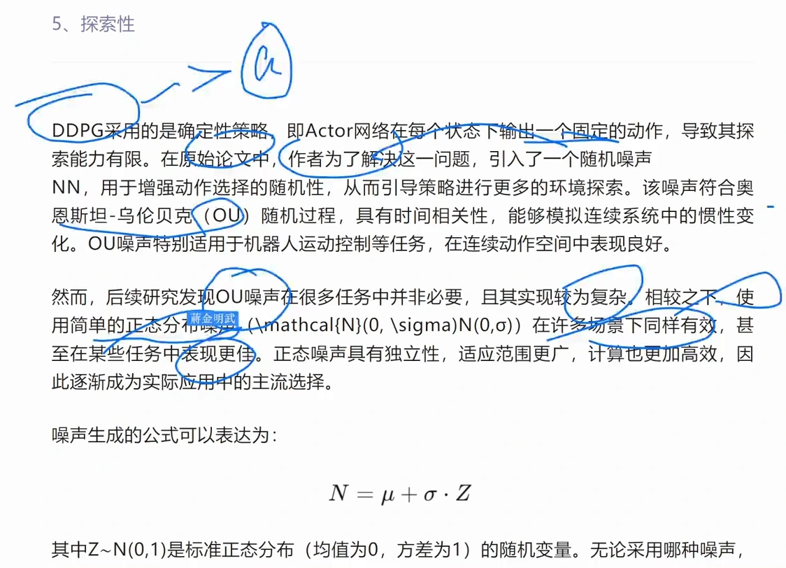
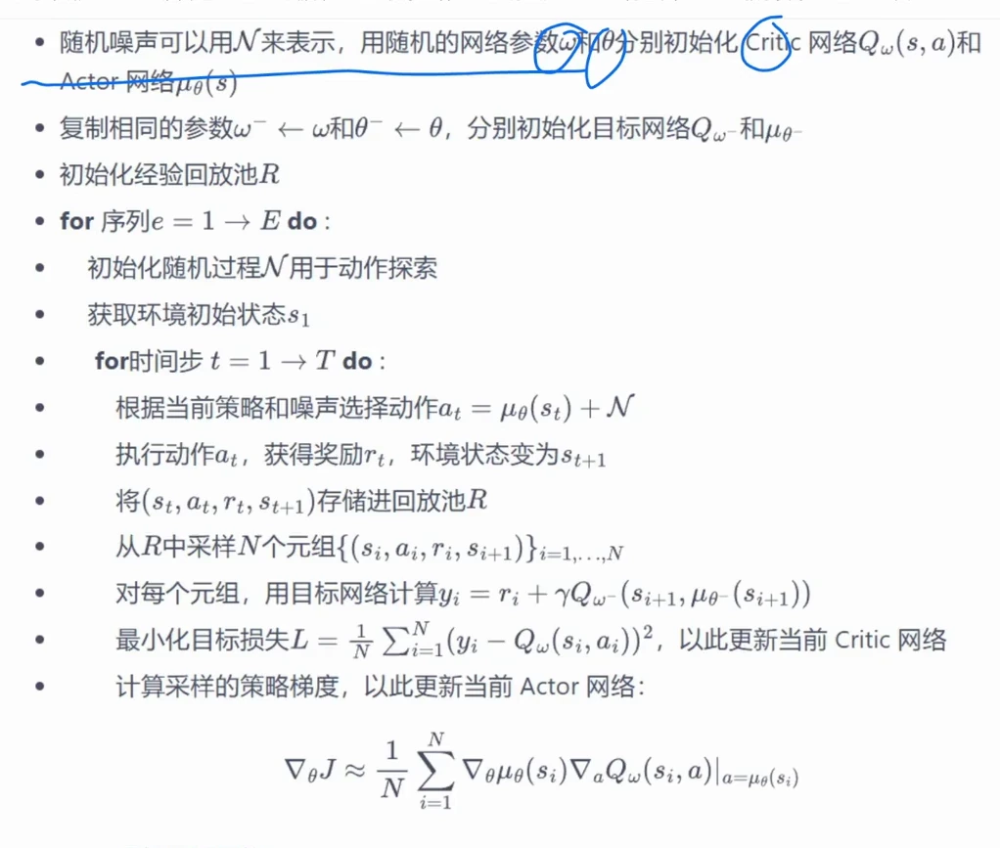
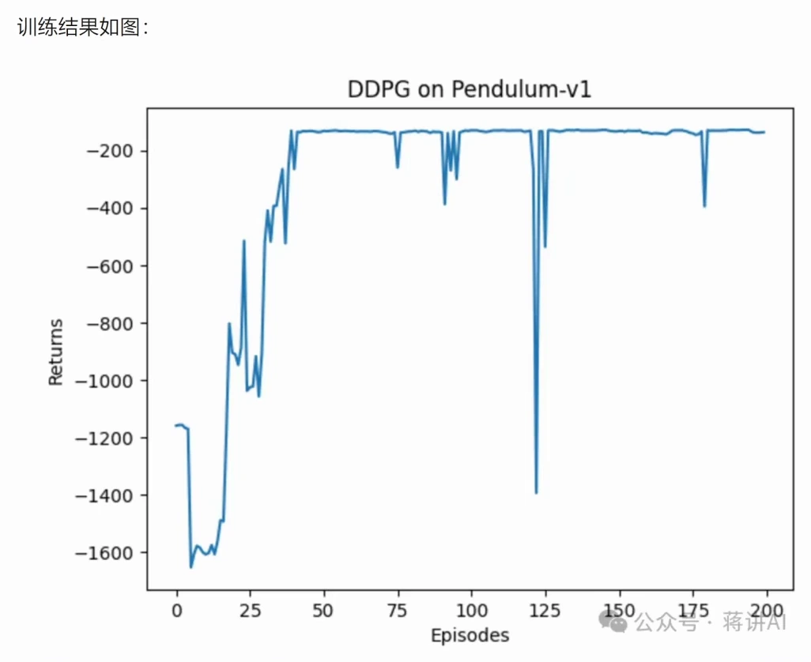

# DDPG 的工程实现：四个网络、软更新与探索噪声

> 本篇整理自蒋一讲 AI《深度确定性策略梯度（DDPG）算法》。视频地址：[BV18Sr8YjEiF](https://www.bilibili.com/video/BV18Sr8YjEiF/)。上一篇《确定性策略梯度（DPG）：为什么可以直接对动作求梯度》讲清了 DPG 的数学：让策略直接输出动作 $a=\mu_\theta(s)$，用链式法则 $\nabla_\theta\mu\cdot\nabla_a Q$ 把 critic 的分数变成 actor 的梯度。本篇换一个角度——**把这个式子真正做成一个能跑的算法**：为什么非要四个网络、软更新到底怎么算、确定性策略不探索怎么办、代码里每一行在干什么。

## 本讲要解决的核心问题（SCQA）

**背景**：前面学的 REINFORCE、Actor-Critic、PPO 都是**在线策略（on-policy）**算法。它们更新的是策略本身：策略参数一改，新策略就必须重新和环境互动、采集新经验，旧策略采到的样本通通作废。

**冲突**：这样一来样本效率太低——交互数据要大量产生，训练成本很高。DQN 靠**经验回放**把历史样本反复用起来，样本效率高得多，但 DQN 只能用在**动作离散**的环境里，因为它的原理是对每个可能的离散动作评估 Q 值。连续动作空间里动作有无穷多个，这个「逐个评估」根本做不完。

**疑问**：能不能既保留 DQN 的离线策略、高样本效率，又能直接处理连续动作？一个确定性的 actor 配上 critic，工程上要额外补哪些东西才能稳定训练？

**回答（中心思想）**：**DDPG 就是把 DQN 的两件遗产（经验回放、目标网络）搬进确定性的 actor-critic 框架**。它用 actor 直接输出连续动作、用 critic 评估该动作的 Q 值，用**经验回放池**提高样本效率，用**四个网络 + 软更新**压住训练的不稳定，再用**加性噪声**补上确定性策略缺失的探索能力。

---

## 一、DDPG 要补的两个洞：样本效率与连续动作

### 1.1 在线策略的浪费

讲者开篇先把「为什么要换算法」讲透。REINFORCE、Actor-Critic、PPO 都是**在线策略算法**：它们更新的是策略，把策略更新到 $\pi_{\theta'}$ 之后，**更新后的策略必须重新和环境互动**，互动之后产生新的一堆数据 $(s,a,r,s')$，再用新数据更新策略，一直到策略最优。

问题在于：**旧策略采到的样本通通用不了**。$\pi_{\theta_1}$、$\pi_{\theta_2}$、$\pi_{\theta_3}$ 各自采的样本，对当前策略都没用。所以这些算法在交互过程中需要产生大量数据，样本需求量比较大、训练成本比较高。

### 1.2 DQN 的回放很好，但它只认离散动作

离线策略算法（off-policy）的好处就在这儿：DQN 采用**经验回放**机制，哪怕是一个旧策略采样得到的大量样本，只要能把 Q 逼近 $Q^*$，这些数据仍然都可以用——因为它只做**值的更新**，不做策略的更新，只更新 Q 值。所以 DQN 才有了经验回放这种机制，能大大提高离线策略算法的样本效率，多次使用历史样本。

但 DQN 有个硬限制：**只能在动作离散的环境中使用**。因为它是基于 Q 值优化的原理，要直接对每一个可能的离散动作进行评估。

### 1.3 强行离散化为什么不行

那能不能把连续动作空间**离散化**，硬套 DQN？讲者说可以，但很粗糙。比如倒立摆环境，力矩从 0 到 10，你把它切成 0、1、2……10 十份，让网络一次性输出十个 Q 值，这样也能跑。

代价是：

- **没有办法对动作实现精细控制**——只有十档力矩，控制精度就到这儿了；
- **动作维度一高就维度灾难**——每个维度切十份，$d$ 维动作就是 $10^d$ 个输出，计算量爆炸。

所以我们需要一种算法，**既能够利用离线策略的高样本效率，又能直接处理连续动作空间的优化问题**。这就是 DDPG：它结合了 DQN 和策略梯度的优点，实现了在连续动作环境中的高效学习。

## 二、目标函数：把 DQN 的 max 换成 actor

DDPG 也采用 **actor-critic 架构**，但它和 REINFORCE、PPO 有一个根本区别：**actor 网络直接输出一个具体的动作**，而不是输出动作的概率分布。这种「输出确定动作」的策略就叫**确定性策略**，它非常适合连续动作空间，因为它能够**直接优化动作的选择精度**。

critic 网络的职责是**直接评估 actor 网络输出的动作的 Q 值大小**，通过这个值帮助 actor 更新，实现基于价值的策略改进。

### 2.1 目标函数的对比

DDPG 的目标函数很简单，**就是把 DQN 的目标函数改一改**。两者都是「最大化 Q 值」，区别只在最大化谁：

$$
\text{DQN:}\quad \max_{a}\;Q(s,a)
\qquad\Longrightarrow\qquad
\text{DDPG:}\quad \max_{\theta}\;\mathbb{E}_{s\sim\nu^{\pi_\beta}}\Big[Q^{\mu}\big(s,\mu_\theta(s)\big)\Big]
$$

唯一的区别就是**把 DQN 里的动作 $a$ 换成了 $\mu_\theta(s)$**，其他都一样。而这个 $a$ 是用**策略网络**输出的，Q 值仍然用**价值网络**来估计。



[【跳转到 08:50】](https://www.bilibili.com/video/BV18Sr8YjEiF/?t=530)

### 2.2 式子里的每个符号是什么

- $\pi_\beta$ 是**用来收集数据的行为策略**（behavior policy）。注意它和当前要优化的策略 $\mu_\theta$ 不是同一个——这正是「离线」的来源。
- $\mathbb{E}_{s\sim\nu^{\pi_\beta}}$ 表示对一组状态 $s$ 的分布取期望；$\nu^{\pi_\beta}$ 是一个**状态分布**，是**从经验回放中采样**的（基于行为策略 $\pi_\beta$，而非当前策略 $\mu_\theta$）。这保证了样本的多样性，并支持离线训练。
- $\mu_\theta(s)$ 是策略网络（actor）在状态 $s$ 下输出的动作，也就是那个 $a$。
- $Q^{\mu}(s,\mu_\theta(s))$ 是 critic 网络对状态 $s$ 和这个由策略网络输出的动作的价值估计。

所以在每个状态 $s$，actor 希望自己输出的动作 $a$ 能够**最大化它的 Q 值**：只要每次都这样干，最终就会达到整体的优化。通过优化所有状态 $s$ 上期望的 Q 值，就能实现最终期望回报的整体最大化。

### 2.3 求导：又是链式法则

对这个目标求导，怎么求？**先对 $a$ 求导，再对 $\theta$ 求导**。也就是把 $a=\mu_\theta(s)$ 代进去，变成 $Q(s,\mu_\theta(s))$，先对 $a$ 求导，然后再对 $\theta$ 求导——这是求导的链式法则。最后用梯度上升最大化 Q 值：

$$
\nabla_\theta J\approx\frac{1}{N}\sum_{i=1}^{N}\nabla_\theta\mu_\theta(s_i)\,\nabla_a Q_\omega\big(s_i,a\big)\Big|_{a=\mu_\theta(s_i)}
$$

## 三、网络架构：倒立摆上的信息流

以倒立摆（Pendulum）为例，DDPG 的网络架构是这样的：

1. 输入是**环境的状态**（倒立摆的余弦值、正弦值、角速度）；
2. 状态经过 **actor 网络**，输出**动作**——这里就是施加的**力矩**；
3. 这个动作和**原始输入的状态**一起被送入 **critic 网络**，critic 输出估计的 Q 值；
4. 接着利用 critic 网络对动作的**梯度信息**，通过反向传播优化 actor 的参数，使得 actor 能够输出使 Q 值最大化的动作；
5. critic 的参数则通过另一个目标（最小化 Q 值估计误差）**独立更新**。



[【跳转到 14:15】](https://www.bilibili.com/video/BV18Sr8YjEiF/?t=855)

一句话总结这条信息流：**actor 出动作，critic 打分，critic 的梯度反传回去改 actor，critic 自己用 TD 误差改自己。**

## 四、为什么是四个网络

和 DQN 一样，DDPG 也引入了**目标网络**，而且是 **actor 和 critic 各自配备一个**。加上两个训练网络，一共**四个网络**：

| 网络 | 作用 |
| --- | --- |
| actor 训练网络 $\mu_\theta$ | 输出实际执行的确定性动作，被 DPG 更新 |
| critic 训练网络 $Q_\omega$ | 评估当前动作的 Q 值，被 TD 误差更新 |
| actor 目标网络 $\mu_{\theta^-}$ | 生成**目标动作**，供 critic 目标网络算目标 Q 值 |
| critic 目标网络 $Q_{\omega^-}$ | 计算**目标 Q 值**，用于构造 TD target |

### 4.1 critic 要目标网络，好理解

因为训练网络频繁更新不利于固定目标 Q 值，网络在训练过程中难以保持相对稳定以拟合 Q 函数。给它配一个更新更慢的目标网络，Q 值在逼近目标的时候就不会因为目标网络的 Q 值变化太大而剧烈波动。

### 4.2 actor 为什么也要目标网络

这一点容易被忽略。**在 critic 的目标值计算中，目标动作是由 actor 网络生成的。** 假如 actor 不固定——用的是训练网络而不是目标网络——那么对于同一个状态，它输出的动作也可能是波动的；动作一波动，critic 计算目标值的过程也会波动。

所以就算 critic 用的是目标网络，只要**计算动作的那个 actor 不稳定**，最后 critic 还是会波动。要让它稳定下来，就必须让它里面那个输出动作的 actor 也保持稳定。**actor 目标网络提供的目标动作较为平稳，从而使 critic 网络的训练更加鲁棒。**



[【跳转到 17:10】](https://www.bilibili.com/video/BV18Sr8YjEiF/?t=1030)

### 4.3 顺带解决高估：像 Double DQN 那样拆开

Q 函数在训练过程中可能会出现**Q 值过高估计**的问题，DDPG 也借鉴了 Double DQN 的技术来更新 critic。为什么 Q 值会高估？因为 Q 值是由神经网络估算的，它的输出不可避免会存在噪声；如果噪声是正态分布的，那么 $\max$ 操作会**倾向于选择噪声偏高的值**，于是目标 Q 值出现系统性的偏高估计。

Double DQN 的办法是把**动作的选择**和 **Q 值的估算**分开：用训练网络选动作 $a=\arg\max_{a}Q(s',a)$，再用目标网络估算这个动作的 Q 值 $Q'(s',a)$。这样选价值最大的动作和计算该动作的价值用的是两套不同的网络，高估就被压下来了。

DDPG 采用了类似的技巧：**目标动作由目标 actor 网络生成，目标 Q 值由目标 critic 网络计算**——相当于用两个网络分别完成「生成动作」和「算 Q 值」，避免用同一个网络既选动作又算价值，从而延缓 Q 值过高估计。

## 五、软更新：每步挪一点点

DQN 用的是**硬更新**：训练网络一步一更新，目标网络隔一百步才把训练网络的参数**整份复制**过去。DDPG 不一样，它用的是**软更新**：

$$
\omega^-\leftarrow\tau\,\omega+(1-\tau)\,\omega^-
$$

也就是把训练网络的参数 $\omega$ 和目标网络的参数 $\omega^-$ 做加权平均，结果作为新的目标网络参数。$\tau$ 是一个比较小的数（例如 0.01 或 0.005）。

几个要点：

- **$\tau=1$ 时退化为硬更新**：此时 $(1-\tau)$ 这一项等于 0，目标网络直接等于训练网络，就与 DQN 的硬更新一致了。
- **软更新是逐步迭代的**：每一步只更新一点点，只有一点点细微的区别。
- **好处是平稳**：软更新可以在**每个时间步**都逐步调整目标网络参数，保持更新的平稳性，但又不至于更新得太大。



[【跳转到 21:20】](https://www.bilibili.com/video/BV18Sr8YjEiF/?t=1280)

## 六、探索：确定性策略的短板与两种噪声

DDPG 用的是**确定性策略**，actor 在每个状态下**输出一个固定的动作**，这导致它的**探索能力有限**：如果每次都输出确定性动作，探索性不够强，就可能收敛到局部最优。

解决办法是在动作上加噪声。这里有一段挺有意思的「历史」：

- **原始论文**引入的随机噪声叫 **OU 噪声**（Ornstein–Uhlenbeck 过程）。它**具有时间相关性**，能够模拟连续系统中的**惯性变化**，特别适用于机器人运动控制等任务，在连续动作空间中表现良好。
- **但后续研究发现**，OU 噪声在很多任务中**并非必要**，而且实现较为复杂；相比之下，使用简单的**正态分布（高斯）噪声** $\mathcal{N}(0,\sigma)$ 在许多场景下同样有效，甚至在某些任务中表现更好。正态噪声具有独立性、适应范围更广、计算也更高效，因此逐渐成为实际应用中的主流选择。

噪声的生成公式可以写成：

$$
N=\mu+\sigma\cdot Z,\qquad Z\sim\mathcal{N}(0,1)
$$

其中 $Z$ 是标准正态分布（均值为 0、方差为 1）的随机变量。最终执行的动作就是 **actor 的输出加上这个噪声**：

$$
a_t=\mu_\theta(s_t)+N
$$



[【跳转到 22:55】](https://www.bilibili.com/video/BV18Sr8YjEiF/?t=1380)

## 七、伪代码与代码要点

### 7.1 伪代码

讲者给出的 DDPG 伪代码，把前面所有零件串成了一条流水线：

```text
用随机网络参数 ω、θ 分别初始化 Critic 网络 Q_ω(s,a) 和 Actor 网络 μ_θ(s)
复制相同参数：ω⁻ ← ω，θ⁻ ← θ，分别初始化目标网络 Q_{ω⁻} 和 μ_{θ⁻}
初始化经验回放池 R

for 序列 e = 1 → E do:
    初始化随机过程 N 用于动作探索
    获取环境初始状态 s₁
    for 时间步 t = 1 → T do:
        根据当前策略和噪声选择动作 a_t = μ_θ(s_t) + N
        执行动作 a_t，获得奖励 r_t，环境状态变为 s_{t+1}
        将 (s_t, a_t, r_t, s_{t+1}) 存储进回放池 R
        从 R 中采样 N 个元组 {(s_i, a_i, r_i, s_{i+1})}
        对每个元组，用目标网络计算 y_i = r_i + γ·Q_{ω⁻}(s_{i+1}, μ_{θ⁻}(s_{i+1}))
        最小化目标损失 L = (1/N)Σ(y_i − Q_ω(s_i,a_i))²，以此更新当前 Critic 网络
        计算采样的策略梯度，以此更新当前 Actor 网络：
            ∇_θ J ≈ (1/N)Σ ∇_θ μ_θ(s_i) · ∇_a Q_ω(s_i,a)|_{a=μ_θ(s_i)}
        更新目标网络：ω⁻ ← τω + (1−τ)ω⁻，θ⁻ ← τθ + (1−τ)θ⁻
```



[【跳转到 24:05】](https://www.bilibili.com/video/BV18Sr8YjEiF/?t=1445)

### 7.2 代码要点（Gymnasium + PyTorch）

讲者用 Gymnasium 的 `Pendulum-v1` 环境把伪代码落成代码，关键点有这些：

- **策略网络**：输入状态维度、经过隐藏层、输出动作维度，最后经过 tanh 变成 $(-1,1)$ 之间的值，再乘动作上界 action_bound（倒立摆是 2），把输出限制到 $(-2,2)$——这就是「actor 输出的是具体动作」在代码里的样子。
- **Q 网络**：先把状态和动作 `cat` 拼接成一个张量，再经过几层全连接输出一个标量 Q 值。
- **四个网络与优化器**：actor、critic 各建一个网络，再把参数复制给各自的目标网络；两者都用 Adam 优化器；`gamma` 是折扣因子，`sigma` 是高斯噪声的标准差（均值默认 0），`tau` 是软更新参数。
- **`take_action`**：状态过 actor 得到动作，再加上 `np.random.normal` 采样出的噪声；因为加噪声后可能偏离范围，所以再把动作 clip 回 $(-2,2)$。
- **`soft_update`**：直接按 $(1-\tau)\omega^-+\tau\omega$ 逐参数更新目标网络。
- **更新函数**：先用目标 actor 网络对下一状态生成目标动作，再用目标 critic 网络算出 next_q，然后乘 gamma 加上奖励得到 TD target（并乘一个标志位来检测是否到达终止状态）；critic loss 取均方误差，反向传播后走一小步；actor 的 loss 则直接用 critic 给出的 Q 值（取负、求均值），对它做梯度下降就等价于做梯度上升；最后更新两个目标网络。

## 八、倒立摆上的训练结果

在 `Pendulum-v1` 上跑出来的回报曲线有明显的波动，平滑之后可以看得很清楚：大约在几十个 episode 之内，回报就迅速爬到了最高值并基本收敛。

讲者的解读是：**DDPG 在连续环境中的样本效率比较高，所以迭代轮次并不用很多，就能达到一个比较高的收敛值**；效果看起来甚至比 PPO 在连续环境中还要好一点。



[【跳转到 38:50】](https://www.bilibili.com/video/BV18Sr8YjEiF/?t=2330)

不过讲者也点出了它的软肋：**DDPG 对参数非常敏感**，参数调整非常灵敏，要很好地调参才能达到很好的效果。他给出的改进方向包括：

- 进一步增强**探索能力**（因为动作是确定性的）；
- 提高**训练稳定性**；
- 利用**分布式**与**软更新**技术；
- 结合**基于模型的学习**。

---

## 小结

- **DDPG 的定位**：结合 actor-critic 与 DQN 的思想，解决连续动作空间问题——actor 输出动作，critic 评估动作价值。
- **为什么不能直接用 DQN**：DQN 要逐个评估离散动作；把连续动作离散化虽然能跑，但控制粗糙、维度一高就维度灾难。
- **目标函数只改了一处**：把 DQN 的 $\max_a Q(s,a)$ 换成 $\max_\theta\mathbb{E}_{s\sim\nu^{\pi_\beta}}[Q(s,\mu_\theta(s))]$，动作 $a$ 由策略网络给出。
- **四个网络缺一不可**：critic 要目标网络稳住 Q 值；actor 也要目标网络，因为目标动作是它生成的，它一抖 critic 的目标值就跟着抖。
- **软更新**：$\omega^-\leftarrow\tau\omega+(1-\tau)\omega^-$，每步只挪一点点，$\tau=1$ 时退化为 DQN 的硬更新。
- **探索靠加噪声**：原论文用时间相关的 OU 噪声，实践中更常用简单的正态噪声 $N=\mu+\sigma Z$。
- **代价**：DDPG 对超参数非常敏感，调参是它落地时的主要工作量。

## 关键术语速查

| 术语 | 一句话解释 |
| --- | --- |
| 在线策略 (on-policy) | 策略一变，旧样本就作废，必须用当前策略重新采样 |
| 离线策略 (off-policy) | 数据可以来自别的（旧的）策略，因此能反复使用历史样本 |
| 经验回放池 (replay buffer) | 存历史 transition 的池子，训练时随机采样，提高样本效率并打散相关性 |
| 行为策略 (behavior policy) | 实际用来收集数据的策略 $\pi_\beta$，可以不同于正在优化的策略 |
| 确定性策略 (deterministic policy) | actor 直接输出一个动作 $\mu_\theta(s)$，同一状态永远输出同一动作 |
| 目标网络 (target network) | 参数更新更慢的副本网络，用来算 TD target，压住训练波动 |
| 软更新 (soft update) | 目标网络参数按 $\omega^-\leftarrow\tau\omega+(1-\tau)\omega^-$ 逐步逼近训练网络 |
| OU 噪声 | 带时间相关性的随机过程，原论文用它做探索，能模拟惯性 |
| 高斯噪声 | 独立同分布的正态噪声 $N=\mu+\sigma Z$，实现简单，实践中更常用 |
| 高估 (overestimation) | 网络噪声加上 $\max$ 操作导致目标 Q 值系统性偏高，Double DQN 用「选动作与算价值分开」来缓解 |