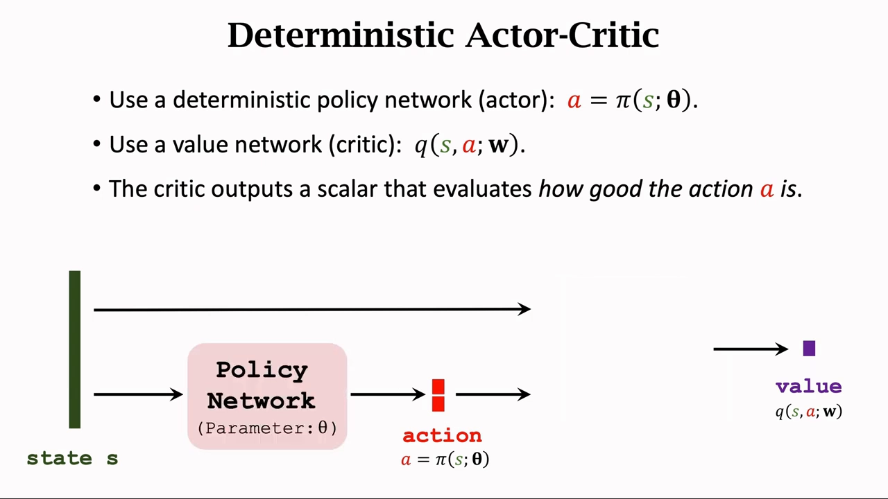
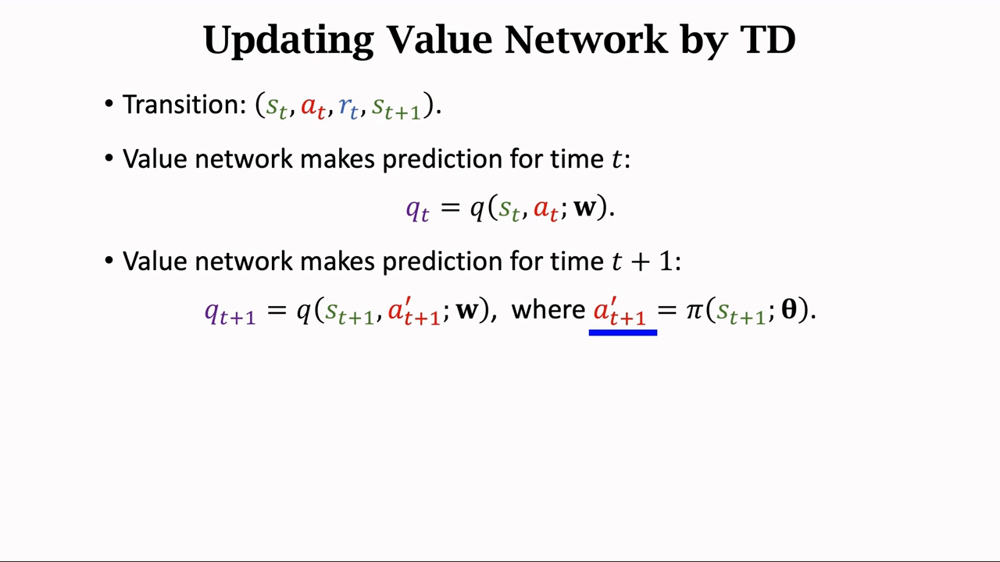
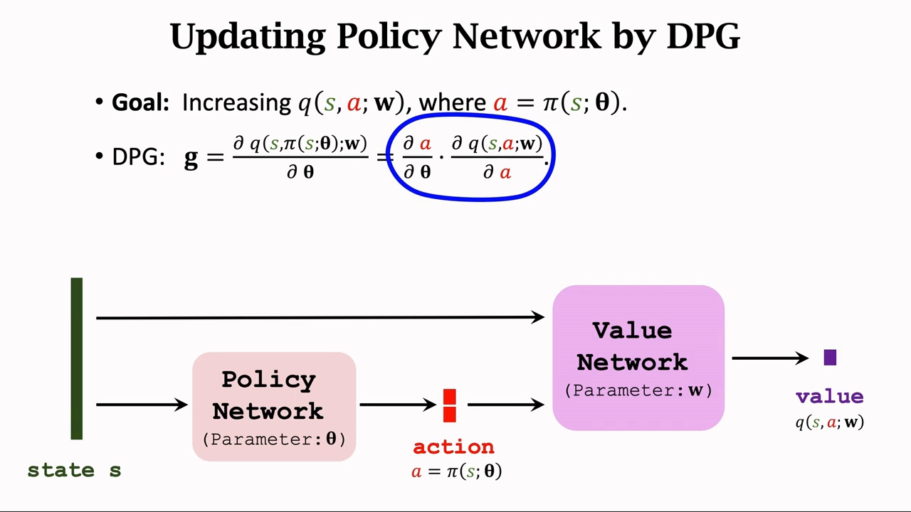
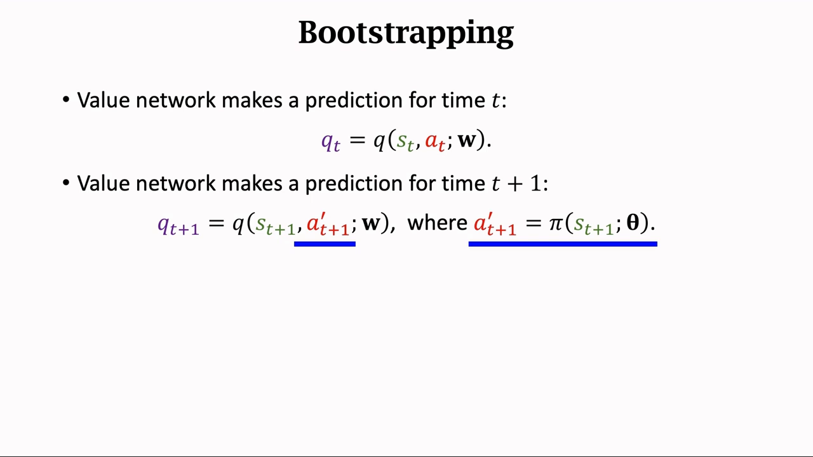
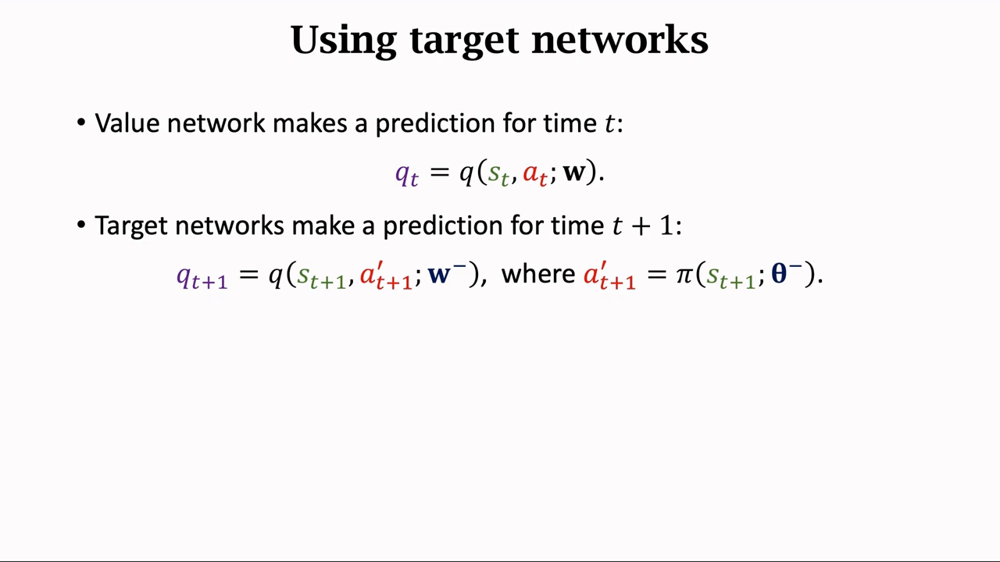
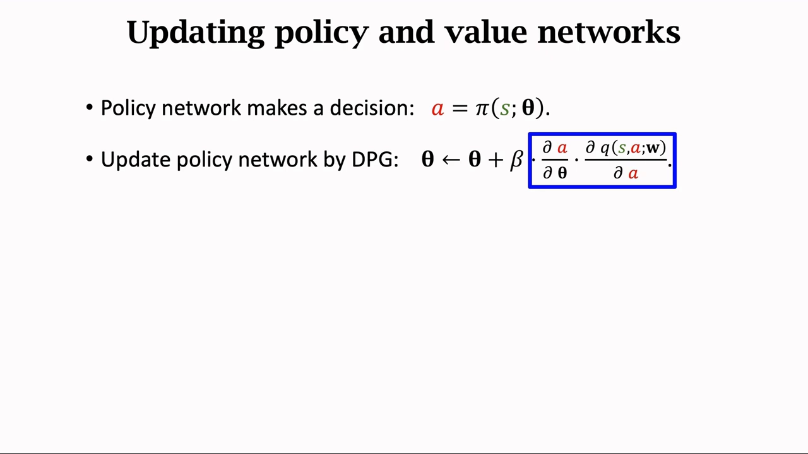
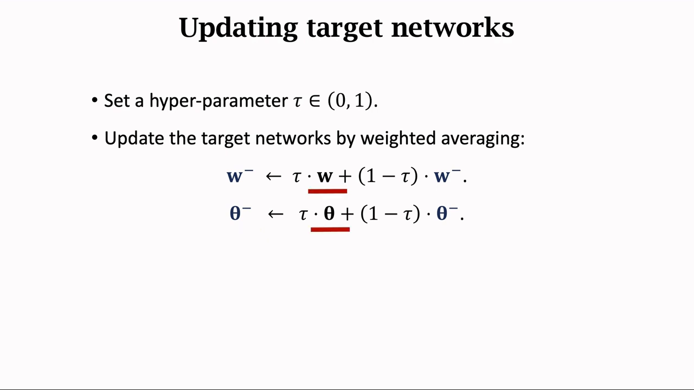
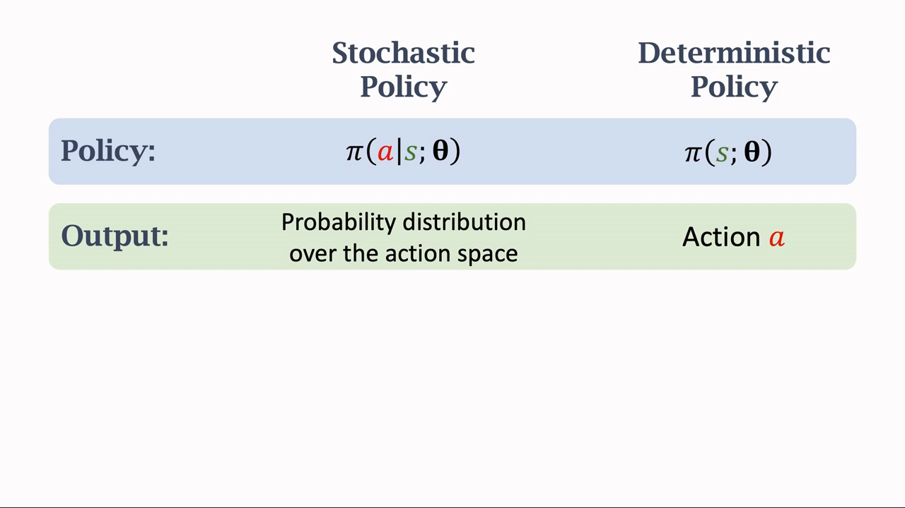

# 确定性策略梯度（DPG）：为什么可以直接对动作求梯度

> 本篇整理自王树森《深度强化学习》「连续控制 2/3：确定策略梯度 DPG」。视频地址：[BV12o4y197US 第 19 P](https://www.bilibili.com/video/BV12o4y197US/?p=19)。上一篇《最简单的 Actor-Critic：把 REINFORCE 里的回报换成 TD 目标》把策略梯度拆成了 actor 与 critic 两半，但那里 actor 输出的仍然是一个**概率分布** $\pi(a\mid s;\theta)$。本篇换一个前提：如果让策略**直接输出一个确定的动作**，梯度还推得出来吗？答案是能，而且推出来的式子比随机策略梯度更短——这就是 DPG（deterministic policy gradient，确定策略梯度），把它放到神经网络上就是 DDPG。

## 本讲要解决的核心问题（SCQA）

**背景**：第 7 章到第 8 章前半部分学的算法——REINFORCE、Actor-Critic、A2C——用的都是**随机策略**：策略网络输入状态 $s$，输出的是动作空间上的一个概率分布，再从这个分布里抽样得到动作。

**冲突**：这套做法在离散动作（左、右、上、下）上很自然，但一碰到**连续控制**就卡住了。机械手臂的关节角度、倒立摆的力矩，取值是连续的一整段实数，动作有无穷多个，你没法「给每个动作一个概率」再抽样。反过来，价值方法（DQN）也不行：它要在所有动作上取 $\max$，连续动作空间里这个 $\max$ 没法枚举。

**疑问**：既然动作本来就是连续的一串数，为什么不让策略网络**直接吐出这串数**？如果策略是确定的 $a=\pi(s;\theta)$，参数 $\theta$ 该怎么更新？梯度从哪儿来？

**回答（中心思想）**：让策略网络直接输出一个确定的动作 $a=\pi(s;\theta)$，就得到**确定性策略**。它自己不知道动作好坏，好坏由价值网络 $q(s,a;w)$ 打分；于是「让分数变高」这件事可以写成对 $\theta$ 求梯度，用**链式法则**把梯度从 $q$ 传到动作 $a$、再从 $a$ 传到参数 $\theta$：

$$
g=\frac{\partial\,q\big(s,\pi(s;\theta);w\big)}{\partial\theta}=\frac{\partial a}{\partial\theta}\cdot\frac{\partial\,q(s,a;w)}{\partial a}
$$

这个 $g$ 就叫**确定性策略梯度（DPG）**。把它和 DQN 的两件遗产——**目标网络**与**经验回放**——拼起来，就是 **DDPG**（deep deterministic policy gradient，深度确定性策略梯度）。

---

[【跳转到 00:59】](https://www.bilibili.com/video/BV12o4y197US/?p=19&t=59)

## 一、连续控制把「输出概率」这条路堵死了

讲者先用一个具体的例子说明什么叫连续控制：一个机械手臂有两个可以运动的关节，所以有**两个变量**，**自由度等于二**。上面的关节可以在 0~360 度之间转动，下面的关节可以在 0~180 度之间转动。于是**动作是一个二维的向量**，动作空间是一个**连续的集合**，里面有无穷多个动作。

这里有个容易误解的地方值得单独强调：**「二维」说的是自由度等于二，不是「只有两个动作」**。两个关节各自可以在一个范围内连续取值，组合出来的动作有无穷多个。这跟离散控制（比如超级玛丽只有左、右、上、下几个键）是完全不同的两回事。

在这样的环境里，随机策略网络的输出层就没法用了——它要输出「每个动作的概率」，而动作根本数不完。

## 二、确定性 actor-critic：一个网络出动作，一个网络打分

DPG 是一种 **actor-critic 方法**，一共两个网络：一个**策略网络**、一个**价值网络**。

- **策略网络 = actor**。它根据状态 $s$ 做出决策 $a$，所以叫 actor。
- **价值网络 = critic**。它**不控制** agent，只是基于状态 $s$ 给动作 $a$ 打分，从而指导策略网络做出改进，所以叫 critic。

### 2.1 策略网络：输出不是分布，而是一个具体的动作

策略网络是**确定性的函数**，记作 $\pi(s;\theta)$，$\theta$ 是神经网络的参数。它的输入是状态 $s$，**输出不是概率分布，而是一个具体的动作 $a$**：给定状态 $s$，输出的动作 $a$ 是确定的、没有随机性——这就是名字里 `deterministic` 的由来。

输出的动作 $a$ 可以是实数，也可以是向量。机械手臂那个例子里，$a$ 就是一个二维向量：如果两个关节的角度分别是 90 度和 45 度，那么向量的两个元素就是 90 和 45。

### 2.2 价值网络：给动作打分

价值网络也叫 critic，记作函数 $q(s,a;w)$，$w$ 是价值网络的参数。它有**两个输入**：一个是状态 $s$，另一个是动作 $a$。基于状态 $s$，价值网络评价动作 $a$ 的好坏程度，**输出是一个实数**：动作越好，这个实数越大。

于是训练目标就很清楚了：**训练两个神经网络，让它们共同进步**——策略网络的决策越来越好，价值网络打分越来越准确。

---

## 三、critic 怎么学：用 TD 更新价值网络

先解决 critic。每次观测到一个 transition，也就是四元组 $(s_t,a_t,r_t,s_{t+1})$，它就是一条训练数据。更新分三步：

1. 让价值网络预测 $t$ 时刻的动作价值，记作 $q_t=q(s_t,a_t;w)$；
2. 再让价值网络预测 $t+1$ 时刻的价值。这里需要 $t+1$ 时刻的动作：把 $s_{t+1}$ 输入策略网络 $\pi$，算出下一个动作，记作 $a'_{t+1}=\pi(s_{t+1};\theta)$。注意 $a'_{t+1}$ **不是 agent 真正执行的动作** $a_{t+1}$，它只是用来更新价值网络的，所以讲者在 $a_{t+1}$ 上加了一撇以示区别。把 $s_{t+1}$ 和 $a'_{t+1}$ 输入价值网络，得到 $q_{t+1}=q(s_{t+1},a'_{t+1};w)$；
3. 用 TD target 和预测值算 TD error，再做一次梯度下降更新 $w$。

$$
\delta_t \;=\; q_t-\big(r_t+\gamma\,q_{t+1}\big),\qquad
w\;\leftarrow\;w-\alpha\,\delta_t\,\frac{\partial\,q(s_t,a_t;w)}{\partial w}
$$

其中 $\alpha$ 是学习率，需要自己调参。TD target 比单纯的预测 $q_t$ 更接近真相，所以 TD 算法鼓励 $q_t$ 去接近 TD target，也就是让 TD error 尽量小；梯度下降让 $\delta_t^2$ 减小，价值网络的预测就更接近真实价值。

[【跳转到 03:54】](https://www.bilibili.com/video/BV12o4y197US/?p=19&t=234)

## 四、actor 怎么学：确定性策略梯度（DPG）

### 4.1 目标：让 critic 打的分更高

更新完价值网络，轮到策略网络。学习策略网络需要用到**确定策略梯度**，它跟前面学的策略梯度不太一样。

策略网络自己**不知道动作的好坏**，好坏全凭价值网络的评价：价值网络的输出越大，就意味着动作越好。所以要改进参数 $\theta$，让价值网络的输出越大越好——这就是训练策略网络的目标。

关键观察在这里：**对于确定的状态 $s$，策略网络会输出确定的动作 $a$；如果输入的状态是固定的、价值网络也是固定的，那么唯一会影响价值 $q$ 的因素就是策略网络的参数 $\theta$。** 于是「让 $q$ 变大」就变成了一个关于 $\theta$ 的最优化问题，可以直接对 $\theta$ 求梯度、做梯度上升。

### 4.2 链式法则：梯度从 $q$ 传到 $a$，再从 $a$ 传到 $\theta$

$q$ 并不直接依赖 $\theta$，它依赖的是动作 $a$，而 $a$ 依赖 $\theta$。所以按链式法则，梯度要分两段走：

$$
g=\frac{\partial\,q\big(s,\pi(s;\theta);w\big)}{\partial\theta}
=\frac{\partial a}{\partial\theta}\cdot\frac{\partial\,q(s,a;w)}{\partial a}
$$

用讲者的说法就是：**让梯度从价值 $q$ 传播到动作 $a$，然后再从 $a$ 传播到策略网络**。算出来的这个 $g$ 就是确定策略梯度 DPG，用它做梯度上升更新策略网络：

$$
\theta\;\leftarrow\;\theta+\beta\,g
$$

$\beta$ 是学习率。这样更新 $\theta$ 可以让价值 $q$ 变大，也就是说**价值网络认为策略变得更好**。

[【跳转到 07:03】](https://www.bilibili.com/video/BV12o4y197US/?p=19&t=398)

### 4.3 和随机策略梯度比，少了什么

把这条式子和第 7 章的随机策略梯度放在一起看，差别一目了然：

$$
\text{随机策略：}\;\nabla_\theta J=\mathbb{E}\Big[\nabla_\theta\ln\pi(a\mid s;\theta)\cdot q(s,a)\Big]
\qquad
\text{确定策略：}\;\nabla_\theta J=\mathbb{E}\Big[\nabla_\theta\pi(s;\theta)\cdot\nabla_a q(s,a;w)\Big]
$$

随机策略梯度里那个 $\ln\pi$ 和对动作的**采样**都不见了，取而代之的是**对动作求导** $\nabla_a q$。这带来两个直接后果：

- **好消息**：不需要在动作空间上积分/采样，动作维度高也不怕——这正是它能处理连续动作的原因；
- **坏消息**：策略完全确定了，就没有「随机抽样」这种天然的探索机制了。这个问题在下一篇《DDPG 的工程实现》里用**加噪声**的办法补上。

## 五、从 DPG 到 DDPG：目标网络与软更新

讲者说得很直白：**用刚才介绍的算法来训练价值网络，效果不是太好**，可以用一些技巧来改进，比如 target networks。之前介绍过 target network 可以改进 DQN 的训练，它同样可以用在这里。

### 5.1 先看清问题：bootstrapping 会带来偏差

回顾价值网络的训练：$q_t$ 是价值网络对 $t$ 时刻的预测，$q_{t+1}$ 是它对 $t+1$ 时刻的预测，而 $q_{t+1}$ 里又用到了策略网络算出的 $a'_{t+1}$。TD 算法鼓励 $q_t$ 接近 TD target $r_t+\gamma q_{t+1}$——这就是 **bootstrapping**：用价值网络对 $t+1$ 时刻的预测，来更新它对 $t$ 时刻的预测。

问题在于，**自己给自己当靶子，偏差会被反复传播**。训练 DQN 时讲过，bootstrapping 造成的偏差一定是**高估**；把 bootstrapping 用在这里也会出现偏差，但偏差未必是高估，也可能会是**低估**。而且偏差一旦出现就会自我强化：如果初始的时候有高估，那么就会一直高估；如果初始的时候有低估，那么就一直会低估。

原因是这样的：假如一开始有低估，那么 TD target 就会有低估，然后低估又会被传播回价值网络自身，导致低估一直存在。

[【跳转到 08:33】](https://www.bilibili.com/video/BV12o4y197US/?p=19&t=513)

### 5.2 解法：用 target networks 算 TD target

解决方案就是**用不同的神经网络来计算 TD target**，尽量避免 bootstrapping，这样可以让性能稳定很多。用来计算 TD target 的神经网络叫做 **target networks**。

具体做法：第一步跟刚才一样，用价值网络自己算 $t$ 时刻的价值 $q_t$；但计算 TD target 的方式变了——原先用价值网络和策略网络算 $t+1$ 时刻的价值，现在改用**另外两个网络**：

- **target policy network**：代替策略网络，网络结构一样但参数不同，参数记作 $\theta^-$；
- **target value network**：代替价值网络，结构一样但参数不同，参数记作 $w^-$，它的输出记作 $q_{t+1}$。

$$
q_{t+1}=q\big(s_{t+1},a'_{t+1};w^-\big),\qquad a'_{t+1}=\pi\big(s_{t+1};\theta^-\big)
$$

[【跳转到 10:13】](https://www.bilibili.com/video/BV12o4y197US/?p=19&t=613)

### 5.3 把整套算法串起来

讲者把训练两个神经网络的算法完整概括了一遍：

1. **决策**由策略网络 $\pi$ 做：输入状态 $s$，输出动作 $a$；
2. **训练策略网络**用 DPG：$g=\nabla_\theta\pi(s;\theta)\cdot\nabla_a q(s,a;w)$，做梯度上升 $\theta\leftarrow\theta+\beta g$，使得价值 $q$ 增长；
3. **估计当前价值**：用价值网络 $q$ 算出 $q_t=q(s_t,a_t;w)$，这是 critic 对动作 $a_t$ 的评价；
4. **算 TD target**：用 target networks 算出 $q_{t+1}$——注意这里用的是目标网络，目的是避免 bootstrapping、减小偏差。所以 $q_t$ 由价值网络算，$q_{t+1}$ 由 target networks 算；
5. **更新价值网络**：算 TD error $\delta_t$，做梯度下降更新 $w$，让 TD error 减小。

[【跳转到 10:56】](https://www.bilibili.com/video/BV12o4y197US/?p=19&t=656)

### 5.4 软更新：目标网络自己怎么更新

target networks 也有参数，也需要更新。方式是：设置一个超参数 $\tau$，介于 0 和 1 之间，把训练网络的参数和目标网络的参数做**加权平均**，结果作为新的目标网络参数：

$$
w^-\;\leftarrow\;\tau\,w+(1-\tau)\,w^-,\qquad
\theta^-\;\leftarrow\;\tau\,\theta+(1-\tau)\,\theta^-
$$

这就是 **soft update（软更新）**，和 DQN 里「每隔若干步把参数整份复制过去」的**硬更新**形成对比。$\tau$ 取小值（比如 0.01、0.005）时，目标网络每一步只挪一点点，跟着训练网络慢慢走。

[【跳转到 12:11】](https://www.bilibili.com/video/BV12o4y197US/?p=19&t=731)

但要诚实地说一句：**target networks 也不能完全避免 bootstrapping**。因为更新 target networks 用到的还是策略网络和价值网络，所以目标网络的参数仍然依赖于它们；用它算出的 TD target 自然还跟它们有关，仍然可能出现偏差。当然，**用 target networks 总比不用要好**。

### 5.5 另外两件从 DQN 借来的东西

讲者顺带点了两件前几节课讲过的改进，它们同样能用在确定性策略梯度上：

- **experience replay（经验回放）**：重复利用过去的经验，还能消除相邻两步之间的相关性；
- **multi-step TD target**：这节课用的 TD target 其实是 one-step 的，其中只包含一个观测到的奖励 $r_t$；换成包含多个奖励的 multi-step target 也可以。

## 六、确定策略 vs 随机策略：一张表看清区别

最后讲者把两种策略网络并排放在一起对比。它们的**输入都是状态 $s$**，但输出、控制方式、适用场景全都不一样。

| 对比项 | 随机策略 | 确定策略 |
| --- | --- | --- |
| 策略写法 | $\pi(a\mid s;\theta)$ | $\pi(s;\theta)$ |
| 输出 | 动作空间上的概率分布 | 一个确定的动作 $a$ |
| 怎么得到动作 | 按分布做随机抽样 | 直接输出，不抽样 |
| 同一个 $s$ 再算一次 | 可能得到不同的动作 | 一定是同一个动作 |
| 典型场景 | 离散控制（超级玛丽、Atari 游戏） | 连续控制（机器人手臂） |

举两个具体例子：

- **随机策略**：玩超级玛丽时，向左的概率 0.3、向右 0.2、向上 0.5；根据这个分布抽样得到动作 $a$，再做一次抽样会得到不同的动作。
- **确定策略**：机械手臂的两个角度分别是 90 度和 45 度，输出的就是一个二维向量 $(90,45)$。

[【跳转到 14:41】](https://www.bilibili.com/video/BV12o4y197US/?p=19&t=881)

讲者还留了一个伏笔：**随机策略也可以用来做连续控制**，但网络结构会有很大区别，跟前面学的完全不一样——那是下一节课的内容（用随机策略网络输出高斯分布的均值与标准差）。而这一节课学的确定策略网络，通常用于连续控制。

---

## 小结

- **确定性策略**就是让策略网络直接输出一个动作 $a=\pi(s;\theta)$，给定状态输出确定、没有随机性；「二维动作」说的是自由度，不是只有两个动作。
- **DPG 是 actor-critic 方法**：actor 决策，critic 打分；critic 不控制 agent，只负责评价动作好坏。
- **critic 用 TD 学**：$q_t$ 是当前预测，$q_{t+1}$ 用下一状态和策略网络算出的动作得到，梯度下降让 $q_t$ 逼近 TD target。
- **actor 用 DPG 学**：目标是把 critic 的分数推高，链式法则给出 $g=\frac{\partial a}{\partial\theta}\cdot\frac{\partial q}{\partial a}$，梯度从 $q$ 传到 $a$ 再传到 $\theta$。
- **和随机策略梯度相比**，DPG 里没有 $\ln\pi$、没有对动作的采样，换成对动作求导——这正是它能处理连续动作的原因。
- **bootstrapping 会让偏差自我强化**（DQN 里是高估，这里可能高估也可能低估），解法是用 **target networks** 算 TD target。
- **目标网络用软更新**：$w^-\leftarrow\tau w+(1-\tau)w^-$，$\tau$ 取小值，每步只挪一点点；它也不能完全消除偏差，但比不用好。
- **经验回放**与 **multi-step TD target** 这两件 DQN 的遗产同样适用。

## 关键术语速查

| 术语 | 一句话解释 |
| --- | --- |
| 连续控制 (continuous control) | 动作是一段连续实数（如关节角度、力矩），动作空间有无穷多个动作 |
| 自由度 (degree of freedom) | 独立可控的变量个数；机械臂两个关节就是二维动作 |
| 确定性策略 (deterministic policy) | 策略是一个确定函数 $a=\pi(s;\theta)$，同一状态永远输出同一动作 |
| 策略网络 / actor | 输入状态、输出具体动作的神经网络，负责决策 |
| 价值网络 / critic | 输入状态和动作、输出一个实数打分的神经网络，负责评价 |
| 确定性策略梯度 (DPG) | $\frac{\partial q}{\partial\theta}=\frac{\partial a}{\partial\theta}\cdot\frac{\partial q}{\partial a}$，把梯度从价值经动作传回策略参数 |
| bootstrapping | 用网络自己对下一时刻的预测来更新对当前时刻的预测，自己给自己当靶子 |
| target network | 一份参数更新更慢的副本网络，专门用来算 TD target，减小偏差 |
| 软更新 (soft update) | 目标网络参数按 $w^-\leftarrow\tau w+(1-\tau)w^-$ 逐步逼近训练网络，而不是整份复制 |
| 经验回放 (experience replay) | 把历史 transition 存进池子反复抽样使用，提高样本效率并打散相关性 |