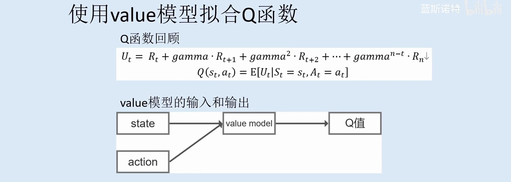
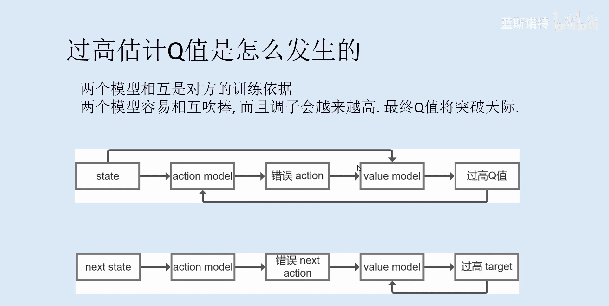
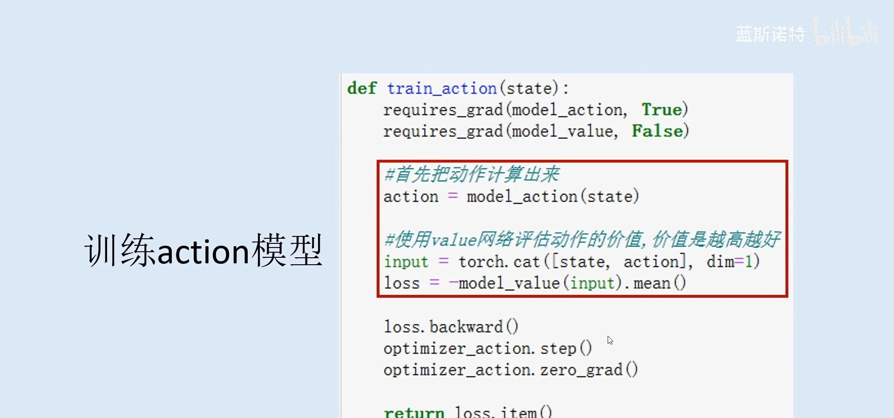
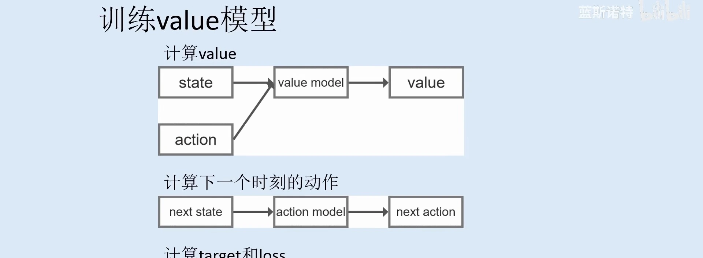
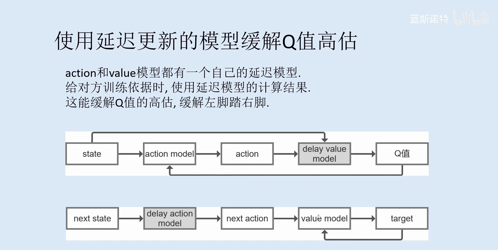
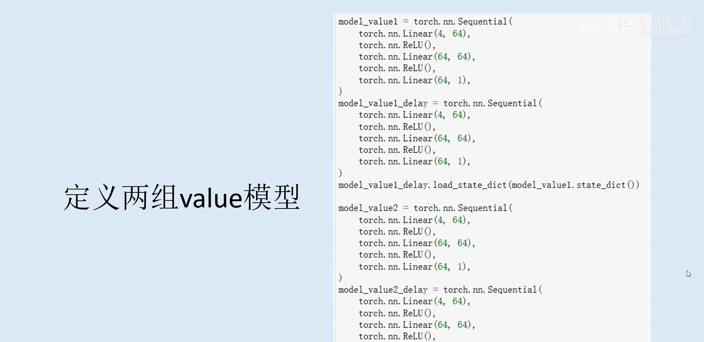

# Q 值为什么会被高估：actor 与 critic 的相互吹捧

> 本篇整理自蓝斯诺特《强化学习从原理到实践 第 10 章 DDPG 和 TD3 算法》。视频地址：[BV1Pqj2zaEsP](https://www.bilibili.com/video/BV1Pqj2zaEsP/)。上一篇《DDPG 的工程实现：四个网络、软更新与探索噪声》把 DDPG 的零件都装好了：actor 出动作、critic 打分、四个网络、软更新、加噪声探索。本篇换一个角度——**先不急着造新算法，而是把 DDPG 训练时最要命的一个病看清楚：Q 值为什么会越训越高**。看清楚了病，TD3 的三处改动才有出处。

## 本讲要解决的核心问题（SCQA）

**背景**：DDPG 用 actor 直接输出连续动作，用 critic 给这个动作打分，actor 沿着 critic 的梯度往上爬。这套结构在倒立摆这类连续控制任务上跑得很好，样本效率也高。

**冲突**：真正训练过的人都会遇到一个怪现象——**Q 值会一路往上涨，涨到与环境实际能拿到的回报完全不成比例**。讲者的建议很直接：在训练循环里把 Q 值打印出来，你会看到它一定是越来越高的。Q 值虚高之后，actor 会去追那些根本不存在的「高收益动作」，策略随之崩掉。

**疑问**：这个高估是从哪儿冒出来的？它为什么不是随机噪声、而是**系统性的偏高**？在不动算法骨架的前提下，能不能把这个「越吹越高」的过程摁住？

**回答（中心思想）**：**因为 actor 和 critic 互为对方的训练依据，构成一个正反馈回路**。critic 的估计偏差会通过梯度传给 actor，actor 迎合这个偏差做出动作，这个动作又成了 critic 计算目标值的输入，偏差被再次放大。TD3 的两件武器——**延迟更新模型**与**两组 value 模型取最小**——本质上都是在给这个回路加阻尼。

---

## 一、先把回路画出来：两个模型互为训练依据

DDPG 的更新是两条腿走路，而这两条腿互相踩在对方身上。先看清楚 actor 依赖的那个东西长什么样：

[【跳转到 08:36】](https://www.bilibili.com/video/BV1Pqj2zaEsP/?t=516)

- **actor 怎么更新？** 它的唯一依据是 critic 给出的 Q 值。actor 调整参数的方向，就是让 critic 给它输出的动作打更高的分：

$$
\nabla_\theta J\approx\frac{1}{N}\sum_{i=1}^{N}\nabla_\theta\mu_\theta(s_i)\,\nabla_a Q_\omega\big(s_i,a\big)\Big|_{a=\mu_\theta(s_i)}
$$

- **critic 怎么更新？** 它要拟合的目标值里，**下一个动作是由 actor 生成的**：

$$
y_i=r_i+\gamma\,Q_{\omega^-}\big(s_{i+1},\mu_{\theta^-}(s_{i+1})\big)
$$

把这两条放在一起看，回路就清楚了：**critic 的估值决定 actor 的动作，actor 的动作又进入 critic 的目标值**。这不是两个独立的模块，而是一个闭环。闭环系统的老问题就是——只要环里每一段的增益都略大于「诚实」，误差就会自己喂自己。

[【跳转到 14:32】](https://www.bilibili.com/video/BV1Pqj2zaEsP/?t=872)

## 二、错误动作是怎么被「吹」成高 Q 值的

讲者把高估的生成过程拆成了四步，每一步单独看都平平无奇，串起来就致命。

### 2.1 第一步：错误动作是必然会发生的

训练过程中两个模型的参数都还没有收敛，随机性事件很多。所以 actor 在某一个 state 上做出一个**并不最优、甚至比较差的动作**，不是意外，而是**大概率事件**。

### 2.2 第二步：critic 给这个动作打了一个偏高的分

这个错误动作和 state 拼在一起送进 value 模型，打分结果往往就是一个**被高估的 Q 值**。为什么？

因为「这个动作是错的」这件事，本身就是**以 critic 的估值为标准**判定的——actor 唯一的训练依据就是 critic 给的 Q 值。这一点在代码里看得最清楚：训练 actor 的那个函数里，`loss` 直接就是**负的 Q 值**，没有任何别的项。

[【跳转到 21:28】](https://www.bilibili.com/video/BV1Pqj2zaEsP/?t=1288)

于是出现一个很微妙的循环论证：**actor 之所以做出错误动作，很多时候恰恰是因为 critic 给出了错误的估值**。

### 2.3 第三步：actor 迎合 critic 的偏见

critic 认为某个动作好，actor 为了迎合它的这种偏见，就会往那个方向去动作。而事实上那个动作是错的。

### 2.4 第四步：偏见被反向加强，回路闭合

actor 迎合了 critic 的错误估计之后，critic 的这个错误偏见**反而被加强了**——因为它看到「actor 也这么选」，于是更确信自己的判断。

讲者用了一个很形象的比喻：**两个模型开始相互吹捧**。action 模型说「你评估得真好」，value 模型说「你做出的动作真好」，然后开始相互循环增强，很快就开始**左脚踩右脚，慢慢就上天了**。

这就是 Q 值在训练过程中被系统性高估的机制：它不是某一次估错，而是**一个自我强化的偏差放大器**。

## 三、next state 那条支路：target 也一起被吹高

上面那张图还有下半部分，讲的是同一件事在 **TD 目标**上的版本：

1. `next state` 交给 action 模型，它同样为了迎合 value 模型的偏好，做出一个**错误的 next action**；
2. 这个错误的 next action 和 next state 一起送进 value 模型，得到**被高估的 target**；
3. target 高估之后，当前 Q 值在向它逼近的过程中也被抬高；
4. 于是「当前 Q 值」和「target」这两张图开始**不停地循环**，Q 值一起上天。

[【跳转到 11:36】](https://www.bilibili.com/video/BV1Pqj2zaEsP/?t=696)

这一支路解释了为什么高估会**沿着时间轴累积**：TD 学习的目标值本身含有估计值，误差不是被平均掉的，而是被**递归地传下去并放大**。

## 四、打破循环：给双方各配一个延迟模型

既然病根是「回路增益太大、沟通太快」，最自然的药方就是**降低回路里信息传递的速度**。讲者给出的方案是：**action 模型和 value 模型各自再配一个延迟更新（delay）模型**，在给对方提供训练依据时，**一律使用延迟模型的计算结果**。

[【跳转到 17:02】](https://www.bilibili.com/video/BV1Pqj2zaEsP/?t=1022)

具体到两条支路：

- **actor 这一侧**：actor 训练的依据是 **delay value 模型**估计出来的 Q 值。所以 actor 做出的一些错误动作，**不会那么快地反映到 delay value 模型身上**，错误动作带来的高估就被抑制了。
- **critic 这一侧**：value 模型算 target 时，next action 是拿 **delay action 模型**算出来的。所以它高估的那个 Q 值，也不会那么快地反映到 delay action 模型上面。

效果是：**两个模型相互之间的沟通频率变小了**，很大程度上抑制了它们相互吹捧。

这里讲者补了一句很重要的限定，别把它当成「根治」：

> 严格来说，Q 值最终还是会被高估的，但**高估的速度被很大程度上缓解了**。

也就是说，延迟模型不是消灭偏差，而是**给偏差的增长加上时间常数**——让它的增长速度慢于 critic 学习真实 Q 函数的速度。这与 DDPG 里目标网络的作用是同一个思路：**用「慢一拍的副本」把不稳定的自举目标钉住**。

## 五、TD3 再补一刀：两组 value 模型取最小

延迟模型只能减缓，不能消除。TD3 的做法是在此之上再叠一层：**不再只用一个 value 模型，而是用两组**。

讲者在 TD3 的代码里把这件事讲得很直白：

- 一共定义**四个 value 模型**（两组，每组一个训练网络加一个 delay 网络），加上两个 action 模型，系统里一共有**六个神经网络**；
- 训练 action 模型时，用两组 value 模型分别算一遍 Q 值，**取两者中最小的那个**作为依据；
- 训练 value 模型时同样如此，**用两组计算结果中最小的那个作为 target**。

对应的目标值就变成：

$$
y=r+\gamma\min_{i=1,2}Q_{\theta_i'}\big(s',\tilde a\big)
$$

[【跳转到 25:56】](https://www.bilibili.com/video/BV1Pqj2zaEsP/?t=1556)

为什么取最小能压住高估？回到第二节的机制：高估是**向上**偏的，两个独立初始化的 critic 各自偏高的方向和幅度不同，取最小值相当于让**偏得最少的那个说了算**——用「悲观」抵消「乐观」。这个改动在下一篇《TD3 的三大改进》里会展开讲它的正式名字：**Clipped Double Q**。

[【跳转到 25:20】](https://www.bilibili.com/video/BV1Pqj2zaEsP/?t=1520)

## 六、这段诊断对后面几篇的意义

把这一篇的结论记住，后面几个算法的动机就都能对上号：

| 现象 | 病根 | 常见药方 |
| --- | --- | --- |
| Q 值越训越高 | actor 与 critic 互为训练依据的正反馈回路 | 延迟模型、目标网络 |
| 高估沿时间轴累积 | TD 目标里含估计值，误差递归放大 | 双 Q 取最小、延迟策略更新 |
| 策略对窄峰过拟合 | 确定性策略只盯住单个动作点 | 目标策略平滑 |

## 小结

- **高估是系统性的，不是随机的**：actor 与 critic 互为训练依据，构成正反馈回路，偏差会自己喂自己。
- **四步链条**：参数未收敛 → 错误动作必然发生 → critic 打出偏高 Q 值 → actor 迎合偏见、偏见被反向加强 → 回路闭合，Q 值上天。
- **TD 目标那条支路同理**：next action 是错的 → target 被高估 → 当前 Q 值被抬高，误差沿时间轴递归累积。
- **延迟模型是第一层药**：双方给对方提供训练依据时都用 delay 模型的结果，沟通频率降低，高估速度被大幅缓解——但严格说最终仍会高估。
- **两组 value 模型取最小是第二层药**：$y=r+\gamma\min_{i=1,2}Q_{\theta_i'}(s',\tilde a)$，用悲观抵消乐观。

## 关键术语速查

| 术语 | 一句话解释 |
| --- | --- |
| 过高估计 (overestimation) | critic 给出的 Q 值系统性高于真实回报，源于自举目标中的最大化/相互依赖 |
| 相互吹捧回路 | actor 迎合 critic 的偏差，critic 又因 actor 的动作强化该偏差 |
| 延迟模型 (delay model) | 参数更新更慢的副本，用来给对方提供训练依据，降低回路增益 |
| TD 目标 (TD target) | $y=r+\gamma Q(s',\cdot)$，其中含估计值，是误差递归传播的通道 |
| 双 Q 取最小 (clipped double Q) | 用两个 critic 的较小值构造目标，抑制向上偏差 |