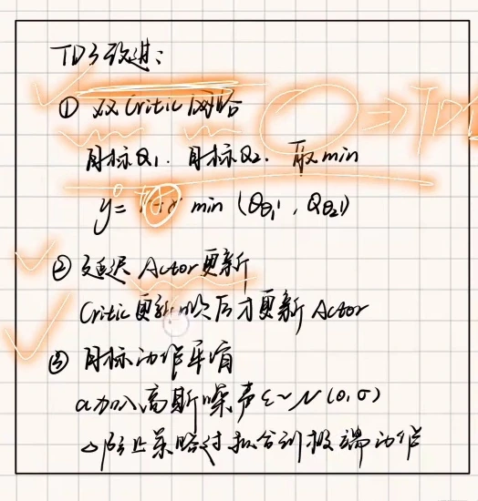
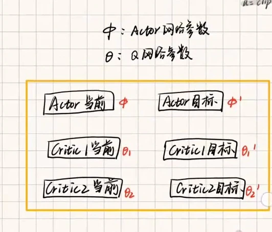
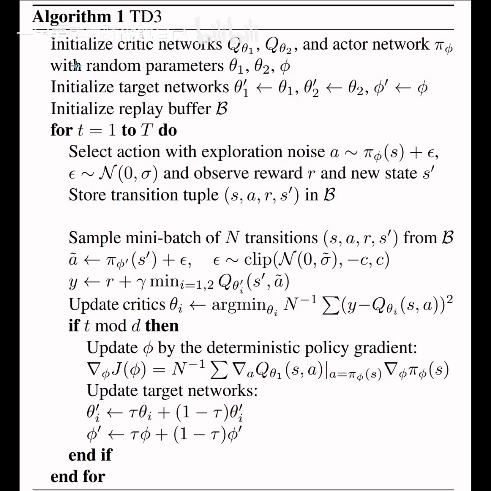
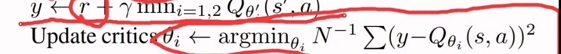
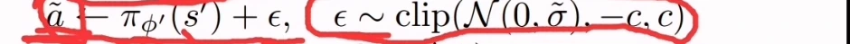
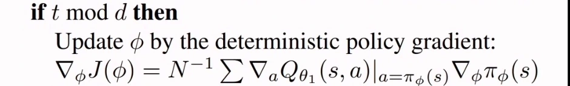
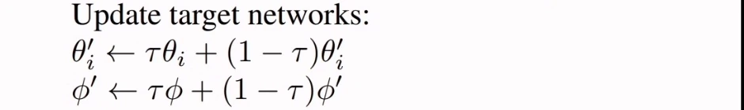

# TD3 的三大改进：截断双 Q、延迟更新与目标平滑

> 本篇整理自姜酱爱睡觉《[强化学习] TD3 算法》。视频地址：[BV1g6421F7wh](https://www.bilibili.com/video/BV1g6421F7wh/)。上一篇《Q 值为什么会被高估：actor 与 critic 的相互吹捧》把病根讲清楚了：actor 和 critic 互为训练依据，构成一个把 Q 值越吹越高的正反馈回路。本篇接着看药方——**TD3（Twin Delayed DDPG）在 DDPG 上到底改了哪三处**，以及这三处改动在伪代码里各自长什么样。

## 本讲要解决的核心问题（SCQA）

**背景**：DDPG 已经能处理连续动作空间，结构也简单：actor 出动作、critic 打分、目标网络稳住自举目标、回放池提高样本效率。

**冲突**：但 DDPG 训练起来很脆——Q 值系统性高估、策略更新过频导致崩坏、确定性策略对 Q 函数的窄峰过拟合。这三件事都不是调参能解决的，得改算法结构。

**疑问**：如果只允许在 DDPG 上做最小的结构改动，改哪三处最划算？每一处改动对应抑制哪一种失效？改动之后完整的训练循环又是什么样子？

**回答（中心思想）**：TD3 的三处改动是一一对应三种失效的——**双 critic 取最小（Clipped Double Q）**治高估，**延迟策略更新（Delayed Policy Update）**治策略更新过频，**目标策略平滑（Target Policy Smoothing）**治对窄峰的过拟合。除此之外的骨架（回放池、目标网络、软更新、确定性策略梯度）全部沿用 DDPG。

---

## 一、先把网络数清楚：六个网络

讲者在白板上把三处改动列成了一张清单，先有个全局印象：



[【跳转到 13:04】](https://www.bilibili.com/video/BV1J3RWBvEv1/?t=784)

DDPG 是四个网络（actor、critic 各一个训练网络加一个目标网络），TD3 在 critic 上翻倍，于是变成**六个**：

| 网络 | 参数 | 作用 |
| --- | --- | --- |
| critic 1（训练） | $\theta_1$ | 给 $(s,a)$ 打分，输出 $Q_{\theta_1}(s,a)$ |
| critic 2（训练） | $\theta_2$ | 另一套独立初始化的打分器，输出 $Q_{\theta_2}(s,a)$ |
| actor（训练） | $\phi$ | 输出确定性动作 $\pi_\phi(s)$ |
| critic 1 目标 | $\theta_1'$ | 算目标值里的 $Q_{\theta_1'}(s',\tilde a)$ |
| critic 2 目标 | $\theta_2'$ | 算目标值里的 $Q_{\theta_2'}(s',\tilde a)$ |
| actor 目标 | $\phi'$ | 生成目标动作 $\pi_{\phi'}(s')$ |



[【跳转到 12:14】](https://www.bilibili.com/video/BV1J3RWBvEv1/?t=734)

讲者给了一条很好用的记号规则：**带撇的都是目标网络的参数，不带撇的是在线网络的参数**。初始化时目标网络直接复制在线网络的参数，之后靠软更新慢慢跟随。

多出来的那两个 critic 不是「多训一个更准」，而是**故意让两个估计器各自独立地犯错**，好在构造目标值时把偏高的那一个压掉——这就是第一个改进。

## 二、完整流程走一遍

论文里的 Algorithm 1 就是 TD3 的全貌，讲者逐行过了一遍：



[【跳转到 00:30】](https://www.bilibili.com/video/BV1g6421F7wh/?t=30)

流程可以概括成五步：

1. **初始化**：两个 critic、一个 actor，各自复制出目标网络；建一个空的经验回放池。
2. **收集数据**：用 actor 在当前状态上给出动作，**加上探索噪声**后与环境交互，把 $(s,a,r,s',\text{done})$ 存进回放池（论文原文用的是在线策略 $\pi_\phi(s)$，讲者口述时说的是目标 actor 网络）。
3. **采样**：回放池存够之后，每次取一个 mini-batch，比如 256 条。
4. **更新 critic**：用目标网络算出目标值 $y$，让两个 critic 分别向 $y$ 回归。
5. **条件更新 actor 与目标网络**：只有当 $t \bmod d = 0$ 时才更新 actor 和目标网络，最后做软更新。

下面三节分别把第 4、5 步里的三处改动拆开看。

## 三、改进一：截断双 Q（Clipped Double Q）

DDPG 的 critic 只有一个，它算出的 Q 值同时充当「打分」和「目标值」，一旦偏高没有任何东西能纠正它。TD3 改成：

$$
y=r+\gamma\min_{i=1,2}Q_{\theta_i'}\big(s',\tilde a\big)
$$



[【跳转到 07:30】](https://www.bilibili.com/video/BV1g6421F7wh/?t=450)

注意这个 $\min$ 的位置——它作用在**两个目标 critic 的输出**上，而不是作用在动作上。含义是：

- 两个 critic 独立初始化、独立训练，各自的估计误差方向不完全一致；
- 高估是**向上**的偏差，所以取最小值相当于「谁最保守听谁的」；
- 即使其中一个因为噪声或过拟合给出虚高的分，另一个只要保持冷静，$\min$ 就会把这个正向偏差拉回来。

讲者的说法是：**「引入双 target 网络，取两者中最小的那个值，就是为了缓解高估问题。」**

还有一处容易写错、讲者特意强调的细节：**$y$ 必须用目标网络算，不能用当前的在线网络算**。如果拿在线 critic 自己生成 $y$，再用这个 $y$ 去算损失、更新同一个在线 critic，那就变成「自己更新自己」，等于拿自己的估计当监督信号，训练会跑偏。正确的做法是：$y$ 出自目标网络与目标 actor，损失里的 $Q_{\theta_i}(s,a)$ 出自在线网络，两者相减才有意义。

## 四、改进二：目标策略平滑（Target Policy Smoothing）

第二个改动藏在目标动作的生成上。DDPG 里目标动作就是 $\pi_{\phi'}(s')$，干净利落；TD3 给它加了一点噪声，并且把噪声截断：

$$
\tilde a=\pi_{\phi'}(s')+\epsilon,\qquad \epsilon\sim\operatorname{clip}\big(\mathcal{N}(0,\tilde\sigma),-c,c\big)
$$



[【跳转到 05:25】](https://www.bilibili.com/video/BV1g6421F7wh/?t=325)

### 4.1 为什么要给目标动作加噪

因为确定性策略的梯度是「往 Q 值更高的方向推」，而 Q 函数是神经网络拟合出来的，**难免有局部尖峰**。如果目标动作总是精确落在那个尖峰上，critic 就会被训练成「只在这个点上分高」——策略一旦稍微偏离，Q 值立刻崩掉，这叫**对窄峰过拟合**。

加噪声之后，critic 在算目标值时看到的不是一个点，而是**这个点附近的一小片邻域**。它必须让这一片邻域上的 Q 值都合理，等价于要求「相似的动作给出相似的 Q 值」——这正是正则化想要的效果：**把 Q 函数在动作维度上抹平一点**。

### 4.2 为什么要截断

噪声不能无限制地加。$\operatorname{clip}(\cdot,-c,c)$ 把扰动限制在 $\pm c$ 之内，防止目标动作被推到离原动作太远的地方——那样算出来的目标值就不再是「这个动作的价值」，而变成「另一个动作的价值」，自举就失去意义了。讲者的原话是：**「为了防止动作偏离太多，把噪声限制在一定范围之内。」**

### 4.3 别和探索噪声搞混

伪代码里出现了两种噪声，作用完全不同，讲者专门点了一句：

| 噪声 | 加在哪 | 目的 |
| --- | --- | --- |
| 探索噪声 $\epsilon\sim\mathcal{N}(0,\sigma)$ | 与环境交互时执行的动作 $a$ | **扩大探索范围**，让数据覆盖更多状态-动作 |
| 平滑噪声 $\epsilon\sim\operatorname{clip}(\mathcal{N}(0,\tilde\sigma),-c,c)$ | 计算目标值时的目标动作 $\tilde a$ | **正则化 Q 函数**，防止对窄峰过拟合 |

前者是为了「多看看」，后者是为了「别太尖」。两者都叫噪声，但一个是数据采集策略，一个是目标值构造技巧。

## 五、改进三：延迟策略更新（Delayed Policy Update）

第三个改动是一行 `if`：

```text
if t mod d then
    用确定性策略梯度更新 actor φ
    软更新目标网络 θ1'、θ2'、φ'
end if
```



[【跳转到 09:40】](https://www.bilibili.com/video/BV1g6421F7wh/?t=580)

也就是说，**critic 每一步都更新，actor 每隔 $d$ 步才更新一次**（$d$ 通常取 2）。

### 5.1 为什么 actor 要慢一点

回到上一篇的回路：actor 的动作是 critic 目标值的一部分，critic 的估值又是 actor 的训练依据。如果两边**同步、同频**地更新，那么 critic 还没把 Q 函数学准，actor 就已经按这个不准的梯度跑出去一大截；actor 一动，critic 的目标又变，误差互相叠加，训练很容易发散。

延迟更新相当于**给回路加了一个采样保持**：先让 critic 多更新几次、把当前策略附近的 Q 值估得靠谱一些，再让 actor 动一步。讲者的表述是：**「当我们训练一部分之后，才开始更新 actor 网络。」**

### 5.2 目标网络也跟着延迟

注意伪代码里 `if t mod d then` 这个块**同时包住了 actor 更新和目标网络更新**。所以目标网络也是每 $d$ 步才软更新一次，比 DDPG 里「每步都软更新」更慢。这让自举目标在一段时间内保持稳定，进一步压住波动。

### 5.3 actor 那一步具体在算什么

块内的 actor 更新用的仍是确定性策略梯度：

$$
\nabla_\phi J(\phi)=N^{-1}\sum\nabla_a Q_{\theta_1}(s,a)\big|_{a=\pi_\phi(s)}\nabla_\phi\pi_\phi(s)
$$

也就是「先对动作求导，再对参数求导」的链式法则。讲者提到，这一部分**与具体任务结合最紧**——你想要什么效果，actor 的损失就可能要改；伪代码给的是最一般的形式。另外注意这里只用了第一个 critic（$Q_{\theta_1}$）的梯度，讲者顺带猜测「其实也可以取两者中较大的那个」，但伪代码本身是固定用第一个。

## 六、目标网络的软更新

块内最后一步是把在线网络的参数一点点挪进目标网络：

$$
\theta_i'\leftarrow\tau\,\theta_i+(1-\tau)\,\theta_i',\qquad
\phi'\leftarrow\tau\,\phi+(1-\tau)\,\phi'
$$



[【跳转到 10:30】](https://www.bilibili.com/video/BV1g6421F7wh/?t=630)

$\tau$ 是一个较小的数（DDPG 原论文取 0.005，实践中常见 0.005 到 0.01 的量级）。它和 DDPG 的软更新完全一样，属于**沿用而非改进**——TD3 只是把「多久软更新一次」也放进了 `if t mod d` 的条件里。

## 七、把三处改动标在伪代码上

把三处改动合起来看，TD3 相对 DDPG 的差异只有这几行：

```text
# 1) 两个 critic，各自有目标网络
初始化 Q_θ1、Q_θ2、π_φ，并复制出 Q_θ1'、Q_θ2'、π_φ'

for t = 1 to T:
    # 探索噪声：为了扩大探索范围
    a ← π_φ(s) + ε,  ε ~ N(0, σ)
    执行 a，得到 r、s'，把 (s, a, r, s') 存入回放池 B

    采样 mini-batch
    # 【改进二】目标策略平滑：目标动作加截断噪声
    ã ← π_φ'(s') + ε,  ε ~ clip(N(0, σ̃), -c, c)
    # 【改进一】截断双 Q：两个目标 critic 取最小
    y ← r + γ · min(Q_θ1'(s', ã), Q_θ2'(s', ã))
    更新两个 critic：θi ← argmin Σ (y - Q_θi(s, a))²

    # 【改进三】延迟策略更新：critic 更新 d 次，actor 才更新 1 次
    if t mod d == 0:
        用确定性策略梯度更新 φ
        软更新 θ1'、θ2'、φ'
```

## 小结

- **六个网络**：两个 critic、一个 actor，各自配一个目标网络；多出来的 critic 是为了取最小。
- **截断双 Q**：$y=r+\gamma\min_{i=1,2}Q_{\theta_i'}(s',\tilde a)$，用两个独立估计器的最小值抵消向上的偏差。
- **目标策略平滑**：$\tilde a=\pi_{\phi'}(s')+\epsilon$，$\epsilon\sim\operatorname{clip}(\mathcal{N}(0,\tilde\sigma),-c,c)$，让 critic 在动作邻域上被正则化，防止对窄峰过拟合；截断是为了不让目标动作跑太远。
- **延迟策略更新**：`if t mod d` 才更新 actor 与目标网络，先让 critic 估准再让 actor 动，给回路加阻尼。
- **两种噪声别混**：探索噪声管数据采集，平滑噪声管目标值构造。
- **$y$ 必须来自目标网络**：拿在线网络自己生成目标再更新自己，是伪代码里最典型的错误写法。

## 关键术语速查

| 术语 | 一句话解释 |
| --- | --- |
| TD3 (Twin Delayed DDPG) | 在 DDPG 上加双 critic、延迟策略更新、目标策略平滑的改进版 |
| 截断双 Q (clipped double Q) | 用两个目标 critic 输出的较小值构造 TD 目标，抑制高估 |
| 延迟策略更新 (delayed policy update) | actor 每 $d$ 步才更新一次，critic 每步都更新 |
| 目标策略平滑 (target policy smoothing) | 给目标动作加截断高斯噪声，把 Q 函数在动作维度上抹平 |
| 平滑噪声 | $\operatorname{clip}(\mathcal{N}(0,\tilde\sigma),-c,c)$，加在目标动作上，用于正则化 |
| 探索噪声 | $\mathcal{N}(0,\sigma)$，加在执行动作上，用于扩大探索 |
| 窄峰过拟合 | 确定性策略精确落在 Q 函数的局部尖峰上，稍一偏离就失效 |
| 软更新 (soft update) | $\theta'\leftarrow\tau\theta+(1-\tau)\theta'$，目标网络每步只挪一点点 |