# 优势函数与 GAE：把「比平均好多少」做成一个可调偏差与方差的估计

> 本篇整理自「热爱学习ai的欧文」《三十分钟说清楚强化学习 GAE：设计思想 / 公式推导 / 代码解析》。视频地址：[BV1DBoYBREfc](https://www.bilibili.com/video/BV1DBoYBREfc/)。上一篇《策略梯度中的 Baseline：减去一个与动作无关的量，期望不变而方差变小》证明了「从 $Q_\pi$ 里减去一个与动作无关的基线 $b$，梯度期望不变、方差变小」，并留下一个伏笔：基线取 $V_\pi$ 时，括号里剩下的 $Q_\pi(s_t,a_t)-V_\pi(s_t)$ 有个正式名字，叫**优势函数**。本篇就从这里接着往下走——把优势函数讲清楚，再讲它最难的那一步：**怎么估**。

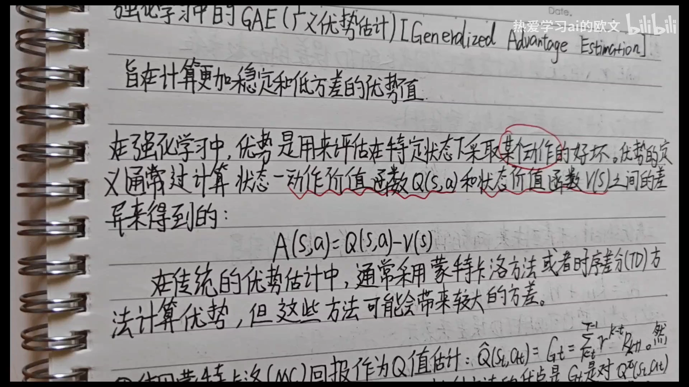

[【跳转到 00:00】](https://www.bilibili.com/video/BV1DBoYBREfc/?t=0)

## 本讲要解决的核心问题（SCQA）

**背景**：第 7 章把策略梯度写成了「对数策略的梯度 $\times$ 一个权重」的期望。7.4 进一步证明：这个权重不必是动作价值 $Q_\pi$，减去任意与动作无关的基线 $b$ 都行；而最有用的取法是 $b=V_\pi(s_t)$，此时权重正好变成 $A_\pi(s_t,a_t)=Q_\pi(s_t,a_t)-V_\pi(s_t)$——**这个动作比该状态的平均水平好多少**。

**冲突**：优势函数定义得很干净，但**它由两个未知量构成**。真实环境里既没有 $Q_\pi$ 也没有 $V_\pi$，只有一条条采样出来的轨迹。而估计它的两条极端路线各有致命伤：用蒙特卡洛回报 $G_t$ 减 $V(S_t)$，无偏但方差大得没法用；用单步 TD 误差 $\delta_t$，方差小但引入了偏差。

**疑问**：既然一头是无偏高方差、一头是有偏低方差，能不能不要二选一，而是**造一个旋钮**，让它在两者之间连续滑动？

**回答（中心思想）**：能，这个旋钮就是 **GAE（generalized advantage estimation，广义优势估计）**。它先用一个参数 $\lambda\in[0,1]$ 把不同步长的优势估计做**指数加权平均**，再证明这个加权平均可以等价地写成**单步 TD 误差的 $(\gamma\lambda)^l$ 加权和**：

$$
\hat{A}_t^{\mathrm{GAE}(\gamma,\lambda)} \;=\; \sum_{l=0}^{\infty}(\gamma\lambda)^{l}\,\delta_{t+l}
$$

$\lambda=0$ 时它退化成 $\delta_t$（TD(0)，低方差高偏差），$\lambda=1$ 时它退化成 $G_t-V(S_t)$（蒙特卡洛，无偏但高方差）。**一个参数，扫过整个偏差-方差谱。**

---

## 一、优势函数：把「比平均好多少」写成一个数

### 1.1 先分清 $Q$ 和 $V$：一个盯着动作，一个不看动作

**动作价值函数**（action-value function）$Q_\pi(s,a)$ 回答的是：「在状态 $s$ 执行动作 $a$、此后一直按策略 $\pi$ 行动，能拿到的折扣回报的期望是多少？」它既看当下的奖励，也看未来的奖励——未来的奖励要乘上折扣因子 $\gamma$ 一层层衰减。

讲者特意点出初学者最容易卡住的地方：**为什么不能直接用当下的奖励 $R$ 代替 $Q$？** 因为 $Q$ 必须把未来算进去，而 $R$ 只反映眼前这一步。

**状态价值函数**（state-value function）$V_\pi(s)$ 则把动作也平均掉了：

$$
V_\pi(s) \;=\; \mathbb{E}_{A\sim\pi}\big[Q_\pi(s,A)\big]
$$

它回答的是：「站在状态 $s$、还没决定做哪个动作时，平均能拿到多少？」——**一个不依赖具体动作的平均水平**。

### 1.2 $A(s,a)=Q(s,a)-V(s)$：它正好是 7.4 里那个括号

把两者一减，就得到优势函数：

$$
A_\pi(s,a) \;=\; Q_\pi(s,a) - V_\pi(s)
$$

它的含义非常直白：**在状态 $s$ 下，动作 $a$ 比「按策略平均行事」好多少**。好于平均为正，差于平均为负。

这个定义和上一篇是同一件事的两面。7.4 已经证明：基线取 $b=V_\pi(s_t)$ 时，策略梯度里的权重就是 $Q_\pi(s_t,a_t)-V_\pi(s_t)$；而 $V_\pi$ 是 $Q_\pi$ 关于动作的期望，所以**优势关于动作的期望恰好为零**：

$$
\mathbb{E}_{A\sim\pi}\big[A_\pi(s,A)\big] \;=\; \mathbb{E}_{A\sim\pi}\big[Q_\pi(s,A)\big] - V_\pi(s) \;=\; 0
$$

一句话：**优势是一个「以零为中心」的量**。这正是它比 $Q_\pi$ 更适合当梯度权重的原因——它把「这个状态本身好不好」这个与动作无关的部分扣掉了，剩下的只是动作之间的相对好坏，数值围绕零波动，方差自然小。

---

## 二、估计优势的两条极端路线

优势函数定义好了，接下来的问题全在「怎么估」上。讲者给了两条最朴素的路线，一条用蒙特卡洛，一条用时序差分。


[【跳转到 02:59】](https://www.bilibili.com/video/BV1DBoYBREfc/?t=179)

### 2.1 路线一：蒙特卡洛——用回报 $G_t$ 减 $V(S_t)$

最直接的想法是把 $Q_\pi(s_t,a_t)$ 换成这一条轨迹上真实观测到的折扣回报：

$$
G_t \;=\; \sum_{k=t}^{T}\gamma^{\,k-t}R_{k+1}, \qquad \hat{A}_t^{\mathrm{MC}} \;=\; G_t - V(S_t)
$$

**优点：无偏。** 讲者的推理很朴素：如果把这条采样完整走完，回报 $G_t$ 就是那个动作实际拿到的结果，它本身就是 $Q$ 的一次实现；既然 $G_t$ 是 $Q$ 的无偏估计，那么 $G_t-V(S_t)$ 也就是优势的无偏估计。

**缺点：方差高，高到不能大规模用。** 因为 $G_t$ 是**未来一长串随机奖励的和**。要生成一篇 1000 个 token 的长文，就有 1000 个 token 各自的奖励要加起来——只要其中任何一步抖一下，总和就跟着抖。考虑的步数越多，方差越大。

### 2.2 路线二：TD(0)——直接用单步 TD 误差当优势

另一头是自举（bootstrapping）：不等到轨迹结束，只用一步真实奖励加上对下一状态价值的估计：

$$
\delta_t \;=\; R_{t+1} + \gamma V(S_{t+1}) - V(S_t)
$$

**优点：方差低。** 它只涉及一步的随机性——真正随机的只有 $R_{t+1}$ 和 $S_{t+1}$，其余都是网络给出的确定数值。

**缺点：有偏。** 因为 $V(S_{t+1})$ 只是一个**估计值**，用它去「引导」（bootstrap）未来，就把估计误差带了进来。

讲者在这里补了一个容易混淆的记号细节：为什么写 $R_{t+1}$ 而不是 $R_t$？因为在 $t$ 时刻智能体处于 $S_t$、执行 $A_t$，环境返回奖励并转到 $S_{t+1}$——这个奖励按惯例记作 $R_{t+1}$，是「从 $S_t$ 转移到 $S_{t+1}$ 时拿到的奖励」。有些资料写成 $R_t$，只是写法差异，指的是同一个数。

还有一个值得记住的巧合：**单步 TD 误差的数值，恰好就是一步优势估计**，即 $\hat{A}_t^{(1)}=\delta_t$。所以「TD 误差」和「一步优势估计」在很多地方被当作同义词使用。

### 2.3 于是 GAE 的设计思想：造一个插值旋钮

两条路线摆在一起，问题的形状就清楚了：

| 估计方式 | 偏差 | 方差 | 原因 |
| --- | --- | --- | --- |
| 蒙特卡洛 $G_t-V(S_t)$ | 无偏 | 高 | 累加未来所有随机奖励 |
| 单步 TD $\delta_t$ | 有偏 | 低 | 只涉及一步随机性，但用了估计值引导 |

GAE 的目标就是**在两者之间插值**：引入一个参数 $\lambda\in[0,1]$，把「用多少步真实奖励、从第几步开始自举」这件事变成一个可以调的连续旋钮，从而按具体问题挑选合适的平衡点。

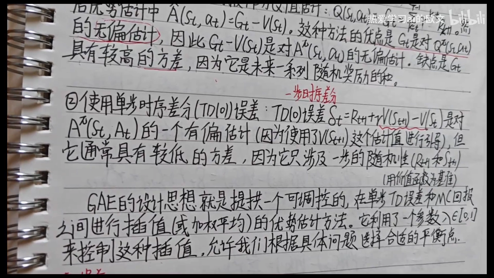

[【跳转到 05:26】](https://www.bilibili.com/video/BV1DBoYBREfc/?t=326)

---

## 三、从 $n$ 步优势估计到 TD 误差的加权和

要把「插值」写成公式，得先把「用 $k$ 步真实奖励」这件事定义清楚。

### 3.1 $k$ 步优势估计：走 $k$ 步真实奖励，再自举

**$k$ 步优势估计**（$k$-step advantage estimate）的构造是：往前真实地走 $k$ 步、把这 $k$ 个奖励都记下来，第 $k$ 步之后再交给价值函数去估：

$$
\hat{A}_t^{(k)} \;=\; R_{t+1} + \gamma R_{t+2} + \cdots + \gamma^{\,k-1}R_{t+k} + \gamma^{\,k}V(S_{t+k}) - V(S_t)
$$

$k=1$ 时它退化成 $\delta_t$；$k$ 越大，用到的真实奖励越多、自举越晚，偏差越小、方差越大。讲者把 $k$ 步 TD 误差和 $k$ 步优势估计当成同一个东西——两者数值完全相同。

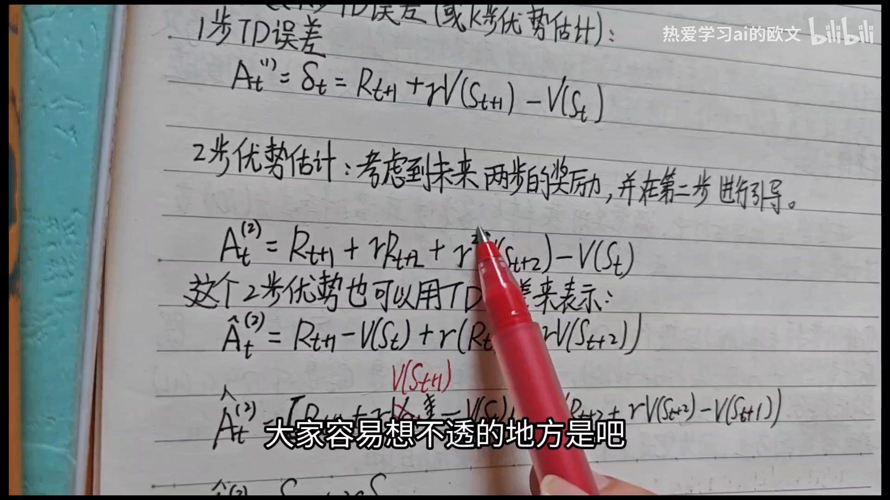

[【跳转到 10:03】](https://www.bilibili.com/video/BV1DBoYBREfc/?t=603)

### 3.2 关键一步：两步优势 = $\delta_t+\gamma\delta_{t+1}$

真正好用的性质出现在这里。把两步优势估计里的 $V(S_t)$ 拆开挪一挪：

$$
\hat{A}_t^{(2)} \;=\; R_{t+1} + \gamma R_{t+2} + \gamma^{2}V(S_{t+2}) - V(S_t)
$$

在中间「凭空」加减一项 $\gamma V(S_{t+1})$（等于没加没减），再重新分组：

$$
\hat{A}_t^{(2)} \;=\; \underbrace{\big[R_{t+1}+\gamma V(S_{t+1})-V(S_t)\big]}_{\delta_t} \;+\; \gamma\underbrace{\big[R_{t+2}+\gamma V(S_{t+2})-V(S_{t+1})\big]}_{\delta_{t+1}}
$$

于是得到一个非常干净的结果：

$$
\hat{A}_t^{(2)} \;=\; \delta_t + \gamma\,\delta_{t+1}
$$

**两步优势，就是两个相邻时间步的单步 TD 误差、按 $\gamma$ 衰减后相加。** 讲者说这一步是「很多人初学都学不太明白」的地方，值得自己动手推一遍。

同样的手法可以一路推下去，三步优势就是三个 TD 误差的加权和：

$$
\hat{A}_t^{(3)} \;=\; \delta_t + \gamma\delta_{t+1} + \gamma^{2}\delta_{t+2}
$$

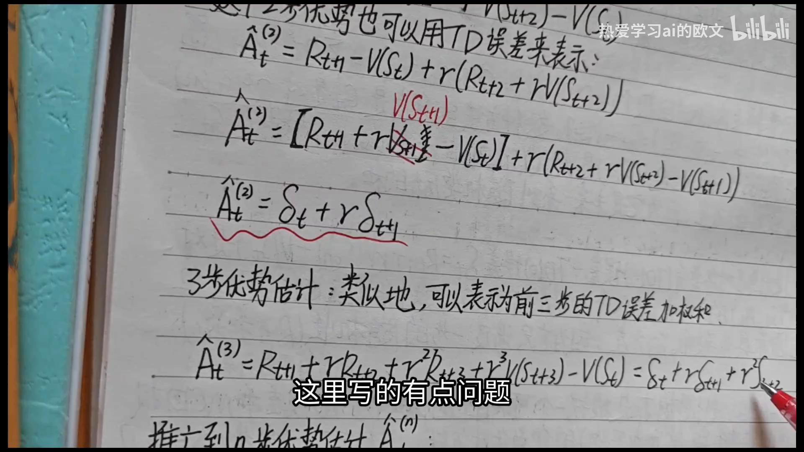

[【跳转到 12:40】](https://www.bilibili.com/video/BV1DBoYBREfc/?t=760)

### 3.3 推广到 $n$ 步

把上面的规律推广，$n$ 步优势估计就是前 $n$ 个 TD 误差的折扣加权和：

$$
\hat{A}_t^{(n)} \;=\; \sum_{k=0}^{n-1}\gamma^{\,k}\,\delta_{t+k}
$$

到这里，两条路线被统一了：**$n=1$ 是 TD(0)，$n\to\infty$ 就是蒙特卡洛**（因为一路走到底、不再自举）。剩下的问题只是——$n$ 该取多少？GAE 的回答是：**别选，全都要，然后加权平均。**

---

## 四、GAE 的定义：$n$ 步优势的指数加权平均

### 4.1 定义式：给每个 $n$ 一个指数衰减的权重

GAE 的做法是把所有 $n$ 步优势估计按指数衰减的权重加起来：

$$
\hat{A}_t^{\mathrm{GAE}(\gamma,\lambda)} \;=\; (1-\lambda)\sum_{n=1}^{\infty}\lambda^{\,n-1}\,\hat{A}_t^{(n)}, \qquad \lambda\in[0,1]
$$

权重依次是 $(1-\lambda)$、$\lambda(1-\lambda)$、$\lambda^{2}(1-\lambda)$……**前面的系数 $(1-\lambda)$ 是归一化因子**：因为

$$
(1-\lambda)\sum_{n=1}^{\infty}\lambda^{\,n-1} \;=\; (1-\lambda)\cdot\frac{1}{1-\lambda} \;=\; 1
$$

所以这是一组**权重和为 1 的加权平均**，而不是加权和。$\lambda$ 越小，权重衰减得越快，长步数的 $n$ 步优势几乎不起作用；$\lambda$ 越大，权重摊得越平，看得越远。

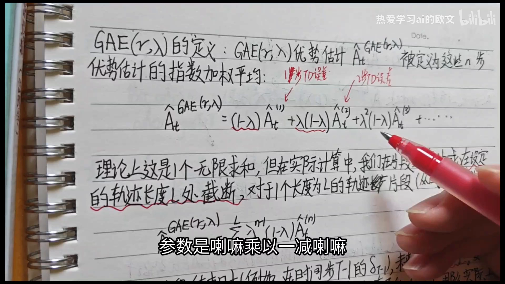

[【跳转到 13:40】](https://www.bilibili.com/video/BV1DBoYBREfc/?t=820)

### 4.2 交换求和顺序：化成 TD 误差的 $(\gamma\lambda)^l$ 加权和

上面这个定义式虽然直观，但**没法直接算**：它要求把每一个 $n$ 步优势都算出来再加权，而 $n$ 从 1 数到无穷。好在把 3.3 节的 $\hat{A}_t^{(n)}=\sum_{k=0}^{n-1}\gamma^{k}\delta_{t+k}$ 代进去、交换求和顺序（从「先按 $n$ 求和」换成「先按 $k$ 求和」），每个 $\delta_{t+k}$ 前面的系数会收拢成 $(\gamma\lambda)^{k}$，最后剩下：

$$
\hat{A}_t^{\mathrm{GAE}(\gamma,\lambda)} \;=\; \sum_{l=0}^{\infty}(\gamma\lambda)^{l}\,\delta_{t+l}
\;=\; \delta_t + (\gamma\lambda)\delta_{t+1} + (\gamma\lambda)^{2}\delta_{t+2} + \cdots
$$

**这是 GAE 最常用的那个形式**，读法也很直白：时间步 $t$ 的优势估计，等于**当前 TD 误差 $\delta_t$**，加上**折扣衰减因子 $\gamma\lambda$ 乘以下一步的 TD 误差 $\delta_{t+1}$**，再加上 $(\gamma\lambda)^2$ 乘以 $\delta_{t+2}$，以此类推，直到片段结束。

注意这里两个参数各管一件事：$\gamma$ 是马尔可夫决策过程本身的折扣因子（管「未来奖励值多少」），$\lambda$ 是 GAE 特有的衰减因子（管「未来误差信多少」）。两者在公式里总是以乘积 $\gamma\lambda$ 的形式出现。

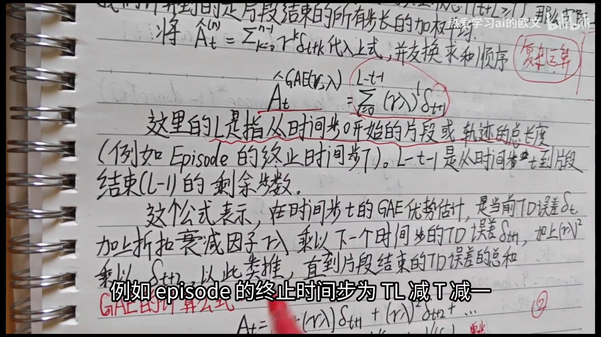

[【跳转到 16:38】](https://www.bilibili.com/video/BV1DBoYBREfc/?t=998)

### 4.3 无限求和怎么办：截断到片段长度

公式里写的是 $l$ 从 $0$ 到无穷。如果真要等无穷步才能算，那它又退化成蒙特卡洛了——必须等整个采样结束才能更新，失去了在线更新的意义。

实际做法是**截断**：在一个长度 $L$ 的轨迹片段上，求和只做到片段末尾：

$$
\hat{A}_t^{\mathrm{GAE}(\gamma,\lambda)} \;=\; \sum_{l=0}^{L-t-1}(\gamma\lambda)^{l}\,\delta_{t+l}
$$

其中 $L-t-1$ 是从时间步 $t$ 到片段结束的剩余步数。片段结束时，未来的 $V$ 项按零处理（终止状态的价值为 0）。这样一来，只要拿到一段轨迹，就能一段一段地在线更新——这正是它能塞进 PPO 这类批量算法里的原因（本系列第 9 章的 PPO 一节会再见到它）。

---

## 五、$\lambda$ 这个旋钮：偏差与方差的连续插值

讲者把 $\lambda$ 的作用总结成一句话：**控制偏差与方差的权衡**。两个端点最好记。

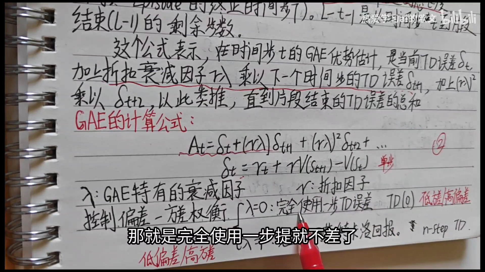

[【跳转到 17:48】](https://www.bilibili.com/video/BV1DBoYBREfc/?t=1068)

### 5.1 $\lambda=0$：退化成 TD(0)

$\lambda=0$ 时，$(\gamma\lambda)^l$ 对 $l\ge 1$ 全是零，求和只剩第一项：

$$
\hat{A}_t^{\mathrm{GAE}(\gamma,0)} \;=\; \delta_t
$$

**这正是单步 TD 误差**——也顺带回答了前面那个记号问题：TD(0) 里的那个「0」，指的其实就是 $\lambda=0$。它是**低方差**的（只有一步随机性），也是**高偏差**的（未来只能靠估计值引导）。当然「高」是相对的，讲者特意补了一句：并不是说偏差一定很大。

### 5.2 $\lambda=1$：退化成蒙特卡洛

$\lambda=1$ 时，$(\gamma\lambda)^l$ 变成 $\gamma^{l}$，求和变成

$$
\hat{A}_t^{\mathrm{GAE}(\gamma,1)} \;=\; \sum_{l=0}^{\infty}\gamma^{l}\,\delta_{t+l}
$$

这个式子看着不像回报，但把 $\delta$ 的定义逐个展开、让相邻项的 $V$ 互相抵消（望远镜求和），剩下的正是 $G_t - V(S_t)$：

$$
\sum_{l=0}^{\infty}\gamma^{l}\delta_{t+l} \;=\; G_t - V(S_t)
$$

也就是**完全使用蒙特卡洛回报**：无偏，但方差很大。

### 5.3 中间值：一个连续的谱

两端连起来看，$\lambda$ 就是一根从「TD(0)」滑到「蒙特卡洛」的滑块：

| $\lambda$ | 等价于 | 偏差 | 方差 |
| --- | --- | --- | --- |
| $0$ | 单步 TD 误差 $\delta_t$ | 高 | 低 |
| $0<\lambda<1$ | 介于两者之间，$(\gamma\lambda)^l$ 逐项衰减 | 中 | 中 |
| $1$ | 蒙特卡洛 $G_t-V(S_t)$ | 无偏 | 高 |

讲者没有给「$\lambda$ 该取多少」的普适答案，因为它是**按问题调**的超参数；但从公式能直接看出它的效果：$\lambda$ 越小，$(\gamma\lambda)^l$ 衰减越快，估计越依赖近处几步的 TD 误差；$\lambda$ 越大，远处的误差也被纳进来，估计更接近回报、方差也更大。

---

## 六、两种等价形式与工程实现

### 6.1 两种形式完全等价，但有前提

把两节的结论并排放：

$$
\text{形式一（单步 TD 加权）:}\quad \hat{A}_t^{\mathrm{GAE}(\gamma,\lambda)} \;=\; \sum_{l=0}^{\infty}(\gamma\lambda)^{l}\,\delta_{t+l}
$$

$$
\text{形式二（多步 TD 加权）:}\quad \hat{A}_t^{\mathrm{GAE}(\gamma,\lambda)} \;=\; (1-\lambda)\sum_{k=1}^{\infty}\lambda^{\,k-1}\,\hat{A}_t^{(k)}
$$

两者是同一个量的两种写法，但**等价是有条件的**：一是轨迹无限长；二是有限轨迹终止时 $V(S_T)=0$。真实任务里轨迹总会在某个终止状态结束、终止状态的价值取零，所以这两个条件在实践中基本总成立——讲者开玩笑说，「人类世界里没有无限的东西」，所以它们永远等价。

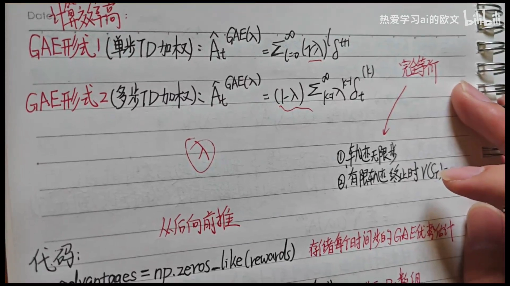

[【跳转到 19:51】](https://www.bilibili.com/video/BV1DBoYBREfc/?t=1191)

那实际用哪一种？**一律用形式一。** 理由很实际：形式一只要算每个时间步的**单步** TD 误差，然后从后往前累乘 $\gamma\lambda$ 就行；形式二要先算每个 $k$ 的 $k$ 步 TD 误差，又麻烦又慢。所以代码里清一色是形式一。

### 6.2 代码：从后往前递推

形式一可以直接写成递推。把求和拆出第一项：

$$
\hat{A}_t^{\mathrm{GAE}(\gamma,\lambda)} \;=\; \delta_t + \gamma\lambda\,\hat{A}_{t+1}^{\mathrm{GAE}(\gamma,\lambda)}
$$

**当前步的优势 = 当前 TD 误差 + $\gamma\lambda$ × 下一步的优势。** 这意味着计算必须**从轨迹末尾往前倒着走**：最后一步的优势只依赖它自己的 TD 误差，倒数第二步依赖最后一步，依此类推。

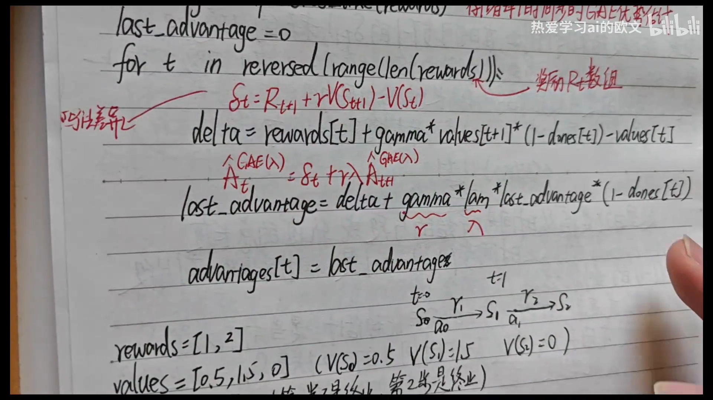

[【跳转到 21:52】](https://www.bilibili.com/video/BV1DBoYBREfc/?t=1312)

```python
advantages = np.zeros_like(rewards)   # 存每个时间步的 GAE 优势估计
last_advantage = 0                    # 上一步（物理上更靠后那一步）的优势

for t in reversed(range(len(rewards))):
    # 单步 TD 误差：δ_t = R_{t+1} + γ V(S_{t+1}) - V(S_t)
    delta = rewards[t] + gamma * values[t + 1] * (1 - dones[t]) - values[t]
    # 递推：Â_t = δ_t + γλ Â_{t+1}
    last_advantage = delta + gamma * lam * last_advantage * (1 - dones[t])
    advantages[t] = last_advantage
```

两个实现细节值得单独说：

- **`(1 - dones[t])` 是终止掩码**，和 GAE 本身无关。它全是 0 或 1：为 1 表示这一步已经终止，不该再把「下一步的价值」或「下一步的优势」接进来，于是乘 0 把它切断。
- **`rewards` 比 `values` 少一项**，这不是 bug。走 $S_0\to S_1\to S_2$ 一共三个状态，但只发生两次转移、只有两个奖励；最后一个状态不再采取动作，没有对应奖励。两种写法完全等价，只是下标错开一位。

### 6.3 一个手算例子

讲者用一个三步的小例子把递推走了一遍：

- `rewards = [1, 2]`，`values = [0.5, 1.5, 0]`（即 $V(S_0)=0.5$、$V(S_1)=1.5$、$V(S_2)=0$）
- `dones = [0, 1]`：第一步未终止，第二步终止
- $\gamma=0.9$，$\lambda=0.8$

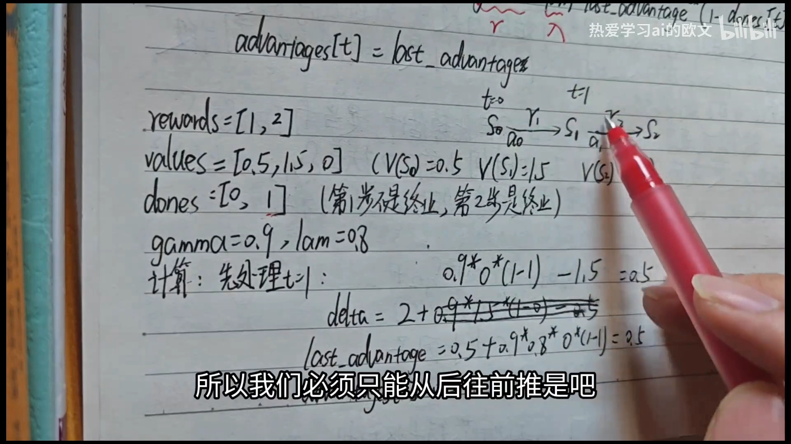

[【跳转到 25:16】](https://www.bilibili.com/video/BV1DBoYBREfc/?t=1516)

**先处理 $t=1$**（处于 $S_1$，这是最后一步）：

$$
\delta_1 \;=\; 2 + 0.9\times 0\times(1-1) - 1.5 \;=\; 0.5
$$

$$
\hat{A}_1 \;=\; 0.5 + 0.9\times 0.8\times 0\times(1-1) \;=\; 0.5
$$

因为已经终止，$V(S_2)=0$ 且掩码为 0，后面那一项整个被切断，所以优势就等于 TD 误差。

**再处理 $t=0$**：

$$
\delta_0 \;=\; 1 + 0.9\times 1.5\times(1-0) - 0.5 \;=\; 1.85
$$

$$
\hat{A}_0 \;=\; 1.85 + 0.9\times 0.8\times 0.5\times(1-0) \;=\; 1.85 + 0.36 \;=\; 2.21
$$

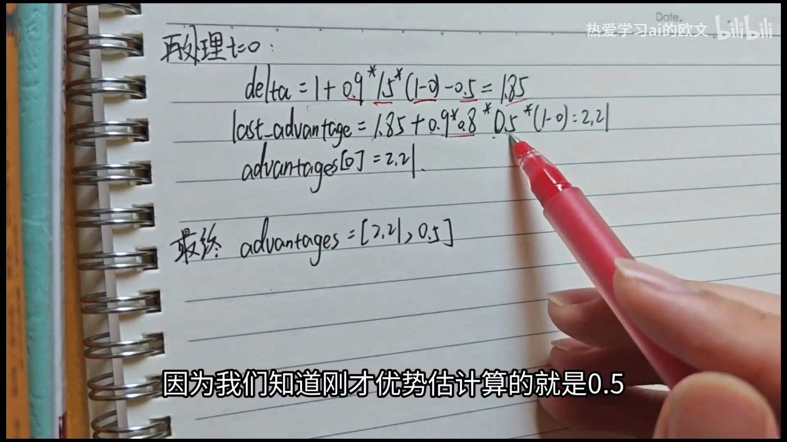

[【跳转到 27:16】](https://www.bilibili.com/video/BV1DBoYBREfc/?t=1636)

最终 `advantages = [2.21, 0.5]`。可以顺手验算一下「求和形式」：$\hat{A}_0 = \delta_0 + \gamma\lambda\delta_1 = 1.85 + 0.72\times 0.5 = 2.21$，与递推结果一致。

---

## 小结

1. **优势函数是「比平均好多少」**：$A_\pi(s,a)=Q_\pi(s,a)-V_\pi(s)$，其中 $V_\pi$ 是 $Q_\pi$ 关于动作的期望，所以优势关于动作的期望为零——它天然以零为中心，正好适合当策略梯度的权重。
2. **估计优势有两条极端路线**：蒙特卡洛 $G_t-V(S_t)$ 无偏但方差高（累加未来所有随机奖励）；单步 TD 误差 $\delta_t$ 方差低但有偏（用估计值引导未来）。
3. **$k$ 步优势估计统一了两者**：走 $k$ 步真实奖励、再自举，$k=1$ 是 TD(0)，$k\to\infty$ 是蒙特卡洛。
4. **关键恒等式**：$k$ 步优势可以写成 TD 误差的折扣加权和，$\hat{A}_t^{(n)}=\sum_{k=0}^{n-1}\gamma^{k}\delta_{t+k}$；两步的情形 $\hat{A}_t^{(2)}=\delta_t+\gamma\delta_{t+1}$ 靠中间加减 $\gamma V(S_{t+1})$ 推出来。
5. **GAE 是 $n$ 步优势的指数加权平均**：权重 $(1-\lambda)\lambda^{n-1}$ 之和为 1，$\lambda$ 控制衰减快慢。
6. **交换求和顺序后得到最常用的形式**：$\hat{A}_t^{\mathrm{GAE}(\gamma,\lambda)}=\sum_{l=0}^{\infty}(\gamma\lambda)^{l}\delta_{t+l}$，实际在片段末尾截断。
7. **$\lambda$ 是偏差-方差的旋钮**：$\lambda=0$ 退化成 TD(0)（低方差高偏差），$\lambda=1$ 退化成蒙特卡洛（无偏高方差），中间值连续插值。
8. **工程上只用形式一加递推**：$\hat{A}_t=\delta_t+\gamma\lambda\hat{A}_{t+1}$，从轨迹末尾往前倒推，终止处用 `(1-done)` 把自举切断。

## 关键术语速查

| 术语 | 一句话解释 |
| --- | --- |
| 优势函数（advantage function） | $A_\pi(s,a)=Q_\pi(s,a)-V_\pi(s)$，衡量在状态 $s$ 下动作 $a$ 比按策略平均行事好多少；关于动作的期望为零 |
| 动作价值 $Q_\pi(s,a)$ | 在 $s$ 执行 $a$、此后按 $\pi$ 行动所得折扣回报的期望，既看当下奖励也看未来奖励 |
| 状态价值 $V_\pi(s)$ | $Q_\pi(s,a)$ 关于动作的期望，即「还没决定动作时的平均水平」 |
| 折扣回报 $G_t$ | 从 $t$ 时刻起所有奖励按 $\gamma$ 衰减求和得到的实际观测值 |
| 蒙特卡洛优势估计 | $\hat{A}_t=G_t-V(S_t)$；无偏，但方差高 |
| TD 误差（TD error） | $\delta_t=R_{t+1}+\gamma V(S_{t+1})-V(S_t)$；数值上等于一步优势估计，低方差但有偏 |
| 自举（bootstrapping） | 用价值函数的估计值 $V(S_{t+1})$ 顶替真实未来，从而不必等轨迹结束 |
| $k$ 步优势估计 | $\hat{A}_t^{(k)}$：走 $k$ 步真实奖励再自举，$k=1$ 是 TD(0)，$k\to\infty$ 是蒙特卡洛 |
| 广义优势估计（GAE） | 用 $\lambda$ 把各阶 $n$ 步优势做指数加权平均，等价于 $\sum_l(\gamma\lambda)^l\delta_{t+l}$ |
| $\lambda$（GAE 衰减因子） | GAE 特有的旋钮，控制偏差与方差的权衡；$\lambda=0$ 退化为 TD(0)，$\lambda=1$ 退化为蒙特卡洛 |
| 偏差-方差权衡 | 估计越依赖真实采样越无偏但越抖；越依赖自举越稳但越偏 |
| 终止掩码（`1-done`） | 代码里用来在片段结束时切断自举与递推的 0/1 因子 |
