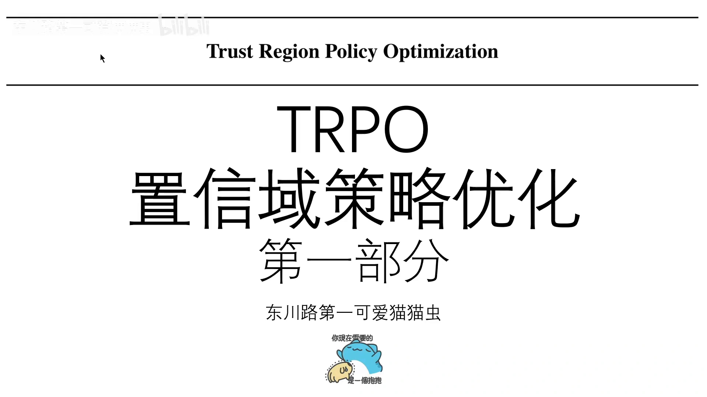
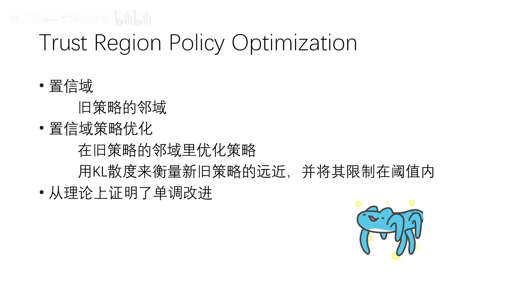
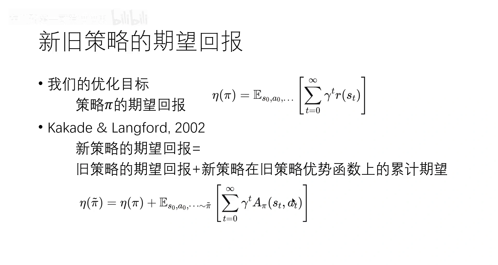
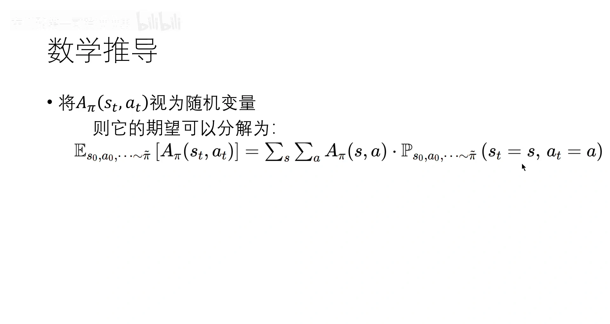
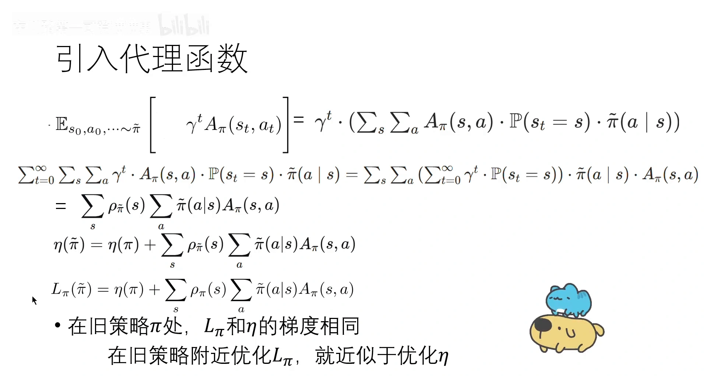
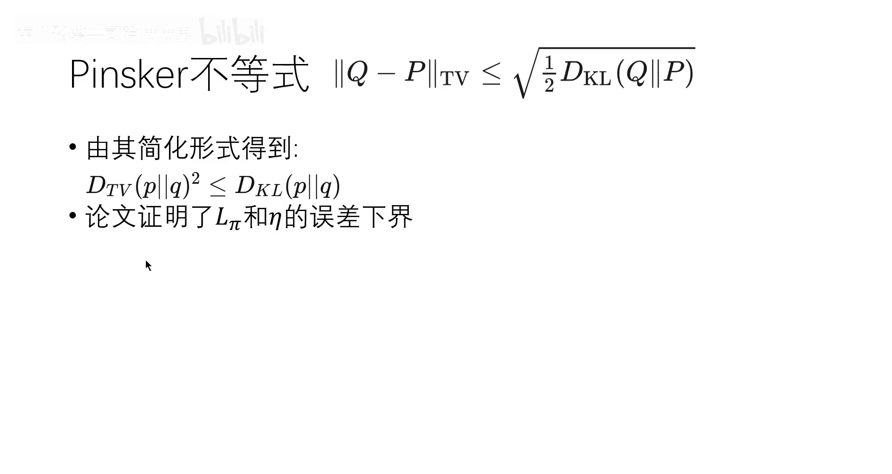
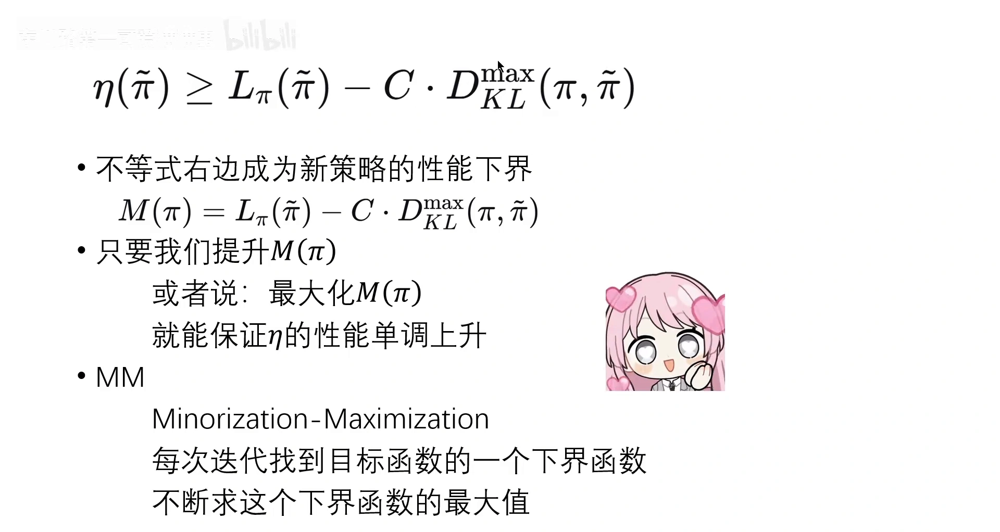
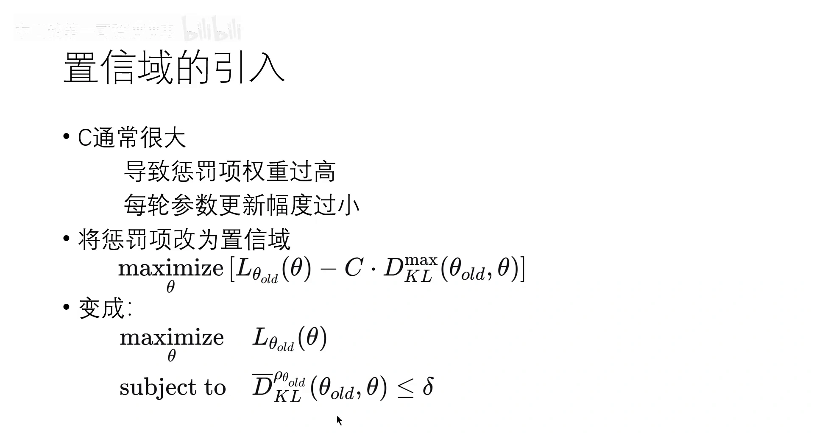
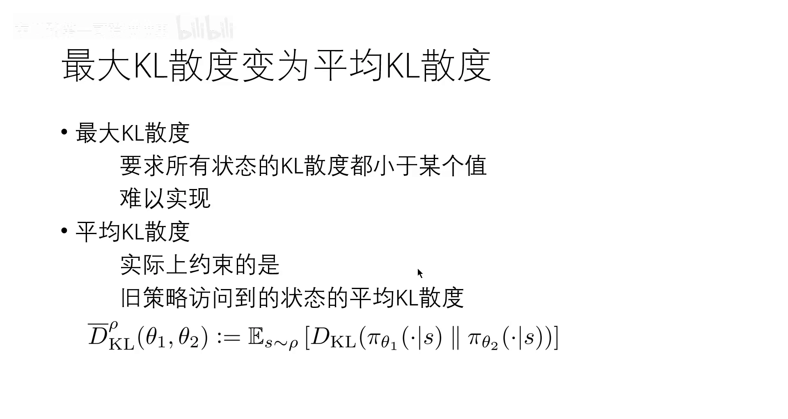

# 单调改进保证：从新旧策略性能差到策略下界

> 本篇整理自「东川路第一可爱猫猫虫」《【PPO的前身】【TRPO】第一部分 直观理解与算法理论》。视频地址：[BV1DcWozHEYi](https://www.bilibili.com/video/BV1DcWozHEYi/)。上一篇《策略梯度的步长困境：为什么一步迈太大就回不来》说明了问题的形状：强化学习的步长会通过改变采样分布产生连锁反应，一步迈大了就回不来，所以我们需要「新策略不能离旧策略太远」这条约束。但约束本身只是一句愿望——**凭什么在旧策略附近更新就一定不会变差？** 本篇补上这块地基：TRPO 论文用一个「新旧策略性能差」的恒等式，推出新策略性能的一个**下界**；只要每步都把这个下界抬高，策略性能就单调不降。

[【跳转到 00:00】](https://www.bilibili.com/video/BV1DcWozHEYi/?t=0)

## 本讲要解决的核心问题（SCQA）

**背景**：第 7 章证明了策略梯度的方向，第 8 章用 critic 把权重换成了优势函数，上一篇又说明了为什么必须限制步长。到这里，「沿着梯度走一小步」这件事在直觉上已经说得通：方向对、步子小，总该不会太差。

**冲突**：但「总该不会太差」只是直觉。梯度上升只保证**一阶**信息（局部方向），它完全不保证**有限步长**之后的性能。步长再小也有个下限，而策略一变，状态分布就变，误差会被这个分布变化放大。所以真正的问题是：**能不能给出一个不等式，把「新策略到底有多好」夹在一个可以在旧数据上计算、并且可以优化的量上？**

**疑问**：新旧策略的性能差，能不能写成一个**只依赖旧策略采样**的表达式？如果能，那么「最大化这个表达式」就等于「提升新策略性能」，而「提升多少」还能被一个惩罚项框住。

**回答（中心思想）**：能。Kakade 与 Langford 在 2002 年给出的恒等式表明，新旧策略的期望回报之差，恰好等于「新策略在旧策略优势函数上的累计期望」；把这个期望改写成状态求和后，唯一的未知量是新策略会访问哪些状态。于是把新策略的状态分布换成旧策略的，就得到一个**代理函数** $L_\pi$；再借助 KL 散度、TV 散度与 Pinsker 不等式，可以把「分布差异带来的误差」量化成一个惩罚项，最终得到

$$
\eta(\tilde\pi)\;\ge\;L_\pi(\tilde\pi)\;-\;C\cdot D_{\mathrm{KL}}^{\max}(\pi,\tilde\pi)
$$

右侧就是新策略的性能下界。**每一步都最大化这个下界，性能就单调不降**——这就是「单调改进保证」，也是 TRPO 名字里「置信域」的由来。

---

## 一、先把「策略有多好」写成一个数

策略优化的目标，是一条策略 $\pi$ 的**期望回报**（expected return）：

$$
\eta(\pi)\;=\;\mathbb{E}_{s_0,a_0,\dots}\left[\sum_{t=0}^{\infty}\gamma^{t}r(s_t)\right]
$$

其中 $\gamma$ 是折扣因子（discount factor），$r(s_t)$ 是第 $t$ 步拿到的奖励。这个 $\eta(\pi)$ 就是「策略好坏」的绝对值——后面所有的推导，都是围绕「新策略的 $\eta$ 能不能比旧策略的 $\eta$ 大」展开的。

讲者在开场用一句话概括了全篇要建立的结论，也顺带点出了 TRPO 与前面所有策略梯度方法的区别：

[【跳转到 03:45】](https://www.bilibili.com/video/BV1DcWozHEYi/?t=225)

这张图里有三个信息，值得逐一拆开：**「置信域 = 旧策略的邻域」**是几何图像；**「用 KL 散度衡量远近并限制在阈值内」**是约束的写法；**「从理论上证明了单调改进」**是这一整套推导的目的。第 7、8 章的算法也是 policy-based 的，也在改进策略，但它们**没有任何一个能证明自己在单调改进**——梯度上升只知道方向对，步长一大就可能迈过头。TRPO 的贡献就是把这个「可能」变成了「保证」。

## 二、新旧策略性能差：一个 2002 年的恒等式

推导的起点是一个前人结论（Kakade & Langford, 2002）：新策略的期望回报 = 旧策略的期望回报 + 新策略在旧策略优势函数上的累计期望。

[【跳转到 05:00】](https://www.bilibili.com/video/BV1DcWozHEYi/?t=300)

写成式子就是

$$
\eta(\tilde\pi)\;=\;\eta(\pi)\;+\;\mathbb{E}_{s_0,a_0,\dots\sim\tilde\pi}\left[\sum_{t=0}^{\infty}\gamma^{t}A_\pi(s_t,a_t)\right]
$$

这里 $\pi$ 是旧策略，$\tilde\pi$ 是新策略；$A_\pi(s,a)$ 是第 8 章讲过的**优势函数**（advantage function），$A_\pi(s,a)=Q_\pi(s,a)-V_\pi(s)$，含义是「在状态 $s$ 下做动作 $a$，比按策略 $\pi$ 平均行事好多少」。

这个恒等式为什么成立？讲者没有逐项展开，但它的推导思路只有一个动作：**望远镜求和**。把优势函数按定义拆开：

$$
A_\pi(s_t,a_t)\;=\;r(s_t)+\gamma V_\pi(s_{t+1})-V_\pi(s_t)
$$

两边乘上 $\gamma^{t}$ 再对 $t$ 求和，中间项会两两抵消：

$$
\sum_{t=0}^{\infty}\gamma^{t}A_\pi(s_t,a_t)
\;=\;\sum_{t=0}^{\infty}\gamma^{t}r(s_t)\;-\;V_\pi(s_0)
$$

（因为 $\sum_t \gamma^{t+1}V_\pi(s_{t+1})$ 与 $\sum_t \gamma^{t}V_\pi(s_t)$ 只差一个 $t=0$ 的项。）再对轨迹取期望：右边第一项就是新策略的期望回报 $\eta(\tilde\pi)$，而 $\mathbb{E}[V_\pi(s_0)]=\eta(\pi)$——因为 $s_0$ 之后按旧策略 $\pi$ 走的价值，正是旧策略的期望回报。于是

$$
\eta(\tilde\pi)-\eta(\pi)\;=\;\mathbb{E}_{\tau\sim\tilde\pi}\left[\sum_{t=0}^{\infty}\gamma^{t}A_\pi(s_t,a_t)\right]
$$

**这个式子的价值在于：它把「两个策略的性能差」变成了「一个策略的期望」。** 左边要评估新策略，右边却只需要在**新策略采样的轨迹**上算旧策略的优势函数——旧策略的优势函数是我们已经有的（critic 就在估它）。剩下的问题是：轨迹还是得用新策略采，而新策略还没训练出来。

## 三、改写成状态求和：引入状态占据度量

第二步是把「沿时间求和的期望」改写成「沿状态求和的期望」。理由是期望的线性性质：**若级数收敛，求期望与求无穷级数可以交换顺序**。

[【跳转到 07:30】](https://www.bilibili.com/video/BV1DcWozHEYi/?t=450)

交换顺序之后，每一项变成 $\gamma^{t}\cdot\mathbb{E}[A_\pi(s_t,a_t)]$。把 $A_\pi(s_t,a_t)$ 当成随机变量，它的期望按定义就是「对每一个状态、每一个动作，取优势函数再乘上出现的概率」：

$$
\mathbb{E}\big[A_\pi(s_t,a_t)\big]\;=\;\sum_{s}\sum_{a}A_\pi(s,a)\cdot\mathbb{P}(s_t=s,\,a_t=a)
$$

联合概率可以拆成「处于 $s$ 的概率 $\times$ 在 $s$ 下选 $a$ 的条件概率」。这里用到一个关键性质：**动作只依赖当前状态**（马尔可夫性），所以 $\mathbb{P}(a_t=a\mid s_t=s)=\tilde\pi(a\mid s)$——注意是新策略 $\tilde\pi$，因为轨迹是新策略采的。于是

$$
\mathbb{P}(s_t=s,\,a_t=a)\;=\;\mathbb{P}(s_t=s)\cdot\tilde\pi(a\mid s)
$$

把它代回、再把 $\gamma^{t}$ 与求和号重新组合，就出现了**折扣访问频率**（discounted visitation frequency），也叫**状态占据度量**（state occupancy measure）：

$$
\rho_{\tilde\pi}(s)\;=\;\sum_{t=0}^{\infty}\gamma^{t}\,\mathbb{P}(s_t=s)
$$

它的含义很直白：**状态 $s$ 在策略 $\tilde\pi$ 下被访问的长期权重**——第 0 步就在 $s$ 的概率，加上 $\gamma$ 倍「第 1 步在 $s$」的概率，加上 $\gamma^2$ 倍「第 2 步在 $s$」的概率……离现在越远的访问，权重被折扣得越小。

把 $\rho_{\tilde\pi}$ 代回去，就得到了一个非常干净的形式：

$$
\eta(\tilde\pi)\;=\;\eta(\pi)\;+\;\sum_{s}\rho_{\tilde\pi}(s)\sum_{a}\tilde\pi(a\mid s)\,A_\pi(s,a)
$$

到这里，**性能差已经完全写成「状态求和」了**。但代价也暴露出来：式子里有 $\rho_{\tilde\pi}$，也就是**新策略会访问哪些状态**——这正是我们不知道的东西，因为新策略还没训练出来。

## 四、代理函数：把未知的 $\rho_{\tilde\pi}$ 换成已知的 $\rho_\pi$

讲者的处理是「做一点小小的变换」：保留 $\eta(\pi)$ 不变，保留后面的求和结构不变，只把 $\rho_{\tilde\pi}$ 换成 $\rho_\pi$。这样得到的函数叫**代理函数**（surrogate function）：

$$
L_\pi(\tilde\pi)\;=\;\eta(\pi)\;+\;\sum_{s}\rho_\pi(s)\sum_{a}\tilde\pi(a\mid s)\,A_\pi(s,a)
$$

[【跳转到 11:15】](https://www.bilibili.com/video/BV1DcWozHEYi/?t=675)

$L_\pi$ 和 $\eta$ 只差这一处：$\rho_{\tilde\pi}$ 变成了 $\rho_\pi$。所以它们在 $\tilde\pi=\pi$ 处**取值相同**（$L_\pi(\pi)=\eta(\pi)$），而且**梯度也相同**。讲者的结论是：**在旧策略附近优化 $L_\pi$，就近似于优化 $\eta$**。

这一步是整个方法能落地的关键，值得说清楚它换来了什么：

- $\rho_\pi$ 是**旧策略**的状态分布，用旧策略采到的数据就能估——这正是我们手上有的数据；
- $\tilde\pi$ 是新策略，是我们要优化的对象，它在式子里只以 $\tilde\pi(a\mid s)$ 的形式出现，是**可以直接对参数求梯度**的；
- 于是「最大化 $L_\pi$」变成了一个标准的、可以用旧数据反复迭代的优化问题。

但它只是「近似」。**近似到什么程度、什么时候会失效**，取决于 $\tilde\pi$ 离 $\pi$ 有多远——这就把问题引到了「怎么量两个策略的远近」。

## 五、怎么量两个策略的远近：KL、TV 与 Pinsker

策略是一个概率分布，所以「远近」要用分布之间的距离来量。讲者用了两个量。

**KL 散度**（Kullback–Leibler divergence）衡量两个离散分布的差异：

$$
D_{\mathrm{KL}}(p\,\|\,q)\;=\;\mathbb{E}_{x\sim p}\left[\log\frac{p(x)}{q(x)}\right]
$$

它表示「用 $q$ 来近似 $p$ 时的信息损失」。讲者特意提醒：**严格说它不是「距离」**，因为距离的定义要求满足三角不等式，而 KL 散度不对称、也不满足三角不等式，所以只能说它衡量「远近」。

**TV 散度**（total variation divergence，总变差散度）则是真正的距离：

$$
D_{\mathrm{TV}}(p\,\|\,q)\;=\;\frac{1}{2}\sum_{i}\lvert p_i-q_i\rvert
$$

两者之间有一个不等式把它们连起来，叫 **Pinsker 不等式**：

[【跳转到 12:55】](https://www.bilibili.com/video/BV1DcWozHEYi/?t=775)

$$
D_{\mathrm{TV}}(p\,\|\,q)\;\le\;\sqrt{\tfrac{1}{2}D_{\mathrm{KL}}(p\,\|\,q)}
$$

两边都是非负的，平方一下得到 $D_{\mathrm{TV}}^2\le\frac{1}{2}D_{\mathrm{KL}}$；既然 $\frac{1}{2}D_{\mathrm{KL}}\le D_{\mathrm{KL}}$，就有简化形式：

$$
D_{\mathrm{TV}}(p\,\|\,q)^2\;\le\;D_{\mathrm{KL}}(p\,\|\,q)
$$

**为什么需要这一步？** 因为后面那个误差项天然是用 TV 散度写出来的（它出现在策略性能差的界里），而我们真正能算、能约束的是 KL 散度。Pinsker 不等式就是这两者之间的桥：**把 TV 换成 KL，界仍然成立，只是更松一点**。

## 六、单调改进下界：把误差写成一个惩罚项

有了前面的零件，TRPO 原论文给出的核心结论是：代理函数与真实性能之间的误差有一个界，即

$$
\eta(\tilde\pi)\;\ge\;L_\pi(\tilde\pi)\;-\;\frac{4\epsilon\gamma}{(1-\gamma)^{2}}\,\alpha^{2}
$$

其中

- $\epsilon=\max_{s,a}\lvert A_\pi(s,a)\rvert$：优势函数在所有状态动作对上的最大绝对值；
- $\alpha=\max_{s}D_{\mathrm{TV}}\big(\pi(\cdot\mid s)\,\|\,\tilde\pi(\cdot\mid s)\big)$：新旧策略在**所有状态**上的最大总变差散度。

再用第五节的简化形式 $\alpha^2\le D_{\mathrm{KL}}$ 把 $\alpha^2$ 换掉，并把常数部分合并成一个 $C$：

$$
\eta(\tilde\pi)\;\ge\;L_\pi(\tilde\pi)\;-\;C\cdot D_{\mathrm{KL}}^{\max}(\pi,\tilde\pi),
\qquad
C=\frac{4\epsilon\gamma}{(1-\gamma)^{2}}
$$

右边这一整块，讲者记作 $M(\pi)$：

[【跳转到 15:00】](https://www.bilibili.com/video/BV1DcWozHEYi/?t=900)

$$
M(\pi)\;=\;L_\pi(\tilde\pi)\;-\;C\cdot D_{\mathrm{KL}}^{\max}(\pi,\tilde\pi)
$$

**这是全篇最重要的一步。** 它把「新策略的真实性能」夹在了「一个可以在旧数据上算的量」和「一个能约束的惩罚项」之间。于是单调改进的论证只需要两行：

1. 因为 $\eta(\tilde\pi)\ge M(\pi)$，所以**只要提升 $M(\pi)$，$\eta(\tilde\pi)$ 一定跟着不低于它**；
2. 而 $M(\pi)$ 在 $\tilde\pi=\pi$ 处等于 $\eta(\pi)$（此时 KL 项为零、$L_\pi(\pi)=\eta(\pi)$），所以每一轮只要找到使 $M(\pi)$ 不减的新策略，就有 $\eta(\pi_{k+1})\ge\eta(\pi_k)$。

讲者把这个套路命名为 **MM（Minorization–Maximization，最小化-最大化）**：每次迭代先找一个目标函数的**下界函数**（minorize），再不断求这个下界函数的最大值（maximize）。因为目标函数永远不低于它的下界，抬高下界就等于抬高目标——**这就是「单调改进保证」的全部机制**。

## 七、$C$ 太大：惩罚项为什么不好用

按上面的逻辑，最直接的做法是每一轮直接最大化 $M(\pi)$，也就是解

$$
\max_{\theta}\;\Big[L_{\theta_{\text{old}}}(\theta)-C\cdot D_{\mathrm{KL}}^{\max}(\theta_{\text{old}},\theta)\Big]
$$

但讲者立刻指出这条路走不通，原因就藏在 $C$ 里。$C=\dfrac{4\epsilon\gamma}{(1-\gamma)^{2}}$，分母是 $(1-\gamma)^2$。取一个常见的折扣因子 $\gamma=0.99$：$1-\gamma=0.01$，$(1-\gamma)^2=10^{-4}$，于是 $C$ 被放大到 $10^{4}$ 量级。

**惩罚项权重这么高，模型就不敢更新策略了**：任何一点 KL 偏离都会被乘上一个巨大的系数，于是每轮只能用极小的幅度挪动参数——这正是上一篇说的「步长太小、学习极慢」。换句话说，**这个界虽然保证了单调改进，却把改进速度压到了零附近**，实际用不起来。

## 八、从惩罚到约束：置信域登场

TRPO 的处理办法是把**惩罚项改成约束**：不再把 KL 放进目标函数里扣分，而是把它写成一条硬性限制。

[【跳转到 16:40】](https://www.bilibili.com/video/BV1DcWozHEYi/?t=1000)

$$
\max_{\theta}\;L_{\theta_{\text{old}}}(\theta)
\qquad\text{s.t.}\qquad
\bar{D}_{\mathrm{KL}}^{\rho_{\theta_{\text{old}}}}(\theta_{\text{old}},\theta)\;\le\;\delta
$$

这个改动看起来只是换了个写法，但它把「惩罚多大」这个难以控制的量，换成了一个**可以直接指定的阈值 $\delta$**：不管 $C$ 有多大，我都只允许策略在一个固定大小的邻域里移动。**这个邻域就是置信域**（trust region）——名字里的「置信」指的是：在这个范围内，代理函数对真实性能的近似是可信的。

同时还有一处细节改动：约束里的 KL 从**最大 KL 散度**换成了**平均 KL 散度**。

[【跳转到 17:55】](https://www.bilibili.com/video/BV1DcWozHEYi/?t=1075)

$$
\bar{D}_{\mathrm{KL}}^{\rho}(\theta_1,\theta_2)\;:=\;\mathbb{E}_{s\sim\rho}\Big[D_{\mathrm{KL}}\big(\pi_{\theta_1}(\cdot\mid s)\,\big\|\,\pi_{\theta_2}(\cdot\mid s)\big)\Big]
$$

讲者给的理由是「减少约束条件」：如果约束的是**最大** KL 散度，那就要求**每一个状态**下新旧策略的 KL 都小于 $\delta$——这是很多条约束，实际很难同时满足；而**平均** KL 散度只要求「旧策略访问到的那些状态上，平均 KL 不超过 $\delta$」，一条约束就够了。代价是界变松了，但换来一个可解的问题。

## 九、小结：这条推导链的骨架

把全篇压成一条链：

1. **目标**：策略好坏是期望回报 $\eta(\pi)$；
2. **恒等式**：$\eta(\tilde\pi)-\eta(\pi)=\mathbb{E}_{\tau\sim\tilde\pi}\big[\sum_t\gamma^{t}A_\pi(s_t,a_t)\big]$——性能差 = 新策略轨迹上旧策略优势的累计期望；
3. **改写**：用 $\rho_{\tilde\pi}(s)=\sum_t\gamma^{t}\mathbb{P}(s_t=s)$ 把它写成状态求和，暴露唯一未知量 $\rho_{\tilde\pi}$；
4. **近似**：把 $\rho_{\tilde\pi}$ 换成 $\rho_\pi$，得到代理函数 $L_\pi$（在 $\pi$ 处与 $\eta$ 同值同梯度）；
5. **量化误差**：用 TV 散度、Pinsker 不等式把「近似误差」写成 $C\cdot D_{\mathrm{KL}}^{\max}$；
6. **得到下界**：$\eta(\tilde\pi)\ge M(\pi)=L_\pi(\tilde\pi)-C\cdot D_{\mathrm{KL}}^{\max}$，于是「最大化下界 ⇒ 性能单调不降」；
7. **修正**：$C\propto 1/(1-\gamma)^2$ 太大，惩罚项不可用，改为 KL 约束（置信域），并把最大 KL 放宽成平均 KL。

**一句话记住这篇**：TRPO 的「单调改进」不是靠调参调出来的，而是靠一个下界——每一步都只做「让下界变大」的事，而这件事在数学上被保证不会让真实性能变差。

## 延伸阅读

- 同条目另一篇《策略梯度的步长困境：为什么一步迈太大就回不来》：从采样与不可逆性的角度讲清「为什么需要这条保证」。
- 9.2 信赖域策略优化（TRPO）：本篇只推到「带约束的最大化问题」，下一步要做的是把它变成能算的算法——重要性采样把动作分布从新策略换回旧策略、对目标做一阶泰勒展开、对 KL 约束做二阶展开得到海森矩阵，最后用共轭梯度与线搜索求解。视频后半段（18:00 之后）讲的就是这些内容。
- 9.3 近端策略优化（PPO）：把 KL 约束换成 clip，让这套想法变得便宜好算。