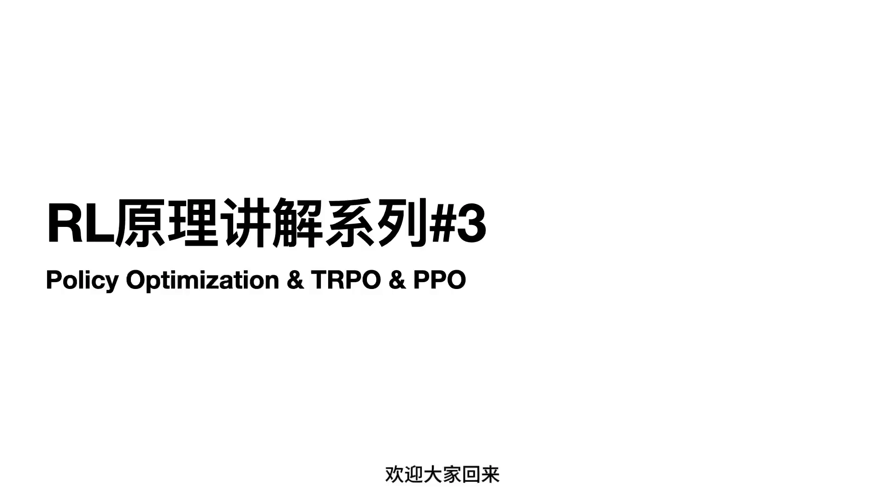
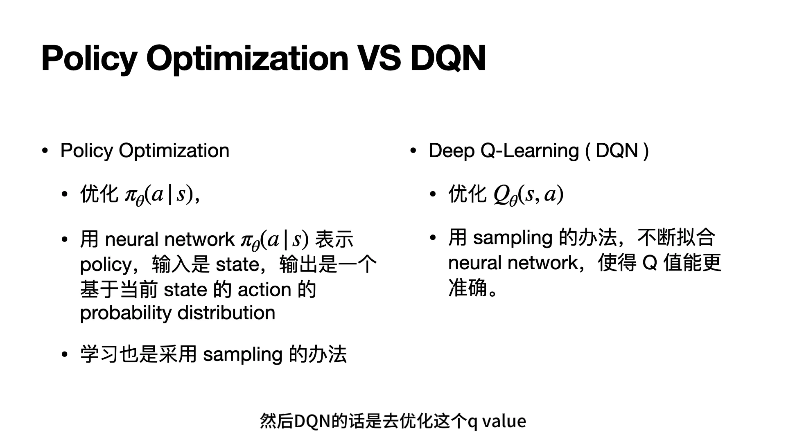
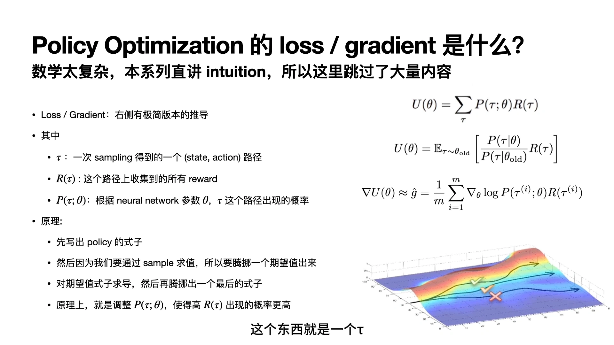
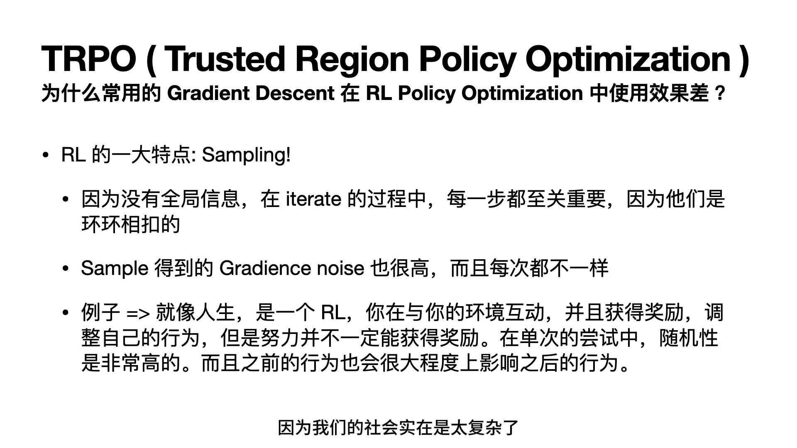
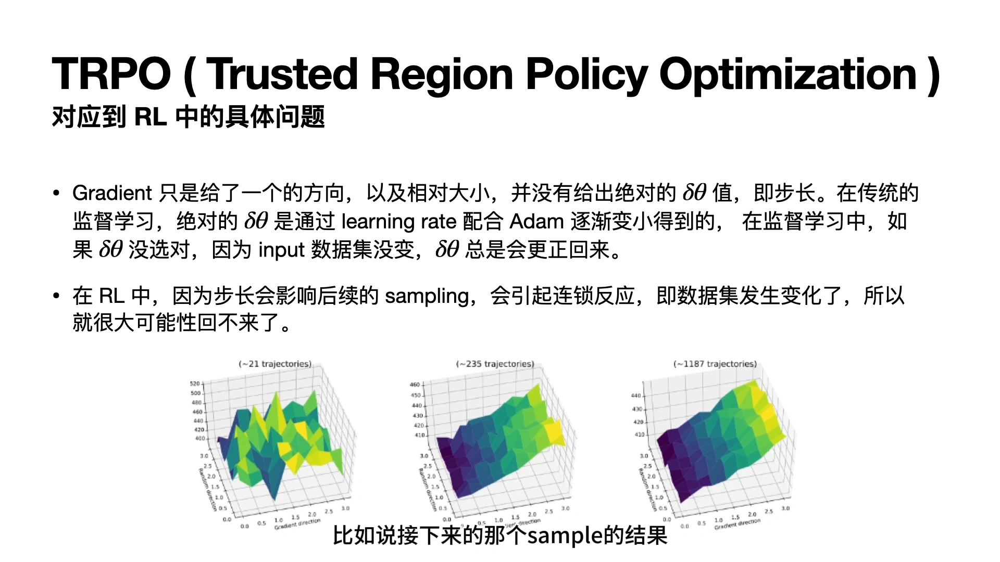
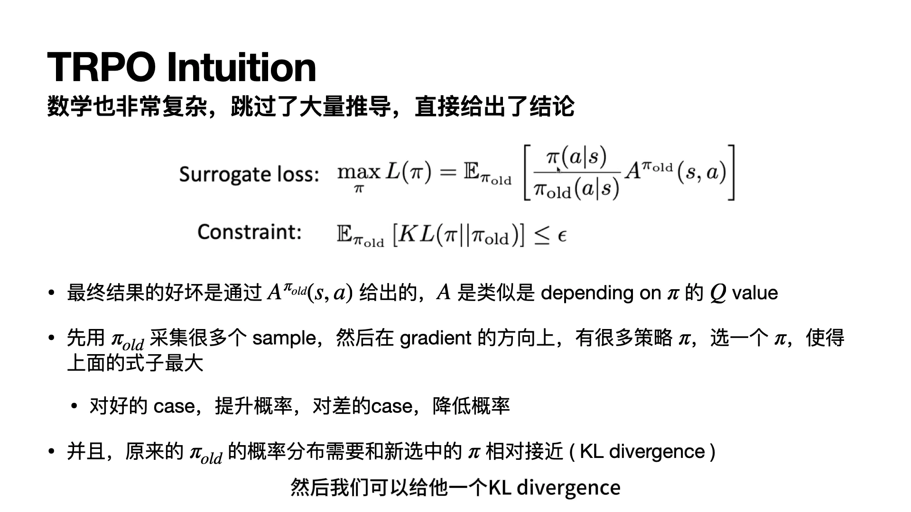
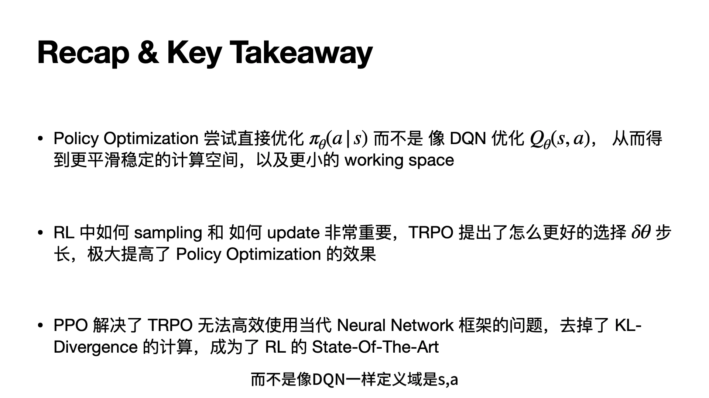

# 策略梯度的步长困境：为什么一步迈太大就回不来

> 本篇整理自「Up-Fei」《Policy Optimization & TRPO & PPO ｜ RL原理讲解系列#3》。视频地址：[BV1YC4y1M7GW](https://www.bilibili.com/video/BV1YC4y1M7GW/)。第 7 章把策略梯度写成了「对数策略的梯度乘上一个权重」的期望，第 8 章又把权重换成了由 critic 估出来的优势。但这两章都绕开了一个最要命的问题：**这个梯度该乘多大的步长？** 本篇讲的就是这个痛点——为什么在强化学习里，步长不像监督学习那样「调小一点总没错」，而是一步迈大了就再也回不来。

[【跳转到 00:00】](https://www.bilibili.com/video/BV1YC4y1M7GW/?t=0)

## 本讲要解决的核心问题（SCQA）

**背景**：第 7、8 章已经把策略梯度这套机器搭好了：用神经网络 $\pi_\theta(a\mid s)$ 表示策略，沿着「让高回报的动作更常出现」的方向更新参数 $\theta$。方向是清楚的——策略梯度定理保证了梯度的期望指向回报上升的方向。

**冲突**：**方向对，不等于走得对**。梯度只给了方向和一个相对大小，它没有告诉你「绝对该走多远」。而强化学习的数据是自己采样出来的：步长决定了新策略，新策略决定了接下来采到什么数据，采到的数据又决定了下一步的梯度。这是一个环环相扣的闭环，步长一旦过大，策略崩坏之后采到的数据也一起崩坏，**梯度再也指不回原来的路**。

**疑问**：既然步长既不能太大（会崩、且不可逆）也不能太小（慢到没法用），那有没有办法**从机制上**保证「每一步更新都不让策略变差」？

**回答（中心思想）**：有，这就是 TRPO（trust region policy optimization，置信域策略优化）要解决的问题。它的思路不是去猜一个合适的学习率，而是**先算清「这一步能走多远才安全」，再在这个范围内取最好的一步**：换一个能在旧数据上估计的替代目标（surrogate loss），同时用 KL 散度把新策略约束在旧策略附近的一个「置信域」里。本篇只讲清这个动机；它背后的单调改进定理与完整推导，见同条目的另一篇《单调改进保证：从新旧策略性能差到策略下界》。

---

## 一、先补一个前置问题：为什么不干脆只用 DQN

在进入步长之前，讲者先用一页 PPT 交代了「为什么要做 policy optimization」。这部分第 7 章已经系统讲过，这里只保留它和步长问题直接相关的那一半。

DQN 的思路是先把动作价值 $Q_\theta(s,a)$ 学准，再据此选动作。它有两个坎：

1. **优化很困难**。$s$ 和 $a$ 都是离散的，价值函数在相邻动作之间没有连续性。下棋就是典型例子：你只能下在这个点或那个点，不存在「下在两个点中间」的中间状态。神经网络在这种离散地形上做梯度下降，loss 曲面非常不平滑——往某个方向挪一点，可能还没跨到下一个格子，就卡在原地，第二次进来还是同一个状态，梯度几乎推不动。
2. **定义域太大**。状态本来就多（围棋的状态数近乎无限），再乘上动作，$Q(s,a)$ 的定义域是「状态 $\times$ 动作」的笛卡尔积。而我们真正关心的其实只是「给定状态该做什么」这个映射。

策略参数化正好绕开这两点：$\pi_\theta(a\mid s)$ 的输入是状态、输出是动作上的一个概率分布，**定义域只剩状态，维度少了一维**，而且概率分布是连续的，梯度可以平滑地推。讲者用一张图对比了这两件事：

[【跳转到 02:05】](https://www.bilibili.com/video/BV1YC4y1M7GW/?t=125)

一句话：**策略优化把「先学值、再选动作」两步并成一步**，直接优化那个我们真正想要的东西。代价是，它把优化对象换成了一个「会改变数据分布」的参数——这正是后面所有麻烦的来源。

## 二、策略优化的目标：让高回报的路径更常出现

要看懂步长为什么难，得先看清策略梯度到底在调什么。

讲者用「整条轨迹」的视角来写目标。一条轨迹记作 $\tau$，就是一次采样得到的完整 (state, action) 序列；$R(\tau)$ 是这条轨迹上收集到的所有奖励；$P(\tau;\theta)$ 是在参数 $\theta$ 下这条轨迹出现的概率。策略的效用（utility）就是所有轨迹的「概率 $\times$ 回报」之和：

$$
U(\theta) \;=\; \sum_{\tau} P(\tau;\theta)\,R(\tau)
$$

因为轨迹空间是枚举不完的，只能改成采样估计——在式子里乘一个 $P(\tau\mid\theta_{\text{old}})$ 再除掉它，把求和写成在旧策略采样下的期望：

$$
U(\theta) \;=\; \mathbb{E}_{\tau\sim\theta_{\text{old}}}\left[\frac{P(\tau\mid\theta)}{P(\tau\mid\theta_{\text{old}})}\,R(\tau)\right]
$$

再对它求导并用采样平均近似，就得到实际拿去反传的梯度估计：

$$
\nabla U(\theta)\;\approx\;\hat g\;=\;\frac{1}{m}\sum_{i=1}^{m}\nabla_\theta \log P(\tau^{(i)};\theta)\,R(\tau^{(i)})
$$

[【跳转到 03:45】](https://www.bilibili.com/video/BV1YC4y1M7GW/?t=225)

这个式子最值得记住的一点是：**$\tau$ 和 $R(\tau)$ 都不会变**，一条轨迹拿到的回报是固定的、与 $\theta$ 无关。$\theta$ 唯一能做的事，就是改 $P(\tau;\theta)$——**把高回报轨迹的概率调大，把低回报轨迹的概率调小**。策略梯度的一切（包括后面所有的稳定性技巧）都只是在想办法把这件事做得更稳。

## 三、RL 和监督学习的根本差别：地形图是会变的

到这里，讲者抛出了全篇最关键的一问：**为什么监督学习里那套「学习率 + Adam 慢慢衰减」的经验，搬到 RL 就不灵了？**

差别不在梯度公式，而在**梯度是在什么地形上算出来的**。

监督学习的数据集是固定的，所以损失曲面（讲者叫它「海拔图」）也是固定的。$\theta$ 在这张图上走来走去，走错一步没关系——因为图没变，下一步的梯度还会把你往最低点推回来。学习率配合 Adam 逐步变小，就是在这个固定地形上做「先大步、后小步」的搜索。

RL 不一样。**步长会改变策略，策略会改变采样，采样会改变数据集**，于是地形图本身跟着变：

[【跳转到 07:30】](https://www.bilibili.com/video/BV1YC4y1M7GW/?t=450)

讲者的表述很直接：**gradient 只给了一个方向、以及相对大小，并没有给出绝对的 $\delta\theta$（步长）**。在监督学习里，如果 $\delta\theta$ 没选对，因为 input 数据集没变，$\delta\theta$ 总会更正回来；而在 RL 里，步长会影响后续的 sampling，引起连锁反应——数据集变了，所以**很大可能性回不来了**。

[【跳转到 10:00】](https://www.bilibili.com/video/BV1YC4y1M7GW/?t=600)

图上那三张「海拔图」值得多看两眼：它们是用不同数量的轨迹估出来的同一类曲面，采样越少，估出来的地形越坑坑洼洼。也就是说，**RL 里的梯度不只是「有噪声」，它是在一张自己看不全、而且每次看都略有不同的图上算出来的**。在这样的图上迈大步，风险自然远高于监督学习。

## 四、人生类比：随机奖励，和不可逆的自我强化

讲者用了一个很长的类比把「不可逆」这件事讲透——把人的一辈子当成一次 RL。

社会太复杂，「怎么过得更好」没有标准答案，你只能在与环境的互动中拿到某种奖励，再据此调整行为。但**单次尝试的随机性极高**：你努力学习了一次，能不能拿到好成绩非常说不准（可能老师出了张难卷子，可能努力的方向不对）；反过来，你做了该被惩罚的事，也可能因为没被发现而拿到一个很好的 reward。

关键的推论在后者：**如果算法偷东西没被发现、反而拿到了 reward，它会继续偷**。因为在它的采样里，这条轨迹就是「有回报」的，之后 sample 出来的整条人生轨迹都会沿着这个方向走。于是：

- 它再也看不到「努力学习」那条分支的样本，因为**它再也不会去努力学习**；
- 看不到那条分支的样本，就估不出那条分支的价值，梯度也就永远指不回去。

这就是「不可逆」的机制：**不是策略变差了，而是变差之后你连「好」长什么样都采样不到了**。讲者把这件事概括成 TRPO 要回答的问题——

> 我做了一个 action、得到了一个 reward，我有多相信这个 reward 是整体的趋势，而不是偶然的发现？

而「我有多相信」，最终就落在**步长 $\Delta\theta$ 选多大**上。类比继续往下推，两种坏步长各有各的坏法：

- **步长太小**：努力学习拿到了 reward，于是只多努力那么一点点——还会拿到 reward，或者拿到 penalty，但训练慢到没法用。
- **步长太大**：偷东西拿到了 reward，于是把「偷」这件事的权重放大很多——从此在违法犯罪的道路上越走越远，再也回不来。

## 五、于是问题变成：方向有了，大小怎么定

把上面的讨论收拢，问题只剩一句话：**给定一个方向，这一步该走多远？**

讲者给了两条思路。

**思路一（朴素）**：沿这个方向枚举几个候选点，每个点都算一遍期望回报，挑最好的那个。问题很明显——每算一个点都要重新采样，代价高得离谱。

**思路二（TRPO）**：不要用原来的 utility 梯度当 loss，**换一个新的 loss**，让它能在旧数据上估计；同时要求新策略和旧策略「不能相差太远」。这个新的 loss 叫替代损失（surrogate loss），「不能相差太远」用 KL 散度来度量：

$$
\max_{\pi}\;\; L(\pi)\;=\;\mathbb{E}_{\pi_{\text{old}}}\left[\frac{\pi(a\mid s)}{\pi_{\text{old}}(a\mid s)}\,A^{\pi_{\text{old}}}(s,a)\right]
\qquad\text{s.t.}\qquad
\mathbb{E}_{\pi_{\text{old}}}\big[\,D_{\mathrm{KL}}(\pi\,\|\,\pi_{\text{old}})\,\big]\;\le\;\epsilon
$$

[【跳转到 12:30】](https://www.bilibili.com/video/BV1YC4y1M7GW/?t=750)

讲者对这个式子的解读只有三句话，但每句都对应一个设计选择：

1. **好坏由 $A^{\pi_{\text{old}}}(s,a)$ 给出**——它是「这个动作比旧策略的平均水平好多少」，所以对好的 case 提升概率、对差的 case 降低概率，方向没变。
2. **先用 $\pi_{\text{old}}$ 采很多样本，再在梯度方向上挑一个 $\pi$**，让上面的式子最大——这就是「枚举候选点」的可行版本，因为所有候选点都在同一批旧数据上评估，不用重新采样。
3. **$\pi$ 必须和 $\pi_{\text{old}}$ 相对接近**（KL divergence 约束）——这就是「步长」的显式写法：不再是一个标量学习率，而是「新旧策略分布之间允许的偏离量」。

换句话说，TRPO 把「调步长」这个玄学问题，换成了「**在旧策略附近的一个小邻域里找最优点**」这个几何问题。邻域有多大由 $\epsilon$ 控制（TRPO 原论文里这个阈值常记作 $\delta$），而「为什么在这个邻域里就一定不会变差」需要一篇完整的定理来保证——那正是同条目另一篇的内容。

## 六、代价与出场：TRPO 的问题和 PPO 的一句话

讲者没有回避 TRPO 的工程代价：它变成了一个**带约束的优化问题**（constrained optimization），用神经网络解起来非常吃力；而且 KL 散度如果不是很漂亮的函数，几乎拿不到解析解，只能对两个分布做数值解，非常难算。所以它在真实场景里不太好落地。

于是 PPO（proximal policy optimization，近端策略优化）出场，思路极简：**把 KL 那一项去掉，改成在概率比上直接裁剪（clip）**——给你一个最大值、一个最小值，只要落在这个范围内就行。讲者的说法是：想加 1，而 clip 范围是 0.2，那就只给你加 0.2。PPO 的价值不在于新想法，而在于**让 TRPO 的想法变得好算**。

[【跳转到 14:35】](https://www.bilibili.com/video/BV1YC4y1M7GW/?t=875)

PPO 的细节属于 9.3，这里只需要记住它在整条线索上的位置：**TRPO 定义了「什么叫安全的一步」，PPO 把「安全的一步」做成了一个便宜好算的近似**。

## 七、小结

- **方向与步长是两件事**。策略梯度只保证方向，不保证走多远；而 RL 的步长会通过改变数据分布产生连锁反应，所以它比监督学习的学习率敏感得多。
- **过大的步长是不可逆的**：策略崩坏 → 采到的数据崩坏 → 梯度也崩坏。最坏的情况不是「变差」，而是「再也采样不到好的分支」。
- **过小的步长只是慢**：方向没错，但每一步的改进被压得极小，样本效率低到不可接受。
- **破局思路是换问题**：不去猜步长，而是把「新策略不能离旧策略太远」写成约束，在旧策略的邻域里找最优点。这个邻域就是**置信域**（trust region）。
- 这条路线的前提是「在邻域内更新一定不会让策略变差」——它需要一个**单调改进**的数学保证，也就是下一篇的主题。

## 延伸阅读

- 同条目另一篇《单调改进保证：从新旧策略性能差到策略下界》：把「邻域内不会变差」写成 $\eta(\tilde\pi)\ge L_\pi(\tilde\pi)-C\cdot D_{\mathrm{KL}}^{\max}(\pi,\tilde\pi)$，并解释为什么惩罚项最终要改成约束。
- 9.2 信赖域策略优化（TRPO）：重要性采样、泰勒展开、共轭梯度与线搜索的完整算法。
- 9.3 近端策略优化（PPO）：PPO-Penalty 与 PPO-Clip。