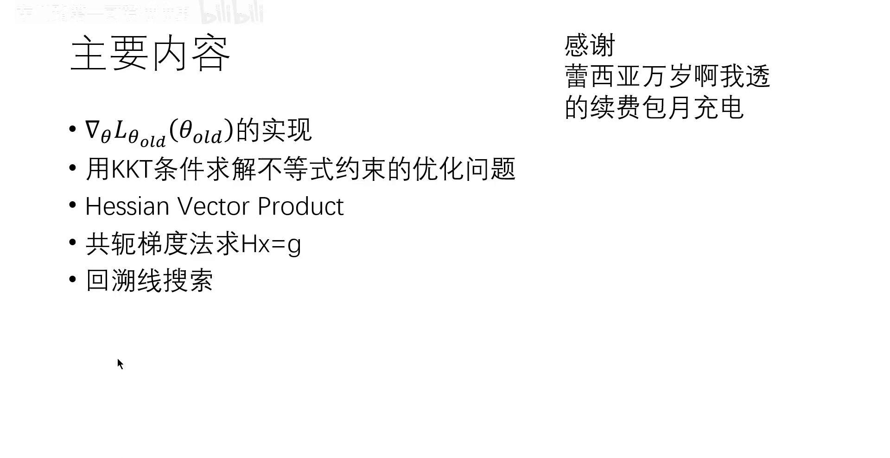
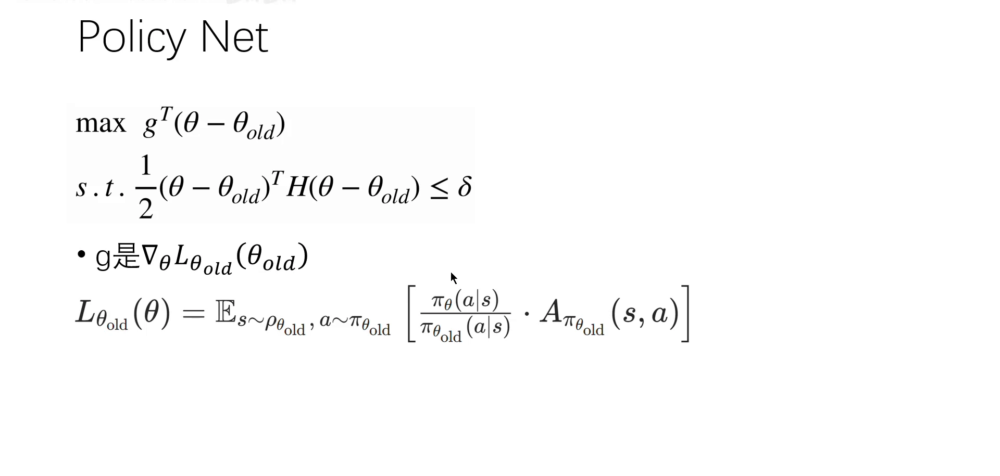
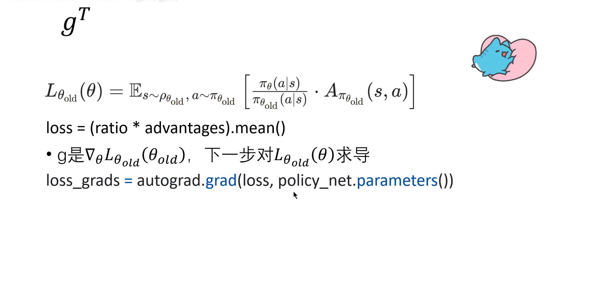
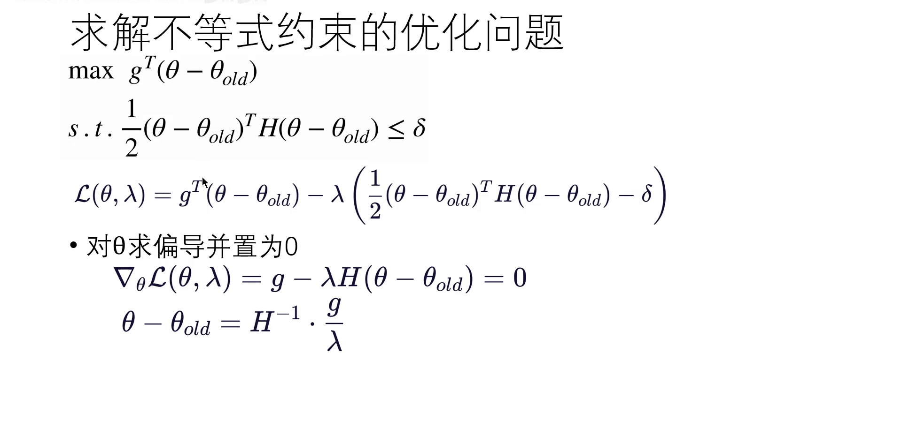
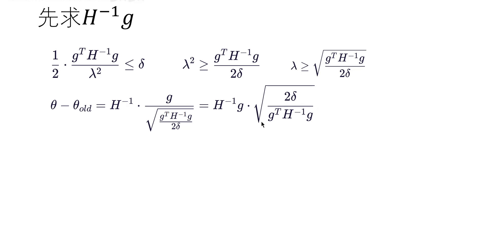
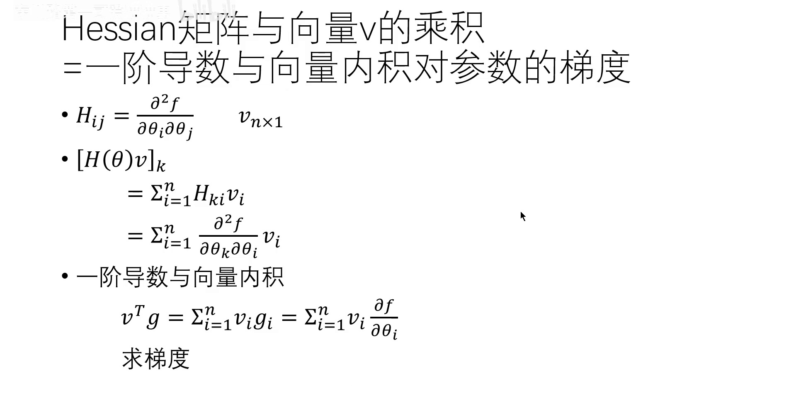
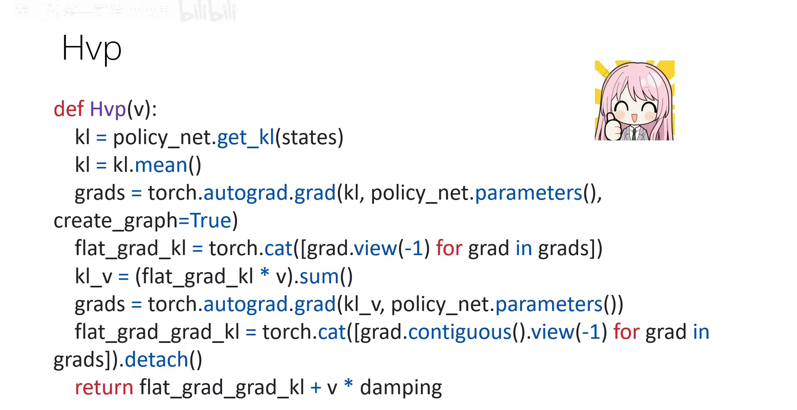
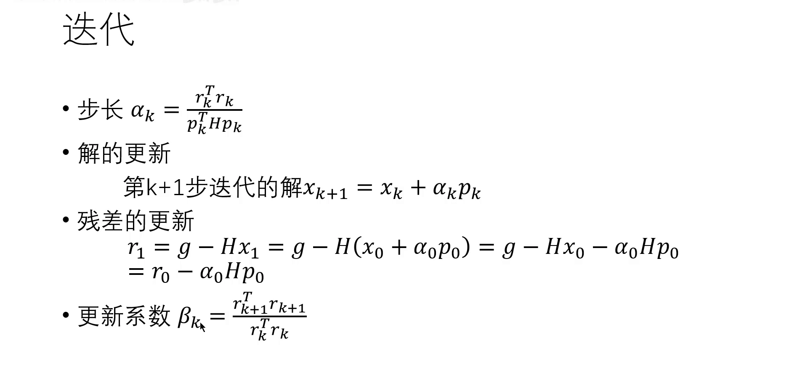
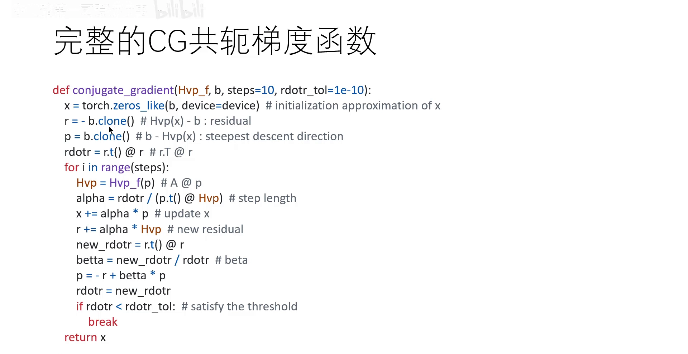
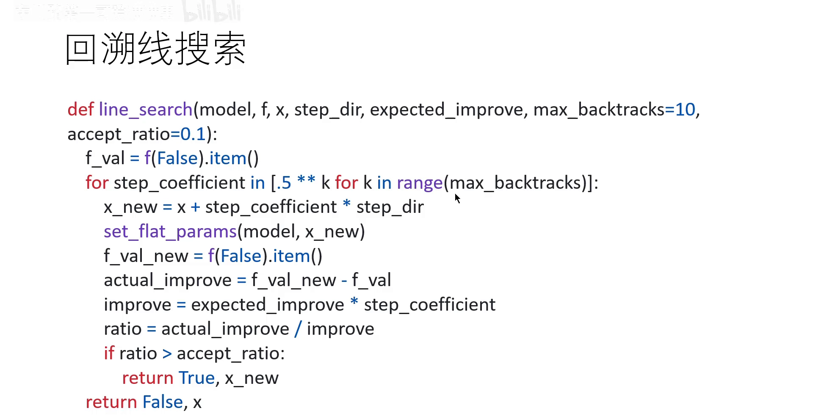

# TRPO 代码实现：海森向量积与回溯线搜索

> 本篇整理自「东川路第一可爱猫猫虫」《【已完结】【TRPO】第二部分 完整代码实现》。视频地址：[BV1Ci1zBcEiz](https://www.bilibili.com/video/BV1Ci1zBcEiz/)。同条目前两篇走完了理论：第一篇把 TRPO 化成「线性目标 + 二次约束」并用拉格朗日对偶解出 $\theta_{k+1}=\theta_k+\sqrt{2\delta/(g^{\top}H^{-1}g)}\,H^{-1}g$；第二篇讲共轭梯度法怎么在不求逆的前提下算出 $H^{-1}g$。本篇把这两块拼成能跑的代码，并补上理论里没有的那一步：**回溯线搜索**。



[【跳转到 01:45】](https://www.bilibili.com/video/BV1Ci1zBcEiz/?t=105)

## 本讲要解决的核心问题（SCQA）

**背景**：数学上 TRPO 每一步要做的事只有三件——算梯度 $g$、解 $Hx=g$、乘上步长。

**冲突**：但三件事在代码里各有各的坑。$g$ 不是「对 loss 求导」这么简单，因为 loss 里含重要性权重比值，必须保证比值和优势都来自**旧策略**；$H$ 是二阶导，PyTorch 虽然能算，但上亿维的矩阵根本存不下；而共轭梯度法解出来的方向是基于**二阶近似**的，近似只在局部成立——万一这一步迈出去性能反而变差呢？

**疑问**：这三个坑，在真实代码里分别是怎么填的？

**回答（中心思想）**：三个坑对应三个技术：

1. **$g$ 用两次「对数概率之差取指数」算比值**，优势用 GAE 估，再用 `autograd.grad` 对展平后的参数求导；
2. **$H$ 用 HVP 绕开**——海森矩阵乘向量可以写成「一阶导与向量的内积」再求一次梯度，全程不构造 $H$；
3. **方向用共轭梯度迭代 10 步**近似求出 $H^{-1}g$，最后用**回溯线搜索**（backtracking line search）以 $0.5^{k}$ 的步长系数逐步缩小步长，直到实际性能提升达到预期的 10%（`accept_ratio` 取 0.1），否则**这一步干脆不走**。

---

## 一、先看全局：TRPO 更新两块网络

TRPO 的参数更新分成两部分：

| 网络 | 作用 | 怎么更新 |
| --- | --- | --- |
| value net（价值网络） | 估计 $V(s)$，用于算优势 | 最小化 loss，普通梯度下降 |
| policy net（策略网络） | 输出动作分布 $\pi_\theta(a\mid s)$ | 本篇的主角：算 $g$ → 解 $H^{-1}g$ → 线搜索 |

policy net 的更新是 TRPO 的核心，也是全部复杂度的来源。它要解的优化问题是



[【跳转到 03:00】](https://www.bilibili.com/video/BV1Ci1zBcEiz/?t=180)

$$
\max_{\theta}\; g^{\top}(\theta-\theta_{\text{old}})
\qquad\text{s.t.}\qquad
\frac{1}{2}(\theta-\theta_{\text{old}})^{\top}H(\theta-\theta_{\text{old}})\le\delta
$$

其中

$$
L_{\theta_{\text{old}}}(\theta)=\mathbb{E}_{s\sim\rho_{\theta_{\text{old}}},\,a\sim\pi_{\theta_{\text{old}}}}
\left[\frac{\pi_\theta(a\mid s)}{\pi_{\theta_{\text{old}}}(a\mid s)}\cdot A_{\pi_{\theta_{\text{old}}}}(s,a)\right],
\qquad
g=\nabla_\theta L_{\theta_{\text{old}}}(\theta)\Big|_{\theta=\theta_{\text{old}}}
$$

注意 $g$ 的下标：它是**代理目标在 $\theta_{\text{old}}$ 处的梯度**，不是任意一点的梯度。这一点决定了代码里必须在参数还没被改动时先把 $g$ 算出来、存下来。

## 二、$g$ 怎么算：比值、优势、展平

### 2.1 重要性权重：对数概率之差取指数

比值 $\dfrac{\pi_\theta(a\mid s)}{\pi_{\theta_{\text{old}}}(a\mid s)}$ 在代码里不能直接「两个概率相除」——概率值可能极小，直接除容易数值不稳。标准做法是**先取对数、相减、再取指数**：

$$
\frac{\pi_\theta(a\mid s)}{\pi_{\theta_{\text{old}}}(a\mid s)}
= \exp\Big(\log\pi_\theta(a\mid s)-\log\pi_{\theta_{\text{old}}}(a\mid s)\Big)
$$

因为 $\exp(\log a-\log b)=a/b$。代码里就是

```python
log_probs = policy_net.get_log_prob(states, actions)
ratio = torch.exp(log_probs - old_log_probs)
```

`old_log_probs` 是采样时用旧策略算好并**存下来**的，不是重算的——这是「比值必须相对旧策略」的技术保证。

### 2.2 优势：用 GAE 估

优势 $A_{\pi_{\theta_{\text{old}}}}(s,a)$ 一般用**广义优势估计**（GAE）来算，也就是第 8 章讲过的那套指数加权。代码里 loss 就一行：



[【跳转到 04:15】](https://www.bilibili.com/video/BV1Ci1zBcEiz/?t=255)

```python
loss = (ratio * advantages).mean()
```

**这行代码值得多看一眼**：它没有负号，因为我们要**最大化**这个量；而 PyTorch 的优化器习惯最小化，所以后面求梯度时是对 loss 求**上升**方向的梯度（`autograd.grad` 拿到的是 $\nabla_\theta$ 本身，用的时候是加上去而不是减）。

### 2.3 求导、展平、拼接、剥离

```python
loss_grads = torch.autograd.grad(loss, policy_net.parameters())
flat_grad = torch.cat([grad.view(-1) for grad in loss_grads]).detach()
```

三步各有理由：

- **展平**（`view(-1)`）：参数是分层的（权重矩阵、偏置向量……），而共轭梯度法要处理的是一个**一维向量**。把所有梯度张量拉平再 `torch.cat` 拼成一个长向量，才能和后面的 $H$ 运算对齐。
- **拼接**：拼成的顺序必须与后面 HVP 输出的顺序**完全一致**，否则「$H$ 乘向量」的对应关系就错了。
- **剥离**（`detach()`）：$g$ 是一个数值结果，不需要参与后续的计算图。不剥离会导致显存泄漏。

## 三、KKT：从约束问题到 $\theta-\theta_{\text{old}}=H^{-1}g/\lambda$

有了 $g$，接下来解约束优化问题。讲者用的是 **KKT 条件**的简化形式（完整 KKT 有三个条件：梯度为零、互补松弛、约束可行；这里只用到第一条，因为约束在最优处取等号）。



[【跳转到 05:30】](https://www.bilibili.com/video/BV1Ci1zBcEiz/?t=330)

构造拉格朗日函数

$$
\mathcal{L}(\theta,\lambda) = g^{\top}(\theta-\theta_{\text{old}}) - \lambda\left(\frac{1}{2}(\theta-\theta_{\text{old}})^{\top}H(\theta-\theta_{\text{old}})-\delta\right)
$$

对 $\theta$ 求偏导并置零：

$$
\nabla_\theta\mathcal{L}(\theta,\lambda) = g - \lambda H(\theta-\theta_{\text{old}}) = 0
\;\Longrightarrow\;
\theta-\theta_{\text{old}} = H^{-1}\cdot\frac{g}{\lambda}
$$

**把更新量代回约束**。代入时有一个小技巧：$H$ 是海森矩阵，$H^{-1}$ 同样对称，所以 $(H^{-1})^{\top}=H^{-1}$。于是

$$
\frac{1}{2}\cdot\frac{g^{\top}H^{-1}g}{\lambda^{2}} \le \delta
\;\Longrightarrow\;
\lambda^{2} \ge \frac{g^{\top}H^{-1}g}{2\delta}
\;\Longrightarrow\;
\lambda \ge \sqrt{\frac{g^{\top}H^{-1}g}{2\delta}}
$$

取 $\lambda$ 的下界（步长取满 $\delta$），得到完整的更新量：



[【跳转到 06:45】](https://www.bilibili.com/video/BV1Ci1zBcEiz/?t=405)

$$
\theta-\theta_{\text{old}} = H^{-1}g\cdot\sqrt{\frac{2\delta}{g^{\top}H^{-1}g}}
$$

**代码实现的思路**：这个式子里只有两样东西要算——$H^{-1}g$（用共轭梯度法）和分母 $g^{\top}H^{-1}g$（用 HVP）。$\delta$ 是超参数（代码里叫 `max_kl`）。

## 四、HVP：不知道 $H$ 也能算 $Hv$

### 4.1 数学原理



[【跳转到 10:30】](https://www.bilibili.com/video/BV1Ci1zBcEiz/?t=630)

**命题**：

$$
H(\theta)\,v = \nabla_\theta\big(v^{\top} g(\theta)\big)
$$

其中 $g(\theta)=\nabla_\theta f(\theta)$ 是一阶导（梯度向量），$v$ 是任意固定向量。

**证明**。海森矩阵的元素是二阶偏导：

$$
H_{ij} = \frac{\partial^{2} f}{\partial\theta_i\,\partial\theta_j}
$$

左边第 $k$ 个分量是「$H$ 的第 $k$ 行与 $v$ 的内积」：

$$
\big[H(\theta)v\big]_k = \sum_{i=1}^{n}H_{ki}v_i = \sum_{i=1}^{n}\frac{\partial^{2}f}{\partial\theta_k\partial\theta_i}v_i
$$

右边先算内积。$v^{\top}g=\sum_{i=1}^{n}v_ig_i=\sum_{i=1}^{n}v_i\dfrac{\partial f}{\partial\theta_i}$，这是一个**标量**；再对它求 $\theta_k$ 的偏导：

$$
\frac{\partial}{\partial\theta_k}\sum_{i=1}^{n}v_i\frac{\partial f}{\partial\theta_i}
= \sum_{i=1}^{n}v_i\frac{\partial^{2}f}{\partial\theta_k\partial\theta_i}
$$

与左边逐项相同。命题得证。

**这个命题为什么关键？** 它把「用 $H$ 乘一个向量」变成了「求一次梯度」。而求梯度是自动微分的本职工作——于是我们**永远不需要构造 $H$**。

### 4.2 代码：两次 `autograd.grad`



[【跳转到 12:50】](https://www.bilibili.com/video/BV1Ci1zBcEiz/?t=770)

```python
def Hvp(v):
    kl = policy_net.get_kl(states)
    kl = kl.mean()
    grads = torch.autograd.grad(kl, policy_net.parameters(), create_graph=True)
    flat_grad_kl = torch.cat([grad.view(-1) for grad in grads])
    kl_v = (flat_grad_kl * v).sum()
    grads = torch.autograd.grad(kl_v, policy_net.parameters())
    flat_grad_grad_kl = torch.cat([grad.contiguous().view(-1) for grad in grads]).detach()
    return flat_grad_grad_kl + v * damping
```

逐行对照命题：

| 代码 | 数学 |
| --- | --- |
| 先 `get_kl` 再 `mean` | $f(\theta)$ 取「KL 散度的均值」 |
| 第一次 `autograd.grad`，并开启 `create_graph` | 算一阶导 $g(\theta)=\nabla_\theta f$ |
| 逐元素相乘后 `sum` | 内积 $v^{\top}g$（即哈德玛积再求和） |
| 第二次 `autograd.grad`（对 `kl_v` 求导） | 对内积再求一次梯度，得到 $Hv$ |
| `+ v * damping` | 加阻尼项，把 $H$ 推成正定 |

**两个工程细节**：

1. **`create_graph` 必须开启**。第一次求导得到的 $g(\theta)$ 必须**保留计算图**，否则第二次求导没有图可走。这是 HVP 能实现的前提。
2. **`damping` 保证正定**。共轭梯度法要求 $H$ 对称正定才能保证收敛，而实际估出来的海森矩阵可能只是半正定。加一个很小的正数 $v\cdot\text{damping}$（相当于给 $H$ 的每个对角元加一点）就能保证正定。

## 五、共轭梯度：把 $H^{-1}g$ 迭代出来

### 5.1 四个公式



[【跳转到 14:55】](https://www.bilibili.com/video/BV1Ci1zBcEiz/?t=895)

讲者说明这些公式是**原封不动**从共轭梯度法那一讲复制过来的，推导在那里已经做完，这里只看结果：

$$
\alpha_k=\frac{r_k^{\top}r_k}{p_k^{\top}Hp_k},
\qquad
x_{k+1}=x_k+\alpha_k p_k,
\qquad
r_{k+1}=r_k-\alpha_k Hp_k,
\qquad
\beta_k=\frac{r_{k+1}^{\top}r_{k+1}}{r_k^{\top}r_k}
$$

### 5.2 一个符号陷阱

代码里的残差与上一讲的**符号相反**：

| | 上一讲（理论） | 本讲代码 |
| --- | --- | --- |
| 残差定义 | $r = g - Hx$ | $r = Hx - b$ |
| 初始化（$x_0=0$） | $r_0 = g$ | $r_0 = -b$ |
| 搜索方向 | $p_0 = r_0$ | $p_0 = -r_0 = b$ |
| 残差更新 | $r_{k+1}=r_k-\alpha_kHp_k$ | $r \mathrel{+}= \alpha_k Hp_k$ |

因为 $x_0=0$，两种定义只差一个负号；搜索方向因为「负负得正」而完全一致（都是 $b$），残差更新则从「减」变成「加」。**这不是错误，只是约定不同**——但看代码时如果不注意，会以为公式抄错了。

### 5.3 完整函数



[【跳转到 16:35】](https://www.bilibili.com/video/BV1Ci1zBcEiz/?t=995)

```python
def conjugate_gradient(Hvp_f, b, steps=10, rdotr_tol=1e-10):
    x = torch.zeros_like(b, device=device)   # 解的初始猜测
    r = - b.clone()                          # Hvp(x) - b : 残差
    p = b.clone()                            # b - Hvp(x) : 最速下降方向
    rdotr = r.t() @ r
    for i in range(steps):
        Hvp = Hvp_f(p)                       # A @ p
        alpha = rdotr / (p.t() @ Hvp)         # 步长
        x += alpha * p                        # 更新解
        r += alpha * Hvp                      # 新残差
        new_rdotr = r.t() @ r
        betta = new_rdotr / rdotr             # beta
        p = -r + betta * p
        rdotr = new_rdotr
        if rdotr < rdotr_tol:                 # 满足阈值
            break
    return x
```

**注意 `steps` 默认只取 10**。理论上共轭梯度法要 $n$ 步（$n$ 是参数维度，上亿）才精确收敛，实际只迭代 **10 步**就返回。也就是说，TRPO 里的 $H^{-1}g$ 从来不是精确解，而是「10 次 HVP 换来的一个足够好的近似方向」。这是整个算法能在真实规模上跑起来的关键取舍。

## 六、拼出完整更新量

现在把三块拼起来：

```python
step_dir = conjugate_gradient(Hvp, loss_grad)   # H⁻¹g
shs = Hvp(step_dir).t() @ step_dir              # gᵀH⁻¹g
lm = torch.sqrt(2 * max_kl / shs)
step = lm * step_dir
```

分母 $g^{\top}H^{-1}g$ 的实现很巧：先把 $H^{-1}g$ 算出来存成 `step_dir`，再做一次 HVP 得到 $H(H^{-1}g)$，然后与 $H^{-1}g$ 做内积——因为 $H$ 对称，

$$
\big(H(H^{-1}g)\big)^{\top}(H^{-1}g) = g^{\top}H^{-1}g
$$

**一次 HVP 就得到了分母**，不需要额外求任何东西。

## 七、回溯线搜索：保证这一步真的在变好

### 7.1 为什么需要它

到这里，方向 $H^{-1}g$ 和步长 $\sqrt{2\delta/(g^{\top}H^{-1}g)}$ 都是基于**二阶近似**算出来的。近似只在 $\theta_{\text{old}}$ 附近成立，万一这一步迈出去，真实性能反而下降呢？

回溯线搜索就是这道保险：**先试一小步，不行就再缩一半，直到确认「真的变好了」才接受**。

### 7.2 代码



[【跳转到 18:35】](https://www.bilibili.com/video/BV1Ci1zBcEiz/?t=1115)

```python
def line_search(model, f, x, step_dir, expected_improve, max_backtracks=10,
                accept_ratio=0.1):
    f_val = f(False).item()
    for step_coefficient in [.5 ** k for k in range(max_backtracks)]:
        x_new = x + step_coefficient * step_dir
        set_flat_params(model, x_new)
        f_val_new = f(False).item()
        actual_improve = f_val_new - f_val
        improve = expected_improve * step_coefficient
        ratio = actual_improve / improve
        if ratio > accept_ratio:
            return True, x_new
    return False, x
```

**三个量决定这一步走不走**：

| 量 | 含义 |
| --- | --- |
| `step_coefficient` | 步长系数，取 $0.5^{k}$，$k=0,1,\dots,9$：依次是 $1,\ 0.5,\ 0.25,\dots$ |
| `expected_improve` | 二阶近似**预测**的提升量，乘上系数就是「缩步之后预期还能提升多少」 |
| `ratio` | 实际提升 ÷ 预期提升。这个比值是**近似质量的度量**：接近 1 说明近似很准，小于 0.1 说明近似在这个尺度上已经不可信 |

**逻辑**：$k=0$ 时先试满步（系数 1）。如果实际提升达到预期的 10%（`accept_ratio` 取 0.1），接受；否则把系数减半再试；试满 10 次都不行，就 `return False`——**这一步不更新**。讲者的说法是：「如果性能提升比较小或者性能不提升，我就不再更新这个参数了。」

这个 `ratio > 0.1` 的判据来自数值优化里的经典做法（Marquardt 的置信域调整）：只要实际/预期比值不太差，就认为近似仍然可用；太差则说明已经跑出置信域，必须退回来。

## 八、小结

1. **两块网络**：value net 用普通梯度下降最小化 loss；policy net 走「算 $g$ → 解 $H^{-1}g$ → 线搜索」这条重路线。
2. **$g$ 的实现**：比值用 $\exp(\log\pi_\theta-\log\pi_{\text{old}})$ 算（数值稳定），优势用 GAE，`autograd.grad` 求导后 `view(-1)` 展平、`torch.cat` 拼接、`detach` 剥离。
3. **KKT**：$\nabla_\theta\mathcal{L}=g-\lambda H(\theta-\theta_{\text{old}})=0$ 给出 $\theta-\theta_{\text{old}}=H^{-1}g/\lambda$；代回约束解出 $\lambda$，得到完整更新量。
4. **HVP**：$Hv=\nabla_\theta(v^{\top}g)$——海森矩阵乘向量等于「一阶导与 $v$ 的内积」再求一次梯度。代码里就是两次 `autograd.grad`，第一次必须开启 `create_graph`。
5. **阻尼**：`+ v * damping` 把 $H$ 推成正定，保证共轭梯度法收敛。
6. **共轭梯度**：只迭代 10 步，$H^{-1}g$ 是近似解；注意代码里的残差符号与理论推导相反。
7. **线搜索**：以 $0.5^{k}$ 缩小步长，`ratio = 实际提升 / 预期提升` 大于 0.1 才接受，否则这一步不更新——这是二阶近似之外的**最后一道保险**。

**一句话记住这篇**：TRPO 的代码里，数学只占一半，另一半是三个工程兜底——**HVP 省掉海森矩阵、CG 省掉求逆、线搜索省掉「近似失效」的风险**。

## 关键术语速查

| 术语 | 一句话解释 |
| --- | --- |
| HVP（Hessian-Vector Product） | 只算 $H$ 乘向量的结果而不构造 $H$，靠两次自动微分实现 |
| `create_graph` | 让第一次求导的结果保留计算图，以便对它再求一次导 |
| 阻尼（damping） | 给 $H$ 加一个很小的正对角项，保证它正定、CG 收敛 |
| `rdotr` | $r^{\top}r$，残差的平方和，用来判断 CG 是否已经足够精确 |
| 回溯线搜索（backtracking line search） | 步长按 $0.5^{k}$ 递减，直到实际提升达到预期的某个比例 |
| `accept_ratio` | 接受阈值，代码里取 0.1，即实际提升至少是预期的 10% |
| `max_kl` | 置信域半径 $\delta$，TRPO 唯一需要调的「步长」超参数 |

## 延伸阅读

- 同条目《从策略梯度到 TRPO：泰勒近似与拉格朗日对偶》：本篇第一到三节的数学来源。
- 同条目《共轭梯度法：求解 TRPO 背后的矩阵方程》：本篇第五节的完整推导，包括 $\beta_k$ 为什么长那样。
- 9.3 近端策略优化（PPO）：把「HVP + 共轭梯度 + 线搜索」这一整套重型机械，换成一次 clip——这也是 PPO 取代 TRPO 成为默认选择的直接原因。