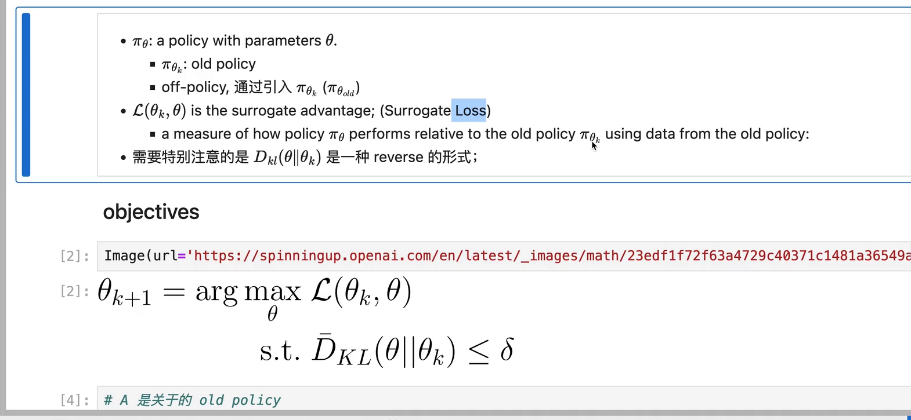
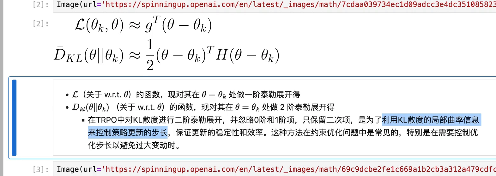
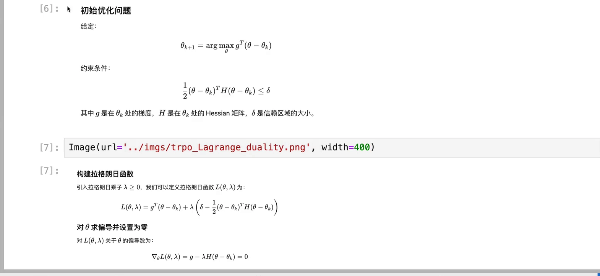
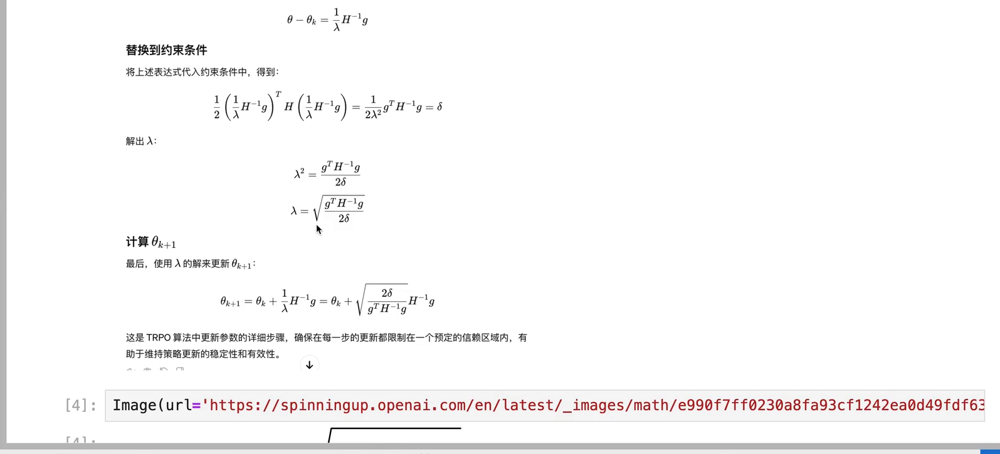
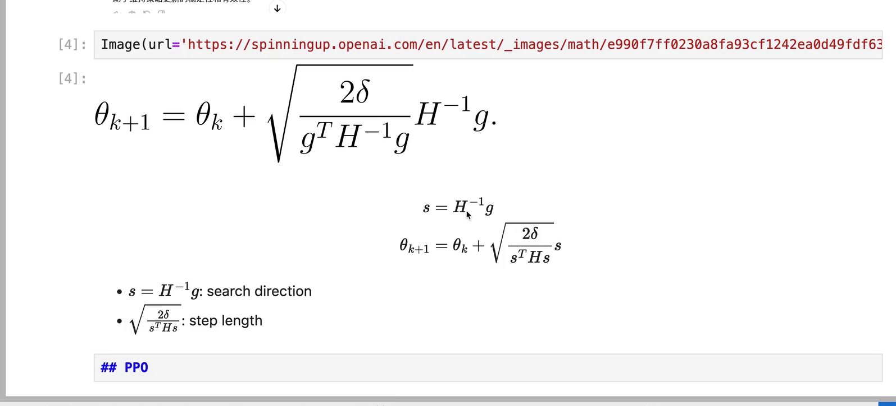
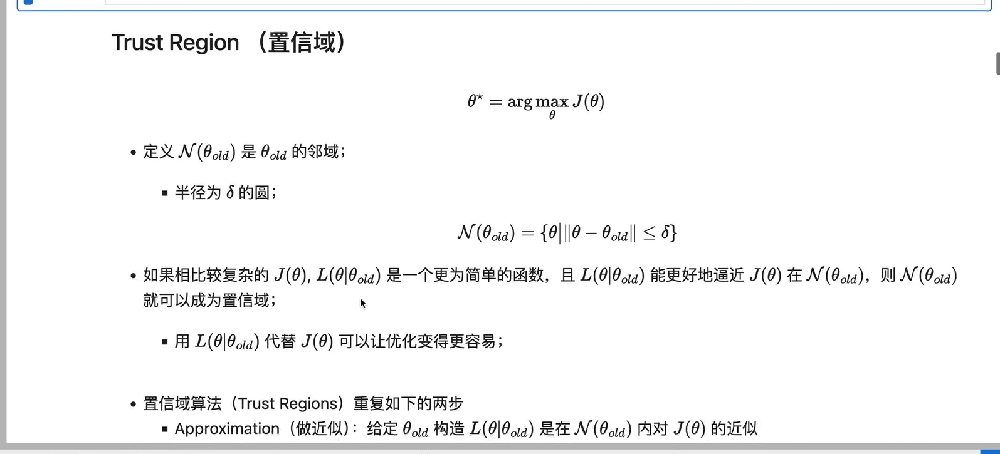

# 从策略梯度到 TRPO：泰勒近似与拉格朗日对偶

> 本篇整理自「五道口纳什」《[DRL] 从策略梯度到 TRPO（Lagrange Duality，拉格朗日对偶性）》。视频地址：[BV1hD421K7gG](https://www.bilibili.com/video/BV1hD421K7gG/)。上一篇《单调改进保证：从新旧策略性能差到策略下界》把 TRPO 的动机推到了尽头：惩罚项系数 $C$ 太大，于是把「减去 $C$ 乘 KL」改写成「在 KL 不超过 $\delta$ 的前提下最大化代理函数」。但那一步只写出了**问题**，没有写出**解法**。本篇接着往下走：这个带约束的最大化问题，怎么变成一个能算出闭式答案的代数式子。

[【跳转到 04:10】](https://www.bilibili.com/video/BV1hD421K7gG/?t=250)

## 本讲要解决的核心问题（SCQA）

**背景**：策略梯度的更新式是 $\theta \leftarrow \theta + \alpha \nabla_\theta J(\theta)$，方向由梯度给出，步长由学习率给出。第 9.1 篇已经说明：在强化学习里，步长不只是「走多远」，它还会改变之后采样的分布，一步迈大了就回不来。

**冲突**：于是我们把「步子别太大」写成了 KL 约束。可写出来之后，问题反而更棘手了——约束里含着一个**未知的、巨大的海森矩阵**，目标函数是一个在旧数据上估出来的期望，两者都不是能直接手算的对象。一个带约束的非线性优化问题，怎么解？

**疑问**：能不能把目标和约束都**近似成多项式**（一次、二次），让问题退化成一个有闭式解的二次规划？如果能，那个解长什么样，它和「梯度方向」是什么关系？

**回答（中心思想）**：能。对目标做**一阶**泰勒展开、对 KL 约束做**二阶**泰勒展开，问题就变成「线性目标 + 二次约束」，再用拉格朗日对偶性一步解出乘子 $\lambda$，得到更新量

$$
\theta_{k+1} = \theta_k + \sqrt{\frac{2\delta}{g^{\top}H^{-1}g}}\,H^{-1}g
$$

这个式子的结构非常干净：$H^{-1}g$ 是**方向**（牛顿方向），前面那个根号是**步长**。也就是说，TRPO 的更新不是「梯度乘学习率」，而是「牛顿方向乘一个由置信域半径 $\delta$ 决定的步长」——步长不再靠调参，而是由约束**算**出来的。

---

## 一、先补一块地基：为什么可以反复用旧数据

在写目标函数之前，得先回答一个前置问题：为什么 TRPO 可以在**同一批旧数据**上做多次优化？

普通的策略梯度是 on-policy 的：采样用的策略和要更新的策略是同一个。这意味着每采样一批数据、更新一次，数据就作废了——**数据利用率非常低**。

TRPO 用**重要性采样**（importance sampling）绕开这一点：引入旧策略 $\pi_{\theta_{\text{old}}}$ 采到的数据，去估计新策略 $\pi_\theta$ 的表现。这样一来，采样策略（$\pi_{\theta_{\text{old}}}$）和学习目标（$\pi_\theta$）就分开了，算法从 on-policy 变成了 off-policy 的形式。

代价是方差。讲者在这里特别提醒：重要性采样虽然**期望相同**，但**方差不同**；如果采样覆盖不足，期望的估计会出现很大的偏差（bias）。这正是后面必须加 KL 约束的深层原因——不只是「步子别太大」，还因为**旧数据只能支撑新策略在旧策略附近的那一小块区域**。

## 二、把问题写清楚：目标、约束、半径

定义代理目标（surrogate objective）为

$$
L_{\theta_{\text{old}}}(\theta) \;=\; \mathbb{E}_{s\sim\rho_{\theta_{\text{old}}},\,a\sim\pi_{\theta_{\text{old}}}}
\left[\frac{\pi_\theta(a\mid s)}{\pi_{\theta_{\text{old}}}(a\mid s)}\cdot A_{\pi_{\theta_{\text{old}}}}(s,a)\right]
$$

三个部件各司其职：

- $\dfrac{\pi_\theta(a\mid s)}{\pi_{\theta_{\text{old}}}(a\mid s)}$ 是**重要性权重**（ratio），衡量新策略在这个动作上比旧策略「更愿意」多少倍；
- $A_{\pi_{\theta_{\text{old}}}}(s,a)$ 是**优势函数**（advantage function），即 $Q(s,a)-V(s)$，衡量「在这个状态下做这个动作，比平均行事好多少」。注意它带的是旧策略的下标——优势是用旧策略估的，这正是 9.1 篇里那个恒等式的结论；
- 期望的采样分布是 $\rho_{\theta_{\text{old}}}$ 与 $\pi_{\theta_{\text{old}}}$，也就是**全部来自旧策略**。

于是 TRPO 的优化问题可以写成

$$
\max_{\theta}\; L_{\theta_{\text{old}}}(\theta)
\qquad \text{s.t.} \qquad
\bar{D}_{\mathrm{KL}}\big(\theta \,\|\, \theta_{\text{old}}\big) \le \delta
$$

其中 $\bar{D}_{\mathrm{KL}}$ 是状态上的**平均** KL 散度，$\delta$ 是置信域半径。讲者提醒了一个细节：这里的 KL 是 **reverse** 的形式，即 $D_{\mathrm{KL}}(\pi_\theta \| \pi_{\theta_{\text{old}}})$，而不是反过来。两种方向在「惩罚谁」上不一样，本系列前面的 KL 专题讲过，这里只需记住 TRPO 用的是 reverse。

## 三、泰勒展开：目标线性化，约束二次化

现在做近似。核心思路是：**在 $\theta = \theta_k$ 附近，把目标和约束都换成多项式**。

[【跳转到 10:00】](https://www.bilibili.com/video/BV1hD421K7gG/?t=600)

**目标做一阶展开**。把 $L_{\theta_{\text{old}}}(\theta)$ 在 $\theta_k$ 处展开：

$$
L_{\theta_{\text{old}}}(\theta) \;\approx\; L_{\theta_{\text{old}}}(\theta_k) + g^{\top}(\theta - \theta_k)
$$

其中 $g = \nabla_\theta L_{\theta_{\text{old}}}(\theta)\big|_{\theta=\theta_k}$。第一项 $L_{\theta_{\text{old}}}(\theta_k)$ 是**常数**——它不随 $\theta$ 变化，对「取最大」这件事毫无影响，所以直接扔掉。剩下的就是 $g^{\top}(\theta-\theta_k)$，一个**线性函数**。

**约束做二阶展开**。KL 散度在 $\theta = \theta_k$ 处取值为零（自己和自己没有差异），一阶导也为零（散度在这一点是极小值），所以第零阶和第一阶都可以忽略，只留二次项：

$$
\bar{D}_{\mathrm{KL}}\big(\theta \,\|\, \theta_{\text{old}}\big) \;\approx\; \frac{1}{2}(\theta-\theta_k)^{\top} H (\theta - \theta_k)
$$

其中 $H$ 是平均 KL 散度对 $\theta$ 的**海森矩阵**（Hessian matrix，二阶导数矩阵），在 $\theta_k$ 处取值。

**为什么约束要展开到二阶、而目标只到一阶？** 讲者给的理由是：二阶项携带了 KL 散度的**局部曲率**信息。曲率决定了「往这个方向走多远才会撞到约束边界」——只用一阶的话，约束会退化成一条直线（一个线性不等式），那就完全失去了「距离」的几何含义。保留二次项，约束才是一个真正的椭球。

把两个近似代回去，得到线性化之后的标准问题：

[【跳转到 10:50】](https://www.bilibili.com/video/BV1hD421K7gG/?t=650)

$$
\max_{\theta}\; g^{\top}(\theta - \theta_k)
\qquad \text{s.t.} \qquad
\frac{1}{2}(\theta - \theta_k)^{\top} H (\theta - \theta_k) \le \delta
$$

这是一个**线性目标 + 二次约束**的问题，也叫二次约束线性规划。它的好处是：不再含期望、不再含策略网络，只剩下 $g$、$H$、$\delta$ 三个量——一个纯粹的代数问题，可以精确求解。

## 四、拉格朗日对偶：一步解出乘子与更新量

求解用**拉格朗日乘子法**。引入乘子 $\lambda \ge 0$，把约束折进目标：

$$
\mathcal{L}(\theta, \lambda) \;=\; g^{\top}(\theta - \theta_k) \;+\; \lambda\left(\delta - \frac{1}{2}(\theta-\theta_k)^{\top} H (\theta-\theta_k)\right)
$$

**第一步：对 $\theta$ 求偏导并置零。**

$$
\nabla_\theta \mathcal{L}(\theta,\lambda) \;=\; g - \lambda H(\theta - \theta_k) \;=\; 0
\;\Longrightarrow\;
\theta - \theta_k \;=\; \frac{1}{\lambda} H^{-1} g
$$

这一步已经给出了更新量的形状：**它一定沿着 $H^{-1}g$ 这个方向**，长度由 $1/\lambda$ 决定。

**第二步：把更新量代回约束，解出 $\lambda$。** 因为约束在最优解处取等号（把 $\delta$ 用满总是更好），代入得

$$
\frac{1}{2}\left(\frac{1}{\lambda}H^{-1}g\right)^{\top} H \left(\frac{1}{\lambda}H^{-1}g\right) \;=\; \frac{1}{2\lambda^{2}}\, g^{\top}H^{-1}g \;=\; \delta
$$

这里用到了 $H$ 对称（$H^{\top}=H$）以及 $H^{-1}H = I$。整理出

$$
\lambda^{2} \;=\; \frac{g^{\top}H^{-1}g}{2\delta}
\qquad\Longrightarrow\qquad
\lambda \;=\; \sqrt{\frac{g^{\top}H^{-1}g}{2\delta}}
$$

**第三步：把 $\lambda$ 代回更新量。**

[【跳转到 12:30】](https://www.bilibili.com/video/BV1hD421K7gG/?t=750)

$$
\theta_{k+1} \;=\; \theta_k + \frac{1}{\lambda}H^{-1}g \;=\; \theta_k + \sqrt{\frac{2\delta}{g^{\top}H^{-1}g}}\, H^{-1}g
$$

讲者特意说明：这个推导过程是**他自己整理**的，网上大多数资料只给最后那个公式、不给中间步骤。而中间步骤恰恰是最有价值的部分——它解释了为什么更新量里会出现一个「根号下的比值」这种奇怪的形状。

## 五、这个更新量在说什么：方向与步长

把上式拆成两个因子看：

[【跳转到 13:20】](https://www.bilibili.com/video/BV1hD421K7gG/?t=800)

$$
\theta_{k+1} = \theta_k + \underbrace{\sqrt{\frac{2\delta}{s^{\top}Hs}}}_{\text{步长}}\; s,
\qquad s = H^{-1}g
$$

- **方向 $s = H^{-1}g$**：讲者指出，这正是**牛顿法**（Newton's method）的方向，也叫 search direction。它和普通梯度 $g$ 的差别在于多乘了一个 $H^{-1}$——相当于先「按曲率做一次白化」，把各个方向上的陡峭程度拉平。在 KL 约束下，这个方向也被称为**自然梯度**（natural gradient）方向。
- **步长 $\sqrt{2\delta/(s^{\top}Hs)}$**：它不再是学习率，而是由 $\delta$ 和方向 $s$ 一起算出来的。$\delta$ 越大，步子越大；$s^{\top}Hs$ 越大（说明这个方向上曲率大、KL 涨得快），步子越小。

**这就是 TRPO 与普通策略梯度的本质区别**：普通策略梯度是「方向 $g$，步长 $\alpha$」，两个量都要人调；TRPO 是「方向 $H^{-1}g$，步长由约束反解」，只剩下一个**有物理含义**的超参数 $\delta$——它直接就是「这一步允许策略走多远」。

## 六、置信域：这个名字到底指什么

最后把「置信域」这个词讲清楚。它来自数值优化里的**置信域方法**（trust region methods）。

[【跳转到 14:10】](https://www.bilibili.com/video/BV1hD421K7gG/?t=850)

定义邻域

$$
\mathcal{N}(\theta_{\text{old}}) = \{\theta : \|\theta - \theta_{\text{old}}\| \le \delta\}
$$

也就是以 $\theta_{\text{old}}$ 为圆心、$\delta$ 为半径的「圆」（在参数空间里是球）。如果真实的、复杂的 $J(\theta)$ 在 $\mathcal{N}(\theta_{\text{old}})$ 内可以被一个更简单的函数 $L(\theta \mid \theta_{\text{old}})$ **很好地逼近**，那么这个邻域就叫**置信域**——「置信」指的是：**在这个范围内，我们相信近似是准的**。

置信域算法因此是两步循环：

1. **Approximation（近似）**：给定 $\theta_{\text{old}}$，构造 $L(\theta\mid\theta_{\text{old}})$ 作为 $J(\theta)$ 在邻域内的近似；
2. **Maximization（最大化）**：在这个邻域内最大化 $L$，得到新的 $\theta$。

TRPO 就是把这个套路搬到了策略优化上：$J$ 是真实性能 $\eta$，$L$ 是代理目标，邻域由 KL 散度（而不是欧氏距离）定义。**「半径 $\delta$ 的圆」在 KL 度量下是一个椭球，而 $H$ 就是这个椭球的形状矩阵**——这也解释了为什么约束要二阶展开：椭球的形状完全由二阶项决定。

## 七、小结

1. **为什么能用旧数据**：重要性采样把 on-policy 变成 off-policy，代价是方差与偏差——这是需要置信域的根本原因。
2. **目标**：$L_{\theta_{\text{old}}}(\theta)=\mathbb{E}\big[\text{ratio}\cdot A_{\pi_{\text{old}}}\big]$，采样分布全部来自旧策略。
3. **问题**：$\max_\theta L$ s.t. $\bar{D}_{\mathrm{KL}}(\theta\|\theta_{\text{old}})\le\delta$，KL 是 reverse 形式。
4. **近似**：目标一阶展开（常数项丢掉）得 $g^{\top}(\theta-\theta_k)$；约束二阶展开（零阶一阶都为零）得 $\tfrac12(\theta-\theta_k)^{\top}H(\theta-\theta_k)$。
5. **求解**：拉格朗日乘子法 → $\theta-\theta_k = \frac{1}{\lambda}H^{-1}g$ → 代回约束 → $\lambda=\sqrt{g^{\top}H^{-1}g/(2\delta)}$。
6. **结论**：$\theta_{k+1}=\theta_k+\sqrt{2\delta/(g^{\top}H^{-1}g)}\,H^{-1}g$，即「牛顿方向 × 由 $\delta$ 决定的步长」。
7. **名字**：置信域 = 参数空间里「近似可信」的邻域；TRPO 用 KL 而不是欧氏距离来定义它，于是邻域是一个由海森矩阵 $H$ 定形的椭球。

**一句话记住这篇**：TRPO 的更新量不是调出来的，是**解出来的**——把目标拉直、把约束弯成椭球，剩下的就是解一个二次规划。

## 关键术语速查

| 术语 | 一句话解释 |
| --- | --- |
| 重要性采样（importance sampling） | 用旧策略采的数据估计新策略的期望，靠比值 $\pi_\theta/\pi_{\theta_{\text{old}}}$ 修正 |
| 代理目标（surrogate objective） | 在旧数据上可估、且在 $\theta=\theta_{\text{old}}$ 处与真实性能同值同梯度的替代目标 |
| 海森矩阵（Hessian） | 二阶偏导组成的矩阵，描述函数在一点附近的曲率；这里指 KL 散度对参数的二阶导 |
| 拉格朗日对偶 | 把带约束的优化问题改写成「目标 + 乘子 × 约束」的无约束问题再求解 |
| 牛顿方向（Newton direction） | $H^{-1}g$，按曲率白化后的梯度方向 |
| 自然梯度（natural gradient） | 在 KL 度量下的最陡上升方向，与 $H^{-1}g$ 同向 |
| 置信域（trust region） | 参数空间里「近似可信」的邻域，TRPO 用 KL 散度定义、半径 $\delta$ |

## 延伸阅读

- 上一篇《单调改进保证：从新旧策略性能差到策略下界》：本篇的起点，讲清为什么要把惩罚项改成约束。
- 同条目《共轭梯度法：求解 TRPO 背后的矩阵方程》：本篇的公式里有一个 $H^{-1}$，而 $H$ 是上亿维的矩阵。下一篇讲怎么**不求出 $H^{-1}$** 也能算出 $H^{-1}g$。
- 同条目《TRPO 代码实现：海森向量积与回溯线搜索》：把本篇的公式落到 PyTorch 代码，并补上「线搜索」这一步——因为二阶近似只在局部可信，实际更新前还要验一遍。
- 9.3 近端策略优化（PPO）：把 KL 约束换成 clip，省掉整条「海森矩阵 + 共轭梯度」的重型机械。