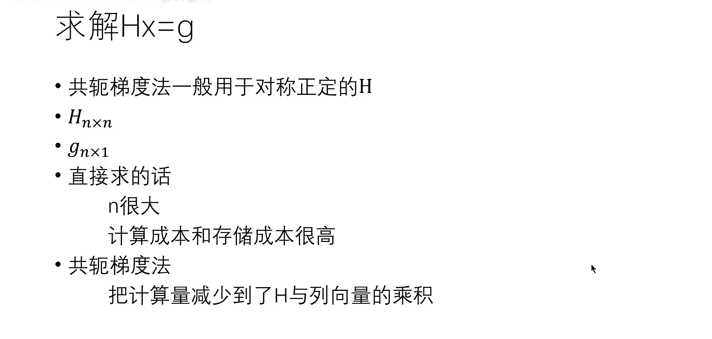
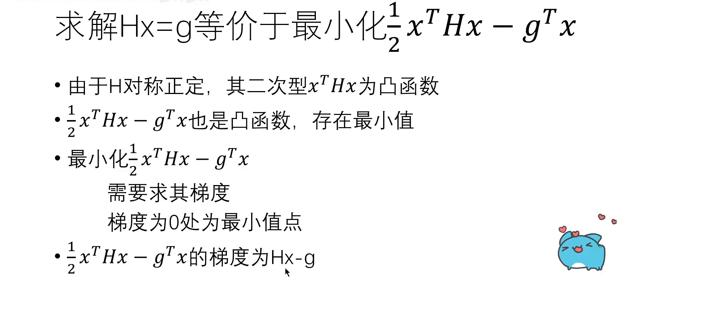
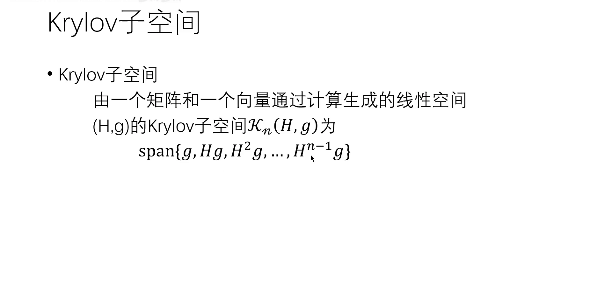
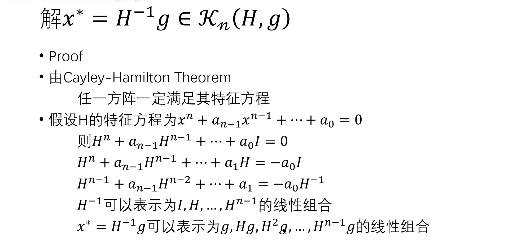
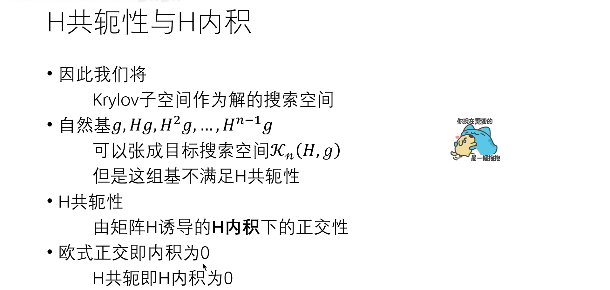
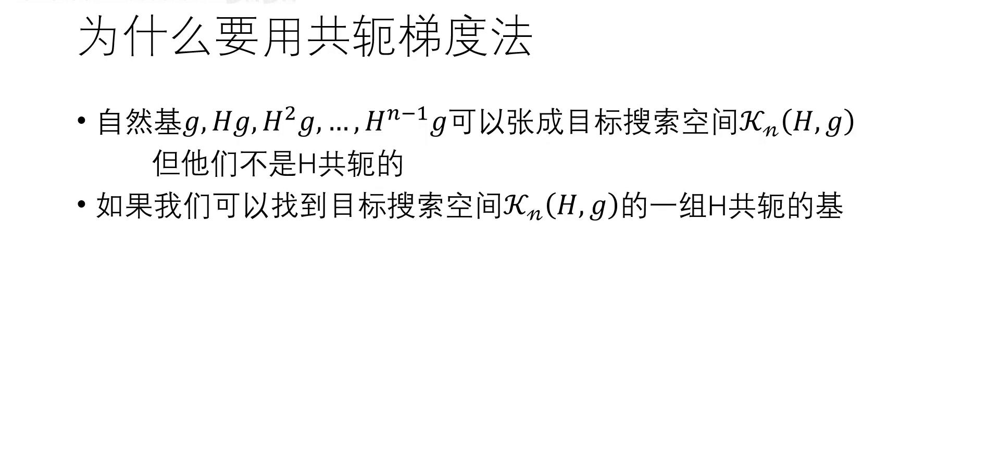
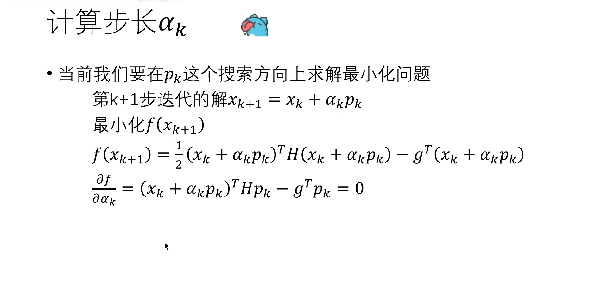
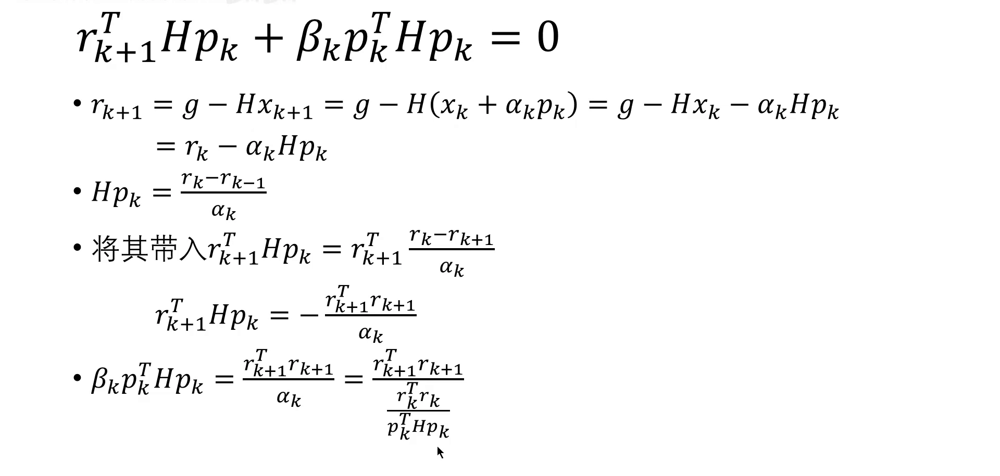

# 共轭梯度法：求解 TRPO 背后的矩阵方程

> 本篇整理自「东川路第一可爱猫猫虫」《【共轭梯度】【TRPO 背后的数学原理】共轭梯度法求解矩阵方程 Fletcher-Reeves 方法 Krylov 子空间上的迭代》。视频地址：[BV1ZQxPzWEJd](https://www.bilibili.com/video/BV1ZQxPzWEJd/)。同条目上一篇《从策略梯度到 TRPO：泰勒近似与拉格朗日对偶》把 TRPO 的更新量推成了 $\theta_{k+1}=\theta_k+\sqrt{2\delta/(g^{\top}H^{-1}g)}\,H^{-1}g$。公式很漂亮，但它藏着一个工程上的死结：$H$ 是 KL 散度对**全部策略参数**的海森矩阵。参数上亿，$H$ 就是上亿乘上亿。本篇讲的就是怎么绕开它。

## 本讲要解决的核心问题（SCQA）

**背景**：TRPO 每一步都要算 $H^{-1}g$，其中 $H$ 是 KL 散度的海森矩阵、$g$ 是代理目标的梯度。数学上答案很干脆：$x = H^{-1}g$。

**冲突**：这个「干脆」在工程上完全不可行。设参数量为 $n$，直接求逆的计算量是 $O(n^{3})$，存储量是 $O(n^{2})$。$n=10^{6}$ 时，光是把 $H$ 存下来就要 $10^{12}$ 个数——比任何显卡都大几个数量级。更麻烦的是，$H$ 本身都构造不出来：它是二阶导，而二阶导的显式形式在自动微分框架里并不便宜。

**疑问**：有没有一种方法，**不需要构造 $H$、也不需要求逆**，只靠「$H$ 乘某个向量」这个操作，就能把 $Hx=g$ 解出来？

**回答（中心思想）**：有，就是**共轭梯度法**（conjugate gradient, CG）。它做三件事：

1. 把「解方程」等价改写成「最小化一个二次函数」——于是问题变成一个优化问题；
2. 证明最优解一定落在 **Krylov 子空间** $\mathcal{K}_n(H,g)=\mathrm{span}\{g,Hg,H^{2}g,\dots,H^{n-1}g\}$ 里——于是搜索范围从 $n$ 维降到「由 $H$ 和 $g$ 张成的那个子空间」；
3. 在这个子空间里构造一组**两两 $H$ 共轭**的搜索方向——沿每个方向只需优化一次，**不会破坏之前方向的成果**，于是 $n$ 步之内精确收敛，而每一步只需要算一次 $H$ 乘向量。

**这就是 TRPO 能落地的全部秘密**：把 $O(n^{3})$ 的求逆，换成 $n$ 次「海森矩阵乘向量」。

---

## 一、先把问题摆出来：$Hx=g$ 有多大



[【跳转到 03:50】](https://www.bilibili.com/video/BV1ZQxPzWEJd/?t=230)

要求解的方程是

$$
Hx = g
$$

其中 $H\in\mathbb{R}^{n\times n}$ 是**对称正定**（symmetric positive definite）矩阵，$g\in\mathbb{R}^{n}$ 是已知的列向量，$x$ 是要求的解。在 TRPO 里，$H$ 就是 KL 散度的海森矩阵，也叫黑塞矩阵。

**为什么共轭梯度法要求 $H$ 对称正定？** 两个原因在后面都会用到：对称让 $H^{\top}=H$，正定让二次型 $x^{\top}Hx>0$——后者保证目标函数是严格凸的，有唯一最小值。工程上如果 $H$ 只是半正定，通常会加一个极小的阻尼项 $v\cdot\text{damping}$ 把它「推」成正定，这一点在代码实现篇里会看到。

直接求解 $x=H^{-1}g$ 的代价：计算 $O(n^{3})$、存储 $O(n^{2})$。$n$ 很大时两个都不可接受。

**共轭梯度法的好处**：它把计算量减少到「只需要算 $H$ 与一些列向量的乘积」。这个性质在 TRPO 里被专门命名为 **Hessian-Vector Product（HVP）**——即使不知道 $H$ 本身，只要能算 $H$ 乘一个向量，就够用了。

## 二、命题一：解方程等价于最小化一个二次函数

第一个命题把「线性代数问题」变成「优化问题」。



[【跳转到 05:30】](https://www.bilibili.com/video/BV1ZQxPzWEJd/?t=330)

$$
Hx = g
\qquad\Longleftrightarrow\qquad
\min_{x}\; f(x) = \frac{1}{2}x^{\top}Hx - g^{\top}x
$$

**证明（正向的直觉）**：因为 $H$ 对称正定，二次型 $x^{\top}Hx$ 是**凸函数**（convex function）——从二维看，就是 $x^{2}$ 这种开口向上的形状。减去一个线性项 $-g^{\top}x$ 之后仍然是凸函数，仍然存在最小值（讲者补充：并非所有凸函数都有最小值，这取决于定义域；这个函数显然有）。

**求最小值就是求梯度为零的点**。先算梯度：

$$
\nabla_x f(x) = Hx - g
$$

这里用到两件事：一是标量函数对向量求导（讲者在讲 LoRA 微调、讲神经网络反向传播时专门讲过「凑形状」的方法），二是 $H$ 对称，所以 $H^{\top}=H$。

于是

$$
\nabla_x f(x) = 0 \;\Longleftrightarrow\; Hx - g = 0 \;\Longleftrightarrow\; Hx = g
$$

命题得证：**解方程就是最小化这个二次函数**。

这一步的意义在于「换赛道」：解方程只能靠消元或求逆，而最小化可以用**迭代**——从一个初始猜测出发，一步步往最小值走。共轭梯度法就是这条迭代路线里最聪明的一种走法。

## 三、Krylov 子空间：解一定落在里面

迭代要有个搜索范围。如果漫无目的地在 $\mathbb{R}^{n}$ 里找，那和直接求逆没有区别。共轭梯度法的搜索范围是 **Krylov 子空间**。



[【跳转到 06:20】](https://www.bilibili.com/video/BV1ZQxPzWEJd/?t=380)

**定义**：给定 $n\times n$ 的矩阵 $H$ 和 $n\times 1$ 的列向量 $g$，它们生成的 Krylov 子空间是

$$
\mathcal{K}_n(H,g) \;=\; \mathrm{span}\left\{g,\; Hg,\; H^{2}g,\; \dots,\; H^{n-1}g\right\}
$$

也就是「拿 $H$ 反复乘 $g$，得到的一串向量所张成的线性空间」。这一串 $\{g, Hg, H^{2}g,\dots,H^{n-1}g\}$ 叫这个空间的**自然基**。

**为什么解会落在这个空间里？** 用 **Cayley-Hamilton 定理**：任意方阵一定满足自己的特征方程。



[【跳转到 08:50】](https://www.bilibili.com/video/BV1ZQxPzWEJd/?t=530)

设 $H$ 的特征方程为

$$
\lambda^{n} + a_{n-1}\lambda^{n-1} + \cdots + a_0 = 0
$$

Cayley-Hamilton 定理说，把 $\lambda$ 换成矩阵 $H$，结果一定是零矩阵：

$$
H^{n} + a_{n-1}H^{n-1} + \cdots + a_0 I = 0
$$

把 $a_0I$ 移到右边，再两边同时乘 $H^{-1}$（幂次各降一次）：

$$
H^{n-1} + a_{n-1}H^{n-2} + \cdots + a_1 I = -a_0 H^{-1}
$$

也就是说，**$H^{-1}$ 可以写成 $I, H, \dots, H^{n-1}$ 的线性组合**。那么

$$
x^{*} = H^{-1}g
$$

自然就可以写成 $g, Hg, H^{2}g, \dots, H^{n-1}g$ 的线性组合——**解就在 Krylov 子空间里**。

这一步给出了搜索范围：不用在整个 $\mathbb{R}^{n}$ 里找，只要在 $\mathcal{K}_n(H,g)$ 里迭代寻找即可。而且这个空间的基是「$H$ 反复乘 $g$」造出来的，**只需要 $H$ 乘向量的能力**——正好是 HVP 能提供的东西。

## 四、换一把尺子：$H$ 内积与 $H$ 共轭

有了搜索空间，还要有「怎么在里面走」的规则。这里引入一个新的内积。



[【跳转到 10:30】](https://www.bilibili.com/video/BV1ZQxPzWEJd/?t=630)

**欧式内积与欧式正交**：两个列向量 $u,v$，$u^{\top}v=0$ 就叫内积为零；在二维三维里就是「垂直」。这是我们已经熟悉的那把尺子。

**$H$ 内积**（$H$-inner product）：定义为

$$
\langle u, v\rangle_{H} \;=\; u^{\top} H v
$$

**$H$ 共轭**（$H$-conjugacy）：若 $\langle u,v\rangle_{H}=0$，就说 $u$ 与 $v$ 关于 $H$ **共轭**。讲者的说法很到位：**$H$ 共轭就是「由矩阵 $H$ 诱导的 $H$ 内积下的正交性」，它与欧式正交的关系，正如 $H$ 内积与欧式内积的关系**。

一句话对照：

| 欧式世界 | $H$ 世界 |
| --- | --- |
| 内积 $u^{\top}v$ | $H$ 内积 $u^{\top}Hv$ |
| 正交：$u^{\top}v=0$ | $H$ 共轭：$u^{\top}Hv=0$ |

**为什么自然基不够用？** 自然基 $\{g,Hg,\dots,H^{n-1}g\}$ 虽然能张成目标空间 $\mathcal{K}_n(H,g)$，但它**不是 $H$ 共轭的**。而共轭梯度法的全部效率，都来自「搜索方向两两 $H$ 共轭」这个性质。

## 五、命题二：两两 $H$ 共轭 ⇒ 线性无关

第二个命题说明这组方向「够用」：$n$ 个两两 $H$ 共轭的向量，一定是线性无关的，因此能张成整个 $n$ 维空间。

**证明（反证法）**：假设 $\{d_0,d_1,\dots,d_k\}$ 两两 $H$ 共轭，但线性相关。线性相关意味着存在**不全为零**的系数 $\alpha_0,\dots,\alpha_k$，使得

$$
\alpha_0 d_0 + \alpha_1 d_1 + \cdots + \alpha_k d_k = 0
$$

任取一个下标 $i$，在等式两边左乘 $d_i^{\top}H$：

$$
\alpha_0\, d_i^{\top}H d_0 + \cdots + \alpha_k\, d_i^{\top}H d_k = 0
$$

因为两两 $H$ 共轭，所有下标不等于 $i$ 的项都是零，只剩

$$
\alpha_i\, d_i^{\top} H d_i = 0
$$

而 $d_i^{\top}Hd_i$ 是 $H$ 的二次型，$H$ 正定意味着它**严格大于零**（若只是半正定则大于等于零，但这里前提是对称正定）。于是只能有 $\alpha_i = 0$。

由于 $i$ 是任取的，所以所有 $\alpha_i$ 都为零——这与「存在不全为零的系数」矛盾。命题得证。

## 六、为什么要 $H$ 共轭：把一个大问题拆成 $n$ 个一维问题

这是全篇最重要的一句「为什么」。



[【跳转到 13:50】](https://www.bilibili.com/video/BV1ZQxPzWEJd/?t=830)

对二次函数 $f(x)=\frac12x^{\top}Hx-g^{\top}x$ 来说，沿方向 $p$ 走一步会改变所有方向上的「进度」——因为 $H$ 一般不是对角的，各个方向是**耦合**的。这就是为什么梯度下降会「之字形」反复：每走一步，前一步的最优性就被破坏了。

但如果搜索方向两两 $H$ 共轭，情况就完全不同：**沿一个方向优化到最优之后，再沿另一个方向优化，不会破坏前一个方向的成果**。于是

- 一个 $n$ 维的耦合优化问题，被拆成了 $n$ 个**互不干扰的一维问题**；
- 每个一维问题只需解一次（求一个标量步长），$n$ 次迭代就能穷尽整个 Krylov 空间；
- 而且每一步只需要一次 $H$ 乘向量。

这就是共轭梯度法的核心思想：**在 $n$ 个 $H$ 共轭的基（搜索方向）上做优化**。

## 七、算法：初始化、步长、残差、更新系数

现在把步骤写出来。先定义**残量**（residual）：

$$
r_k = g - Hx_k
$$

它衡量「当前解离真解还差多少」。注意 $r_k = -\nabla f(x_k)$，也就是**负梯度**——残量就是二次函数在当前点的负梯度。

**初始化**：

$$
x_0 = 0,\qquad r_0 = g - Hx_0 = g,\qquad p_0 = r_0
$$

初始解取零（代码实现里就是与 $b$ 同形状的全零张量），于是初始残量就是 $g$，第一个搜索方向就是残量本身——**第一步退化成梯度下降**，这是符合直觉的。

**迭代**。已知 $x_k, r_k, p_k$，求 $x_{k+1}, r_{k+1}, p_{k+1}$：



[【跳转到 18:00】](https://www.bilibili.com/video/BV1ZQxPzWEJd/?t=1080)

**第一步，算步长 $\alpha_k$**。把 $x_{k+1}=x_k+\alpha_k p_k$ 代入 $f$，此时 $x_k$ 与 $p_k$ 都是已知量，**唯一的变量是 $\alpha_k$**：

$$
f(x_{k+1}) = \frac{1}{2}(x_k+\alpha_k p_k)^{\top}H(x_k+\alpha_k p_k) - g^{\top}(x_k+\alpha_k p_k)
$$

对 $\alpha_k$ 求导并置零：

$$
\frac{\partial f}{\partial \alpha_k} = (x_k+\alpha_k p_k)^{\top}H p_k - g^{\top}p_k = 0
$$

把 $r_k = g - Hx_k$ 代进去整理，得到

$$
\alpha_k = \frac{r_k^{\top} r_k}{p_k^{\top} H p_k}
$$

**第二步，更新解与残量**：

$$
x_{k+1} = x_k + \alpha_k p_k,
\qquad
r_{k+1} = r_k - \alpha_k H p_k
$$

残量公式来自 $r_{k+1}=g-Hx_{k+1}=g-H(x_k+\alpha_kp_k)=r_k-\alpha_kHp_k$。

**第三步，更新搜索方向**。新方向由「当前残量」和「上一个方向」线性组合而成：

$$
p_{k+1} = r_{k+1} + \beta_k p_k
$$

其中 $\beta_k$ 是更新系数。这个「残量 + 上方向」的更新式配上 $\beta_k$ 的特定公式，合起来叫 **Fletcher-Reeves 公式**。

## 八、$\beta_k$ 为什么长这样：一条归纳证明

$\beta_k$ 的唯一使命是：**保证 $p_{k+1}$ 与 $p_k$ 是 $H$ 共轭的**。



[【跳转到 29:15】](https://www.bilibili.com/video/BV1ZQxPzWEJd/?t=1755)

要求 $p_{k+1}^{\top}Hp_k=0$。把 $p_{k+1}=r_{k+1}+\beta_kp_k$ 代入：

$$
r_{k+1}^{\top}H p_k + \beta_k\, p_k^{\top}H p_k = 0
$$

第一项里的 $Hp_k$ 可以从残量公式反解出来：由 $r_{k+1}=r_k-\alpha_kHp_k$ 得

$$
Hp_k = \frac{r_k - r_{k+1}}{\alpha_k}
$$

代入第一项：

$$
r_{k+1}^{\top}Hp_k = r_{k+1}^{\top}\frac{r_k-r_{k+1}}{\alpha_k}
= \frac{r_{k+1}^{\top}r_k - r_{k+1}^{\top}r_{k+1}}{\alpha_k}
$$

关键在于：**相邻两代的残量是欧式正交的**，即 $r_{k+1}^{\top}r_k=0$。于是第一项等于 $-r_{k+1}^{\top}r_{k+1}/\alpha_k$，代回共轭条件：

$$
\beta_k\, p_k^{\top}Hp_k = \frac{r_{k+1}^{\top}r_{k+1}}{\alpha_k}
$$

再把 $\alpha_k = r_k^{\top}r_k/(p_k^{\top}Hp_k)$ 代入，$p_k^{\top}Hp_k$ 上下抵消，得到

$$
\beta_k = \frac{r_{k+1}^{\top} r_{k+1}}{r_k^{\top} r_k}
$$

**这个公式极其便宜**：只需要两个残量的内积，连 $H$ 都不用碰。

**残量为什么两两正交？** 讲者用数学归纳法给出了完整证明：断言 $r_{k+1}$ 与之前**所有**搜索方向 $p_0,\dots,p_k$ 都正交。

- **基础步 $k=0$**：要证 $r_1^{\top}p_0=0$。由 $r_1=r_0-\alpha_0Hp_0$，两边乘 $p_0^{\top}$ 得 $r_0^{\top}p_0-\alpha_0p_0^{\top}Hp_0$，把 $\alpha_0$ 的公式代入后分子分母抵消，变成 $r_0^{\top}p_0-r_0^{\top}r_0$；而 $p_0=r_0$，故为零。
- **归纳步**：假设对所有 $0\le i\le m$ 有 $r_{m+1}^{\top}p_i=0$，要证对所有 $0\le i\le m+1$ 有 $r_{m+2}^{\top}p_i=0$。分两种情况：$i\le m$ 时，$r_{m+2}^{\top}p_i = r_{m+1}^{\top}p_i - \alpha_{m+1}p_i^{\top}Hp_{m+1}$，第一项由归纳假设为零，第二项由「搜索方向两两 $H$ 共轭」为零；$i=m+1$ 时，把 $p_{m+1}=r_{m+1}+\beta_mp_m$ 代入，同样两项相消为零。
- **推论**：既然 $r_{k+1}$ 与所有 $p_i$ 正交，而 $p_k$ 与 $r_k$ 线性相关，就得到 $r_{k+1}^{\top}r_k=0$——**所有残量之间两两欧式正交**。

这条归纳证明同时验证了两件事：残量正交性、以及「$\beta_k$ 确实保证了搜索方向两两 $H$ 共轭」。后者不是巧合，是被 $\beta_k$ 的公式**强行保证**的。

## 九、终止条件与它在 TRPO 里的位置


[【跳转到 30:55】](https://www.bilibili.com/video/BV1ZQxPzWEJd/?t=1855)

理论上，共轭梯度法在**精确算术**下 $n$ 步收敛（因为 $n$ 个 $H$ 共轭方向能张成整个空间）。但实际用起来有两个终止条件：

1. **残差阈值**：当 $r^{\top}r$（代码里叫 `rdotr`）小于预设阈值，就认为解已经足够精确，可以停；
2. **最大迭代步数**：如果矩阵条件数够好，往往不需要 $n$ 步、也不需要残差特别小，走一定步数就足够——这样能大幅减少计算成本。

在 TRPO 里，这两个条件都用得上：$n$ 是上亿的参数维度，绝不可能迭代 $n$ 次，实际实现里通常只迭代 10 步左右就停（代码实现篇会看到）。**也就是说，TRPO 里的共轭梯度法从来不是「精确解」，而是「用 10 次 HVP 换一个足够好的近似方向」**。

把本篇放回 TRPO 的流程里，位置是这样的：

```text
1. 用旧策略采样一批轨迹
2. 算代理目标的梯度 g                    ← 一次反向传播
3. 用共轭梯度法解 Hx = g，得到 H⁻¹g      ← 每步一次 HVP，迭代 ~10 次
4. 乘上步长 √(2δ / (gᵀH⁻¹g))，得到完整更新量
5. 回溯线搜索，确认这一步真的让性能变好
```

## 十、小结

1. **问题**：TRPO 要算 $H^{-1}g$，$H$ 是上亿维的海森矩阵，求逆 $O(n^{3})$、存储 $O(n^{2})$，不可行。
2. **换问题**：$Hx=g$ 等价于最小化 $f(x)=\frac12x^{\top}Hx-g^{\top}x$（因为 $H$ 对称正定，$f$ 是凸函数，梯度 $Hx-g$ 为零处即最小值）。
3. **定范围**：由 Cayley-Hamilton 定理，$H^{-1}$ 是 $I,H,\dots,H^{n-1}$ 的线性组合，所以解 $x^{*}=H^{-1}g$ 落在 Krylov 子空间 $\mathcal{K}_n(H,g)$ 里。
4. **换尺子**：定义 $H$ 内积 $\langle u,v\rangle_H=u^{\top}Hv$；$H$ 内积为零即 $H$ 共轭。两两 $H$ 共轭的向量必线性无关。
5. **为什么值得**：$H$ 共轭的搜索方向互不干扰，一个 $n$ 维耦合问题被拆成 $n$ 个一维问题，各优化一次即可。
6. **怎么做**：$\alpha_k=\frac{r_k^{\top}r_k}{p_k^{\top}Hp_k}$，$x_{k+1}=x_k+\alpha_kp_k$，$r_{k+1}=r_k-\alpha_kHp_k$，$\beta_k=\frac{r_{k+1}^{\top}r_{k+1}}{r_k^{\top}r_k}$，$p_{k+1}=r_{k+1}+\beta_kp_k$。
7. **代价**：每步只需一次 $H$ 乘向量（HVP），不需要构造 $H$、不需要求逆。

**一句话记住这篇**：共轭梯度法把「求逆」换成了「$n$ 次矩阵乘向量」——它不是在解方程，而是在一个由 $H$ 和 $g$ 张成的小空间里，沿着互不干扰的方向一步步逼近答案。

## 关键术语速查

| 术语 | 一句话解释 |
| --- | --- |
| 对称正定（SPD） | $H=H^{\top}$ 且对任意非零 $x$ 有 $x^{\top}Hx>0$；保证二次目标严格凸、共轭梯度法收敛 |
| 二次型 | $x^{\top}Hx$ 这种「向量—矩阵—向量」的标量形式，刻画函数的曲率 |
| Krylov 子空间 | $\mathrm{span}\{g,Hg,\dots,H^{n-1}g\}$，由 $H$ 反复乘 $g$ 张成的空间 |
| Cayley-Hamilton 定理 | 任意方阵满足自己的特征方程，由此可把 $H^{-1}$ 写成 $H$ 的多项式 |
| $H$ 内积 | $\langle u,v\rangle_H=u^{\top}Hv$，用 $H$ 当「尺子」量内积 |
| $H$ 共轭 | $\langle u,v\rangle_H=0$，也叫 $H$ 正交；共轭的搜索方向互不干扰 |
| 残量（residual） | $r_k=g-Hx_k$，等于当前点的负梯度，衡量离真解还差多少 |
| Fletcher-Reeves | 用 $\beta_k=r_{k+1}^{\top}r_{k+1}/(r_k^{\top}r_k)$ 更新搜索方向的共轭梯度变体 |
| HVP | Hessian-Vector Product，算 $H$ 乘一个向量而不构造 $H$ |

## 延伸阅读

- 同条目《从策略梯度到 TRPO：泰勒近似与拉格朗日对偶》：本篇服务的那个公式从哪来。
- 同条目《TRPO 代码实现：海森向量积与回溯线搜索》：HVP 怎么用两次 `autograd.grad` 实现、CG 的代码怎么写、线搜索怎么兜底。
- 9.3 近端策略优化（PPO）：干脆绕开海森矩阵，用 clip 代替 KL 约束——本篇这套机械在 PPO 里被整体删掉了，这也是 PPO 更流行的直接原因。