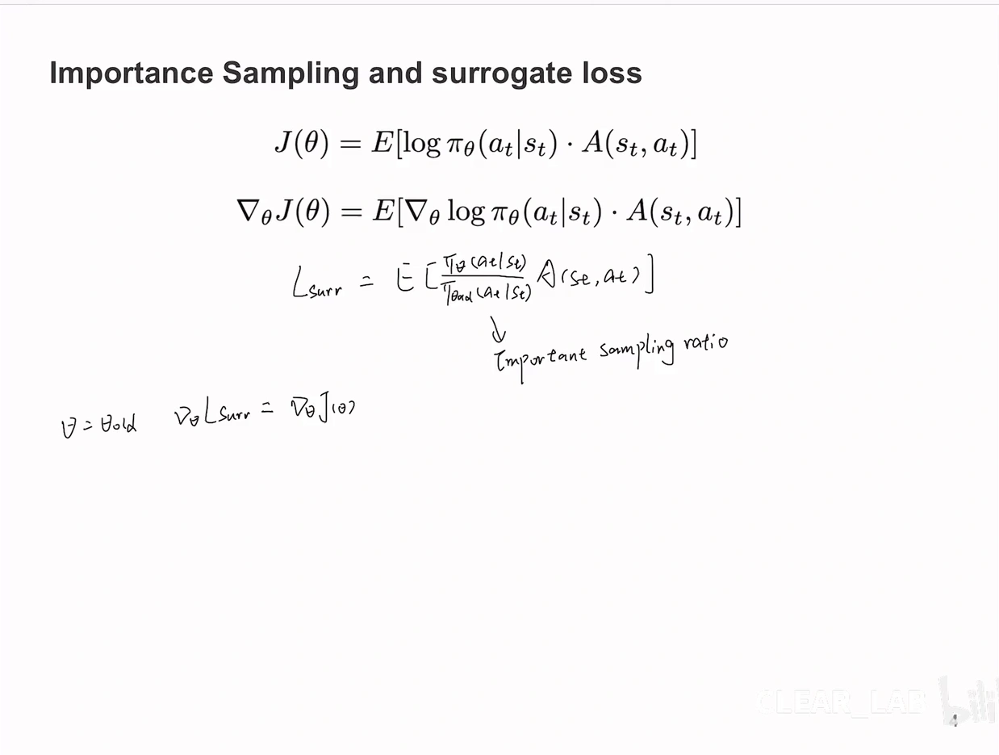
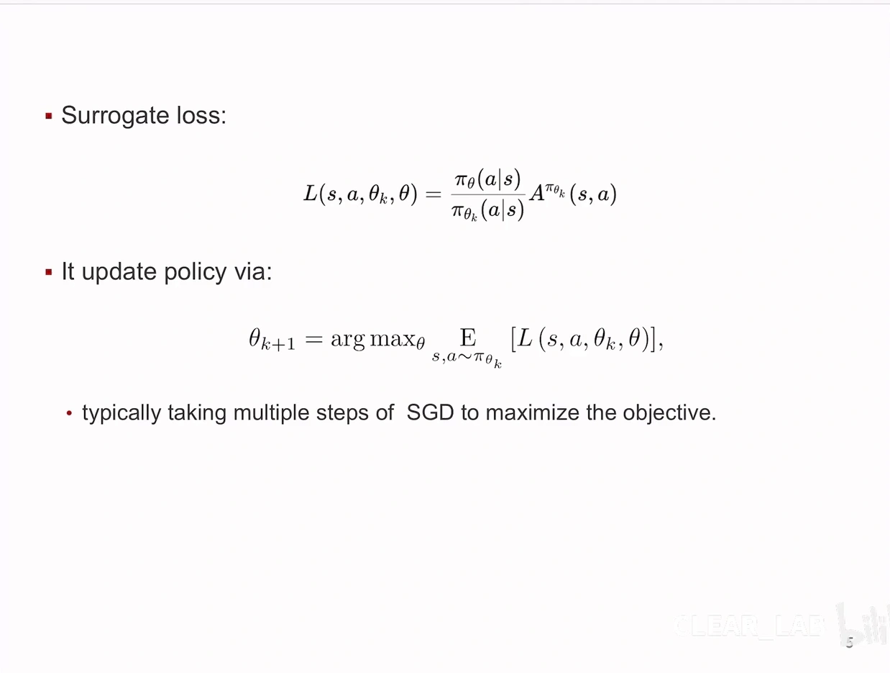
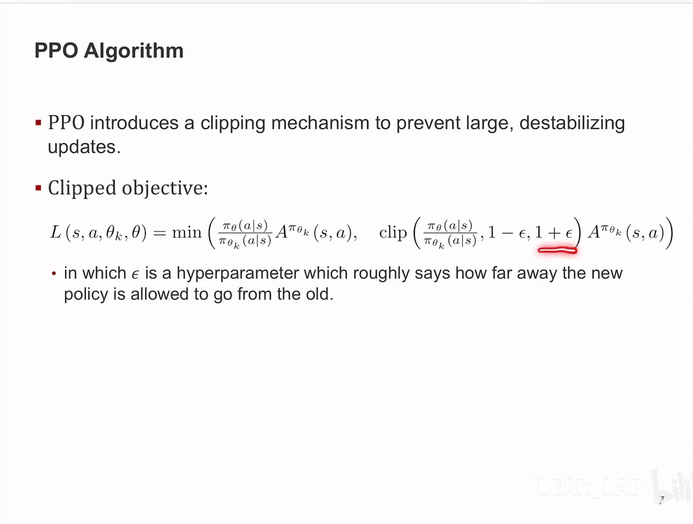
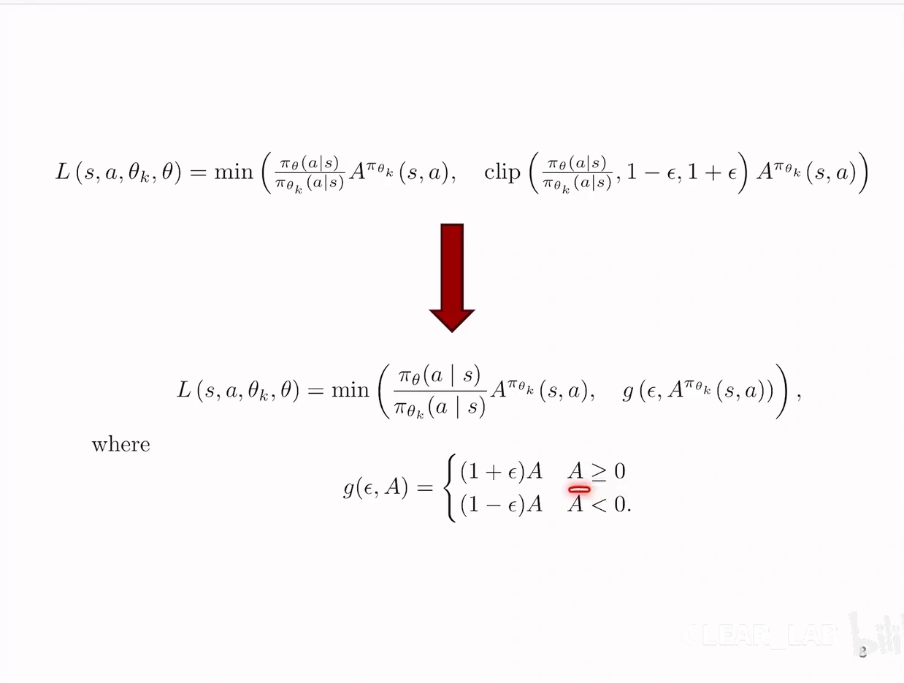
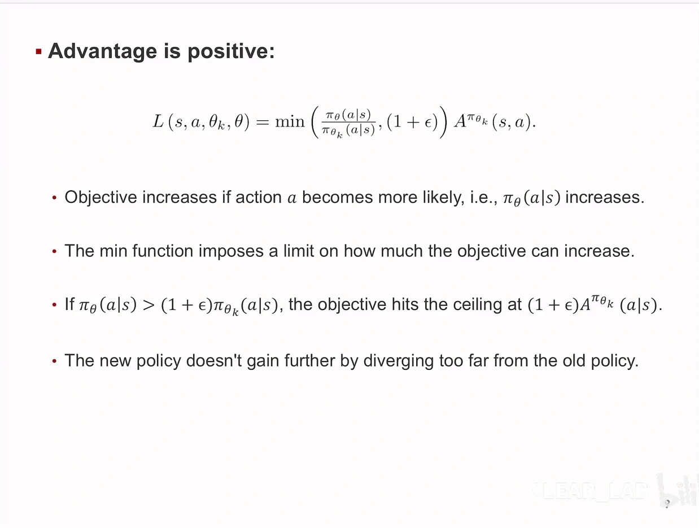
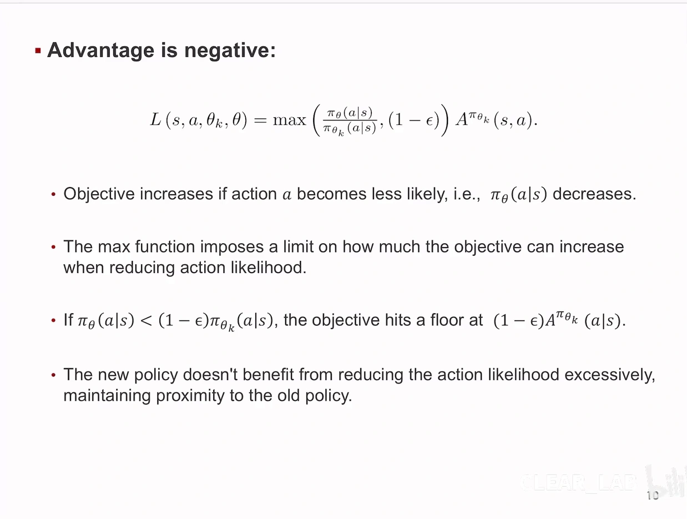
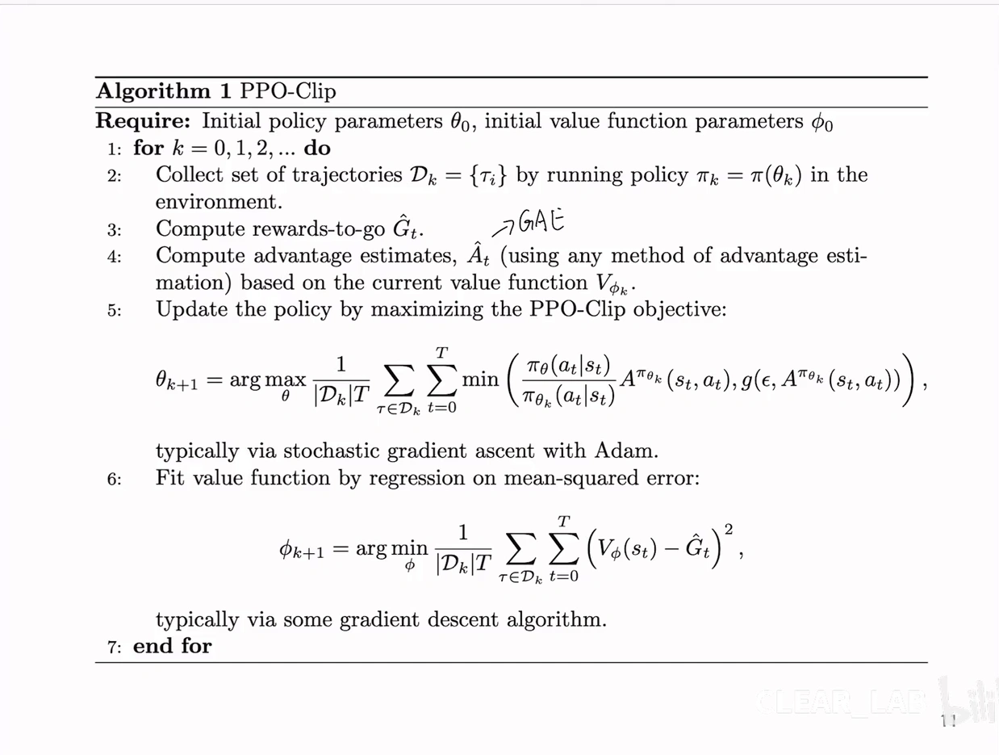
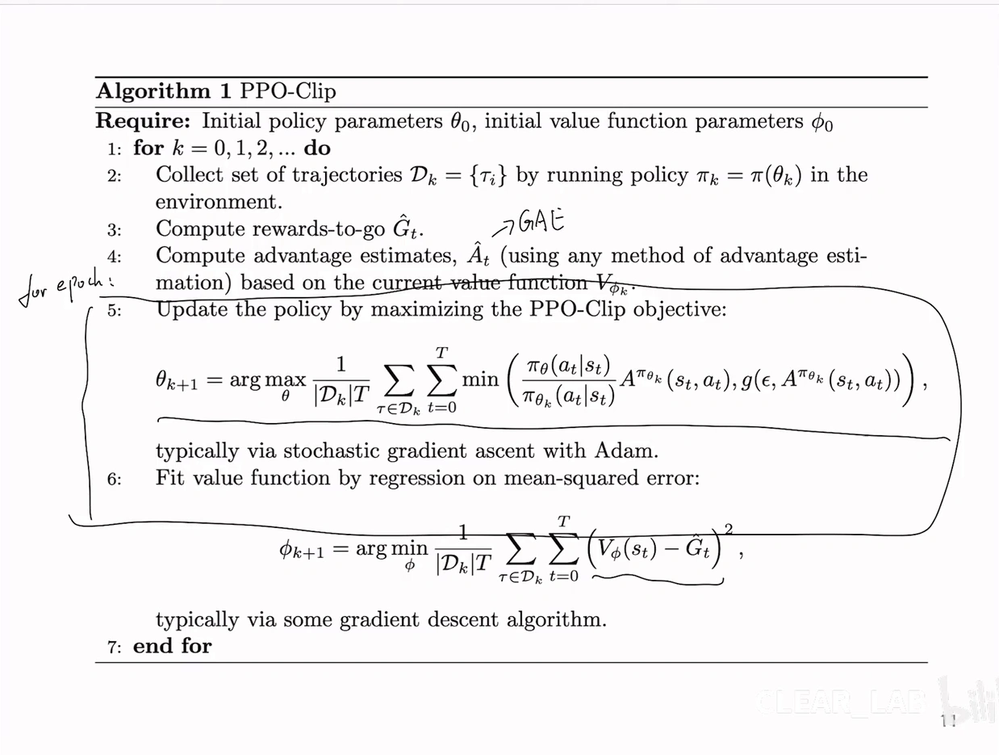

# PPO 原理与推导：从替代目标到 clip 与数据复用

> 本篇整理自「CLEAR_LAB」《Lec14：强化学习 PPO 原理与推导》。视频地址：[BV1R5r4YkEkF](https://www.bilibili.com/video/BV1R5r4YkEkF/)。同条目另一篇《PPO 的裁剪目标函数：从梯度本质看 clip》走的是「从梯度看 clip 掐掉了什么」这条路；本篇走的是另一条路：**从「一条轨迹只能用一次」这个工程痛点出发，一步步推出替代损失函数，再把 clip 写成条件函数，最后落到完整算法与代码改写**。两篇互补，建议对照读。


[【跳转到 00:00】](https://www.bilibili.com/video/BV1R5r4YkEkF/?t=0)

## 本讲要解决的核心问题（SCQA）

**背景**：第 7、8 章已经把策略梯度的流水线搭完了：用两个网络（策略网络 $\pi_\theta$ 和价值网络 $V_\phi$），跑当前策略采一批轨迹，算每个时间步的回报和优势，然后用「动作概率乘优势」去更新策略，用回报去回归价值网络。这套做法叫 VPG（vanilla policy gradient），Actor-Critic 就是它的一个版本。

**冲突**：这条流水线有一个致命的浪费——**一条轨迹只能用来更新一次**。因为更新一次之后，当前策略的概率分布就不再是采集轨迹时那个分布了，策略梯度的推导前提（样本来自当前策略）当场失效。而采一批轨迹往往是最贵的一步（要和环境交互），训一次就扔，样本效率低得离谱。

**疑问**：能不能用**旧策略采的数据**来估计**新策略**的梯度，从而让同一批数据支撑多次更新？如果能，那「更新几次」该由什么来限制？更新太多会不会把估计搞崩？

**回答（中心思想）**：能，靠**重要性采样**。把目标函数里的期望换成「旧策略分布上的期望乘一个比值」，就得到**替代损失函数** $L_{\mathrm{surr}}$；在 $\theta=\theta_{\mathrm{old}}$ 时它与原目标的梯度完全相同，所以可以放心地用旧数据优化新策略。但更新越多，新旧策略差得越远、比值的方差越大，估计就越不可靠。**PPO 的裁剪机制就是给这件事装一个刹车：把比值按在 $[1-\epsilon,1+\epsilon]$ 里，越界的那部分梯度直接归零，于是「同一批数据多训几轮」变得安全。**

---

## 一、先用一句话回顾策略优化的目标

策略优化的目标很朴素：调神经网络的参数 $\theta$，让期望累积奖励最大。

$$
\max_\theta\ \mathbb{E}_{\tau\sim\pi_\theta}\left[\sum_{t=0}^{T}\gamma^t r_t\right]
$$

其中 $\pi_\theta(a\mid s)$ 是策略网络——输入状态 $s$，输出每个动作上的概率分布，再按这个分布采样得到动作 $a$。$\gamma$ 是折扣因子，$r_t$ 是第 $t$ 步的奖励。**这个过程本质上就是通过不断调整策略网络的参数来改进决策能力**，让智能体在与环境的交互中获得更好的长期表现。

求解它用策略梯度。带 baseline 的版本需要两个网络：策略网络 $\pi_\theta$ 和价值网络 $V_\phi$（$\phi$ 是价值网络的参数）。一轮迭代的流程是：

1. 用当前策略 $\pi_\theta$ 在环境中采集一批轨迹；
2. 对轨迹中的每个时间步，算从该时刻开始的回报（reward-to-go），以及优势估计 $\hat{A}_t$——也就是「从该时刻开始的回报」减去「当前状态价值」；
3. 用回报回归价值网络，更新 $\phi$；
4. 用「动作概率乘优势」算梯度，更新策略网络 $\theta$。

第 2 步里的优势估计很关键：**它告诉我们某个动作的表现好于预期还是差于预期，以及偏差多大**，这是梯度更新最核心的信号。好于平均的动作优势为正，更新后它被选中的概率上升；差于平均的动作优势为负，概率下降。

**问题就出在第 1 步与第 4 步之间**：第 4 步一执行，策略就变了，第 1 步采的那批数据立刻「过期」。所以 VPG 的循环是「采样一批 → 更新一次 → 扔掉 → 再采样」，样本利用率极低。

## 二、重要性采样：让旧数据为新策略服务

要复用数据，就得解决「用旧分布的样本估计新分布的期望」这个问题。这正是第 4 章讲过的**重要性采样**（importance sampling）：它允许我们用一个概率分布下的采样数据，去估计另一个概率分布下的期望值。

把这个思想套到策略梯度上，就得到一个**替代损失函数**（surrogate loss）：

$$
L_{\mathrm{surr}}(\theta)=\hat{\mathbb{E}}_{t}\left[\frac{\pi_\theta(a_t\mid s_t)}{\pi_{\theta_{\mathrm{old}}}(a_t\mid s_t)}\,A^{\pi_{\theta_{\mathrm{old}}}}(s_t,a_t)\right]
$$

式子里那个比值 $\pi_\theta/\pi_{\theta_{\mathrm{old}}}$ 就是**重要性采样比率**（importance sampling ratio），它衡量新旧策略分布之间的差异程度：比值等于 1 说明两个策略对这个动作的态度一样，比值偏离 1 说明新策略已经走远了。



[【跳转到 07:05】](https://www.bilibili.com/video/BV1R5r4YkEkF/?t=425)

**为什么它敢叫「替代」？** 因为可以证明：在 $\theta=\theta_{\mathrm{old}}$ 这个点上，替代损失函数的梯度**恰好等于**原始目标 $J(\theta)$ 的梯度。

$$
\nabla_\theta L_{\mathrm{surr}}(\theta)\Big|_{\theta=\theta_{\mathrm{old}}}=\nabla_\theta J(\theta)\Big|_{\theta=\theta_{\mathrm{old}}}
$$

证明只用一步：对 $L_{\mathrm{surr}}$ 关于 $\theta$ 求导，用复合函数的对数求导法则，把比值写成 $\exp(\log\pi_\theta-\log\pi_{\theta_{\mathrm{old}}})$ 再求导；在 $\theta=\theta_{\mathrm{old}}$ 处比值为 1，于是

$$
\nabla_\theta L_{\mathrm{surr}}=\hat{\mathbb{E}}_t\left[\frac{\nabla_\theta\pi_\theta(a_t\mid s_t)}{\pi_{\theta_{\mathrm{old}}}(a_t\mid s_t)}A^{\pi_{\theta_{\mathrm{old}}}}\right]
\;\xrightarrow{\theta=\theta_{\mathrm{old}}}\;
\hat{\mathbb{E}}_t\Big[\nabla_\theta\log\pi_\theta(a_t\mid s_t)\,A^{\pi_{\theta_{\mathrm{old}}}}\Big]
$$

右边正是第 7 章那个策略梯度。**「同值同梯度」就是替代损失函数可以顶替原目标的理由**：在出发点附近，沿着它的梯度走和沿着真实目标的梯度走是同一个方向。

于是我们可以用旧策略采的数据，在**不与环境交互**的情况下多次更新策略参数——这正是提升样本效率的关键。



[【跳转到 08:45】](https://www.bilibili.com/video/BV1R5r4YkEkF/?t=525)

## 三、走太远就失真：为什么必须加刹车

替代损失函数看起来已经把问题解决了，但讲者立刻补了一句关键提醒：**基于当前策略采集的一组数据，不是想更新多少次就能更新多少次的。**

原因是重要性采样的方差。当 $\pi_\theta$ 与 $\pi_{\theta_{\mathrm{old}}}$ 的分布接近时，比值接近 1，估计比较准确；一旦更新后的策略与采样时的策略差异过大，比值就会剧烈波动——某些样本的比值可能是 10、甚至 100，**估计的方差会变得相当大**，梯度方向就不可信了。

这里可以借用 9.1 讲过的图像来理解：梯度只保证「出发点附近」的方向是对的，**它完全不保证走出有限步之后还对**。而 PPO 允许对同一批数据走很多步（多个 epoch 的 SGD），不设限制的话，很容易在几步之内就把策略推到旧策略的几十倍远的地方，然后拿着一个方差爆炸的估计继续更新。

所以问题变成：**怎么保证「高效地多次更新」和「稳定地更新」同时成立？** PPO 的答案是引入一个**裁剪机制**，用来防止策略更新过大导致的不稳定性。

## 四、PPO-Clip 的目标函数：把比值按在区间里

PPO 修改了替代损失函数，加了一个裁剪项：

$$
L(s,a,\theta_k,\theta)=\min\left(\frac{\pi_\theta(a\mid s)}{\pi_{\theta_k}(a\mid s)}A^{\pi_{\theta_k}}(s,a),\ \ \mathrm{clip}\!\left(\frac{\pi_\theta(a\mid s)}{\pi_{\theta_k}(a\mid s)},1-\epsilon,1+\epsilon\right)A^{\pi_{\theta_k}}(s,a)\right)
$$

这里 $\theta_k$ 就是采样时用的旧参数（等同前面的 $\theta_{\mathrm{old}}$）。公式看起来有点复杂，但思想非常简单：**引入一个超参数 $\epsilon$，限定新策略与旧策略的比值必须落在 $1-\epsilon$ 到 $1+\epsilon$ 之间。**



[【跳转到 10:00】](https://www.bilibili.com/video/BV1R5r4YkEkF/?t=600)

取 $\epsilon=0.2$ 时，这句话的含义非常具体：**新策略在每个状态动作对上的概率，最多只能比旧策略高 20%、或者低 20%。** 就是这么简单的一个约束，就有效防止了策略更新过大。

## 五、把 clip 写成条件函数：看清「封顶」与「托底」

为了看清 clip 到底在做什么，可以把它改写成一个条件函数 $g(\epsilon,A)$：

$$
L(s,a,\theta_k,\theta)=\min\left(\frac{\pi_\theta(a\mid s)}{\pi_{\theta_k}(a\mid s)}A^{\pi_{\theta_k}}(s,a),\ \ g\!\left(\epsilon,A^{\pi_{\theta_k}}(s,a)\right)\right)
$$

$$
g(\epsilon,A)=
\begin{cases}
(1+\epsilon)A & A\ge 0\\[4pt]
(1-\epsilon)A & A<0
\end{cases}
$$



[【跳转到 10:50】](https://www.bilibili.com/video/BV1R5r4YkEkF/?t=650)

**为什么要按 $A$ 的符号分两种情况？** 因为「有利方向」取决于优势的正负：优势为正说明这个动作值得多做（提高概率是好事），优势为负说明这个动作该少做（降低概率才是好事）。所以封顶和托底必须分开写。

### 5.1 优势为正：目标函数被封了顶

当 $A\ge 0$ 时，$g(\epsilon,A)=(1+\epsilon)A$，目标函数简化成

$$
L(s,a,\theta_k,\theta)=\min\left(\frac{\pi_\theta(a\mid s)}{\pi_{\theta_k}(a\mid s)},\ 1+\epsilon\right)A^{\pi_{\theta_k}}(s,a)
$$

这个形式告诉我们三件事：

1. **动作变得更可能时，目标函数会上升**——$\pi_\theta(a\mid s)$ 增大，比值增大，目标值上升。这符合直觉：好动作就该多做。
2. **但 $\min$ 给这个上升设了上限**。即使比值超过 $1+\epsilon$，目标函数的值也不会继续增加。
3. 也就是说，**当 $\pi_\theta(a\mid s)>(1+\epsilon)\pi_{\theta_k}(a\mid s)$ 时，目标函数就撞到天花板 $(1+\epsilon)A^{\pi_{\theta_k}}(s,a)$**，再往上推没有收益。



[【跳转到 11:15】](https://www.bilibili.com/video/BV1R5r4YkEkF/?t=675)

讲者的总结很到位：**它鼓励策略朝好的方向更新，但同时通过设置上限，防止新策略与旧策略的差异过大导致更新不稳定。**「新策略不会因为偏离旧策略太远而进一步获益」——这句话就是 clip 的全部机制。

### 5.2 优势为负：目标函数被托了底

当 $A<0$ 时，$g(\epsilon,A)=(1-\epsilon)A$，目标函数变成

$$
L(s,a,\theta_k,\theta)=\max\left(\frac{\pi_\theta(a\mid s)}{\pi_{\theta_k}(a\mid s)},\ 1-\epsilon\right)A^{\pi_{\theta_k}}(s,a)
$$

**注意这里 $\min$ 变成了 $\max$。** 原因很机械：把负的 $A$ 从括号里提出来时，$\min$ 要变成 $\max$（$\min(cx,cy)=c\max(x,y)$ 对 $c<0$ 成立）。

逻辑与优势为正时正好相反：

1. 优势为负说明这个动作表现低于平均水平，**我们希望减少选择它的概率**，也就是降低 $\pi_\theta$；
2. 但由于 $A$ 是负数，**降低 $\pi_\theta$ 实际上会提高目标函数的值**（负得少一点就是「更不负」）；
3. $\max$ 在这里设了一个下限：一旦 $\pi_\theta(a\mid s)<(1-\epsilon)\pi_{\theta_k}(a\mid s)$，目标函数的值就不会继续改善，而是被限制在 $(1-\epsilon)A^{\pi_{\theta_k}}(s,a)$ 这个下限上。



[【跳转到 12:30】](https://www.bilibili.com/video/BV1R5r4YkEkF/?t=750)

这种设计确保了**即使对于坏的动作，我们也不会把它的概率降得过低**，从而保持新旧策略的相对接近与算法的稳定性。

### 5.3 一句话对照

| 优势 | 有利方向 | 目标函数形式 | 限制 | 效果 |
| :--- | :--- | :--- | :--- | :--- |
| $A\ge 0$ | 提高动作概率 | $\min(r_t,\,1+\epsilon)\,A$ | 天花板 $(1+\epsilon)A$ | 好动作加够就停 |
| $A<0$ | 降低动作概率 | $\max(r_t,\,1-\epsilon)\,A$ | 地板 $(1-\epsilon)A$ | 坏动作压够就停 |

其中 $r_t=\pi_\theta(a\mid s)/\pi_{\theta_k}(a\mid s)$ 是重要性采样比。**两行的共同点是：一旦策略已经顺着有利方向走够了，目标函数就变成常数，梯度为零，更新自动停止。** 这就是「近端」在数学上的落地方式——不是去测量距离再惩罚，而是让「走远」这件事本身没有收益。

## 六、完整的 PPO-Clip 算法

有了策略的目标函数，还差价值网络那一半。完整的算法（对应论文的 Algorithm 1）是这样的：

$$
\theta_{k+1}=\arg\max_\theta\ \frac{1}{\vert\mathcal{D}_k\vert T}\sum_{\tau\in\mathcal{D}_k}\sum_{t=0}^{T}\min\left(\frac{\pi_\theta(a_t\mid s_t)}{\pi_{\theta_k}(a_t\mid s_t)}A^{\pi_{\theta_k}}(s_t,a_t),\ g\!\left(\epsilon,A^{\pi_{\theta_k}}(s_t,a_t)\right)\right)
$$

$$
\phi_{k+1}=\arg\min_\phi\ \frac{1}{\vert\mathcal{D}_k\vert T}\sum_{\tau\in\mathcal{D}_k}\sum_{t=0}^{T}\Big(V_\phi(s_t)-\hat{G}_t\Big)^2
$$



[【跳转到 14:35】](https://www.bilibili.com/video/BV1R5r4YkEkF/?t=875)

逐步读一遍：

1. **初始化**策略网络参数 $\theta_0$ 和价值网络参数 $\phi_0$；
2. **采集**：用当前策略 $\pi_{\theta_k}$ 在环境中跑一批轨迹，得到数据集 $\mathcal{D}_k=\{\tau_i\}$；
3. **算回报**：对每个时间步算 reward-to-go $\hat{G}_t$；
4. **算优势**：基于当前价值函数 $V_{\phi_k}$ 估计 $\hat{A}_t$——这里可以用任何常用的优势估计方法（本讲后半段介绍的 GAE 就是其中之一，推导见 8.2《优势函数与GAE：从Q减V到指数加权的优势估计》）；
5. **更新策略**：最大化裁剪目标，实践中用 Adam 做随机梯度**上升**；
6. **更新价值**：用均方误差回归 $\hat{G}_t$，实践中用梯度**下降**；
7. 回到第 2 步。

注意第 5、6 步的目标方向是相反的：策略是**最大化**，价值是**最小化**。这也是为什么在代码里策略损失要取负号——深度学习框架的优化器默认做最小化。

## 七、数据复用：同一批数据跑多个 epoch

算法里最容易被忽略的一句话是：**收集了一组数据之后，策略网络其实可以更新不止一次。** 这正是前面重要性采样那一节的回报——一次采集的轨迹可以用于策略网络多次更新，价值网络同样可以多次更新。所以第 5、6 步外面还可以再套一层 epoch 循环。



[【跳转到 15:25】](https://www.bilibili.com/video/BV1R5r4YkEkF/?t=925)

**这就是 PPO 相对 VPG 的两点改进**：

| 改进 | 靠什么实现 | 解决了什么 |
| :--- | :--- | :--- |
| 样本效率 | 重要性采样 + 替代损失函数 | 一次采集的数据可以多次更新策略与价值网络 |
| 更新稳定性 | clip 机制 | 多次更新时，新旧策略的比值被限制在 $[1-\epsilon,1+\epsilon]$ 内 |

讲者在代码环节用 CartPole 做了对照实验：先实现一个 Actor-Critic 版本（一次采集只更新一次），学习曲线「上升得较为艰难和崎岖」，最后策略也没能稳定地在整个 episode 里存活；改写成 PPO 后——保存最原始的动作概率、在外层加 epoch 循环、每个 epoch 重算重要性采样比、把比值 clip 到 $[1-\epsilon,1+\epsilon]$、取两个损失中较小的那个——**训练更快收敛，收敛后的结果也更稳定**。

这段改写只多了三行核心代码，可以对照着看：

```python
for epoch in range(k_epochs):
    # 当前策略在已采数据上的动作概率
    logp = policy.log_prob(states, actions)
    # 重要性采样比 r_t(θ) = π_θ / π_θold
    ratio = torch.exp(logp - logp_old)
    # 未裁剪项与裁剪项，取较小者（损失取负号以适配最小化优化器）
    surr1 = ratio * advantages
    surr2 = torch.clamp(ratio, 1 - eps, 1 + eps) * advantages
    policy_loss = -torch.min(surr1, surr2).mean()
    value_loss = ((value(states) - returns) ** 2).mean()
```

**注意 `logp_old` 是在 epoch 循环之外算好并保存的**——它是「旧策略」的证据，一旦进了循环就固定不动。如果每轮都重算 `logp_old`，比值永远等于 1，clip 就彻底失效了。这是实现 PPO 时最常见的一个坑。

## 小结

- **痛点**：VPG 一条轨迹只能更新一次，因为更新后策略变了、数据过期，样本效率极低。
- **替代损失函数**：用重要性采样比 $\pi_\theta/\pi_{\theta_{\mathrm{old}}}$ 把旧数据的期望改写成新策略的期望；在 $\theta=\theta_{\mathrm{old}}$ 处它与原目标**同值同梯度**，所以可以顶替原目标。
- **风险**：更新越多，新旧策略差得越远，比值的方差越大，估计越不可靠——所以必须加刹车。
- **PPO-Clip 的目标**：未裁剪项与裁剪项取 $\min$；$\epsilon=0.2$ 意味着新策略的概率最多比旧策略高或低 20%。
- **条件函数 $g(\epsilon,A)$**：$A\ge0$ 时用 $(1+\epsilon)A$ 封顶（好动作加够就停），$A<0$ 时用 $(1-\epsilon)A$ 托底（坏动作压够就停）。
- **完整算法**：策略用裁剪目标最大化、价值用均方误差最小化，外面可以套多个 epoch 复用同一批数据。
- **实现要点**：`logp_old` 必须在 epoch 循环外保存，否则比值恒为 1、clip 失效。

## 关键术语速查

| 术语 | 一句话解释 |
| :--- | :--- |
| VPG | vanilla policy gradient，最朴素的策略梯度，一条轨迹只更新一次 |
| 重要性采样 | 用一个分布下的样本估计另一个分布下的期望，靠乘一个概率比值实现 |
| 重要性采样比 $r_t$ | $\pi_\theta(a\mid s)/\pi_{\theta_k}(a\mid s)$，等于 1 表示新旧策略一致 |
| 替代损失函数 $L_{\mathrm{surr}}$ | 用旧数据估计新策略梯度的目标函数，在 $\theta=\theta_{\mathrm{old}}$ 处与原目标同梯度 |
| 裁剪目标 $L^{\mathrm{CLIP}}$ | 未裁剪项与裁剪项取 $\min$，PPO 实际优化的策略目标 |
| $\epsilon$ | 裁剪幅度，原论文取 $0.2$，即比值被限制在 $[0.8,1.2]$ |
| 条件函数 $g(\epsilon,A)$ | 把 clip 按优势符号拆成「封顶」与「托底」两种写法的等价形式 |
| epoch 复用 | 同一批采样数据上做多轮梯度更新，PPO 样本效率的来源 |

## 延伸阅读

- 同条目另一篇《PPO 的裁剪目标函数：从梯度本质看 clip》：把 $L^{\mathrm{CLIP}}$ 的梯度逐项拆开，看六种情况下哪些位置的梯度被掐断，并对比 PPO-Penalty 与 PPO-Clip 的取舍。
- 8.2《优势函数与GAE：从Q减V到指数加权的优势估计》：本讲第 4 步「算优势」用到的方法，那里有完整推导。
- 9.1《单调改进保证：从新旧策略性能差到策略下界》：理解「为什么必须限制新旧策略的距离」的理论起点。