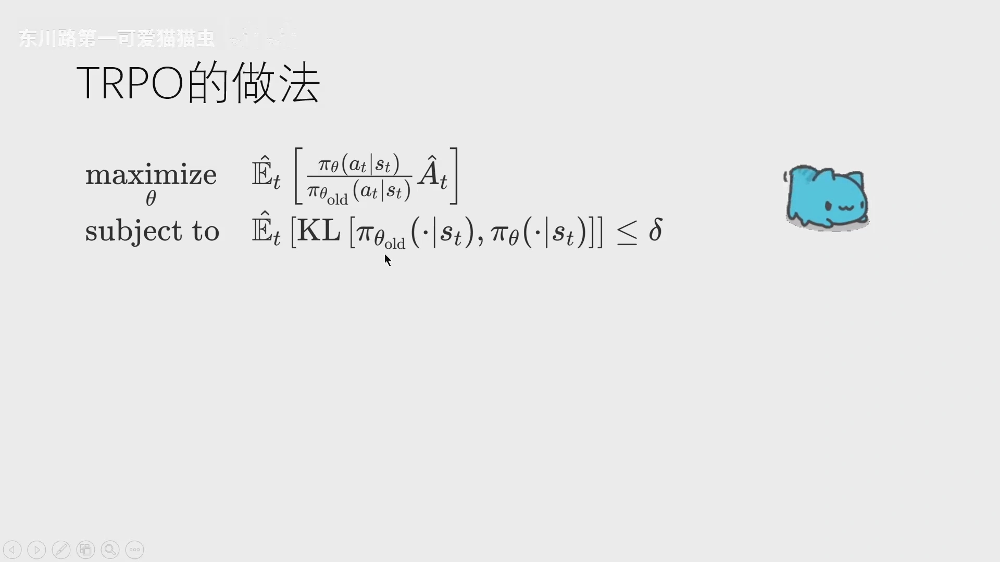
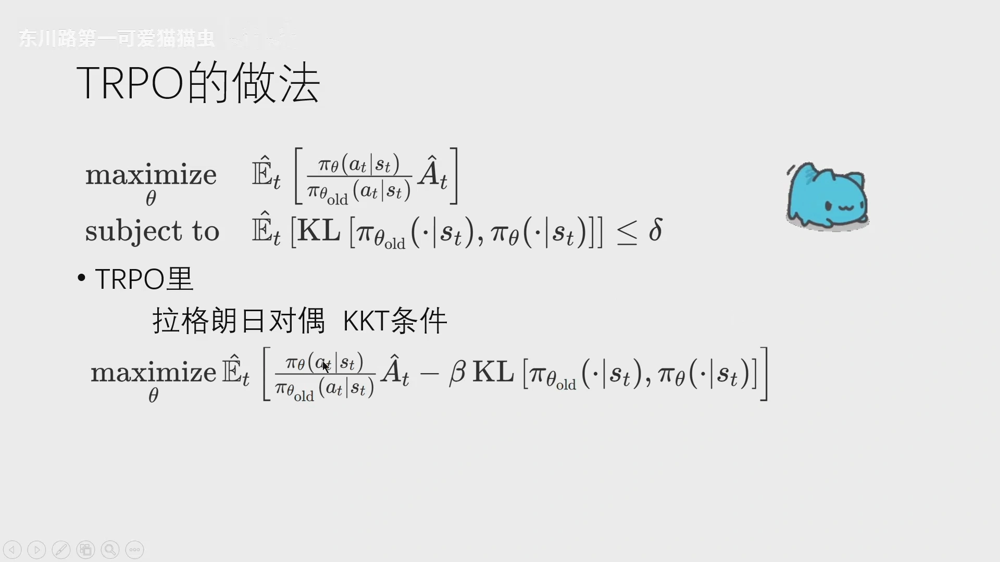
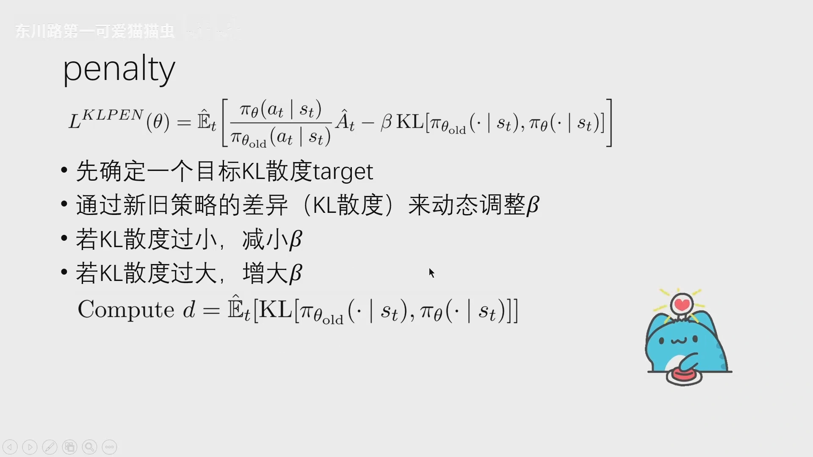
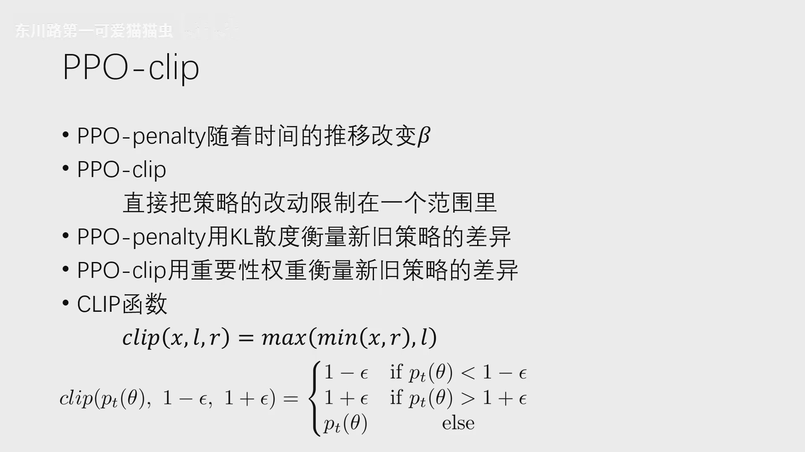
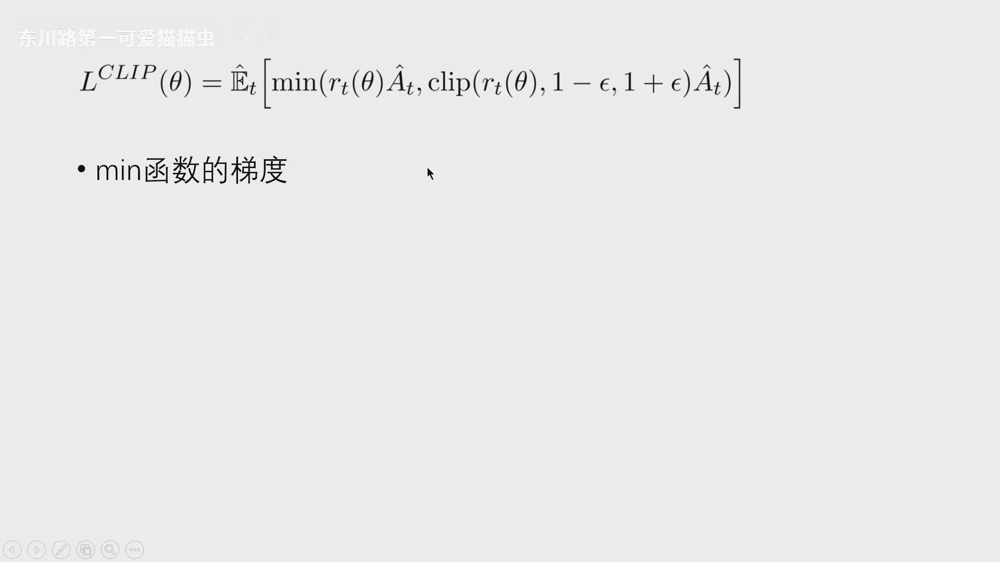
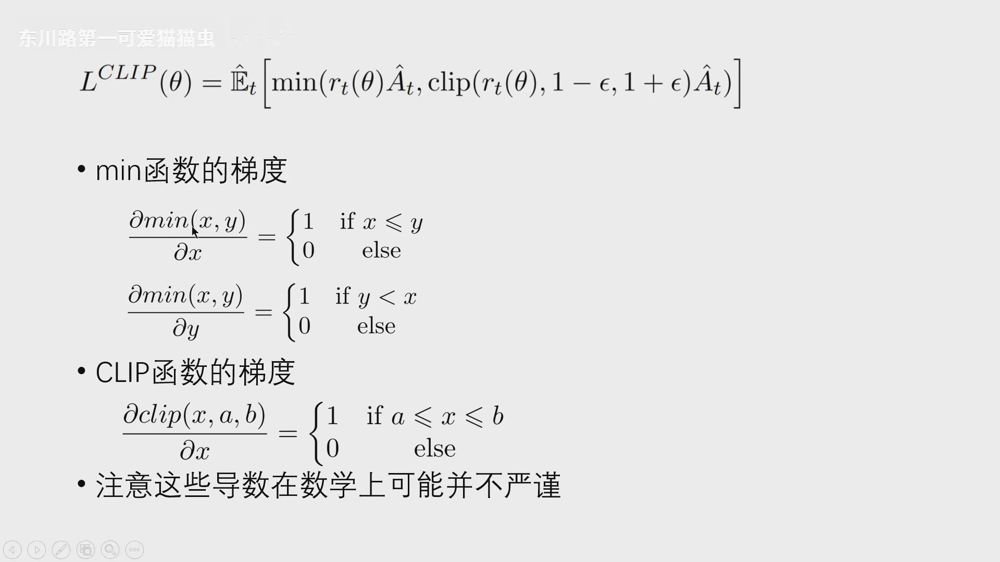
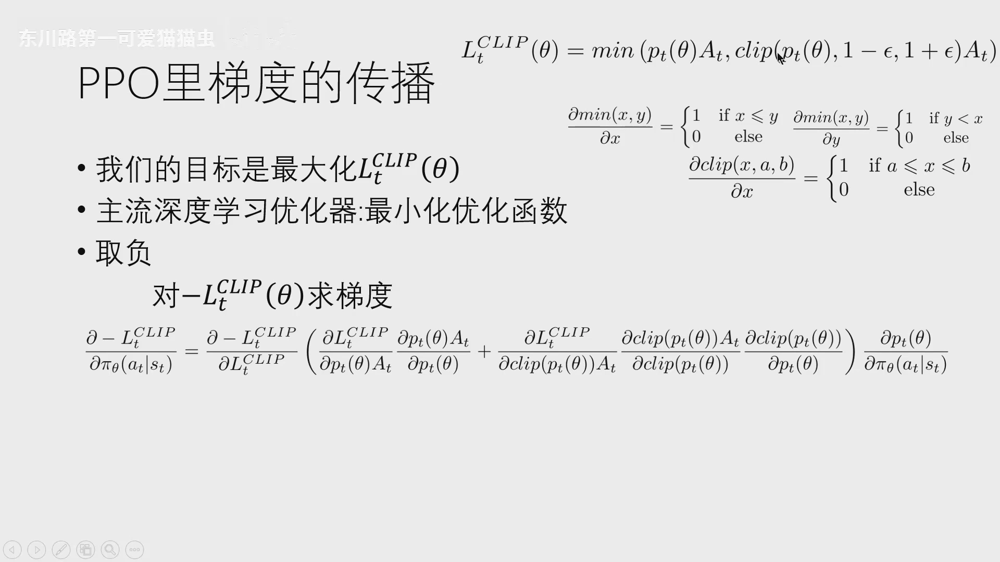
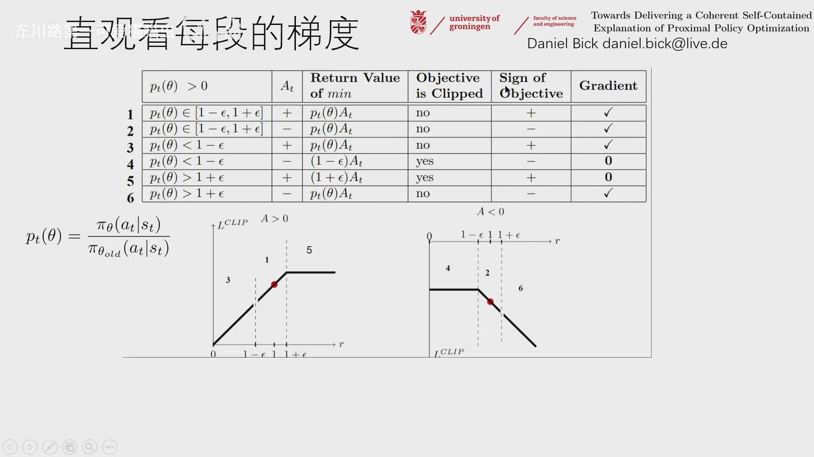

# PPO 的裁剪目标函数：从梯度本质看 clip

> 本篇整理自「东川路第一可爱猫猫虫」《【PPO】从零到深入(1) 从梯度本质看 PPO 的裁剪目标函数》。视频地址：[BV1rVCcB1EDT](https://www.bilibili.com/video/BV1rVCcB1EDT/)。上一篇《单调改进保证：从新旧策略性能差到策略下界》已经把 TRPO 的动机推到了「带 KL 约束的最大化」这一步，9.2 讲的是怎么用二阶方法把这个约束问题解出来。本篇接着往下走：**PPO 干脆不解那个约束问题**，它用两种更便宜的办法——自适应惩罚（PPO-Penalty）和裁剪（PPO-Clip）——把「新策略不许走太远」这件事塞进一阶梯度下降里。本篇的重点是把 $L^{\mathrm{CLIP}}$ 的梯度逐项拆开，看 clip 到底在掐断哪一段梯度。

[【跳转到 00:00】](https://www.bilibili.com/video/BV1rVCcB1EDT/?t=0)

## 本讲要解决的核心问题（SCQA）

**背景**：TRPO 的思路已经很清楚——最大化代理目标 $\mathbb{E}_t\big[r_t(\theta)\hat{A}_t\big]$，同时要求新旧策略的平均 KL 散度不超过 $\delta$。9.1 已经说明这条约束是从「性能下界」推出来的，9.2 说明它可以用共轭梯度加线搜索来解。

**冲突**：这条约束是**硬约束**，要严格满足就得解一个带不等式约束的优化问题。即便用了共轭梯度来省掉显式构造海森矩阵的开销，每一轮仍然要做二阶近似、算 Fisher 向量积、再做线搜索，**计算复杂、速度慢、开销高**。更麻烦的是，这套机器和「随手写个 Adam 就能跑」的深度学习工具链并不兼容。

**疑问**：不等式约束一定要严格遵守吗？偶尔越界几次，影响真的很大吗？如果不需要严格满足，那有没有办法**只用一阶优化器**就把「别走太远」这件事做出来？

**回答（中心思想）**：有，而且有两种做法。**PPO-Penalty** 把硬约束换成软约束，把 KL 放进目标函数里当惩罚项，惩罚系数 $\beta$ 由 KL 散度自己反馈调节；**PPO-Clip** 更进一步，它不再测量 KL 散度，而是直接盯着**重要性采样比** $r_t(\theta)$，一旦这个比值超出 $[1-\epsilon,\,1+\epsilon]$，就把目标函数**削平**——削平的那一段梯度为零，参数自然就不再往那个方向走。**clip 不是在限制参数，而是在限制「继续朝同一个方向使劲」的收益**，这就是它能用一阶方法实现「近端」的原因。

---

## 一、TRPO 留下的包袱：硬约束与难选的 $\beta$

先把 TRPO 的问题摆出来。它求解的是这样一个带约束的最大化问题：

$$
\max_{\theta}\;\hat{\mathbb{E}}_t\left[\frac{\pi_\theta(a_t\mid s_t)}{\pi_{\theta_{\text{old}}}(a_t\mid s_t)}\,\hat{A}_t\right]
\qquad\text{s.t.}\qquad
\hat{\mathbb{E}}_t\Big[\mathrm{KL}\big[\pi_{\theta_{\text{old}}}(\cdot\mid s_t),\,\pi_\theta(\cdot\mid s_t)\big]\Big]\le\delta
$$

其中那个分式就是**重要性权重**（importance weight）：分子是新策略在状态 $s_t$ 下选动作 $a_t$ 的条件概率，分母是旧策略选同一个动作的条件概率。$\hat{A}_t$ 是优势函数的估计，衡量「这个动作比平均水平好多少」。约束里的平均 KL 散度衡量新旧两个概率分布的差异。TRPO 用拉格朗日对偶与 KKT 条件来解这个约束问题（推导见 9.2）。

[【跳转到 01:28】](https://www.bilibili.com/video/BV1rVCcB1EDT/?t=88)

按拉格朗日的标准做法，带约束的问题可以写成带惩罚项的无约束问题：

$$
\max_{\theta}\;\hat{\mathbb{E}}_t\left[\frac{\pi_\theta(a_t\mid s_t)}{\pi_{\theta_{\text{old}}}(a_t\mid s_t)}\,\hat{A}_t-\beta\,\mathrm{KL}\big[\pi_{\theta_{\text{old}}}(\cdot\mid s_t),\,\pi_\theta(\cdot\mid s_t)\big]\right]
$$

[【跳转到 02:43】](https://www.bilibili.com/video/BV1rVCcB1EDT/?t=163)

**这个式子的好处是「软」**：KL 散度不必永远严格小于等于 $\delta$，偶尔越界也没关系，只要整体目标值够大就行。但 TRPO 最终没有采用它，原因全在 $\beta$ 上——$\beta$ 是惩罚系数，**它在不同的任务里、甚至同一次训练的不同阶段里，都很难取到同一个合适的值**。取小了约束形同虚设，取大了策略几乎不敢更新（9.1 里那个 $C\propto 1/(1-\gamma)^2$ 的教训就是极端例子）。

于是 TRPO 选择了硬约束，代价就是共轭梯度那一整套开销。**PPO 的两个变体，本质上就是对「$\beta$ 难选」这一点的两种回答**：既然固定 $\beta$ 不行，那就让它动起来（Penalty）；或者干脆不用 $\beta$，换个更便宜的量来卡住步长（Clip）。

## 二、PPO-Penalty：让 KL 散度自己调 $\beta$

PPO 的第一个变体把 $\beta$ 交给数据自己决定。目标函数是

$$
L^{\mathrm{KLPEN}}(\theta)=\hat{\mathbb{E}}_t\left[\frac{\pi_\theta(a_t\mid s_t)}{\pi_{\theta_{\text{old}}}(a_t\mid s_t)}\,\hat{A}_t-\beta\,\mathrm{KL}\big[\pi_{\theta_{\text{old}}}(\cdot\mid s_t),\,\pi_\theta(\cdot\mid s_t)\big]\right]
$$

做法分三步：

1. **先确定一个目标 KL 散度** $\delta_{\text{targ}}$，这就是我们「希望」每轮走多远；
2. **每轮算一次实际的平均 KL 散度** $d=\hat{\mathbb{E}}_t\big[\mathrm{KL}[\pi_{\theta_{\text{old}}}(\cdot\mid s_t),\pi_\theta(\cdot\mid s_t)]\big]$；
3. **按 $d$ 与 $\delta_{\text{targ}}$ 的关系调 $\beta$**：$d$ 太小说明策略畏手畏脚、不敢更新，就把 $\beta$ 减小让它迈大步；$d$ 太大说明步子迈过头了，就把 $\beta$ 增大把它拉回来。

[【跳转到 04:23】](https://www.bilibili.com/video/BV1rVCcB1EDT/?t=263)

「太大」「太小」的阈值是实践中定出来的，用的是 1.5 倍的关系：

$$
\begin{cases}
d<\delta_{\text{targ}}/1.5 & \Rightarrow\ \beta\leftarrow\beta/2 \quad(\text{KL 过小，放松惩罚})\\[4pt]
d>1.5\,\delta_{\text{targ}} & \Rightarrow\ \beta\leftarrow2\beta \quad(\text{KL 过大，加重惩罚})
\end{cases}
$$

注意这里有个容易搞反的地方：**惩罚系数和步长是反着走的**。$\beta$ 大，惩罚重，策略只能小步挪；$\beta$ 小，惩罚轻，策略敢迈大步。所以「KL 太小」要减 $\beta$，「KL 太大」要加 $\beta$。

除了 $\beta$ 变成动态的，PPO-Penalty 的流程和 TRPO 完全一样：初始化策略参数 $\theta_0$、初始惩罚系数 $\beta_0$、目标 KL 散度 $\delta$，然后循环「采样 → 算优势 → 最大化 $L^{\mathrm{KLPEN}}$ → 算 $d$ → 调 $\beta$」。**它把 TRPO 的二阶求解换成了普通的一阶优化，代价是引入了一个需要调的目标 KL 散度。**

## 三、PPO-Clip：换一把尺子量「走了多远」

PPO 的第二个变体连 KL 散度都不算了。它的关键观察是：**「走了多远」不一定要用 KL 散度来量，用重要性采样比 $r_t(\theta)$ 也能量。**

$$
r_t(\theta)=\frac{\pi_\theta(a_t\mid s_t)}{\pi_{\theta_{\text{old}}}(a_t\mid s_t)}
$$

这个比值有一个非常直观的含义：**它衡量新旧策略对同一个动作 $a_t$ 的「倾向」之比**。

- $r_t(\theta)=1$：新旧策略对这个动作的态度完全一样；
- $r_t(\theta)=2$：新策略选这个动作的概率是旧策略的两倍，说明这一步更新把它推得很猛；
- $r_t(\theta)=0.1$：新策略几乎不再选它了。

如果 $r_t$ 落在 1 附近的一个小邻域里，就可以认为新旧策略的差异不算太大。于是 PPO-Clip 的思路就是：**把 $r_t$ 硬按在 $[1-\epsilon,\,1+\epsilon]$ 这个区间里**，用的工具是 clip 函数。

$$
\mathrm{clip}(x,l,r)=\max\big(\min(x,r),\,l\big)
$$

也就是「先和右界取小、再和左界取大」：$x$ 比右界还大就输出右界，比左界还小就输出左界，落在中间就原样输出。代几个数字进去就能验证，比如 $\mathrm{clip}(0.7,0.8,1.2)=0.8$，$\mathrm{clip}(1.3,0.8,1.2)=1.2$，$\mathrm{clip}(0.9,0.8,1.2)=0.9$。

[【跳转到 06:53】](https://www.bilibili.com/video/BV1rVCcB1EDT/?t=413)

把它代进目标函数，就得到 PPO-Clip 的**裁剪代理目标**：

$$
L^{\mathrm{CLIP}}(\theta)=\hat{\mathbb{E}}_t\Big[\min\big(r_t(\theta)\hat{A}_t,\ \mathrm{clip}(r_t(\theta),1-\epsilon,1+\epsilon)\,\hat{A}_t\big)\Big]
$$

[【跳转到 08:08】](https://www.bilibili.com/video/BV1rVCcB1EDT/?t=488)

原论文里 $\epsilon=0.2$，也就是左界 $0.8$、右界 $1.2$。**一句话读懂这个目标：它同时算「不裁剪的收益」和「裁剪后的收益」，然后取小的那个。** 为什么要取小？因为取小意味着**悲观**：只要有一条路能让你「虚报」收益，我就走另一条；只有两条路都认账的收益，我才敢去最大化。这个 $\min$ 就是 PPO 里真正干活的那个算子。

> 记号提示：不少资料（包括本讲的幻灯片和 Daniel Bick 的论文）把这个比值写成 $p_t(\theta)$，与本篇的 $r_t(\theta)$ 是同一个东西，读图时注意对应。

## 四、clip 到底在裁什么：把梯度拆开看

到这里「clip 把比值按在区间里」还是句直觉。要看清它到底在做什么，得**把梯度算出来**，看哪些位置的梯度被掐断成零。

先看两个基础算子的梯度。$\min(x,y)$ 输出两者中较小的那个，所以它对 $x$ 的梯度是「$x$ 是不是那个较小的」：

$$
\frac{\partial\min(x,y)}{\partial x}=
\begin{cases}1 & x\le y\\[2pt] 0 & \text{otherwise}\end{cases}
\qquad
\frac{\partial\min(x,y)}{\partial y}=
\begin{cases}1 & y<x\\[2pt] 0 & \text{otherwise}\end{cases}
$$

$\mathrm{clip}(x,a,b)$ 在区间内就是恒等映射，出了区间就是常数，所以：

$$
\frac{\partial\,\mathrm{clip}(x,a,b)}{\partial x}=
\begin{cases}1 & a\le x\le b\\[2pt] 0 & \text{otherwise}\end{cases}
$$

[【跳转到 08:58】](https://www.bilibili.com/video/BV1rVCcB1EDT/?t=538)

讲者特意提醒：**这些导数在数学上并不严谨**。$x=y$ 时 $\min$ 其实不可导，$x=a$ 或 $x=b$ 时 clip 也不可导。之所以这么规定，是因为主流深度学习框架就是这么实现的（次梯度取其中一个），我们后面所有的代码也都要落在这些框架上。

接下来是链式法则。我们要**最大化** $L^{\mathrm{CLIP}}(\theta)$，但主流优化器（比如 Adam）是**最小化**目标函数的，所以实际反传的是 $-L^{\mathrm{CLIP}}$。而 $\theta$ 只通过 $\pi_\theta(a_t\mid s_t)$ 进入这个式子，于是

$$
\frac{\partial\left(-L^{\mathrm{CLIP}}\right)}{\partial \pi_\theta(a_t\mid s_t)}
=
\frac{\partial\left(-L^{\mathrm{CLIP}}\right)}{\partial L^{\mathrm{CLIP}}}
\left(
\frac{\partial L^{\mathrm{CLIP}}}{\partial \pi_\theta(a_t\mid s_t)}
\right)
$$

其中括号里那一项要分成 $\min$ 的两条支路各自求导再相加：第一条支路走 $r_t(\theta)\hat{A}_t$，第二条支路走 $\mathrm{clip}(r_t(\theta),1-\epsilon,1+\epsilon)\hat{A}_t$。

[【跳转到 10:13】](https://www.bilibili.com/video/BV1rVCcB1EDT/?t=613)

把上面几个 0-1 开关代进去，最后会剩下一个非常干净的结果。注意 $r_t(\theta)$ 的分母 $\pi_{\theta_{\text{old}}}(a_t\mid s_t)$ 与 $\theta$ 无关，所以 $\partial r_t/\partial \pi_\theta(a_t\mid s_t)=1/\pi_{\theta_{\text{old}}}(a_t\mid s_t)$。整理后，**梯度等于「一个 0 或 1 的开关」乘上 $\hat{A}_t$、再除以旧策略概率**：

$$
\frac{\partial\left(-L^{\mathrm{CLIP}}\right)}{\partial \pi_\theta(a_t\mid s_t)}
=-\underbrace{\Big[\mathbb{1}\{r_t\hat{A}_t\le \mathrm{clip}(r_t)\hat{A}_t\}+\mathbb{1}\{\mathrm{clip}(r_t)\hat{A}_t<r_t\hat{A}_t\}\cdot\mathbb{1}\{1-\epsilon\le r_t\le1+\epsilon\}\Big]}_{\text{开关：0 或 1}}\cdot\frac{\hat{A}_t}{\pi_{\theta_{\text{old}}}(a_t\mid s_t)}
$$

这个式子的信息量很大，可以逐条读：

- **梯度的方向和大小由 $\hat{A}_t$ 决定**，除以 $\pi_{\theta_{\text{old}}}$ 只是重要性采样带来的权重，和前面第 7 章的策略梯度一脉相承；
- **clip 唯一的作用就是那个开关**：开关打开（值为 1），梯度照常传；开关关上（值为 0），这个样本对参数更新的贡献直接为零；
- 开关由两部分拼成：第一部分是 $\min$ 选中了未裁剪项，第二部分是 $\min$ 选中了裁剪项**并且** $r_t$ 还在区间内（此时 clip 的梯度为 1）。**只要 $\min$ 选中的是「被削平的那一段」，梯度就是零。**

## 五、六种情况：什么时候梯度会被掐断

把「$r_t$ 在区间内 / 在左边 / 在右边」和「$\hat{A}_t$ 为正 / 为负」交叉起来，一共六种情况。讲者引用了格罗宁根大学 Daniel Bick 那篇 PPO 讲解论文里的对照表，逐行看过去：

| 情形 | $r_t(\theta)$ 的位置 | $\hat{A}_t$ | $\min$ 的输出 | 目标是否被裁剪 | 梯度 |
| :--- | :--- | :---: | :--- | :---: | :---: |
| 1 | 落在 $[1-\epsilon,1+\epsilon]$ | $+$ | $r_t\hat{A}_t$ | 否 | 更新 |
| 2 | 落在 $[1-\epsilon,1+\epsilon]$ | $-$ | $r_t\hat{A}_t$ | 否 | 更新 |
| 3 | 小于 $1-\epsilon$ | $+$ | $r_t\hat{A}_t$ | 否 | 更新 |
| 4 | 小于 $1-\epsilon$ | $-$ | $(1-\epsilon)\hat{A}_t$ | 是 | $0$ |
| 5 | 大于 $1+\epsilon$ | $+$ | $(1+\epsilon)\hat{A}_t$ | 是 | $0$ |
| 6 | 大于 $1+\epsilon$ | $-$ | $r_t\hat{A}_t$ | 否 | 更新 |

[【跳转到 12:43】](https://www.bilibili.com/video/BV1rVCcB1EDT/?t=763)

图下半部分的两条折线是同一件事的图像版：左边是 $\hat{A}_t>0$ 时 $L^{\mathrm{CLIP}}$ 随 $r_t$ 的变化，右边是 $\hat{A}_t<0$ 时的情况。**注意折线在区间外不是继续上升或下降，而是被压成了水平线**——水平线就是梯度为零。

**情形 1 与情形 2（比值在区间内，不论优势正负）**：$r_t$ 还在 1 附近，说明这一步没走远，$r_t\hat{A}_t$ 与裁剪后的项相等，$\min$ 输出未裁剪项，裁剪没有发生。这时策略照常更新：$\hat{A}_t>0$ 就增加这个动作的概率，$\hat{A}_t<0$ 就减少，**这正是「近端」允许的正常更新**。

**情形 3（比值偏小，优势为正）**：$r_t<1-\epsilon$ 说明新策略对这个动作的倾向明显**小于**旧策略；而 $\hat{A}_t>0$ 说明这是个好动作。好动作却被冷落了，那就该把它捡回来——此时裁剪后的项是 $(1-\epsilon)\hat{A}_t$，因为 $\hat{A}_t>0$，所以 $r_t\hat{A}_t<(1-\epsilon)\hat{A}_t$，$\min$ 取小的那个、也就是未裁剪的 $r_t\hat{A}_t$。**目标没有被裁剪，梯度为正，策略继续提高这个动作的概率。**

**情形 4（比值偏小，优势为负）**：$r_t<1-\epsilon$ 但 $\hat{A}_t<0$，说明这是个坏动作，而新策略**已经**把它的概率压得很低了。此时 $\min$ 输出被裁剪的 $(1-\epsilon)\hat{A}_t$（因为 $\hat{A}_t<0$，乘上更大的 $(1-\epsilon)$ 反而更小），这是个常数，**梯度为零**。用讲者的原话说：**没必要过分贪婪**——坏动作压到这个程度就够了，再压下去就是在拿「离旧策略更远」换一点微薄的收益。

**情形 5（比值偏大，优势为正）**：$r_t>1+\epsilon$ 说明新策略对这个动作的倾向**已经**远超旧策略，而 $\hat{A}_t>0$ 说明它是个好动作。好动作、而且已经加得够多了，$\min$ 输出被裁剪的 $(1+\epsilon)\hat{A}_t$，常数，**梯度为零**。这就是折线在右边被压平的那一段：**再往上推也不会让目标函数变大，所以优化器没有动力再推。**

**情形 6（比值偏大，优势为负）**：$r_t>1+\epsilon$ 但 $\hat{A}_t<0$，说明这是个坏动作，而新策略居然把它选得更多了——必须赶紧把概率降下来。此时裁剪后的项是 $(1+\epsilon)\hat{A}_t$，因为 $\hat{A}_t<0$、两边同乘负数要变号，所以 $r_t\hat{A}_t<(1+\epsilon)\hat{A}_t$，$\min$ 取的仍是未裁剪的 $r_t\hat{A}_t$。**目标没有被裁剪，梯度为正（沿下降方向），策略继续压低这个动作的概率。**

把六种情况压成一句话：**梯度只在两种情形下被掐断——好动作已经被加得太多（情形 5）、坏动作已经被压得太狠（情形 4）。这两种情形的共同点是：策略已经顺着有利方向走得太远了。** 其余四种情形，要么还没走远（1、2），要么虽然越界但方向是「往回拉」（3、6），PPO 都允许梯度继续传。

## 六、为什么工程上几乎都用 Clip

回到开头的问题：PPO 的两个变体该选哪个？讲者在进入 clip 之前先用一页把两者的分工摆清楚了：**PPO-penalty 用 KL 散度衡量新旧策略的差异，并且随着时间推移改变 $\beta$；PPO-clip 用重要性权重衡量差异，直接把策略的改动限制在一个范围里。** 一句话：一个是「软约束 + 动态系数」，一个是「硬裁剪 + 固定幅度」。

[【跳转到 06:03】](https://www.bilibili.com/video/BV1rVCcB1EDT/?t=363)

把两者的差别列出来就很清楚了。

| 维度 | PPO-Penalty | PPO-Clip |
| :--- | :--- | :--- |
| 用什么量「走了多远」 | 新旧策略的平均 KL 散度 | 重要性采样比 $r_t(\theta)$ |
| 怎么控制步长 | 惩罚项 $\beta$，按 KL 反馈动态调整 | 直接把 $r_t$ 按在 $[1-\epsilon,1+\epsilon]$ |
| 需要额外调的超参 | 目标 KL 散度 $\delta_{\text{targ}}$、调整倍率、初始 $\beta$ | 只有 $\epsilon$（通常 $0.2$） |
| 每轮额外计算 | 要算一次平均 KL 散度 | 无 |
| 实现难度 | 中等，惩罚项与策略损失要一起调 | 极低，三行代码 |

**Clip 胜出的原因不是它更「正确」，而是它更「便宜且够用」**：

1. **少一个超参**。$\beta$ 的调整规则（$1.5$ 倍、$2$ 倍那些数字）本身就是拍出来的，等于用一个拍出来的规则去调另一个拍出来的系数；而 $\epsilon$ 只有一个，而且对任务不敏感——$0.2$ 在绝大多数任务上都能用。
2. **少一次前向**。算平均 KL 散度需要额外跑一遍新旧策略的分布，clip 只需要比值，而比值本来就要算（重要性采样必须用）。
3. **和「同批数据多训几轮」天然配合**。这一点下一篇会展开：PPO 允许对同一批采样数据做多个 epoch 的梯度更新，而每多训一轮，$r_t$ 就离 1 更远一点；clip 会在 $r_t$ 越界时自动把梯度掐断，相当于**给「数据复用」上了一道保险**。KL 惩罚项做不到这么干脆——它是软约束，越界了只是「扣分」，梯度还在。

代价是理论保证变弱了：PPO-Clip 没有 TRPO 那样的单调改进定理，它只是「经验上很稳」。但对工程来说，一个便宜、稳定、超参少的方法，比一个昂贵、有定理的方法有用得多——这也是 PPO 成为默认选择的原因。

## 小结

- **TRPO 的两个包袱**：硬约束要二阶求解（共轭梯度、线搜索），开销高；而惩罚形式里的 $\beta$ 又难选。PPO 的两个变体分别回答这两点。
- **PPO-Penalty**：把 KL 放进目标函数当惩罚项，$\beta$ 由实际 KL 散度反馈调节——$d$ 太小就减半，$d$ 太大就翻倍。软约束，偶尔越界可以接受。
- **PPO-Clip**：不再算 KL，改用重要性采样比 $r_t(\theta)=\pi_\theta/\pi_{\theta_{\text{old}}}$ 量「走了多远」，用 $\mathrm{clip}(r_t,1-\epsilon,1+\epsilon)$ 把它按在区间里，再与未裁剪项取 $\min$。
- **$\min$ 的作用是悲观**：同时算「不裁剪的收益」和「裁剪后的收益」，只认两者中更小的那个，防止策略靠虚报比值刷分。
- **梯度的形状**：$\partial(-L^{\mathrm{CLIP}})/\partial\pi_\theta \propto -\text{开关}\cdot\hat{A}_t/\pi_{\theta_{\text{old}}}$，开关只有 0 和 1 两个取值；clip 唯一的作用就是决定这个开关。
- **六种情况里只有两种被掐断**：好动作已经加太多（$r_t>1+\epsilon,\ \hat{A}_t>0$）、坏动作已经压太狠（$r_t<1-\epsilon,\ \hat{A}_t<0$）。共同点是「顺着有利方向走太远」。
- **工程上选 Clip**：少一个超参、少一次前向、和「同批数据多训几轮」天然配合；代价是失去 TRPO 的单调改进保证。

## 关键术语速查

| 术语 | 一句话解释 |
| :--- | :--- |
| 近端（proximal） | 指新策略必须待在旧策略附近，不许一步走太远 |
| 重要性采样比 $r_t(\theta)$ | $\pi_\theta(a_t\mid s_t)/\pi_{\theta_{\text{old}}}(a_t\mid s_t)$，衡量新旧策略对同一动作的倾向之比，等于 1 表示没变 |
| 裁剪代理目标 $L^{\mathrm{CLIP}}$ | 未裁剪项与裁剪项取 $\min$ 后的期望，PPO-Clip 实际优化的对象 |
| $\epsilon$ | 裁剪幅度，原论文取 $0.2$，意味着比值被限制在 $[0.8,1.2]$ |
| PPO-Penalty | 把 KL 散度当惩罚项、惩罚系数 $\beta$ 自适应调整的 PPO 变体 |
| 目标 KL 散度 $\delta_{\text{targ}}$ | PPO-Penalty 里「希望每轮走多远」的参照值，$\beta$ 围绕它上下调 |
| 悲观下界 | 取 $\min$ 的含义：只认两条路都成立的收益，避免策略钻空子 |
| 次梯度 | 不可导点处取其中一个方向的导数，深度学习框架的实际做法 |

## 延伸阅读

- 同条目另一篇《PPO 原理与推导：从替代目标到 clip 与数据复用》：从「一条轨迹只能用一次」讲起，推出替代损失函数，再把 clip 写成条件函数 $g(\epsilon,A)$，最后给出完整的 PPO-Clip 算法与代码改写。
- 9.1《单调改进保证：从新旧策略性能差到策略下界》：本篇用到的代理目标与 KL 约束，都是从那条性能下界推出来的。
- 9.2 信赖域策略优化（TRPO）：本篇只一句话带过的「KL 硬约束 + 共轭梯度」，在那篇里有完整推导。