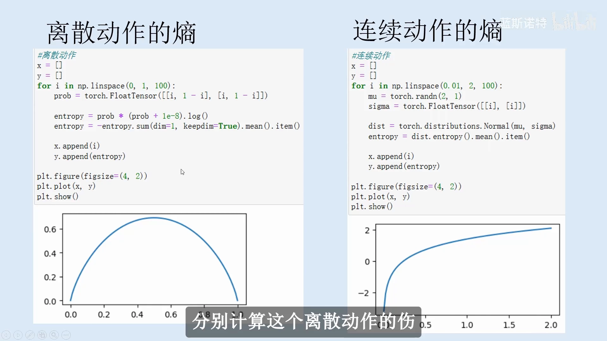
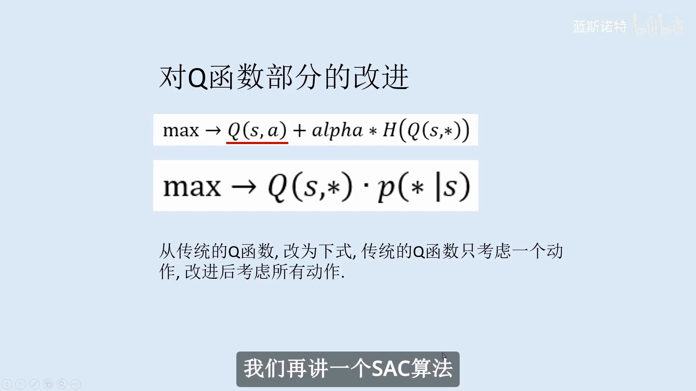
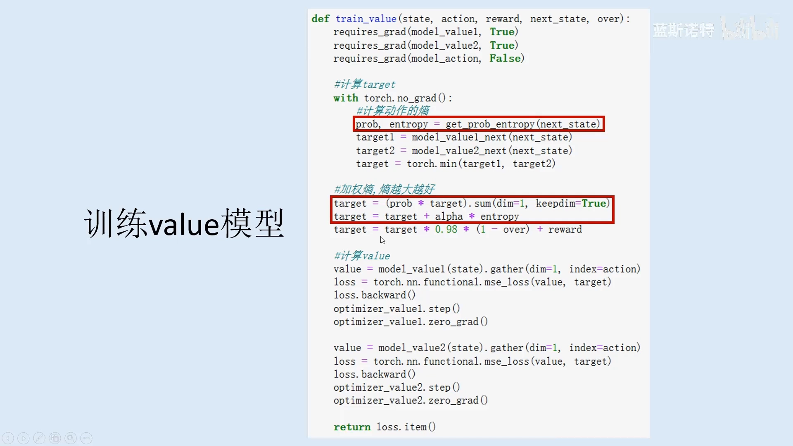
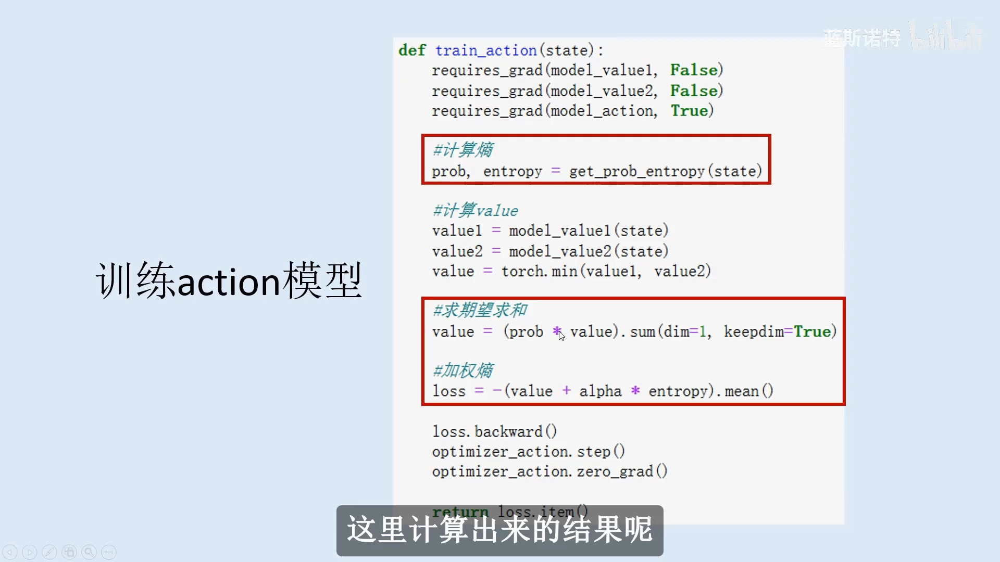
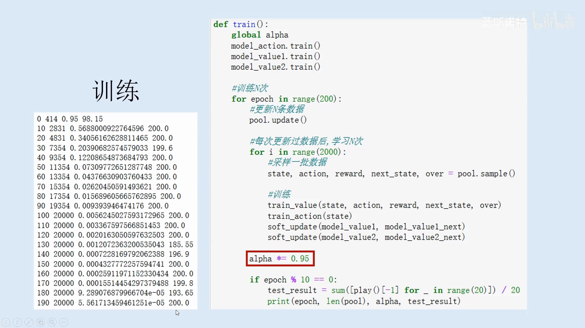
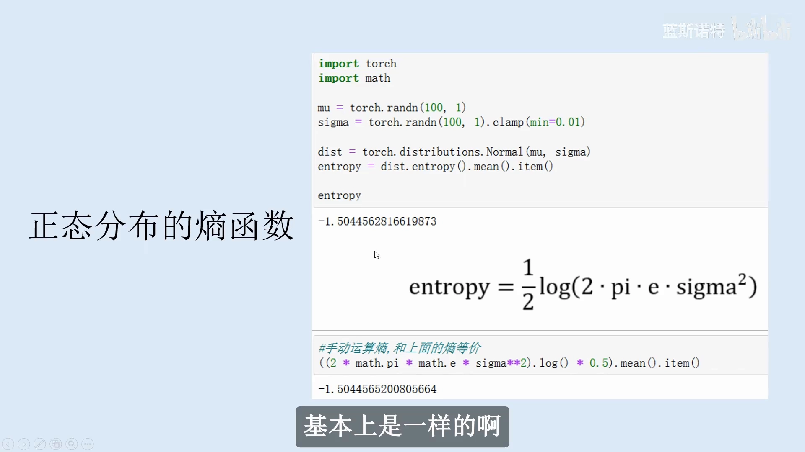
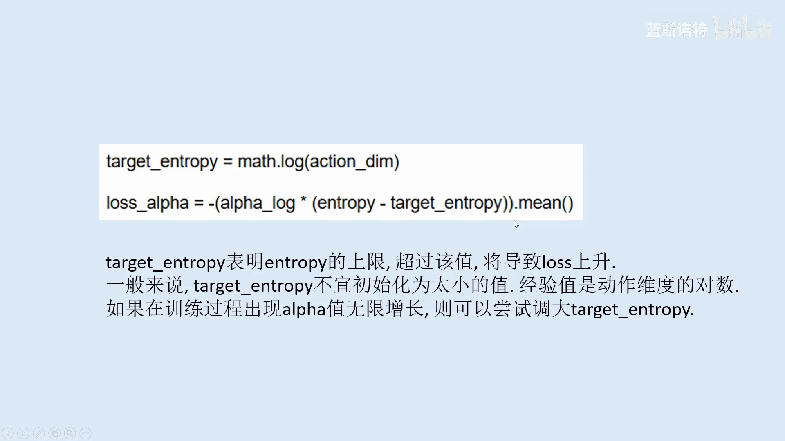

# SAC 代码实现：熵怎么算、温度怎么调

> 本篇整理自兰斯诺特《强化学习从原理到实践 第 11 章 SAC 算法》。视频地址：[BV1meMMz6ETB](https://www.bilibili.com/video/BV1meMMz6ETB/)。上一篇《SAC 算法：五个网络、软 Q 目标与重参数化》讲的是 SAC 的算法结构，本篇换一个视角——**打开代码，看熵这一项到底怎么算出来、温度 $\alpha$ 到底怎么自动调**。

## 本讲要解决的核心问题（SCQA）

**背景**：SAC 的目标函数写出来只有一行——最大化 $Q$ 加上 $\alpha$ 倍的熵。理论上很干净，落到代码里却处处是细节：离散动作的熵是一个求和，连续动作的熵是一个积分；动作无穷多时「对所有动作加权求和」根本做不了；$\alpha$ 这个权重到底该设多少。

**冲突**：这些细节如果含糊过去，代码能跑但学不对——熵算错了，策略会莫名其妙地不动；$\alpha$ 设错了，要么探索过度导致学不动，要么策略过早收窄。更麻烦的是，「熵」在离散和连续两种情形下是**两个不同的公式**，而 SAC 的代码骨架却要在两种情形下保持同一套训练流程。

**疑问**：熵在离散和连续动作空间分别怎么算？把熵加进目标以后，Q 函数那一项要不要跟着改？$\alpha$ 的自动调节具体是哪一行代码？

**回答（中心思想）**：熵的计算只有两种情形——**离散是 $-\sum_a p(a)\log p(a)$，连续高斯是 $\frac{1}{2}\log(2\pi e\sigma^2)$**，后者只依赖标准差，而且能用 PyTorch 的分布对象直接算。加入熵之后，Q 那一项要从「只看当前动作」改成「对所有动作按概率加权」，这样才和熵项的口径一致。$\alpha$ 的自动调节则压缩成一行损失：让策略熵去追一个目标熵，熵低了就把 $\alpha$ 推大、熵高了就推小。

> **版本说明**：这份代码是 SAC 的早期实现，比上一篇多一个独立的**状态价值网络 $V$**（两个 value 网络加两个目标 value 网络），critic 学的是 $V$ 而不是直接学 soft $Q$。核心机制——熵、双网络取小、温度自动调节——与五网络版完全一致，只是「$V$ 与 $Q$ 谁来承担」这一处工程选择不同。读的时候把 $V$ 当成「soft $Q$ 对动作求期望之后的结果」即可。

---

## 一、熵在算什么：离散是一条拱形，连续是一条对数曲线

熵衡量的是一个分布有多不确定。放在策略上，它衡量的是**动作的确定性程度**：

$$
\mathcal{H}\big(\pi(\cdot\mid s)\big) = -\sum_{a}\pi(a\mid s)\log\pi(a\mid s)
$$

以两个动作为例，概率分别是 $p$ 和 $1-p$：

$$
\mathcal{H} = -p\log p - (1-p)\log(1-p)
$$

$p=0.5$ 时两个动作被采样的概率相等，最难预测下一个动作是什么，熵最大；$p$ 靠近 0 或 1 时几乎确定，熵最小。所以离散熵的图像是一条**上凸的拱形**，中间高、两端低。

连续动作空间里求和换成积分，情况就完全不同了：

$$
\mathcal{H}\big(\pi(\cdot\mid s)\big) = -\int \pi(a\mid s)\log\pi(a\mid s)\,da
$$



[【跳转到 04:30】](https://www.bilibili.com/video/BV1meMMz6ETB/?t=270)

两条曲线的形状差异值得记住：

- **离散熵**有上界（$\log\vert\mathcal{A}\vert$），随概率分布变均匀而增大，到 $p=0.5$ 封顶；
- **连续熵**没有上界，是一条**单调递增**曲线，定义域从 0 开始一路增长到无穷。原因是连续分布的熵取决于分布的「铺开程度」，标准差越大铺得越开，熵就越大。

这一点直接决定了后面 $\alpha$ 的设定：离散和连续的目标熵不能套用同一个数。

## 二、目标函数的一处改写：从单个动作到所有动作

SAC 的目标是在最大化 $Q$ 的同时最大化熵，两项加权：

$$
\max\ \ Q(s,a) + \alpha\,\mathcal{H}\big(Q(s,\cdot)\big)
$$

讲者指出，这里的 $Q(s,a)$ 只考虑了**一个**动作，而熵那一项考虑的是**所有**动作的分布，两者口径不一致。SAC 论文的改法是让 $Q$ 也铺到所有动作上：

$$
\max\ \ Q(s,\ast)\cdot p(\ast\mid s)
$$



[【跳转到 06:00】](https://www.bilibili.com/video/BV1meMMz6ETB/?t=360)

也就是说，$Q$ 那一项从「当前动作的价值」变成「**所有动作价值的期望**」，权重就是每个动作被采样到的概率。这样两项都在同一个分布上求期望，整个目标才自洽。写成式子就是

$$
J(\pi) = \mathbb{E}_{a\sim\pi(\cdot\mid s)}\Big[Q(s,a) + \alpha\,\mathcal{H}\big(\pi(\cdot\mid s)\big)\Big]
$$

这个改写看起来只是换了个写法，实际上决定了代码里那一行「按概率加权求和」的来历——**先按概率加权求和，再加上 $\alpha$ 乘熵**。

## 三、为什么要加熵：防止采样概率一步跳到 0 或 1

如果只最大化 $Q$，训练会非常「情绪化」：某个状态下偶然试了一个动作、碰巧结果不错，这个动作的采样概率可能**一次更新就冲到 1.0**；反过来，偶然一次结果不好，概率可能直接掉到 0.0，这个动作以后再也没有机会被采样到。

问题是，一次经验的好坏并不能决定一个动作的价值——这次不好不代表下次不好。概率被极端化以后，模型就失去了纠错的机会。熵项的作用正是**给这种极端化踩刹车**：它要求分布保持一定的宽度，于是概率只能一点点地挪，而不是一步跳到端点。

讲者的说法很直白：加上熵，就是告诉模型「多采用不同的动作，多犯错误」——多犯错误才可能学到一个更稳的结果。这也是 SAC 比 DDPG 一类确定性算法更鲁棒的直觉来源。

## 四、代码骨架：一个循环、两个训练函数、一组辅助函数

整份实现由六段代码组成，其中第 3、4 段是「带自动调节 $\alpha$」的版本，本篇重点看第 1、2 段（离散版与连续版），自动调节部分在第七节单独讲。

骨架只有三层：

1. **辅助函数**：`soft_update`（目标网络慢跟随，每次只挪 0.005）、`get_prob_entropy`（给一个状态，返回所有动作的概率与熵）、以及一个全局的 $\alpha$；
2. **两个训练函数**：`train_value` 更新价值网络，`train_action` 更新策略网络；
3. **训练循环**：与环境交互、把经验写进数据池、采样一个批次、依次调用上面两个函数、软更新目标网络。

`get_prob_entropy` 是整份代码里最关键的辅助函数，因为熵在 value 和 action 两处都要用：它把「状态 → 动作概率 → 熵」这条链路封装起来，离散版和连续版的差别也集中在这一个函数里。

## 五、离散版逐行：value 与 action 各自在优化什么

### 5.1 train_value：把熵加进目标值



[【跳转到 15:00】](https://www.bilibili.com/video/BV1meMMz6ETB/?t=900)

这段代码的每一行都对应一个设计决定，写成伪代码就是：

```python
requires_grad(model_action, False)        # 策略网络只提供概率，不参与梯度
with torch.no_grad():                     # 目标值不建计算图
    prob, entropy = get_prob_entropy(next_state)
    target = torch.min(target1, target2)      # 双网络取小，抑制过估
    target = (prob * target).sum(dim=1)       # 对所有动作按概率加权求和
    target = target + alpha * entropy         # 加上熵奖励
    target = target * 0.98 * (1 - over) + reward   # 折扣与终止截断
```

逐行读下来，三个关键点是：

1. **策略网络在目标里不参与梯度**：它只是「提供动作概率的工具」，梯度只回传到在线 value 网络。
2. **两个目标 value 网络取较小值**：抑制过估，和上一篇的双 Q 是同一个思路。
3. **按概率加权求和再加熵**：这正是第二节那个「对所有动作求期望」的落地；折扣 $\gamma=0.98$，终止时用 $(1-\text{over})$ 截断未来。

**这里有一个容易被忽略的改动**：注意上面只算了「下一状态的动作概率」，**没有算 next action**。而传统 TD 目标需要先选出 next action，再用 `gather` 把它对应的 Q 取出来。为什么可以省掉这一步？

因为一旦需要「先选动作再取值」，目标值就依赖策略网络的输出，耦合度很高，每次算目标都得调用策略网络、且必须用当前策略采的数据——那就退回成同策略算法，数据池用不上了。改成「用动作概率加权求和」之后，目标值只依赖概率分布，耦合度低得多，于是**可以放心使用数据池**。

讲者也诚实地补了一句：严格说 SAC 仍然是同策略算法（目标里还是用了当前策略的概率），但耦合度降低以后，数据池带来的收益很大——池子里的数据采样出来是无序的，反而有助于学到更健壮的结果。

### 5.2 train_action：value 加权求和再加熵



[【跳转到 18:00】](https://www.bilibili.com/video/BV1meMMz6ETB/?t=1080)

策略网络的损失是 value 那一套的镜像：

$$
\mathcal{L}_\pi = -\mathbb{E}_{s}\left[\sum_{a}\pi(a\mid s)\min_{i}V_i(s) + \alpha\,\mathcal{H}\big(\pi(\cdot\mid s)\big)\right]
$$

和普通 AC 算法相比，唯一的区别就是**括号里多了 $\alpha$ 乘熵这一项**：普通 AC 算到「按概率加权求和」就已经是损失了，SAC 还要再加上熵、整体取负号（因为优化器做的是最小化）。

### 5.3 训练循环与结果



[【跳转到 19:30】](https://www.bilibili.com/video/BV1meMMz6ETB/?t=1170)

循环里值得注意的是红框那一行：每个 epoch 结束后把 $\alpha$ 乘以 $0.95$。**这是示例代码里的简化处理**——让 $\alpha$ 随训练单调递减，早期多探索、后期专注价值。讲者明确说这只是为了演示，标准做法是第七节的自动调节。

左边那份日志有四列：epoch 编号、数据池里已有的样本数、当前的 $\alpha$、以及每 10 个 epoch 一次的 20 盘测试平均分。读下来能看到三件事：

- **分数涨得很快**：第 0 个 epoch 测试分是 98.15，第 10 个 epoch 就到 200，之后一直维持在上限附近；
- **$\alpha$ 确实在指数衰减**：从 0.95 一路降到第 190 个 epoch 的 $5.5\times10^{-5}$，到后期熵项几乎不起作用，策略基本只认价值；
- **数据池很快被填满**：样本数在第 100 个 epoch 就顶到 20000 的上限，之后不再增长——这也说明后续训练完全是在复用历史数据，样本效率就是这么来的。

## 六、连续版：高斯熵有闭式解

连续动作版和离散版的差别几乎全在 `get_action_entropy` 这一个函数里：策略网络不再输出 softmax 概率，而是输出正态分布的均值 $\mu$ 和标准差 $\sigma$，用 PyTorch 的分布对象包装起来，采样和算熵都交给它。

### 6.1 正态分布的熵：只依赖标准差



[【跳转到 21:00】](https://www.bilibili.com/video/BV1meMMz6ETB/?t=1260)

正态分布的微分熵有闭式解：

$$
\mathcal{H} = \frac{1}{2}\log\left(2\pi e\,\sigma^2\right)
$$

这个式子里**只有 $\sigma$ 一个变量**，$\mu$ 完全不出现——因为熵衡量的是分布的「铺开程度」，平移不改变铺开程度。代码里可以直接调 `dist.entropy()`，也可以手写这一行公式，两者结果在小数点后六位一致（差异只是浮点精度）。

### 6.2 动作无穷多时，加权求和怎么办

离散版能对每个动作算 value 再按概率加权求和，连续版做不到——动作有无穷多个。这里的处理很直接：**把状态和动作拼在一起喂给 value 网络**，直接得到 $(s,a)$ 处的价值，不再需要「遍历所有动作」。

于是连续版的 value 网络输入是 $[s,a]$ 拼接，而离散版的 value 网络只输入 $s$、输出每个动作一个值。这个差别也解释了为什么离散版必须用 `gather` 取出实际执行动作对应的那一列。

连续版用的环境是 Pendulum，讲者给出的结果是 180 分左右——在这个环境里已经相当高。

## 七、温度 $\alpha$ 的自动调节：一行损失

前面的示例都让 $\alpha$ 递减或固定，标准做法是把它也交给优化器。损失只有一行：



[【跳转到 24:00】](https://www.bilibili.com/video/BV1meMMz6ETB/?t=1440)

$$
\mathcal{L}(\alpha) = \mathbb{E}\Big[-\log\alpha\cdot\big(\mathcal{H}(\pi) - \bar{\mathcal{H}}\big)\Big],\qquad \bar{\mathcal{H}} = \log\vert\mathcal{A}\vert
$$

读法：$\bar{\mathcal{H}}$ 是**目标熵**，也就是熵的上限靶子。当前熵超过它，括号为正，最小化损失会把 $\log\alpha$ 压小；当前熵低于它，括号为负，$\log\alpha$ 被推大。也就是说，**熵不够就加大探索的价格，熵太多就减小**，形成一个闭环。

实现上有三个要点：

1. **优化的是 $\log\alpha$ 而不是 $\alpha$**：这样无需额外约束就保证 $\alpha>0$，也避免梯度一步把 $\alpha$ 推成负数。
2. **目标熵取动作数的对数**：两个动作就填 $\log 2$，三个填 $\log 3$。这是经验值，本质上是「假设所有动作等概率」时的最大熵。
3. **$\alpha$ 无限增长时调大目标熵**：如果训练中 $\alpha$ 一直往上跑，说明策略的熵始终达不到靶子，把靶子调低（对 $\log$ 值来说是调大）就能缓解。

注意这里的 $\bar{\mathcal{H}}=\log\vert\mathcal{A}\vert$ 是**离散**动作的取法；上一篇的连续动作实验用的是 $-\dim(\mathcal{A})$。两种取法不冲突，因为连续熵可以为负、也可以无上界，用负维度做靶子相当于要求「每个维度保留大约 1 纳特的随机性」。

## 八、三个常见疑问

讲者在最后回答了三个实现层面的问题，都很实用：

**问题一：两组 value 网络是不是有点啰嗦，能不能只用一组？**
可以。两组是经验做法，目的是取小抑制过估；如果你愿意，用一组也能跑，只是失去了这层保护。

**问题二：正态分布的熵能不能直接用 $\sigma$ 代替？**
严格来说不行。虽然熵只是 $\sigma$ 的函数，但两者代表的意义不同：熵是信息量，$\sigma$ 是几何尺度，$\log$ 变换之后数值关系也变了。在本书这种简单环境里替代一下影响不大，但环境复杂、模型复杂时会出现明显偏差，所以不建议。

**问题三：自动调节 $\alpha$ 太麻烦，能不能就用递减的 $\alpha$？**
简单演示可以，复杂环境不建议。手动控制 $\alpha$ 相当于把它变成一个超参数，调起来比自动调节更难；相比之下**常量 $\alpha$ 反而比递减的 $\alpha$ 更好用**，这是讲者的个人经验。但标准做法仍然是自动调节。

## 九、两种 SAC 实现的对照

读到这里可能会有一个疑问：上一篇的 SAC 是「两个 Q 网络」，这一篇的代码却是「两个 V 网络」，到底哪个对？答案是**两个都对，只是把同一件事放在不同的网络上算**。

| 维度 | 本篇的 V 版本 | 上一篇的 Q 版本 |
| --- | --- | --- |
| 价值网络 | 两个 $V(s)$，输入只有状态 | 两个 $Q(s,a)$，输入是状态加动作 |
| 目标值里的期望 | 显式按动作概率加权求和 | 采样一个 $a'$ 直接估 |
| 策略损失里的价值 | 对 $V$ 按概率加权 | 直接取 $Q(s,a)$ |
| 离散动作 | 天然契合（可枚举、可精确求和） | 需要改成对全部动作求期望 |
| 连续动作 | 需把 $(s,a)$ 拼起来喂给 $V$ | 天然契合（直接估点值） |

两套写法在数学上是等价的：$V(s)=\mathbb{E}_{a\sim\pi}\big[Q(s,a)-\alpha\log\pi(a\mid s)\big]$，所以「对 $V$ 按概率加权」与「对 $Q$ 直接估」得到的是同一个量。区别只在工程上：**离散动作用 $V$ 更自然（能精确求和），连续动作用 $Q$ 更自然（不用积分）**。这也是为什么后来的主流实现统一用双 $Q$：它一套代码就能同时覆盖两种动作空间。

## 小结

把这篇的要点压成三句话：

1. **熵的算法只有两种**：离散是 $-\sum p\log p$（有上界、拱形），连续高斯是 $\frac{1}{2}\log(2\pi e\sigma^2)$（无上界、只依赖 $\sigma$、单调递增）。
2. **加熵之后 Q 那一项也要改口径**：从「当前动作的价值」改成「所有动作价值按概率加权」，代码里就是那一行按概率加权求和；顺带把「必须先选 next action」的耦合解开，于是数据池可以用了。
3. **温度用一行损失自动调**：让策略熵去追目标熵，优化 $\log\alpha$ 保证为正；目标熵离散取 $\log\vert\mathcal{A}\vert$、连续取 $-\dim(\mathcal{A})$。

讲者最后给了一句评价：SAC 的**理论比较简单，实现起来反而比较麻烦**。上面这些「麻烦」几乎都集中在熵的计算与 $\alpha$ 的处理上——这也是为什么值得单独用一篇把代码摊开看。

## 关键术语速查

| 术语 | 含义 |
| --- | --- |
| 离散熵 | $-\sum_a \pi(a\mid s)\log\pi(a\mid s)$，上界为 $\log\vert\mathcal{A}\vert$ |
| 高斯熵 | $\frac{1}{2}\log(2\pi e\sigma^2)$，只依赖标准差 |
| `get_prob_entropy` | 给一个状态返回所有动作的概率与熵的辅助函数 |
| 目标熵 $\bar{\mathcal{H}}$ | 自动调节 $\alpha$ 时的靶子，离散取 $\log\vert\mathcal{A}\vert$ |
| 软更新 | $\bar\theta\leftarrow\tau\theta+(1-\tau)\bar\theta$，本例 $\tau=0.005$ |