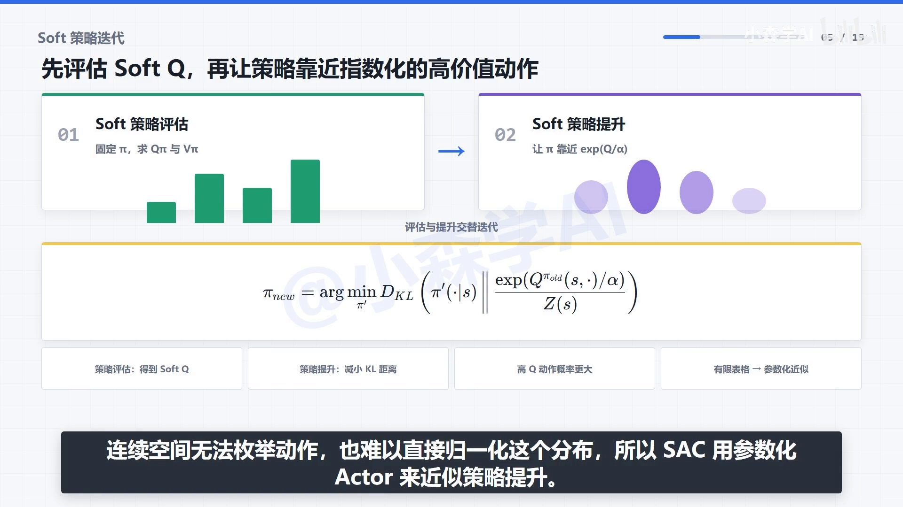
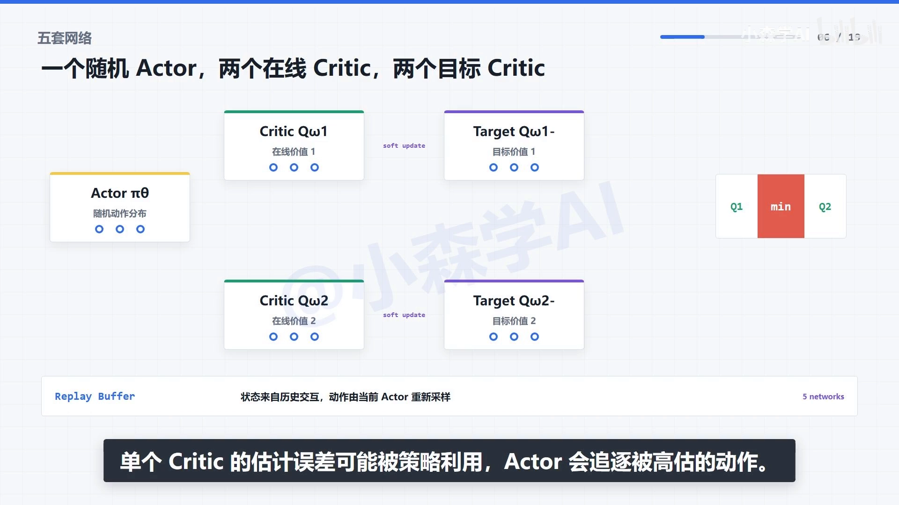
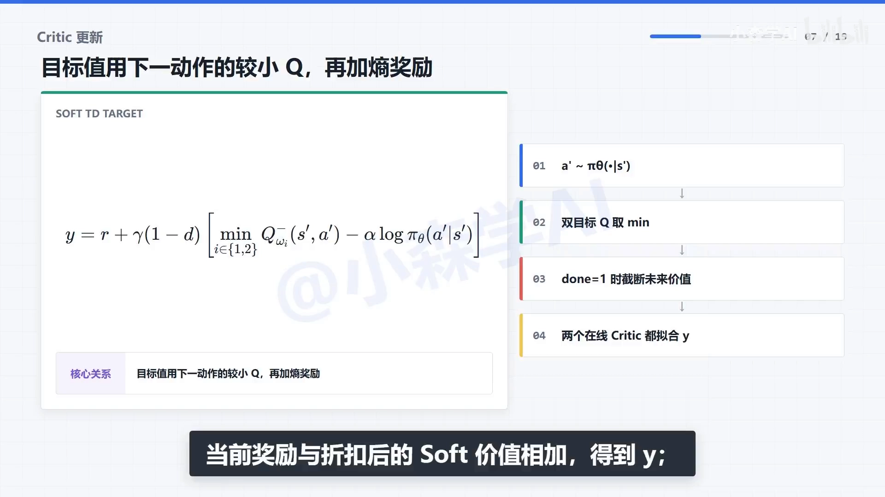
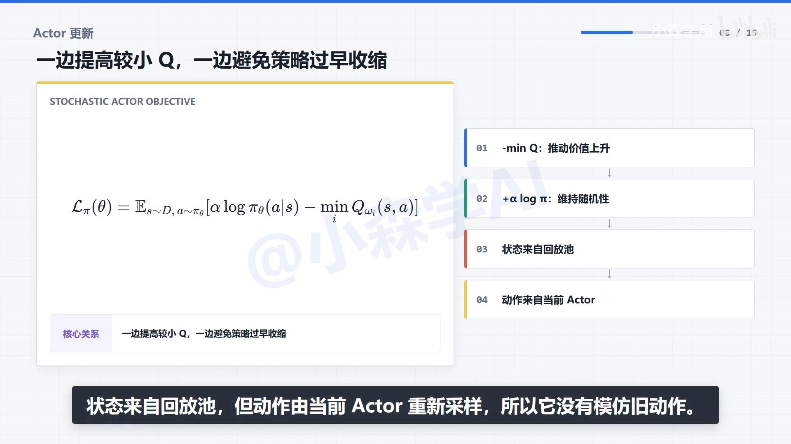
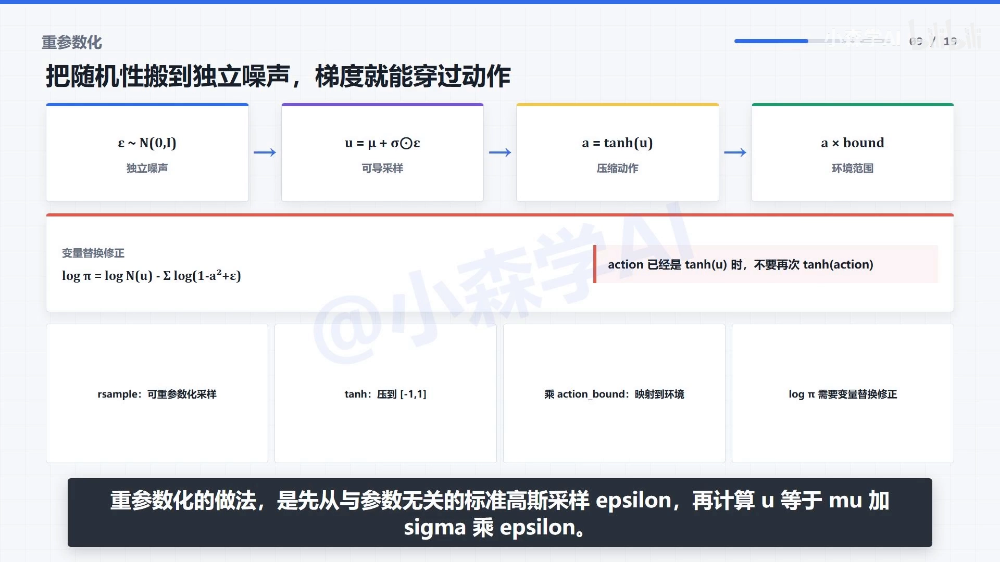
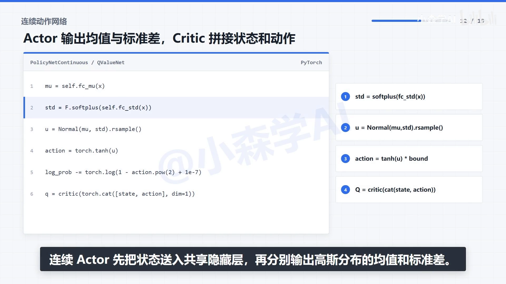
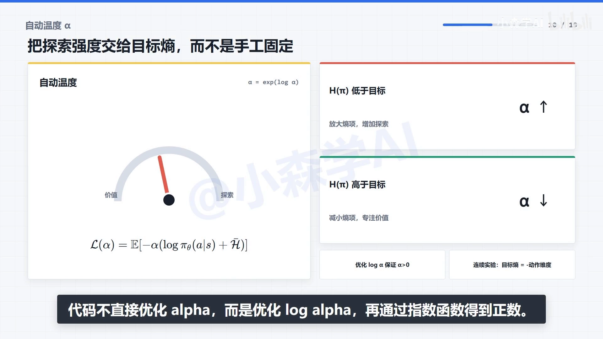
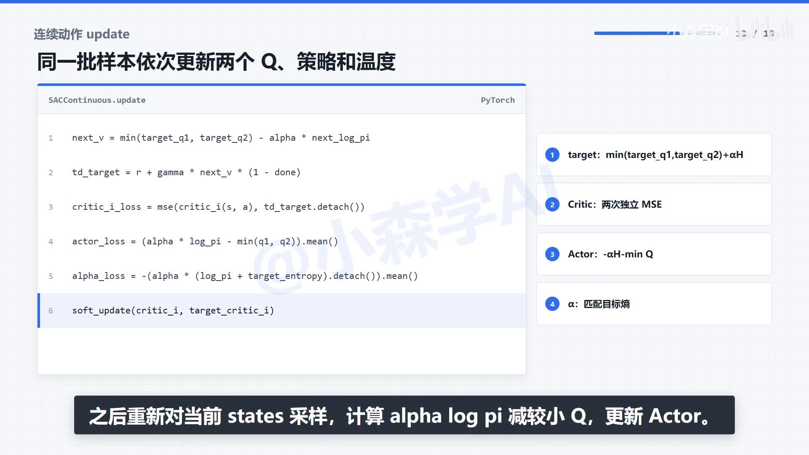
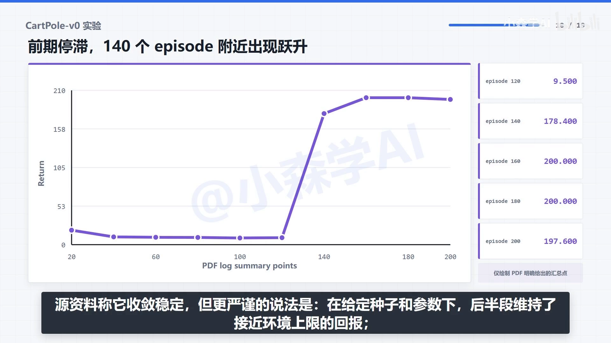
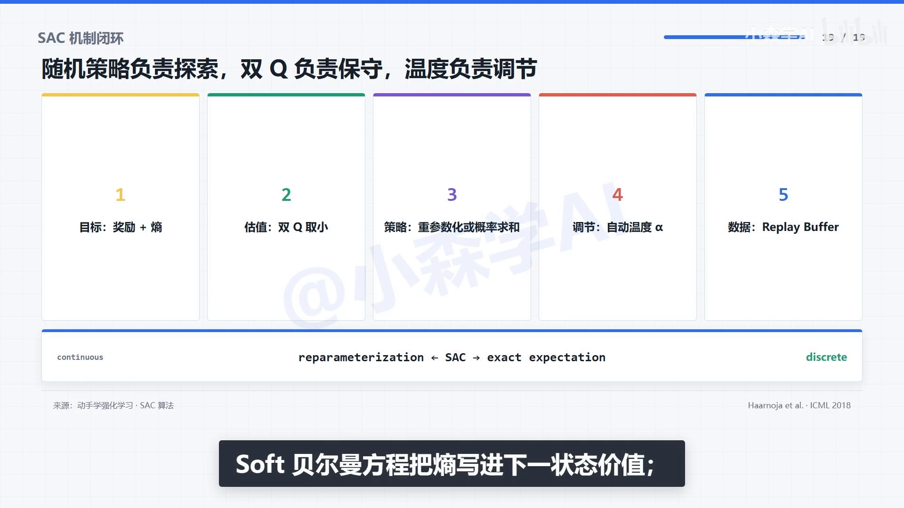

# SAC 算法：五个网络、软 Q 目标与重参数化

> 本篇整理自小森学AI《3.2.15 强化学习 SAC 算法》。视频地址：[BV1q1386VEsb](https://www.bilibili.com/video/BV1q1386VEsb/)。上一篇 9.4 已经把最大熵目标、软价值函数与两条软贝尔曼方程推导完了；本篇不重推理论，只回答一个问题：**这套目标要变成能跑的代码，需要几个网络、几种损失、几处工程细节**。

## 本讲要解决的核心问题（SCQA）

**背景**：最大熵框架给出了一个漂亮的目标——每一步的回报里除了环境奖励 $r$，还要加上 $\alpha$ 倍的策略熵 $\mathcal{H}\big(\pi(\cdot\mid s)\big)$。理论上最优策略是波尔兹曼分布 $\pi^*\propto\exp(Q/\alpha)$，理论上策略迭代仍然收敛。

**冲突**：但这套理论在连续动作空间里**一步都走不下去**。策略提升要求「靠近 $\exp(Q/\alpha)$ 归一化后的分布」，而连续空间的动作无穷多，分母 $Z(s)=\int\exp(Q/\alpha)\,da$ 积不出来，分布也无法枚举；更麻烦的是，一旦把策略参数化成神经网络，损失函数里就出现「从策略分布中采样」这一步——**采样这个操作本身没有梯度**，反向传播到这里就断了。

**疑问**：怎样把「最大化 $Q$ 加熵」翻译成几个可以 `.backward()` 的标量损失？采样不可导这个坎怎么绕？温度 $\alpha$ 是手调超参数还是也能学？

**回答（中心思想）**：SAC 的答案是**五个网络、三种损失、一处梯度技巧**。五个网络是 1 个随机 actor 加 2 个在线 critic 加 2 个目标 critic；三种损失分别是 critic 的软 TD 误差、actor 的「熵减 Q」、温度 $\alpha$ 的熵匹配误差；一处技巧是**重参数化**——把随机性挪到一个与参数无关的噪声变量上，让梯度能穿过采样点，再顺着 critic 对动作的导数回到 actor。把这几件事接起来，最大熵目标就变成了一个能跑通的高样本效率离策略算法。

---

## 一、先看策略提升：为什么必须换成参数化 actor

最大熵框架下的策略提升，目标不是「选 $Q$ 最大的动作」，而是「让新策略靠近一个由 $Q$ 指数化得到的分布」：

$$
\pi_{\text{new}} = \arg\min_{\pi'\in\Pi} D_{\mathrm{KL}}\left(\pi'(\cdot\mid s)\ \Big\Vert\ \frac{\exp\big(Q^{\pi_{\text{old}}}(s,\cdot)/\alpha\big)}{Z(s)}\right)
$$



[【跳转到 03:00】](https://www.bilibili.com/video/BV1q1386VEsb/?t=180)

这个式子的读法是：$Q$ 越高的动作，在目标分布里概率越大；$\alpha$ 控制这个分布有多尖——$\alpha$ 小就接近贪心，$\alpha$ 大就摊得更平。评估与提升交替进行，就朝最大熵目标下的最优策略推进。

问题出在「$\Pi$ 是什么」。在有限状态、有限动作的表格里，$\Pi$ 就是所有可能的概率向量，KL 投影可以直接算。但在连续空间里，动作无法枚举，归一化常数 $Z(s)$ 也积不出来，这个投影根本没有闭式解。**SAC 的处理是把 $\Pi$ 限制成一个参数化的分布族**——比如对角高斯——于是「投影」就退化成「用梯度下降把 actor 的参数往目标分布上拉」。这就是 SAC 里那个随机 actor 的来历：它不是额外加的装饰，而是**策略提升在连续空间里唯一可行的实现方式**。

### 1.1 符号对齐

本篇沿用 9.4 的记号，只补充几个工程侧的：

| 记号 | 含义 |
| --- | --- |
| $\pi_\theta(a\mid s)$ | 随机 actor，输出动作分布；$\theta$ 是它的参数 |
| $Q_{\omega_1}, Q_{\omega_2}$ | 两个在线 critic，参数 $\omega_1,\omega_2$ |
| $Q_{\bar\omega_1}, Q_{\bar\omega_2}$ | 两个目标 critic，参数是上面两份的慢拷贝 |
| $\alpha$ | 温度系数，权衡奖励项与熵项 |
| $\bar{\mathcal{H}}$ | 目标熵，自动调节 $\alpha$ 时的靶子 |
| $\mathcal{D}$ | 经验回放池 |

## 二、五个网络：谁在算什么

SAC 一共五个网络。和 DDPG 的四个网络相比，多出来的不是「一个更准的 critic」，而是**两个互相独立的 critic 各配一个目标网络**：



[【跳转到 03:30】](https://www.bilibili.com/video/BV1q1386VEsb/?t=210)

| 网络 | 输入 | 输出 | 在损失里的角色 |
| --- | --- | --- | --- |
| Actor $\pi_\theta$ | 状态 $s$ | 高斯的均值 $\mu_\theta(s)$ 与标准差 $\sigma_\theta(s)$ | 被 actor 损失更新；同时给 critic 提供 $a'$ |
| Critic $Q_{\omega_1}$ | $(s,a)$ | 一个标量 | 拟合软 TD 目标 |
| Critic $Q_{\omega_2}$ | $(s,a)$ | 一个标量 | 拟合同一个软 TD 目标，参数独立 |
| Target Critic $Q_{\bar\omega_1}$ | $(s',a')$ | 一个标量 | 只用来构造标签，不参与反向传播 |
| Target Critic $Q_{\bar\omega_2}$ | $(s',a')$ | 一个标量 | 同上 |

两个细节值得单独点出来：

**第一，连续版 SAC 没有目标 actor。** DDPG 与 TD3 都需要一个目标 actor 来生成下一状态的动作 $\pi_{\phi'}(s')$，因为确定性策略的动作是参数的确定函数，用在线 actor 会让标签随参数抖动。SAC 不需要：下一动作 $a'$ 直接从**当前的随机 actor** 里采样，随机性本身就提供了平滑，标签不会因为参数微小变化而跳变。

**第二，状态来自回放池，动作却由当前 actor 重新采样。** 这一点决定了 SAC 的离策略性质：$s$ 是历史数据，$a'$ 是现算的。所以 actor 学的不是「旧数据里那个动作好不好」，而是「我现在这个策略在这个状态上会做什么、值多少」——它没有在模仿旧动作。

## 三、Critic 的损失：软 Q 目标怎么算

critic 要拟合的目标值，就是把 9.4 的软贝尔曼方程搬进函数近似：

$$
y = r + \gamma\,(1-d)\left[\min_{i\in\{1,2\}} Q_{\bar\omega_i}(s',a') - \alpha\log\pi_\theta(a'\mid s')\right],\qquad a'\sim\pi_\theta(\cdot\mid s')
$$



[【跳转到 04:00】](https://www.bilibili.com/video/BV1q1386VEsb/?t=240)

拆开看，这个式子有四处改动，每一处都有明确目的：

1. **$a'$ 由当前 actor 采样**，不是取 $\arg\max$——这是「软」的体现，下一状态的价值是对策略分布求期望，而不是取最大值。
2. **$\min_{i}Q_{\bar\omega_i}$** 是双 Q 技巧：两个目标 critic 各估一次，取小的那个。单个 critic 的估计误差可能被策略利用，actor 会专门去追那些被高估的动作；取 min 相当于给标签加了一层保守下界。这套机制在 8.5 讲 TD3 时已经推导过，此处直接沿用。
3. **$-\alpha\log\pi_\theta(a'\mid s')$** 是熵奖励。因为 $\mathcal{H}=-\mathbb{E}\log\pi$，所以「减去 $\alpha\log\pi$」等价于「加上 $\alpha$ 倍熵」——低概率动作会得到更大的熵奖励，标签因此鼓励策略不要把概率压得太死。
4. **$(1-d)$** 在终止时把未来整段截断，和普通 TD 目标一致。

两个在线 critic 各自用均方误差拟合这个**同一个** $y$，但参数独立更新：

$$
\mathcal{L}_{Q}(\omega_i) = \mathbb{E}_{(s,a,r,s',d)\sim\mathcal{D}}\left[\Big(Q_{\omega_i}(s,a) - y\Big)^2\right],\qquad i=1,2
$$

目标 critic 不参加这次反向传播，只通过软更新跟随在线网络（$\tau$ 通常取 $0.005$）：

$$
\bar\omega_i \leftarrow \tau\,\omega_i + (1-\tau)\,\bar\omega_i
$$

## 四、Actor 的损失：为什么梯度穿不过采样

actor 的损失只有一行：

$$
\mathcal{L}_{\pi}(\theta) = \mathbb{E}_{s\sim\mathcal{D},\,a\sim\pi_\theta(\cdot\mid s)}\Big[\alpha\log\pi_\theta(a\mid s) - \min_{i\in\{1,2\}}Q_{\omega_i}(s,a)\Big]
$$



[【跳转到 04:30】](https://www.bilibili.com/video/BV1q1386VEsb/?t=270)

这一行里两个目的在拔河：$-\min_i Q$ 让策略去挑价值更高的动作，$\alpha\log\pi$ 让策略不要把分布收得太窄。注意它是**最小化**，所以等价于最大化 $\mathbb{E}\big[\min_i Q - \alpha\log\pi\big]$，正好是「Q 加熵」。

### 4.1 断掉的梯度

麻烦在于期望是对 $a\sim\pi_\theta$ 求的。要更新 $\theta$，需要

$$
\nabla_\theta\,\mathbb{E}_{a\sim\pi_\theta}\big[f(a)\big]
$$

而采样 $a\sim\pi_\theta$ 这一步在计算图里是一个**没有导数的黑盒**：它把 $\theta$ 变成了一个随机数，梯度传到这里就断了。这就是为什么策略梯度定理（第 7 章）要用「对数导数技巧」另起炉灶——那条路能算，但方差大，而且要用在策略上采到的样本，天然只能在策略。

SAC 走的是另一条路：**重参数化**。

### 4.2 把随机性挪到独立噪声上



[【跳转到 05:00】](https://www.bilibili.com/video/BV1q1386VEsb/?t=300)

做法是把采样拆成两步：

$$
\varepsilon\sim\mathcal{N}(0,I),\qquad u = \mu_\theta(s) + \sigma_\theta(s)\odot\varepsilon,\qquad a=\tanh(u)\cdot a_{\max}
$$

关键在于：**随机性被完全放进了 $\varepsilon$ 里，而 $\varepsilon$ 与 $\theta$ 无关**。于是 $u$（进而 $a$）成了 $\theta$ 的一个确定、可导的函数，梯度可以正常地穿过动作，再经过 critic 对动作的偏导回到 actor：

$$
\nabla_\theta \mathcal{L}_\pi = \mathbb{E}_{\varepsilon}\left[\nabla_a\big(\alpha\log\pi_\theta(a\mid s) - Q(s,a)\big)\Big|_{a=a(\theta,\varepsilon)}\cdot\nabla_\theta a(\theta,\varepsilon)\right]
$$

一句话概括：**对数导数技巧把随机性留在采样里、靠乘一个 $\nabla\log\pi$ 来绕；重参数化把随机性挪到外部噪声里，让采样本身变成一条可导的路径**。代价是策略分布必须能写成「标准噪声的确定变换」，所以 SAC 用对角高斯；好处是梯度方差小得多，而且可以直接用 critic 的导数。

### 4.3 一个容易漏掉的细节：tanh 改变了概率密度

动作要落在环境允许的区间里，所以最后套一个 $\tanh$ 再乘上界。但**变量替换会改变概率密度**，对数概率必须补一个雅可比修正项：

$$
\log\pi(a\mid s) = \log\mathcal{N}(u;\mu,\sigma) - \sum_{j}\log\big(1-\tanh^2(u_j)\big)
$$

如果代码里拿到的 `action` 已经是 $\tanh(u)$，修正项应直接写成 $1-a_j^2$，**不能对 `action` 再做一次 `tanh`**——这是实现里最常见的一处错。多维动作还要沿动作维求和，而不是取平均。

### 4.4 网络本身长什么样



[【跳转到 07:00】](https://www.bilibili.com/video/BV1q1386VEsb/?t=420)

```python
mu   = fc_mu(x)
std  = F.softplus(fc_std(x))          # 标准差必须为正
u    = Normal(mu, std).rsample()      # 可重参数化采样，保留梯度
a    = torch.tanh(u)
log_prob -= torch.log(1 - a.pow(2) + 1e-7)   # tanh 的雅可比修正
q    = critic(torch.cat([state, a], dim=1))
```

几行代码对应几个要点：

- **标准差用 softplus 而不是 exp**：保证为正，且不会像 exp 那样在数值上放大。
- **必须用 rsample 而不是 sample**：rsample 是「可重参数化采样」，它保留了对均值和标准差的梯度；用 sample 梯度就断了。
- **减去 log 修正项**：这就是上面的雅可比修正，加 1e-7 是防止 $\tanh$ 饱和时取到 $\log 0$。
- **动作张量要和状态一起喂给 critic**：动作必须留在同一张计算图里，否则 actor 的梯度传不进 critic。

## 五、温度 $\alpha$：交给目标熵，而不是手工固定

$\alpha$ 决定「探索值多少钱」。固定一个常数有两个毛病：训练早期策略还很随机，固定的大 $\alpha$ 会拖慢收敛；训练后期策略该收窄了，固定的小 $\alpha$ 又会让它过早僵化。同一个探索强度很难适合所有训练阶段，所以 SAC 把 $\alpha$ 也变成一个可学的参数。



[【跳转到 06:00】](https://www.bilibili.com/video/BV1q1386VEsb/?t=360)

做法是把原目标改写成「带熵约束」的形式，然后对 $\alpha$ 求导。实际用的损失是

$$
\mathcal{L}(\alpha) = \mathbb{E}_{a\sim\pi_\theta}\Big[-\alpha\big(\log\pi_\theta(a\mid s) + \bar{\mathcal{H}}\big)\Big]
$$

其中 $\bar{\mathcal{H}}$ 是**目标熵**。这个式子的行为很好读：

- 当前策略的熵 $\mathcal{H}=-\mathbb{E}\log\pi$ **低于**目标 $\bar{\mathcal{H}}$ 时，括号里的 $\log\pi+\bar{\mathcal{H}}$ 为正，最小化 $\mathcal{L}(\alpha)$ 会把 $\alpha$ 推**大**——放大熵项，逼策略去探索；
- 当前熵**高于**目标时，括号为负，$\alpha$ 被推**小**——减小熵项，让价值项占更大比重。

两个实现细节：

1. **代码不直接优化 $\alpha$，而是优化 $\log\alpha$，再用 $\exp$ 得到 $\alpha$。** 这样无需约束就保证了 $\alpha>0$，也不会出现「梯度一步迈过零变成负数」的数值事故。
2. **目标熵取 $-\dim(\mathcal{A})$**，也就是负的动作维度。连续动作实验里把 $\bar{\mathcal{H}}$ 设成 $-\dim(\mathcal{A})$、$\alpha$ 初值设成 $0.01$。这个取值是经验做法：动作维度越高，能达到的熵上限越高，用负维度做靶子相当于要求「每个维度平均保留大约 1 纳特的随机性」。

还有一个必须注意的工程点：**温度损失里要把策略部分 detach**。$\mathcal{L}(\alpha)$ 只应该根据「熵偏差」更新 $\alpha$，不能让 $\alpha$ 的优化反过来改动 actor 的参数。

## 六、一次 update 的完整顺序

把上面三块拼起来，连续动作版的 `update` 就是六行：



[【跳转到 08:00】](https://www.bilibili.com/video/BV1q1386VEsb/?t=480)

```python
next_v     = min(target_q1(s2, a2), target_q2(s2, a2)) - alpha * next_log_pi   # a2 ~ actor(s2)
td_target  = r + gamma * next_v * (1 - done)
critic_i_loss = mse(critic_i(s, a), td_target.detach())    # 两个 critic 各算一次
actor_loss = (alpha * log_pi - min(q1(s, a_new), q2(s, a_new))).mean()   # a_new ~ actor(s)
alpha_loss = -(alpha * (log_pi + target_entropy).detach()).mean()
soft_update(critic_i, target_critic_i)
```

顺序很重要，有三个「不能提前」：

- **先在 next state 上采样动作，再算标签**：$a'$ 必须来自当前 actor，且要在 `no_grad` 里算，否则标签会带着梯度。
- **目标值要 detach**：标签只当常数用，梯度只回传到在线 critic。
- **actor 更新时重新对当前 state 采样**：actor 用的动作是新采的，不是回放池里那个旧动作；这也是为什么 SAC 能用回放池而不至于变成「模仿旧数据」。

整条闭环可以概括成：**用当前随机策略与环境交互 → 把 $(s,a,r,s',d)$ 写进回放池 → 采样一个批次 → 目标 critic 构造软 TD 标签 → 更新两个在线 Q → 重采样动作更新 actor → 按熵偏差更新 $\alpha$ → 软更新目标 critic**。下一轮继续复用历史样本，这就是它样本效率高的来源。

## 七、连续与离散：核心不变，变的是「期望怎么算」

同一套核心也能改写到离散动作空间，只是「对动作求期望」从采样变成了精确求和：

| 环节 | 连续动作版 | 离散动作版 |
| --- | --- | --- |
| actor 输出 | 高斯均值与标准差，采样后过 $\tanh$ | 所有动作的 softmax 概率 |
| 下一状态价值 | 采样一个 $a'$ 后估一次 | 对每个动作取 $\min_i Q$，再按概率加权求和 |
| 熵 | $-\log\pi(a\mid s)$ 的单样本估计 | $-\sum_a \pi(a\mid s)\log\pi(a\mid s)$ 精确求和 |
| critic 的当前 Q | 直接估 $(s,a)$ | 用 `gather` 取出实际执行动作那一列 |

离散版的好处是期望可以精确算，不用采样，方差更小；代价是动作数一多就退化。讲者用 CartPole 跑了一次离散版：前 120 个 episode 的汇总回报一直在 9~20 附近，第 140 个突然跃升到 178.4，第 160、180 个都达到 200，第 200 个是 197.6。



[【跳转到 11:30】](https://www.bilibili.com/video/BV1q1386VEsb/?t=690)

这条曲线的形状值得说一句：它**不是平滑上升**，而是长时间停滞之后突然跃升。所以「SAC 收敛稳定」这句话要打个折扣——更严谨的说法是，在给定种子和超参数下，后半段维持了接近环境上限的回报；换环境或换超参数仍然需要重新验证。

连续动作那边用的是 Pendulum，1 维动作表示连续力矩，超参数是：actor 学习率 $3\times10^{-4}$、critic 学习率 $3\times10^{-3}$、$\alpha$ 学习率 $3\times10^{-4}$，隐藏层 128，$\gamma=0.99$，$\tau=0.005$，回放池容量 10 万，至少积累 1000 条样本后开始更新，批量 64，训练 100 个 episode。注意代码还把原奖励先加 8 再除以 8，所以曲线对应这套奖励重塑，不能和其他实现的原始回报直接比。

## 八、和 DDPG/TD3、PPO 的对照

SAC 的位置，放在两张对照表里最清楚。

**与第 8 章的 DDPG / TD3 比：**

| 维度 | DDPG / TD3 | SAC |
| --- | --- | --- |
| 策略类型 | 确定性 $a=\pi_\phi(s)$ | 随机策略，输出动作分布 |
| 探索从哪来 | 外部加噪声（DDPG 的 OU 噪声、TD3 的目标平滑噪声） | 策略自身的熵，无需外加噪声 |
| 抑制高估的手段 | 双 Q 取 min（TD3）＋目标平滑 | 双 Q 取 min，但**没有**目标平滑 |
| 目标 actor | 需要 | 不需要（下一动作直接由随机 actor 采样） |
| 正则化的位置 | 加在**目标值**上（目标平滑） | 加在**目标函数**里（熵正则） |

一句话区别：TD3 用「给目标动作加噪」来把 Q 函数在动作维上抹平，SAC 用「把熵写进目标」让策略自己保持宽度。前者是**目标平滑**，后者是**熵正则**——一个改标签，一个改目标。

**与 9.3 的 PPO 比：**

| 维度 | PPO | SAC |
| --- | --- | --- |
| 数据来源 | 在策略，采样完更新几轮就丢掉 | 离策略，回放池反复复用 |
| 样本效率 | 低，需要大量新交互 | 高，同一批数据能用很多次 |
| 稳定机制 | clip 或 KL 惩罚，限制策略一次走多远 | 熵正则 + 双 Q + 目标网络 |
| 动作分布 | 随机策略（本就如此） | 随机策略（为了可导与探索） |
| 典型场景 | 大规模并行采样便宜的环境 | 真实交互昂贵、样本稀缺的环境 |

PPO 的思路是「**目标不动，限制步长**」；SAC 的思路是「**改目标，让策略自带探索**」。两者不是替代关系：采样便宜时 PPO 更简单可靠，采样昂贵时 SAC 的样本效率更值钱。

## 小结：一条因果链，而不是五个网络的堆叠



[【跳转到 11:36】](https://www.bilibili.com/video/BV1q1386VEsb/?t=696)

把全篇压成一条链：

1. **最大熵目标**给探索一个明确的价格，$\alpha$ 就是这个价格；
2. **软贝尔曼方程**把熵写进下一状态价值，于是 critic 的标签里多出 $-\alpha\log\pi$ 一项；
3. **双 critic 取 min** 降低策略追逐被高估动作的风险；
4. **随机 actor** 在提高 $Q$ 的同时保留动作多样性，而重参数化让「从分布里采样」这一步变得可导；
5. **自动温度**根据目标熵调节奖励项与熵项的权重；
6. **经验回放与目标 critic** 让训练能复用历史样本，同时保持标签相对稳定。

理解这条链，SAC 就不再是「五个网络加三种损失」的堆叠，而是一套围绕**探索、估值与稳定性**共同设计的闭环：熵负责探索，双 Q 负责保守，温度负责在两者之间调节。

## 关键术语速查

| 术语 | 含义 |
| --- | --- |
| 软 Q 目标 | $y=r+\gamma(1-d)\big[\min_i Q_{\bar\omega_i}(s',a')-\alpha\log\pi(a'\mid s')\big]$ |
| 重参数化 | 把 $a\sim\pi_\theta$ 写成 $a=g_\theta(\varepsilon)$，$\varepsilon$ 与参数无关，使梯度可穿 |
| `rsample` | PyTorch 中保留梯度的采样方法，重参数化技巧的实现 |
| 雅可比修正 | $\tanh$ 变换后 $\log\pi$ 要减去 $\sum\log(1-a_j^2)$ |
| 目标熵 $\bar{\mathcal{H}}$ | 自动调节 $\alpha$ 的靶子，连续动作常用 $-\dim(\mathcal{A})$ |
| 目标网络软更新 | $\bar\omega\leftarrow\tau\omega+(1-\tau)\bar\omega$，$\tau$ 常取 $0.005$ |