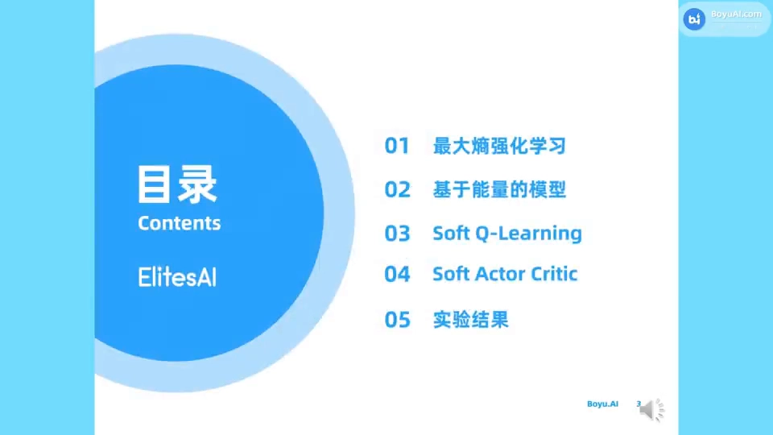
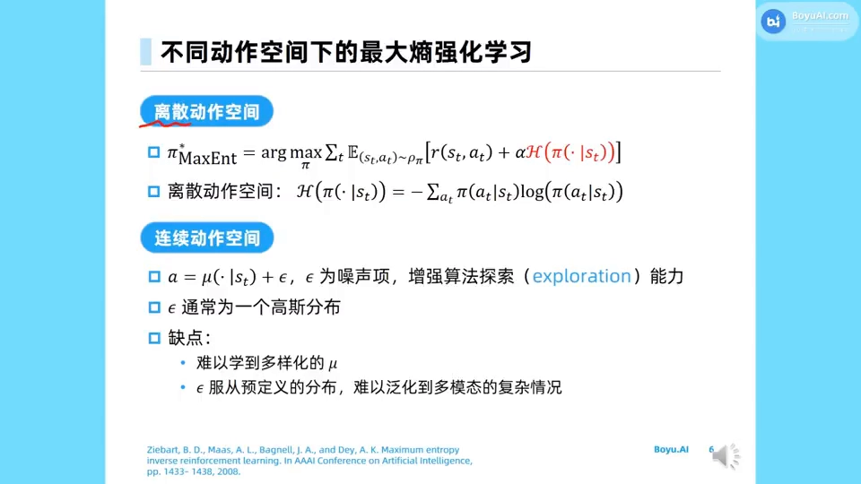
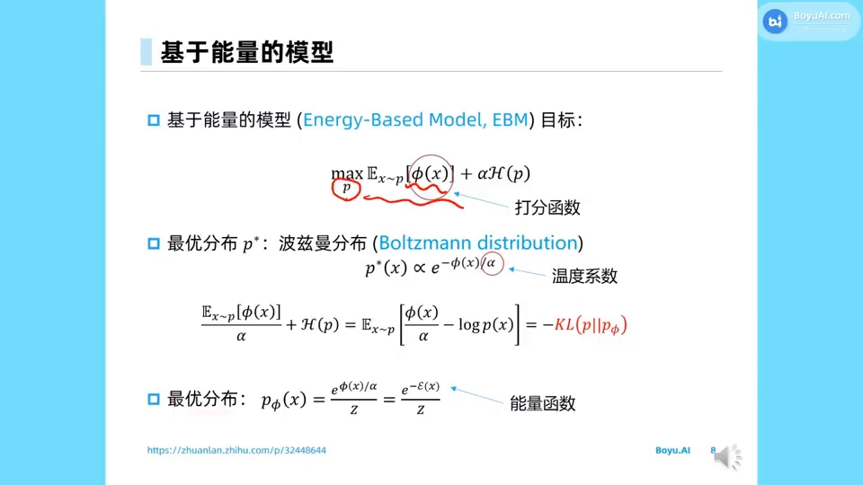
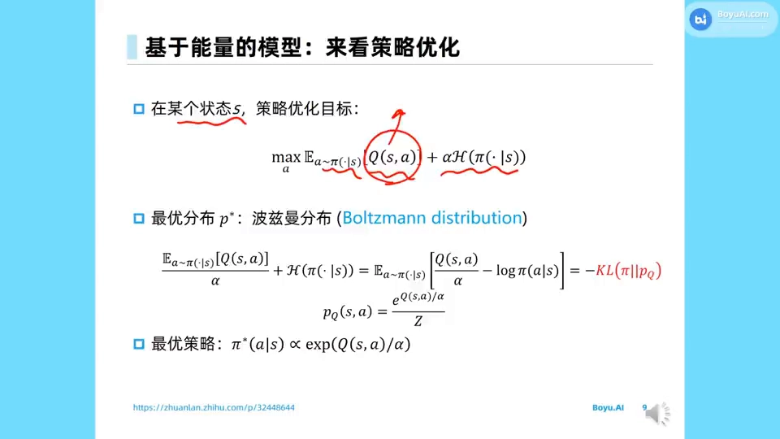
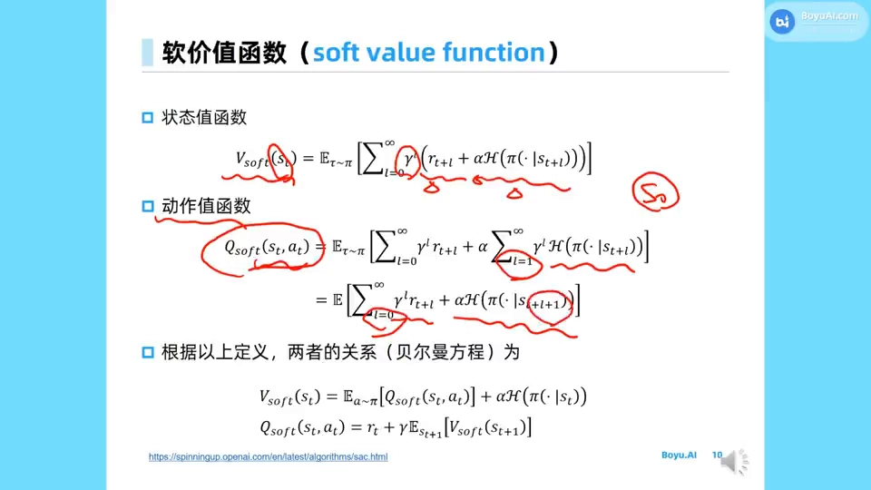
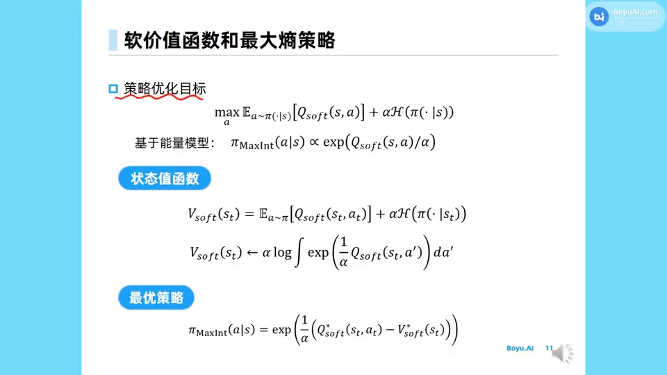
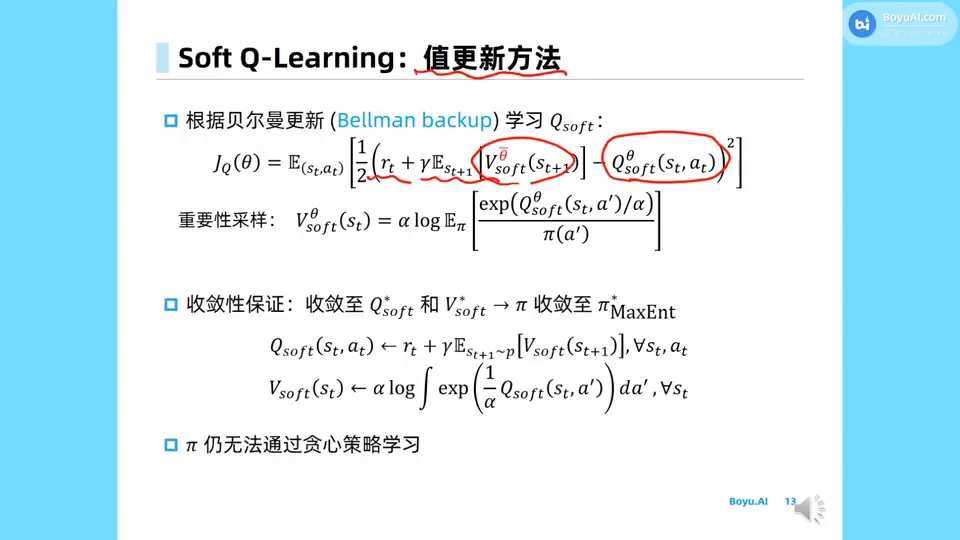
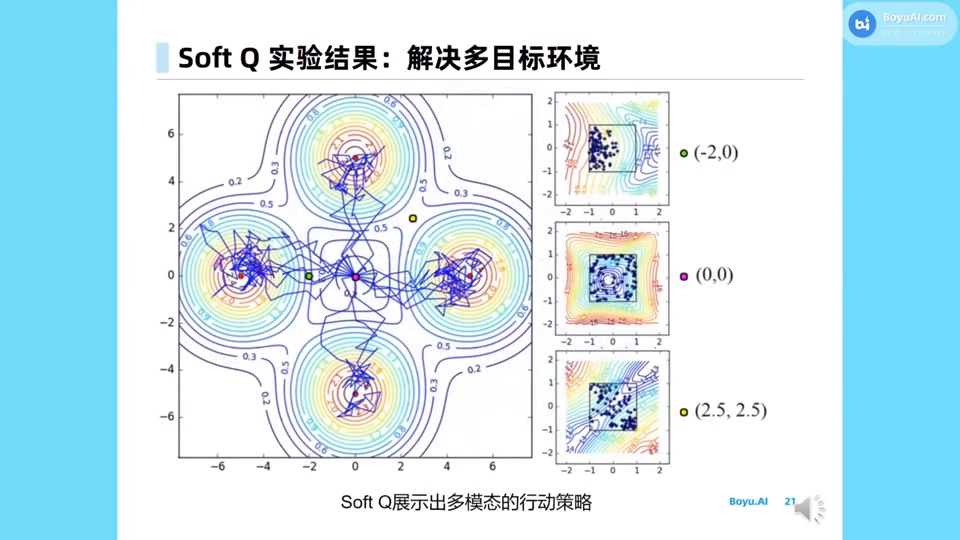
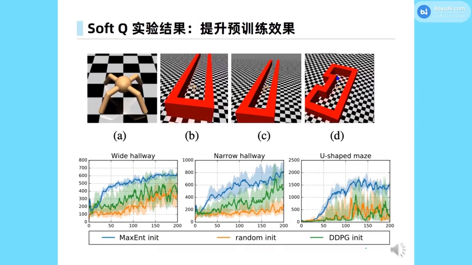

# 最大熵强化学习框架：从能量模型到软贝尔曼方程

> 本篇整理自上海交通大学张伟楠的《28. 最大熵强化学习：soft Q-learning & Soft Actor Critic》。视频地址：[BV1Le4y1q7te](https://www.bilibili.com/video/BV1Le4y1q7te/)。第 9 章前三篇（9.1 步长困境、9.2 TRPO、9.3 PPO）都在做同一件事——**目标不动，给更新加约束**；本篇是全章的转折点：**把目标本身改掉**，在每一步奖励后面加一份策略的熵。SAC 如何用这个框架落地成算法，见 9.5。

[【跳转到 00:22】](https://www.bilibili.com/video/BV1Le4y1q7te/?t=22)

## 本讲要解决的核心问题（SCQA）

**背景**：从第 7 章到第 9 章，我们一直在最大化期望累积奖励。TRPO 与 PPO 已经把这个目标优化得相当稳：前者用 KL 约束划出信赖域，后者用 clip 把重要性采样比按在区间里。它们解决的是「**怎么走这一步才不摔**」的问题。

**冲突**：但目标本身有个隐患——「最大化期望回报」这个目标**只认回报，不认策略长什么样**。只要两个动作的 $Q$ 值差一点点（比如 $0.99$ 与 $0.98$），贪心策略就会把全部概率压到前者身上，后者的概率直接归零。这样的策略有三个后果：一是**探索不足**，没被选过的动作永远没机会证明自己；二是**脆弱**，环境稍微一变（走廊变窄、目标挪位），原来那条最优路径失效，策略没有任何备选；三是**过早收敛到次优的确定性策略**，一旦早期估计有偏，就再也回不来。

**疑问**：能不能不靠「外部加约束」，而是**在目标函数里就把「策略要保留多样性」写进去**？写进去以后，价值函数、贝尔曼方程、策略迭代这一整套机器还转得动吗？

**回答（中心思想）**：能。把目标从 $\mathbb{E}\left[\sum_t r\right]$ 改成 $\mathbb{E}\left[\sum_t \left(r + \alpha\mathcal{H}(\pi(\cdot\mid s_t))\right)\right]$，也就是每一步除了拿奖励，还要拿一份**策略的熵**。这个改动看起来只是加了一项，实际上把整个问题推进了统计物理的地盘：最优策略不再是「取最大」，而是**波尔兹曼分布** $\pi^*(a\mid s)\propto \exp(Q(s,a)/\alpha)$；价值函数变成**软价值函数**，贝尔曼方程里的 $\max$ 变成 **soft max**（log-sum-exp）；策略迭代相应变成**软策略迭代**。$\alpha\to 0$ 时整套东西退化为标准 RL，所以最大熵框架是标准 RL 的**严格推广**，而不是另一套无关的理论。

---

## 一、目标改写：给每一步奖励加一份熵

### 1.1 从「只认回报」到「回报 + 多样性」

标准 MDP 的设定没变：状态空间、动作空间、转移概率、奖励函数都在，我们要学一个策略 $\pi$，让它与环境交互产生的累积奖励最大。标准目标是：

$$
\max_\pi\ \mathbb{E}_{\tau\sim\pi}\left[\sum_{t=0}^{\infty}\gamma^t r(s_t,a_t)\right]
$$

最大熵强化学习（maximum entropy RL，简称 MaxEnt RL）把它改成：

$$
\pi^*_{\mathrm{MaxEnt}} = \arg\max_\pi\ \mathbb{E}_{(s_t,a_t)\sim\rho_\pi}\left[\sum_{t=0}^{\infty}\left(r(s_t,a_t) + \alpha\,\mathcal{H}\big(\pi(\cdot\mid s_t)\big)\right)\right]
$$

多出来的 $\mathcal{H}(\pi(\cdot\mid s_t))$ 是**策略在状态 $s_t$ 上的熵**，$\alpha$ 是温度系数。注意这里的期望是对**占用度量**（occupancy measure）$\rho_\pi$ 取的——策略一变，它访问到的状态与状态-动作对的分布就跟着变，所以熵项不是简单地加在一个固定的分布上。

[【跳转到 03:04】](https://www.bilibili.com/video/BV1Le4y1q7te/?t=184)

离散动作空间里，熵就是熟悉的求和形式：

$$
\mathcal{H}\big(\pi(\cdot\mid s_t)\big) = -\sum_{a}\pi(a\mid s_t)\log\pi(a\mid s_t)
$$

熵大意味着「各个动作的概率比较平均」，熵小意味着「概率压在少数动作上」。所以最大化熵这一项，等于在说：**别把宝全押在一个动作上**。

### 1.2 熵项带来的三个效果

**第一，鼓励探索。** 熵项直接把「概率分布要平」写进了目标，智能体不需要靠 $\epsilon$-greedy 这种外加的探索噪声来保证尝试，探索变成了优化目标的一部分。

**第二，策略更鲁棒：多峰而非单峰。** 这是本讲反复强调的一点。假设某个状态下有两个动作，$Q$ 值分别是 $0.99$ 和 $0.98$，标准 Q-Learning 只会选 $0.99$ 那个，$0.98$ 的概率归零；而在最大熵目标下，两个动作的 $Q$ 值几乎一样，熵项就会让策略**同时保留这两个选项**。于是策略在「有多条路都能走通」的状态上呈现**多峰分布**，而不是一根独木桥。环境稍有扰动时，另一座峰就是现成的退路。

**第三，避免过早收敛到次优的确定性策略。** 早期 $Q$ 估计有噪声，如果此刻就贪心，很可能锁死在一个其实不好的动作上。保留熵相当于给策略留了「反悔的余地」：只要某个动作的概率还没归零，它就有机会在后续采样中翻案。

**第四，好的初始化。** 一个保留了多样性的策略，天然适合当**预训练权重**：把它迁移到新任务上做微调，比从随机初始化或从一个已经「缩成一团」的确定性策略出发表现更好。这一点在第五节的实验里有直接证据。

### 1.3 连续动作空间：单峰高斯不够用

连续动作空间里常见的做法是输出一个高斯策略 $a = \mu(\cdot\mid s_t) + \epsilon$，$\epsilon$ 是从高斯分布采的噪声项，用来增强探索。这个做法的问题是**只能表达单峰**：如果某个状态下「动作在 5 附近」和「动作在 15 附近」都能拿到高回报，一个单峰高斯只能在两者之间选一个，或者在中间放一个其实很差的均值。而多峰策略恰恰是最大熵目标想要的东西——所以后面用能量模型导出的策略分布，天生就是多峰的。

## 二、熵项从哪来：能量模型与波尔兹曼分布

### 2.1 一个更一般的问题

先跳出 RL，看一个统计学问题：给定打分函数 $\phi(x)$，要找一个分布 $p(x)$，使得「$p$ 下 $\phi$ 的期望」尽量大。如果只最大化 $\mathbb{E}_{x\sim p}[\phi(x)]$，答案是把所有概率堆到 $\arg\max\phi$ 上，得到一个退化的点分布。

统计物理的做法是**再加一项熵**，并用温度系数 $\alpha$ 加权：

$$
\max_p\ \mathbb{E}_{x\sim p}\left[\phi(x)\right] + \alpha\,\mathcal{H}(p)
$$

这就是**基于能量的模型**（Energy-Based Model，EBM）的目标。$\alpha$ 越大越鼓励熵，也就越鼓励分布平缓；$\alpha$ 越小，分布越尖，越逼近「只取最大值」。

[【跳转到 05:34】](https://www.bilibili.com/video/BV1Le4y1q7te/?t=334)

### 2.2 解是波尔兹曼分布

把 $\alpha$ 除进打分函数，再把熵展开成 $-\mathbb{E}_{x\sim p}[\log p(x)]$，两项就能合并：

$$
\frac{\mathbb{E}_{x\sim p}[\phi(x)]}{\alpha} + \mathcal{H}(p) = \mathbb{E}_{x\sim p}\left[\frac{\phi(x)}{\alpha} - \log p(x)\right] = -KL(p\,\Vert\,p_\phi)
$$

其中 $p_\phi(x) = \dfrac{e^{\phi(x)/\alpha}}{Z} = \dfrac{e^{-\mathcal{E}(x)}}{Z}$，$Z$ 是归一化常数，$\mathcal{E}(x) = -\phi(x)/\alpha$ 就是**能量函数**。

这一步的结论很关键：**最大化「打分期望 + 熵」，等价于最小化 $p$ 与波尔兹曼分布 $p_\phi$ 之间的 KL 散度**，而 KL 的最小值在 $p = p_\phi$ 处取到。所以最优分布就是

$$
p^*(x) \propto e^{-\phi(x)/\alpha} = e^{\phi(x)/\alpha}
$$

$\alpha$ 在这里的角色就是**温度**：温度高，分布平缓、各状态都有概率；温度趋近于零，分布急剧尖锐，概率全部缩到能量最低（打分最高）的那个状态上。物理直觉是：低能量的分子稳定待着，高能量的分子一晃而过。

### 2.3 把打分函数换成 Q 值

现在回到策略优化。在某个固定状态 $s$ 上，我们要挑一个动作分布 $\pi(\cdot\mid s)$，希望它一方面 $Q$ 值高，一方面熵大：

$$
\max_{\pi(\cdot\mid s)}\ \mathbb{E}_{a\sim\pi(\cdot\mid s)}\left[Q(s,a)\right] + \alpha\,\mathcal{H}\big(\pi(\cdot\mid s)\big)
$$

这就是上一节 EBM 目标在「打分函数 $=Q(s,a)$」时的特例，于是最优策略直接读出来：

$$
\pi^*(a\mid s) \propto \exp\left(\frac{Q(s,a)}{\alpha}\right)
$$

[【跳转到 09:44】](https://www.bilibili.com/video/BV1Le4y1q7te/?t=584)

**这个式子的含义值得停一下**：策略不再是一个 $\arg\max$，而是一个**按 $Q$ 值指数加权的分布**。$Q$ 值高的动作概率大，但 $Q$ 值稍低的动作**不会被清零**，只是概率小一点。当 $\alpha\to 0$，这个分布退化成 one-hot 的贪心策略；当 $\alpha$ 很大，它退化成均匀分布。所以 $\alpha$ 就是「探索与利用」这条滑杆的连续刻度，而标准 RL 只是它最右端（$\alpha=0$）的一个端点。

## 三、软价值函数与软贝尔曼方程

### 3.1 定义：把熵当成一份奖励

既然每一步都要拿熵，价值函数就得跟着改。**软状态价值**（soft value function）定义为从当前状态出发、每一步的奖励**加上 $\alpha$ 倍的熵**的折扣和：

$$
V_{\mathrm{soft}}(s_t) = \mathbb{E}_{\tau\sim\pi}\left[\sum_{l=0}^{\infty}\gamma^l\Big(r_{t+l} + \alpha\,\mathcal{H}\big(\pi(\cdot\mid s_{t+l})\big)\Big)\right]
$$

**软动作价值**则要小心一点：熵从**下一步**开始算，而不是从当前步：

$$
Q_{\mathrm{soft}}(s_t,a_t) = \mathbb{E}_{\tau\sim\pi}\left[\sum_{l=0}^{\infty}\gamma^l r_{t+l} + \alpha\sum_{l=1}^{\infty}\gamma^l\,\mathcal{H}\big(\pi(\cdot\mid s_{t+l})\big)\right]
$$

**为什么 $Q$ 里不含当前状态的熵？** 因为 $Q(s_t,a_t)$ 的条件里已经把动作 $a_t$ 定死了——此时「策略在 $s_t$ 上有多随机」这件事已经无关紧要，真正还有随机性的是**下一步之后**的策略。这个看似吹毛求疵的错位，恰恰让 $V$ 与 $Q$ 之间的关系变得非常干净。

[【跳转到 11:49】](https://www.bilibili.com/video/BV1Le4y1q7te/?t=709)

### 3.2 两条软贝尔曼方程

按上面的定义，直接得到一对关系：

$$
V_{\mathrm{soft}}(s_t) = \mathbb{E}_{a\sim\pi}\left[Q_{\mathrm{soft}}(s_t,a)\right] + \alpha\,\mathcal{H}\big(\pi(\cdot\mid s_t)\big)
$$

$$
Q_{\mathrm{soft}}(s_t,a_t) = r_t + \gamma\,\mathbb{E}_{s_{t+1}}\left[V_{\mathrm{soft}}(s_{t+1})\right]
$$

和标准贝尔曼方程对照着看：第一条多了一个 $\alpha\mathcal{H}$ 的「熵奖励」，第二条形式完全一样，只是 $V$ 换成了 $V_{\mathrm{soft}}$。也就是说，**熵只在「状态价值」这一层进入系统，然后顺着 $Q = r + \gamma V$ 这条通道传播到所有动作上**。

### 3.3 soft max：$\max$ 的平滑版本

把 $Q$ 的式子代回 $V$ 的式子，并利用最优策略 $\pi^*\propto\exp(Q/\alpha)$，可以得到软状态价值的一个闭式表达：

$$
V_{\mathrm{soft}}(s_t) = \alpha\log\int \exp\left(\frac{1}{\alpha}Q_{\mathrm{soft}}(s_t,a')\right)da'
$$

离散动作空间里积分换成求和。这个算子叫 **soft max**（log-sum-exp），注意它**不是**平时说的那个把 logits 变成概率的 softmax，而是一个**软的取最大值操作**：$\alpha\to 0$ 时它严格等于 $\max_{a'}Q(s_t,a')$；$\alpha$ 越大，它越接近「对所有动作取平均」。所以「软价值」这个名字是准确的——它是**最大值的一个平滑近似**，平滑程度由温度控制。

### 3.4 最优策略的归一化形式

有了 soft max 形式的 $V_{\mathrm{soft}}$，最优策略可以写成**带归一化**的形式：

$$
\pi_{\mathrm{MaxEnt}}(a\mid s) = \exp\left(\frac{1}{\alpha}\Big(Q^*_{\mathrm{soft}}(s,a) - V^*_{\mathrm{soft}}(s)\Big)\right)
$$

[【跳转到 13:04】](https://www.bilibili.com/video/BV1Le4y1q7te/?t=784)

这里等号（而不是正比于）成立，是因为 $\exp\left(Q/\alpha\right)$ 对动作求和的结果恰好就是 $\exp\left(V/\alpha\right)$——分母被 $V$ 吸收掉了。所以 $Q - V$ 扮演的是「**动作比平均好多少**」的角色，也就是第 8 章讲过的**优势**；最大熵框架下，策略是这个优势除以温度后的指数化。$\alpha\to 0$ 时它退化为「只给最优动作概率 1」的贪心策略，与标准策略迭代完全一致。

## 四、软策略迭代：Soft Q-Learning 怎么更新

### 4.1 值更新目标

有了软贝尔曼方程，就可以像 Q-Learning 一样做**贝尔曼回溯**（Bellman backup）。Soft Q-Learning 的损失是标准的平方 TD 误差，只是目标里的 $V$ 换成了软状态价值：

$$
J_Q(\theta) = \mathbb{E}_{(s_t,a_t)}\left[\frac{1}{2}\Big(r_t + \gamma\,\mathbb{E}_{s_{t+1}}\big[V^{\bar\theta}_{\mathrm{soft}}(s_{t+1})\big] - Q^\theta_{\mathrm{soft}}(s_t,a_t)\Big)^2\right]
$$

其中 $\bar\theta$ 是目标网络的参数（慢更新的一份拷贝），$V^{\bar\theta}_{\mathrm{soft}}$ 是目标网络算出来的软状态价值。

### 4.2 用重要性采样算 $V$

问题在于：$V_{\mathrm{soft}}$ 的定义里有一个对 $\exp(Q/\alpha)$ 的积分（离散时是求和），而数据是按**行为策略**采的，不是按当前策略采的。Soft Q-Learning 的处理是**重要性采样**——把当前策略采到的动作概率除下去做纠偏：

$$
V^\theta_{\mathrm{soft}}(s_t) = \alpha\log\ \mathbb{E}_{\pi}\left[\frac{\exp\left(Q^\theta_{\mathrm{soft}}(s_t,a')/\alpha\right)}{\pi(a')}\right]
$$

[【跳转到 15:48】](https://www.bilibili.com/video/BV1Le4y1q7te/?t=948)

### 4.3 收敛性，以及一个绕不过去的坎

Soft Q-Learning 这篇论文给出了收敛性分析：按上面的方式迭代，$Q_{\mathrm{soft}}$ 与 $V_{\mathrm{soft}}$ 收敛到最优值，策略 $\pi$ 也随之收敛到最大熵意义下的最优策略 $\pi^*_{\mathrm{MaxEnt}}$——它在最大化价值的同时保持了多样性。用不动点写法就是：

$$
Q_{\mathrm{soft}}(s_t,a_t) \leftarrow r_t + \gamma\,\mathbb{E}_{s_{t+1}\sim p}\left[V_{\mathrm{soft}}(s_{t+1})\right],\qquad
V_{\mathrm{soft}}(s_t) \leftarrow \alpha\log\int \exp\left(\frac{1}{\alpha}Q_{\mathrm{soft}}(s_t,a')\right)da'
$$

**但有个坎**：值函数收敛了，策略本身却**没法用贪心策略学出来**。因为最优策略是 $\exp(Q/\alpha)$ 这个分布，要把它当成一个可优化的对象，就必须能表示并采样这个分布——这在连续动作空间里通常做不到（它可能不可积、写不出密度）。Soft Q-Learning 论文当时的做法是**近似推断**：用 Stein 变分梯度下降（SVGD）在一族分布里最小化与目标分布之间的 KL。这带来两个新问题：需要先假设随机数分布的族，而且采样开销大、不稳定。

**这正是 SAC 要解决的事**：既然我们本来就有策略梯度和 actor-critic 这套工具，为什么还要绕道变分推断去拟合策略？SAC 直接用一个策略网络（actor）去优化软价值目标，把「拟合波尔兹曼分布」变成「用梯度上升最大化软 Q」。具体怎么拆成 actor 损失、双 Q、目标网络与温度自动调节，见 9.5。

## 五、实验：多峰、探索、可迁移

### 5.1 多目标环境：一个状态，四条路

第一个实验是一个「多目标」环境：起点在中间，上下左右四个方向各有一个高回报区域。标准 Q-Learning 会锁定其中一个（通常取决于初始化），而 Soft Q-Learning 学出来的策略在起点处对四个方向**几乎等概率**，轨迹均匀地铺向四个目标。

[【跳转到 24:56】](https://www.bilibili.com/video/BV1Le4y1q7te/?t=1496)

右侧的小图更说明问题：在某个位置上，策略采样出的动作虽然都「朝左」（因为左边有高回报），但同时**上下都有分布**——它保留了多条通往同一目标的路径，而不是一条精确到像素的最优轨迹。这就是「多峰而非单峰」在行为上的样子。

### 5.2 需要充分探索的环境

在 MuJoCo 的两个环境里，这个差别变成了成败之别。

**Swimming snake**：蛇沿着某个方向一直走会累积奖励，但只有当方向超过某个阈值时才会突然拿到一个大奖励。也就是说，**必须把方向探索得足够广**才能发现那个阈值。Soft Q-Learning 几乎在所有情况下都能越过终点线；而基于确定性策略的 DDPG 有时根本探索不到那个方向，直接失败。

**四腿蜘蛛**：奖励是「离目标位置越近越大」，而环境有上下两条分支，走上面那条永远完不成任务。Soft Q-Learning 每次都能探索到真正能完成任务的那条路，DDPG 则有时卡在看起来回报还不错的分支上。

### 5.3 作为预训练初始化：鲁棒性的直接证据

最能说明「多样性 = 鲁棒性」的是迁移实验：先用最大熵目标训一个智能体，把它的参数当作**初始化**，再到三个不同的走廊任务上微调——宽走廊、窄走廊、U 形迷宫。

[【跳转到 28:56】](https://www.bilibili.com/video/BV1Le4y1q7te/?t=1736)

三条曲线分别对应 MaxEnt 初始化、随机初始化、DDPG 初始化。结果是 MaxEnt 初始化在三种环境下都收敛得最快、最终回报最高。原因正是前面说的：最大熵策略保留了「所有还不错的动作」的概率，环境一换（走廊变窄、要绕 U 形），它手上还有备选动作可用；而 DDPG 初始化出来的策略已经把概率缩到某一条具体轨迹上，环境一变就失效。

## 六、和 TRPO / PPO 的关系，以及 $\alpha$ 到底在调什么

### 6.1 同一目标加约束 vs 换一个目标

把第 9 章串起来看，两条路线泾渭分明：

| | TRPO / PPO（9.2、9.3） | 最大熵 RL（本篇） |
| :--- | :--- | :--- |
| 目标函数 | 期望回报，**不变** | 期望回报 **+ 熵**，改了 |
| 控制手段 | 外部约束：KL 信赖域、clip | 内部机制：熵项本身 |
| 最优策略 | 可以是确定性的 | 天然随机、多峰 |
| 代价 | 需要约束求解或裁剪技巧 | 贝尔曼方程与策略迭代都要重写 |

两者并不冲突：SAC 就是把最大熵目标交给 actor-critic 去优化，而 actor 的更新同样要防止步长过大。**换目标不替代加约束，只是把「探索与鲁棒」从工程技巧提升为优化目标的一部分。**

### 6.2 $\alpha$ 的角色

$\alpha$ 是温度系数，读法有三种，说的其实是同一件事：

- **从分布看**：$\pi\propto\exp(Q/\alpha)$，$\alpha$ 越大分布越平缓（越随机），$\alpha\to 0$ 越尖锐（越贪心）。
- **从 soft max 看**：$V_{\mathrm{soft}} = \alpha\log\int e^{Q/\alpha}$，$\alpha$ 控制这个「软最大值」离真正的 $\max$ 有多远。
- **从目标看**：$\alpha$ 是熵项的权重，决定「回报」与「多样性」的相对重要性。

**为什么固定 $\alpha$ 不够用？** 因为 $\alpha$ 的效果**和奖励的尺度绑在一起**：奖励放大十倍，同样的 $\alpha$ 就相当于把熵的权重缩小了十倍，探索强度悄悄变了。而且训练的不同阶段需求也不同——前期需要大 $\alpha$ 广泛探索，后期需要小 $\alpha$ 锁定高回报路径。于是后续工作把熵从「加权项」改成「约束」：要求策略的平均熵不低于某个目标值 $\bar{\mathcal{H}}$，把 $\alpha$ 当成这个约束的拉格朗日乘子，让它随训练自动调整（熵低于目标就调大 $\alpha$，高于目标就调小）。这就是 SAC 后续版本里「自动温度调节」的动机，具体损失与实现见 9.5。

## 小结

- **换目标**：标准 RL 最大化 $\mathbb{E}\left[\sum_t r\right]$；最大熵 RL 最大化 $\mathbb{E}\left[\sum_t (r + \alpha\mathcal{H})\right]$——每一步除奖励外还要拿一份策略的熵。
- **三个效果**：鼓励探索；策略多峰因而鲁棒（$Q$ 值相近的动作都保留概率）；避免过早收敛到次优的确定性策略，同时得到好的预训练初始化。
- **理论来源**：EBM 目标 $\max_p \mathbb{E}[\phi] + \alpha\mathcal{H}(p)$ 等价于最小化与波尔兹曼分布的 KL，最优解 $p^*\propto e^{\phi/\alpha}$；把打分函数换成 $Q$ 就得到 $\pi^*\propto\exp(Q/\alpha)$。
- **软价值函数**：$V_{\mathrm{soft}}$ 每步加 $\alpha\mathcal{H}$；$Q_{\mathrm{soft}}$ 的熵从下一步开始算，因此 $V_{\mathrm{soft}} = \mathbb{E}_\pi[Q_{\mathrm{soft}}] + \alpha\mathcal{H}$、$Q_{\mathrm{soft}} = r + \gamma\mathbb{E}[V_{\mathrm{soft}}]$ 这对关系非常干净。
- **soft max**：$V_{\mathrm{soft}} = \alpha\log\int e^{Q/\alpha}$，是 $\max$ 的平滑版；$\alpha\to 0$ 时整套框架退化为标准 RL。
- **最优策略**：$\pi_{\mathrm{MaxEnt}}(a\mid s) = \exp\left((Q^*_{\mathrm{soft}} - V^*_{\mathrm{soft}})/\alpha\right)$，指数里是优势除以温度。
- **软策略迭代**：Soft Q-Learning 用重要性采样估计 $V_{\mathrm{soft}}$ 做贝尔曼回溯，有收敛性保证；但策略本身要靠变分推断去拟合——这个笨重之处正是 SAC 的出发点。
- **实验证据**：多目标环境里策略覆盖多条路径；需要广探索的环境里胜过 DDPG；作为预训练初始化在宽/窄走廊与 U 形迷宫上全面占优。

## 关键术语速查

| 术语 | 一句话解释 |
| :--- | :--- |
| 最大熵 RL（MaxEnt RL） | 目标里加入策略熵的强化学习框架，$\mathbb{E}\left[\sum (r+\alpha\mathcal{H})\right]$ |
| 熵 $\mathcal{H}(\pi(\cdot\mid s))$ | 策略在状态 $s$ 上的随机程度，$-\sum_a \pi\log\pi$ |
| 温度系数 $\alpha$ | 熵项权重，越大越随机，趋零则退化为贪心 |
| 占用度量 $\rho_\pi$ | 策略 $\pi$ 下状态-动作对的访问分布，策略一变它就变 |
| 基于能量的模型（EBM） | 用打分函数 $\phi$ 加熵定义分布，最优解是波尔兹曼分布 |
| 波尔兹曼分布 | $p(x)\propto e^{\phi(x)/\alpha} = e^{-\mathcal{E}(x)}/Z$，$\mathcal{E}$ 为能量函数 |
| 软状态价值 $V_{\mathrm{soft}}$ | 每步奖励加 $\alpha\mathcal{H}$ 的折扣和 |
| 软动作价值 $Q_{\mathrm{soft}}$ | 先定住动作 $a_t$，熵从下一步开始计的折扣和 |
| 软贝尔曼方程 | $V_{\mathrm{soft}}=\mathbb{E}_\pi[Q_{\mathrm{soft}}]+\alpha\mathcal{H}$，$Q_{\mathrm{soft}}=r+\gamma\mathbb{E}[V_{\mathrm{soft}}]$ |
| soft max | $\alpha\log\int e^{Q/\alpha}$，$\max$ 的平滑近似，$\alpha\to0$ 时等于 $\max$ |
| Soft Q-Learning | 用软贝尔曼回溯加重要性采样学 $Q_{\mathrm{soft}}$，策略靠 SVGD 等变分推断拟合 |
| SVGD | Stein 变分梯度下降，在一族分布中最小化与目标分布 KL 的近似推断方法 |

## 延伸阅读

- 9.1《单调改进保证：从新旧策略性能差到策略下界》、9.2《从策略梯度到TRPO：泰勒近似与拉格朗日对偶》、9.3《PPO 原理与推导：从替代目标到 clip 与数据复用》：同一目标下「加约束」这条路线，与本篇「换目标」正好对照。
- 9.5《柔性演员-评论家算法（SAC）》：把本篇的软贝尔曼方程交给 actor-critic 去优化，包括双 Q、目标网络与温度自动调节的具体实现。
- 8.4《确定性策略梯度定理：为什么可以直接对动作求梯度》：本讲实验中作为对照的 DDPG 的理论来源，也是「确定性策略为什么探索不足」的参照系。