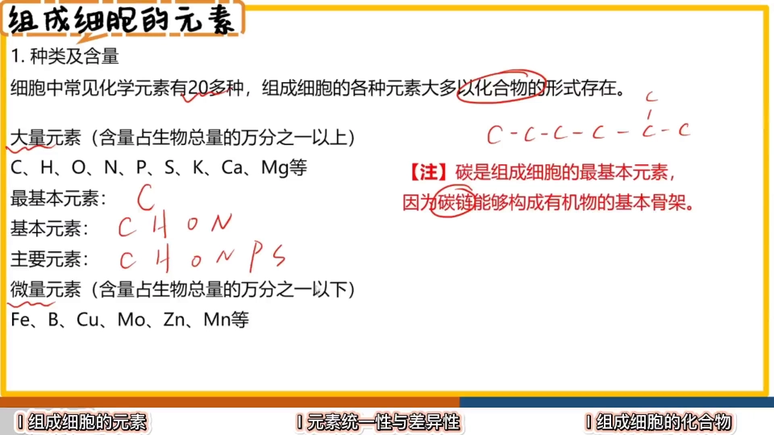
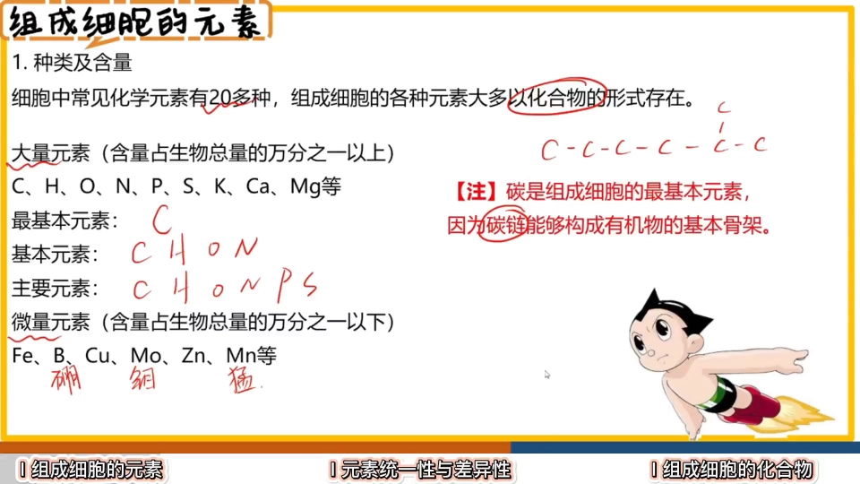
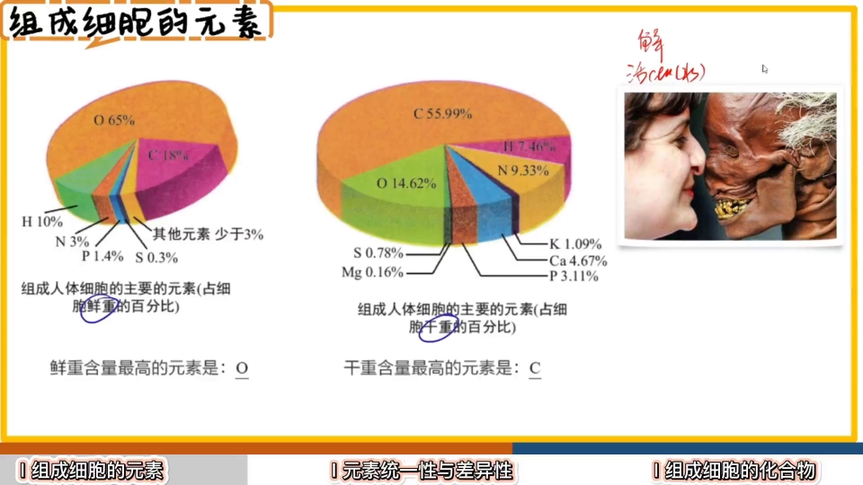
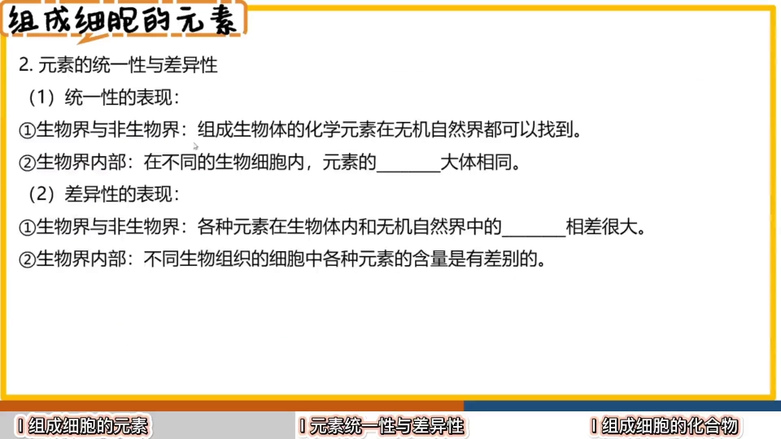
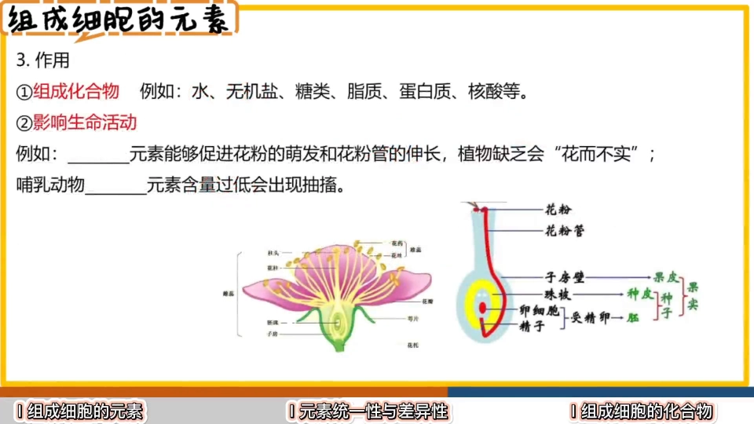
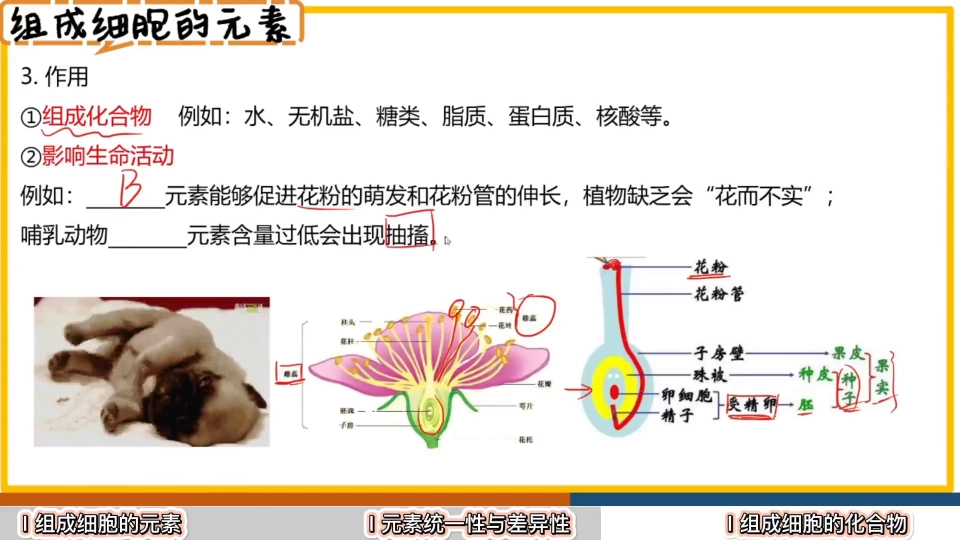
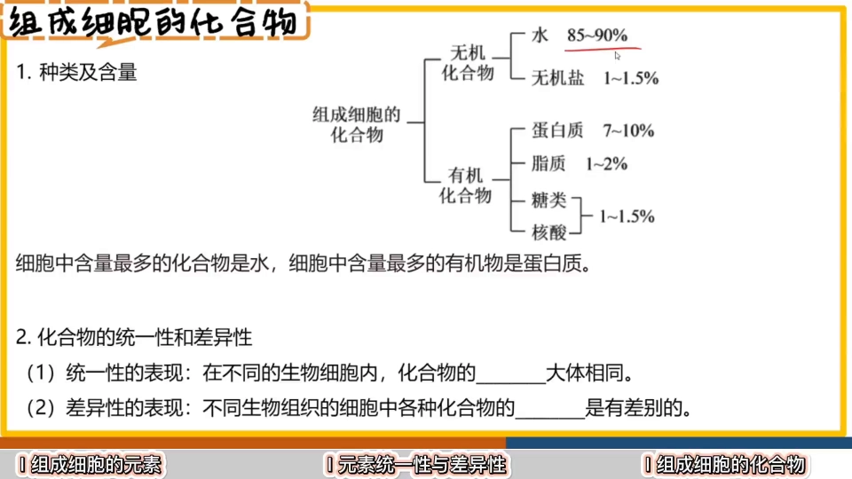
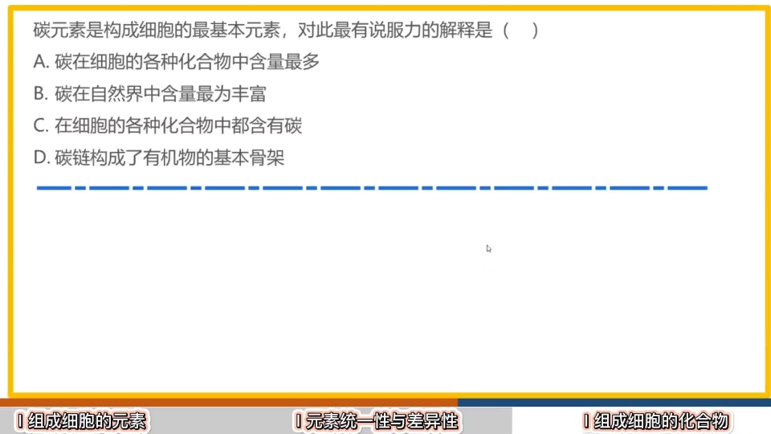
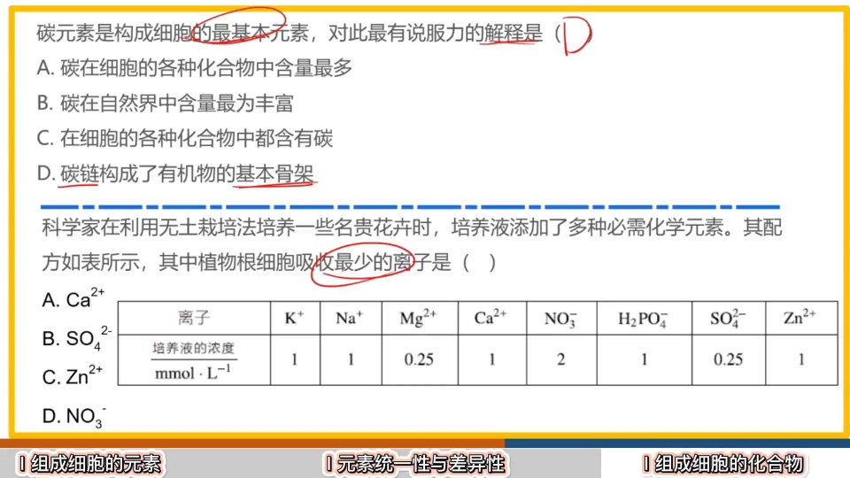
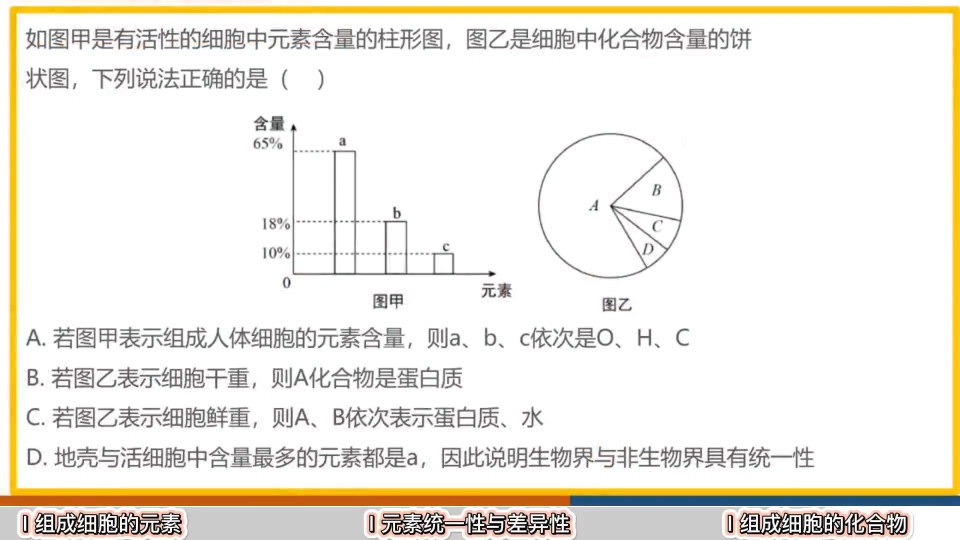

# 细胞中的元素和化合物：组成细胞的分子基础

> 视频来源：[《细胞中的元素和化合物：组成细胞的分子基础》](https://www.bilibili.com/video/BV18F411w71i/)（B 站 · 喵喵老师）｜时长约 19 分钟
> 导读：这是必修一第二章「组成细胞的分子」的第一小节。视频把元素按含量分了类、给出记忆口诀，再讲清鲜重/干重、统一性/差异性这两组最容易考混的概念，最后落到组成细胞的化合物。

## 本讲要解决的核心问题（SCQA）

**背景**：细胞是由物质构成的，要研究细胞，先得知道组成细胞的元素和化合物有哪些。

**冲突**：这一节知识点密度高、还特别爱考选择题——「最基本元素」为什么是碳、「鲜重」和「干重」谁含量最高、元素和化合物的「统一性」与「差异性」到底指种类还是含量，概念一含糊就容易掉进题目的坑。

**疑问**：组成细胞的元素怎么分类？含量最高的元素和化合物分别是谁？「统一性」和「差异性」各指什么？

**回答（中心思想）**：组成细胞的元素约 20 多种，按含量分**大量元素**和**微量元素**；含量最高这件事要分**鲜重**与**干重**两种情况看，两者结论正好颠倒；**统一性看「种类」、差异性看「含量」**——把这三组对应关系记牢，这一节的题基本就稳了。

---

## 一、组成细胞的元素：20 多种，按含量分成两类

细胞中常见的化学元素有 **20 多种**，大部分以**化合物**的形式存在。按元素所占含量的多少，可以分为两类：

- **大量元素**：含量占生物总量**万分之一以上**，有 C、H、O、N、P、S、K、Ca、Mg 等；
- **微量元素**：含量占生物总量**万分之一以下、而且是生物必需的**（这一点很关键），有 Fe、B、Cu、Mo、Zn、Mn 等。

[【跳转到 02:23】](https://www.bilibili.com/video/BV18F411w71i/?t=143)

### 1.1 三个层次的名字：最基本元素、基本元素、主要元素

- **最基本元素：碳（C）**。这里特别容易考，一定要强调：**它叫最基本元素，并不是因为它含量最多**，而是因为细胞里有很多有机物都以**碳链**的形式存在，碳链是构成有机物的**基本骨架**——多糖类、核酸链、蛋白质链都是由很多碳连在一起构成的骨架。
- **基本元素**：活细胞中含量前四位的元素，即 **C、H、O、N**。
- **主要元素**：**C、H、O、N、P、S**。因为它们正是细胞中化合物的主要元素——糖类是 C、H、O，蛋白质是 C、H、O、N（有的含 S），核酸是 C、H、O、N、P。

[【跳转到 03:13】](https://www.bilibili.com/video/BV18F411w71i/?t=193)

### 1.2 记微量元素的口诀：铁臂阿童木最猛

区分大量元素和微量元素是选择题常见题型。诀窍是**把微量元素背下来**，剩下的基本就是大量元素。喵喵老师的口诀是 **「铁臂阿童木最猛」**：

| 口诀字 | 对应元素 |
| --- | --- |
| 铁 | Fe（铁） |
| B | B（硼，用英文符号借音） |
| 童 | Cu（铜） |
| 木 | Mo（钼） |
| 最（Z） | Zn（锌） |
| 猛 | Mn（锰） |

判断某个元素是不是微量元素时，想一遍「铁臂阿童木最猛」：在这句口诀里的就是微量元素，不在里面的通常就是大量元素。

---

## 二、鲜重与干重：含量最高的元素正好颠倒

先搞清**鲜重**和**干重**：

- **鲜重**指**活细胞**——活细胞里有很多很多水分；
- **干重**是把水全部去掉之后的重量。

把两者对照，会得到两组结论：

| 比较项 | 鲜重 | 干重 |
| --- | --- | --- |
| 含量最多的化合物 | 水 | 蛋白质 |
| 含量最高的元素 | 氧（O） | 碳（C） |
| 元素含量前四位 | O、C、H、N | C、O、N、H |

[【跳转到 05:35】](https://www.bilibili.com/video/BV18F411w71i/?t=335)

为什么鲜重含量最高是氧而不是碳？因为鲜重里水最多，而水里最重的元素是氧。干重把水去掉后，剩下最多的是蛋白质，而蛋白质里最重的是碳。**鲜重前四位（O、C、H、N）和干重前四位（C、O、N、H）正好颠倒，可以对比着记。**

[【跳转到 06:50】](https://www.bilibili.com/video/BV18F411w71i/?t=410)

---

## 三、元素的统一性与差异性：统一看种类，差异看含量

这是最容易混的一组概念，记住判据只有一句：**统一性表现在「种类」上，差异性表现在「含量」上。**

**统一性表现：**

1. **生物界与非生物界之间**：在生物体中能找到的化学元素，在无机自然界都能找到（话说反了就是错的）；
2. **生物界内部**：不同生物细胞内，元素的**种类**大体相同。

**差异性表现：**

1. **生物界与非生物界之间**：各种元素在生物体内和无机自然界中的**含量**相差很大；
2. **生物界内部**：不同生物组成的细胞中，各元素的**含量**也有差别。

[【跳转到 08:12】](https://www.bilibili.com/video/BV18F411w71i/?t=492)

---

## 四、元素的两大作用

### 4.1 作用一：组成化合物

细胞中的化合物有水、无机盐、糖类、脂质、蛋白质、核酸等主要几类（后面几期视频会分别细讲）。

### 4.2 作用二：影响生命活动

两个经典例子：

**例 1：硼（B）促进花粉的萌发和花粉管的伸长，缺硼会「花而不实」。**

「花而不实」就是**只开花但不结果**。要理解这个原理，得先回忆花的结构：

- 一朵**两性花**既有雌蕊又有雄蕊。**雌蕊** = 柱头 + 花柱 + 子房，**雄蕊** = 花丝 + 花药；
- **卵细胞**在雌蕊的**胚珠**里，**精细胞**在**花药**里。

[【跳转到 08:51】](https://www.bilibili.com/video/BV18F411w71i/?t=531)

到了授粉季节，花粉飘落到**柱头**上，在柱头处萌发出**花粉管**，花粉里的精细胞沿着花粉管慢慢到达珠孔，与卵细胞结合形成**受精卵**。受精卵将来发育成种子的胚——**种子的形成必须有受精卵，而种子形成后才能刺激子房发育成果实**。

[【跳转到 10:31】](https://www.bilibili.com/video/BV18F411w71i/?t=631)

于是缺硼的后果就清楚了：要么花粉不能萌发、要么花粉管不能延长，无论哪种，**受精卵都形不成 → 种子形不成 → 果实也形不成**，这就是「花而不实」。

**例 2：血液中钙离子过低会抽搐。**

钙离子与**神经系统的兴奋性**有关，它本来起**抑制神经系统过度兴奋**的作用；当它太少时，神经系统就太兴奋了，于是人会抽筋、抽搐。所以半夜腿抽筋时，要想到补钙。

[【跳转到 12:11】](https://www.bilibili.com/video/BV18F411w71i/?t=731)

---

## 五、组成细胞的化合物：最多的是水，最多的是蛋白质（有机物）

组成细胞的化合物先分两大类：

| 类别 | 化合物 | 含量 |
| --- | --- | --- |
| 无机化合物 | 水 | 85~90%（最多） |
| 无机化合物 | 无机盐 | 1~1.5% |
| 有机化合物 | 蛋白质 | 7~10% |
| 有机化合物 | 脂质 | 1~2% |
| 有机化合物 | 糖类 | 1~1.5% |
| 有机化合物 | 核酸 | 很少 |

[【跳转到 15:25】](https://www.bilibili.com/video/BV18F411w71i/?t=925)

记住两句话：

- **细胞中含量最多的化合物是水**（严格说是一般情况下都如此，无论海洋生物的细胞还是沙漠里仙人掌的细胞）；
- **细胞中含量最多的有机化合物是蛋白质**（脂肪、糖类、核酸都更少）。

以上说的都是**鲜重**。如果换成**干重**（去掉水），那含量最多的化合物自然就是**蛋白质**了——所以做题时一定先看清题目问的是鲜重还是干重。

### 5.1 化合物的统一性与差异性

和元素一样，判据不变：**统一性看种类，差异性看含量。**

- **统一性**：不同生物细胞内，化合物的**种类**大体相同；
- **差异性**：不同生物组织细胞中，各种化合物的**含量**有差别（所以含量给的往往是一个范围）。

---

## 六、三道练习题的思路

**第 1 题**：碳元素是构成细胞的最基本元素，对此最有说服力的解释是——答案是 **D：碳链构成了有机物的基本骨架**。其他选项（含量最多、自然界最丰富、各种化合物都含碳）都不是这个「最基本」的根据。

[【跳转到 12:56】](https://www.bilibili.com/video/BV18F411w71i/?t=776)

**第 2 题**：无土栽培名贵花卉，培养液配方里植物根细胞**吸收最少的离子**是谁？不要被浓度数字骗了——吸收多少不是按浓度算，这题考的是**大量元素与微量元素**。用「铁臂阿童木最猛」去比对选项：Fe、B、Cu、Mo 都不在选项里，只有 **Zn（锌）是微量元素**，所以它吸收得最少，答案是 **C**。

[【跳转到 14:11】](https://www.bilibili.com/video/BV18F411w71i/?t=851)

**第 3 题**：图甲是「有活性的细胞」（即鲜重）中元素含量的柱形图，图乙是细胞中化合物含量的饼状图。逐项看：

- **A** 错：鲜重里含量最多的化合物是水，所以最重的元素是氧；但第二、三位应颠倒过来，不能是 O、H、C；
- **B** 对：图乙若表示细胞干重（不管水），含量最多的化合物是蛋白质；
- **C** 错：图乙若表示鲜重，应是水在前、蛋白质在后，选项把它说反了；
- **D** 错：统一性指的是**元素种类**——生物体内的元素在无机自然界都能找到；而「地壳与活细胞中含量最多的元素都是氧」说的是**含量**，含量问题属于**差异性**，不能叫统一性。

所以答案是 **B**。

[【跳转到 19:04】](https://www.bilibili.com/video/BV18F411w71i/?t=1144)

---

## 小结

- 组成细胞的元素有 20 多种，按含量分**大量元素**（万分之一以上）和**微量元素**（万分之一以下且必需）。
- **碳是最基本元素，原因是碳链构成有机物的基本骨架**，与含量多少无关；基本元素是 C、H、O、N，主要元素是 C、H、O、N、P、S。
- 微量元素记「**铁臂阿童木最猛**」（Fe、B、Cu、Mo、Zn、Mn）。
- **鲜重**含量最高：化合物是水、元素是氧（前四位 O、C、H、N）；**干重**含量最高：化合物是蛋白质、元素是碳（前四位 C、O、N、H）。
- **统一性看种类、差异性看含量**，元素和化合物都适用这套判据。
- 元素的作用有两条：组成化合物、影响生命活动，典型例子是**缺硼导致花而不实**、**缺钙导致抽搐**。
- 化合物：含量最多的化合物是**水**，含量最多的有机物是**蛋白质**。

## 关键术语速查

| 术语 | 一句话解释 |
| --- | --- |
| 大量元素 | 含量占生物总量万分之一以上的元素，如 C、H、O、N、P、S、K、Ca、Mg |
| 微量元素 | 含量占生物总量万分之一以下且生物必需的元素，如 Fe、B、Cu、Mo、Zn、Mn |
| 最基本元素 | 碳（C），因为碳链构成有机物的基本骨架 |
| 鲜重 | 活细胞的重量，含水，含量最高的元素是氧 |
| 干重 | 去掉水后的重量，含量最高的元素是碳 |
| 花而不实 | 缺硼导致只开花不结果的现象 |
| 统一性 | 指元素或化合物的「种类」大体相同、生物界与非生物界种类相通 |
| 差异性 | 指元素或化合物的「含量」相差很大 |
