# 细胞是生命活动的基本单位：细胞学说与生命系统的层次

> 视频来源：[《细胞是生命活动的基本单位：细胞学说的建立》](https://www.bilibili.com/video/BV1WM4y1L7f8/)（B 站 · 国家中小学课程资源，北京理工大学附属中学 赵清洁老师）｜时长约 25 分钟
> 导读：这是一节高一必修一第一章第一节的完整课堂。它讲清了两件事——「细胞学说」是怎样被一步步建立和修正的，以及为什么说「细胞是基本的生命系统」。文末附生命系统结构层次与病毒这个例外。

## 本讲要解决的核心问题（SCQA）

**背景**：初中就学过「生物由细胞组成」。大熊猫和冷箭竹在个体水平上形态迥异，但两者结构与功能的基本单位都是细胞。

**冲突**：这个结论凭什么成立？细胞小到肉眼根本看不见（人体细胞直径约 10 微米，而人眼能分辨的两点最小距离只有 0.1 mm），科学家是借助什么、经历了哪些步骤，才把「一切动植物都由细胞构成」确立为学说的？为什么细胞学说的建立者主要是施莱登和施旺，而不是更早看到细胞的虎克或列文虎克？

**疑问**：细胞学说讲了什么、靠什么思维方法得出、后来又怎样被修正？为什么说细胞是「最基本的生命系统」？

**回答（中心思想）**：细胞学说不是某个人的灵光一现，而是**「大量观察 → 归纳概括 → 形成理论 → 被新证据修正」**的产物——显微镜让观察深入到细胞水平，施莱登和施旺用归纳法把它上升为学说，魏尔肖又用「所有的细胞都来源于先前存在的细胞」修正了它。由此，细胞成为生命活动的基本单位，也是生命系统结构层次中最基础的一层。

---

## 一、细胞学说的建立：从肉眼观察走到显微镜

科学家不是一下子就看到了细胞。整条线索按观察工具分成两个阶段：**肉眼观察阶段**和**显微观察阶段**。

### 1.1 肉眼时代：维萨里与比夏只走到器官、组织这一层

早在没有显微镜的年代，科学家也在解剖观察生物，但受限于肉眼分辨率，他们只能看到比细胞大得多的层次：

| 科学家 | 观察方法 | 观察内容 | 主要成就 |
| --- | --- | --- | --- |
| 维萨里（1543，比利时解剖学家）| 肉眼观察 | 尸体解剖 | 揭示器官水平的结构 |
| 比夏（1800，法国学者）| 肉眼观察 | 器官解剖 | 发现比器官更低一层次的组织结构 |

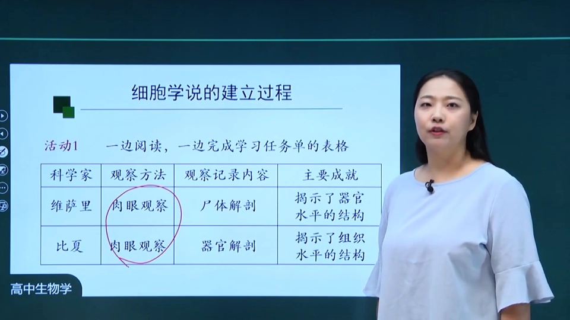

[【跳转到 03:54】](https://www.bilibili.com/video/BV1WM4y1L7f8/?t=234)

两位科学家的观察手段都仅限于肉眼，因此再往下就看不到了。原因是一道硬性的物理限制：构成人体的细胞大概只有 **10 微米**左右，而人眼能够分辨的两个点的最小距离是 **0.1 mm**，所以大部分细胞根本无法用肉眼直接观察。

### 1.2 显微镜打开微观世界：虎克命名细胞，列文虎克看到活细胞

到了 17 世纪，显微镜的发明使人们终于可以观察到微观世界。

- **罗伯特·虎克**用显微镜观察软木栓的横断面，发现其中由许多规则的小室组成，他把这些像蜂窝一样的小室画下来，并命名为 **cell（细胞）**。这是细胞第一次被观察并命名。
- 需要注意的是，**虎克看到的其实是死细胞**——我们看到的那些「小室」绝大多数是植物的细胞壁。但细胞的发现仍为人类打开了微观世界的大门，是生物学科进入显微研究的起点。

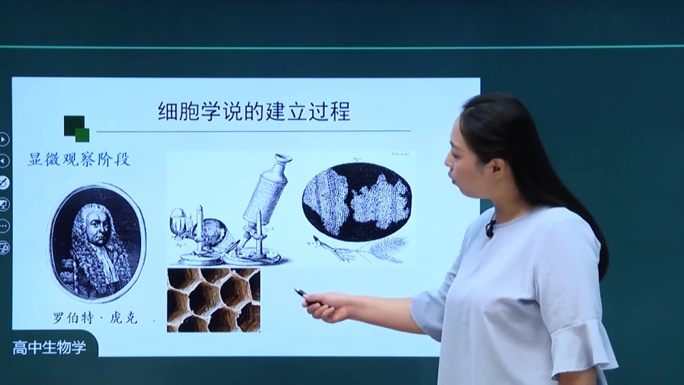

[【跳转到 05:05】](https://www.bilibili.com/video/BV1WM4y1L7f8/?t=305)

- **第一个真正看到活细胞的是荷兰的列文虎克。** 他是一位技术高超的磨镜师，制作的显微镜在当时就能把物体放大到 300 多倍。他用显微镜观察了动物的红细胞、精子和细菌等。

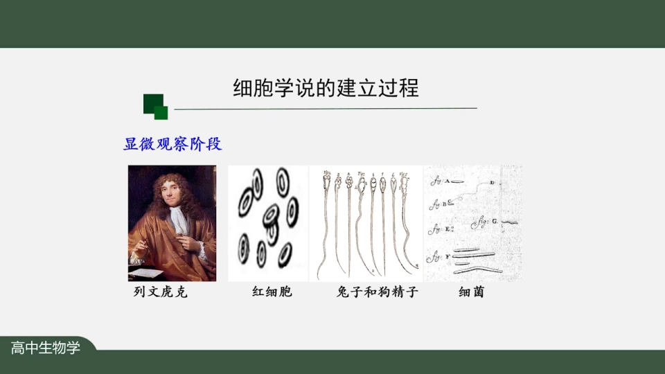

[【跳转到 06:40】](https://www.bilibili.com/video/BV1WM4y1L7f8/?t=400)

此后显微镜技术越来越进步，意大利的**马尔比基**等人也观察到了更细微的结构。**但人们虽然已经观察到大量细胞，却始终没有提出细胞学说**——这正是下面要回答的问题：为什么建立者主要是施莱登和施旺？

---

## 二、施莱登与施旺：细胞学说为什么出自他们

**关键区别在于：早期科学家只做了「广泛观察」，没有进行科学的「归纳和概括」。**

### 2.1 理论归纳阶段：从观察到学说

- **德国植物学家施莱登**通过对花粉、胚珠、柱头等组织的观察，发现这些组织都由细胞构成、且细胞中都有细胞核；他进一步做**理论概括**，得出「植物体都是由细胞构成的，细胞是植物体的基本单位，新细胞从老细胞中产生」。

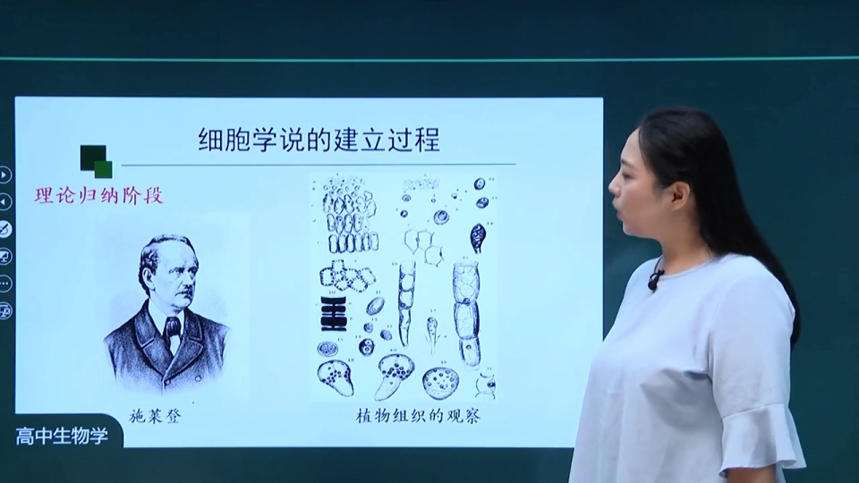

[【跳转到 07:39】](https://www.bilibili.com/video/BV1WM4y1L7f8/?t=459)

- **德国动物学家施旺**发现，与植物细胞相比，动物细胞形态差异更大、更变幻多端，因而人们一直没能建立起动植物在显微结构上的联系。经过大量观察，他发表了《关于在动植物的结构及一致性的显微研究》，提出「动物体也是由细胞构成的，**一切动物的个体发育过程都是从受精卵这个单细胞开始的**」。

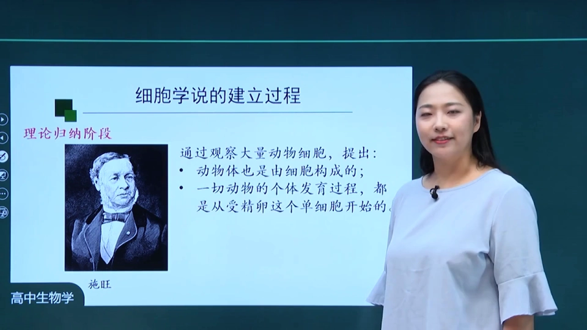

[【跳转到 09:05】](https://www.bilibili.com/video/BV1WM4y1L7f8/?t=545)

至此，施莱登和施旺共同提出细胞学说：**一切动植物体都是由细胞组成的，细胞是一切动植物体的基本单位**。它推倒了分隔动植物界的巨大屏障，揭示了动物和植物的统一性，从而阐明了生物界的统一性。

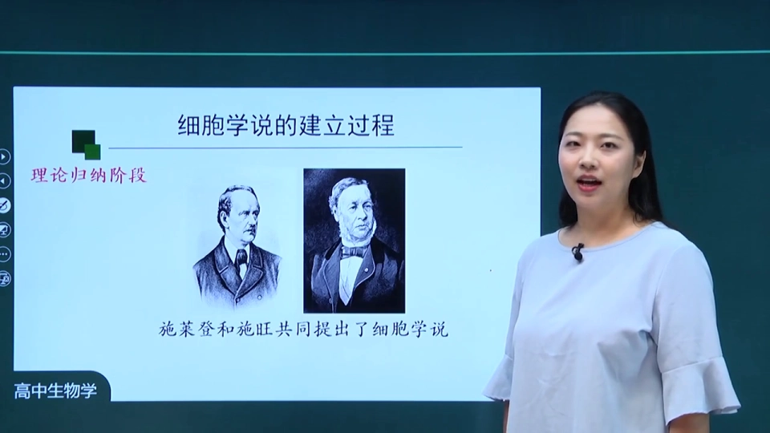

[【跳转到 09:14】](https://www.bilibili.com/video/BV1WM4y1L7f8/?t=554)

### 2.2 归纳法：细胞学说靠什么思维方法得出

回头看证据的三个角度：

- **材料角度**：无论是早期通过大量尸体解剖、器官解剖了解结构层次，还是后来观察红细胞、花粉等动植物细胞，都建立在科学家前赴后继的大量观察之上；
- **工具角度**：早期靠简单、直接的肉眼观察；随着科技进步，显微镜把研究层次深入到细胞水平，**正是显微镜的发明直接导致了细胞学说的建立**；
- **科学方法角度**：科学家先通过直接观察获得结论，再在此基础上归纳概括，最终形成理论。

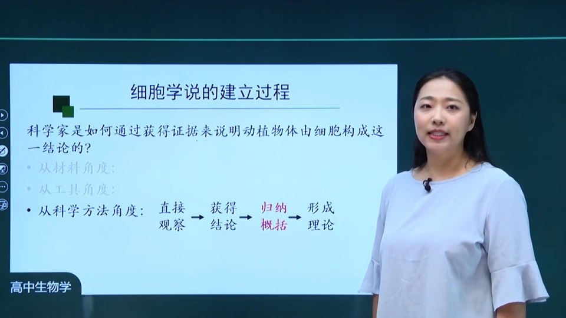

[【跳转到 12:06】](https://www.bilibili.com/video/BV1WM4y1L7f8/?t=726)

这种「由一系列具体事实推出一般结论」的思维方法就是**归纳法**，它分两种：

- **完全归纳法**：掌握了全部事实再下结论。例如科学家观察了所有植物的花粉、胚珠、柱头等组织的细胞，发现都有细胞核，才得出「植物细胞都有细胞核」。
- **不完全归纳法**：只考察一类事物中的部分研究对象，就得出该类事物所有对象的某种特性。由于生物的多样性和生命活动的复杂性，生物学研究很难用完全归纳法。施莱登和施旺只观察了部分动植物的组织，就归纳出「所有动植物都由细胞构成」——**这正是典型的不完全归纳法**。但只要在简单枚举的基础上进行了科学归纳、抓住了部分对象与本质的内在联系，这个一般性结论就是可靠、科学的。

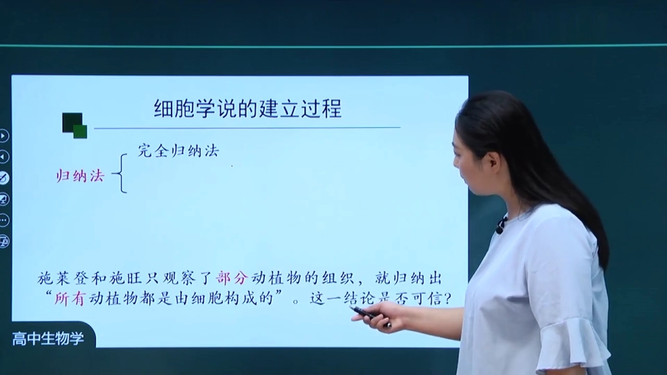

[【跳转到 13:21】](https://www.bilibili.com/video/BV1WM4y1L7f8/?t=801)

---

## 三、细胞学说在修正中前进：新细胞究竟从哪来

施莱登认为「新细胞从老细胞中产生」，施旺认为「动物细胞都是从受精卵这个单细胞开始的」。但新细胞产生的**具体方式**到底是什么，两人并没有说清——施莱登甚至猜测新细胞是从老细胞的细胞核中长出、或在细胞质中像结晶那样产生。这个猜想是错的。

**施莱登的朋友耐格里**用显微镜观察了多种植物分生区新细胞的形成，发现新细胞的产生原来是**细胞分裂**的结果；此后很多科学家也观察到了细胞分裂。

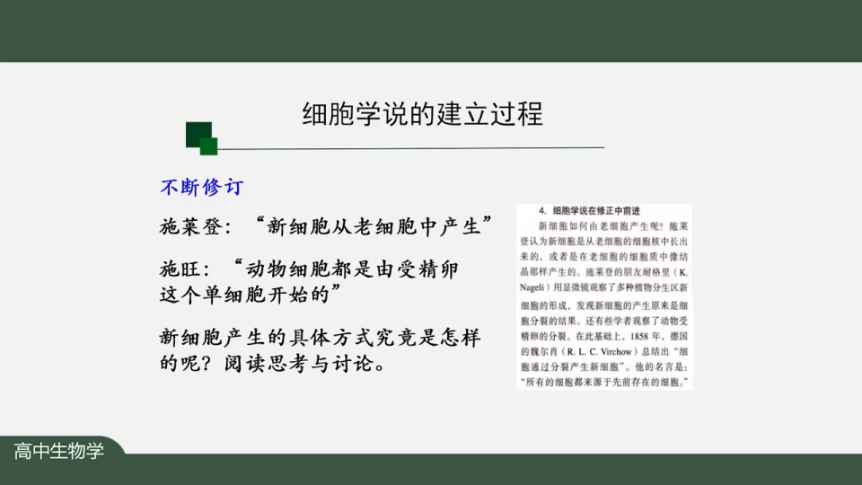

[【跳转到 14:56】](https://www.bilibili.com/video/BV1WM4y1L7f8/?t=896)

1855 年，**魏尔肖**总结自己和他人观察到的结果，提出至理名言：**「所有的细胞都来源于先前存在的细胞。」** 这一论断推翻了施莱登和施旺的错误假设，对细胞学说作了重要修订。至此，细胞学说才得以完善和建立。

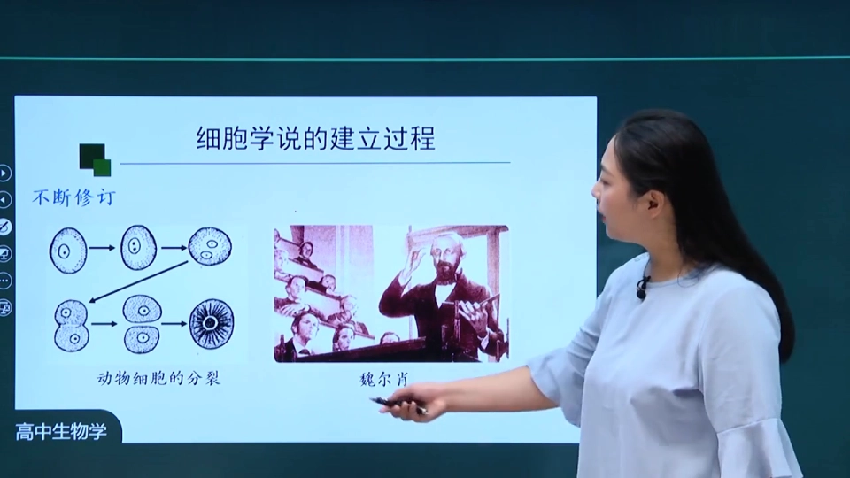

[【跳转到 15:19】](https://www.bilibili.com/video/BV1WM4y1L7f8/?t=919)

---

## 四、细胞学说的三个主要观点与三项意义

### 4.1 三个主要观点

1. **细胞是一个有机体**，一切动植物都是由细胞发育而来，并由细胞和细胞产物所构成；
2. **细胞是一个相对独立的单位**，既有它自己的生命，又对与其他细胞共同组成的整体的生命起作用；
3. **新细胞是由老细胞分裂产生的。**

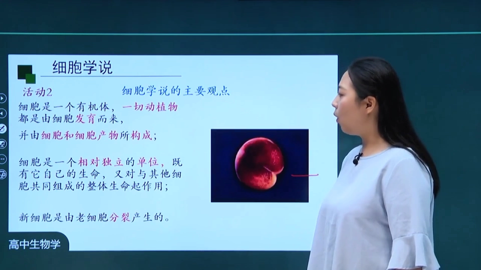

[【跳转到 16:50】](https://www.bilibili.com/video/BV1WM4y1L7f8/?t=1010)

其中第 1 点可以用卵细胞来理解：卵细胞发育时，外面包裹着一层由卵细胞或其他细胞分泌产生的透明带，这说明生物体是由**细胞和细胞产物**所构成的；精卵结合形成受精卵后，受精卵又分化发育成上皮细胞、神经细胞等，这又说明细胞既相对独立，又服务于整体。

### 4.2 三项意义

- **观念上**：承认一切动植物都由细胞和细胞产物构成，打破了动植物界的壁垒，体现了动物和植物的统一性，从而阐明了**生物界的统一性**；
- **学科上**：总结出一切动植物都由细胞发育而来，促进了由来已久的解剖学、生理学、胚胎学等多学科的融通和统一；
- **研究水平上**：承认细胞是相对独立的单位，使人们认识到生物的生长、生殖、发育等生理现象的奥秘要到细胞中去寻找，**生物学研究由器官、组织水平进入到了细胞水平**。

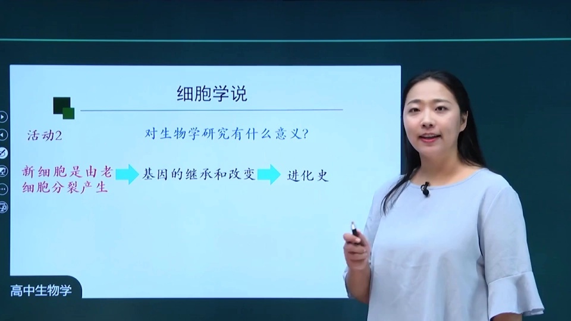

[【跳转到 18:25】](https://www.bilibili.com/video/BV1WM4y1L7f8/?t=1105)

理解这三项意义后，视频用一句话作结：**新细胞由老细胞产生，老细胞由更老的细胞产生**——小小的细胞内部凝聚着数十亿年基因的继承和改变，每个细胞、每个生物都是历史的产物。

---

## 五、细胞是基本的生命系统

### 5.1 为什么说细胞是生命活动的基本单位

- **单细胞生物**（如草履虫）：只有一个细胞，就能独立完成整个个体的生命活动；
- **多细胞生物**（如人）：仅完成一次缩手反射，就需要骨骼肌细胞、神经细胞等一系列已分化的细胞共同参与。

细胞的代谢、生长发育、遗传和变异，都说明生命活动离不开细胞。细胞之所以有如此强大的功能，是因为它内部结构复杂而精巧，是一个由各种组分相互配合而成的**系统**——**系统**是指彼此间相互作用、相互依赖的组分有规律地结合而形成的整体；细胞是有生命的，是一个**生命系统**。

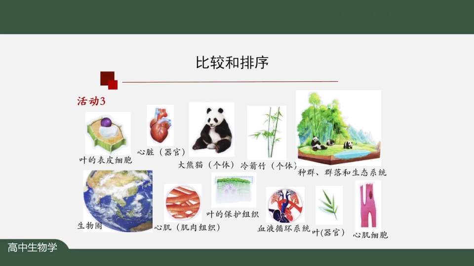

[【跳转到 20:22】](https://www.bilibili.com/video/BV1WM4y1L7f8/?t=1222)

### 5.2 生命系统的结构层次：从细胞到生物圈

把画面中出现的材料按从小到大排序，就得到生命系统的结构层次：

**细胞 → 组织 → 器官 → 系统 → 个体 → 种群 → 群落 → 生态系统 → 生物圈**

- **细胞、组织、器官、系统、个体**：细胞构成组织，组织构成器官；在动物个体中，器官构成系统，系统构成个体；
- **种群**：在一定空间范围内，同种生物的**所有个体**形成一个整体（例如某区域内的所有大熊猫）；
- **群落**：同一区域内所有大熊猫、冷箭竹和其他生物共同形成的更大整体；
- **生态系统**：群落与无机环境相互作用而形成；
- **生物圈**：地球上所有生态系统相互关联而构成的整体。

其中，**个体以下是从微观角度观察，个体及以上是从宏观角度观察**；**细胞是这些层次当中最基本的生命系统**。

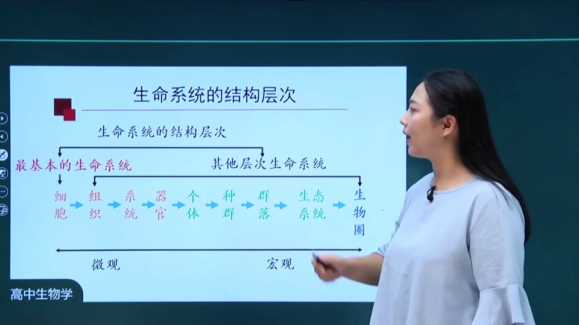

[【跳转到 23:00】](https://www.bilibili.com/video/BV1WM4y1L7f8/?t=1380)

### 5.3 唯一的例外：病毒

并不是所有生命体都落在这套层次里，**例外是病毒**。病毒一般由**核酸分子（DNA 或 RNA）与蛋白质**构成，**没有细胞结构**。

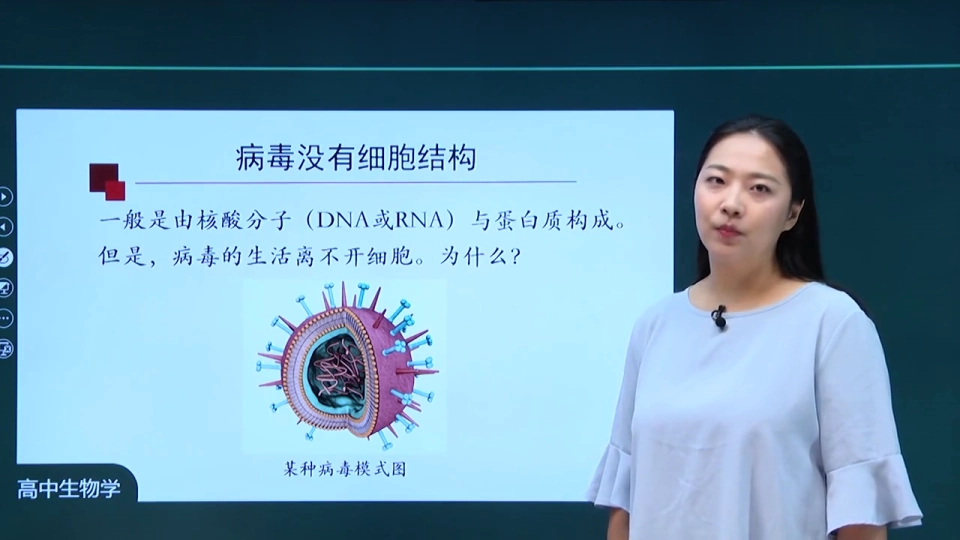

[【跳转到 23:38】](https://www.bilibili.com/video/BV1WM4y1L7f8/?t=1418)

但**病毒的生活离不开细胞**：它只能在细胞内寄生生活，缺少自主代谢的完整结构，单独存在时不能繁殖。例如新冠病毒只能在人体特定的细胞内生存，因此隔离是消灭它的重要措施。也正因为如此，研究病毒的活动有助于我们更深入地理解细胞活动的机理。

---

## 小结

- 细胞学说的建立分两步：**肉眼观察阶段**（维萨里、比夏，只能到器官/组织水平）到**显微观察阶段**（虎克命名细胞、列文虎克看到活细胞）。
- 施莱登和施旺的贡献不在于「看到细胞」，而在于用**归纳法**把大量观察概括成学说：一切动植物都由细胞构成，细胞是基本单位。
- 归纳法分**完全归纳法**与**不完全归纳法**，细胞学说采用的是后者，但只要做了科学归纳就是可靠结论。
- 学说在**修正中前进**：耐格里发现细胞分裂，1855 年魏尔肖提出「所有的细胞都来源于先前存在的细胞」。
- 细胞学说有三个观点、三项意义，核心是把生物学研究推进到**细胞水平**，并阐明生物界的统一性。
- 生命系统的结构层次是**细胞 → 组织 → 器官 → 系统 → 个体 → 种群 → 群落 → 生态系统 → 生物圈**，细胞是最基本的一层。
- **病毒**没有细胞结构，但必须寄生在细胞内才能生活，是这套层次之外的例外。

## 关键术语速查

| 术语 | 一句话解释 |
| --- | --- |
| 细胞学说 | 一切动植物体都由细胞组成，细胞是一切动植物体的基本单位 |
| 归纳法 | 由一系列具体事实推出一般结论的思维方法 |
| 完全归纳法 | 掌握了全部事实后再得出结论 |
| 不完全归纳法 | 只考察部分研究对象就得出一般性结论 |
| 魏尔肖论断 | 「所有的细胞都来源于先前存在的细胞」 |
| 生命系统 | 彼此间相互作用、相互依赖的组分有规律结合而形成的整体 |
| 种群 | 一定空间范围内同种生物的所有个体 |
| 群落 | 同一区域内所有生物共同形成的整体 |
| 生态系统 | 群落与无机环境相互作用形成的整体 |
| 生物圈 | 地球上所有生态系统相互关联构成的最大整体 |
