# 细胞的结构与功能：细胞膜、细胞器与细胞核

> 视频来源：[《细胞结构与功能，看这一条视频就够了》](https://www.bilibili.com/video/BV1zsnBzGENK/)（B 站 · 高中生物科普）｜时长约 27 分钟
> 导读：这条视频按「细胞膜 → 细胞器 → 细胞核」把真核细胞拆开讲了个遍，最后补上原核细胞和内共生学说。它反复用同一个总纲——**结构与功能相适应**——来解释每一处结构为什么长成那样。

## 本讲要解决的核心问题（SCQA）

**背景**：细胞的结构与功能是高一必修一最基础的生物学知识，也是后面学光合、呼吸、细胞分裂、遗传进化的地基。

**冲突**：很多同学在这里「没入明白、似懂非懂」，于是后面越学越吃力。细胞里结构那么多、名字那么碎，如果只是死记硬背，很难记住，也说不清哪两个结构容易混。

**疑问**：细胞里到底有哪些结构、各干什么？它们为什么长成那样？原核细胞和真核细胞差在哪？

**回答（中心思想）**：细胞是一个由**细胞膜（边界）+ 细胞器（车间）+ 细胞核（控制中心）**三大部分构成的工厂；记住它们的捷径是把每个结构和它的功能绑在一起理解，也就是**「结构与功能相适应」**——线粒体折叠出嵴、叶绿体堆出基粒、溶酶体装水解酶，都是这条原则的落地。

---

## 一、先立一个总纲：结构与功能相适应

「结构与功能相适应」是贯穿高中生物三年的观点：**有什么样的结构，就应该有什么样的功能**。鸟有翅膀所以能飞，人没有翅膀所以不能飞；长颈鹿有长脖子所以能吃到高处的叶子。

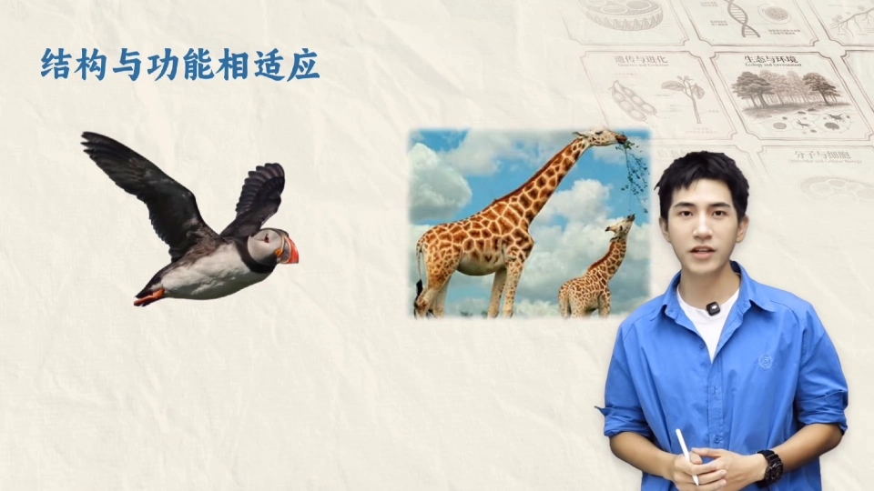

[【跳转到 00:47】](https://www.bilibili.com/video/BV1zsnBzGENK/?t=47)

细胞作为生物体的最小单位，本身就是一个完整的结构层次：里面有不同结构各司其职，共同维持细胞稳定运行。用一幅简图理解细胞，只要三类东西：

- **细胞膜**：细胞得有个边界，控制物质进出；
- **细胞器**：像工厂里不同的车间，干不同的活；
- **细胞核**：车间谁来管？它充当「老板」，控制整个细胞的功能。

---

## 二、细胞膜：细胞的「门卫」

### 2.1 三大功能

细胞膜把细胞和外界隔绝开来。如果细胞是一个工厂，细胞膜就是**门卫**：

1. **屏障、保护**：起到保护和屏障的作用；
2. **控制物质运输**：谁出来、谁进去，都得听门卫的；
3. **信息交流**：外来的信号要先经过它，才能传递给细胞内部。

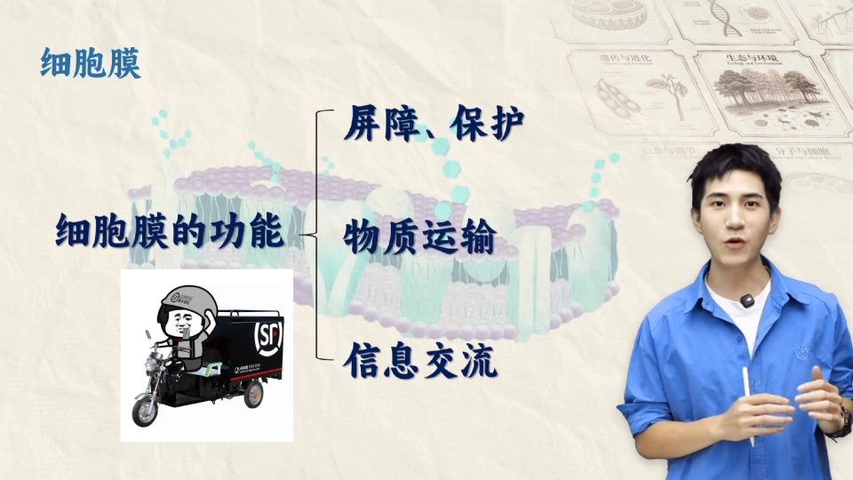

[【跳转到 02:49】](https://www.bilibili.com/video/BV1zsnBzGENK/?t=169)

### 2.2 结构基础：磷脂双分子层、蛋白质与糖

行使这些功能靠的是相应的结构：

- **磷脂分子**：细胞膜最基本的结构。它的**头部亲水、尾部疏水**。
- 正因为头亲水、尾疏水，磷脂排布时会形成**头部朝外、尾部朝内**、上下两层的结构，即**磷脂双分子层**。它起到隔绝作用，是细胞膜最基本的**骨架**。

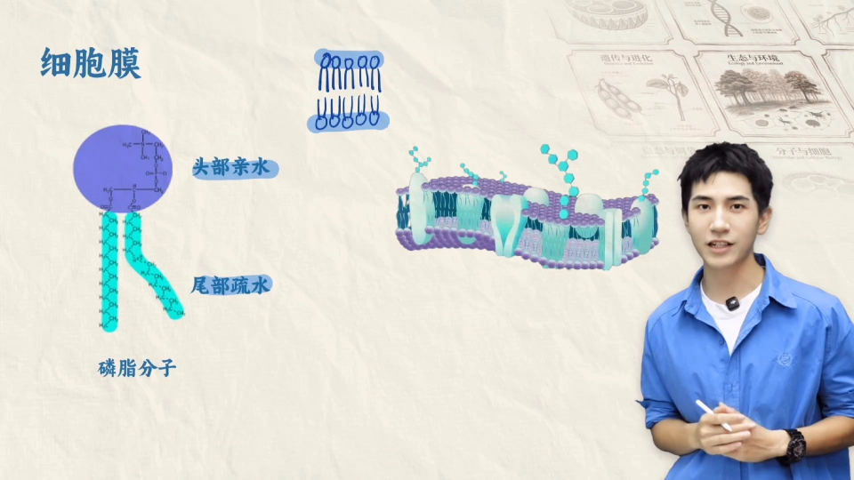

[【跳转到 03:44】](https://www.bilibili.com/video/BV1zsnBzGENK/?t=224)

有了磷脂构成的屏障，控制运输和信息交流就交给**蛋白质**。细胞膜上的蛋白质结构非常多样：有的像门一样控制物质进出、还能开或关，有的是**受体**可以接受外来信号，还有一些与糖链结合形成**糖蛋白**。

所以组成细胞膜的结构主要有三种：**脂质、蛋白质、糖**。注意两点：

- 组成细胞膜的**脂质不只是磷脂，还含有胆固醇**（有些胆固醇会插在膜里），因此填空题写「脂质」而不是「磷脂」；
- 若只给两个空，就写「**脂质和蛋白质**」——它们占比最大，糖不是最主要的。

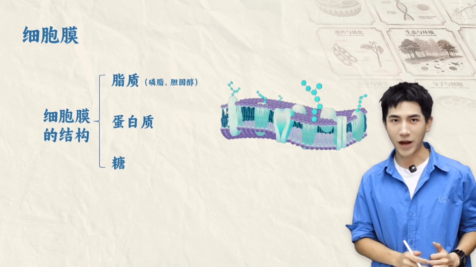

[【跳转到 04:30】](https://www.bilibili.com/video/BV1zsnBzGENK/?t=270)

### 2.3 两大特性：结构上「流动」、功能上「选择」

- **结构特性——流动性**：膜上的蛋白质不是傻站着不动的，哪里需要就搬到哪里。比如细胞左侧要进货，膜上的蛋白质就会移向左侧，让物质进来。
  - 但流动性**不是完全自由**：有些蛋白质铆定在细胞结构里，甚至与细胞质中的细胞骨架结合，这类蛋白就动不了——「一动就牵扯全身」。
- **功能特性——选择透过性**：什么物质能进、什么能出，由细胞膜自己选择。

⚠️ 别混淆：**细胞膜的功能特性是选择透过性，而细胞膜的「功能」是那三大功能**（屏障保护、控制运输、信息交流），两者不是一回事。

[【跳转到 05:20】](https://www.bilibili.com/video/BV1zsnBzGENK/?t=320)

---

## 三、细胞器：细胞里的一个个「车间」

### 3.1 先看动植物细胞的差别

动物和植物形态差异很大，组成它们的细胞自然也不同。最直观的一条：**植物细胞有一个细胞壁**。

- 植物细胞壁的成分是**纤维素和果胶**，所以想分解植物细胞壁就要用**纤维素酶和果胶酶**；
- 并不是只有植物有细胞壁：**细菌**的细胞壁主要成分是**肽聚糖**，**真菌**的主要成分是**几丁质**（作为补充了解）。

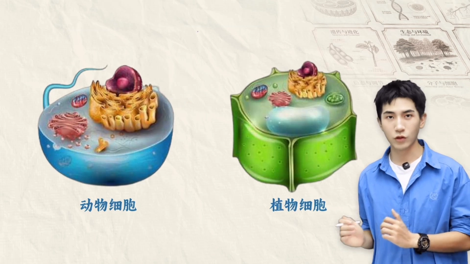

[【跳转到 06:16】](https://www.bilibili.com/video/BV1zsnBzGENK/?t=376)

### 3.2 按「膜的层数」给细胞器分类

细胞器相当于独立的车间，理论上也该有边界（细胞器膜），但并非所有细胞器都有膜。按**膜层数**可以把它们分成三类：

| 类型 | 细胞器 |
| --- | --- |
| 双层膜 | 线粒体、叶绿体 |
| 单层膜 | 内质网、高尔基体、溶酶体、液泡 |
| 无膜 | 核糖体、中心体 |

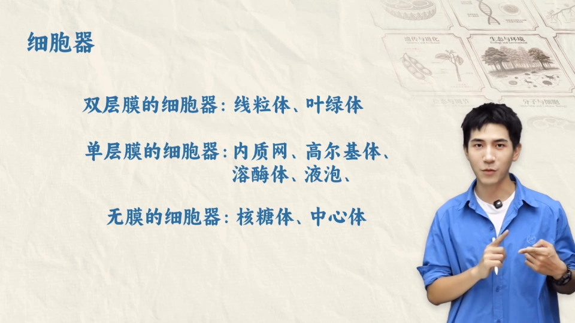

[【跳转到 07:22】](https://www.bilibili.com/video/BV1zsnBzGENK/?t=442)

### 3.3 双层膜：线粒体与叶绿体

这两个是最特殊的两种细胞器：**它们都有自己的 DNA（在基质里）和自己的核糖体**。

- **线粒体**：动植物细胞都有，是**有氧呼吸的场所**（细胞的「动力车间」）；
- **叶绿体**：植物细胞特有，是**光合作用的场所**。

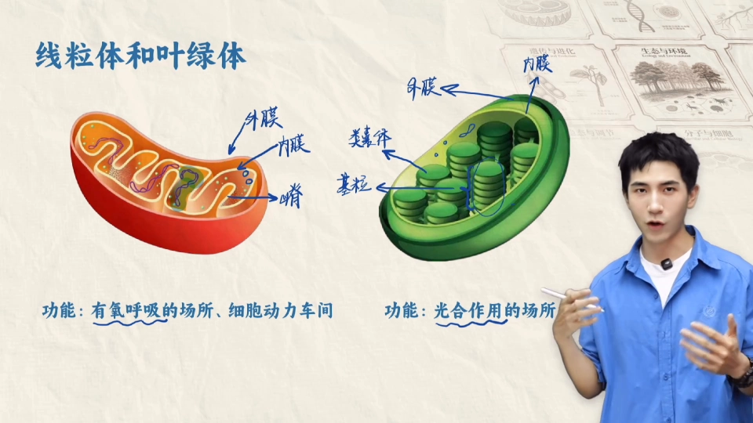

[【跳转到 08:32】](https://www.bilibili.com/video/BV1zsnBzGENK/?t=512)

再看结构，正好体现「结构与功能相适应」：

- **线粒体**：双层膜，内膜向内折叠形成 **嵴**（像猪大肠）。有氧呼吸的第三阶段就发生在线粒体内膜上，**内膜表面积越大，有氧呼吸效率越高**，所以要折叠出嵴。
- **叶绿体**：双层膜，里面有像一摞摞硬币一样的**类囊体**，摞成一摞就是**基粒**。基粒同样是为了增大表面积、更好地利用光照。
  - 那为什么叶绿体不像线粒体那样折叠内膜？因为叶绿体要做光合作用、**需要光**，如果内膜一层层折叠反而会**遮光**；而堆成基粒就像高层楼房，无论多高都能受光，连最底层的类囊体也能接受到光照。

### 3.4 单层膜（一）：内质网与高尔基体

这两种细胞器都和**蛋白质的合成、加工和运输**有关，但分工不同。

**内质网**分两种：

- **粗面内质网（R 型）**：外面附着很多核糖体，疙疙瘩瘩，核糖体合成的蛋白质可以运进来加工，因此负责**蛋白质的加工、运输**；
- **滑面内质网（S 型）**：外面没有核糖体、很光滑，功能与蛋白质无关，主要负责**脂质的合成和解毒**。

**高尔基体**则对蛋白质进行加工、分类和运输。差别在于：**内质网是蛋白质的「精加工」车间，到了高尔基体，蛋白质基本加工完了，只再做一点小小的包装与分拣**。打个比方——核糖体合成出多肽链，运到内质网精加工（折叠、弯曲、连接），再通过囊泡送到高尔基体包装，最后按目的地址发出去，所以**高尔基体像快递分拣站**。

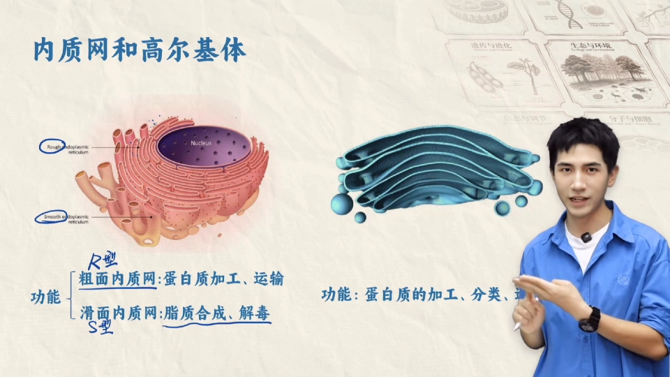

[【跳转到 11:57】](https://www.bilibili.com/video/BV1zsnBzGENK/?t=717)

考试给图分辨内质网和高尔基体时：**内质网层与层之间有小小的通道（像迷宫、不完全连着、有出口），高尔基体层与层之间没有缝，像千层饼，每层都完整。**

### 3.5 单层膜（二）：溶酶体与液泡

这两个结构都比较简单，就是单层膜包裹，里面没有很复杂的结构：

- **溶酶体**：膜里含有很多**水解酶**，可以**消化外来物质、分解细胞内衰老损伤的细胞器**。它是**动物细胞**具有的细胞器。
- **液泡**（特指**中央大液泡**）：**植物细胞特有**。成熟后它在植物细胞里占比很大，基本「撑起」整个细胞，功能是**维持细胞形态、储存物质、调节内环境**。液泡里的液体叫**细胞液**，里面有一些离子、糖类、花青素等色素。

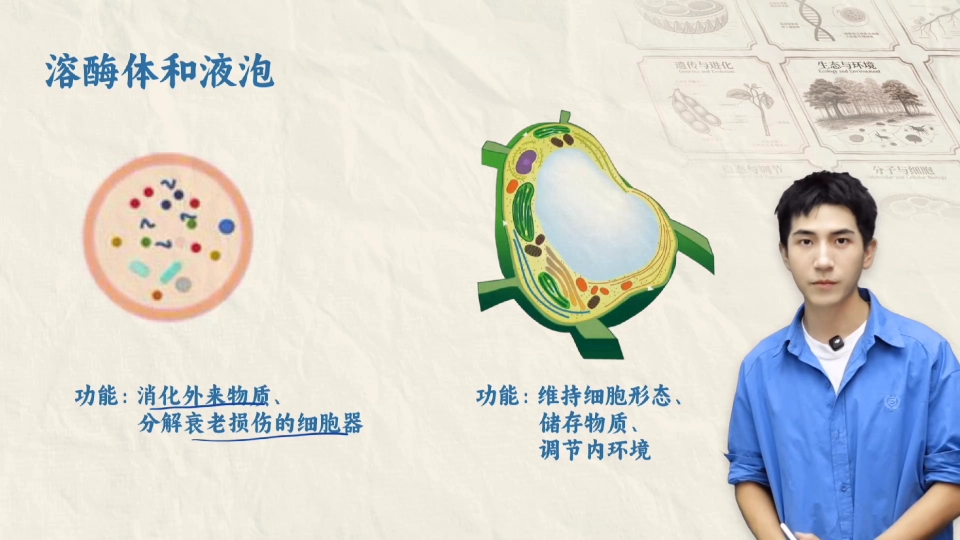

[【跳转到 14:15】](https://www.bilibili.com/video/BV1zsnBzGENK/?t=855)

补充一个易错点：**新版教材把植物的溶酶体删掉了，现在只认为动物具有溶酶体。** 那植物若出现衰老损伤的细胞器或有有害物质入侵怎么办？液泡可以行使一部分类似功能；如果细胞状态特别惨，植物细胞一般会进行**自噬**。

### 3.6 无膜：核糖体与中心体

- **核糖体**：主要功能是**合成蛋白质**，结构非常简单，由**大亚基和小亚基**构成，主要成分是 **rRNA 加蛋白质**。翻译时大、小亚基之间夹着一条 **mRNA**，大亚基上结合 **tRNA**，一步步合成蛋白质。
  - 图上的 **60S 和 40S** 是它们的**沉降系数**。分离细胞组分常用的**差速离心法**，就是利用不同组分质量、密度不同而在离心时分离，各自对应不同的沉降系数。

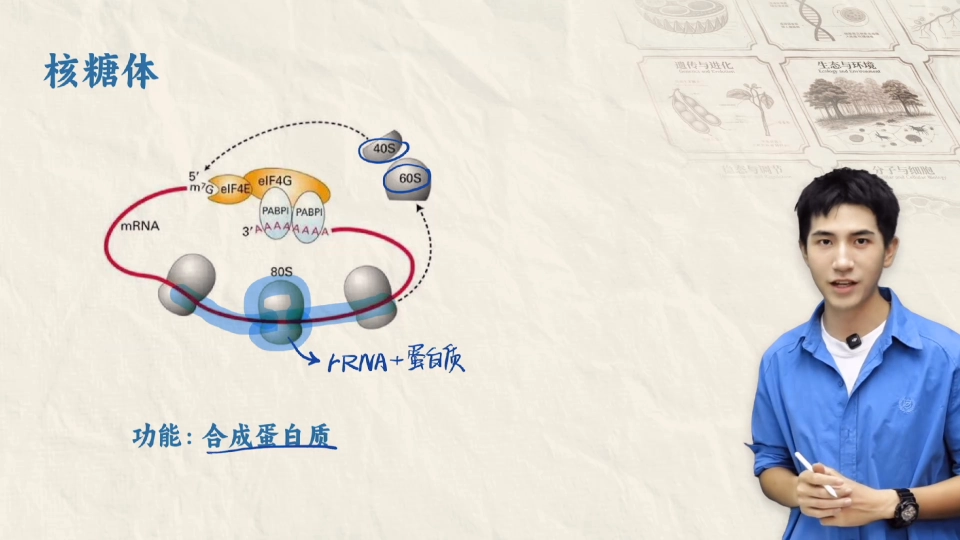

[【跳转到 16:14】](https://www.bilibili.com/video/BV1zsnBzGENK/?t=974)

- **中心体**：有点像两捆垂直排列的钢管。高中阶段它主要有两个功能——最重要的是**形成纺锤体**（有丝分裂时纺锤丝牵引染色质移向细胞两极）；它也是**微管组织中心**，可以控制**细胞骨架**的形成、变化与移动。细胞骨架是细胞质内以蛋白质为主的成分，支撑细胞形态，高中接触不多。

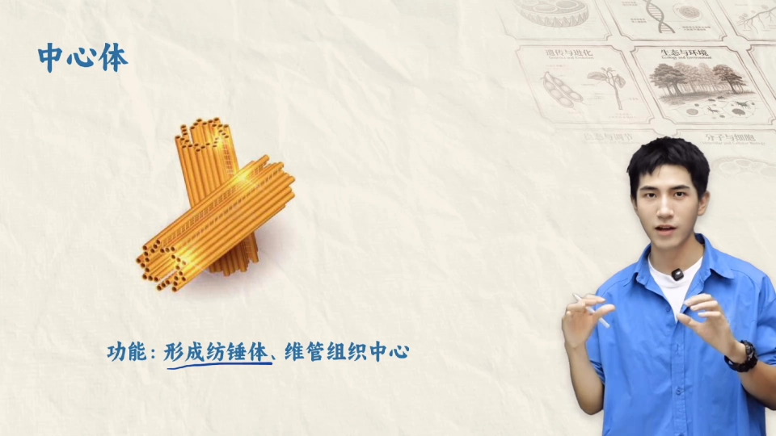

[【跳转到 17:11】](https://www.bilibili.com/video/BV1zsnBzGENK/?t=1031)

---

## 四、细胞核：操控细胞器的「控制中心」

细胞核是细胞**代谢和遗传的控制中心**，相当于整个工厂的控制室。它的结构有三层：

- **核膜**：双层膜（有内外膜），膜上有很多**核孔**。核孔实际上是一个**复合体**（不是简单的一个孔，周围也有蛋白质），功能是**控制大分子物质进出细胞核**。
  - 对比一下大分子的运输方式：细胞质基质里的大分子主要通过内质网、高尔基体之间的**囊泡**或胞吞胞吐的囊泡运输，而**细胞核不形成囊泡，就是通过核孔运输**。
- **染色质**：**染色质和染色体是同一种物质在不同时期的不同形态**，组成都是 **DNA 加蛋白质**。细胞间期时它像一团散开的头发，因为间期代谢旺盛、要进行转录，散开有利于与 RNA 结合；到分裂期就**紧缩短成染色体**，便于随纺锤丝被拉向细胞两极——这又一次体现了结构与功能相适应。
- **核仁**：细胞核最核心的部分，和**某种 RNA 的形成以及核糖体的合成**有关。

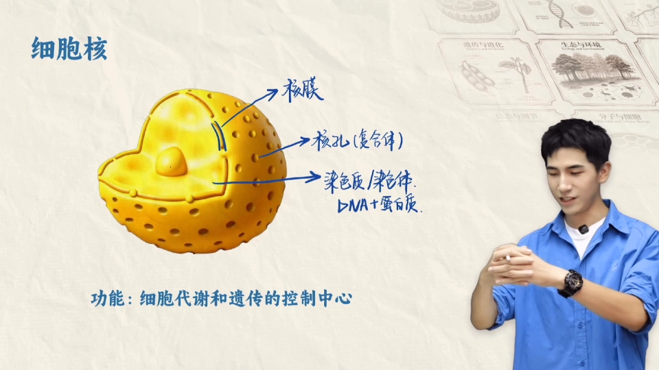

[【跳转到 18:51】](https://www.bilibili.com/video/BV1zsnBzGENK/?t=1131)

到这里，真核细胞的结构就齐全了，共三大类：**细胞核**（控制中心）、**细胞器**（各式各样功能）、**细胞膜**（边界）。

---

## 五、不是所有细胞都这么复杂：原核细胞

世界上所有细胞都有这么多结构吗？并没有。**原核细胞**就简单得多。

- 顾名思义，「原核」是说它的核非常原始——**它没有真正的核，只有拟核，而拟核没有核膜包被**，实际上就是一团散乱的 DNA 聚在一起。
- 它**只有一种细胞器，就是核糖体**。因为只要合成蛋白质就得有核糖体，其他细胞器它就没有了。

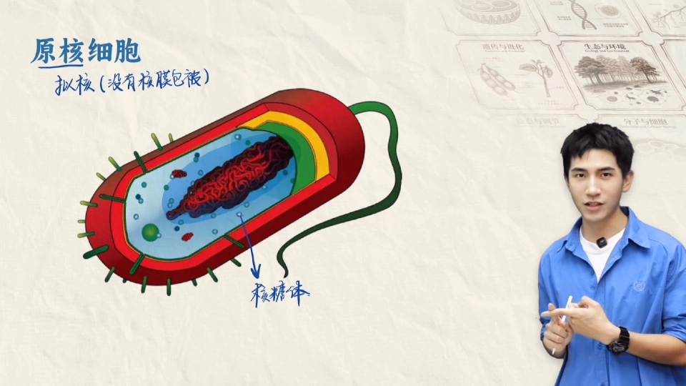

[【跳转到 19:46】](https://www.bilibili.com/video/BV1zsnBzGENK/?t=1186)

**常见的原核生物主要有五种：衣原体、支原体、蓝藻、细菌、放线菌**，记它们的口诀是「**一支蓝细线**」。这五种是常考的考点。

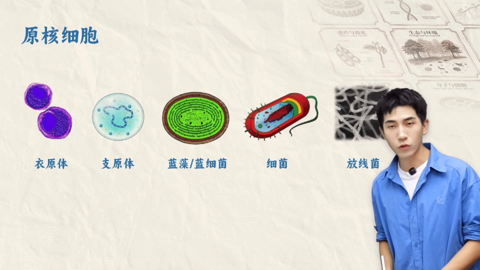

[【跳转到 22:02】](https://www.bilibili.com/video/BV1zsnBzGENK/?t=1322)

- **衣原体、支原体**：比细菌更小，寄生在活细胞里生存，体内是裸露的 DNA 和一些核糖体；二者明显的区别是**衣原体有细胞壁、支原体没有**。
- **蓝藻（现多称蓝细菌）**：可以理解成一种「原核植物」，**它没有叶绿体但也能进行光合作用**，因为它有**藻蓝素和叶绿素**。有污染的湖里发绿，往往就是蓝藻很多。
- **细菌**：有的会形成**鞭毛**作为运动器官。
- **放线菌**：会形成很多线条一样的结构，那是它的**菌丝**，它也有菌丝和孢子。注意**真菌虽然也有孢子和菌丝，但真菌是真核生物、放线菌是原核生物**，两者是两条进化路线，形态相似属于**趋同进化**。雨后空气里那股「泥土的清香」其实就是放线菌产生的。

看一道高考题的思路：鱼腥蓝细菌既能光合又有固氮能力。判断「DNA 位于细胞核中」是**错误的**——蓝细菌是原核生物，没有细胞核，DNA 是裸露的。

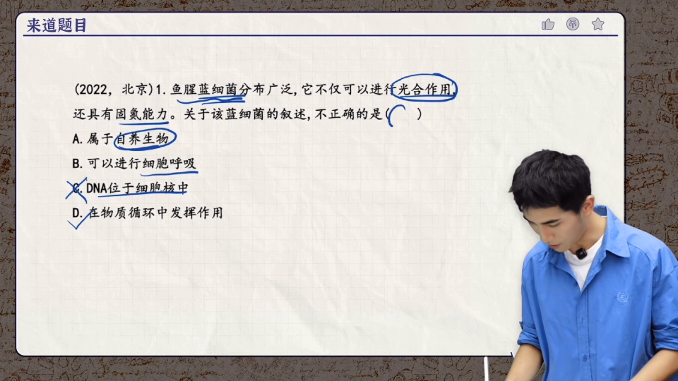

[【跳转到 22:57】](https://www.bilibili.com/video/BV1zsnBzGENK/?t=1377)

---

## 六、内共生学说：线粒体和叶绿体从哪来

前面说线粒体和叶绿体是最特殊的两类细胞器，它们叫**半自主性细胞器**。内共生学说是一个能解释这一点的理论。

它讲的是：很久很久以前，叶绿体和线粒体原本是两种完整的、独立生活的**原核小生物**（可以叫「小线」和「小叶」）。有一天，它们遇到一个体型大很多的**真核生物**（「小真」），小真把它们一口吃掉了，但**它们没有被消化，而是活了下来**，并且被小真控制住——小线利用氧气产生的能量、小叶光合产生的有机物，都被小真利用了。在漫长进化中，它们逐渐变成了叶绿体和线粒体。

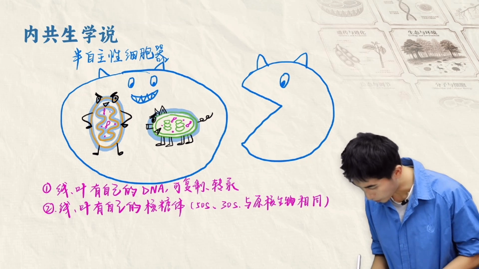

[【跳转到 26:23】](https://www.bilibili.com/video/BV1zsnBzGENK/?t=1583)

**怎么证明线粒体和叶绿体是「被吃掉的」？** 有三条证据：

1. 线粒体和叶绿体**有自己的 DNA**，并且能自己复制、转录，说明它们具有一定的**自主性**；
2. 它们**有自己的核糖体**，而且**核糖体大小亚基的沉降系数是 50S 和 30S**——这和**原核生物**的核糖体一模一样（而真核生物是 60S 和 40S）；
3. 线粒体和叶绿体是**唯二具有双层膜结构**的细胞器，且研究发现**它们的外膜在结构和组成上很像真核生物的细胞膜，内膜则与真核细胞膜差异较大**。科学家由此推测：小真吃掉它们后没有消化，而是给它们裹上了一层自己的膜（像囊泡），它们才在其中活了下来。

最后强调：所谓**半自主性**，是说线粒体和叶绿体虽然有一定自主能力，但无论 DNA 复制还是生理活动，**都受细胞核的调控**——它们毕竟还是真核细胞的一部分。

---

## 小结

- 全篇的总纲是**结构与功能相适应**：有什么结构就有什么功能，记住功能就能反推结构。
- **细胞膜**：功能是屏障保护、控制物质运输、信息交流；结构基础是磷脂双分子层（骨架）+ 蛋白质 + 糖；结构特性是**流动性**、功能特性是**选择透过性**。
- **细胞器按膜分类**：双层膜（线粒体、叶绿体）、单层膜（内质网、高尔基体、溶酶体、液泡）、无膜（核糖体、中心体）。
- 线粒体折叠出**嵴**、叶绿体堆出**基粒**，都是为增大表面积；叶绿体不折叠内膜是为了避免遮光。
- **内质网**是蛋白质精加工车间、**高尔基体**是快递分拣站；**溶酶体**动物特有、**液泡**植物特有（新版教材植物没有溶酶体）。
- **细胞核**是代谢和遗传的控制中心，由核膜、核孔、染色质/染色体、核仁组成。
- **原核细胞**没有真正的细胞核（只有拟核），只有核糖体一种细胞器；常见五类记「一支蓝细线」。
- **内共生学说**用「自己的 DNA、类似原核的核糖体、外膜像真核细胞膜」三条证据解释线粒体和叶绿体的半自主性。

## 关键术语速查

| 术语 | 一句话解释 |
| --- | --- |
| 结构与功能相适应 | 有什么样的结构就有什么样的功能，是贯穿高中生物的核心观点 |
| 磷脂双分子层 | 磷脂分子头部亲水、尾部疏水，自发排成两层，是细胞膜的基本骨架 |
| 选择透过性 | 细胞膜的功能特性——什么物质进出由膜自己选择 |
| 嵴 | 线粒体内膜向内折叠形成的结构，增大表面积以提高有氧呼吸效率 |
| 基粒 | 叶绿体内类囊体堆叠形成的结构，增大受光面积 |
| 溶酶体 | 动物细胞中含水解酶的细胞器，消化外来物质、分解衰老损伤的细胞器 |
| 拟核 | 原核细胞中没有核膜包被的 DNA 区域 |
| 半自主性细胞器 | 有自身 DNA 和核糖体、但仍受细胞核调控的线粒体与叶绿体 |
| 内共生学说 | 认为线粒体和叶绿体起源于被真核生物吞噬后未被消化的原核生物 |
