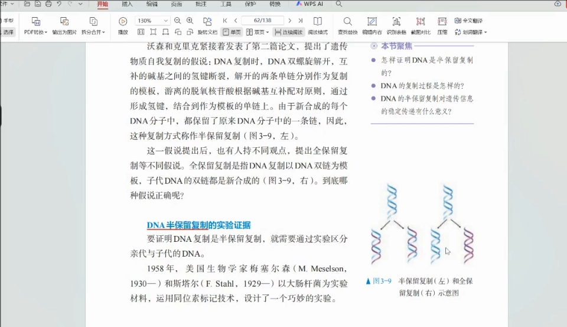
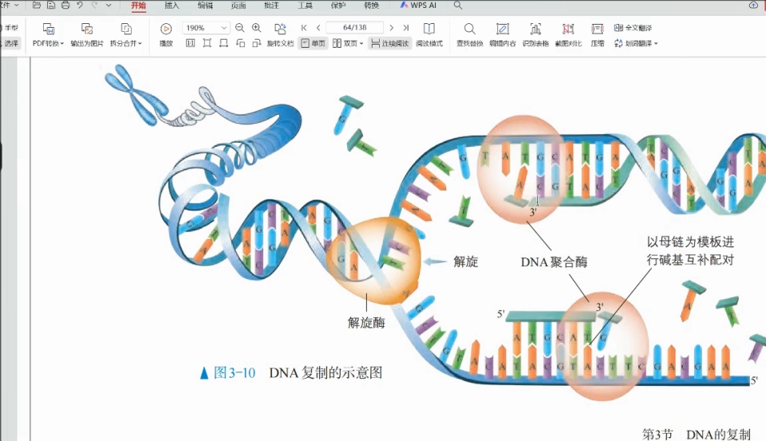
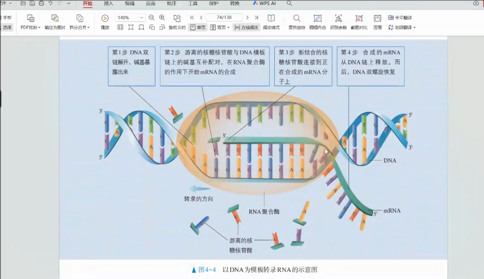
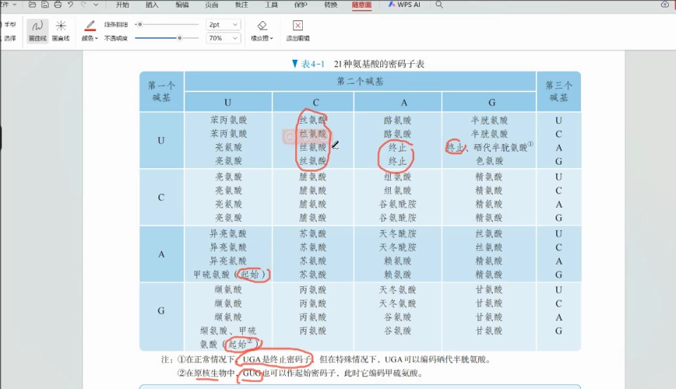
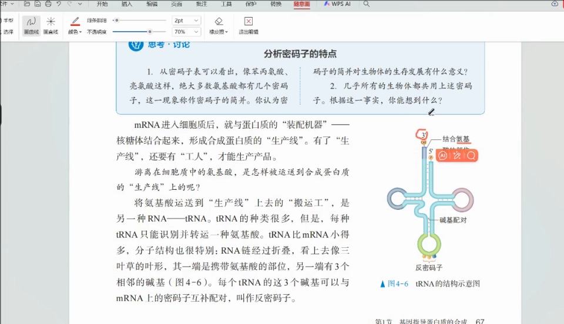
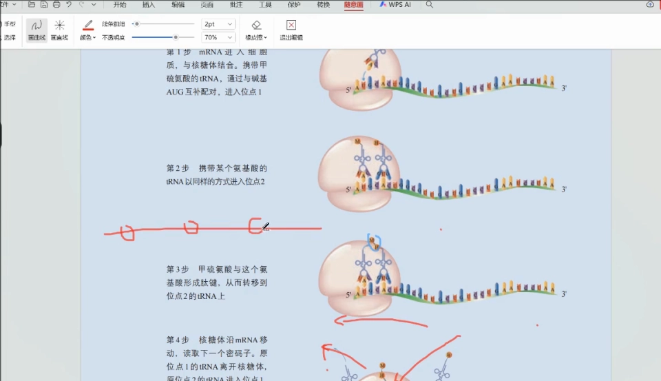
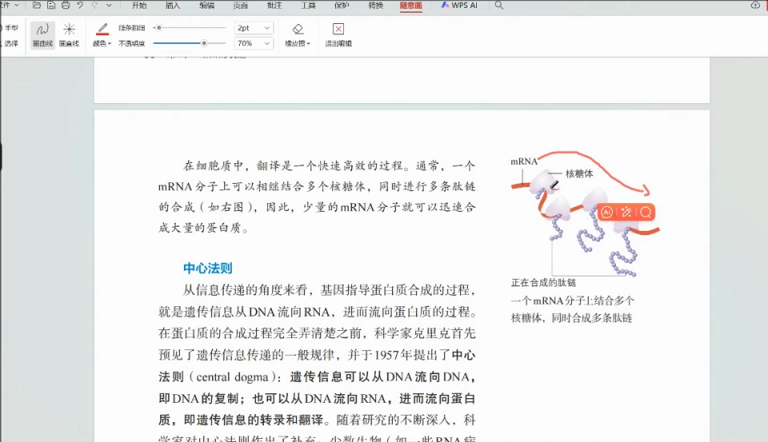
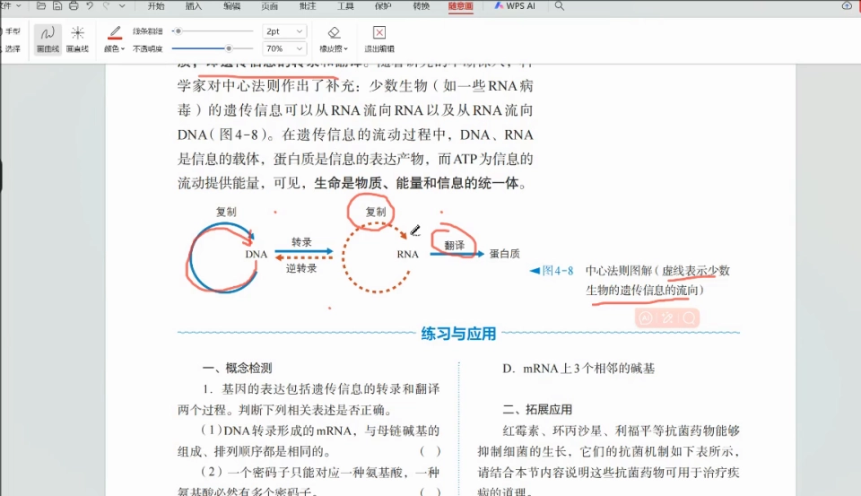
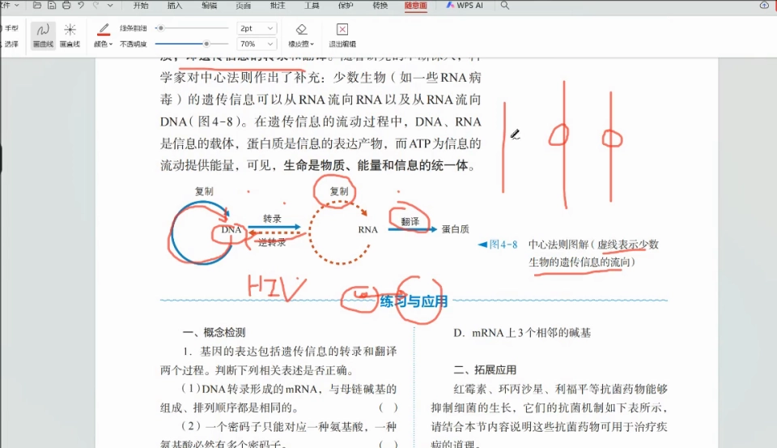

# DNA 复制、转录与翻译：一张中心法则图看懂遗传信息流

> 视频来源：[DNA的复制、转录；蛋白质的翻译；中心法则](https://www.bilibili.com/video/BV1eHTVzcELe/)（Bilibili · 约 17 分钟）。本文按该视频的逐窗口字幕与幻灯片整理，内容均可在原视频中核查。
> 导读：一支把"遗传信息怎么从 DNA 流到蛋白质"讲透的课。先讲 DNA 的半保留复制（解旋酶、DNA 聚合酶、DNA 连接酶），再讲转录（RNA 聚合酶）与翻译（密码子、tRNA、核糖体移动方向），最后用一张中心法则图收束，并用 HIV 举例说明逆转录与潜伏期。

## 本讲要解决的核心问题（SCQA）

**背景**：遗传信息藏在 DNA 的碱基序列里，而执行生命活动的却是蛋白质；DNA 还要在细胞分裂前把自己完整地复制一份。

**冲突**：DNA 是双螺旋、两条链缠得很紧，"抄写"和"复制"到底由谁来完成？复制、转录、翻译用到哪些酶、朝哪个方向进行？为什么艾滋病会有长达十几年的潜伏期？

**疑问**：DNA 是怎么复制出两个一模一样的自己的？信息怎样从 DNA 转到 RNA、再变成蛋白质？这几种信息流向之间又是什么关系？

**回答（中心思想）**：DNA 以**半保留复制**的方式复制——解旋酶先把双链解开，DNA 聚合酶再沿 5′→3′ 方向把游离的脱氧核苷酸接到 3′ 端、合成子链，片段之间的缺口由 DNA 连接酶补齐。信息随后由 **RNA 聚合酶**转录成 mRNA，再由**核糖体**按**密码子**翻译成蛋白质；tRNA 靠**反密码子**搬运氨基酸。把这几条流向画在一起，就是**中心法则**——DNA→DNA 是复制、DNA→RNA 是转录、RNA→蛋白质是翻译，RNA→DNA 则是（少数病毒才有的）逆转录。

---

## 一、DNA 怎么复制：半保留复制

### 1.1 半保留 vs 全保留

DNA 的复制方式叫**半保留复制**。名字里的"半保留"很好理解：**DNA 复制之后，新生成的 DNA 里有一半是原来那条 DNA 的链**——也就是说，一条单链分出去作为模板，另一半是新合成的子链。

课程还专门对比了另一种假说**全保留复制**：在全保留复制里，原来的模板 DNA 复制完还是模板 DNA，新生成的子链单独"飘"在一旁；而半保留复制的子代 DNA 里会保留复制前那条 DNA 的一半单链。区分这两种模型，正是当年**同位素标记实验**要证明的事（本视频不展开该实验）。

[【跳转到 00:00】](https://www.bilibili.com/video/BV1eHTVzcELe/?t=0)

### 1.2 两种酶：解旋酶先解旋，DNA 聚合酶再合成

DNA 复制需要用到两种酶：**解旋酶**和 **DNA 聚合酶**，它们的分工是先后接力。

先看 DNA——它是一个双螺旋结构，两条链缠绕得很紧。在缠得这么紧的情况下，聚合酶想直接上去复制出一条新链是**不现实**的。所以第一步必须先**把两条链分开**，这个把两条链分开的过程叫**解旋**，由**解旋酶**完成。链解开之后，就轮到 **DNA 聚合酶**上场了。

[【跳转到 01:15】](https://www.bilibili.com/video/BV1eHTVzcELe/?t=75)

### 1.3 DNA 聚合酶连的是磷酸二酯键，不是氢键

一个关键细节：**DNA 聚合酶的作用并不是去形成碱基之间的氢键**。它真正负责的，是把**两个相邻的脱氧核糖核苷酸连接起来**——具体来说，是连接 **3 号碳原子（3′ 位）上的那个键**，也就是**磷酸二酯键**。

至于碱基之间的氢键，是**可以自发形成**的，不需要酶来催化。子链的合成依靠**碱基互补配对**进行：A 对应 T、C 对应 G，一个一个接上去。

[【跳转到 02:05】](https://www.bilibili.com/video/BV1eHTVzcELe/?t=125)

### 1.4 方向、缺口与复制起点

**子链的合成方向都是从 5′ 端到 3′ 端。** 由于在双螺旋里两条链方向相反，就会出现一个麻烦：在下边那条链上，**DNA 聚合酶的移动方向和解旋酶的方向正好相反**。

那么问题来了：解旋酶新解出来的这段单链上，不就没有新子链了吗？其实不会。解旋酶解了一段之后，会有**新的 DNA 聚合酶**再结合到这段模板链上继续复制，同时也会有**新的解旋酶**结合上来，一段一段地把新链接起来。

但这些片段之间还留着缺口：**DNA 聚合酶不会把相邻片段彼此连接起来**，片段之间那个磷酸二酯键要靠另一种酶来完成——它叫 **DNA 连接酶**。上面那条链没有这个顾虑；但下面那条链因为复制起点不同（DNA 聚合酶可能结合在另一个点上，这个点叫**复制起点**），就需要靠 DNA 连接酶把多个复制起点复制出来的片段连接起来。

> 讲者说明：DNA 连接酶这部分是"以后做题会用到、课本具体内容里没有提到"的补充。

[【跳转到 04:17】](https://www.bilibili.com/video/BV1eHTVzcELe/?t=257)

---

## 二、转录：把 DNA 的信息抄成 mRNA

转录跟复制**大差不差**，但用到的酶不一样、合成出来的产物也不一样——转录合成的是 **mRNA**。

既然是 mRNA，那用到的酶自然就不是 DNA 聚合酶，而是 **RNA 聚合酶**。而且有一个便利之处：**RNA 聚合酶在工作时不需要再配合解旋酶**，所以转录时只需要一个 RNA 聚合酶就够了。

方向规律和复制一致：**新链的合成方向同样是从 5′ 端到 3′ 端**；而 **RNA 聚合酶的移动方向与合成出来这条链的"尾巴"方向相反**。所以随着 RNA 聚合酶往一个方向移动，这条链会越来越长。做题时看到一个 RNA 聚合酶后面拖着一条小尾巴，就知道它正朝与小尾巴相反的方向前进。它连接的同样是**磷酸二酯键**。

[【跳转到 05:37】](https://www.bilibili.com/video/BV1eHTVzcELe/?t=337)

[【跳转到 06:13】](https://www.bilibili.com/video/BV1eHTVzcELe/?t=373)

---

## 三、翻译：把 mRNA 的碱基序列表成氨基酸序列

### 3.1 翻译是什么

翻译的模板是 **mRNA**（信使 RNA）。以 mRNA 为模板，合成具有一定氨基酸序列的蛋白质，这个过程就叫**翻译**。

怎么翻译？mRNA 上有很多**密码子**，密码子是**三个碱基一组**的。因为这些密码子编码不同的氨基酸，所以随着翻译的进行，不同的氨基酸被接上去，连成一条**肽链**。

[【跳转到 07:16】](https://www.bilibili.com/video/BV1eHTVzcELe/?t=436)

### 3.2 密码子表：只需记住几个特例

视频给出的是各种密码子对应氨基酸的表格（表 4-1）。这张表**不用背**，但有几点要记住：

- **UGA 是终止密码子**；
- **GUG 是原核生物的起始密码子**，此时它编码甲硫氨酸；我们通常使用的起始密码子是 **AUG**，对应**甲硫氨酸**。

也就是说，起始密码子一般记 AUG（甲硫氨酸），而 GUG 是原核生物里"兼职"当起始的一个特例。

[【跳转到 07:51】](https://www.bilibili.com/video/BV1eHTVzcELe/?t=471)

### 3.3 tRNA 与反密码子

**tRNA 是用来转运氨基酸的。** 它有一长一短两条链：长的那一端是 **3′ 端**，用来结合氨基酸（所以会有一大坨氨基酸挂在那里）；**5′ 端**没有结合东西，稍微短一点。

tRNA 上的三个碱基我们叫做**反密码子**，它要和 mRNA 上的**密码子**进行**碱基互补配对**。

tRNA 的种类有很多，**每一种 tRNA 只能转运一种氨基酸**；反过来，**一种氨基酸可以由很多种 tRNA 来转运**。以丝氨酸为例，编码它的密码子就有 GCU、UCU、UCC 等等，这些密码子彼此不一样、对应的 tRNA 与反密码子也不一样，但它们都用来转运丝氨酸。要记住：**密码子和反密码子是反向互补的关系**——例如密码子是 GUG，对应的反密码子就应该是 CAC（常考：题目给的是反密码子，还得自己再转一步）。

[【跳转到 08:33】](https://www.bilibili.com/video/BV1eHTVzcELe/?t=513)

### 3.4 核糖体朝哪个方向移动

题里常给核糖体在 mRNA 上移动的示意，问移动方向。视频给了三种判断方式：

1. **看 tRNA**：tRNA 从一个方向进来、另一个方向出去，总体有它的移动趋势；**核糖体的移动方向和 tRNA 相反**。
2. **看飘出的肽链**：若一条 mRNA 上结合了好几个核糖体、后面飘出长度不一的肽链——肽链是翻译的产物，越往后应该越长。所以**短的那条是刚开始的、长的那条已经运行了一段时间**，据此可判断方向。
3. **看模板链的 5′/3′ 端**：如果题目给了 mRNA 的 3′ 端和 5′ 端，要记住**核糖体是从模板链的 5′ 端往 3′ 端移动**的。

另外补充一点（非常规考点）：核糖体上面大的叫**大亚基**，下面小的叫**小亚基**。

[【跳转到 10:47】](https://www.bilibili.com/video/BV1eHTVzcELe/?t=647)

顺带一提，翻译是快速高效的过程：通常一条 mRNA 上可以相继结合**多个核糖体**，同时合成多条肽链，因此少量的 mRNA 就能迅速合成大量蛋白质。

[【跳转到 11:12】](https://www.bilibili.com/video/BV1eHTVzcELe/?t=672)

---

## 四、中心法则：一张图囊括 DNA→RNA→蛋白质

中心法则看起来复杂，其实**就是一张图的事**：遗传信息可以从 DNA 流向 DNA（复制），也可以从 DNA 流向 RNA、再流向蛋白质（转录和翻译）。把这张图弄明白就够了。

### 4.1 实线：一般生物的流向

图里每条箭头表示"由什么生成什么"：

- **DNA → DNA**：DNA 生成 DNA，就是 **DNA 复制**；
- **DNA → RNA**：由 DNA 转录成 RNA，就是 **转录**；
- **RNA → 蛋白质**：就是核糖体翻译表达蛋白质的过程。

一般来说，常规生物都走"DNA 复制 → DNA 转录成 RNA → RNA 翻译成蛋白质"这条主线。

[【跳转到 12:42】](https://www.bilibili.com/video/BV1eHTVzcELe/?t=762)

### 4.2 虚线：少数生物的流向

图上还有虚线，表示**少数生物的遗传信息流向**，指的就是病毒，在病毒里比较常见：

- **RNA → RNA**：即 **RNA 的复制**。最常见的例子是**烟草花叶病毒**，它是一种 RNA 病毒，会进行 RNA 的自我复制；
- **RNA → DNA**：转录是从 DNA 到 RNA，反过来从 RNA 变成 DNA 就是**逆转录**，见于逆转录病毒。

[【跳转到 13:37】](https://www.bilibili.com/video/BV1eHTVzcELe/?t=817)

### 4.3 用 HIV 理解逆转录与潜伏期

逆转录病毒最典型的例子就是 **HIV（艾滋病病毒）**。它是一种**逆转录 RNA 病毒**：遗传物质是 RNA，也就是一个蛋白质外壳里包着的全是 RNA。

HIV 感染普通细胞后，会先把 RNA 扔到细胞里。因为它是逆转录病毒，**不会进行 RNA 的复制，而是选择逆转录变成 DNA**。变成 DNA 之后，它很"阴险"——会把这段 DNA **整合到宿主细胞的 DNA 里**，让病毒的 DNA 变成我们细胞自身 DNA 的一部分，从而潜伏起来。

这正好解释了为什么有的人得了艾滋病可能几个月就发病，有的人却十几年才发病：

- 如果这段 DNA 整合到了一个**比较活跃**的 DNA 片段上（某段基因经常被复制、转录、翻译、一直在表达），病毒 DNA 就可能经常被表达、生成更多病毒；
- 如果整合在了**不太活跃**的片段上，它就在这段基因上潜伏起来，可能过十几二十年，等你的身体状况发生变化、这段基因开始表达，病毒 DNA 才重新"复苏"，表现为突然发病。

这就是潜伏期，也是 HIV 潜伏期有长有短的原因。而病毒重新活跃后的路线是：**逆转录成 DNA →（由宿主细胞表达）DNA 再转录出病毒 RNA → RNA 翻译成蛋白质（病毒外壳）→ 外壳与新的 RNA 单链一起组装成新的 HIV 病毒**。

[【跳转到 14:27】](https://www.bilibili.com/video/BV1eHTVzcELe/?t=867)

[【跳转到 16:07】](https://www.bilibili.com/video/BV1eHTVzcELe/?t=967)

---

## 小结

- DNA 以**半保留复制**方式复制：子代 DNA 保留原来 DNA 的一半单链；对照模型是全保留复制。
- 复制用到**解旋酶**（解旋）和 **DNA 聚合酶**（把相邻脱氧核糖核苷酸连成磷酸二酯键）；碱基间的氢键靠互补配对自发形成，不需酶催化。
- 子链合成方向都是 **5′→3′**；两条链方向相反，导致下边那条链上聚合酶与解旋酶方向相反，片段缺口由 **DNA 连接酶**补齐，涉及**复制起点**。
- **转录**由 **RNA 聚合酶**完成，不需要解旋酶，产物是 mRNA，方向同样是 5′→3′。
- **翻译**以 mRNA 为模板：**密码子**三个碱基一组，**tRNA** 靠**反密码子**互补配对搬运氨基酸，连成肽链。
- 需记住的特例：**UGA 是终止密码子**，**AUG（甲硫氨酸）是通常的起始密码子**，GUG 是原核生物的起始密码子。
- 核糖体移动方向可用 tRNA 方向、肽链长度、模板链 5′/3′ 端三种方式判断。
- **中心法则**一张图囊括全部流向：复制、转录、翻译为一般路径，RNA 复制与逆转录为少数病毒（如烟草花叶病毒、HIV）的路径。

## 关键术语速查

| 术语 | 一句话解释 |
| --- | --- |
| 半保留复制 | DNA 复制后，每个子代 DNA 保留原有 DNA 的一半单链 |
| 解旋酶 | 把 DNA 双螺旋的两条链解开（解旋）的酶 |
| DNA 聚合酶 | 把相邻脱氧核糖核苷酸连成磷酸二酯键、合成子链的酶 |
| DNA 连接酶 | 把复制片段之间的缺口（磷酸二酯键）连接起来的酶 |
| 复制起点 | DNA 聚合酶结合并开始复制的位置 |
| 转录 | 以 DNA 为模板、由 RNA 聚合酶合成 mRNA 的过程 |
| 翻译 | 以 mRNA 为模板、按密码子合成蛋白质的过程 |
| 密码子 / 反密码子 | mRNA 上三个碱基一组编码氨基酸 / tRNA 上与之互补的三个碱基 |
| 起始密码子 | 翻译开始处的密码子，通常为 AUG（甲硫氨酸） |
| 终止密码子 | 结束翻译的密码子，如 UGA |
| 中心法则 | 概括 DNA、RNA、蛋白质之间遗传信息流向的总图 |
| 逆转录 | 以 RNA 为模板合成 DNA，见于逆转录病毒（如 HIV） |
