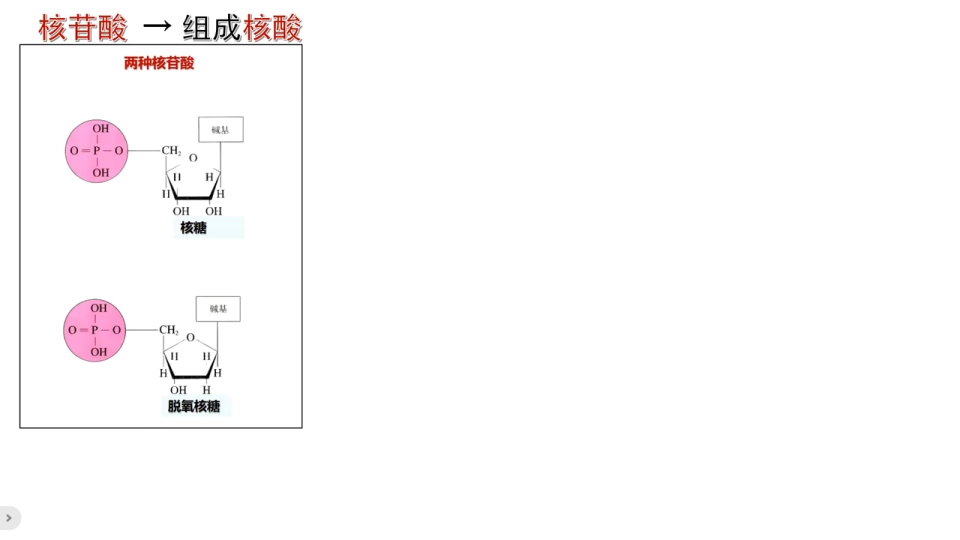
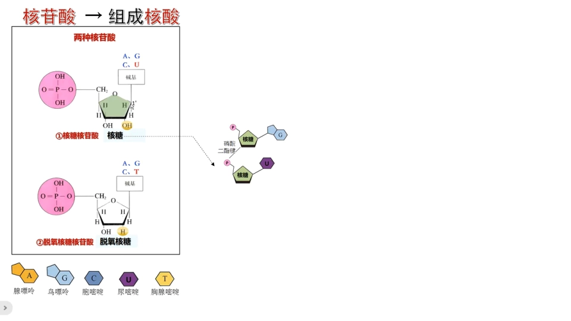
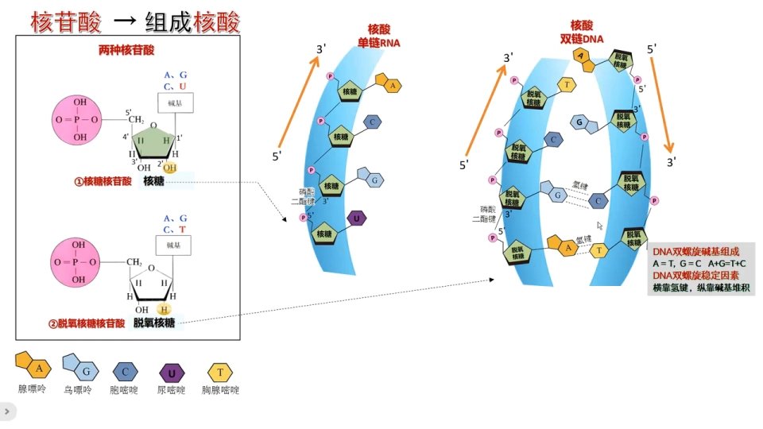
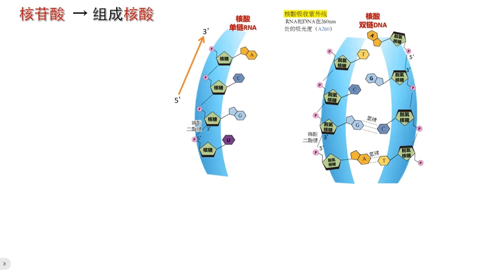
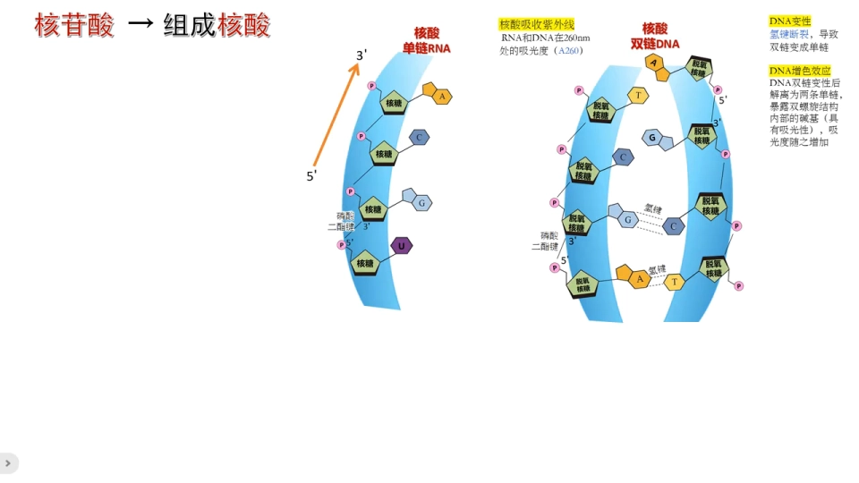
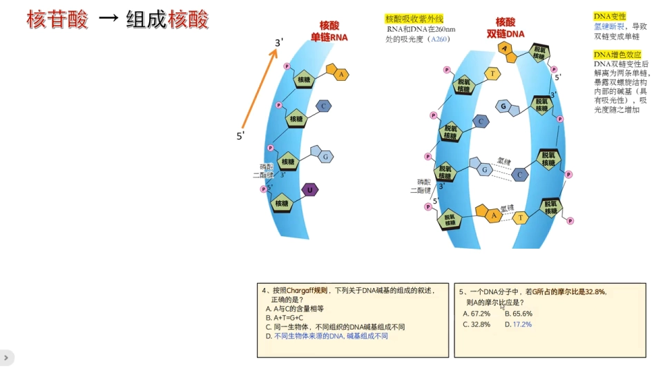
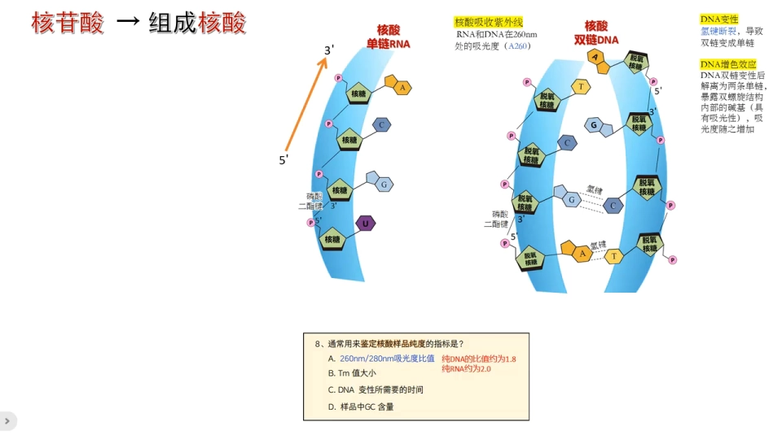
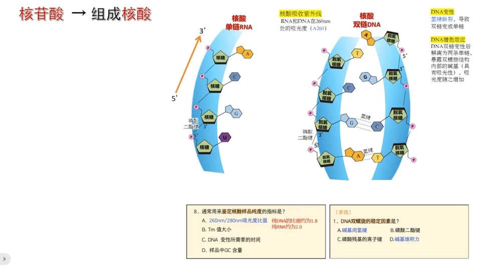
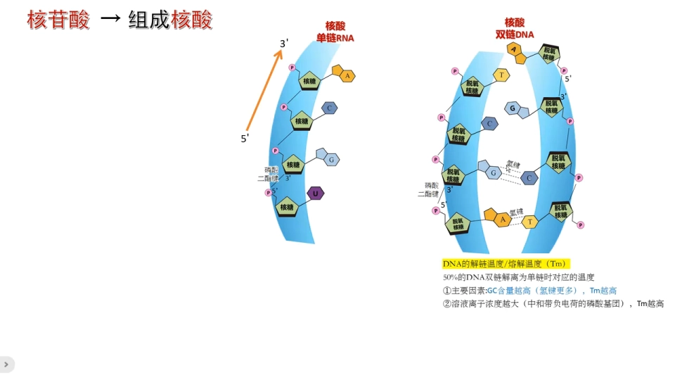
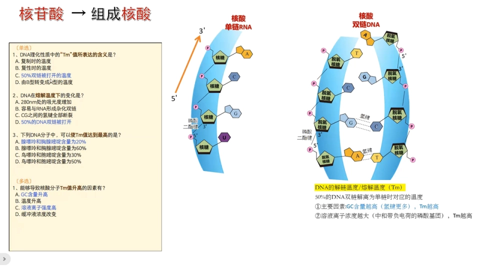

# 核苷酸、碱基配对与 DNA 双螺旋：变性、增色效应与解链温度

> 视频来源：[核酸、核苷酸、碱基配对、DNA双螺旋、DNA变性、增色效应、解链温度](https://www.bilibili.com/video/BV1yeLo6gEML/)（Bilibili · 约 15 分钟）。本文按该视频的逐窗口字幕与幻灯片整理，内容均可在原视频中核查。
> 导读：一支把"核酸"从单个核苷酸一路讲到双螺旋理化性质的课。前半段认结构——核苷酸、磷酸二酯键、5′ 端与 3′ 端；后半段讲性质——Chargaff 规则、260 nm 紫外吸收、DNA 变性、增色效应与解链温度 Tm，最后配了一组典型习题。

## 本讲要解决的核心问题（SCQA）

**背景**：核酸是遗传信息的载体，DNA 双链、RNA 单链，初学者通常记得"A 配 T、G 配 C"。

**冲突**：可真到做题、读文献时会发现光记住配对远远不够——为什么单链 RNA 里找不到 T？为什么加热能让 DNA"变性"，而且不同 DNA 的变性温度还不一样？"增色效应""解链温度"又各指什么？

**疑问**：核苷酸是怎么连成核酸链的？双螺旋靠什么维持稳定？它在受热、加盐时到底发生了什么？

**回答（中心思想）**：核酸由核苷酸通过**磷酸二酯键**连成 5′→3′ 方向的链；DNA 双螺旋则是两条方向相反的单链靠**碱基氢键**横向配对、又靠**碱基堆积力**纵向堆叠而成。双螺旋的稳定来自"横向氢键 + 纵向堆积力"，而不是磷酸二酯键。一旦氢键被热破坏，双链解离成单链（**变性**），原本藏在螺旋内部的碱基暴露、260 nm 吸光度升高（**增色效应**）；50% 双链解离时的温度就是**解链温度 Tm**，它主要由 GC 含量和溶液离子强度决定。

---

## 一、核苷酸：核酸的基本单位

### 1.1 两种核苷酸只差一个氧

核酸是生物大分子，它的基本单位叫**核苷酸**。核苷酸这个名字也可以拆开看：它由三部分组成——左边一个**磷酸基团**，中间一个**五碳糖**，右边连接一个**含氮碱基**。

核苷酸只有两类，区别集中在"糖"上：

- **核糖核苷酸**：糖是**核糖**，连接碱基 A、G、C、U；
- **脱氧核糖核苷酸**：糖是**脱氧核糖**，连接碱基 A、G、C、T。

两者的糖长得很像，只差一个氧原子：核糖在 2 号碳位置上有一个羟基（—OH）；脱氧核糖在这个位置只有一个氢（—H），也就是少了一个氧。因此这几处画面上给出的是两幅并排的结构式，唯一不同就落在那个碳的取代基上——"脱氧"二字说的正是这件事。

[【跳转到 00:00】](https://www.bilibili.com/video/BV1yeLo6gEML/?t=0)

### 1.2 碱基：五个容易混的字母

课程里反复强调，核酸这章不难，但五个碱基的名字必须记牢、不能混：

| 字母 | 中文名 | 出现在 |
| --- | --- | --- |
| A | 腺嘌呤 | DNA、RNA |
| G | 鸟嘌呤 | DNA、RNA |
| C | 胞嘧啶 | DNA、RNA |
| U | 尿嘧啶 | 只在 RNA |
| T | 胸腺嘧啶 | 只在 DNA |

> 记忆可以各显神通。讲者分享的方法是联想：A 联想成 Amerika（美国），G 联想成"高高地飞"的鸟，C 取自细胞的英文 cell 的首字母（对应"胞"），U 的形状像一个尿壶（对应"尿"嘧啶），T 像一个人张开双臂、露出胸腺（对应"胸腺"嘧啶）。方法只作参考，关键是别把 U 和 T 弄反。

[【跳转到 00:50】](https://www.bilibili.com/video/BV1yeLo6gEML/?t=50)

### 1.3 单核苷酸怎么命名

一个单独的核苷酸有自己的名字，规律是"**碱基名 + 核糖核苷酸 / 脱氧核糖核苷酸**"：

- 连接碱基 U 的核糖核苷酸叫**尿嘧啶核糖核苷酸**；
- 连接碱基 G 的核糖核苷酸叫**鸟嘌呤核糖核苷酸**；
- 同理，连接碱基 A 的脱氧核糖核苷酸叫**腺嘌呤脱氧核糖核苷酸**。

命名不用单独去背，把"碱基名"套进第二半即可。

[【跳转到 02:05】](https://www.bilibili.com/video/BV1yeLo6gEML/?t=125)

---

## 二、从核苷酸到核酸链：磷酸二酯键与 5′ 端、3′ 端

### 2.1 五碳糖的碳为什么带一撇

要讲清楚核苷酸怎么连成链，先要认识五碳糖上的碳编号。糖环上的碳按位置依次编号，但每个数字后面都带一撇：1′、2′、3′、4′、5′。加这一撇是有原因的——**碱基上也有碳**，如果不加撇，两套编号就会混淆。

这个编号直接决定了链的走向：磷酸基团连接在糖的 **5′ 位**，相邻核苷酸之间又要连接到 **3′ 位**上。于是从 5′ 位向 3′ 位延伸，就构成了核酸链的方向。

### 2.2 磷酸二酯键：把核苷酸串起来的那根"线"

两个相邻的核苷酸靠**磷酸二酯键**连接起来。链条从 5′ 端开始、向 3′ 端延伸，这样连成的一条链就是**单链 RNA**（图示右侧那条蓝色的带子）。

这里可以套用一个很好的类比来记：学蛋白质时，多肽链由氨基酸组成、靠肽键连接；核酸这一层与之完全对应——

- 核酸链 ↔ 多肽链；
- 核苷酸 ↔ 氨基酸；
- **磷酸二酯键 ↔ 肽键**。

也就是说，**核苷酸之于核酸，正如氨基酸之于多肽链**。

[【跳转到 02:30】](https://www.bilibili.com/video/BV1yeLo6gEML/?t=150)

脱氧核糖核苷酸之间同样是 5′→3′ 的磷酸二酯键连接，照样能连成一条链。

[【跳转到 03:20】](https://www.bilibili.com/video/BV1yeLo6gEML/?t=200)

---

## 三、双螺旋：横向氢键配对 + 纵向碱基堆积

### 3.1 碱基配对：A=T 两条氢键，G≡C 三条氢键

两条链之间的碱基靠**氢键**配对：A 与 T 之间形成 **2 条氢键**，G 与 C 之间形成 **3 条氢键**。除了横向的氢键，纵向上一串碱基之间还有**碱基堆积力**——它本质是一种疏水相互作用，把相邻的碱基像叠硬币一样堆在一起。横向配对 + 纵向堆叠，两条链才能合起来盘成**双链 DNA**。

注意：不论是单链的 RNA 还是双链的 DNA，它们都叫**核酸**。

[【跳转到 04:35】](https://www.bilibili.com/video/BV1yeLo6gEML/?t=275)

### 3.2 Chargaff 规则：碱基数量上的硬约束

因为 A 只和 T "搭伙"、G 只和 C "搭伙"，双链 DNA 里碱基的数量就被锁死了：

- $A = T$，$G = C$；
- 更进一步，嘌呤总数等于嘧啶总数：$A + G = T + C$。

另外，双链 DNA 里根本不会出现 U——U 是 RNA 才有的碱基。这套数量规律就是著名的 **Chargaff 规则（查加夫规则）**。

[【跳转到 05:00】](https://www.bilibili.com/video/BV1yeLo6gEML/?t=300)

---

## 四、紫外吸收、DNA 变性与增色效应

### 4.1 核酸在 260 nm 处吸收紫外线

核酸（DNA 和 RNA）具有吸收紫外线的特性，吸收峰在 **260 nm** 处。这一点可以和蛋白质对照记忆：学氨基酸时，芳香族氨基酸（色氨酸、酪氨酸等）的吸收靠近 **280 nm**；其中苯丙氨酸靠近 **260 nm**，正因为它离核酸的吸收峰很近，所以在核酸样品里它常被视为"污染信号"。

[【跳转到 06:15】](https://www.bilibili.com/video/BV1yeLo6gEML/?t=375)

### 4.2 DNA 变性：氢键断裂，双链散开

**DNA 变性**指的就是双链之间的氢键被破坏。具体来说，是 A–T 之间、G–C 之间的氢键**完全断裂**，两条链拉不住彼此，双链就解离成了单链，也就是"散开"了。

[【跳转到 06:40】](https://www.bilibili.com/video/BV1yeLo6gEML/?t=400)

### 4.3 增色效应：碱基"露出来"，吸光度就升高

为什么变性会伴随一个"增色"的现象？关键在碱基的位置：

- 双链状态下，碱基都藏在螺旋**内部**；
- 双链一旦断开，这些内部碱基就**暴露**出来；
- 碱基本身是有吸光性的，暴露后吸光度随之增加。

这就是 **DNA 的增色效应**。讲者特别在这个名词前面加了"DNA"三个字来强调：增色效应说的是 **DNA**（双链解离）的现象，和单链的 RNA 没有关系。

[【跳转到 07:05】](https://www.bilibili.com/video/BV1yeLo6gEML/?t=425)

---

## 五、Chargaff 规则的典型习题

理解了配对和数量约束，很多选择题就是"套公式"。

**判断题（对 DNA 碱基组成的叙述）**

- A 与 C 的含量相等 —— ✗，A 和 C 不配对；
- $A + T = G + C$ —— ✗，正确的关系是 $A + G = T + C$；
- 同一生物体不同组织的 DNA 碱基组成不同 —— ✗，同一个体的不同器官 DNA 必须一致；
- 不同生物体来源的 DNA 碱基组成不同 —— ✓，这正是 DNA 的物种多样性。

**计算题**：一个 DNA 分子中 G 占摩尔比 32.8%，求 A 的摩尔比。由 $A + G = T + C$ 且 $A = T$，

$$
A = T = \frac{100\% - 2 \times 32.8\%}{2} = 17.2\%
$$

所以选 17.2%。

[【跳转到 09:10】](https://www.bilibili.com/video/BV1yeLo6gEML/?t=550)

**判断核酸类型**：某新分离核酸的碱基组成为 A=27%、G=30%、T=21%、C=22%。

- 出现了 T，说明不可能是 RNA（RNA 用 U 不用 T），排除单链 RNA、DNA–RNA 杂交链；
- 再看 A 与 T 是否相等：这里 A=27%、T=21%，不相等，不满足 Chargaff 规则，说明不是双链；
- 结论：它是**单链 DNA**。

[【跳转到 09:35】](https://www.bilibili.com/video/BV1yeLo6gEML/?t=575)

---

## 六、怎么判断核酸样品的纯度：260/280 比值

常规用来鉴定核酸样品纯度的指标，是 **260 nm 与 280 nm 吸光度的比值**。道理是：蛋白质里含芳香族氨基酸（其吸收靠近 280 nm），所以一旦样品混进蛋白质，280 的读数就被抬起来，比值随之改变。

参照值：纯 DNA 的 260/280 约为 **1.8**，纯 RNA 约为 **2.0**。考试通常考不到这么细，但要记住"核酸纯度常常通过这个比值来鉴别、而它是用来反映蛋白质污染的"。

[【跳转到 10:50】](https://www.bilibili.com/video/BV1yeLo6gEML/?t=650)

---

## 七、双螺旋靠什么稳定：横向氢键，纵向堆积

一个高频考点是"DNA 双螺旋的稳定因素"。答案是两点：

- **横向**：碱基之间的**氢键**；
- **纵向**：碱基之间的**堆积力**（也就是疏水相互作用）。

要点在于——**稳定因素不是磷酸二酯键**。磷酸二酯键是把核苷酸串成单链的键，相当于蛋白质一级结构里的肽键；它属于**一级结构**层次。而双螺旋这种形状属于**二级结构**，维持它的是横向氢键加纵向堆积，而不是磷酸二酯键。

[【跳转到 11:15】](https://www.bilibili.com/video/BV1yeLo6gEML/?t=675)

---

## 八、解链温度 Tm：DNA 的"熔点"

### 8.1 定义

**解链温度**也叫**熔解温度**，记作 **Tm**（melting temperature）：**50% 的 DNA 双链解离为单链时对应的温度**。换句话说，它不是"全部解开"的温度，而是"解开一半"的温度。

[【跳转到 12:05】](https://www.bilibili.com/video/BV1yeLo6gEML/?t=725)

### 8.2 两个主要影响因素

**① GC 含量越高，Tm 越高。** 因为 G≡C 有 3 条氢键、A=T 只有 2 条；GC 占比越高，整段双链的氢键总数就越多，越稳定、越难被破坏，需要的温度自然越高。

**② 溶液离子浓度越大，Tm 越高。** DNA 双链本来就不算牢固，一个重要原因是磷酸基团带负电荷、彼此排斥。加入较高浓度的离子后，这些离子把磷酸基团的负电荷中和掉，排斥减弱、双链更稳定，破坏它需要的温度也更高。

[【跳转到 12:30】](https://www.bilibili.com/video/BV1yeLo6gEML/?t=750)

### 8.3 围绕 Tm 的习题

- **Tm 的含义**：选"50% 双链被打开的温度"；
- **DNA 在熔解温度下的变化**：选"50% 的 DNA 双链被打开"；
- **哪个 DNA 分子的 Tm 最高**：比较 GC 含量。若某分子里 A+T 合计只有 20%，则 C+G 高达 80%，氢键最多、最稳定，Tm 最高；
- **能导致 Tm 升高的因素**：GC 含量升高、溶液离子强度高（"温度升高"本身不是决定因素）。

[【跳转到 13:45】](https://www.bilibili.com/video/BV1yeLo6gEML/?t=825)

---

## 小结

- 核苷酸是核酸的基本单位，由磷酸 + 五碳糖 + 含氮碱基构成；核糖核苷酸与脱氧核糖核苷酸只差五碳糖 2 号碳上的一个氧。
- 碱基五种：A、G、C、U、T——U 只在 RNA，T 只在 DNA。
- 核苷酸靠**磷酸二酯键**从 5′ 端向 3′ 端连成链；"核苷酸 : 核酸"对应"氨基酸 : 多肽链"。
- DNA 双螺旋中 A=T（2 氢键）、G≡C（3 氢键），另有纵向碱基堆积力；数量上满足 Chargaff 规则：$A=T$、$G=C$、$A+G=T+C$。
- 核酸在 260 nm 吸紫外；260/280 比值可判断纯度（纯 DNA≈1.8，纯 RNA≈2.0）。
- DNA 变性＝氢键断裂、双链→单链；变性使内部碱基暴露、吸光度升高，即增色效应。
- 双螺旋稳定靠"横向氢键 + 纵向堆积力"，与磷酸二酯键无关。
- Tm 是 50% 双链解离时的温度，GC 含量越高、溶液离子浓度越大，Tm 越高。

## 关键术语速查

| 术语 | 一句话解释 |
| --- | --- |
| 核苷酸 | 核酸的基本单位，磷酸 + 五碳糖 + 碱基三件套 |
| 磷酸二酯键 | 连接相邻核苷酸的化学键，使链沿 5′→3′ 延伸 |
| 5′ 端 / 3′ 端 | 五碳糖上分别连着磷酸、羟基的碳位置，决定链的方向 |
| 碱基堆积力 | 纵向相邻碱基间的疏水相互作用，稳定双螺旋 |
| Chargaff 规则 | 双链 DNA 中 $A=T$、$G=C$，故 $A+G=T+C$ |
| DNA 变性 | 双链碱基间氢键断裂，解离为两条单链 |
| 增色效应 | 变性后内部碱基暴露，260 nm 吸光度升高的现象 |
| Tm（解链温度） | 50% DNA 双链解离为单链时的温度 |
| 260/280 比值 | 鉴定核酸纯度的指标，纯 DNA≈1.8、纯 RNA≈2.0 |
