# 蛋白质是什么：氨基酸组成、四级结构与功能

> 视频来源：[蛋白质是什么（What is a Protein.）、蛋白质的组成、结构与功能](https://www.bilibili.com/video/BV1ZJ411e7RD/)（Bilibili · 约 7 分钟，译自 PDB-101 教育系列）。本文按该视频的逐窗口字幕与画面整理，内容均可在原视频中核查。
> 导读：一支从"氨基酸"讲到"四级结构"的入门课，用血红蛋白、抗体、α 淀粉酶、铁蛋白、胶原蛋白等实例说明"结构决定功能"，并教你看懂空间填充、丝带、表面三种蛋白质图示。

## 本讲要解决的核心问题（SCQA）

**背景**：蛋白质是生命活动的主要承担者——运输、催化、支撑、免疫……几乎无所不包。

**冲突**：功能如此五花八门，可它们却只由二十几种构件搭成；更奇怪的是，同样一批氨基酸，为什么能折叠成酶、抗体、结构蛋白这些完全不同的"机器"？

**疑问**：蛋白质由什么组成？一条氨基酸链是怎么层层折叠出三维形状的？这个形状又和功能是什么关系？

**回答（中心思想）**：所有蛋白质都由同一批**氨基酸**搭成；氨基酸靠**肽键**连成链，得到**一级结构**（序列），序列再依次折叠出**二级结构**（α 螺旋、β 折叠）、**三级结构**（整条链的三维形状），多个链还能组装成**四级结构**。层层折叠出来的三维形状决定了蛋白质的功能——形状对，才能结合氧、识别病原体、催化反应或支撑身体。

---

## 一、蛋白质：功能最广的一类生物大分子

蛋白质在整个生物界扮演着无数角色：有些在全身**运输**营养物质，有些让化学反应以**更快的速度**发生（催化），还有些负责**搭建**生物体的结构。虽然功能如此广泛，但所有蛋白质都由**同样的构件**搭成，这个构件叫做**氨基酸**。

[【跳转到 00:00】](https://www.bilibili.com/video/BV1ZJ411e7RD/?t=0)

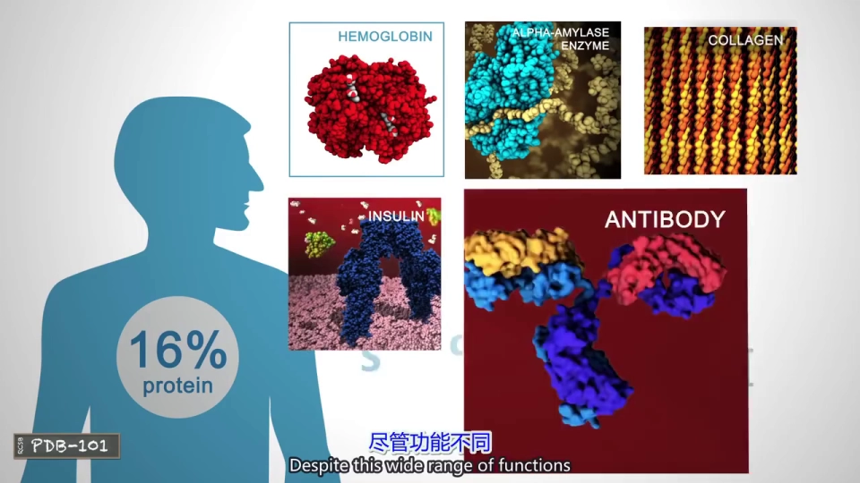

---

## 二、氨基酸：一个中心碳挂三样东西

### 2.1 氨基、羧基、侧链都连在 α 碳上

氨基酸由**碳、氧、氮、氢**原子组成，有些还含有硫原子；**硒代半胱氨酸**则是唯一含有硒的标准氨基酸。这些原子组织成一个**氨基**、一个**羧基**和一个**侧链**，它们都连在一个中心的碳原子（α 碳）上。

三者的分工很明确：氨基和羧基负责把氨基酸连成链，而**侧链决定氨基酸的性质**——它也是不同氨基酸之间**唯一不同**的部分。

[【跳转到 00:30】](https://www.bilibili.com/video/BV1ZJ411e7RD/?t=30)

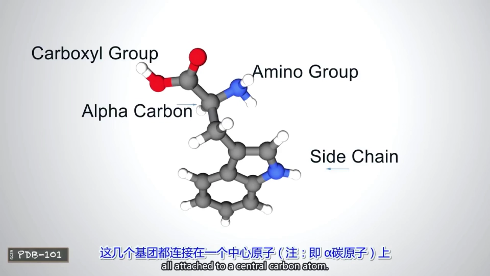

构成蛋白质的氨基酸并不多。视频幻灯片按"标准氨基酸"列出了一整版——正是这一小批构件，通过不同的排列和折叠，撑起了生物界几乎全部蛋白质。

[【跳转到 00:15】](https://www.bilibili.com/video/BV1ZJ411e7RD/?t=15)

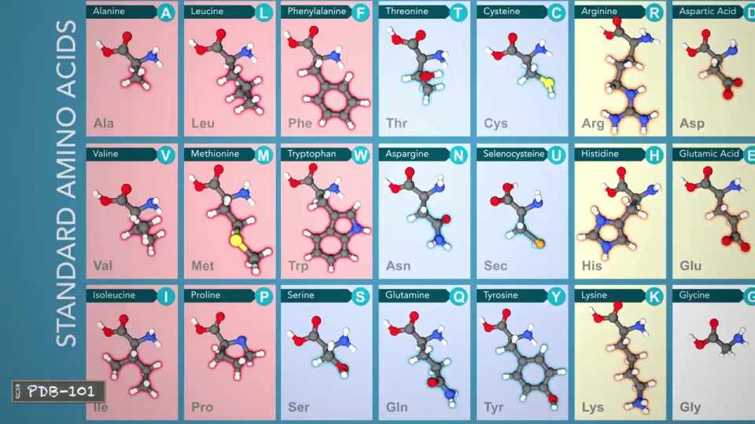

### 2.2 侧链决定性质：疏水、亲水与带电

既然侧链是氨基酸之间唯一不同的地方，它的性质就直接决定了这一段"链"在蛋白质里的行为：

- **疏水氨基酸**：侧链富含碳，不能很好地与水相互作用，倾向于躲开水；
- **亲水（极性）氨基酸**：能够很好地与水相互作用；
- **带电氨基酸**：能与带相反电荷的氨基酸或其他分子相互作用。

[【跳转到 00:50】](https://www.bilibili.com/video/BV1ZJ411e7RD/?t=50)

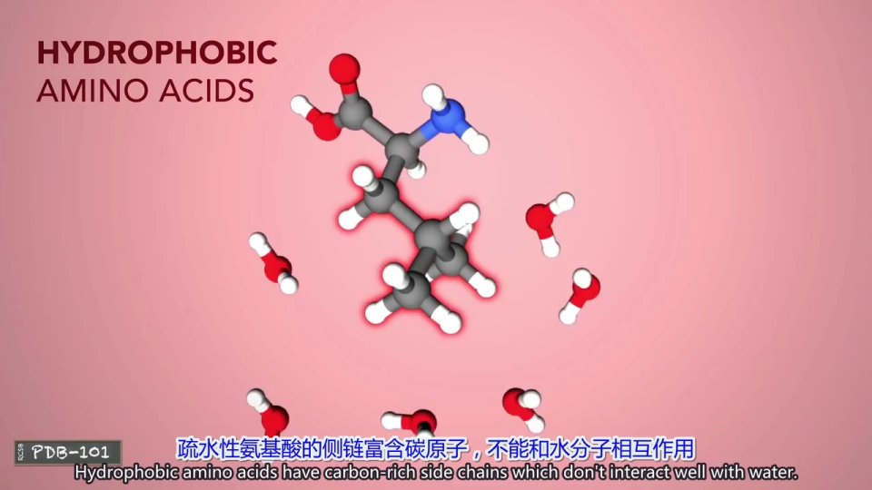

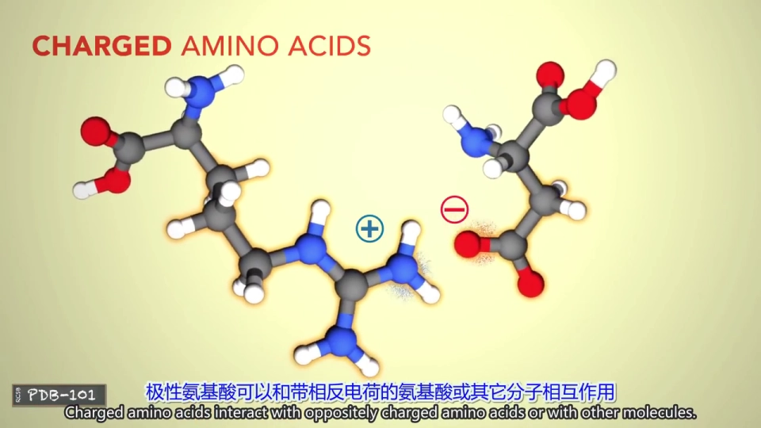

这几类侧链的性格，正是后面"链怎么折叠、往哪折"的底层原因。

---

## 三、从氨基酸到链：一级结构与肽键

### 3.1 一级结构就是氨基酸的排列顺序

蛋白质的**一级结构**就是氨基酸的**线性序列**，而这个序列**由 DNA 编码**——DNA 上的三联体（triplet）密码子一一对应到氨基酸，串出整条序列。所以"顺序"不是随机的，它写在基因里。

[【跳转到 01:19】](https://www.bilibili.com/video/BV1ZJ411e7RD/?t=79)

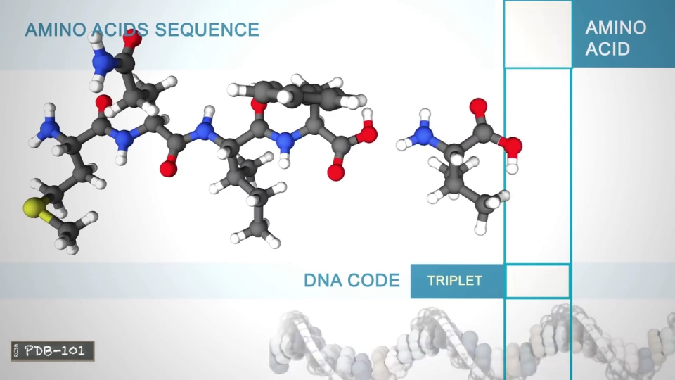

### 3.2 肽键：脱水缩合把氨基酸连起来

蛋白质中的氨基酸通过**肽键**连接：肽键连接**一个氨基酸的氨基**和**另一个氨基酸的羧基**，每形成一个肽键就会**释放一分子水**（这就是脱水缩合）。

[【跳转到 01:29】](https://www.bilibili.com/video/BV1ZJ411e7RD/?t=89)

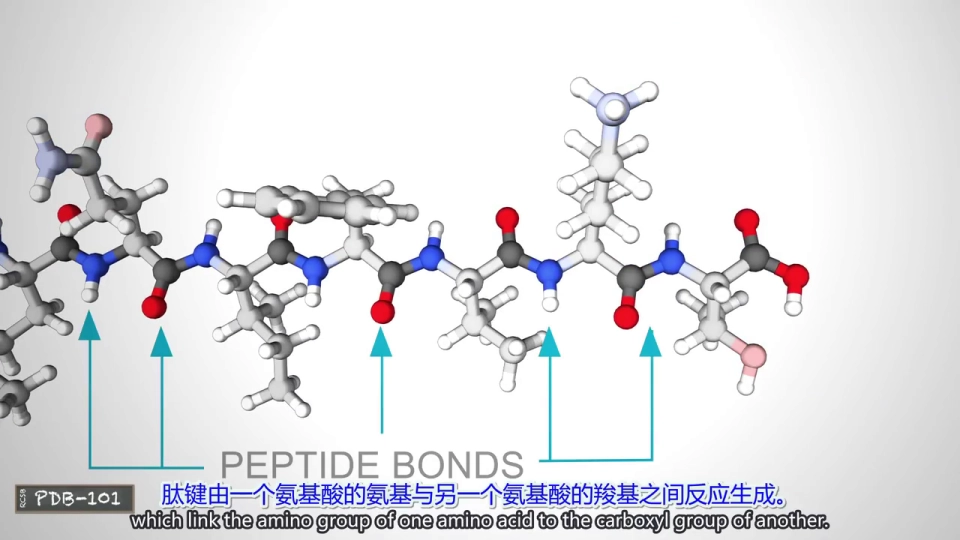

这些由**碳、氮、氧**原子相连形成的长链，就是蛋白质的**主链**（骨架）。侧链挂在主链上，而主链本身则负责把整条链"串"起来、并折叠成各种形状。

[【跳转到 01:39】](https://www.bilibili.com/video/BV1ZJ411e7RD/?t=99)

---

## 四、二级结构：α 螺旋与 β 折叠

蛋白质链通常会折叠出两种常见的**二级结构**：

- **α 螺旋**：一条**右手螺旋**，由附近氨基酸的**氨基和羧基之间的氢键**稳定；
- **β 折叠（片层）**：当**氢键把两条或更多相邻的氨基酸链连接起来**时，就形成了这种片层结构。

[【跳转到 01:44】](https://www.bilibili.com/video/BV1ZJ411e7RD/?t=104)

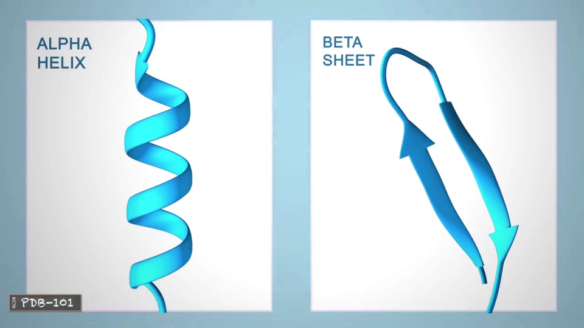

二级结构讲的是"链上局部怎么卷"，它还不是完整的三维形状——那是下一层的事。

---

## 五、三级结构：整条链的三维形状

**三级结构**是**整条蛋白质链的三维形状**，而这个形状**由组成链的氨基酸特性决定**。前面讲的三类侧链，在这里就化身成"折叠的规则"：

- 许多可溶蛋白质折叠成**球状**，把**疏水侧链藏在内部**，让它们远离周围的水分子；
- **膜蛋白**则相反，把**疏水氨基酸聚集在外部**，这样疏水侧链就能与膜中的脂质相互作用；
- **带电氨基酸**让蛋白质能与带互补电荷的分子相互作用。

[【跳转到 02:19】](https://www.bilibili.com/video/BV1ZJ411e7RD/?t=139)

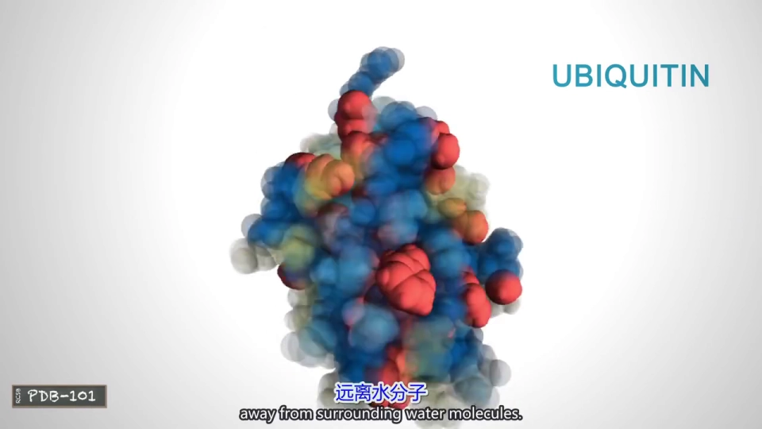

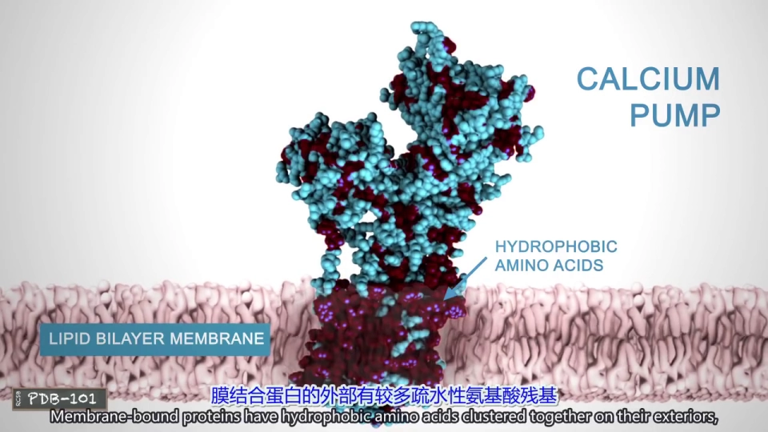

一句话概括这条规律：**"谁在水里、谁躲开"，由侧链的疏水或带电性质决定，最终决定了整条链的三维形状。**

---

## 六、四级结构：多个亚基组装成协作的机器

两条或更多**多肽链**可以聚集在一起，形成一个有功能的分子——也就是由几个**亚基**组成。这是蛋白质的**四级结构**。

最经典的例子是**血红蛋白**：它由**四个亚基**组成，四个亚基相互协作，让整个复合体更容易在**肺部吸收氧气**、并在**体内释放氧气**。要理解它为什么能抓氧，还得看它的三维形状——血红蛋白会形成一个"**口袋**"来容纳**血红素**，而血红素是中心带一个**铁原子**、能与氧结合的小分子。

[【跳转到 02:51】](https://www.bilibili.com/video/BV1ZJ411e7RD/?t=171)

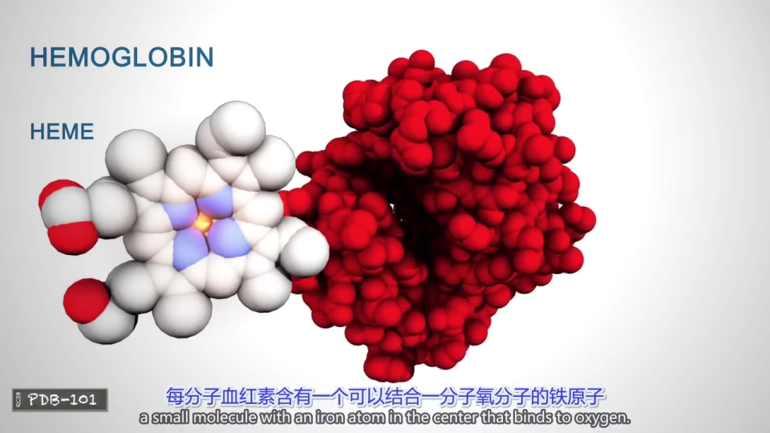

[【跳转到 03:11】](https://www.bilibili.com/video/BV1ZJ411e7RD/?t=191)

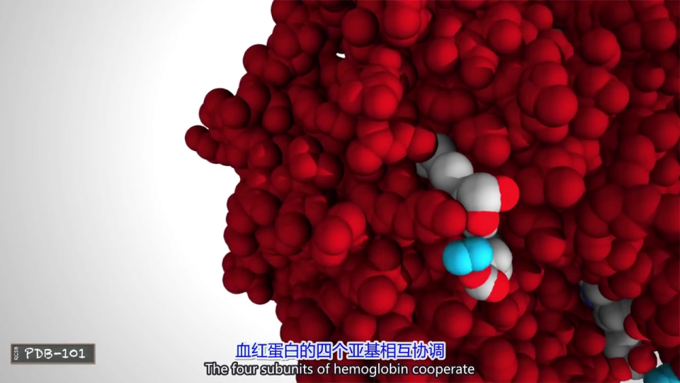

---

## 七、结构决定功能：几个经典例子

**许多蛋白质的功能依赖于它们的三维形状**。形状对了，功能才成立。除血红蛋白外，视频还给了几组鲜活的例子：

- **抗体**：灵活的"手臂"通过**识别并结合病原体**来保护我们免受疾病侵害，并引导免疫系统将其破坏——形状决定了它能否牢牢抓住抗原。
- **铁蛋白**：一种**球形蛋白质**，带有让**铁原子进出的通道**，通道开闭取决于生物体内部的需要；它内部形成一个**中空空间**，铁原子附着在内壁上，这样就能以**无毒的形式储存铁**。
- **胶原蛋白**：形成牢固的**三重螺旋**，为全身提供结构支撑；胶原分子可以形成拉长的纤维，再聚集形成胶原纤维，这类胶原蛋白在**皮肤和肌腱**中含量丰富。
- 此外，**胰岛素**是一种小型、稳定的激素蛋白，在血液中传播时很容易保持形状，用来调节血糖水平；**α 淀粉酶**是一种酶，在唾液中开始消化淀粉；**钙泵**由镁辅助、由 ATP 供能，在每次肌肉收缩后把钙离子送回肌质网。

[【跳转到 04:24】](https://www.bilibili.com/video/BV1ZJ411e7RD/?t=264)

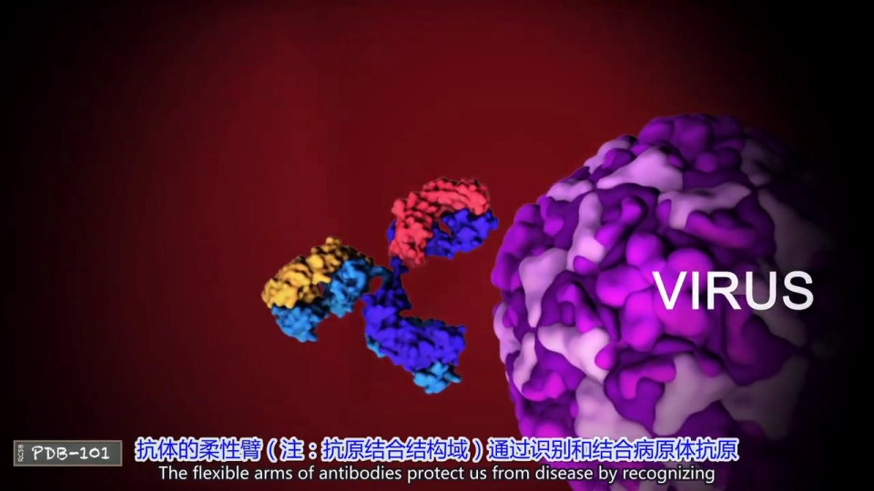

[【跳转到 05:47】](https://www.bilibili.com/video/BV1ZJ411e7RD/?t=347)

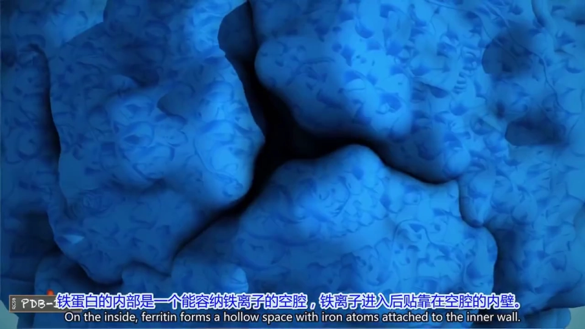

[【跳转到 06:02】](https://www.bilibili.com/video/BV1ZJ411e7RD/?t=362)

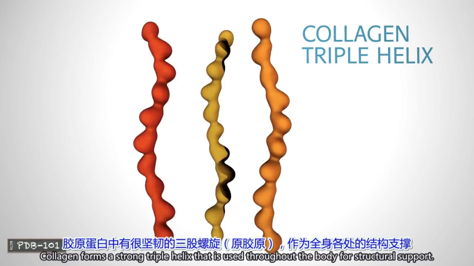

---

## 八、看懂蛋白质结构图：三种表示法

蛋白质的结构与功能有多种视觉展示方式，不同的表示法提供了不同的线索：

- **空间填充图**：显示构成蛋白质的**所有原子**，直观呈现原子的堆积与整体轮廓；
- **丝带图（卡通图）**：显示**主链的组织方式**，并**突出 α 螺旋**等二级结构；
- **表面表示**：显示**水分子能接触到的蛋白质区域**，也就是蛋白质的"外表"。

[【跳转到 03:26】](https://www.bilibili.com/video/BV1ZJ411e7RD/?t=206)

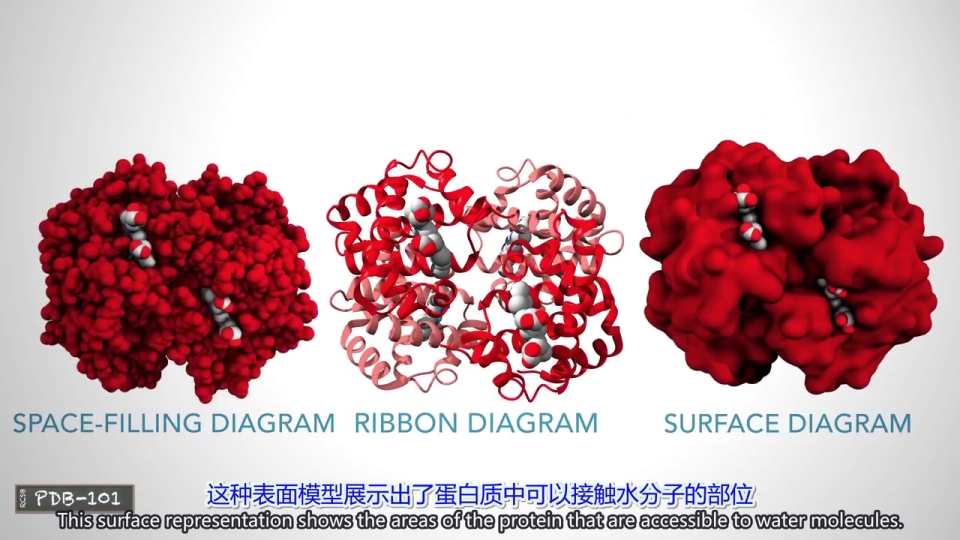

顺带记住一个尺度感：**大多数蛋白质的尺寸小于光的波长**，例如血红蛋白分子大约只有 **6.5 纳米**大小；而它在**红细胞**中浓度很高，一个典型的红细胞含有大约 **2.8 亿个**血红蛋白分子。想进一步了解蛋白质和其他分子机器的功能与三维结构，视频建议访问 **RCSB 蛋白质数据库**。

[【跳转到 03:48】](https://www.bilibili.com/video/BV1ZJ411e7RD/?t=228)

---

## 小结

- 所有蛋白质都由同一批**氨基酸**搭成；氨基酸由碳、氧、氮、氢（部分含硫）组成，硒代半胱氨酸是唯一含硒的标准氨基酸。
- 一个氨基酸 = **氨基 + 羧基 + 侧链**，三者都连在 α 碳上；**侧链决定性质**，分疏水、亲水、带电三类。
- **一级结构**是氨基酸的线性序列，由 DNA 编码；氨基酸靠**肽键**（脱水缩合）相连，形成由碳、氮、氧组成的主链。
- **二级结构**是局部的 α 螺旋与 β 折叠，由链内或链间的氢键稳定。
- **三级结构**是整条链的三维形状，由氨基酸特性决定：球状蛋白把疏水侧链藏在内部，膜蛋白把疏水氨基酸聚在外部。
- **四级结构**是多个亚基组装成的有功能复合体，如四亚基的血红蛋白。
- **结构决定功能**：血红蛋白的"口袋"容纳含铁血红素来结合氧，抗体识别病原体，铁蛋白储铁，胶原蛋白提供支撑。
- 三种常见图示：空间填充图、丝带图、表面图；蛋白质尺寸常在纳米量级。

## 关键术语速查

| 术语 | 一句话解释 |
| --- | --- |
| 氨基酸 | 蛋白质的构件，含氨基、羧基和决定性质的侧链 |
| 侧链 | 不同氨基酸唯一不同的部分，决定疏水 / 亲水 / 带电性质 |
| 肽键 | 连接一个氨基酸的氨基与另一个氨基酸羧基的键，形成时脱去一分子水 |
| 一级结构 | 氨基酸的线性排列顺序，由 DNA 编码 |
| 二级结构 | 链上局部的折叠方式，主要是 α 螺旋和 β 折叠 |
| 三级结构 | 整条肽链的三维形状，由氨基酸特性决定 |
| 四级结构 | 多个多肽链（亚基）组装成的有功能复合体 |
| 血红素 | 中心带一个铁原子、能与氧结合的小分子，被血红蛋白"口袋"容纳 |
| 空间填充图 | 显示蛋白质全部原子的表示法 |
| 丝带图 | 显示主链组织、突出 α 螺旋的表示法 |
