# 组学不是"更多基因"，而是换一个层次看整体：基因组、转录组、蛋白质组各回答什么问题

> 视频来源：[20 组学概述](https://www.bilibili.com/video/BV1Lo4y1i7wr/)（Bilibili · 医学生化一点通）｜时长约 25 分钟
> 导读：这是"组学及组学分析技术"课程的绪论，讲清"组"与"组学"的定义、四层组学的数量级差异、每一层能回答什么问题、以及各层的测量思路与平台。本文按视频顺序整理，字幕中的口误（如"主学"应为"组学"、"质朴"应为"质谱"）已按上下文订正。

## 本讲要解决的核心问题（SCQA）

**背景**：你已经学过中心法则——一个基因转录成 mRNA，再翻译成蛋白质。这条路讲的是**单个基因**怎么工作。

**冲突**：但真正做研究时，论文里出现的却是"基因组""转录组""蛋白质组"这样的词，动辄几万个基因、十几万个转录本、上百万种蛋白。单个基因的知识在这里不够用了：你没法靠"一个基因一个基因地看"去理解一个细胞的状态。

**疑问**：所谓"组"到底"组"的是什么？基因组、转录组、蛋白质组这三层之间是什么关系？它们各自测什么、各自能回答什么问题？

**回答（中心思想）**：组学是把**某一层次的全部分子当成一个整体**来一次性测量和研究；层次越往下（DNA → RNA → 蛋白 → 代谢物），分子数量级越大、动态性越强、越接近真实表型。因此这三层（再加上代谢层）不是"同一件事的几种叫法"，而是**四个不同的问题**：基因组告诉你"可能发生什么"，转录组告诉你"选择了表达什么"，蛋白质组告诉你"功能是否真的完成"，代谢组告诉你"体内确实发生了什么"。

## 一、"组"是整体，"组学"是研究这个整体的学问

### 1.1 从单个基因到整条染色体

以往的学习是从单个个体出发的：中心法则讨论的是某一个基因怎么转录、怎么翻译、怎么造出一条蛋白质。而组学换了一个出发点——从整体看。

基因只是遗传的最小单位，是一段序列，充其量只是染色体上非常短的一段；而一条染色体又是细胞核里 46 条染色体中的一条。人的每个细胞里都有 46 条染色体，当你要研究这 46 条染色体**整体**的功能时，就上升到了"组"的概念。[【跳转到 01:28】](https://www.bilibili.com/video/BV1Lo4y1i7wr/?t=88)

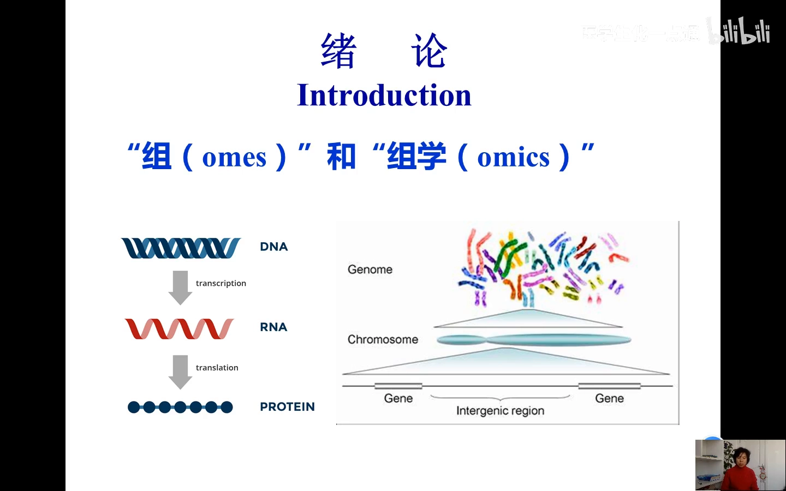

### 1.2 四个"组"的定义：都是集合

理解了"组"是整体，四个组的定义就顺理成章了：

| 名称 | 定义（视频中的说法） | 对应的分子 |
| --- | --- | --- |
| 基因组 Genome | 所有基因所在的集合；对人就是细胞核里 46 条染色体的整体 | DNA |
| 转录组 Transcriptome | 所有 RNA 的集合，因为 RNA 是转录的产物 | RNA |
| 蛋白质组 Proteome | 细胞里所有蛋白质的集合 | 蛋白质 |
| 代谢组 Metabolome | 一个生命体内所有代谢产物构成的集合，包括糖代谢、脂代谢、氨基酸代谢、核苷酸代谢等 | 小分子代谢物 |

[【跳转到 02:18】](https://www.bilibili.com/video/BV1Lo4y1i7wr/?t=138)

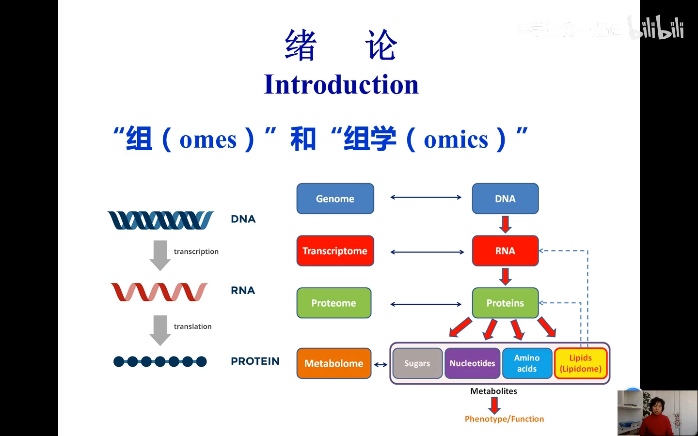

### 1.3 词源与定义的松动

"基因组"这个概念最初由德国的一位教授在 1920 年提出，英文单词是把 gene（基因）和 chromosome（染色体）两个词整合而来的。[【跳转到 03:47】](https://www.bilibili.com/video/BV1Lo4y1i7wr/?t=227)

最初它的定义比较严格：指**一个单倍体细胞中的全套染色体**——对人不算 46 条，而是 22 条常染色体加 2 条性染色体。但随着知识积累，这个概念不再那么严格了：现在提基因组，可以笼统地理解为**这个生物体中所有遗传信息的总和**。[【跳转到 04:17】](https://www.bilibili.com/video/BV1Lo4y1i7wr/?t=257)

"组学（omics）"则由"组（omes）"衍生而来：比如我要研究基因，就要弄清它所有染色体上的遗传序列、每个基因是什么功能，这就构成了一门学问——所以基因组学就是研究所有基因以及基因之间关系的学科。

## 二、组学远不止四层，而每一门组学还在往深里长

### 2.1 组学家族的扩张

除了基因组学、转录组学、蛋白质组学、代谢组学，视频里还列出了一长串：RNA 组学、糖组学、脂类组学、免疫组学，甚至影像组学、超声组学。[【跳转到 05:18】](https://www.bilibili.com/video/BV1Lo4y1i7wr/?t=318)

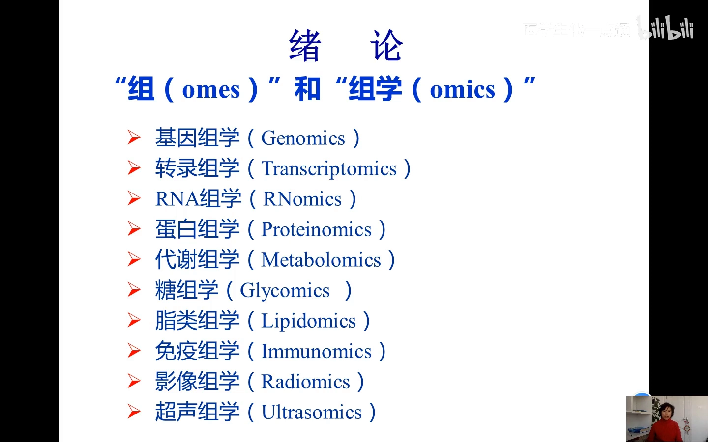

组学概念今天确实有些"泛滥"，个别科学家也对它提出过质疑。视频的处理方式是：不纠缠这些争论，只从本科基础医学的角度，落脚在最扎实的四个层次上——基因组学、转录组学、蛋白质组学、代谢组学，另外补一个表观组学（因为在 DNA 转录成 RNA 的过程中，染色体层次上有必须掌握的知识）。

### 2.2 每一门组学内部也在加深

不仅种类变多，每门组学的纵深发展也很可观：基因组学从比较基因组学、结构基因组学、功能基因组学，发展到了 3D 基因组学；转录组学则提出了空间转录组学的概念。[【跳转到 05:48】](https://www.bilibili.com/video/BV1Lo4y1i7wr/?t=348)

### 2.3 层次之上还要整合：系统生物学

不管哪一门组学，它都只是**在一个层次上**做系统性研究。而不同层次的研究汇总起来，再加上个体内外环境的变化，构成的更大体系叫做系统生物学。[【跳转到 06:28】](https://www.bilibili.com/video/BV1Lo4y1i7wr/?t=388)

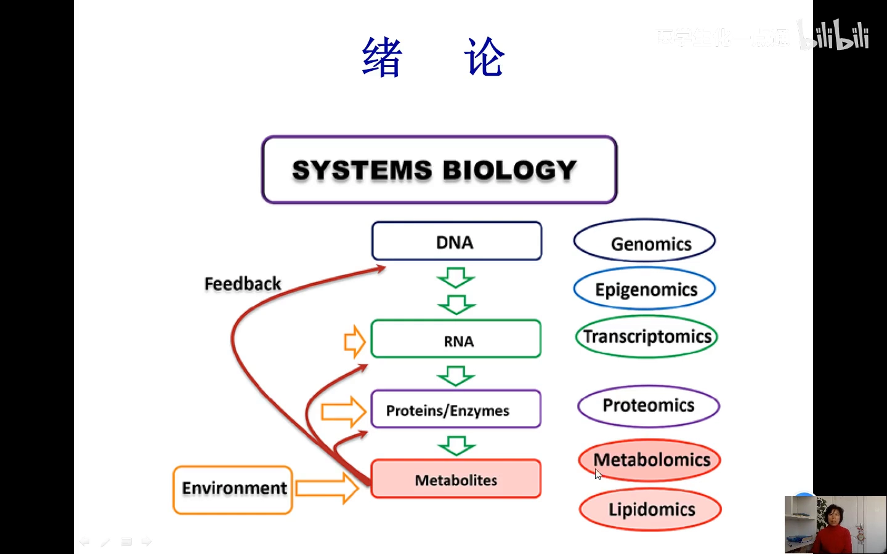

这张图值得多看一会儿：它画出了两件常被忽略的事——**环境会直接作用于代谢层**，而**代谢物又会反过来影响 RNA 与蛋白质，并通过反馈回路作用于 DNA**。所以组学不是单向的信息流，而是一个带反馈的系统。正因如此，做研究时不能只盯着一个层次，要把它和疾病、和个体的生理病理状态联系起来，才能把基础医学用到临床指导上。[【跳转到 07:07】](https://www.bilibili.com/video/BV1Lo4y1i7wr/?t=427)

## 三、四层分子的数量级：每往下一层，复杂度就跳一级

各组学的"规模"差别很大，这直接决定了分析难度：

| 层次 | 数量级（视频中的说法） | 复杂度来源 |
| --- | --- | --- |
| 基因组学 | 人体基因约 2 万～2.5 万个（幻灯片上标约 4 万个基因） | 序列本身固定 |
| 转录组学 | 10 万级（幻灯片标约 15 万个转录本） | 可变启动子、可变剪接、RNA 编辑 |
| 蛋白质组学 | 100 万级以上 | 翻译后修饰带来大量蛋白变体 |
| 代谢组学 | 约 2800～3000 种化合物 | 受遗传与内外环境共同影响 |

[【跳转到 08:22】](https://www.bilibili.com/video/BV1Lo4y1i7wr/?t=502)

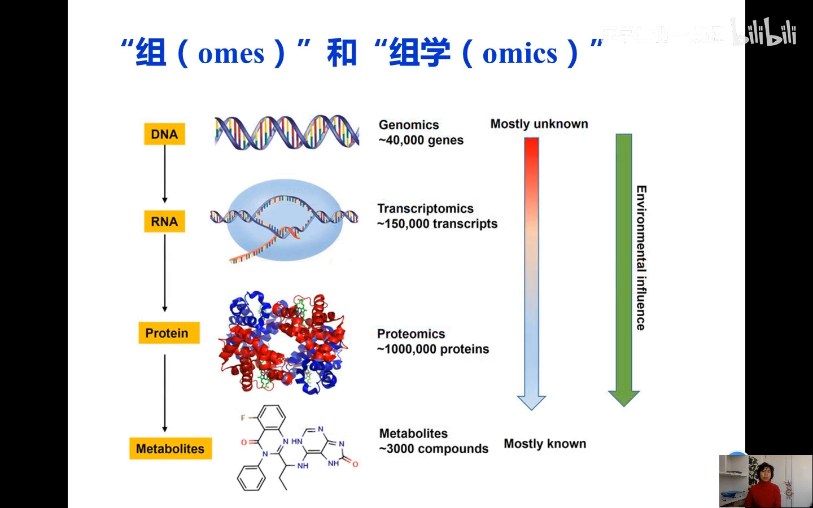

"每上升一级，数量级都是一个大的跨越"——原因在于每一级都不是单一活动：转录时有染色质层次的调控和转录前后的加工修饰，翻译之后还有各种各样的蛋白质修饰。而到了具体的一个人身上，代谢组的分子种类反而不像想象的那么多，因为体内外环境会把它"收窄"。[【跳转到 08:47】](https://www.bilibili.com/video/BV1Lo4y1i7wr/?t=527)

## 四、同一份样本，四个层次回答四个不同的问题

这是全片最有价值的一段，也是理解"为什么要做多组学"的关键。

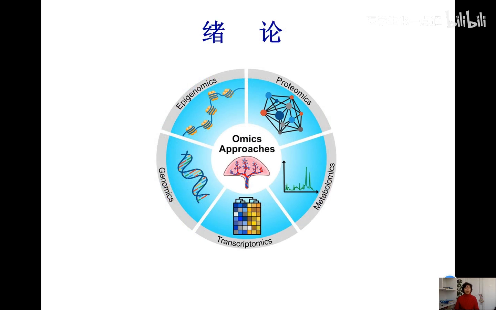

视频用一个递进的句式把四层串了起来：

1. **基因组——"可能发生什么"**。不同的组织细胞具备**相同**的基因组，但每个基因在不同条件下的活动是不一样的；基因的表达是有选择性的。所以基因只能决定你这个细胞里**可能会**发生什么。[【跳转到 09:44】](https://www.bilibili.com/video/BV1Lo4y1i7wr/?t=584)
2. **转录组——"正在发生什么"**。只有开始转录、生成了 RNA，我们才说这个基因被选择表达了、细胞里正在发生这个过程。但"正在发生"未必都有最终结果。[【跳转到 10:09】](https://www.bilibili.com/video/BV1Lo4y1i7wr/?t=609)
3. **蛋白质组——"功能有没有完成"**。只有蛋白质生成出来，才能说这个基因到底有没有完成它的功能，也就是这个组织细胞里已经有什么蛋白了。[【跳转到 10:34】](https://www.bilibili.com/video/BV1Lo4y1i7wr/?t=634)
4. **代谢组——"确实发生了什么"**。蛋白出来了，还要看它在内外环境改变的过程中有没有发生作用；只有蛋白发挥了功能、体内化学变化发生了、代谢物产出了，才能证明机体里确实发生了什么。[【跳转到 10:59】](https://www.bilibili.com/video/BV1Lo4y1i7wr/?t=659)

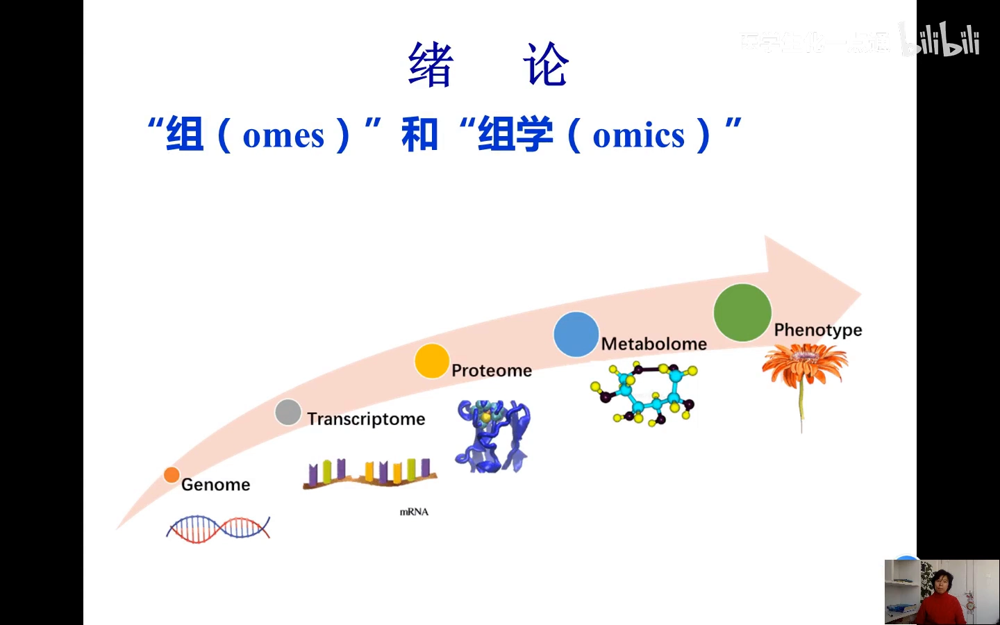

**再加一层：表观基因组学。** 基因的遗传密码是"决定者"，但不是唯一者——还有一些外来因素会影响它，这就是表观遗传学要研究的东西。所以一个真实的体内到底怎么样，必须从各个层次探讨才能确定。[【跳转到 11:24】](https://www.bilibili.com/video/BV1Lo4y1i7wr/?t=684)

## 五、每一层怎么测：从提取样本到拿到序列

视频对每一层的"测量思路"都给了交代。共同点是：先拿到样本、提取目标分子、拿到序列或谱图，再靠软件分析。

### 5.1 基因组学：提取 DNA → 酶切 → 测序 → 分析 → 功能验证

基因组学的主要任务是获得细胞里所有基因的序列，并判断序列的意义、功能以及它们之间有没有相关性。研究对象是 DNA，所以要把样本的 DNA 提取出来；因为 DNA 分子很大，要进行酶切，得到每一个基因片段的序列；序列非常庞大，要靠软件分析才知道细胞里到底有什么基因，再结合其他技术证明基因的功能。[【跳转到 11:45】](https://www.bilibili.com/video/BV1Lo4y1i7wr/?t=705)

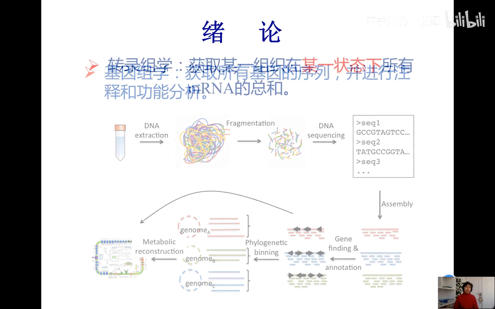

### 5.2 转录组学：必须带"动态"的观点

每一个时刻、不同的组织细胞，转录出来的 mRNA 都不一样。所以一提到转录组学就要有动态观点：要获得**某一个组织在某一个状态下**所有 mRNA 的总和，提取这个状态下的 mRNA，用各种方法拿到 RNA 序列，再分析推断功能。[【跳转到 12:35】](https://www.bilibili.com/video/BV1Lo4y1i7wr/?t=755)

### 5.3 蛋白质组学：数量级放大带来的困难

蛋白质组同样是动态的：要获取某一时刻样本中所有蛋白质的序列。但难度更大——从基因到转录本，由于染色质调控和加工修饰，转录本数量已经比基因多很多；到蛋白，翻译过程中模板本身就有很大变化，得到蛋白之后又有大量修饰，需要分析的数量又是一个数量级的改变。[【跳转到 13:11】](https://www.bilibili.com/video/BV1Lo4y1i7wr/?t=791)

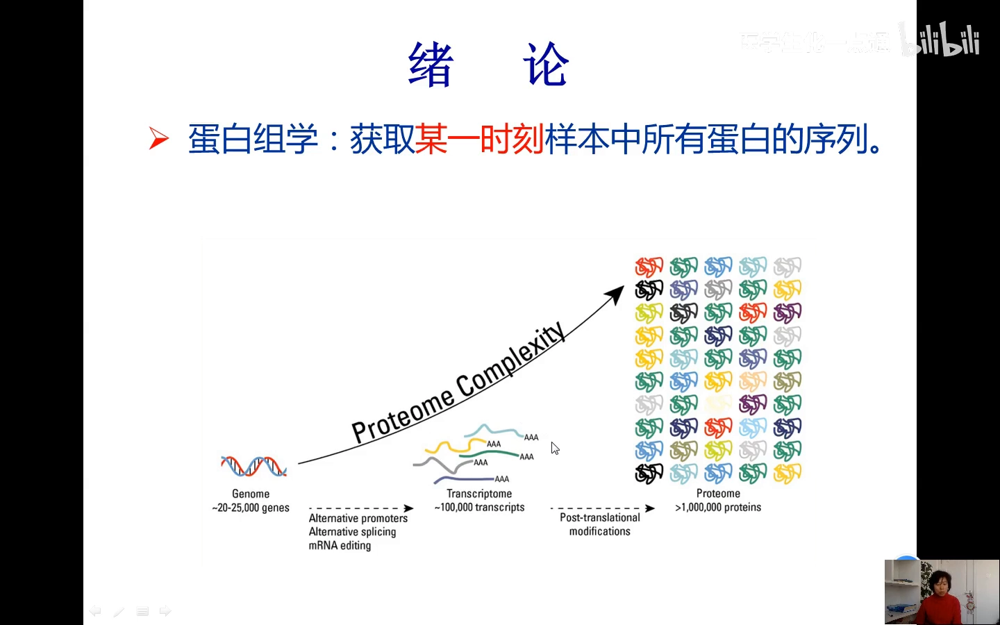

### 5.4 代谢组学：质谱、色谱、核磁

想知道一个人体内到底确实发生了什么，就要到代谢组学：从感兴趣的组织或体液取标本、测定、推断有哪些代谢物，再和其他层次的结果关联。具体手段是把你感兴趣的代谢物提取出来，通过质谱、色谱、核磁这样的大规模分析做比对，得到样品里有哪些代谢产物；这些产物是干什么的，还要和数据库关联分析，才能判断它的来源、反映体内实质性的分子水平变化。[【跳转到 14:51】](https://www.bilibili.com/video/BV1Lo4y1i7wr/?t=891)

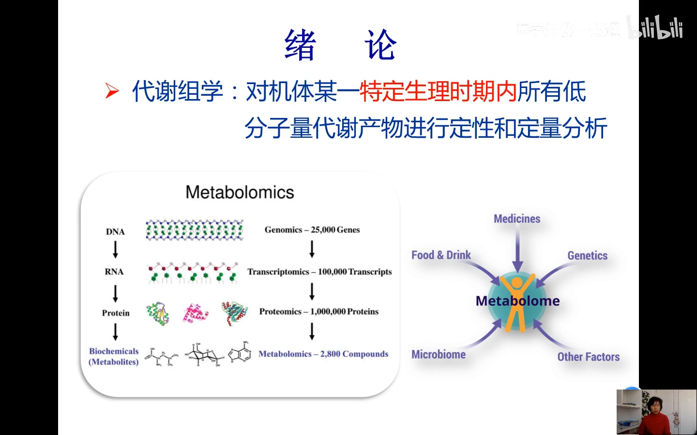

### 5.5 表观基因组学：在基因组水平上研究表观修饰

什么叫表观遗传？真核染色体不单单包括 DNA，还含有组蛋白、构成核小体。DNA 上的碱基序列是遗传信息活动的主宰者，但不是唯一的：DNA 上某些碱基会发生甲基化，核小体的组蛋白也会发生修饰，甚至一些小分子 RNA 也对 DNA 有调控作用。这些基因本身之外、对表达的调控，就是表观遗传。[【跳转到 16:31】](https://www.bilibili.com/video/BV1Lo4y1i7wr/?t=991)

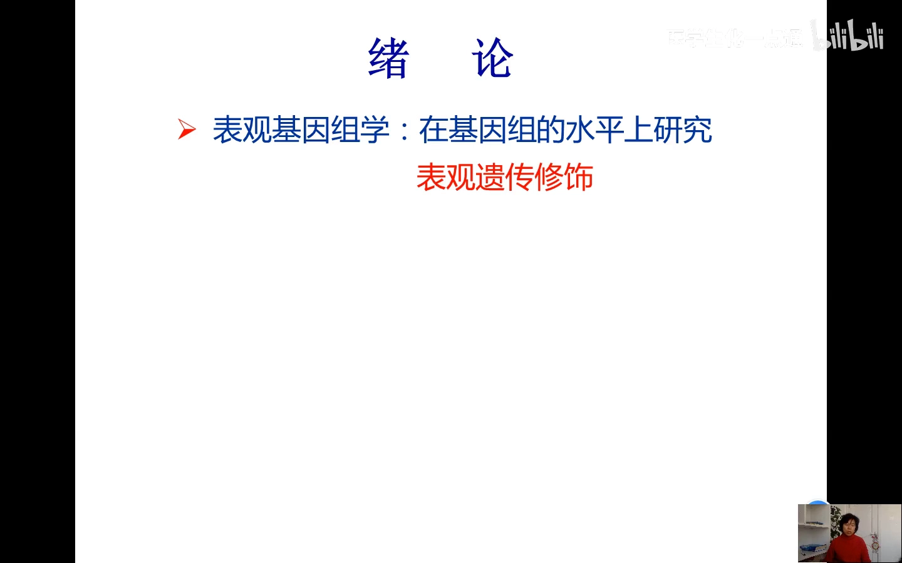

最基本的两个方向是 DNA 甲基化和组蛋白修饰。研究对象是细胞核，要把核里的物质提取出来，再通过染色质免疫共沉淀、DNA 测序等方法，探讨 DNA 和蛋白质之间的相关性。[【跳转到 17:21】](https://www.bilibili.com/video/BV1Lo4y1i7wr/?t=1041)

## 六、平台与技术栈：芯片、测序、质谱、验证

把各层放在一起看，技术平台其实分工很清楚：

| 平台 | 服务的组学 | 典型用途 |
| --- | --- | --- |
| 芯片平台 | 基因组学、转录组学 | 基因组组装、重测序、外显子测序、捕获测序、SNP/CNV 芯片；转录组的 mRNA/sRNA/lncRNA/circRNA 芯片 |
| 测序平台 | 基因组学、转录组学 | DNA/RNA 测序，包括单细胞转录组测序、全转录组测序 |
| 质谱平台 | 蛋白质组学、代谢组学 | 蛋白定性、定量、修饰检测；小分子代谢物检测 |
| 验证平台 | 全层次的下游验证 | 常规 PCR、免疫组化、Western blot |

[【跳转到 22:24】](https://www.bilibili.com/video/BV1Lo4y1i7wr/?t=1344)

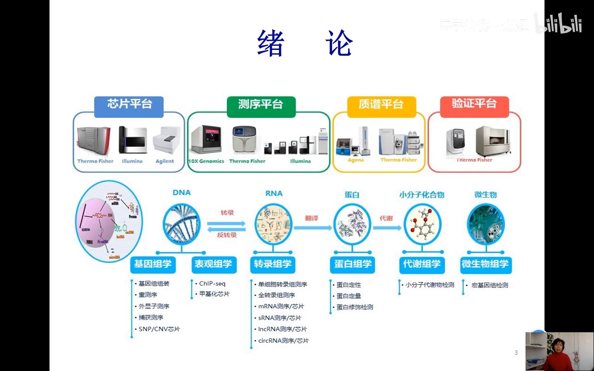

## 七、组学研究是一条流水线，而不是一次实验

视频后半段把组学研究的"工程属性"讲得很实在：

1. **先有目的和设计**：你的目的是什么、面对的对象是什么；
2. **拿到合适的样本**：分离、得到高质量的样品；
3. **锚定层次再选技术**：确定要研究哪一层，再按它的要求选方法；
4. **上机得到海量数据**；
5. **靠生物信息学把序列变成意义**：不管做哪一层组学，得到的充其量是很多很多序列，必须借助生物信息学、利用现成数据库、通过不同软件去分析，才能找出其中的意义；
6. **挑重点分子，用常规分子生物学技术验证**：结合理论和预判挑出重点分子，用 PCR、免疫组化、Western blot 等去验证，才能得出结论。[【跳转到 21:10】](https://www.bilibili.com/video/BV1Lo4y1i7wr/?t=1270)

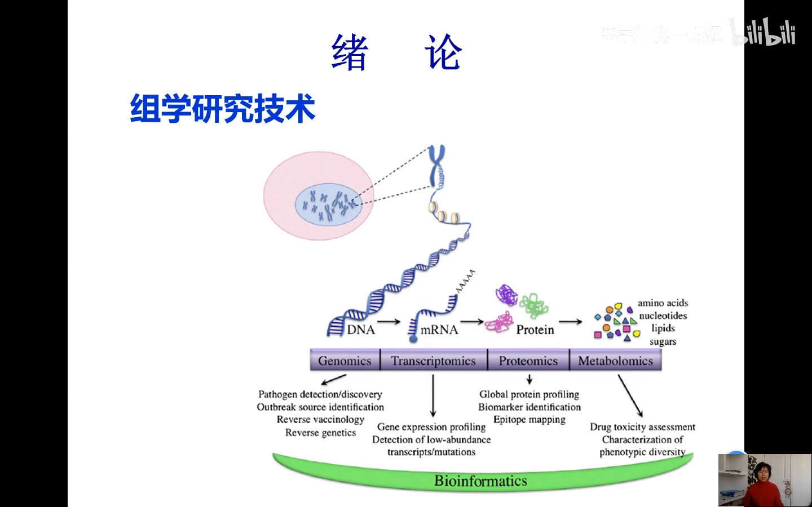

也正因为如此，"组学分析不是一个人能办到的，肯定要一个团队才能完成"。[【跳转到 21:35】](https://www.bilibili.com/video/BV1Lo4y1i7wr/?t=1295)

## 八、落到临床：一次肿瘤多组学分析长什么样

视频最后给了一个具体例子：对某个肿瘤患者的肿瘤发生感兴趣，就做一次肿瘤多组学分析——做基因组测序、转录组测序，看这个患者从基因水平、转录水平有哪些 DNA、哪些 RNA 的表达和正常人不一样；甚至看表观组，组蛋白修饰哪里不同、哪个启动子的甲基化发生了变化；再结合三维基因组，通过生物信息学分析得到这些分子之间的关联度、和正常人的对比，之后挑重点验证，最终得出结论。[【跳转到 22:56】](https://www.bilibili.com/video/BV1Lo4y1i7wr/?t=1376)

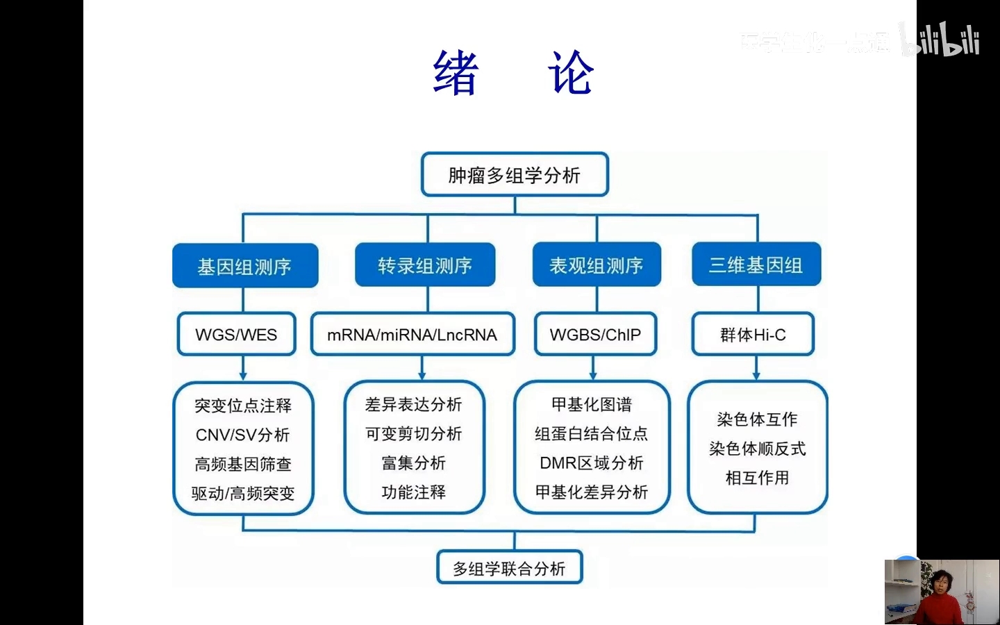

这套流程的方向是闭环的：问题来自临床观察 → 实验室里借助分子生物学技术、生物信息技术和组学研究 → 结论再翻回临床指导临床。而在这个"临床—基础—临床"的转化过程中，既可能提出新的科学问题，也可能带来技术上的创新（比如为大量数据分析设计出新的程序和软件）。[【跳转到 24:21】](https://www.bilibili.com/video/BV1Lo4y1i7wr/?t=1461)

## 小结

- **"组"是整体，"组学"是研究这个整体的学科**：基因组是所有基因的集合，转录组是所有 RNA 的集合，蛋白质组是所有蛋白的集合，代谢组是所有代谢产物的集合。
- **四层不是同义词，而是四个不同的问题**：基因组说"可能发生什么"，转录组说"选择了表达什么"，蛋白质组说"功能有没有完成"，代谢组说"体内确实发生了什么"。
- **越往下越复杂**：基因 2 万～2.5 万 → 转录本 10 万级 → 蛋白 100 万级以上 → 代谢物约 3000 种，每上一级都是数量级的跨越。
- **测量思路统一但难度递增**：都是"取样本 → 提取目标分子 → 拿到序列或谱图 → 生物信息学分析 → 常规实验验证"，但 DNA 可以酶切测序，蛋白要靠质谱，代谢物要靠质谱/色谱/核磁。
- **表观基因组学补上了"决定者不是唯一者"这一层**：DNA 甲基化、组蛋白修饰等基因之外的调控，同样决定表达。
- **层次之上要整合**：单层组学只是系统性研究一个层次，系统生物学才把各层与环境、反馈放在一起看。
- **组学是团队工程**：设计、样本、仪器、生物信息学、验证缺一不可，最终目的是服务于临床。

## 关键术语速查

| 术语 | 一句话解释 |
| --- | --- |
| 组（omes） | 某一层次全部分子的集合，如基因组、转录组、蛋白质组、代谢组 |
| 组学（omics） | 把某一层次的全部分子当作整体来系统性测量的学科 |
| 基因组学 | 研究所有基因的序列、功能以及基因之间关系的学科 |
| 转录组学 | 研究某一组织在某一状态下所有 RNA（转录产物）总和的学科 |
| 蛋白质组学 | 研究某一时刻样本中所有蛋白质的序列、丰度与修饰的学科 |
| 代谢组学 | 对机体某一特定生理时期内所有低分子量代谢产物做定性和定量分析 |
| 表观基因组学 | 在基因组水平上研究表观遗传修饰（DNA 甲基化、组蛋白修饰等） |
| 系统生物学 | 把各层次组学数据连同环境因素与反馈整合起来研究生命系统的学科 |
| 中心法则 | DNA 转录为 RNA、RNA 翻译为蛋白质的信息流主线 |
| 生物信息学 | 用数据库与软件对海量组学序列/谱图做分析，从中提取生物学意义 |