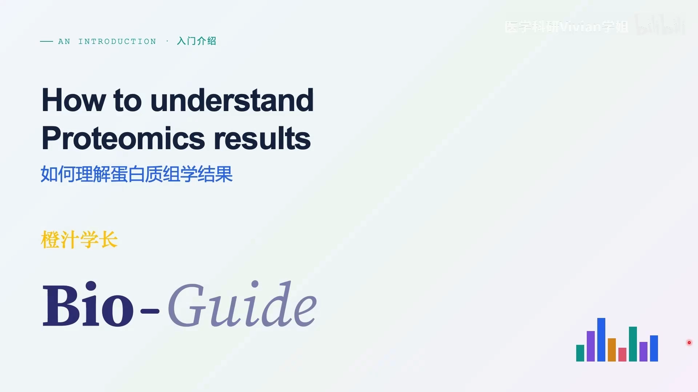
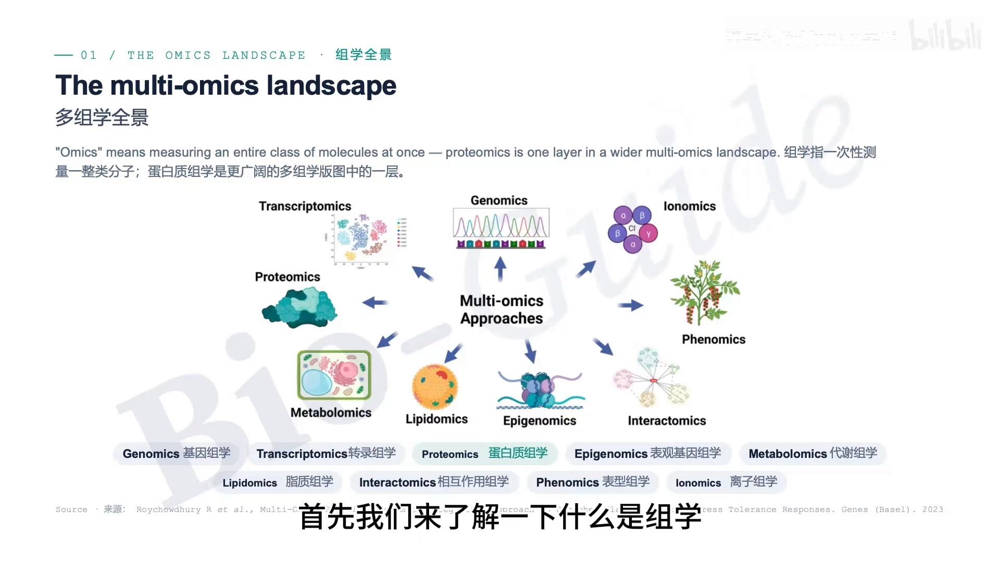
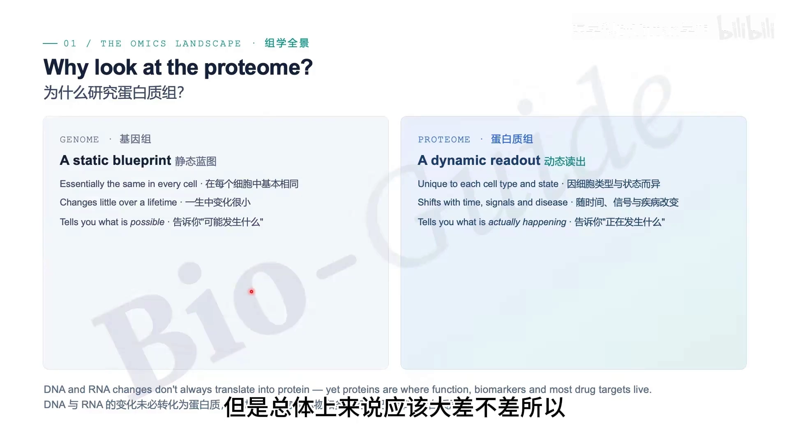
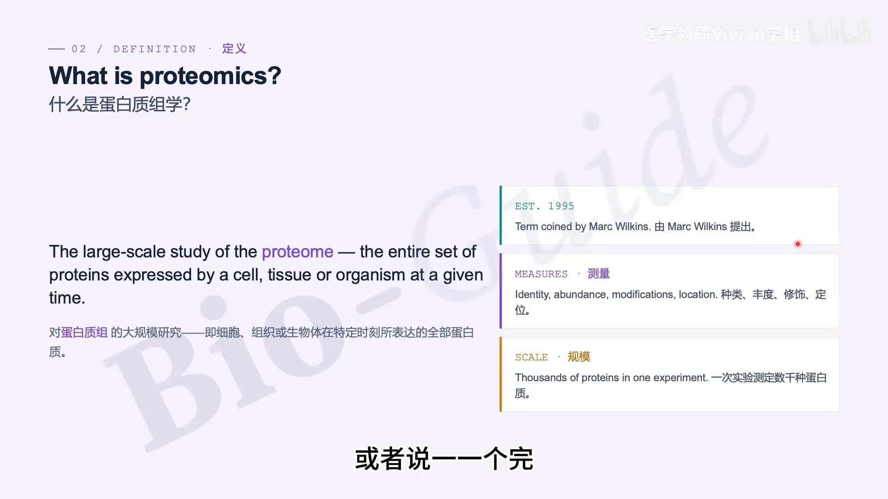
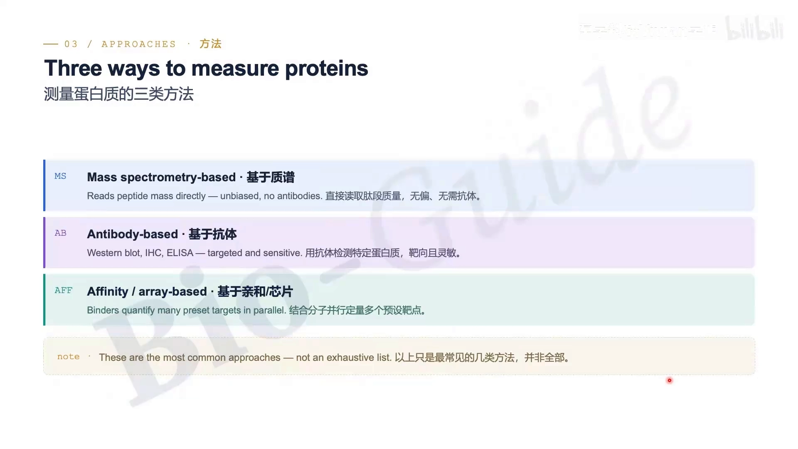
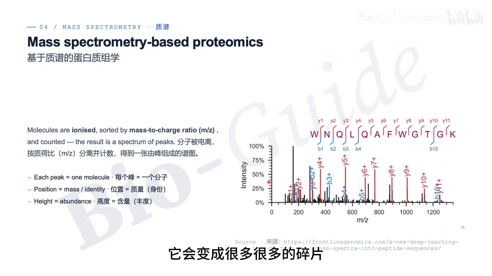
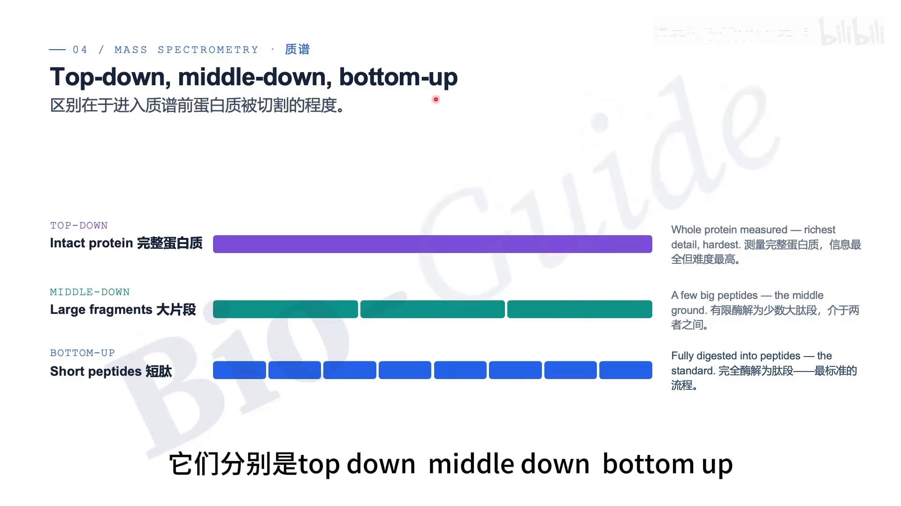
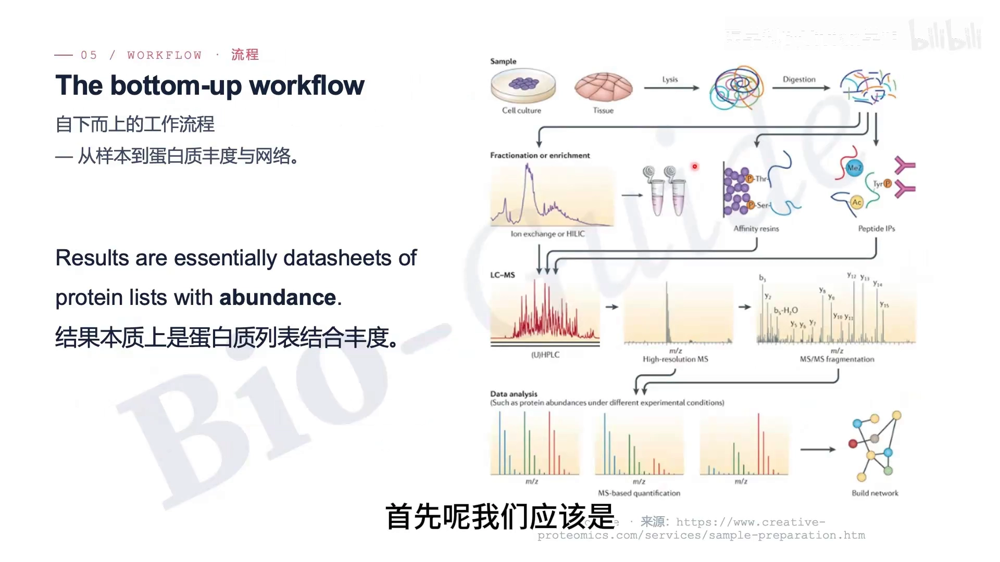

# 蛋白质组怎么测出来：把上千种蛋白酶解成短肽，再从谱图拼回一张蛋白×样本丰度表

> 视频来源：[科研小白读文献 | 一个视频带你读懂蛋白质组学（1）原理篇](https://www.bilibili.com/video/BV1qw8p6NEee/)（Bilibili · 还没发Nature的Vivian，主讲：Bio-Guide 橙汁学长）｜时长约 11.5 分钟
> 导读：这支视频只回答一个问题——文献里的蛋白质组学结果是怎么来的。它把"组学是什么、蛋白质组为什么是动态的、测蛋白的三条路线、质谱怎么出谱图、top-down/middle-down/bottom-up 怎么选、bottom-up 全流程、最后拿到什么数据"串成一条线。本文按视频顺序整理，字幕中的口误（如"质朴"应为"质谱"、"风度"应为"丰度"）已订正。

## 本讲要解决的核心问题（SCQA）

**背景**：读文献时，你常看到蛋白质组的热图、火山图、差异蛋白列表——一张表里几千个蛋白、几十个样本，每个格子一个数值。

**冲突**：DNA 可以 PCR 扩增、可以测序，但蛋白质既不能扩增，也没有"蛋白测序仪"。那几千种蛋白的丰度，到底是怎么被测出来的？为什么同一个蛋白在不同样本里会有不同的值？

**疑问**：蛋白质组学测的究竟是什么？用什么方法测？跑完一次实验，最后拿到的数据长什么样？

**回答（中心思想）**：组学是**一次性测量一整类分子**；蛋白质组是某一时刻、某一份样本里全部蛋白的集合，它是**动态读出**而不是静态蓝图。主流测法是**基于质谱的 bottom-up 流程**：把蛋白裂解、酶解成短肽，用液相色谱排队送进质谱，把肽段打碎成谱图，再和蛋白数据库比对拼回序列——最终得到的是**一张"蛋白 × 样本"的丰度表**，此后所有蛋白质组分析都基于这张表。

## 一、组学 = 一次性测量一整类分子，蛋白质组是其中最动态的一层

### 1.1 什么是组学

组学指的是一次性测量一整类分子：一个细胞里一次性测量所有 DNA 分子，就叫基因组学；一次性测量所有蛋白质，就叫蛋白质组学。组学包括很多分支，这支视频只把注意力放在蛋白质组学上。[【跳转到 00:15】](https://www.bilibili.com/video/BV1qw8p6NEee/?t=15)

### 1.2 为什么基因组是静态的，蛋白质组是动态的

谈基因组时，它一般是静态的：一个人身上所有细胞里的基因组都一样，测序测出来理论上应该一样（除非有表观遗传或突变的情况），而且一生中变化也很小。它相当于细胞里的"总路线"或者说"数据库"，可以从中表达出很多基因——但基因是**选择性表达**的，不同细胞、不同组织里表达方式不同。[【跳转到 00:40】](https://www.bilibili.com/video/BV1qw8p6NEee/?t=40)

测蛋白质组时，测的却是一个动态过程：不是所有基因在所有细胞中都表达，只有一部分基因在某些细胞中表达。所以蛋白质组因细胞类型和状态而异；同一个细胞随时间变化、随外界刺激变化，表达的蛋白也会变。[【跳转到 01:05】](https://www.bilibili.com/video/BV1qw8p6NEee/?t=65)

这张对照表值得记住，它也是"为什么要做蛋白质组"的答案：DNA 与 RNA 的变化未必转化为蛋白质，而功能、生物标志物和大多数药物靶点都落在蛋白这一层。

### 1.3 蛋白质组学测什么、规模多大

蛋白质组学是对蛋白质组的大规模研究。虽然叫"一个细胞"，但实际研究常常关注的是一片细胞、一群细胞、一个区域内的组织，甚至一整个器官。测量内容包括蛋白的**种类、丰度、修饰、定位**——因为一个蛋白通常是一条或几条多肽链，多肽链上有不同的氨基酸，不同氨基酸上可以发生不同修饰，这些都是蛋白质组能测的。[【跳转到 01:55】](https://www.bilibili.com/video/BV1qw8p6NEee/?t=115)

一个细胞里可能有几千种蛋白同时在表达，所以做一次蛋白质组可以测量数千种蛋白质，是一个**非常高通量**的实验。[【跳转到 02:45】](https://www.bilibili.com/video/BV1qw8p6NEee/?t=165)

## 二、测蛋白的三条路线：质谱、抗体、亲和芯片

一般说"蛋白质组"，默认指的是**基于质谱**的方法。除此之外还有两类常见思路：

| 路线 | 原理 | 特点 |
| --- | --- | --- |
| 基于质谱（MS） | 直接读取肽段质量，无需抗体 | 无偏、可发现新东西，是主流 |
| 基于抗体（AB） | Western blot、免疫组化、ELISA 等 | 靶向、灵敏，但一次只看少数目标 |
| 基于亲和/芯片（AFF） | 用结合分子并行定量多个预设靶点 | 把蛋白信号转换成其他分子信号（如 DNA，进而做 qPCR） |

[【跳转到 03:29】](https://www.bilibili.com/video/BV1qw8p6NEee/?t=209)

视频强调：以上只是最常见的几类，并非全部——科学总在发展，新方法不断被提出；但迄今为止用得最多、最主流的，仍然是基于质谱的蛋白质组学。[【跳转到 04:19】](https://www.bilibili.com/video/BV1qw8p6NEee/?t=259)

## 三、质谱怎么把分子变成一张谱图

质谱本质上是一台机器：你把分子丢进去，它会把分子裂解成很多碎片，检测仪器上分子按**质荷比（m/z）**分离并计数，于是得到一张由峰组成的谱图。读谱只要记住三件事：

- 每个峰 = 一个分子（片段）；
- 峰的位置 = 质量，也就是身份线索；
- 峰的高度 = 丰度（含量）。

[【跳转到 04:44】](https://www.bilibili.com/video/BV1qw8p6NEee/?t=284)

有了谱图，还需要算法把它"拼回去"：把碎掉的分子重新计算，推出丢进去的原来是哪一段序列。这类算法有商业的，也有实验室不断提出、不断发展的。这就是基于质谱的蛋白质组学的基本原理。[【跳转到 05:09】](https://www.bilibili.com/video/BV1qw8p6NEee/?t=309)

## 四、三种进样策略：区别只在"进质谱前把蛋白切多碎"

把分子丢进质谱仪，一般有三种模式，区别就在于**蛋白质在进入质谱前被切割的程度**：

| 模式 | 进样形态 | 优势 | 代价 |
| --- | --- | --- | --- |
| top-down | 完整蛋白质（整条多肽链） | 信息最全，能拿到完整蛋白的信息 | 链太长，打碎后复原极难，算法复杂、容易算错，限制性大 |
| middle-down | 大片段（有限酶解） | 信息与可复原性之间的折中 | 信息略少于 top-down |
| bottom-up | 短肽（完全酶解，如 8 个氨基酸左右） | 序列短、复原最简单、速度最快、通量最高 | 信息不如前两者完整，依赖算法精度 |

[【跳转到 05:34】](https://www.bilibili.com/video/BV1qw8p6NEee/?t=334)

结论很直接：**bottom-up 是目前用得最广、通量最高、也是分析蛋白质组最强大的方法**——虽然信息不完整，但算法精度和准确性在不断提高。[【跳转到 07:39】](https://www.bilibili.com/video/BV1qw8p6NEee/?t=459)

## 五、bottom-up 全流程：从一管样本到一张谱图

视频把流程拆得很清楚，按顺序是：

1. **取样本**：培养的细胞，或从病人、小鼠模型得到的组织；
2. **裂解细胞**：释放整个蛋白质组；
3. **酶解**：把蛋白切成很多小的多肽；
4. **（可选）纯化、分级或富集**：取决于实验目的，不是必做；也可以在这里先做一次裂解是否充分的检查；
5. **液相色谱（LC）分离**：分子像排队一样一个一个进入质谱；
6. **质谱（MS）打碎并收集信号**：得到谱图，也就是一个数据集。

[【跳转到 08:09】](https://www.bilibili.com/video/BV1qw8p6NEee/?t=489)

### 5.1 谱图怎么变成序列：靠数据库比对

拿到谱图之后，分析并不是凭空推断，而是**和数据库比对**。在发展蛋白质组学的过程中，人们已经建立了成熟的蛋白数据库：把某个物种的蛋白全部提出来，一个一个上质谱，就知道每一个蛋白、每一段多肽打碎之后应该是什么样子。下次你拿一个样本丢进质谱仪，出来的谱图和库里某一条对上，就知道它原来的肽段序列应该是哪一条。[【跳转到 09:24】](https://www.bilibili.com/video/BV1qw8p6NEee/?t=564)

通过这样不断比对，就能还原多肽链的序列，从而重建整个蛋白质组的数据——这一步视频里叫 build network。[【跳转到 10:14】](https://www.bilibili.com/video/BV1qw8p6NEee/?t=614)

## 六、最后拿到什么数据：一张蛋白 × 样本的丰度表

这是全片最想让人记住的一点。跑完、分析完之后，拿到的**不是**一堆谱图，而是一个**蛋白质列表加上它的丰度**：

- 形式上就是一张 Excel 表；
- 纵轴是不同的蛋白名字；
- 横轴是不同的样本（patient one、patient two……）；
- 每个格子里的值，代表这个蛋白在那个样本里检测到的量。

[【跳转到 10:39】](https://www.bilibili.com/video/BV1qw8p6NEee/?t=639)

所以此后所有蛋白质组的分析，本质上都是基于这张表进行的。视频特别强调："我觉得这是理解蛋白质组的核心——我们的数据到底长什么样。"[【跳转到 11:04】](https://www.bilibili.com/video/BV1qw8p6NEee/?t=664)

## 小结

- **组学是一次性测量一整类分子**；蛋白质组学是其中一层，测的是某一时刻、某份样本里的全部蛋白。
- **基因组是静态蓝图，蛋白质组是动态读出**：前者告诉你"可能发生什么"，后者告诉你"正在发生什么"，且随细胞类型、时间、信号、疾病而变。
- **蛋白质组能测四件事**：种类、丰度、修饰、定位；一次实验可覆盖数千种蛋白，通量很高。
- **三条测量路线**：质谱（主流、无偏）、抗体（靶向、灵敏）、亲和芯片（并行定量预设靶点）。
- **质谱读图的三个要点**：峰=分子、位置=质量/身份、高度=丰度。
- **三种进样策略的取舍**：top-down 信息最全但难复原，middle-down 折中，bottom-up 通量最高、用得最广。
- **bottom-up 全流程**：裂解 → 酶解 →（可选）分级富集 → 液相色谱 → 质谱 → 数据库比对重建序列。
- **最终产物是一张蛋白×样本丰度表**，后续所有蛋白质组分析都建立在它之上。

## 关键术语速查

| 术语 | 一句话解释 |
| --- | --- |
| 组学（omics） | 一次性测量一整类分子的研究方式 |
| 蛋白质组（proteome） | 细胞、组织或生物体在特定时刻表达的全部蛋白质 |
| 蛋白质组学 | 对蛋白质组做大规模研究，测种类、丰度、修饰与定位 |
| 质谱（MS） | 把分子电离、按质荷比分离并计数，得到谱图的仪器方法 |
| 质荷比（m/z） | 离子的质量与电荷之比，是质谱横轴，也是识别分子的依据 |
| top-down | 完整蛋白直接进质谱，信息最全但最难复原 |
| middle-down | 有限酶解成大片段后进质谱，介于两者之间 |
| bottom-up | 完全酶解成短肽后进质谱，通量最高、最常用 |
| 液相色谱（LC） | 进质谱前的分离步骤，让肽段依次排队进入质谱 |
| 串联质谱（MS/MS） | 把肽段再打碎一次，用碎片谱反推肽段序列 |
| 丰度（abundance） | 某个蛋白在样本中被检测到的量，构成定量矩阵的数值 |
| build network | 由肽段谱图重建蛋白序列、进而重建整个蛋白质组数据的过程 |