# 翻译如何发生：从密码子到多肽链的分子流水线

> 视频来源：[Cell Biology | Translation: Protein Synthesis 🧬](https://www.youtube.com/watch?v=80kxa1zApUM)（YouTube · Ninja Nerd，约 93 分钟）
> 导读（100 字以内）：Ninja Nerd 的白板长课，从密码子、tRNA、核糖体一路讲到起始、延伸、终止，再到粗面内质网分选与翻译后修饰。本文按「读码规则 → 三种 RNA → 三个阶段 → 蛋白去向 → 修饰」重排，并补上单细胞研究关心翻译这一步的原因。

## 本讲要解决的核心问题（SCQA）

**背景**：转录这一步把 DNA 上的基因变成了 mRNA。mRNA 是一串由 A、U、G、C 四个字母写成的序列，而细胞真正干活的是蛋白质——由 20 种氨基酸串成的链。

**冲突**：四个字母怎么对应二十种氨基酸？而且蛋白质合成不是"大致差不多"就行的：每加一个氨基酸都要保证正确、要消耗能量、还必须有明确的方向和终点。更麻烦的是，mRNA 上并没有"从这里开始读"的标点符号。

**疑问**：密码子到底怎么读？tRNA 凭什么把某个密码子翻译成某个氨基酸？核糖体如何把氨基酸一个一个接成链，又怎么知道什么时候停？合成出来的蛋白质又去了哪里？

**回答（中心思想）**：翻译是一套**查表 + 装配**的机制。mRNA 上每三个碱基构成一个**密码子**，共 64 种；tRNA 用**反密码子**与密码子互补配对，把对应的氨基酸带到核糖体；核糖体在 **A、P、E 三个位点**上，用**肽基转移酶**催化成键、用 **GTP 水解**驱动移位，把氨基酸逐个接成多肽链；遇到三个**终止密码子**时由**释放因子**收尾。产物随后按 N 端**信号肽**分选到细胞质或粗面内质网，并经过**翻译后修饰**才获得最终功能。

---

## 一、翻译要解决的核心问题：四个字母怎么写成二十种氨基酸

### 1.1 翻译的定义

翻译（translation）就是**把 RNA 变成蛋白质**。这里的 RNA 主角是 **mRNA**（信使 RNA）——它是上一步转录的产物；转录是"从 DNA 拿到 mRNA"，翻译是"用 mRNA 造蛋白质"。两者合起来就是中心法则的主干。

### 1.2 密码子：三个碱基一组

看 mRNA 的拓扑结构：一端是 **5' 端**（带 5' 帽），另一端是 **3' 端**（带 poly(A) 尾）。沿着这条链，碱基以**三联体**的形式被读取，每一个三联体叫一个**密码子（codon）**。

[【跳转到 08:45】](https://www.youtube.com/watch?v=80kxa1zApUM&t=525)

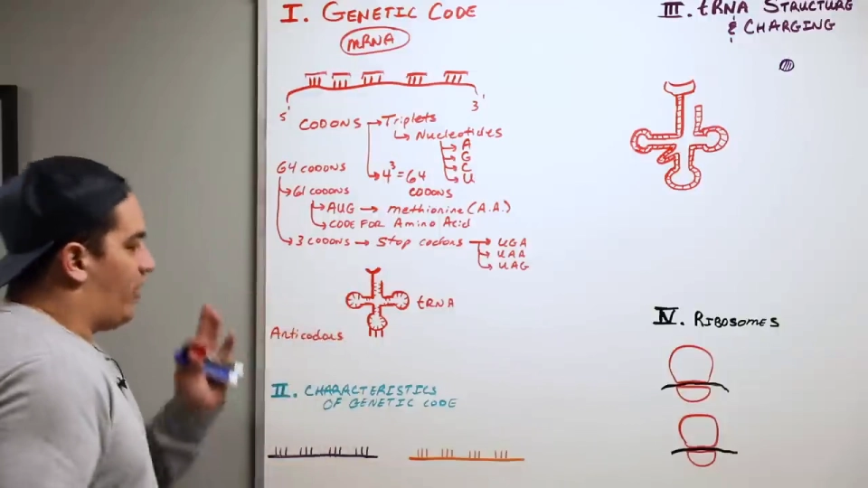

密码子由 RNA 的四种碱基组成：**A（腺嘌呤）、G（鸟嘌呤）、C（胞嘧啶）、U（尿嘧啶）**。注意 RNA 里没有胸腺嘧啶（T），取而代之的是 U——这是 RNA 与 DNA 在字母表上的唯一差别。

### 1.3 64 = 4³：61 个编码氨基酸，3 个叫停

每个位置有 4 种选择，每个密码子有 3 个位置，所以可能的密码子总数是：

$$
4^3 = 64
$$

这 64 个密码子分两类：

- **61 个**编码氨基酸。例如 AUG 编码**甲硫氨酸**（methionine），这是少数值得直接记住的密码子之一。
- **3 个**不编码任何氨基酸，而是**终止翻译**，叫**终止密码子（stop codon）**：UAA、UAG、UGA。视频给的记忆法是"you go away, you are away, you are gone"。

另外，**AUG 同时是起始密码子**：翻译从这里开始，所以新合成的多肽链第一个氨基酸总是甲硫氨酸（原核生物是它的修饰形式，见 4.1）。不需要背完整的密码子表——它就在教科书附录里，重要的是理解这张表的性质。

---

## 二、读码规则：连续、不重叠、简并

### 2.1 无逗号、不重叠

mRNA 从 5' 到 3' 被**连续**读取，中间不跳过任何碱基，这叫**无逗号（commaless）**；而且读过的三个碱基不会被重新组合再读一遍，这叫**不重叠（non-overlapping）**。

[【跳转到 16:01】](https://www.youtube.com/watch?v=80kxa1zApUM&t=961)

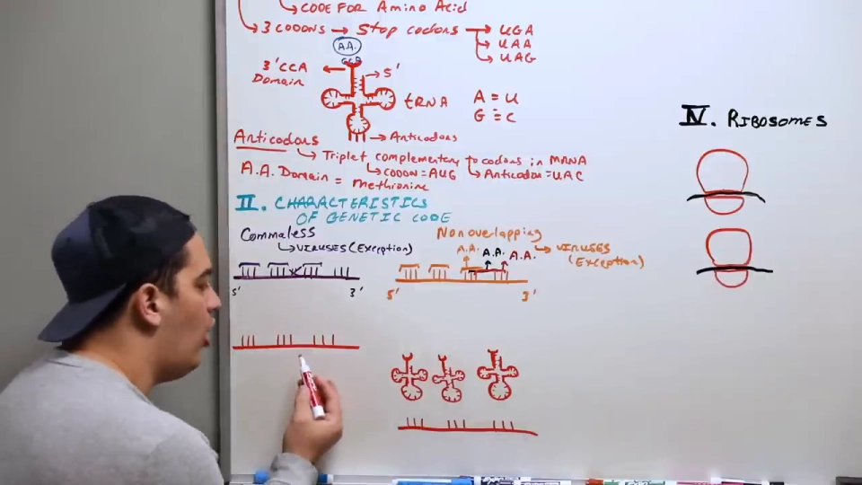

这两条规则各有一个例外，而且都是**病毒**：某些病毒基因组可以"跳读"或"重叠读码"，用同一段序列编码不同的蛋白。

### 2.2 简并：一个氨基酸可以有多个密码子

64 个密码子对应 20 种氨基酸，必然有冗余。这种"一个氨基酸对应多个密码子"的性质叫**简并性（degeneracy）**或**冗余（redundancy）**。

例如**异亮氨酸（isoleucine）**就有三个密码子：AUA、AUC、AUU。这意味着：**知道氨基酸可以推出可能的密码子集合，但不能反推出唯一一个密码子**。

只有两个例外：**甲硫氨酸只有 AUG**，**色氨酸只有 UGG**。它们各自只有一个密码子，是简并规则的唯一例外。

### 2.3 摆动效应：反密码子第一位为什么能"一配多"

简并带来一个新问题：如果每个密码子都需要一个专属 tRNA，细胞就得准备 61 种 tRNA。实际上 tRNA 的种类少得多，靠的是**摆动效应（wobble effect）**。

tRNA 的反密码子与 mRNA 密码子反向互补配对。关键在于反密码子**第一位**（对应密码子第三位）常常是**次黄嘌呤（inosine，I）**，而次黄嘌呤可以同时与 **A、U、C** 配对。于是同一个 tRNA 就能识别"前两位相同、第三位不同"的一组密码子——这正是简并性在分子层面的实现方式。

[【跳转到 21:04】](https://www.youtube.com/watch?v=80kxa1zApUM&t=1264)

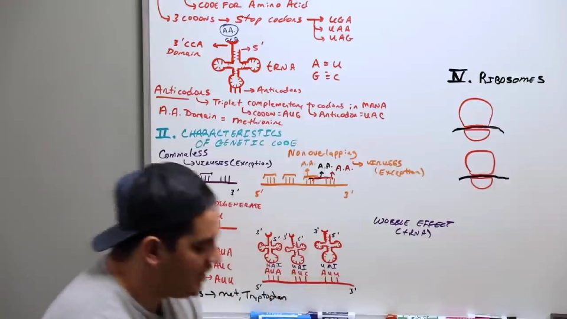

摆动效应不是"偷懒"，它有明确的好处：**降低突变的风险**。DNA 上的点突变如果落在密码子第三位，往往因为摆动配对而仍然编码同一个氨基酸（同义突变），蛋白质结构不受影响。

---

## 三、三种 RNA 各司其职

翻译需要三种 RNA：**mRNA** 提供信息，**tRNA** 搬运氨基酸，**rRNA** 构成核糖体。

### 3.1 mRNA：带方向的信息带

mRNA 提供的是"读的顺序"：5' 端有帽子、3' 端有 poly(A) 尾，中间是一串密码子。5'→3' 的方向决定了翻译的方向，也决定了蛋白质从 N 端到 C 端的合成顺序。

### 3.2 tRNA：把密码子翻译成氨基酸的适配器

tRNA（transfer RNA）的形状像字母 T，功能上可以拆成四个部分：

- **反密码子环**（下方环）：三个碱基，与 mRNA 密码子互补配对；
- **3' 端的 CCA 结构**：氨基酸结合位点，氨基酸就挂在这个"小杯托"上；
- **T 臂**：把 tRNA 拴到核糖体上；
- **D 臂**：让**氨酰-tRNA 合成酶**能够识别这是哪一种 tRNA。

[【跳转到 27:30】](https://www.youtube.com/watch?v=80kxa1zApUM&t=1650)

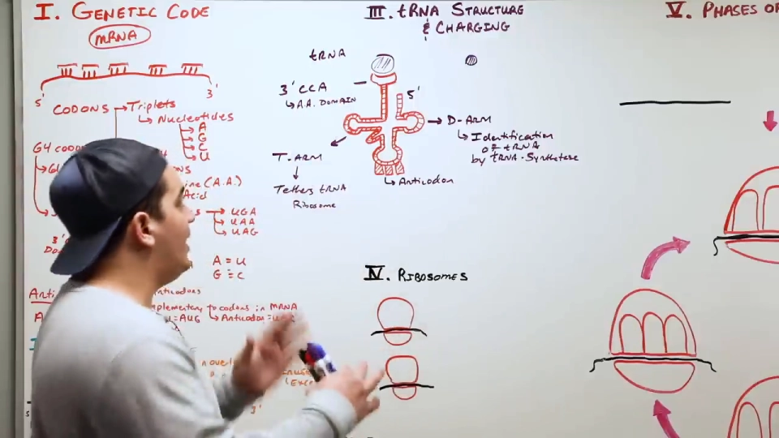

举例：密码子 AUG 的反密码子是 **UAC**（A 配 U、U 配 A、G 配 C），所以带 UAC 反密码子的 tRNA 一定携带甲硫氨酸。

### 3.3 tRNA 装载：氨酰-tRNA 合成酶做"配对校验"

空载的 tRNA 不能直接用，必须先"充能"（charging）：

1. 氨基酸 + **ATP** → 去掉两个磷酸（形成焦磷酸），只剩 **AMP** 挂在氨基酸上，得到**氨酰-AMP**；
2. **氨酰-tRNA 合成酶**有两个口袋：一个抓住氨酰-AMP，一个抓住空载 tRNA；
3. 酶检查 tRNA 的反密码子是否与目标密码子互补（靠 D 臂识别 tRNA 身份），确认无误后把两者"咔哒"接上；
4. 氨基酸被转移到 tRNA 3' 端的 CCA 上，AMP 被释放。

[【跳转到 31:18】](https://www.youtube.com/watch?v=80kxa1zApUM&t=1878)

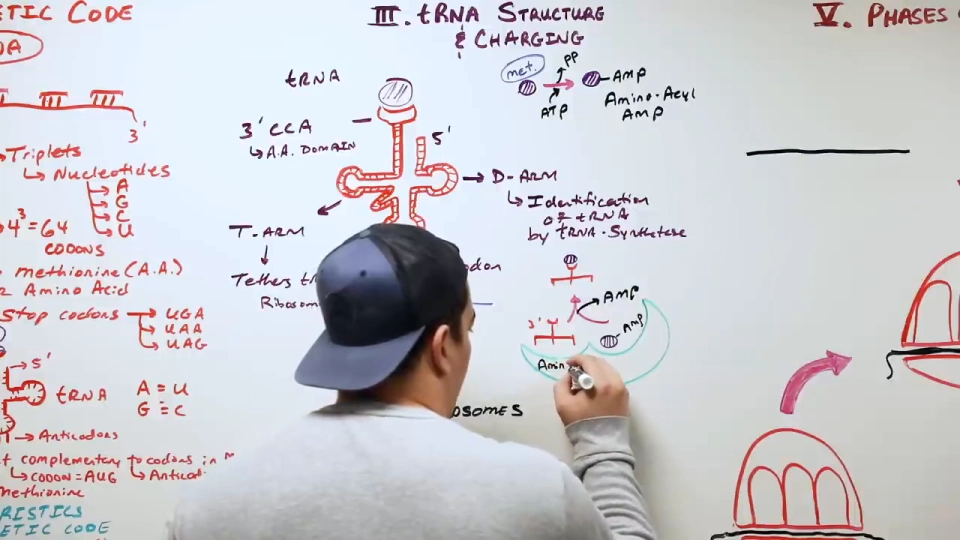

产物叫**充能 tRNA（charged tRNA）**。这一步是整个翻译里保真度的第一道关口：**氨基酸与 tRNA 的对应关系在这里被确定**，核糖体后面只负责按反密码子配对取货。

### 3.4 rRNA 与核糖体：蛋白质合成的工厂

核糖体由 **rRNA + 蛋白质**组成，分大小两个亚基。用 **Svedberg 单位（S）**表示沉降系数：

| | 大亚基 | 小亚基 | 完整核糖体 |
| --- | --- | --- | --- |
| 真核生物 | 60S | 40S | 80S |
| 原核生物 | 50S | 30S | 70S |

注意 S 值不能简单相加（60+40≠100），因为沉降系数反映的是形状与质量共同的沉降行为。

[【跳转到 33:43】](https://www.youtube.com/watch?v=80kxa1zApUM&t=2023)

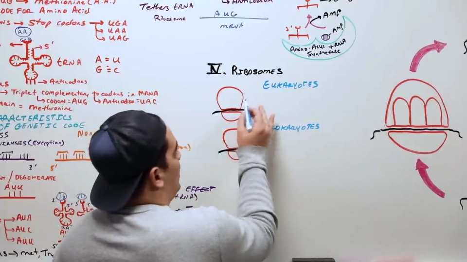

这个差异有直接的临床意义：许多抗生素正是通过**特异性结合细菌核糖体亚基**来抑菌——氨基糖苷类（如庆大霉素）和四环素类作用于 **30S**，大环内酯类（如阿奇霉素、红霉素）作用于 **50S**。细菌核糖体被抑制就无法合成蛋白，细菌随之死亡；人的 80S 核糖体不受影响，这就是这类药物的选择性来源。
---

## 四、翻译的三个阶段

### 4.1 起始：把核糖体、mRNA 和起始 tRNA 装到一起

起始阶段的目标很明确：把小亚基、mRNA、起始 tRNA 摆到正确位置，再让大亚基合上来。原核与真核的做法大同小异，差别在于"小亚基凭什么找到起点"。

**原核生物**靠一段序列定位。起始密码子上游约 8 个核苷酸处有一段富含嘌呤（A、G）的序列，叫 **Shine-Dalgarno 序列**，它是 mRNA 上的"身份证"。过程分三步：

1. 小亚基与起始因子识别并结合 Shine-Dalgarno 序列，然后向下游移动，直到碰上起始密码子 AUG；
2. 起始因子把携带 **fMet**（甲酰甲硫氨酸）的起始 tRNA 拉过来，反密码子 UAC 与 AUG 配对；
3. 起始因子上的 **GTP** 水解为 GDP + 无机磷酸，释放能量，同时大亚基结合上来；起始因子被释放。

[【跳转到 47:11】](https://www.youtube.com/watch?v=80kxa1zApUM&t=2831)

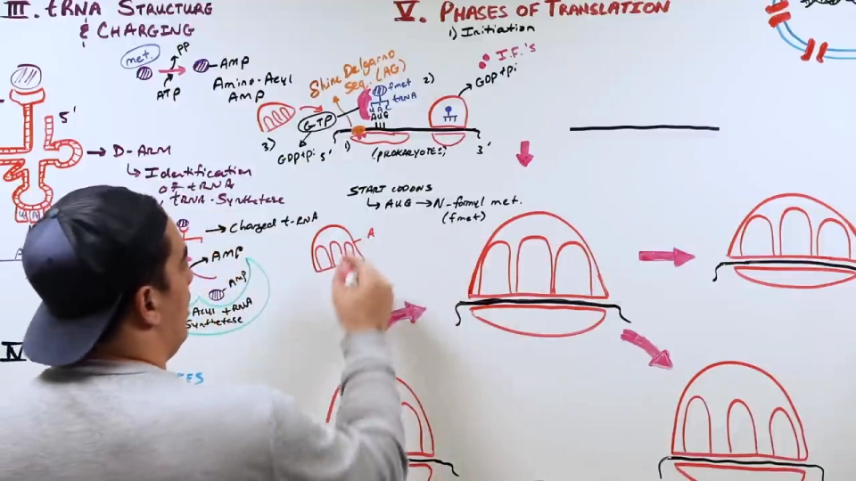

**真核生物**没有 Shine-Dalgarno 序列，靠 5' 帽定位：

1. **eIF4**（真核起始因子 4）结合到 mRNA 的 5' 帽上；
2. 小亚基与若干起始因子结合到 mRNA 上；
3. **eIF2** 携带起始 tRNA（真核里是普通**甲硫氨酸**，不是 fMet）结合到起始密码子；
4. eIF2 上的 GTP 水解，大亚基结合，起始因子释放。

[【跳转到 50:50】](https://www.youtube.com/watch?v=80kxa1zApUM&t=3050)

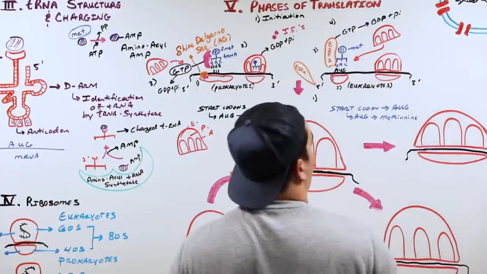

起始结束时，起始 tRNA 停在核糖体的 **P 位**，A 位空着，等待第一个延伸用的 tRNA。

### 4.2 延伸：A 位进货、P 位成键、E 位出货

核糖体有三个位点，按"进货—加工—出货"的顺序记最好：

- **A 位**（aminoacyl / arrival site）：新来的氨酰-tRNA 进入；
- **P 位**（peptidyl site）：正在延长的肽链挂在 P 位 tRNA 上；
- **E 位**（exit site）：卸空的 tRNA 从这里离开。

[【跳转到 57:16】](https://www.youtube.com/watch?v=80kxa1zApUM&t=3436)

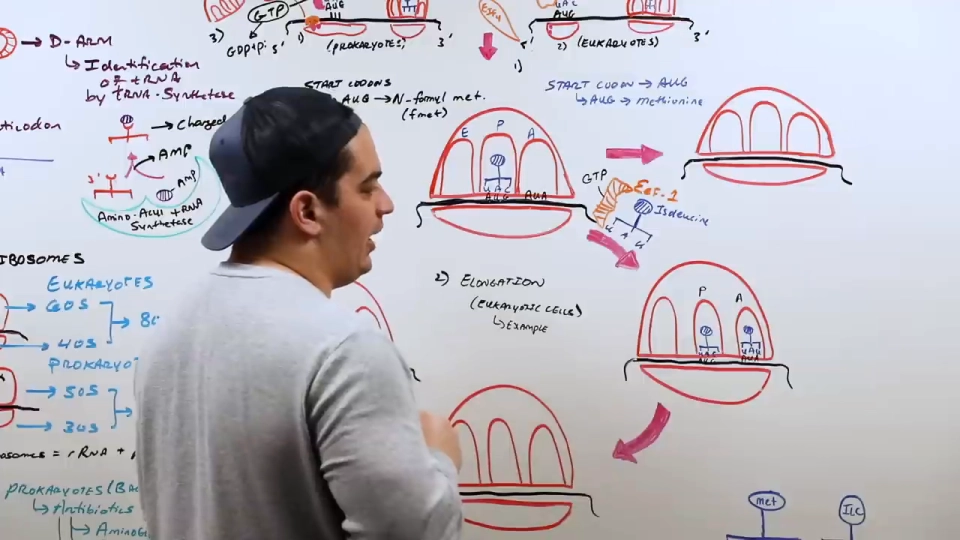

延伸每一轮包含三个动作：

1. **进位**：**EF1**（真核延伸因子 1）携带 GTP，把与 A 位密码子互补的氨酰-tRNA 送进 A 位；GTP 水解为 GDP + Pi，EF1 被释放。
2. **成键**：P 位 tRNA 上的肽链被转移到 A 位 tRNA 的氨基酸上。这一步由核糖体自身固有的酶——**肽基转移酶（peptidyl transferase）**催化：A 位氨基酸的氨基氮亲核攻击 P 位氨基酸的羧基端，肽链整体"搬"到 A 位 tRNA 上。化学上就是一次肽键形成。
3. **移位（translocation）**：**EF2** 携带 GTP 进入，水解产生的能量驱动核糖体沿 mRNA 前移一个密码子：A 位的肽酰-tRNA 移到 P 位，P 位的空载 tRNA 移到 E 位，随后从 E 位释放，重新去充能。

[【跳转到 62:44】](https://www.youtube.com/watch?v=80kxa1zApUM&t=3764)

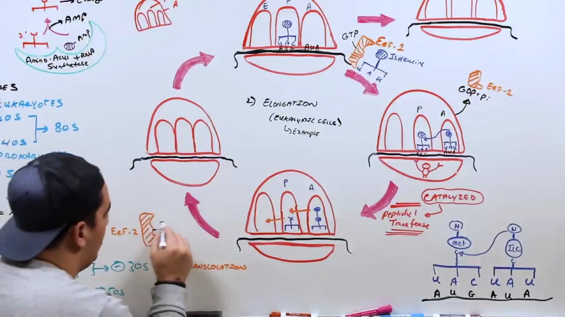

这一轮循环反复进行，多肽链越来越长。可以把它记成一句流程：**EF1 进货 → 肽基转移酶成键 → EF2 移位 → E 位出货**。

### 4.3 终止：释放因子做三件事

当 A 位出现终止密码子（UAA、UAG、UGA）时，**没有任何 tRNA 会来**。取而代之进入 A 位的是**释放因子（release factor）**，它做三件事：

1. **识别并结合终止密码子**；
2. **阻止核糖体继续沿 mRNA 移动**，终止翻译；
3. **把肽链从 P 位 tRNA 上切下来**，多肽被释放。

[【跳转到 66:41】](https://www.youtube.com/watch?v=80kxa1zApUM&t=4001)

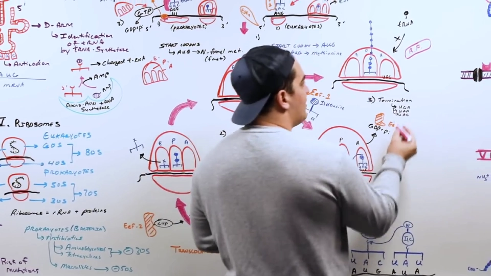

释放后的多肽可能进入细胞质、被分泌、被插入膜，也可能进入溶酶体——这取决于它的去向信号，见下一节。

---

## 五、蛋白质的去向：游离核糖体还是粗面内质网

翻译可以发生在**游离核糖体**上（漂在细胞质里），也可以发生在**膜结合核糖体**上（贴在粗面内质网上）。区别不在于核糖体本身，而在于**新生肽链的 N 端有没有一段"地址标签"**。

### 5.1 信号肽与 SRP

新生肽链从核糖体出来约 9–10 个氨基酸时，如果 N 端是一段特定的氨基酸序列（**信号肽，signal sequence**），就会被胞质中的**信号识别颗粒（SRP）**识别并结合。SRP 随后带着整个"核糖体–mRNA–新生肽链"复合体，靠对**粗面内质网膜上 SRP 受体**的高亲和力，把它拖到膜上。

[【跳转到 75:06】](https://www.youtube.com/watch?v=80kxa1zApUM&t=4506)

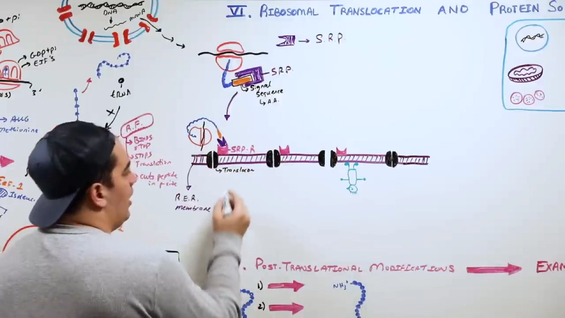

### 5.2 转位子与信号肽酶

膜上还有一个关键蛋白：**转位子（translocon）**。它默认是关闭的。SRP 与 SRP 受体各自带着一个 GTP，两者紧密结合后，**两个 GTP 同时水解**为 GDP + Pi，产生的能量让转位子打开。核糖体与转位子对齐，正在合成的肽链被直接送进**粗面内质网腔（lumen）**。

[【跳转到 85:45】](https://www.youtube.com/watch?v=80kxa1zApUM&t=5145)

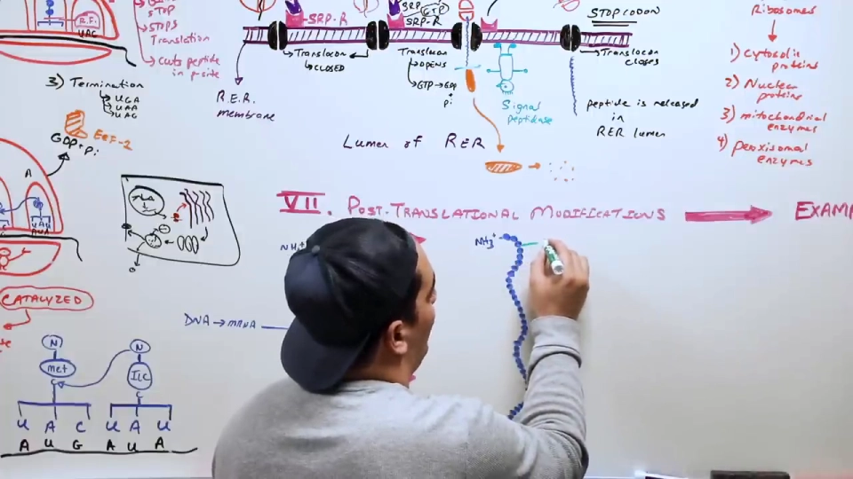

肽链进腔后，SRP 不再需要，被释放去循环使用；腔内的**信号肽酶（signal peptidase）**把信号肽切掉，信号肽随后被降解成氨基酸。翻译继续进行，直到遇到终止密码子：转位子关闭，肽链释放进内质网腔，核糖体与 mRNA 解离。

### 5.3 两类核糖体的产物清单

| 核糖体类型 | 产物去向 |
| --- | --- |
| 粗面内质网核糖体 | 分泌蛋白、膜蛋白、溶酶体蛋白（经内质网 → 高尔基体 → 囊泡） |
| 游离核糖体 | 细胞质蛋白、核蛋白、线粒体蛋白、过氧化物酶体蛋白 |

判断依据很简单：**需要进入膜系统（分泌、膜、溶酶体）的走粗面内质网；留在细胞内部的走游离核糖体。**

---

## 六、翻译后修饰：加什么、切什么

翻译刚结束时得到的只是一条多肽，要成为有功能的蛋白质，还需要**加东西或切东西**。视频列了七类最基本的修饰：

[【跳转到 88:01】](https://www.youtube.com/watch?v=80kxa1zApUM&t=5281)

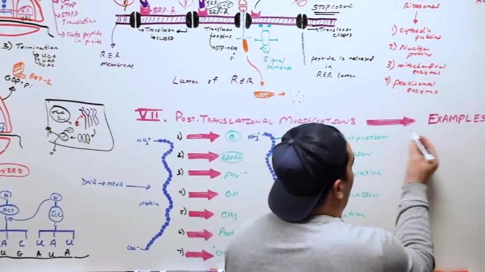

| 修饰 | 加/切什么 | 典型作用 |
| --- | --- | --- |
| 糖基化（glycosylation） | 加糖基 | 细胞表面抗原（如 ABO 血型抗原）、转运蛋白 |
| 脂化（lipidation） | 加脂类 | 把蛋白锚定到细胞膜或细胞器膜上 |
| 磷酸化（phosphorylation） | 加磷酸基 | 激活或抑制蛋白，如蛋白激酶 A、周期蛋白依赖激酶 |
| 羟化（hydroxylation） | 加羟基 | 胶原蛋白合成，支撑骨、软骨、结缔组织 |
| 甲基化（methylation） | 加甲基 | 组蛋白甲基化使染色质更紧密，降低转录 |
| 乙酰化（acetylation） | 加乙酰基 | 组蛋白乙酰化放松染色质，提高转录 |
| 修剪（trimming） | 切掉部分氨基酸 | 把无活性的前体变成有活性的酶 |

几个值得记住的例子：

- **磷酸化**是细胞信号与细胞周期的核心开关：磷酸基加上去，蛋白可能被激活也可能被抑制，取决于蛋白本身。
- **组蛋白的甲基化与乙酰化**直接对应转录的关闭与开启——这与上一篇转录里的"染色质松紧"是同一件事的两面。
- **修剪**的经典例子是胰蛋白酶原（trypsinogen）：它本身没有活性，被切掉一小段后变成有活性的胰蛋白酶，才能去消化你吃进去的蛋白质。

---

## 七、把翻译放回单细胞扰动组学里看

这支课讲的是经典分子生物学，但它解释了单细胞数据里几个绕不开的现象：

1. **mRNA 丰度不等于蛋白丰度**。转录本只是"订单"，翻译效率、tRNA 供给、核糖体占用情况都会影响最终蛋白量。所以用 scRNA-seq 推断蛋白水平时，必须意识到中间隔着一整层翻译调控。
2. **扰动常常作用在翻译这一层**。很多药物与基因扰动并不改变转录，而是改变翻译起始（如 eIF2 的磷酸化状态）或核糖体可用性——这类效应在转录组上可能看不出来，需要 Ribo-seq 或蛋白组才能捕捉。
3. **蛋白质的去向决定了表型**。同样的表达量，如果蛋白被错误地分选（该分泌的没分泌、该进膜的没进膜），细胞状态就会完全不同。这也是为什么单细胞多组学要把转录组与表面蛋白（CITE-seq）一起测。
4. **翻译后修饰是"表达量"之外的一层信息**。磷酸化、乙酰化这类修饰改变的是蛋白活性而不是丰度，任何只用 RNA 计数的模型都会漏掉这一层。

---

## 小结

- 翻译是把 mRNA 的碱基序列变成氨基酸序列的过程，核心是一张**查表规则**：64 个密码子，61 个编码氨基酸，3 个终止。
- 读码规则是**连续、不重叠、简并**；简并靠 tRNA 反密码子第一位的**次黄嘌呤**实现**摆动配对**，顺带降低了突变风险。
- **tRNA** 是适配器：反密码子负责配对，CCA 端负责挂氨基酸，D 臂供合成酶识别，T 臂负责结合核糖体；装载由**氨酰-tRNA 合成酶**完成，用 ATP 供能。
- **核糖体**由 rRNA 与蛋白质组成，真核 80S（60S+40S），原核 70S（50S+30S）；这个差异是氨基糖苷类、四环素类、大环内酯类抗生素的选择性基础。
- 翻译分三阶段：**起始**（原核靠 Shine-Dalgarno、真核靠 5' 帽与 eIF4）、**延伸**（EF1 进位 → 肽基转移酶成键 → EF2 移位）、**终止**（释放因子结合终止密码子、停止移动、切下肽链）。
- 新生肽链按 N 端**信号肽**分选：有信号肽的走粗面内质网（分泌、膜、溶酶体蛋白），没有的留在游离核糖体产物（细胞质、核、线粒体、过氧化物酶体）。
- 最后还要经过**翻译后修饰**（糖基化、脂化、磷酸化、羟化、甲基化、乙酰化、修剪）才成为有功能的蛋白质。

## 关键术语速查

| 术语 | 一句话解释 |
| --- | --- |
| 翻译（translation） | 以 mRNA 为模板合成多肽链的过程。 |
| 密码子（codon） | mRNA 上连续三个核苷酸，对应一个氨基酸或终止信号。 |
| 反密码子（anticodon） | tRNA 上与密码子互补配对的三联体。 |
| 起始密码子 | AUG，同时编码甲硫氨酸，是翻译的起点。 |
| 终止密码子 | UAA、UAG、UGA，不编码氨基酸，终止翻译。 |
| 简并性 / 冗余 | 一个氨基酸可由多个密码子编码的性质。 |
| 摆动效应 | 反密码子第一位为次黄嘌呤时可与 A、U、C 配对，实现一对多识别。 |
| 氨酰-tRNA 合成酶 | 把氨基酸接到对应 tRNA 上的酶，决定翻译保真度。 |
| 充能 tRNA | 已装载氨基酸的 tRNA。 |
| 肽基转移酶 | 核糖体固有的酶，催化肽键形成。 |
| A / P / E 位点 | 核糖体上氨酰-tRNA 进入、肽链停留、空载 tRNA 离开的三个位点。 |
| 释放因子 | 识别终止密码子、终止翻译并切下肽链的蛋白。 |
| Shine-Dalgarno 序列 | 原核 mRNA 上引导小亚基定位起始密码子的序列。 |
| 信号肽 | 新生肽链 N 端的地址标签，引导其进入粗面内质网。 |
| SRP | 信号识别颗粒，识别信号肽并把核糖体带到内质网膜。 |
| 转位子（translocon） | 内质网膜上的通道，肽链由此进入内质网腔。 |
| 翻译后修饰 | 蛋白质合成后加或切化学基团，使其获得最终功能。 |
