# 转录如何发生：从启动子到成熟 mRNA 的分子流水线

> 视频来源：[彻底解密DNA转录与mRNA剪接：动画揭秘生物学奥秘](https://www.bilibili.com/video/BV1ya9cYEEuC/)（Bilibili · XBlab基因与细胞治疗，约 42 分钟；原作为 Clockwork 频道的真核转录长动画，本片为中文配音版）
> 导读（100 字以内）：这支动画用逐分子建模的方式走完真核 RNA 聚合酶 II 的一生——从启动子识别、暂停加帽、延伸、鱼雷式终止，到剪接体切除内含子。本文按「中心法则 → 转录五阶段 → RNA 加工 → 可变剪接」重排，并补上单细胞研究为什么关心转录这一步。

## 本讲要解决的核心问题（SCQA）

**背景**：中心法则这张图几乎人人都见过——DNA 转录成 RNA，RNA 翻译成蛋白质。学校里讲的多半还是细菌版本：一条 DNA 被转录成 mRNA，mRNA 立刻被翻译，简单、连续、高效。

**冲突**：真核细胞（从面包酵母到你和我）玩的不是这个游戏。转录并不是"RNA 聚合酶照着 DNA 打印"这么一件机械的事：它由几十个调控因子层层管理，产物还只是一条半成品（pre-mRNA），必须经过加帽、加尾、剪接才能出核去翻译。更麻烦的是，同一个基因可以通过不同的剪接方式产出多种蛋白质。

**疑问**：转录究竟是怎么开始、又怎么被叫停的？一条刚合成的 RNA 要经过哪些加工才能变成成熟 mRNA？真核细胞为什么要为这件事付出这么大的代价？

**回答（中心思想）**：真核转录本质上是一个**"RNA 聚合酶管理问题"**，而不是一次简单的打印。它被拆成五个阶段——预起始、起始、暂停、延伸、终止，每个阶段都有一批专门的分子"管理者"；产物 pre-mRNA 再经过**加帽、加多聚腺苷酸尾、剪接**三步加工，才成为成熟 mRNA。真核生物为此付出的复杂性代价，换回来的是**可变剪接**带来的蛋白质多样性，以及"不同细胞只转录自己需要的基因"这种可调控性——这正是单细胞研究里"转录本丰度≈基因表达量"这一整套逻辑的分子基础。

---

## 一、中心法则不是一张简单的箭头图

### 1.1 DNA 是档案库，RNA 才是执行者

把细胞想象成一台计算机：DNA 是硬盘里那份从不轻易改动的档案，RNA 则是被调出来、正在运行的程序。视频一开头就给了这个类比——你的全部遗传信息存在 DNA 里，但"信息如何变成行动"是另一回事。

人类基因组计划完成时，人们一度认为只要把 30 亿个 DNA 字母全部解码，生命的问题就基本解决了，甚至有人相信"DNA 就是命运"。三十年过去，结论恰恰相反：DNA 在故事里只是原料，真正把信息变成行动的是 RNA。所有为了维持你活着而协调进行的工作，都依赖于**DNA 被转录成 RNA** 这一步。

[【跳转到 08:02】](https://www.bilibili.com/video/BV1ya9cYEEuC/?t=482)

### 1.2 一个先记住的悬念：为什么肾脏细胞只转录肾脏基因

视频抛出了一个后面才回答的问题：你身上几乎每一个细胞都带着同一份完整的 DNA 副本，那么肾脏细胞为什么只转录和使用与肾脏相关的基因？是什么阻止一个细胞制造它不该制造的蛋白质？

这里先只留结论的方向：**转录是被严格管理的，而不是全基因组一起开动**。这正是本讲要展开的"管理"二字的含义，也是后面"不同细胞表达不同调节蛋白、以不同方式放松染色质"那段话的伏笔。

---

## 二、转录发生在细胞核的染色质上

### 2.1 起点：一团被蛋白质包裹的 DNA

转录发生在细胞核里——一个充满 DNA 的大球，DNA 以厚厚的染色质纤维形式存在。要把 DNA 转录成 RNA，第一步不是"读"，而是让转录机器能够接触到 DNA：染色质必须先松开。

[【跳转到 08:02】](https://www.bilibili.com/video/BV1ya9cYEEuC/?t=482)

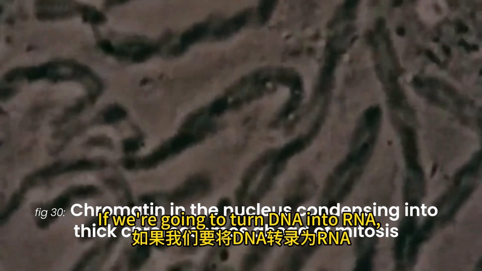

视频在这里明确说明：把 DNA 从紧密的染色质形式中松脱这一步，留到系列后面讲，本讲假设目标基因已经暴露、随时可以被结合。

### 2.2 RNA 聚合酶 II 是打印机，但打印机需要管理者

真正负责合成的分子是 **RNA 聚合酶 II**（Pol II）。它的工作方式很朴素：以 DNA 的一条链为模板，把与模板互补的核糖核苷酸一个个接到正在延长的 RNA 链上。注意这里不是"把 DNA 变成 RNA"，DNA 只是模板，被读过去，本身不变。

问题在于：**Pol II 只是一个打印机，它不知道你的身体此刻需要什么**。它只要被装到 DNA 上、被激活、被放开，就会开始打印。而细胞核里并不空——游离的核苷酸字母到处都是，每接上一个新字母还会释放能量，进一步推着聚合酶往前冲。视频的说法很形象：如果不加管理，Pol II 会沿着 DNA 一路冲刺，势不可挡，最后产出一条没用的转录本。

所以对细胞来说，**转录首先是一个"RNA 聚合酶管理问题"**：真正的难点不在于聚合酶会不会合成，而在于什么时候让它开始、让它在哪里停一下、让它走多快、以及什么时候把它从 DNA 上踢下来。

---

## 三、转录的五个阶段

视频把真核转录拆成五个部分：**预起始（pre-initiation）、起始（initiation）、暂停（pausing）、延伸（elongation）、终止（termination）**。每一步都有几十个分子助手参与，本讲只挑足够讲完一个完整故事的那部分。

### 3.1 预起始：TATA 盒把转录机器叫到正确的位置

先给基因一个坐标系。大多数基因的编码区在下游，往上游走会看到一段特殊的 DNA：一堆胸腺嘧啶（T）和腺嘌呤（A）反复重复。这就是 **TATA 盒**。

[【跳转到 12:21】](https://www.bilibili.com/video/BV1ya9cYEEuC/?t=741)

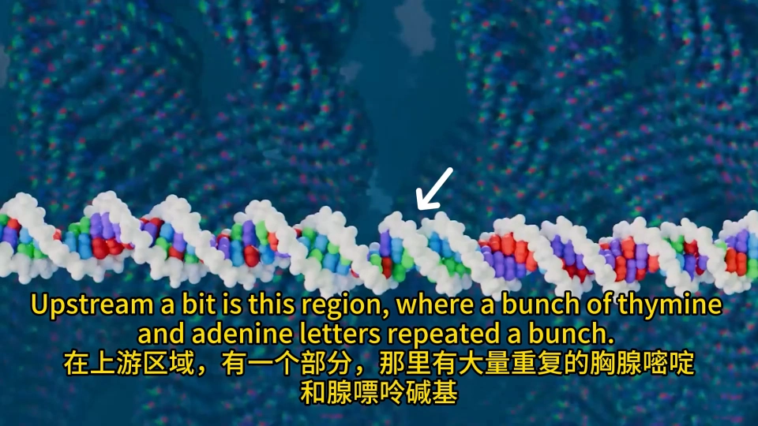

重复序列对能结合 DNA 的专门蛋白来说就像猫薄荷。第一个被招募来的是 **TATA 结合蛋白（TBP）**——一个蝴蝶形状的小分子，它是庞大复合体 **TFIID**（通用转录因子 IID）里的一个亚基。

[【跳转到 12:45】](https://www.bilibili.com/video/BV1ya9cYEEuC/?t=765)

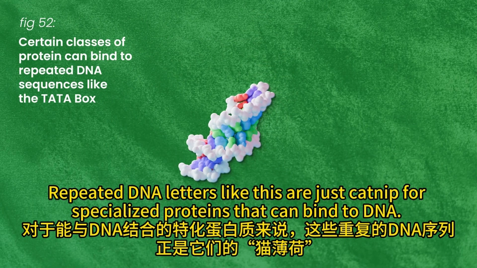

接下来的组装顺序值得记一遍，因为它是"转录起始"的标准剧本：

1. **TFIID** 先稳定 DNA，让 TBP 有机会结合到 TATA 盒上；
2. TFIID 的前端识别 TATA 盒下游一点的位置并结合，然后大幅重排，把 TBP 锁在 TATA 盒上；
3. TBP 成为支架，**TFIIA** 加入稳定，**TFIIB** 加入，接着 **Pol II** 被插进来，**TFIIE** 结合——这一整套叫**预起始复合体**。

[【跳转到 13:50】](https://www.bilibili.com/video/BV1ya9cYEEuC/?t=830)

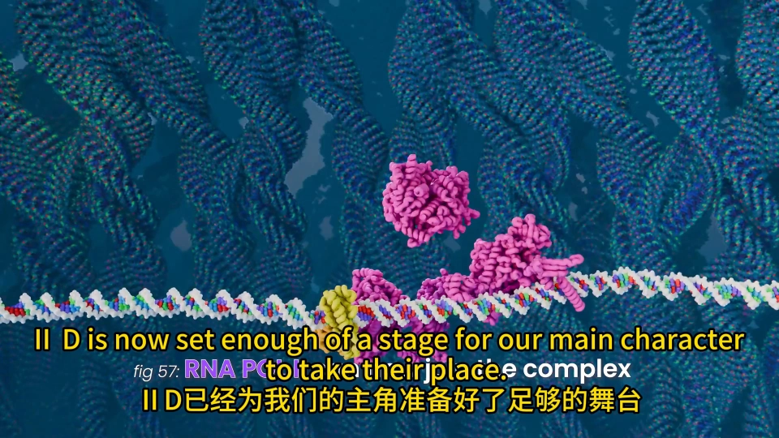

### 3.2 中介体与增强子：确认"现在真的该转录了"

预起始复合体装好了，是不是就可以开始？视频的回答是：**不对，还差一步**。因为 TATA 盒可能只是碰巧暴露出来的，细胞需要再加一层调控，确认这不是误触。

这层调控来自**增强子**：位于基因上游很远处的一段 DNA，专门结合调控蛋白。当增强子上的蛋白把信号传过来，**中介体（Mediator）**复合体被招募进来，它负责组织预起始复合体组装的最后步骤，并把信号传给 Pol II 末端那条长长的尾巴——**C 端结构域（CTD）**。

[【跳转到 14:15】](https://www.bilibili.com/video/BV1ya9cYEEuC/?t=855)

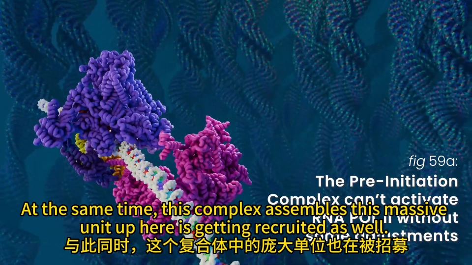

### 3.3 CTD：聚合酶尾巴上的调控平台

Pol II 末端那条"长长的扭曲结构"就是 **CTD**。它由一段重复的氨基酸序列构成（视频里只渲染了其中一小部分，并强调真实结构 90% 都看不见），核心特征是：**上面有大量丝氨酸，可以被磷酸化**。

[【跳转到 15:10】](https://www.bilibili.com/video/BV1ya9cYEEuC/?t=910)

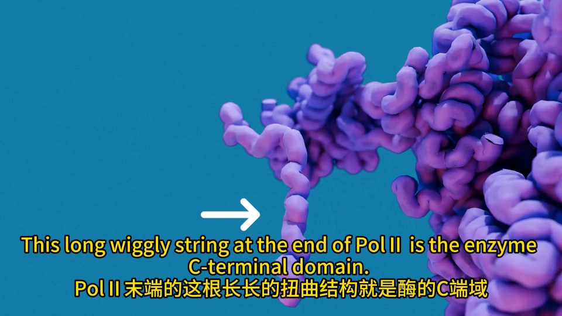

CTD 有两个作用：一是作为支架，让各种调节因子挂上去等时机；二是它的磷酸化状态会随转录进程改变——**每一步转录都会微妙地改变磷酸化设置**，等于给聚合酶挂了一个"当前进行到哪一步"的状态标签。中介体之所以重要，就在于它抓住 CTD，让 **TFIIH** 启动第一波磷酸化，从而激活转录。

[【跳转到 16:24】](https://www.bilibili.com/video/BV1ya9cYEEuC/?t=984)

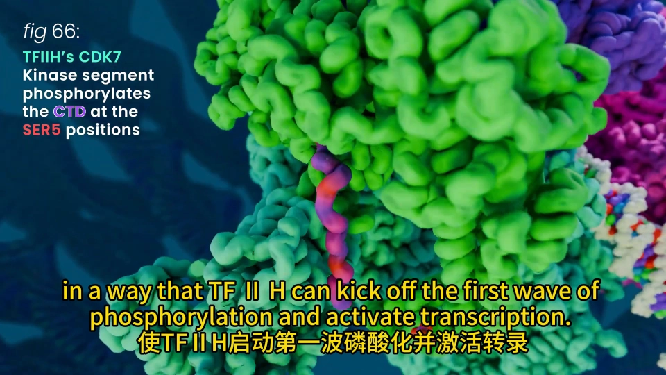

磷酸化完成后，TFIIH 还会帮助解开 DNA 双链，把模板链送进 Pol II 的活性位点——预起始复合体进入"开放"状态，聚合酶被释放，起始阶段结束。

### 3.4 暂停：聚合酶刚跑出几步就被叫停，为的是加帽

刚启动的 Pol II 几乎立刻被停住——视频称之为"惊喜"：转录的第三阶段是**暂停**，执行者是**负延伸因子 NELF**。

为什么要停？因为刚合成的一小段 RNA 正从聚合酶里探出头来，而**单链 RNA 既灵活又脆弱**。细胞质里到处是防御系统，会把看起来陌生的 RNA 切碎。所以必须在 RNA 还短的时候立刻开始打包：

- 一组**加帽酶**在 RNA 的 5' 端加上一个甲基化的帽子；
- 这个帽子既保护 RNA 不被核酸酶降解，也是细胞识别"这是自己的 mRNA"的身份标签。

[【跳转到 17:06】](https://www.bilibili.com/video/BV1ya9cYEEuC/?t=1026)

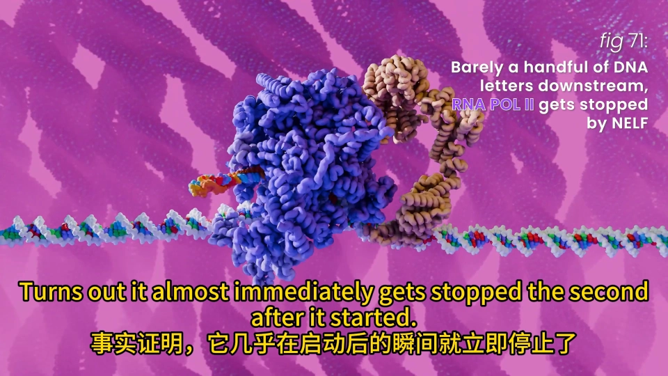

[【跳转到 18:30】](https://www.bilibili.com/video/BV1ya9cYEEuC/?t=1110)

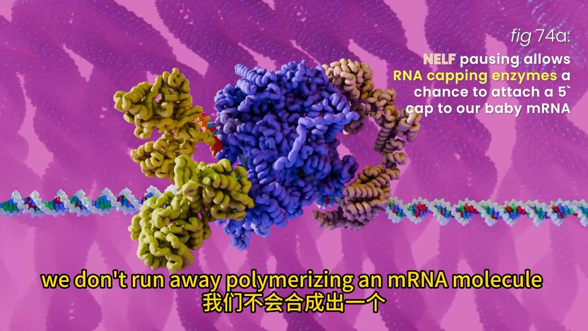

暂停还有一层意义：它是一个**检查点**。如果细胞此刻并不需要制造蛋白质，停滞的聚合酶可能被整个踢离 DNA，转录在真正开始前就被终止。

### 3.5 延伸：P-TEFb 踢走 NELF

如果细胞确实需要这个基因的产物，就会发出"继续"的信号。下游的组蛋白会被标记和修饰，让 **P-TEFb** 能够结合上来；P-TEFb 通过磷酸化 Pol II 的 CTD，改变复合体的构象，把 NELF 踢出去。

[【跳转到 19:32】](https://www.bilibili.com/video/BV1ya9cYEEuC/?t=1172)

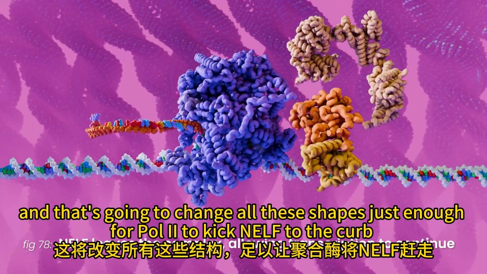

进入延伸阶段后，一大批延伸因子加入，它们做两件事：稳定正在延长的 RNA，以及帮助解开缠绕着 DNA 的组蛋白，让聚合酶顺利通过。视频在这里特意提醒：**这才是转录里最"平淡"的一大段，而前面那些名字拗口的因子，全是为了让这一段能够顺利发生**。

### 3.6 终止：多聚腺苷酸化信号与"鱼雷"模型

聚合酶走出编码区，进入 3' 非翻译区，就遇到终止信号。几乎所有编码蛋白质的基因末端都有一段 DNA 序列专门用来"叫停"，其中最关键的是**多聚腺苷酸化信号**。

[【跳转到 21:31】](https://www.bilibili.com/video/BV1ya9cYEEuC/?t=1291)

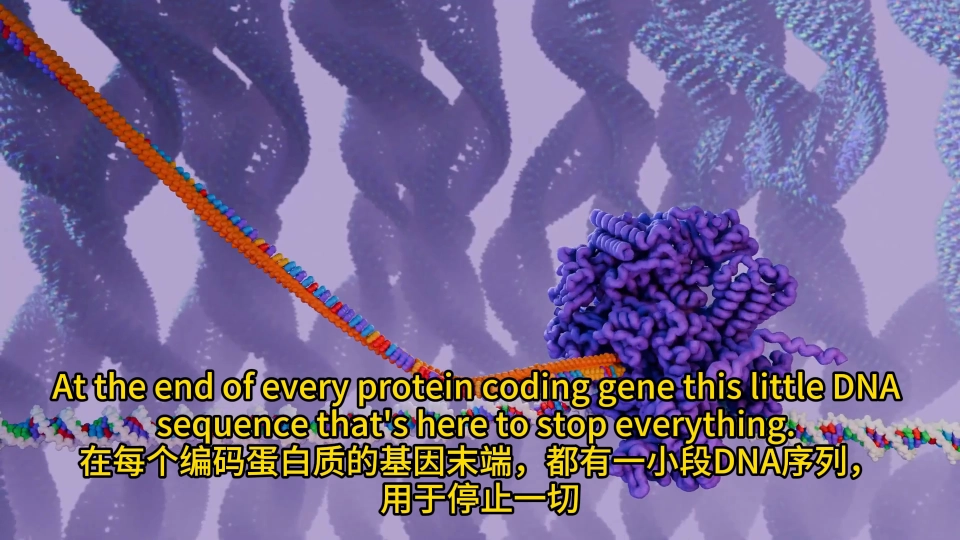

结合在这段信号上的是一组以 **CPSF** 为首的因子，它们在新生 RNA 上切开一个位点，把转录本"剪下来"送去加工。但麻烦在于：**Pol II 并不知道转录已经结束**。它只是个打印机，聚合酶只会一直聚合下去，除非有人阻止它。

细胞的解法很巧妙：切割之后，仍然挂在 Pol II 上的那段"废料 RNA"没有 5' 帽保护，于是招来一种 5'→3' 的 RNA 外切酶——人源版本叫 **XRN2**（酵母中的同源酶叫 Rat1）。XRN2 像导弹一样沿着这段废料 RNA 追上去，撞到 Pol II 底部，把它从 DNA 上物理撞下来。

[【跳转到 23:01】](https://www.bilibili.com/video/BV1ya9cYEEuC/?t=1381)

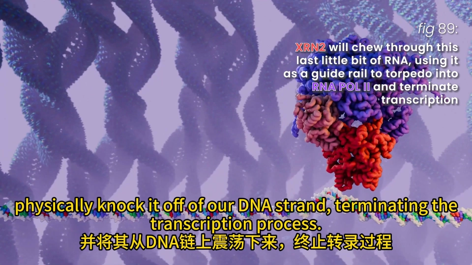

这就是著名的**转录终止"鱼雷模型"（torpedo model）**：终止不是聚合酶自己"看到红灯停下"，而是被一台追尾的核酸酶撞下来的。
---

## 四、RNA 加工：一条转录本要过三道工序

转录结束，得到的还只是一条 **pre-mRNA**（前体 mRNA）。对真核生物来说，它必须被"编辑"成成熟 mRNA 才能出核。视频把这一部分称为本片的转折点：**DNA 转录出的是原始信息，而不是最终指令**。

细菌遵循的是中心法则那张简单图：转录和翻译同时同地发生，简单、高效。真核生物则要多做很多工作，原因就在下面这三道工序。

### 4.1 加帽与加尾：两端都要保护

- **5' 帽**：在暂停阶段就已经加上（见 3.4），甲基化的帽子既保护 RNA 不被核酸酶降解，又是"自己人"的身份标签。
- **3' 多聚腺苷酸尾（poly(A) tail）**：切割之后，另一组加尾酶在切开的 3' 端接上一大串腺苷酸。两端都加保护，RNA 才足够稳定。

poly(A) 尾还有一个额外功能：它会被认为是一种**"新鲜度"信号**。尾巴随时间逐渐变短，细胞里的因子据此评估这条 RNA 有多"新"，并选择销毁过期的转录本。这条机制在单细胞数据里非常实际——**poly(A) 尾正是大多数 scRNA-seq 建库时捕获 mRNA 的抓手**（oligo-dT 引物），而"尾巴越短越容易被降解"直接影响到你测到的表达量。

### 4.2 内含子与外显子：基因里夹着不编码的片段

真核基因并不是连续的一段编码序列。它们中间夹着大量不编码蛋白质的片段，叫**内含子（intron）**；真正编码蛋白质的片段叫**外显子（exon）**。

[【跳转到 26:19】](https://www.bilibili.com/video/BV1ya9cYEEuC/?t=1579)

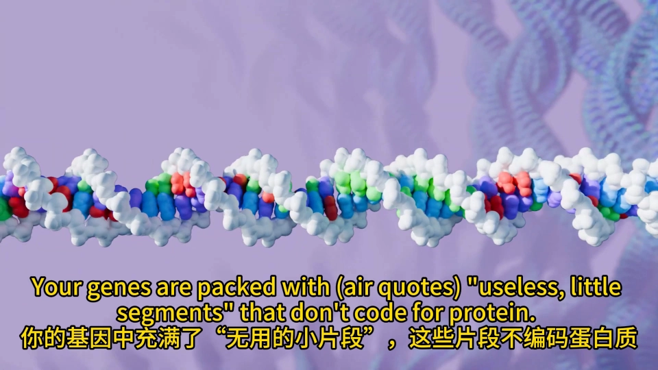

所以加工的核心任务很明确：**切除内含子，把外显子连接起来**，这样核糖体才拿到正确的指令。执行这件事的机器是细胞里最复杂的分子机器之一——**剪接体（spliceosome）**。

### 4.3 剪接体：用 RNA-RNA 配对来定位剪接位点

剪接体由 **U1、U2、U4、U5、U6** 等小核核糖核蛋白（**snRNP**）组成。一个 snRNP = 一段**小核 RNA（snRNA）** + 一组蛋白质。视频在这里点出一个惊人的事实：基因组里大量"不编码蛋白质"的序列，其实编码的就是这类小 RNA 机器；而 RNA 是单链、可折叠的，能像蛋白质一样形成精确的形状去识别序列。

[【跳转到 26:58】](https://www.bilibili.com/video/BV1ya9cYEEuC/?t=1618)

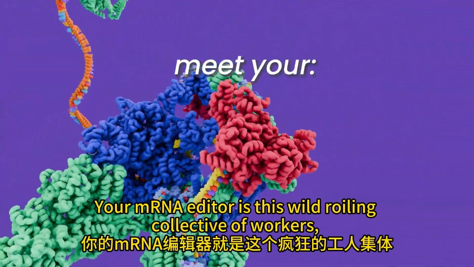

定位靠的是碱基互补，而不是"找特定蛋白"：

1. **U1** 的 snRNA 有一段序列与内含子 5' 端的**5' 剪接位点**直接互补，因此在转录延伸过程中就能精确结合上去；
2. **U2** 招募到内含子另一侧，结合在**分支点**上；
3. **U4/U5/U6** 三元复合体加入，随后 U1、U4 逐步退出，把 5' 剪接位点交给 U5/U6 组成的催化核心；
4. 在大量 **ATP** 供能下，剪接体反复重排构象，把内含子两端推到一起。

[【跳转到 30:00】](https://www.bilibili.com/video/BV1ya9cYEEuC/?t=1800)

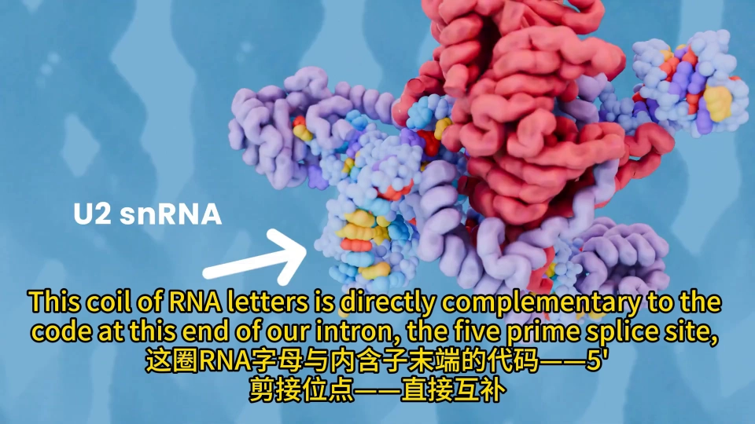

### 4.4 剪接的两步化学反应：分支与外显子连接

构象调整到位后，剪接反应本身只有两步：

1. **分支（branching）**：5' 剪接位点被推近分支点上的腺苷酸，发生酯交换，内含子 5' 端与分支点形成环状的"套索"结构，上游外显子被解放出来；
2. **外显子连接**：两个外显子末端被推到一起并连接，内含子以套索形式被释放，随后被降解回收。

[【跳转到 32:27】](https://www.bilibili.com/video/BV1ya9cYEEuC/?t=1947)

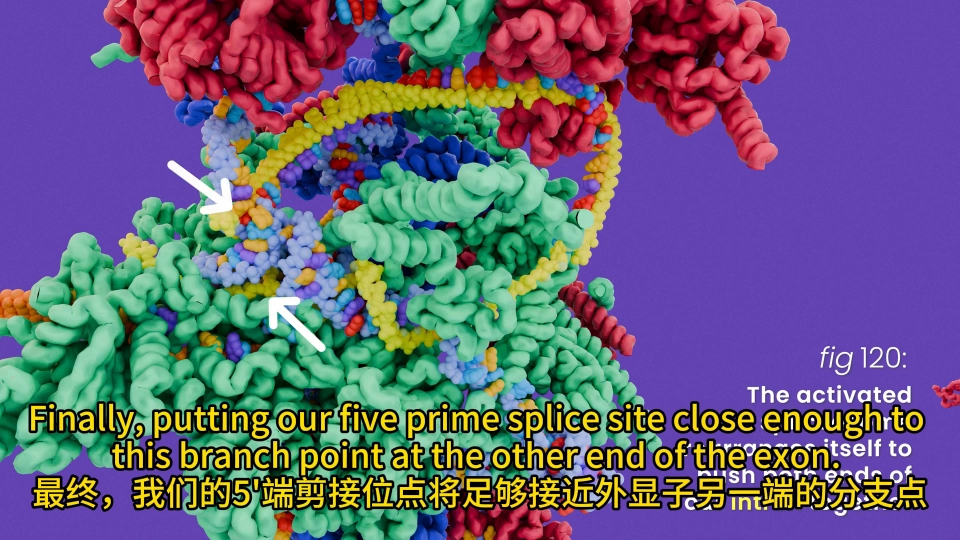

视频坦白地说，这里省略了大量有机化学细节，只保留了"商业部分"。但有一点必须记住：**剪接与转录在真实细胞里是同时发生的**——RNA 一边从聚合酶里出来，剪接体一边就装上去。

---

## 五、为什么真核要这么麻烦：可变剪接

### 5.1 两万个基因，几十万种蛋白质

视频用一个数字对比来"推翻"对中心法则的简单理解：

- 你的核糖体能合成大约 **7.5 万到 50 万种**不同的蛋白质（这就是你的蛋白质组）；
- 而人类基因组里编码蛋白质的基因只有**大约 2 万个**。

两万个基因怎么可能编码几十万种蛋白质？如果中心法则只是"一个基因 → 一种 mRNA → 一种蛋白质"，那么信息量根本不够。缺失的信息在哪里？答案是**剪接**。

### 5.2 一个基因，五种蛋白质

剪接体并不总是把每个内含子都剪掉、把所有外显子都留下。**取决于细胞类型，它可以跳过某些外显子**，甚至一次带走好几个。这意味着一个基因可以产出几十种不同的 mRNA。

[【跳转到 37:40】](https://www.bilibili.com/video/BV1ya9cYEEuC/?t=2260)

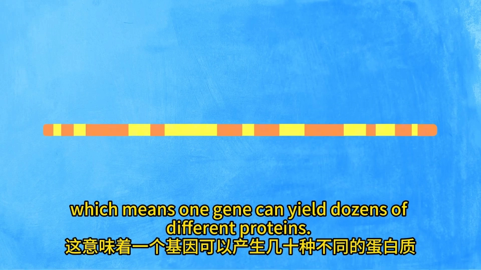

经典例子是 **α-辅肌动蛋白（α-actinin）基因**：它有十几个内含子，按不同方式剪接可以得到五种功能各异的蛋白——有的帮助骨骼肌收缩，有的更适合平滑肌，有的参与成纤维细胞，还有一种对脑结构很关键。一个基因，五种蛋白，服务于五种不同的细胞类型。

### 5.3 剪接体怎么知道自己在哪种细胞里

这是自然引出的问题：剪接体怎么知道自己在骨骼肌细胞中、必须以骨骼肌的方式剪接 α-辅肌动蛋白？

答案是：**不同细胞表达不同的非编码 RNA 和调节蛋白**，它们与许多其他因素一起，控制剪接体去寻找哪些剪接位点。于是同一份 DNA，在不同细胞里被"放松"的染色质区域不同、被激活的基因不同、剪接的方式也不同——这就是为什么你的白细胞和胃黏膜细胞带着完全相同的 DNA，却能有完全不同的结构和功能。

视频最后把结论说得更彻底：**DNA 不是命运**。你并不是一台由 DNA 管理的机器人，而是一个极其复杂的"DNA 管理问题"——RNA 也不只是一个平庸的中间体，它可能就是整个游戏的关键。

---

## 六、把这条流水线放回单细胞研究里看

这支视频讲的是分子机制，但它解释了单细胞扰动组学里几个最基本的前提：

1. **"表达量"测的是转录这一步的产量**。scRNA-seq 捕获的是带 poly(A) 尾的成熟 mRNA，所以一个基因在某个细胞里的 count，本质上是"转录起始频率 × 加工与出核效率 × 降解速率"的综合结果，而不是 DNA 层面的"开关状态"。
2. **转录是被管理的事件，所以可以被扰动**。起始需要 TATA 盒、通用转录因子、中介体、增强子信号；任何一个环节被干预（比如敲掉一个转录因子），下游一整套基因的转录产量都会改变——这正是 Perturb-seq 这类实验读出"扰动 → 表达变化"的分子通路。
3. **同一个基因可以对应多种转录本**。可变剪接意味着"基因层面"的计数会掩盖"转录本层面"的差异；单细胞数据里常见的"某个基因上调"往往还需要回到 isoform 层面才能解释清楚。
4. **暂停与终止都是调控点**。Pol II 启动后立刻暂停、需要 P-TEFb 才能放行，这解释了为什么某些刺激下基因表达可以极快地被"释放"——细胞早就把聚合酶停在起跑线上了。

---

## 小结

- 真核转录不是"打印机照抄 DNA"，而是一个 **RNA 聚合酶管理问题**：难点在于何时开始、何时暂停、何时放行、何时终止。
- 转录分五个阶段：**预起始**（TATA 盒 → TBP/TFIID → 预起始复合体）、**起始**（TFIIH 磷酸化 CTD 并解开 DNA）、**暂停**（NELF 叫停，顺便加 5' 帽）、**延伸**（P-TEFb 踢走 NELF）、**终止**（多聚腺苷酸化信号切割 + XRN2 鱼雷模型）。
- 转录产物是 **pre-mRNA**，必须经过 **加 5' 帽、加 poly(A) 尾、剪接** 三道加工才成为成熟 mRNA。
- 剪接由 **剪接体**完成，靠 snRNA 与剪接位点的碱基互补定位，化学上只有**分支**与**外显子连接**两步。
- **可变剪接**用约 2 万个基因产出数十万种蛋白质，是不同细胞类型共享同一份 DNA 却表现出不同功能的关键机制之一。
- 结论：DNA 不是命运，RNA 也不是平庸的中间体；细胞的复杂性来自对转录与加工的精细管理。

## 关键术语速查

| 术语 | 一句话解释 |
| --- | --- |
| 中心法则 | 遗传信息从 DNA 到 RNA 再到蛋白质的流动方向。 |
| RNA 聚合酶 II（Pol II） | 真核细胞里负责把蛋白质编码基因转录成 mRNA 的酶。 |
| 启动子 | 基因上游供转录机器识别与结合的 DNA 区域。 |
| TATA 盒 | 启动子上富含 T 与 A 的重复序列，被 TBP 识别。 |
| TBP / TFIID / TFIIH | 通用转录因子：TBP 结合 TATA 盒，TFIID 含 TBP，TFIIH 磷酸化 CTD 并解开 DNA。 |
| 预起始复合体 | 通用转录因子与 Pol II 在启动子上组装成的复合体。 |
| 中介体（Mediator） | 把增强子信号传给 Pol II 的大型复合体。 |
| CTD | Pol II 末端的重复序列尾巴，磷酸化状态标记转录进程。 |
| NELF / P-TEFb | 负延伸因子让聚合酶暂停；P-TEFb 磷酸化 CTD 后解除暂停。 |
| 5' 帽 | 加在 mRNA 5' 端的甲基化帽子，保护 RNA 并作为身份标签。 |
| poly(A) 尾 | 加在 mRNA 3' 端的多聚腺苷酸尾，维持稳定并作为"新鲜度"计时器。 |
| 内含子 / 外显子 | 基因中不编码蛋白质的片段 / 编码蛋白质的片段。 |
| 剪接体（spliceosome） | 由 U1、U2、U4、U5、U6 等 snRNP 组成的剪接机器。 |
| snRNP | 小核 RNA 与蛋白质组成的复合体，是剪接体的功能单元。 |
| 鱼雷模型 | 转录终止机制：XRN2 沿废料 RNA 追上并撞落 Pol II。 |
| 可变剪接 | 同一 pre-mRNA 通过不同剪接方式产出多种成熟 mRNA。 |
