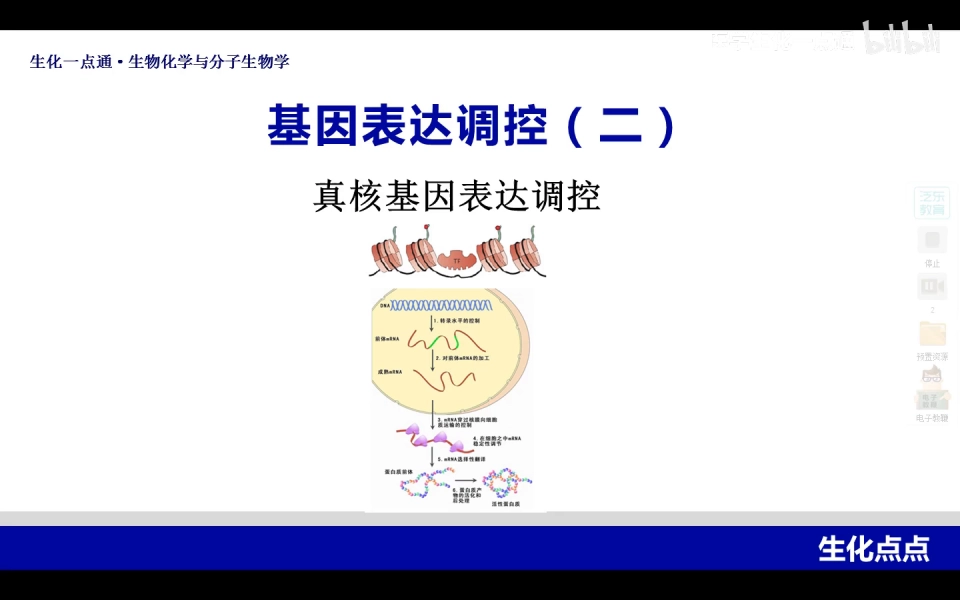
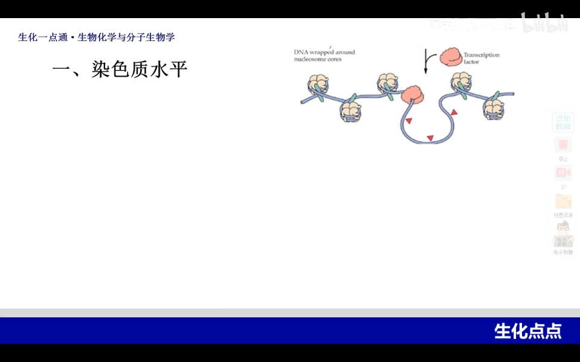
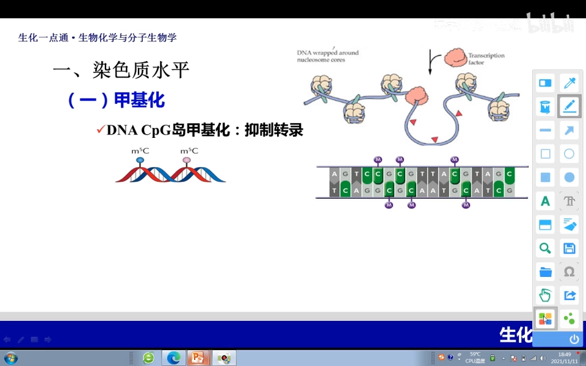
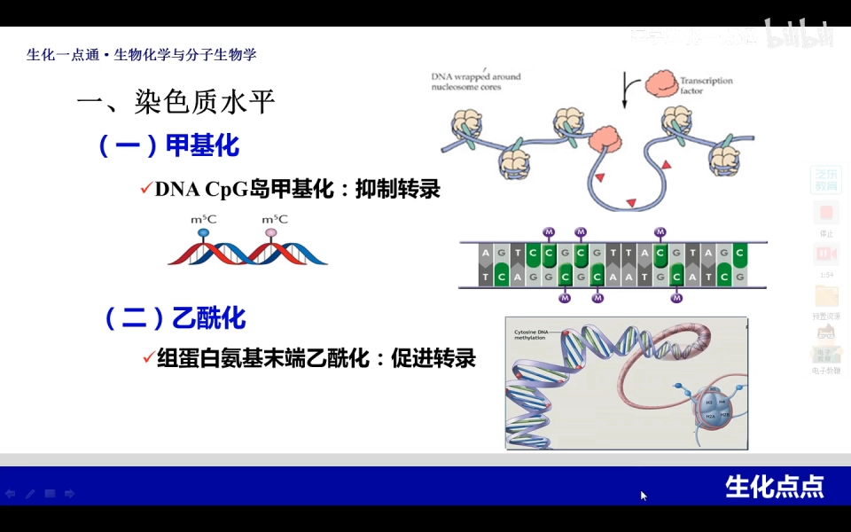
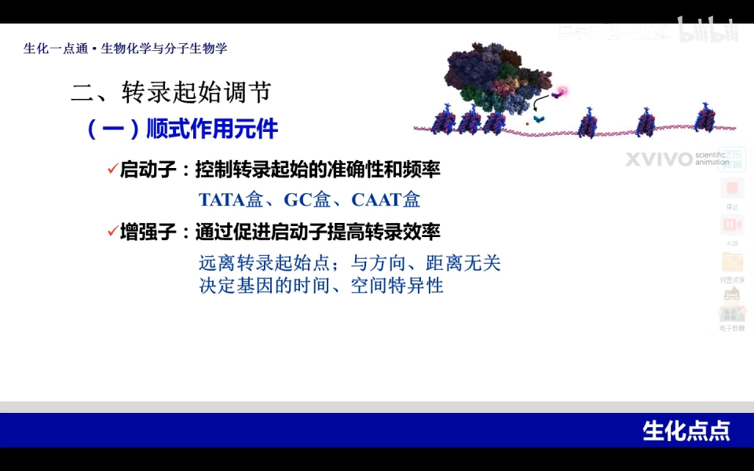
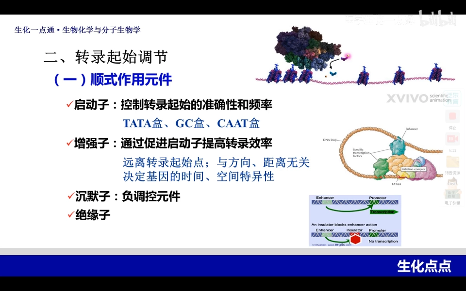
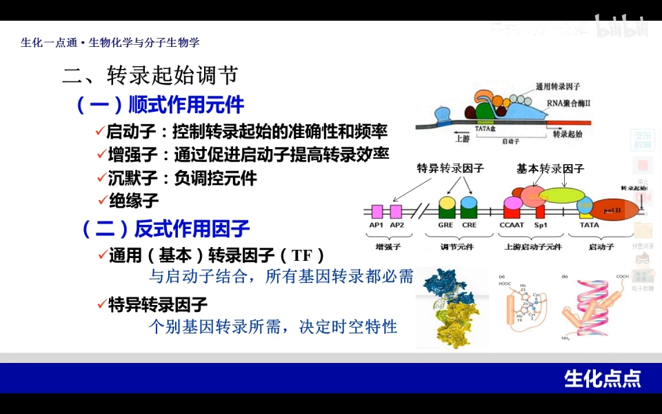
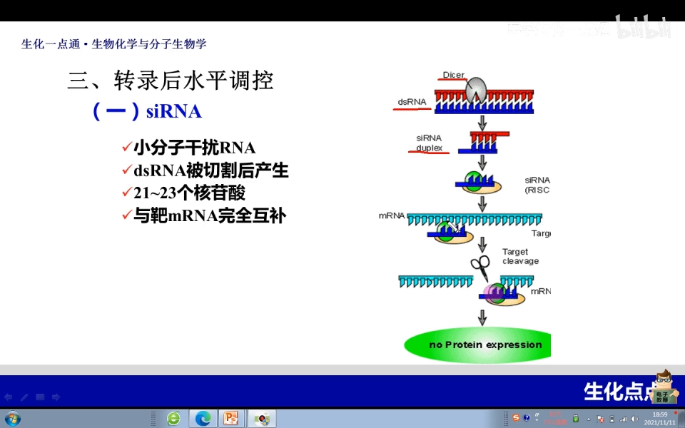
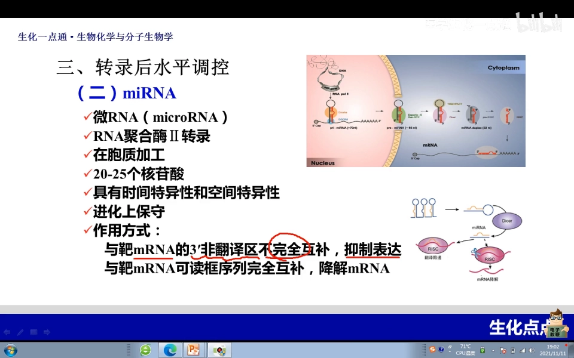

# 基因表达调控的三个层次：染色质、转录起始与转录后

> 视频来源：[31 真核基因表达调控](https://www.bilibili.com/video/BV1Kb4y1T7a2/)（Bilibili · 医学生化一点通，约 15 分钟）
> 导读（100 字以内）：一支按教材章节顺序讲真核基因表达调控的短课，把"染色质—转录起始—转录后"三层串成一条线。本文保留它的三层框架，把字幕里的口头表述补成完整的机制解释，并补上单细胞研究为什么关心这三层。

## 本讲要解决的核心问题（SCQA）

**背景**：同一个人的肝细胞和神经细胞，DNA 序列完全一样，做出来的蛋白质却几乎完全不同。这说明"基因是什么"和"基因表达多少"是两件事，后者是可以被调节的。

**冲突**：真核细胞的基因组被层层包裹在细胞核里，一个基因要被表达出来，得先让 DNA 从核小体上松开、再让 RNA 聚合酶被准确地招募到转录起始点、最后还要让转录出来的 mRNA 活着走到核糖体上。任何一环被卡住，蛋白质就出不来。真核生物的表达调控"相当复杂，目前还没有完全搞清楚"——这是视频开篇的原话。

**疑问**：既然环节这么多，细胞究竟在哪些环节上做调节？这些调节手段分别是什么，彼此是什么关系？

**回答（中心思想）**：真核基因表达调控可以按"信息流动的顺序"切成三个层次——**染色质水平**（这段 DNA 能不能被读到）、**转录起始水平**（转录机器能不能被正确地装上去）、**转录后水平**（mRNA 能不能活着被翻译）。三层里最核心的是转录起始，因为它是"基因表达调控的基本点"；而转录起始的调节永远是**顺式作用元件**（DNA 上的短序列）与**反式作用因子**（识别这些序列的蛋白质）"两个巴掌拍响"的结果。

---

## 一、先记住一张地图：三层调控各管一段

视频一开始就给出了整章的地图。真核染色质以**核小体**为单位，如果核小体能够舒展开，就意味着这个基因**有可能**开始表达——注意只是"有可能"，因为松开只是把门打开，还没有决定要不要进去。

[【跳转到 00:00】](https://www.bilibili.com/video/BV1Kb4y1T7a2/?t=0)



这张图值得先看一遍再看细节：调控并不是一个开关，而是一条流水线上的多个闸门。视频按教材要求只挑三个闸门讲——染色质水平、转录起始水平、转录后水平。下面按这个顺序展开。

---

## 二、第一层：染色质水平——先决定这段 DNA 能不能被读到

### 2.1 核小体是默认的"锁"

真核 DNA 并不是裸露的一根线，而是缠在组蛋白八聚体上形成一串"珠子"，这串珠子就是染色质。转录因子要识别 DNA 上的调控序列，前提是那段 DNA 露在外面。

[【跳转到 00:25】](https://www.bilibili.com/video/BV1Kb4y1T7a2/?t=25)



所以染色质水平的调控本质上只做一件事：**改变 DNA 与组蛋白之间的亲密程度**。贴得越紧，转录机器越够不着；松一点，才有机会。视频说目前研究得比较清楚的手段有两种：DNA 甲基化和组蛋白乙酰化，而且它们的方向正好相反。

### 2.2 DNA 甲基化：在 CpG 岛上加一把锁

真核基因组里有一类富含 CG 二核苷酸的短区域，习惯上称为 **CpG 岛**，常出现在基因的调控序列附近。这里的 C 就是胞嘧啶（cytosine），它经常在**第五位碳**上被加上一个甲基，这就是 **DNA 甲基化**。

[【跳转到 00:50】](https://www.bilibili.com/video/BV1Kb4y1T7a2/?t=50)



甲基的分子非常小，但它的位置很关键：它伸在 DNA 双螺旋的沟里，恰好是转录因子要去"摸"的地方。视频的解释很直白——**甲基虽然小，但它起码掩盖了这个区域**，转录因子就不可能很好地识别这段调控序列；没有转录因子的识别，RNA 聚合酶当然也就不会开始转录。

一句话结论：**DNA 甲基化抑制转录**。在单细胞层面，这也是为什么"启动子甲基化程度"常被当作某个基因是否关闭的旁证。

### 2.3 组蛋白乙酰化：把锁打开

反方向的操作发生在组蛋白上。组蛋白的**氨基末端**（往往在**赖氨酸**残基上）可以被加上乙酰基。乙酰化改变的是组蛋白的带电性质：原本带正电、能和带负电的 DNA 紧密结合的尾部，被乙酰化之后结合力变弱，核小体的结构就趋于松弛。

[【跳转到 01:54】](https://www.bilibili.com/video/BV1Kb4y1T7a2/?t=114)



于是这一层有了两个方向相反的旋钮：

| 修饰 | 加在哪 | 对 DNA–组蛋白结合的影响 | 对转录的作用 |
| --- | --- | --- | --- |
| DNA 甲基化 | CpG 岛中胞嘧啶的第 5 位碳 | 甲基挡在沟里，妨碍转录因子识别 | 抑制 |
| 组蛋白乙酰化 | 组蛋白氨基末端的赖氨酸 | 削弱组蛋白与 DNA 的静电结合，核小体松弛 | 促进 |

视频要求掌握的就是这两个。它们是"表观遗传"这个词在分子层面最具体的两个例子：DNA 序列一个字都没改，但基因的开关状态变了，而且这种状态可以在细胞分裂中传递下去。

---

## 三、第二层：转录起始——顺式元件与反式因子的"两个巴掌"

### 3.1 为什么这一层才是核心

视频明确说：**基因表达调控的基本点在转录的起始**。理由是前面转录那一章已经讲过，真核基因的转录必须在转录因子（TF）的协助下，由 RNA 聚合酶识别启动子、形成**转录前起始复合物**，这是转录最基本的需求。既然整个流水线的"总闸"在这里，调节自然以它为核心。

[【跳转到 02:24】](https://www.bilibili.com/video/BV1Kb4y1T7a2/?t=144)

而调节的方式，视频用了一个很好记的说法：**两个巴掌才能拍响**。

- 一只巴掌是 DNA 上的**顺式作用元件**（cis-acting element）：一段能调控基因活动的 DNA 短序列，它和它所调控的基因在同一个 DNA 分子上。
- 另一只巴掌是识别这些元件的**反式作用因子**（trans-acting factor）：由别的基因编码、扩散过来结合的蛋白质。

两者相互作用，才有调控结果。这个二分法非常重要，因为后面所有的名词都能塞进这两只巴掌里。

### 3.2 启动子：决定"从哪里开始、多久一次"

**启动子**（promoter）是最基础的顺式元件——没有启动子，任何基因都不可能开始转录。它控制的是转录起始的**准确性**和**频率**。

真核启动子常见的几个部件是 **TATA 盒、GC 盒、CAAT 盒**，其中更核心的是 TATA 盒。这个分工可以这样理解：

- TATA 盒负责"定位"——告诉转录机器从哪个碱基开始，所以它管的是**准确性**；
- GC 盒和 CAAT 盒负责"加力"——它们让转录起始更频繁，所以管的是**效率**。

### 3.3 增强子：可以很远，也可以反着放

有些基因（比如具有时空表达特性的基因）光有启动子还不够，还需要**增强子**（enhancer）。增强子的作用是**通过促进启动子的活动，进一步加大转录的程度**——注意，它自己不起始转录，它是作用于启动子的。

增强子和启动子的区别，是这一节最值得记的部分：

[【跳转到 04:29】](https://www.bilibili.com/video/BV1Kb4y1T7a2/?t=269)



1. **距离无关**：增强子和真正开始转录的结构基因位点之间相隔多远没有定数，可以很近，也可以远远地离开转录起始点。
2. **方向无关**：增强子这段 DNA 是 5' 到 3' 排列还是 3' 到 5' 排列，都不影响它的作用。
3. **位置无关**：它在基因上游、下游还是内部，都不影响它发挥作用。

启动子则相反：它一定在结构基因上游不远的地方，而且必须按照 5' 到 3' 的顺序排列好。换句话说，**启动子是"坐标"，增强子是"信号"**——信号可以从任何方向、任何距离传过来，只要最后能传到启动子上。

增强子为什么能做到"远距离遥控"？因为它和启动子之间会通过 DNA 弯折形成空间上的接触，把结合在增强子上的蛋白和结合在启动子上的转录机器拉到一起。这也是为什么后面讲单细胞 ATAC-seq 时，"增强子—启动子连接"是一个独立的研究对象。

### 3.4 沉默子与绝缘子：负调控与"断路"

顺式元件不只有促进转录的。视频还讲了两类：

- **沉默子**（silencer）：一种负调控元件。它和增强子很像，也是通过蛋白质相互作用去影响启动子，只不过给启动子的是**抑制性**的效果。视频提到，一个位置上"有时候是增强子、有时候是沉默子"，取决于结合上去的是什么蛋白。
- **绝缘子**（insulator）：位于启动子和上游的增强子（或沉默子）**之间**，像一道墙，使得上游的命令传不到启动子那里。视频说人类对绝缘子了解得还不是很清楚，但可以用物理上的"绝缘"来想象它。

[【跳转到 06:34】](https://www.bilibili.com/video/BV1Kb4y1T7a2/?t=394)



这张图把四类元件的关系画全了：上方是增强子经 DNA 环（DNA loop）绕过很远距离去激活启动子上的转录起始复合物；下方是绝缘子插在中间，增强子的激活信号被挡住，转录不发生。**增强子是油门，沉默子是刹车，绝缘子是断路开关。**

### 3.5 反式作用因子：通用与特异

另一只巴掌——反式作用因子——也分两类，分类标准是"是不是所有基因都需要它"：

- **通用（基本）转录因子**：识别启动子，所有基因的转录都需要。视频举的例子是识别 TATA 盒的各种 TF，比如 TFIIA、TFIIB、TFIID。
- **特异转录因子**：识别启动子之外的其他顺式元件（增强子、沉默子、绝缘子），只有个别基因的转录才需要，而且往往**决定这些基因的时空特异性表达**。

[【跳转到 08:37】](https://www.bilibili.com/video/BV1Kb4y1T7a2/?t=517)



这张图是本节最实用的一张，它把"谁认谁"画成了左右两半：左边是增强子和调节元件，由特异转录因子识别；右边是上游启动子元件（CAAT、GC）和 TATA 盒，由基本转录因子识别，最后 RNA 聚合酶 II 落在转录起始点上。**配套使用**这四个字就是这一层的全部逻辑。

视频还顺带提了一句反式作用因子为什么能结合 DNA：因为这些蛋白质里有**模体**（motif）结构，比如最典型的**锌指结构**。模体的种类、结构以及与 DNA 序列的对应关系属于转录因子本身的话题，这里只需记住"蛋白质靠模体读 DNA 序列"这个因果关系。

---

## 四、第三层：转录后水平——在 mRNA 上做文章

染色质打开了、转录也启动了，故事还没完。转录出来的 mRNA 能不能稳定存在、能不能被翻译，是第三个可以下手的环节。视频在这一层只讲了两类小 RNA，但这两类是后面单细胞实验里最常用的两个工具。

### 4.1 siRNA：把模板直接切掉

**siRNA**（small interfering RNA，小干扰 RNA）的产生逻辑是：只要细胞里出现了**双链 RNA** 结构——不管是外源导入的还是内源产生的——就会被核酸酶 **Dicer** 切割，切出来的 21~23 个核苷酸的双链小片段就是 siRNA。

接下来是一套标准流程：

1. 双链 siRNA 在一些蛋白因子的作用下被拆开；
2. 其中一条单链按照碱基序列去寻找细胞里与它互补的 mRNA；
3. 找到后**完全配对**结合，把这条 mRNA 降解掉。

[【跳转到 11:11】](https://www.bilibili.com/video/BV1Kb4y1T7a2/?t=671)



结果很直接：mRNA 作为翻译的模板被降解掉了，就不可能再指导蛋白质合成，翻译被阻断。从基因水平上讲，这就叫**基因沉默**。视频强调，正是借助 siRNA，我们才有了 **RNA 干扰技术**——把目标 mRNA 降解掉，实现特定基因的沉默来做研究。这也是 CRISPR 之外另一条"关掉一个基因"的路线。

### 4.2 miRNA：内源产生、两种结局

**miRNA**（microRNA）和 siRNA 走的是同一条下游通路，但来源不同：它由**细胞内源产生**，染色体上有它的基因，经 **RNA 聚合酶 II** 转录成发夹结构的前体，再经过一系列加工（在细胞核内剪出茎环、出核后在 Dicer 作用下切掉茎环），最后形成 20~25 个核苷酸的单链成熟 miRNA。它的表达具有**时空特异性**，在进化上相对保守。

关键差别在**配对方式**，这决定了两种完全不同的结局：

[【跳转到 13:58】](https://www.bilibili.com/video/BV1Kb4y1T7a2/?t=838)



| 配对情况 | 配对区域 | 结果 |
| --- | --- | --- |
| 不完全互补 | 靶 mRNA 的 3' 非翻译区（3' UTR） | 抑制翻译，mRNA 本身还在 |
| 完全互补 | 靶 mRNA 的开放阅读框（ORF）编码区 | 降解 mRNA，模板消失 |

第一种结局特别值得注意：**mRNA 的量没变，蛋白质却少了**。这对单细胞分析是一个直接的提醒——转录组测得的 mRNA 丰度，并不等于蛋白质丰度，中间隔着一层 miRNA 的翻译抑制。

视频最后提到，除了 siRNA 和 miRNA，还有 lncRNA、circRNA 等调控性非编码 RNA，教材上没有过多展开，但 siRNA 和 miRNA 是必须掌握的两个知识点。

---

## 五、把三层连起来：为什么单细胞研究要关心这张地图

把三层按顺序摆好，就能看清一个基因的"表达量"到底是被什么决定的：

```
染色质层（能不能读到）
   DNA 甲基化 ↓ ／ 组蛋白乙酰化 ↑
        ↓
转录起始层（转录机器装不装得上）
   顺式元件：启动子、增强子、沉默子、绝缘子
   反式因子：通用 TF、特异 TF
        ↓
转录后层（mRNA 活不活得到翻译）
   siRNA 降解 ／ miRNA 抑制翻译
        ↓
蛋白质丰度
```

这条链对单细胞扰动组学有三个直接用处：

1. **同一份 DNA，不同细胞读出不同的表达谱**，第一层（染色质状态）和第三层（特异转录因子）共同解释了细胞类型差异的来源。这也是单细胞 ATAC-seq 要测的东西。
2. **扰动一个基因，效应不一定出现在转录水平**。如果被扰动的是一个 miRNA，靶基因的 mRNA 可能几乎不变，但蛋白水平明显下降；只看 scRNA-seq 就会漏掉这类效应。
3. **"表达量"是一个多环节的合成结果**，所以做扰动响应分析时，观察到的差异表达基因只是这条链下游的一个读数，不能直接等同于"这个基因被直接调控了"。

---

## 小结

- 真核基因表达调控按信息流动顺序分三层：**染色质水平、转录起始水平、转录后水平**，其中转录起始是核心环节。
- 染色质层用两个方向相反的修饰控制"能不能读到"：**DNA 甲基化抑制转录**（甲基挡在 CpG 岛的沟里，妨碍转录因子识别），**组蛋白乙酰化促进转录**（削弱组蛋白与 DNA 的结合，核小体松弛）。
- 转录起始层的调节永远是两只巴掌：**顺式作用元件**（启动子、增强子、沉默子、绝缘子）与**反式作用因子**（通用 TF、特异 TF）的配套识别。
- **启动子**管转录起始的准确性和频率，位置固定、方向固定；**增强子**通过促进启动子来提高转录效率，与距离、方向、位置都无关；**沉默子**是负调控元件；**绝缘子**插在启动子和上游元件之间，阻断信号传递。
- 通用（基本）转录因子识别启动子，所有基因都需要；特异转录因子识别增强子等元件，决定基因的时空特异性表达。
- 转录后层：**siRNA** 由双链 RNA 经 Dicer 切割产生，与靶 mRNA 完全互补后将其降解；**miRNA** 内源产生，与 3' UTR 不完全互补时**抑制翻译**（mRNA 量不变），与 ORF 完全互补时**降解 mRNA**。

## 关键术语速查

| 术语 | 一句话解释 |
| --- | --- |
| 核小体 | 组蛋白八聚体外面缠约 147 bp DNA 形成的"珠子"，染色质的基本单位 |
| CpG 岛 | 基因组中富含 CG 二核苷酸的短区域，常位于基因调控序列附近 |
| DNA 甲基化 | 胞嘧啶第 5 位碳被加甲基，通常抑制转录 |
| 组蛋白乙酰化 | 组蛋白氨基末端赖氨酸被加乙酰基，削弱与 DNA 的结合，促进转录 |
| 顺式作用元件 | 与所调控基因同处一个 DNA 分子上的调控序列 |
| 反式作用因子 | 识别并结合顺式元件、从而调节基因表达的蛋白质 |
| 启动子 | 决定转录起始准确性与频率的序列，含 TATA 盒、GC 盒、CAAT 盒 |
| 增强子 | 通过促进启动子提高转录效率的元件，作用与距离、方向无关 |
| 沉默子 | 抑制转录的负调控元件 |
| 绝缘子 | 位于启动子与上游增强子/沉默子之间，阻断两者通讯的元件 |
| 通用转录因子 | 识别启动子、所有基因转录都需要的转录因子 |
| 特异转录因子 | 识别增强子等元件、决定基因时空特异性表达的转录因子 |
| 模体（motif） | 蛋白质中赋予其结合特定 DNA 序列能力的结构单元，如锌指 |
| siRNA | 双链 RNA 被 Dicer 切割产生的 21~23 nt 小 RNA，完全互补时降解靶 mRNA |
| miRNA | 内源产生的 20~25 nt 单链小 RNA，不完全互补时抑制翻译，完全互补时降解 mRNA |
| 3' UTR | mRNA 编码区下游的非翻译区，是 miRNA 结合的主要位置 |