# 转录后调控的两类小 RNA：miRNA 与 lncRNA

> 视频来源：[【分子生物学】第5章 基因表达调控 ｜ 第3节 真核生物基因表达调控 ｜ microRNA（miRNA）-lncRNA专题](https://www.bilibili.com/video/BV1dpvAe7EPt/)（Bilibili · 轻轻松松学分子，约 22 分钟）
> 导读（100 字以内）：这支专题课把"转录之后"这一层单独拎出来讲透：先讲 miRNA 从发夹前体到两种作用结局，再讲 lncRNA 如何在染色质、转录、转录后、翻译、翻译后五个层次上各插一手。本文按这两条线重排，并补上它们对单细胞分析的含义。

## 本讲要解决的核心问题（SCQA）

**背景**：中心法则的经典版本是"DNA → mRNA → 蛋白质"。如果基因表达调控只发生在转录起始，那么"mRNA 有多少"就应该等于"蛋白质有多少"。

**冲突**：这个等式在真核细胞里经常不成立。同一份 mRNA，可以被降解掉，也可以被完好地保存着却翻译不出来；一个基因的开关状态，也可能被一段根本不编码蛋白质的 RNA 从旁干预。也就是说，**转录之后还有一整套调控**。

**疑问**：这些"转录之后"的调控是谁在做？它们各自在哪一步下手、用什么机制、产生什么后果？

**回答（中心思想）**：转录后调控的主力是两类非编码 RNA。**miRNA** 是一类内源产生的约 22 nt 小 RNA，通过与靶 mRNA 的配对程度决定结局——完全互补就**降解 mRNA**，不完全互补（结合在 3' UTR）就**抑制翻译**，后者会让 mRNA 量不变而蛋白量下降。**lncRNA** 是长度大于 200 nt 的非编码 RNA，它的特点不是某一种机制，而是**能在染色质、转录、转录后、翻译、翻译后每一个层次上都插一手**：既能当脚手架招募染色质修饰酶，也能当诱饵把转录因子带走，还能当"海绵"吸走 miRNA。

---

## 一、miRNA：22 nt 的小 RNA，两种结局

### 1.1 它是什么：内源产生的发夹加工产物

视频给的定义很干脆：**miRNA 是一类长约 22 nt 的单链小 RNA，由细胞内源产生的发夹（hairpin）结构转录本加工而来**。

[【跳转到 00:30】](https://www.bilibili.com/video/BV1dpvAe7EPt/?t=30)

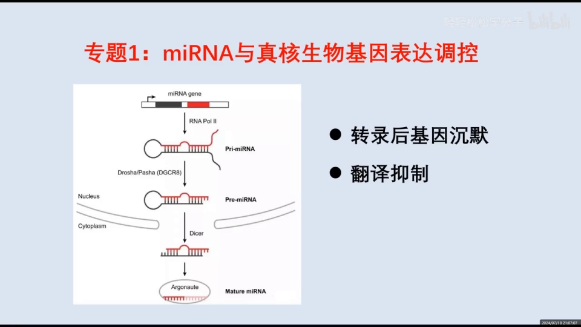

这句话里有两个关键词，都值得单独拎出来：

- **内源**：miRNA 的基因就在细胞自己的染色体上，是"自己生产的"，不是外面导入的。这一点是它和 siRNA 最根本的区别。
- **发夹结构**：它的前体是一段能自己跟自己配对、形成茎环（stem-loop）的 RNA，加工过程就是把这个茎环一层层剪短。

### 1.2 成熟过程：从 pri-miRNA 到 22 nt 单链

成熟 miRNA 的形成是一条三级流水线：

1. **转录**：miRNA 基因由 **RNA 聚合酶 II** 转录，先得到较长的初级转录本 pri-miRNA；
2. **核内剪裁**：在 Drosha 等酶的作用下，两段多余的片段被剪掉，形成 pre-miRNA（约 70 nt 的茎环）；
3. **出核后再剪**：pre-miRNA 从细胞核转移到细胞质，在 **Dicer** 酶作用下茎环被切除，形成双链 RNA；
4. **解链**：双链被打开，其中一条链作为成熟的 miRNA（约 22 nt），另一条被丢弃。

[【跳转到 02:44】](https://www.bilibili.com/video/BV1dpvAe7EPt/?t=164)

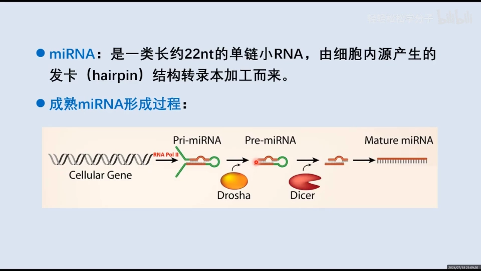

视频特别强调了一个前提：**它是在细胞核内转录的**。这看起来是常识，但它决定了 miRNA 的调控是"细胞自己安排的"，而不是外界输入的信号——这一点在理解后面 siRNA 的对比时很关键。

### 1.3 功能一：装载 RISC，把 mRNA 切掉

成熟 miRNA 的第一条出路，和 siRNA 共用同一套机器：**装载进 RISC（RNA-induced silencing complex，RNA 诱导沉默复合体）**，然后引导这个复合体去结合互补配对的 mRNA，把它降解掉。

[【跳转到 04:54】](https://www.bilibili.com/video/BV1dpvAe7EPt/?t=294)

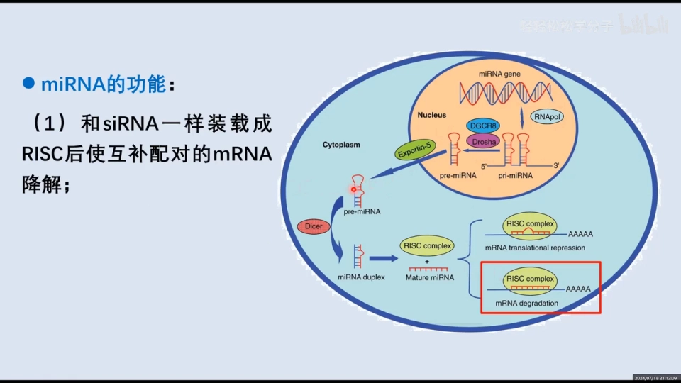

这张图把整条路径画在了一个细胞里，值得对照着看：细胞核（上方橙色区域）里是 miRNA 基因的转录和 Drosha 的剪裁，出核（Exportin-5）之后在细胞质里由 Dicer 完成最后一步，成熟的 miRNA 双链解开、单链进入 RISC，然后分成两条分支——右上角是**翻译抑制**，右下角是**mRNA 降解**。

### 1.4 功能二：抑制翻译——mRNA 还在，蛋白没了

第二条出路是这支视频最想让人记住的地方：**抑制 mRNA 的翻译，降低靶基因的蛋白质水平，但不影响 mRNA 本身的水平**。

[【跳转到 06:09】](https://www.bilibili.com/video/BV1dpvAe7EPt/?t=369)

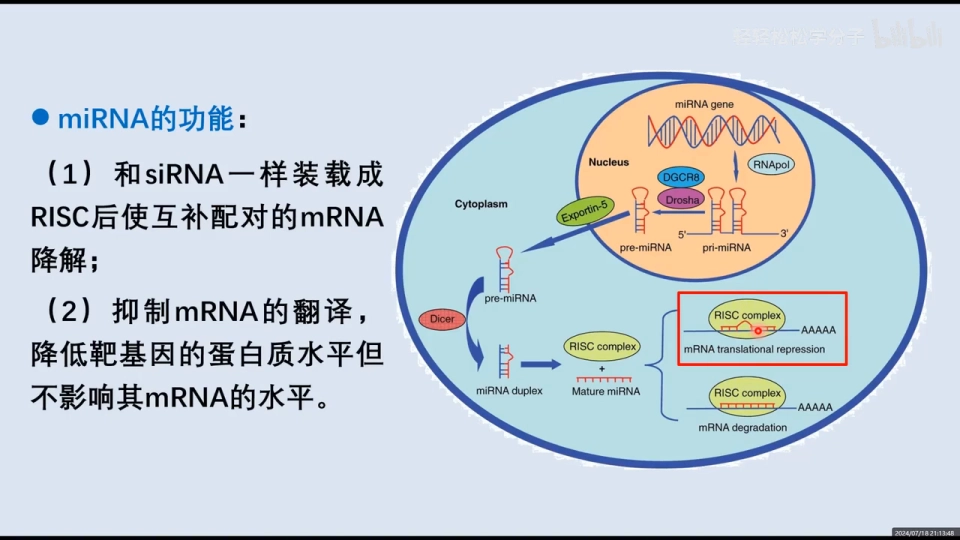

决定走哪条分支的，是**配对的完全程度**：

| 配对情况 | 结合位置 | 后果 | mRNA 量 | 蛋白量 |
| --- | --- | --- | --- | --- |
| 完全碱基互补配对 | mRNA 的编码区 | mRNA 被降解 | 下降 | 下降 |
| 不完全碱基互补配对 | mRNA 的 3' UTR | 翻译被抑制 | 基本不变 | 下降 |

视频用"注意这两幅图的细节"来提醒这个区别——完全配对促进 mRNA 降解，不完全配对抑制翻译。这个区别在实验上非常实用：**如果你只测 mRNA（比如做 scRNA-seq），那么被 miRNA 抑制翻译的那批基因看起来毫无变化，但蛋白层面已经塌了**。

### 1.5 miRNA 与 siRNA 的两点区别

两者下游机制相似（都走 RISC），但视频列了两条区别：

[【跳转到 07:29】](https://www.bilibili.com/video/BV1dpvAe7EPt/?t=449)

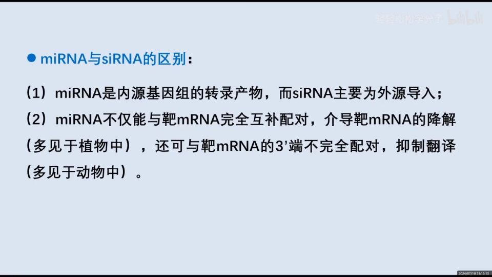

1. **来源**：miRNA 是**内源基因组**的转录产物；siRNA 主要是**外源导入**的（比如实验里转进去的双链 RNA）。
2. **作用方式**：miRNA 既能与靶 mRNA 完全互补配对、介导降解，也能与 3' 端不完全配对、抑制翻译；而且视频还补了一句分布上的倾向——**介导 mRNA 降解多见于植物，抑制翻译多见于动物**。

这两条区别解释了为什么 RNA 干扰实验（外源 siRNA）和细胞内源的 miRNA 调控，虽然共用 RISC，却在生物学角色上完全不同：前者是实验工具，后者是细胞自己的调节层。

---

## 二、lncRNA：能在每一层都插一手的调控分子

### 2.1 它是什么：大于 200 nt、不编码蛋白质

**lncRNA（long noncoding RNA，长链非编码 RNA）是一类长度大于 200 nt、不编码蛋白质的 RNA 分子**。这个 200 nt 的门槛是人为划的，用来把它和小 RNA（miRNA、siRNA 等）区分开。

[【跳转到 08:28】](https://www.bilibili.com/video/BV1dpvAe7EPt/?t=508)

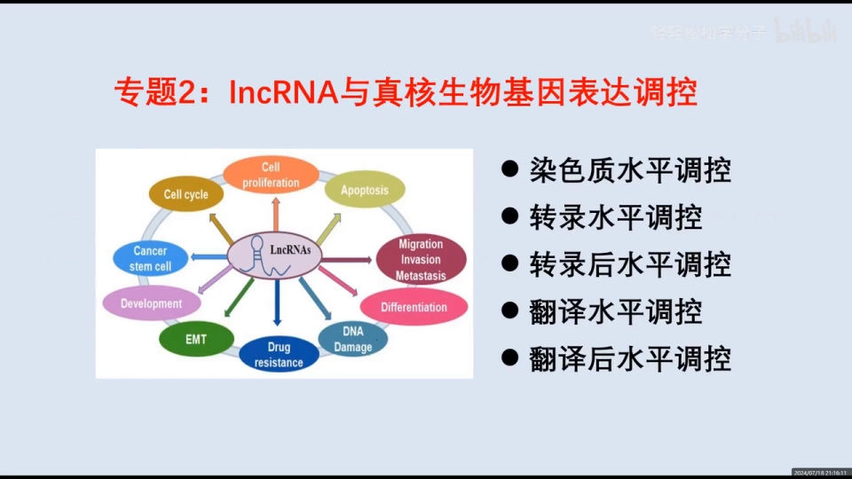

视频开篇就用这张图说明了 lncRNA 为什么值得单独做一个专题：左边是它参与的生物学过程（细胞周期、细胞增殖、凋亡、迁移侵袭转移、分化、DNA 损伤、耐药、EMT、发育、癌症干细胞），右边是它参与调控的五个层次。**lncRNA 不是"某一层"的调控分子，它是"每一层"都能插手的调控分子**——这也是它难讲的原因。

### 2.2 按基因位置分类：六种 lncRNA

lncRNA 的分类方式之一是看它的基因落在基因组的什么位置：

[【跳转到 09:57】](https://www.bilibili.com/video/BV1dpvAe7EPt/?t=597)

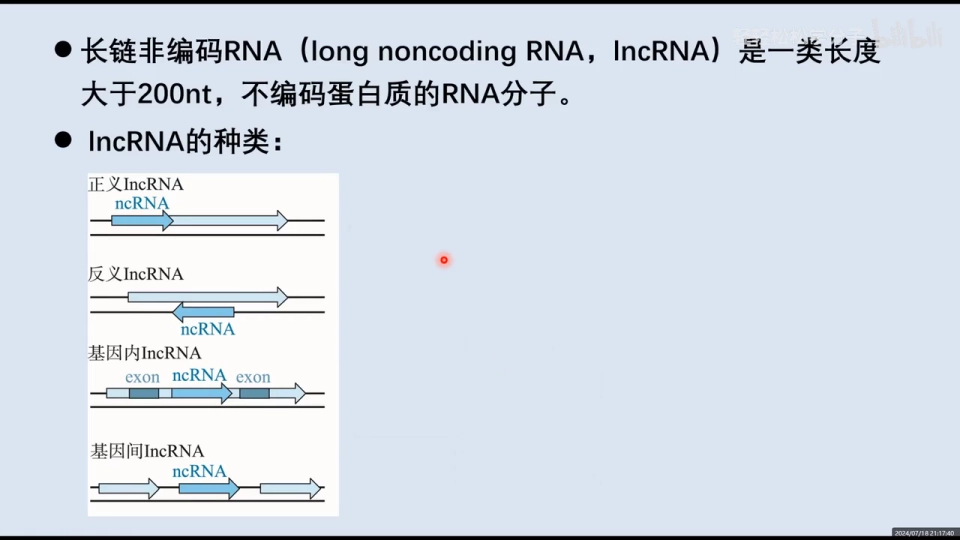

| 类型 | 基因位置 |
| --- | --- |
| 正义 lncRNA | 与某个蛋白编码基因共享相同的启动子，两者有重叠 |
| 反义 lncRNA | 以反向的方式插入在某个已知的蛋白编码基因当中 |
| 基因内 lncRNA | 基因位于某个蛋白编码基因的内含子区域 |
| 基因间 lncRNA | 基因位于两个蛋白编码基因之间 |
| 增强子 lncRNA | 基因位点位于某一蛋白编码基因的增强子区域 |
| 环状 RNA | 通过共价键形成闭合环状，一般来自核内剪接 |

前四种在图里画得很清楚：蓝色是 lncRNA 基因，白色是蛋白编码基因。后两种（增强子 lncRNA、环状 RNA）在图之后补充。这个分类本身没有太多机制含义，但它在实际分析里很有用——比如"反义 lncRNA"天然就可能和它的邻居基因形成互补双链，从而影响邻居的表达。

### 2.3 染色质水平：当脚手架，把修饰酶招过来

lncRNA 的第一层作用在染色质上：**介导染色质重塑，以及组蛋白乙酰化、DNA 甲基化修饰，从而影响靶基因的表达**。

[【跳转到 12:39】](https://www.bilibili.com/video/BV1dpvAe7EPt/?t=759)

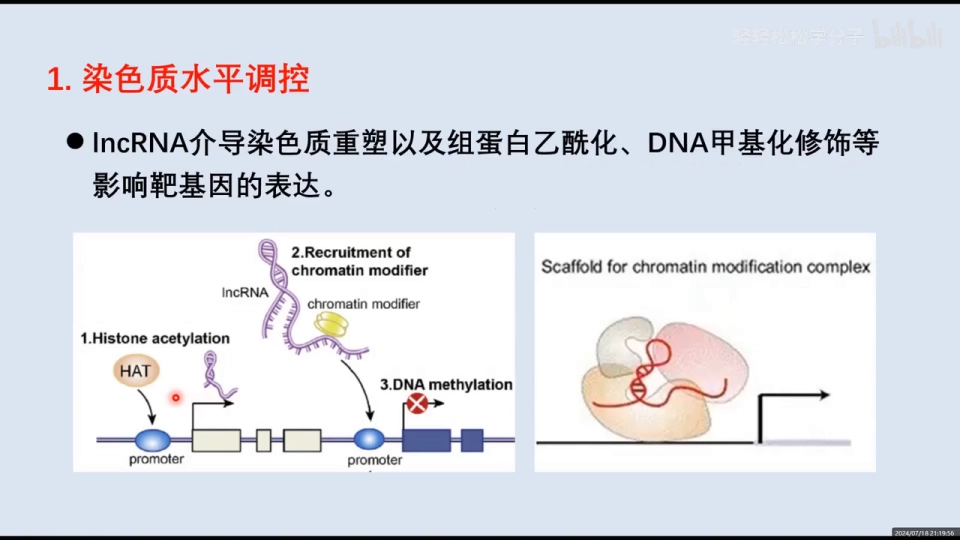

图里标了三个动作：一是招募 **HAT**（组蛋白乙酰转移酶）到启动子上做组蛋白乙酰化；二是招募染色质修饰因子（chromatin modifier）；三是介导 DNA 甲基化。右侧那张"scaffold for chromatin modification complex"是理解它的关键比喻——**lncRNA 像一个脚手架**，把本来分散的多个蛋白拉到一起，形成一个能干活儿的复合物。

对照上一篇讲的染色质层，这里的意义就出来了：DNA 甲基化和组蛋白乙酰化不会自己发生，它们需要被"送到正确的位置"，而 lncRNA 就是一种定位装置。

### 2.4 转录水平：当诱饵，把转录因子带走

第二层是转录水平，lncRNA 在这里扮演**诱饵分子**（decoy）。视频给了两个方向相反的例子：

[【跳转到 14:19】](https://www.bilibili.com/video/BV1dpvAe7EPt/?t=859)

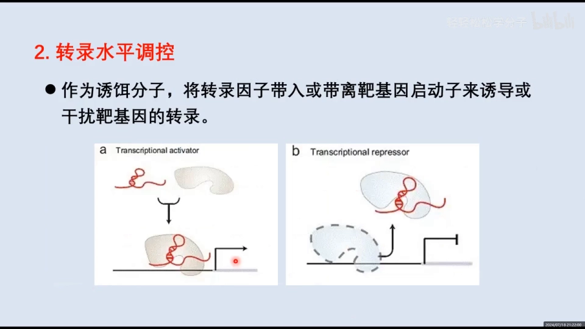

- **促进**：lncRNA 招募转录因子，并把它带到靶基因的启动区，促进该基因的转录（图 a，transcriptional activator）；
- **抑制**：lncRNA 把原本能和启动子结合的转录因子**带离**启动子区域，转录因子结合不上，靶基因的转录就被抑制（图 b，transcriptional repressor）。

视频还顺手教了一个读图约定：**箭头表示促进，箭头末端加一道小竖线表示抑制**。这个约定在后面的几张图里反复出现。

### 2.5 转录后水平：参与剪接，或制造内源 siRNA

第三层是转录后水平，视频举了两个例子：

**（1）参与可变剪接。** lncRNA 可以促进 pre-mRNA 与可变剪接因子的结合，有助于产生成熟的 mRNA。

[【跳转到 15:05】](https://www.bilibili.com/video/BV1dpvAe7EPt/?t=905)

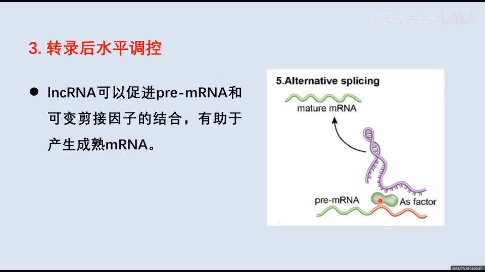

**（2）与 mRNA 形成互补双链，制造内源 siRNA。** lncRNA 与编码蛋白基因的 mRNA 形成互补双链，这个双链 RNA 在 **Dicer** 酶作用下产生内源的 siRNA，进一步介导 RNA 降解。

[【跳转到 15:30】](https://www.bilibili.com/video/BV1dpvAe7EPt/?t=930)

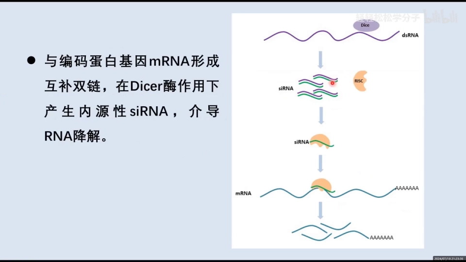

这个例子把上一节和这一节接上了：**siRNA 不一定是外源导入的，细胞自己也能通过 lncRNA 与 mRNA 配对来生产内源 siRNA**。这也是"反义 lncRNA"这个分类在机制上的一个具体用途。

### 2.6 翻译水平：当"海绵"，把 miRNA 吸走

第四层是翻译水平，机制叫 **miRNA 海绵**（miRNA sponge）。逻辑是这样的：

1. miRNA 结合到 mRNA 的 3' UTR 上，抑制翻译；
2. lncRNA 上有许多与 miRNA 互补的位点，可以竞争性地把 miRNA 结合走；
3. miRNA 被"吸走"之后，就腾出了靶 mRNA 的 3' UTR，**miRNA 对翻译的抑制作用被解除**。

[【跳转到 16:45】](https://www.bilibili.com/video/BV1dpvAe7EPt/?t=1005)

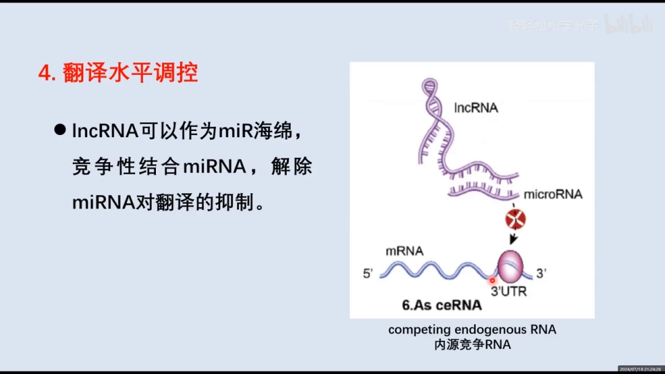

这类 lncRNA 有一个专门的名字：**ceRNA（competing endogenous RNA，内源竞争 RNA）**。视频特别解释了这个词——就是"竞争性地结合 miRNA 的 RNA"。理解 ceRNA 的关键是它**不直接作用于靶基因**，它作用的是一条 miRNA，然后间接影响这条 miRNA 的所有靶基因。所以在分析里看到一个 lncRNA 敲低后一大批基因同时变化，ceRNA 机制是一个常见解释。

### 2.7 翻译后水平：改修饰、抗降解、换位置

第五层是翻译后水平。视频给了三个例子，都属于"蛋白质层面的调控"：

[【跳转到 18:00】](https://www.bilibili.com/video/BV1dpvAe7EPt/?t=1080)

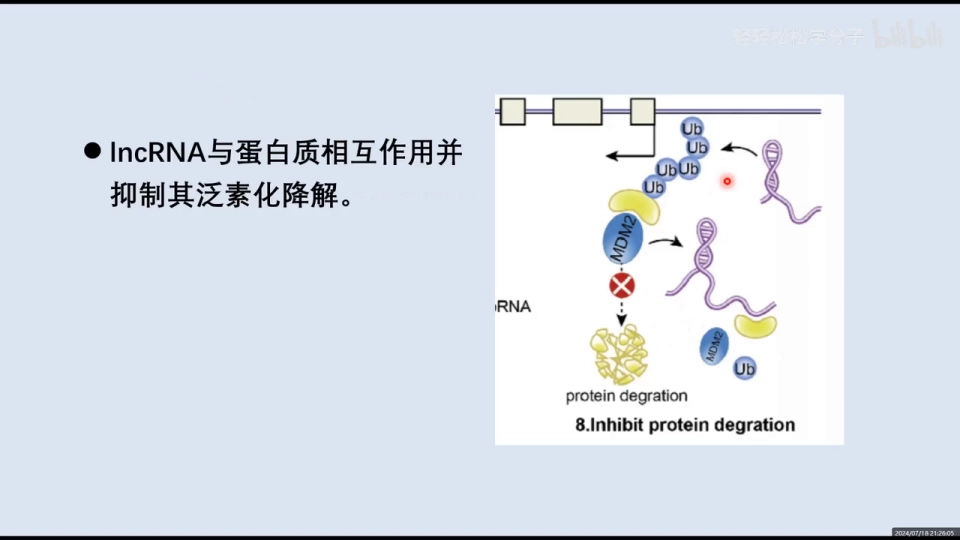

1. **参与去磷酸化**：原本磷酸化的蛋白质，在相应酶的作用下发生去磷酸化——这是蛋白质修饰层面的调控。
2. **抑制泛素化降解**：lncRNA 与相关蛋白互作，抑制它的泛素化。视频顺带复习了蛋白质降解的两条主要途径——泛素化介导的**泛素-蛋白酶体途径**，以及细胞自噬介导的**溶酶体途径**；抑制泛素化，就等于让这个蛋白不被降解、稳定存在。
3. **改变细胞定位**：lncRNA 与靶蛋白结合，改变该蛋白在细胞内的位置。

第三点常被忽略但很重要：**同样多的蛋白，放在细胞核里还是细胞质里，功能完全不同**。所以"定位改变"也是一种调控结果。

### 2.8 一张总图看完五层

视频最后放出了把所有例子拼在一起的总图：

[【跳转到 19:20】](https://www.bilibili.com/video/BV1dpvAe7EPt/?t=1160)

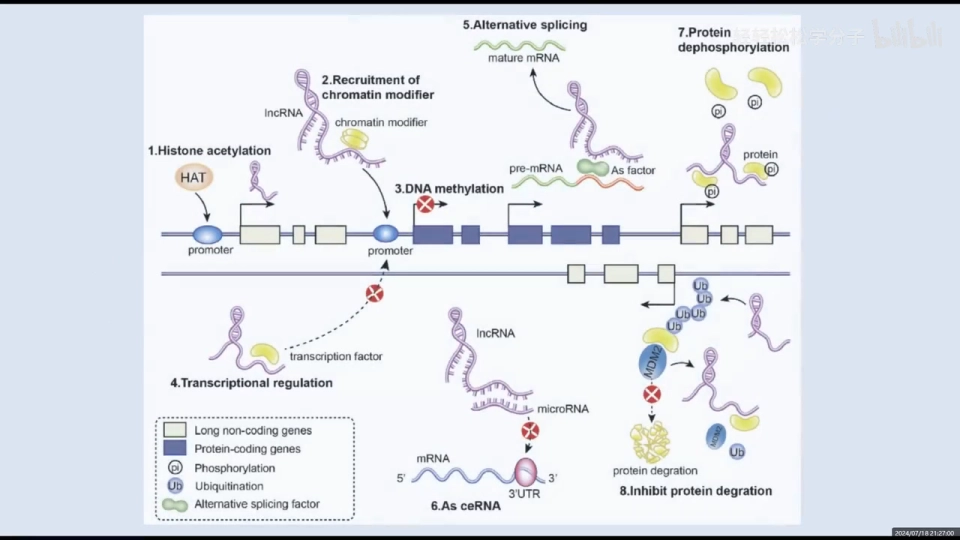

这张图值得反复看，因为它把前面七个例子按"沿基因表达流程从左到右"的顺序排好了：染色质修饰（1、2、3）→ 转录调控（4）→ 可变剪接（5）→ ceRNA 海绵（6）→ 蛋白去磷酸化（7）→ 抑制蛋白降解（8）。**同一个分子，八个不同的下手点**——这就是 lncRNA 难研究的根本原因，也是它作为调控分子最特别的地方。

---

## 三、把 RNA 家族摆在一起看

视频结尾做了一次系统回顾，把 RNA 分成两大类：

[【跳转到 20:06】](https://www.bilibili.com/video/BV1dpvAe7EPt/?t=1206)

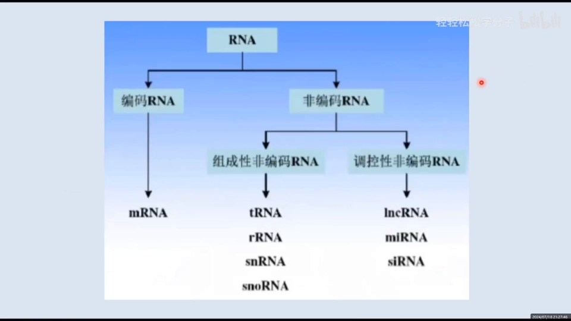

| 大类 | 子类 | 成员 | 角色 |
| --- | --- | --- | --- |
| 编码 RNA | — | mRNA | 翻译的模板，编码蛋白质 |
| 非编码 RNA | 组成型 | tRNA、rRNA、snRNA、snoRNA | 基础装置：snRNA 参与 mRNA 前体剪接、是剪接体的重要组分；snoRNA 参与 rRNA 加工 |
| 非编码 RNA | 调控型 | siRNA、miRNA、lncRNA | 参与基因表达调控 |

这张分类树给了一个清晰的判断标准：**"组成型"的非编码 RNA 是细胞常备的机器零件，"调控型"的非编码 RNA 才是随情况变化去调节别人表达的分子**。本讲讨论的 miRNA 和 lncRNA 都属于后者。

---

## 四、这两类 RNA 对单细胞扰动分析意味着什么

把这一讲的内容放回单细胞扰动组学的语境，有三点值得记住：

1. **mRNA 丰度不等于蛋白丰度**。miRNA 抑制翻译时 mRNA 量可以完全不变。所以用 scRNA-seq 评估一个扰动效应时，如果扰动的是一个 miRNA，很可能在转录组上看不到明显信号，需要蛋白层面的读出（比如 CITE-seq 的抗体计数）才能看到效应。
2. **扰动效应会沿调控网络扩散**。ceRNA 机制意味着敲低一个 lncRNA，可能通过一条 miRNA 影响它的一整批靶基因；做差异表达分析时会看到"一大片基因同时变化"，这不是技术噪声，而可能是网络效应。
3. **lncRNA 本身也是可扰动的对象**。CRISPRi 敲低一个 lncRNA 的启动子，读出的表达变化会分布在上面五个层次中的任意一层——这也是为什么 lncRNA 的 Perturb-seq 数据往往比蛋白编码基因更难解释。

---

## 小结

- 转录之后还有一整套调控，主力是两类非编码 RNA：**miRNA** 与 **lncRNA**。
- **miRNA** 是内源产生的约 22 nt 单链小 RNA，由 RNA 聚合酶 II 转录的 pri-miRNA 经 Drosha、Dicer 逐级剪裁而来。
- miRNA 的结局由配对程度决定：**完全互补 → 降解 mRNA**；**不完全互补（结合 3' UTR）→ 抑制翻译**，此时 mRNA 量不变、蛋白量下降。
- miRNA 与 siRNA 的区别：**来源**（内源 vs 主要外源导入）与**作用方式**（miRNA 兼有两种结局）；降解多见于植物，翻译抑制多见于动物。
- **lncRNA** 是长度大于 200 nt、不编码蛋白质的 RNA，按基因位置可分为正义、反义、基因内、基因间、增强子 lncRNA 与环状 RNA。
- lncRNA 的特别之处是**在五个层次上都能调控**：染色质（脚手架招募修饰酶）、转录（诱饵带走转录因子）、转录后（参与剪接、制造内源 siRNA）、翻译（ceRNA 海绵吸走 miRNA）、翻译后（去磷酸化、抑制泛素化降解、改变定位）。
- RNA 家族可分为编码 RNA（mRNA）与非编码 RNA；非编码 RNA 又分组成型（tRNA、rRNA、snRNA、snoRNA）与调控型（siRNA、miRNA、lncRNA）。

## 关键术语速查

| 术语 | 一句话解释 |
| --- | --- |
| miRNA | 内源产生的约 22 nt 单链小 RNA，通过配对程度决定降解 mRNA 或抑制翻译 |
| siRNA | 小干扰 RNA，主要由双链 RNA 经 Dicer 切割产生，完全互补时降解靶 mRNA |
| pri-miRNA / pre-miRNA | miRNA 的初级转录本与核内剪裁后的茎环前体 |
| Drosha / Dicer | 两个 RNase III 家族酶，分别在细胞核与细胞质中剪裁 miRNA 前体 |
| RISC | RNA 诱导沉默复合体，装载小 RNA 后引导其找到互补的靶 mRNA |
| 3' UTR | mRNA 编码区下游的非翻译区，miRNA 不完全配对结合的位置 |
| lncRNA | 长度大于 200 nt、不编码蛋白质的 RNA |
| 正义 / 反义 lncRNA | 与蛋白编码基因同向共享启动子 / 以反向方式插入蛋白编码基因中 |
| 增强子 lncRNA | 基因位点位于某个蛋白编码基因增强子区域的 lncRNA |
| ceRNA | 内源竞争 RNA，通过竞争性结合 miRNA 来解除其对靶基因的抑制 |
| miRNA 海绵 | ceRNA 的作用方式，像海绵一样把 miRNA 吸附走 |
| 泛素-蛋白酶体途径 | 蛋白质被泛素链标记后送进蛋白酶体降解的途径 |