# 基因调控网络如何从表达数据中被推断出来

> 视频来源：[MIT 生信公开课 15. 基因调控网络](https://www.bilibili.com/video/BV1od4y1e7UZ/)（Bilibili · 王白尔搬运，MIT OpenCourseWare 原课，约 79 分钟，中文字幕为机器翻译）
> 导读（100 字以内）：这是一堂把「调控网络」当计算问题来讲的课：先用距离度量与聚类把表达数据整理成模块，再用一个「随机基因集也能预测预后」的著名反例说明相关不等于因果，最后逐一拆开贝叶斯网络、回归、互信息（ARACNE、MINDy）四类推断方法的假设与软肋。本文按「数据 → 模块 → 陷阱 → 四类方法 → 局限」重排，公式与判据保留。

## 本讲要解决的核心问题（SCQA）

**背景**：一个转录因子能同时控制多个基因，一个基因又受多个转录因子控制，所以「谁调控谁」天然是一张网络。问题在于，大多数实验里我们能测到的只有**基因表达量**——一张「基因 × 条件」的表，而转录因子蛋白本身的活性往往测不到。

**冲突**：从表达数据里能直接看到的是「共表达」：一群基因在同样的条件下一起升高、一起降低。但共表达只是相关，不是因果。更麻烦的是，共表达本身强到足以骗人——用一组**随机的**基因也能把乳腺癌病人分成预后显著不同的两组。

**疑问**：既然共表达既不可靠又容易被滥用，我们还能不能从表达数据推断调控网络？如果能，凭什么？不同方法的假设差在哪里，各自会在什么地方失效？

**回答（中心思想）**：从表达数据推断调控网络，本质是**在「共表达」之上逐层加约束**。第一层是几何与统计：把每个基因看成高维空间里的一个向量，用距离/相关定义相似性，再用聚类把基因压成模块。第二层是概率模型：用贝叶斯网络把「转录因子—靶基因」写成有向图加条件概率表，把多种证据合成一个后验概率。第三层是动力学假设：用回归拟合「靶基因表达 = 调控因子表达的某个函数」，或用互信息捕捉线性相关抓不到的非线性关系，再用数据处理不等式剪掉间接边。每一层都在用更强的假设换更具体的结论，也因此各自带着明确的失效条件——这正是后面要用 DREAM 挑战做盲测比较的原因。

---

## 一、为什么调控网络要从表达数据出发

视频给了一个很直白的理由：**基因表达数据太多了**。相比之下，蛋白质组数据、蛋白—蛋白相互作用数据、结构数据的规模都小得多。因此「分析基因表达数据的技术将在很长一段时间里扮演非常重要的角色」。

这也是本讲的组织顺序：先把表达数据本身讲清楚（怎么比较两个基因、怎么把基因分组），再谈怎么在这些分组之上推断调控关系。

### 1.1 把基因看成高维向量：距离与相关

一个基因在一组实验条件（时间序列、不同扰动、不同病人）下的表达值，可以写成一个向量。于是「两个基因像不像」就变成了「两个向量近不近」。

最直接的是**欧氏距离**：把各条件下的表达值之差平方求和再开方。

$$
d(a,b) = \sqrt{\sum_{i} \left( a_i - b_i \right)^2}
$$

视频还给出了距离的正式定义性质：非负、自身距离为零、对称，以及三角不等式。

但欧氏距离有一个问题：它比较的是**绝对水平**。如果两个基因的表达模式完全同步，只是一个整体比另一个高 1000 拷贝，欧氏距离会很大，而生物学上它们显然很像。所以更常用的是**皮尔逊相关**：先把每个基因的表达值转成 Z 分数（减去该基因在所有条件下的均值、再除以标准差），再求两组 Z 分数乘积的平均。

$$
r_{AB} = \frac{1}{n} \sum_{i} z_A(i)\, z_B(i)
$$

这样一来，形状相同但幅度不同的两条曲线会得到接近 1 的相关系数；形状相反（一个升一个降）会得到接近 −1 的强负相关。视频特别点出：**用欧氏距离看，红色和蓝色这两条曲线差异很大；用相关看，它们的相似度很高**。选哪种度量不是技术细节，而是你对「相似」的定义——取决于你要回答的生物学问题。

### 1.2 从相似性到聚类：几种做法与各自的坑

有了距离，就可以把基因分组。这是一个**无监督学习**问题：进去之前既不知道有几类，也不知道每类是什么。

视频依次讲了四种做法，重点不在算法细节，而在每种做法的**不确定性来源**：

**（1）层次聚类（hierarchical clustering）**：从每个数据点各自成一类开始，反复把最相似的两类合并（凝聚式），或反过来不断分裂（分裂式）。合并两类时需要定义「类与类之间的距离」：取两类成员间的最小距离叫**单链接**（single linkage），取最大距离叫**完全链接**（complete linkage），取所有距离的平均叫 **UPGMA**。三者行为差别很大：单链接容易把彼此靠近的点连成一串（chaining），完全链接则抗拒合并、对离群点更稳健。

[【跳转到 23:27】](https://www.bilibili.com/video/BV1od4y1e7UZ/?t=1407)

层次聚类的输出是**树状图**（dendrogram）：在任何高度切一刀，就得到一种划分。好处是能一眼看出数据的层次结构；坑在于——**不管你切在哪，你总会得到一棵树**，即使数据本身根本没有层次结构。视频的原话是：树状图更多反映的是「你是怎么聚类的」，而不是数据的基本结构。而且它**不会告诉你应该分成几类**。

**（2）k-means**：先指定类数 $k$，随机选 $k$ 个初始质心，然后循环两步——把每个点分配给最近的质心，再重新计算每类的质心（均值），直到分配不再变化。

[【跳转到 31:12】](https://www.bilibili.com/video/BV1od4y1e7UZ/?t=1872)

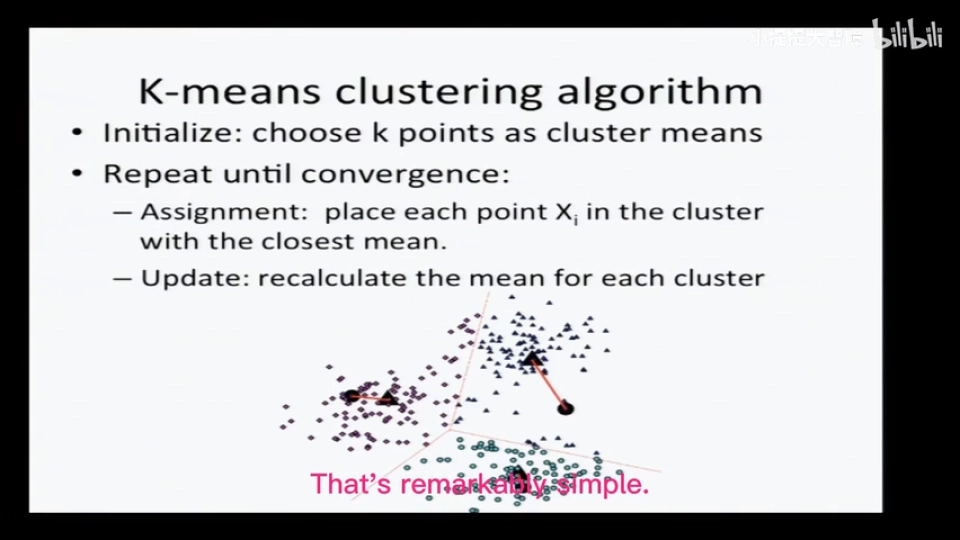

k-means 的坑有三个：

- **$k$ 是你指定的**。如果真实结构是 5 类而你给 3，算法仍会「想办法」给出 3 类——它会把一个定义良好的簇劈成两半，或把两个簇硬并成一个。视频给的经验办法是看**类内距离随 $k$ 的下降曲线**：当 $k$ 增加到真实类数之后，再增加 $k$ 带来的下降会明显变小（拐点）。
- **初始化是随机的**，不同初始化可能收敛到不同结果，甚至收敛到局部最优。实践上要多次初始化、看结果是否一致。
- **用平方欧氏距离，离群点影响很大**。

**（3）模糊 k-means（fuzzy k-means）**：把「每个点属于哪一类」的硬分配换成**隶属度** $\mu$（0 到 1 之间的连续值）。夹在两个簇中间的点可以同时「一半属于 A、一半属于 B」，而不是被迫二选一。视频用彩虹色演示了这一点：颜色越暖表示该点对这一类的隶属度越高。

**（4）k-medoids**：当聚类对象不是数值向量、算不出「平均值」时（例如用 EM 算法聚类的序列 motif，平均 motif 不一定对应任何真实存在的序列），就用**最靠近中心的实际样本点**（medoid）代替质心。代价是失去了 k-means 的收敛保证。

### 1.3 聚类能换来什么：从基因群到疾病分型

聚类本身不是目的。视频给了一个奠基性的例子：把弥漫性大 B 细胞淋巴瘤（DLBCL）病人的表达数据做聚类，病人被干净地分成两大群；而这两群恰好对应病理学家独立判定的两种淋巴瘤亚型（生发中心 B 细胞样与活化 B 细胞样）。

[【跳转到 44:15】](https://www.bilibili.com/video/BV1od4y1e7UZ/?t=2655)

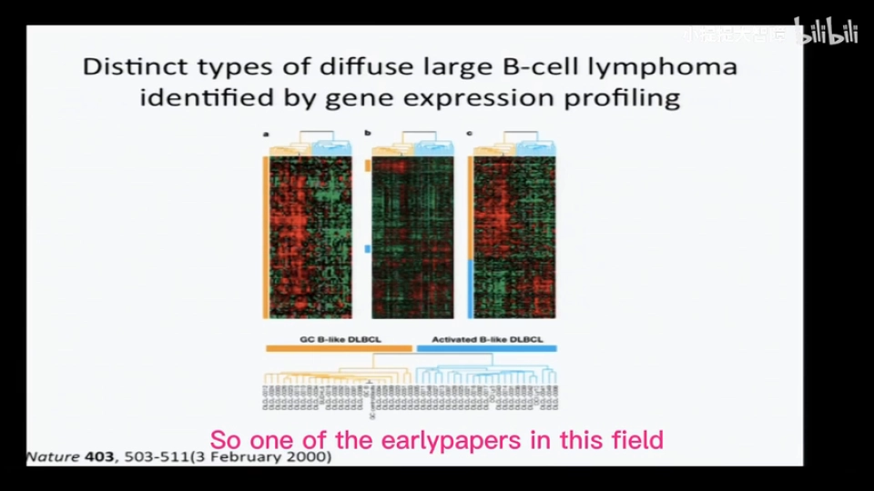

这件事当年很令人兴奋，因为它说明**纯分子特征至少和病理学判读一样好**，也许能自动化肿瘤分型。更进一步的想法是：不止复述病理学家已经知道的东西，而是**预测结局**——用表达特征把病人分成高/低风险组，甚至在临床判定为「低风险」的病人里挑出实际高风险的那部分。

---

## 二、相关不等于因果：一个让人不安的反例

到这里，故事出现了转折。视频问了一个问题：**基因签名真的揭示了疾病的机制吗？**

答案是：不一定。研究者做了一个「拆台」实验：从基因组里**随机**抽一组基因，按病人这组基因的表达高低把病人分成两组，然后画生存曲线——结果同样得到统计学显著的差异，同样有不错的风险比。

更夸张的版本：用与乳腺癌毫无关系的基因集（比如与小鼠「社交挫败」相关的基因的同源物），一样能「预测」乳腺癌结局。

[【跳转到 47:35】](https://www.bilibili.com/video/BV1od4y1e7UZ/?t=2855)

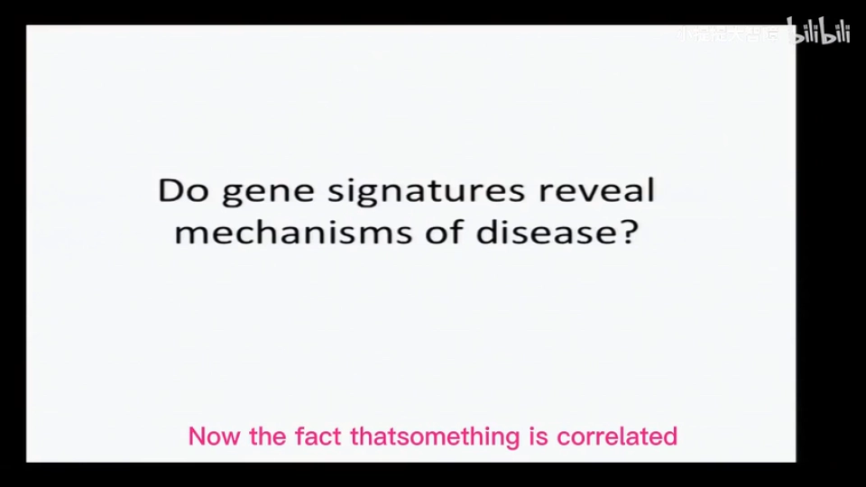

为什么会这样？视频给出了机制层面的解释：**基因不是相互独立的随机变量**。基因组里有很大一部分基因是共表达的——其中一个典型是 **PCNA**，病理学家早就知道它在侵袭性更强的肿瘤里水平更高。于是，你随机抽的一组基因，很可能与 PCNA 所在的共表达模块高度相关；而「这组随机基因高表达」的病人，往往就是「PCNA 高表达」的病人，也就是预后更差的那批人。

[【跳转到 52:28】](https://www.bilibili.com/video/BV1od4y1e7UZ/?t=3148)

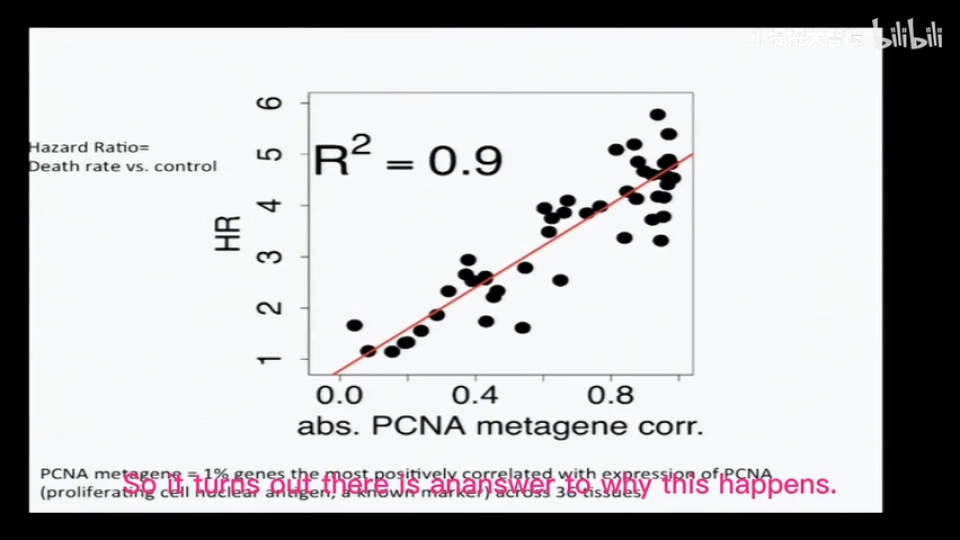

这张图的横轴是「基因集与 PCNA 模块的相关性」，纵轴是「该基因集分组得到的风险比」，两者几乎落在一条直线上（$R^2 = 0.9$）。结论很清楚：**只要你的基因集与这个共表达模块沾边，就能得到好看的风险比**，与它是否真的参与疾病机制无关。

视频由此给出两条实践忠告：

1. **不要因为一组基因与结局相关，就成立一家制药公司**——很多预后标志物与机制毫无因果关系；
2. 更危险的是，这种相关性可能只在特定病人队列里成立，换一批病人就会崩掉。判断一个基因集到底有多有效，需要一个**客观的基准**，而不是「我挑的这批病人里它很显著」。

这个反例也为本讲后半部分定下基调：既然共表达这么容易误导人，那么从表达数据推断调控网络时，就必须**引入更多类型的约束**（先验结构、扰动数据、非线性度量），而不能只看相关系数。

---

## 三、把网络写成概率模型：贝叶斯网络

视频先在一个「非调控」的场景里讲贝叶斯网络，再把它迁移到调控网络——这个顺序很值得注意，因为两者的数学形式是同一套。

### 3.1 节点、边与条件概率表

贝叶斯网络是一种**概率推理工具**：它由一个有向无环图（节点=变量，边=依赖关系）和一组**条件概率表**（每条边上的概率）组成。网络结构可以从数据里学，也可以先验地强加；条件概率表同样可以从数据里估计。

在蛋白—蛋白相互作用（PPI）的例子里，节点分两类：

- **隐藏节点**：我们真正想知道但不知道答案的变量，比如「蛋白 A 和 B 是否真的相互作用」；
- **观测节点**：我们能测到的证据，比如「这对蛋白在酵母双杂交里被检测到」「在亲和力捕获质谱里被检测到」「两个基因的表达是否相似」「两个基因是否都是必需基因」。

推理的方向是**从观测反推隐藏原因**：给定一堆质量参差不齐的实验证据，算出「这对蛋白真的相互作用」的概率。

[【跳转到 05:20】](https://www.bilibili.com/video/BV1od4y1e7UZ/?t=320)

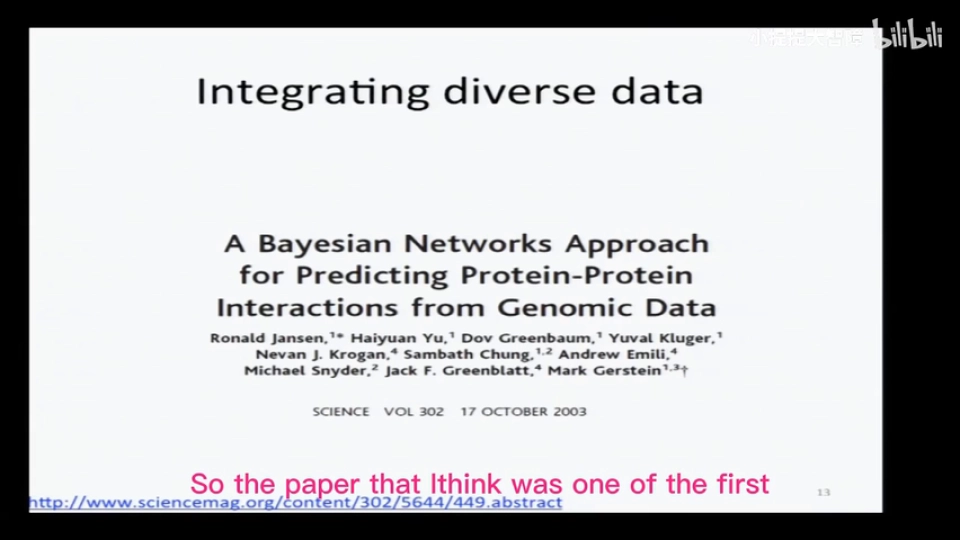

这套框架的价值在于「整合」：单个证据都很弱，合起来却可能很有信息量。视频给了一个具体数字——两个基因是否都是必需基因，作为一个预测因子很弱（似然比只有 4 左右）；但**如果两个基因的表达高度相关，它们相互作用的几率比不相互作用高出一百倍以上**。

[【跳转到 03:54】](https://www.bilibili.com/video/BV1od4y1e7UZ/?t=234)

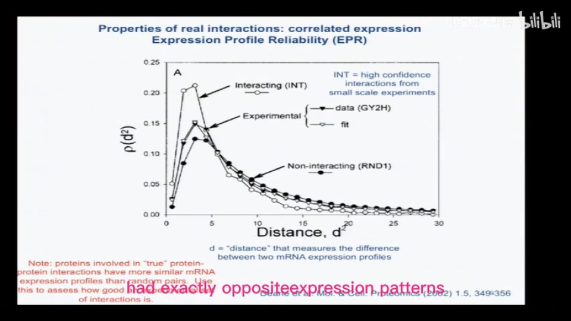

注意这张图的另一半信息：**两类分布是重叠的**。所以你无法画一条「表达相似度」的截止线，说「比这条线更相似的一定互作」。这正是需要概率框架、而不是硬阈值的原因。

### 3.2 迁移到调控网络：判断一条通路是否被激活

把同样的思路搬到调控上，问题就变成：**给定基因表达数据，某条通路的转录因子是否处于激活状态？**

以 p53 为例。p53 是一个转录激活因子，它被激活时应该打开一批靶基因。所以最朴素的做法是：看它的靶基因表达有没有整体升高。但视频立刻指出这个方法的问题：**可能有其他转录调控因子在调控相似的基因集**，靶基因升高并不保证是 p53 干的。

[【跳转到 58:09】](https://www.bilibili.com/video/BV1od4y1e7UZ/?t=3489)

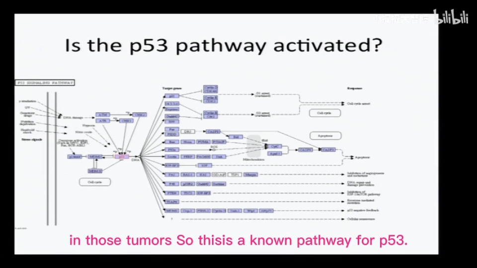

更细一点的做法是往上追：如果通路里激活 p53 的激酶表达升高了，也许 p53 是活跃的。但视频强调，这仍然只是推断——**激酶表达升高不等于它被磷酸化并激活了 p53**。如果只有基因表达数据（没有蛋白质组数据），能用的信号就这些，而且「基因表达的变化与蛋白质水平的变化并不唯一相关」。

贝叶斯网络在这里的作用，是给这些弱证据一个统一的推理框架。它有一个特别有用的性质叫**explaining away（解释掉）**：如果我已经看到转录因子 A 的靶基因全部上调，那么「转录因子 B 也负责这组基因」的概率就会自动下降。视频用经典的「草地湿了」例子说明这一点——看到草地湿，你会推断下过雨，同时降低「洒水器开着」的概率，尽管两者之间并没有因果关系。

贝叶斯网络还允许多层结构（一个转录因子打开另一个转录因子，一层套一层），但有一个**根本限制：不能有环**。你不能让底层的转录因子回头激活顶层的因子。

### 3.3 贝叶斯网络的两个硬约束

视频明确点出了两个约束，它们决定了这类方法的适用边界：

**（1）结构（方向）不能只从观测数据学出来。** 如果只有两个高度相关的变量 $x$ 和 $y$，数据本身无法告诉你「$x$ 激活 $y$」还是「$y$ 激活 $x$」。要定方向，你必须**扰动系统**：抑制 $x$，看 $y$ 有没有变化；再抑制 $y$，看 $x$ 有没有变化。视频的结论很直接：**想从数据里学出有向网络，你需要的不只是表达数据，你需要扰动实验**。

**（2）模型通常不包含所有基因。** 为了紧凑，网络里往往省略一些节点。如果真实的因果链是 $x \to y \to z$，而模型里没有 $y$，你仍然可能学到 $x$ 与 $z$ 之间的边，但这条边上的「效应」会变弱、解释也会变模糊。

---

## 四、四类推断方法：假设、公式与软肋

讲完贝叶斯网络，视频把当时主流的 GRN 推断方法分成几大类：**基于回归的、贝叶斯网络、互信息与相关**。下面按这个顺序展开。

### 4.1 回归：把「靶基因表达」写成调控因子的函数

核心假设只有一句话：**一个基因的表达水平，是调控它的那些转录因子表达水平的某个函数**。

$$
Y_g = f_g\left(X_{T_g}\right) + \varepsilon
$$

其中 $Y_g$ 是基因 $g$ 的预测表达，$X_{T_g} = \{X_t : t \in T_g\}$ 是可能调控 $g$ 的那组转录因子的实测表达，$f_g$ 是任意函数，$\varepsilon$ 是噪声。注意这里的「噪声」不是修辞——我们观测到的表达量本来就不是「真实表达量」的精确读数。

最常见的具体形式是线性：

$$
Y_g = \sum_{t \in T_g} \beta_t X_t + \varepsilon
$$

系数 $\beta_t$ 表示「转录因子 $t$ 对基因 $g$ 的影响有多大」。算法的任务就是**学出这些 $\beta$**：如果某个 $\beta_t$ 被学成 0，就意味着这个转录因子对该基因没有影响；值越大影响越大。优化的目标函数是标准的残差平方和最小化——预测值与观测值之差的平方和最小。

[【跳转到 65:52】](https://www.bilibili.com/video/BV1od4y1e7UZ/?t=3952)

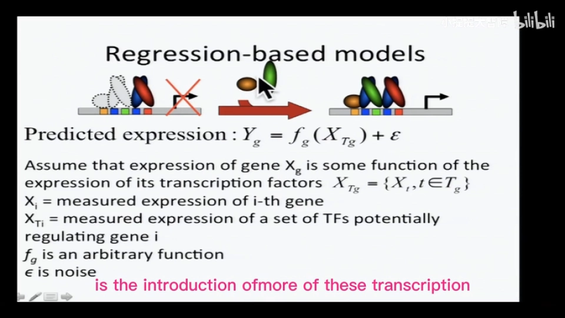

问题出在「学出来的 $\beta$ 好不好用」：真实数据里往往得到一堆**很小但不为零**的系数，意味着算法没有给出「是/不是调控因子」的干脆答案；更糟的是这些系数**不稳定**——训练数据稍微一变，系数就大幅波动。视频提到围绕这个问题有一整个领域（正则化、稀疏化），思路是限制非零系数的数量以换取更可靠的预测，代价是会漏掉那些「确实有很小影响」的转录因子。

### 4.2 互信息：抓线性相关抓不到的关系

第三类方法基于**信息论**。先定义熵——观察一个变量时的不确定性；再定义两个变量之间的**互信息**：

$$
I(A;B) = H(A) + H(B) - H(A,B)
$$

高互信息意味着「知道 A 的取值，会大幅降低我对 B 的不确定性」。关键在于：**互信息能捕捉非线性关系，而相关系数不能**。

视频给了一个漂亮的例子：**非相干前馈回路**（incoherent feed-forward loop）。调控因子 A 直接激活 B，同时也直接激活 C，而 C 抑制 B。结果是 B 的水平随 A 先升后降，形成一条「钟形」曲线：

$$
\text{互信息} = 1.73, \qquad \text{相关系数} = -0.046
$$

[【跳转到 71:02】](https://www.bilibili.com/video/BV1od4y1e7UZ/?t=4262)

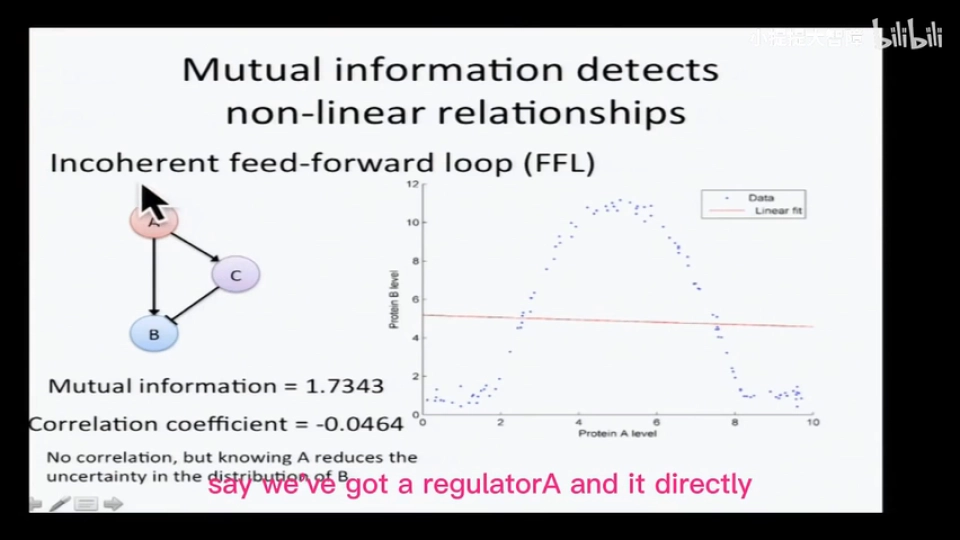

相关系数几乎为零，但两个变量明显不是独立的——这正是只看线性相关会漏掉的调控关系。**注意这个例子的意义**：它同时说明了为什么网络里会出现「前馈回路」这类结构，以及为什么用相关做网络推断会系统性地漏掉它们。

### 4.3 ARACNE：先定阈值，再剪掉间接边

用互信息推断网络，第一个问题是：**多大的互信息算「显著」**？视频给的做法是**随机化定标**：把表达数据打乱（shuffle），打乱后的基因对之间不应该有任何真实关系，用它们算出的互信息分布作为零假设；再看真实数据里的互信息是否显著大于随机水平。

第二个问题更麻烦：**间接效应也会产生高互信息**。假设 G2 是调控因子，同时调控 G1 和 G3。那么 G1 与 G2、G3 与 G2 之间都有高互信息，而 G1 与 G3 之间因为「同受一个父母调控」也会表现出高互信息。只看互信息，你分不清谁是调控者、谁是共同靶标。

ARACNE 的解法是**数据处理不等式**（data processing inequality）：在 $G_2 \to G_1$、$G_2 \to G_3$ 这样的三角形里，两个下游节点之间的互信息不可能超过上游与任一节点之间互信息的最小值。

$$
I(g_1, g_3) \le \min\left[\, I(g_1, g_2),\; I(g_2, g_3) \,\right]
$$

因此，**在每个三元组里删掉互信息最小的那条边**，间接关系就被剪掉了。

[【跳转到 72:43】](https://www.bilibili.com/video/BV1od4y1e7UZ/?t=4363)

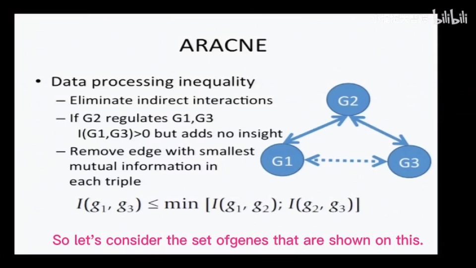

### 4.4 MINDy：把「调制器」显式写进模型

ARACNE 之后，视频介绍了 MINDy——它的出发点是：**除了转录因子，还有另一类蛋白在开关转录因子**（比如磷酸化修饰、或形成复合物）。

模型写成：

$$
[T] = C \cdot [TF]^{k} \cdot [M]^{r}
$$

即靶基因 T 的表达由转录因子 TF 与调制器 M 共同决定。怎么识别调制器？把数据按 M 的水平分成两组：M 处于最低水平时，TF 与 T 之间没有关系；M 处于高水平时，T 对 TF 呈线性响应——**这就说明 M 是激活剂**。反过来若只有 M 低时才有关系，则 M 是抑制剂。如果两组里 TF 与 T 的关系都强、或都弱，那 M 看起来什么也没做。

[【跳转到 73:58】](https://www.bilibili.com/video/BV1od4y1e7UZ/?t=4438)

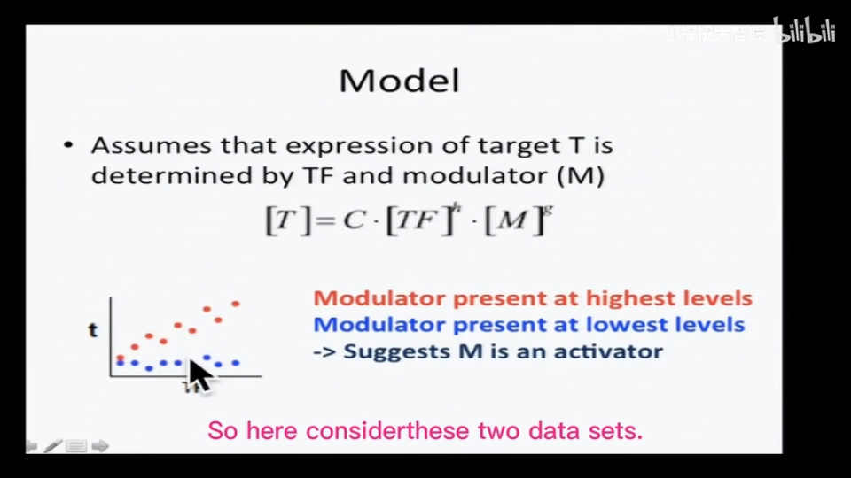

视频也点出了这个模型的一个不自然假设：它假定**不管转录因子多高，靶基因的表达总是随之增加，没有饱和**。真实系统里饱和是常态。

---

## 五、这些方法的共同局限

在进入方法比较之前，视频先给了一份「丑话」清单，这些局限对四类方法都成立：

1. **信号必须真的出现在表达数据里**。像 p53 这样的蛋白，很多情况下是被磷酸化激活的，转录因子本身的表达量并不变化。如果数据里转录因子没有变化，MINDy 这类方法就得不到任何正确信号。
2. **调制器不能与靶基因因为其他原因强相关**。如果 M 出于别的生物学原因总是和目标一起打开，你就永远无法用「按 M 分层」的方式把数据切开。
3. **网络大到你无法解释**。视频给的例子是 ARACNE 在包含微小 RNA 调制器的互信息网络里得到约 **25 万条相互作用**；平均下来，**每个基因有 10%~20% 的候选转录因子与调制器被判定为在调控它**。讲者的评价是：这个比例看起来太高了。

第 3 点其实是整堂课最尖锐的自我批评：一个「每个基因被一两成转录因子调控」的网络，既不符合已知的生物学家共识，也无法用来做具体假设。这也正是下一步要做的——把不同方法放到**同一批数据**上做盲测比较。

---

## 六、怎么公平地比较这些方法：DREAM 挑战的设计

视频最后介绍了 **DREAM5 基因网络推断挑战**的组织方式，它解决的是「我怎么知道我的方法真的好」这个问题：

1. **目标网络**：四个数据集——三个来自真实生物（大肠杆菌、酿酒酵母、金黄色葡萄球菌），一个是完全**计算机模拟生成**的合成网络（in silico，195 个调控因子、1643 个基因）。
2. **微阵列数据集**：真实数据集来自实验（基因敲除、抗生素、毒素等扰动条件），合成数据集来自模拟；**数据在发给参赛者前做了匿名化**（anonymize），参赛者不知道哪份是合成的、哪份是真实的。
3. **推断网络**：各团队用自己的方法从表达数据推断网络。
4. **共识**：组织者把各团队的预测整合成元预测（meta-prediction）。
5. **评估**：用已知的「真值」打分——合成数据集用真实模拟网络，真实数据集用实验测定的相互作用与 ChIP motif 等证据。金黄色葡萄球菌的数据**不参与评分**，留作外部检验。

[【跳转到 56:06】](https://www.bilibili.com/video/BV1od4y1e7UZ/?t=3366)

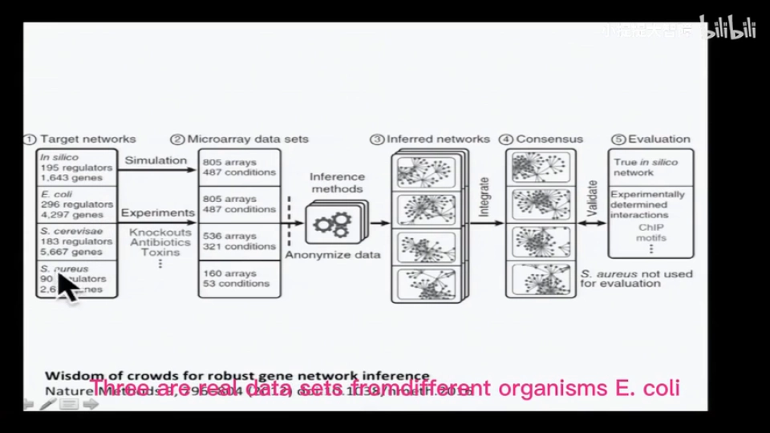

这个设计的关键在**匿名化 + 合成数据**：如果参赛者知道哪份是模拟数据，就可以针对模拟器的特性调参；匿名化之后，方法必须在「不知道数据来源」的情况下表现好，这才是可迁移的能力。视频在这里停住，把各方法的正面对决留到下一讲——所以本讲给出的只是「方法有哪些、各自假设是什么」，还没有「谁更好」的结论。

---

## 小结

- **起点是表达数据**：蛋白与互作数据的规模远小于表达数据，所以调控网络推断长期只能从「基因 × 条件」的表达矩阵出发。
- **相似性有两种定义**：欧氏距离比绝对水平，皮尔逊相关比形状（Z 分数）。选哪个取决于你问的问题，二者会给出不同的「最相似基因」。
- **聚类把基因压成模块**，但每种做法都自带不确定性：层次聚类总会给你一棵树、且不告诉你切几类；k-means 需要你指定 $k$、受初始化与离群点影响；模糊 k-means 用隶属度处理边界点；k-medoids 在没有「平均值」时用真实样本点当中心。
- **共表达强到会骗人**：随机基因集也能显著预测乳腺癌预后，因为基因组里存在 PCNA 这样的大共表达模块；风险比与该模块的相关性高达 $R^2 = 0.9$。相关不等于因果，预后标志物不等于机制。
- **贝叶斯网络**用有向无环图 + 条件概率表整合多源弱证据，并支持 explaining away；但方向无法只从观测数据学出（需要扰动），且不能有环。
- **回归**把靶基因表达写成转录因子表达的线性函数，学 $\beta$ 判断调控强度；问题是 $\beta$ 又小又不稳定，需要稀疏化，代价是漏掉弱效应。
- **互信息**能捕捉相关抓不到的非线性（非相干前馈回路：互信息 1.73、相关系数 −0.046）；ARACNE 用随机化定阈值、用数据处理不等式剪掉间接边；MINDy 进一步把调制器显式写进模型，但假设了「无饱和」。
- **共同局限**：信号必须存在于表达数据、调制器不能与靶基因因其他原因强相关、网络规模大到难以解释（每基因 10%~20% 候选调控因子被判定为在调控它）。
- **公平比较需要盲测**：DREAM5 用匿名化的真实数据 + 合成数据、统一的评估真值来比较各方法；本讲只讲了设计，比较结果在下一讲。

## 关键术语速查

| 术语 | 一句话解释 |
| --- | --- |
| 基因表达向量 | 一个基因在所有实验条件下的表达值组成的高维向量 |
| 欧氏距离 | 各条件表达值之差平方和再开方，比较绝对水平差异 |
| 皮尔逊相关 | 先转 Z 分数再求乘积平均，比较表达曲线的形状 |
| 层次聚类 | 反复合并最相似的两类，输出树状图，可在任意高度切分 |
| 单链接 / 完全链接 | 用两类成员间的最小距离 / 最大距离定义类间距离 |
| k-means | 指定类数，交替执行「分配点」与「重算质心」直到收敛 |
| 模糊 k-means | 用 0 到 1 的隶属度替代硬分配，处理边界点 |
| k-medoids | 用最靠近中心的真实样本点代替质心，适用于算不出平均值的数据 |
| 共表达模块 | 一组在多种条件下表达同步变化的基因，常被当作功能模块的近似 |
| 贝叶斯网络 | 有向无环图 + 条件概率表，用于从观测证据反推隐藏变量 |
| 条件概率表 | 贝叶斯网络中每条边上的概率表，描述父节点取值下子节点的分布 |
| explaining away | 一个原因被证据支持后，其他竞争原因的概率自动下降 |
| 互信息 | 知道一个变量后另一个变量不确定性减少的量，可捕捉非线性关系 |
| 数据处理不等式 | 串联关系中间节点的互信息不小于两端，用于剪掉间接边 |
| ARACNE | 基于互信息与数据处理不等式的网络推断算法 |
| MINDy | 把调制器显式写进模型的推断方法，靶基因表达由 TF 与调制器共同决定 |
| 非相干前馈回路 | A 激活 B、A 激活 C、C 抑制 B 的三节点结构，产生钟形响应 |
| DREAM5 | 基因网络推断的盲测挑战，用匿名真实数据与合成数据统一评估方法 |