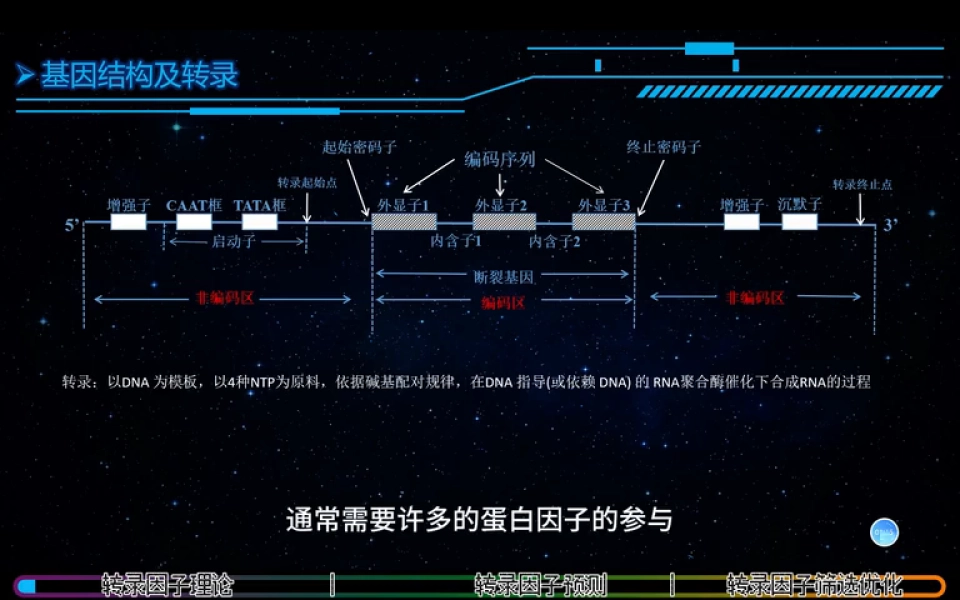
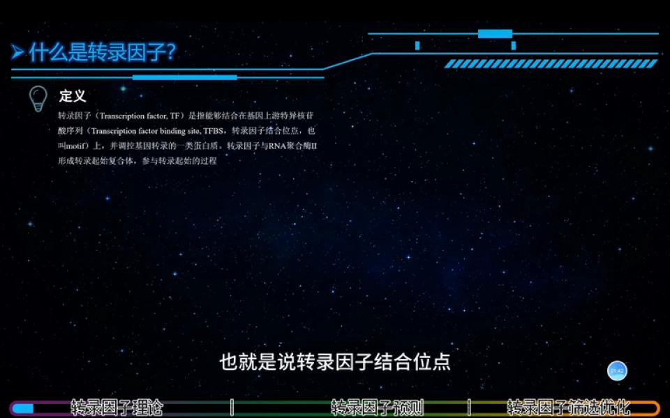
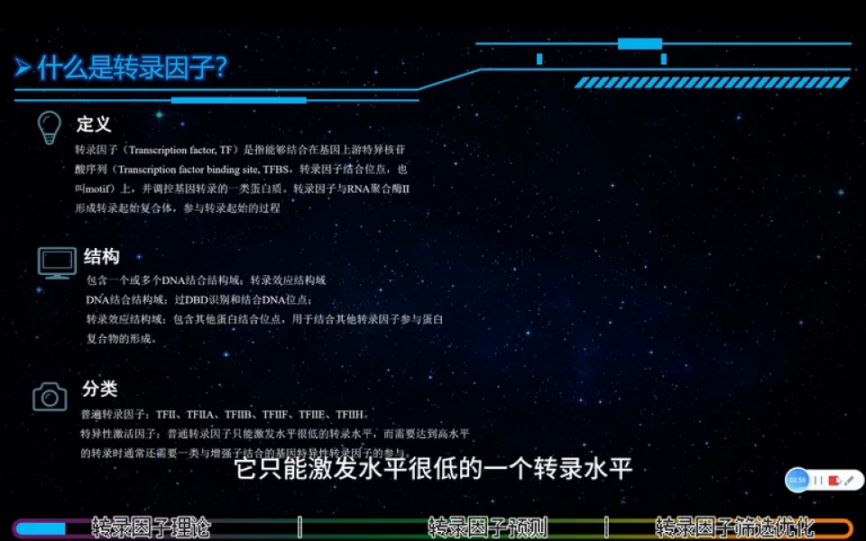
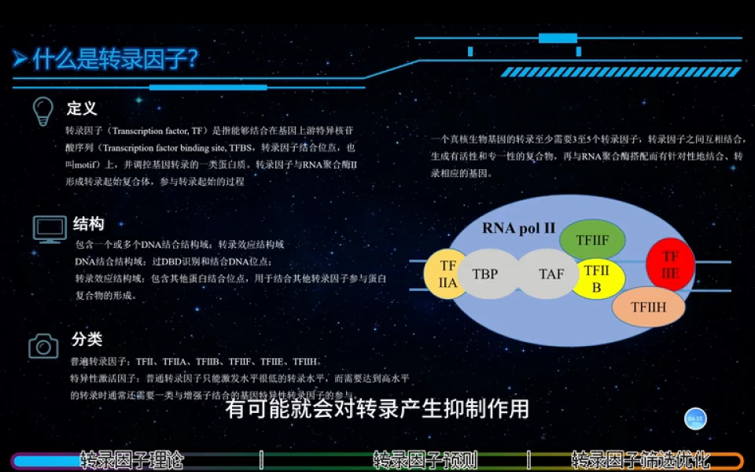
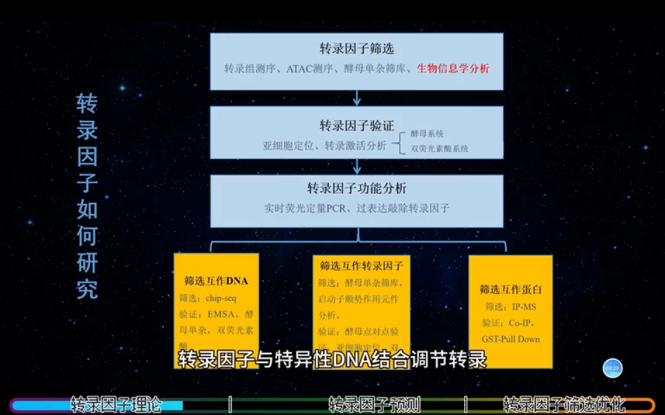
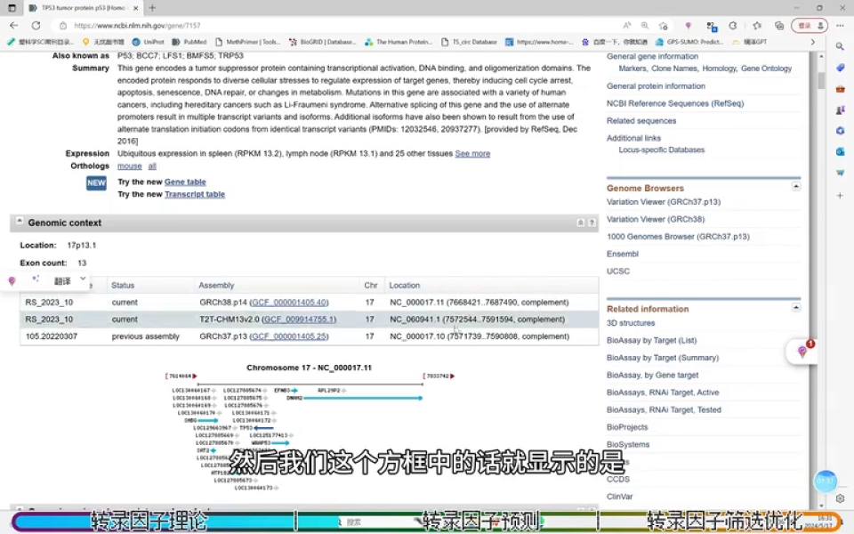
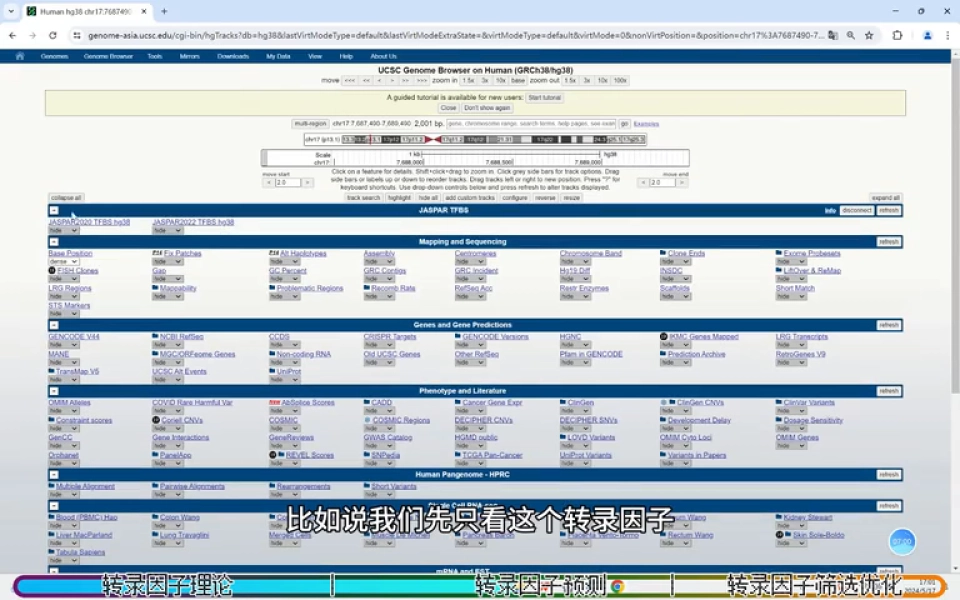
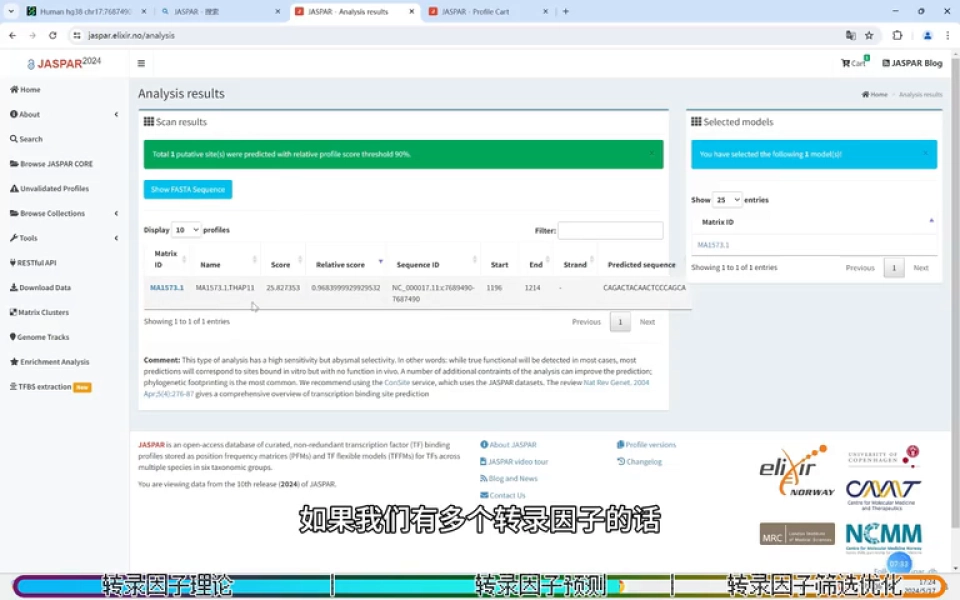
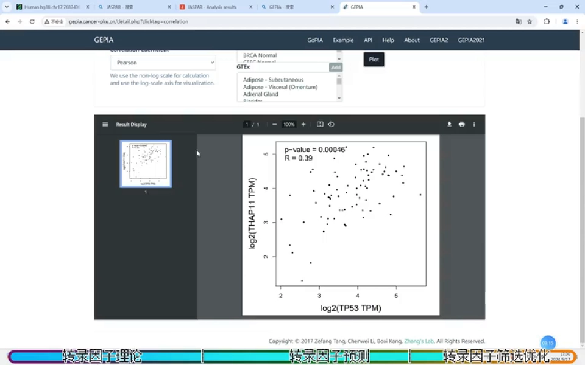
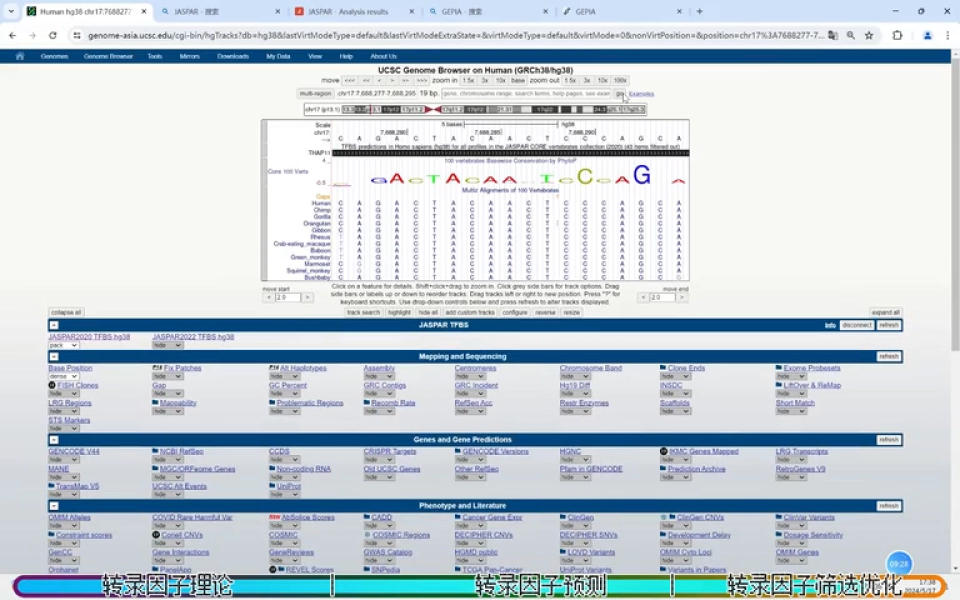

# 转录因子如何识别 DNA：从结构域到 motif 预测

> 视频来源：[UP主爆肝输出：认识转录因子、预测转录因子、优化筛选转录因子！（含操作演示）](https://www.bilibili.com/video/BV1GT421v7yS/)（Bilibili · 噗啦噗啦实验室，约 32 分钟）
> 导读（100 字以内）：这支视频把「转录因子是什么」讲成一条可执行的流水线：先讲 DBD 与转录效应结构域，再用 NCBI + UCSC + JASPAR 演示如何从一段启动子序列扫出候选 motif，最后用表达相关性、序列保守性、组蛋白修饰三重过滤把候选收敛到几个。本文按「分子结构 → 研究动因 → 预测流程 → 筛选」重排，操作细节与判据都保留。

## 本讲要解决的核心问题（SCQA）

**背景**：转录是中心法则里信息从 DNA 流向 RNA 的那一步，需要 RNA 聚合酶，也需要一大批蛋白因子参与。其中一类叫**转录因子**（transcription factor，TF）的蛋白，决定了「哪个基因在什么时候被打开」。

**冲突**：知道转录因子重要，和真的找到一个基因的转录因子，是两件完全不同的事。一个基因的启动子上可能同时存在几十上百个转录因子的结合位点；实验上做 ChIP-seq、酵母单杂都要花几个月，而生物信息学预测的结果往往「一屏拉不到底」，全是候选、没有一个能直接拿去做实验。

**疑问**：转录因子到底靠什么识别 DNA 上的特定位置？如果手上只有一个感兴趣的基因、一段启动子序列，怎样才能系统地列出可能的转录因子，并且把候选从几十个压缩到几个值得做实验验证的？

**回答（中心思想）**：转录因子是**「两段式」的蛋白**——DNA 结合结构域（DBD）负责认地址，转录效应结构域负责招募其他蛋白干活；它认的「地址」就是 motif。因此转录因子预测可以被拆成一道**序列打分题**：拿启动子序列去比对已知 motif 的矩阵，得分超过阈值就记为候选；再用**表达相关性、结合位点保守性、组蛋白修饰峰值**三重过滤，把「序列上说得通」的候选收敛成「生物学上说得通」的少数几个。这条流水线的每一步都能用公开数据库完成。

---

## 一、转录因子是两段式的蛋白：一段认地址，一段干活

### 1.1 定义：结合特异序列、并调控转录的一类蛋白

视频先回顾了转录的分子定义：以 DNA 为模板、以四种 NTP 为原料、按碱基互补配对原则、在 DNA 依赖的 RNA 聚合酶催化下合成 RNA。这个过程「非常复杂，通常需要许多蛋白因子的参与」，包括 RNA 聚合酶本身，也包括转录因子。

转录因子的定义是：**能够结合在基因上游特异核苷酸序列上、并调控基因转录的一类蛋白质**。那个「特异核苷酸序列」叫转录因子结合位点（transcription factor binding site，**TFBS**），也叫 **motif**。转录因子与 RNA 聚合酶 II 一起形成转录起始复合体，参与转录起始的过程。

[【跳转到 01:11】](https://www.bilibili.com/video/BV1GT421v7yS/?t=71)

### 1.2 两个结构域：DBD 认序列，效应结构域找伙伴

转录因子一般**至少包含两种结构域**：

- **DNA 结合结构域**（DNA binding domain，**DBD**）：一个或多个，通过 DBD 识别并结合 DNA 上的特定位点。这是「认地址」的部分。
- **转录效应结构域**：包含其他蛋白的结合位点，用来结合参与转录的其他蛋白，形成转录复合物。这是「干活」的部分——它本身不认 DNA，但决定了结合之后是招募 RNA 聚合酶还是招募抑制因子。

[【跳转到 01:36】](https://www.bilibili.com/video/BV1GT421v7yS/?t=96)

这个「两段式」设计解释了一件事：**同一个 DBD 可以搭配不同的效应结构域**，于是识别同一段 DNA 的不同转录因子，可能一个激活、一个抑制。

### 1.3 通用转录因子与特异性激活因子：为什么只过表达一个往往没效果

按功能，转录因子可以分成两类：

- **普通（通用）转录因子**：TFIIA、TFIIB、TFIID、TFIIE、TFIIF、TFIIH 等，是 RNA 聚合酶 II 起始转录的通用组件。
- **特异性激活因子**：能与增强子结合、决定「哪个基因被高效转录」的因子。

视频给了一个很实用的经验数字：**一个真核生物基因的转录通常需要 3~5 个转录因子**。这直接解释了很多人在双荧光素酶报告基因实验里遇到的困惑——只过表达一个转录因子，启动子活性变化不明显。原因可能是：

1. 你选的这个因子是通用转录因子，它只能激发一个很低的转录水平；
2. 要达到高水平的转录，还需要与增强子结合的特异性转录因子的参与。

[【跳转到 02:26】](https://www.bilibili.com/video/BV1GT421v7yS/?t=146)

### 1.4 三条容易踩坑的经验规则

视频明确列了三条关于转录因子行为的经验规则，它们后面会直接决定预测结果的解读方式：

1. **一个转录因子可以结合多个 motif，结合在不同 motif 上往往执行不同功能**。结合到某个位点时它可能激活转录，结合到另一个位点时可能产生抑制。
2. **理论上转录因子可以结合在基因的任何区域**，只要那里存在它的识别位点；但**通常只有结合在启动子区才有生物学意义**。这也是后面预测流程从启动子序列入手的原因。
3. **转录因子通常不独立发挥作用**，而是与其他转录辅因子形成复合物，再执行调控功能。

[【跳转到 03:21】](https://www.bilibili.com/video/BV1GT421v7yS/?t=201)

---

## 二、为什么要研究转录因子：从下游走向上游

视频用一个很朴素的科研路径解释了这个动机：一个课题最开始往往研究某个基因的序列信息和它发挥的功能，这属于**基因的下游研究**；下游积累到一定程度后，大家开始追问**上游调控机制**——不只看这个基因如何影响细胞活动，而是看**哪些因素在影响这个基因**。

上游调控涉及很多层面：转录因子、蛋白激酶、microRNA、DNA 甲基化、组蛋白修饰、lncRNA 等等。其中转录因子成为热门，原因有两个：

- **一个转录因子能同时控制多个基因的表达**（一对多，杠杆效应大）；
- **一个转录因子的功能又受多个共同作用因子影响**（多对一，可被精细调节）。

正因为这种「多对多」的结构，阐明转录调控机制本质上就是在阐明一张**网络**；理解这张网络，才可能解释疾病的发病机理，并据此设计靶向药物。

[【跳转到 04:49】](https://www.bilibili.com/video/BV1GT421v7yS/?t=289)

### 2.1 研究一个转录因子的四步路线图

视频用一张流程图把「转录因子如何研究」串了起来，这也是本文后半部分的地图：

1. **转录因子筛选**：转录组测序、ATAC 测序、酵母单杂筛库、生物信息学分析；
2. **转录因子验证**：亚细胞定位、转录激活分析（酵母系统 / 双荧光素酶系统）；
3. **转录因子功能分析**：实时荧光定量 PCR、过表达与敲除/敲低；
4. **机制解析**：筛选互作 DNA（ChIP-seq 筛选、EMSA/酵母单杂/双荧光素酶验证）与筛选互作蛋白（IP-MS、Co-IP、GST-Pull Down）。

[【跳转到 08:51】](https://www.bilibili.com/video/BV1GT421v7yS/?t=531)

其中第 1 步的「生物信息学分析」正是本讲操作演示的部分；第 2 步之所以要先做**亚细胞定位**，是因为转录因子必须在细胞核内才能对基因组发挥作用——很多转录因子平时滞留在细胞质，只有在特定刺激下才入核。如果筛到的蛋白在目的样本里根本没有核内表达，它就不具备发挥转录调控的前提条件。

---

## 三、预测一个基因的转录因子：从启动子序列到 motif 打分

这一部分是整支视频的操作核心，用到的数据库有三个：**NCBI**（取序列）、**UCSC Genome Browser**（看基因组位置与注释轨道）、**JASPAR**（motif 矩阵库）。视频以人类 **TP53** 基因为例。

### 3.1 第一步：拿到启动子序列，注意转录方向

在 NCBI 的 Gene 库中检索 TP53，进入 Genomic context，可以看到：

- 基因定位在 **17 号染色体**（17p13.1），外显子数目 13 个；
- 具体坐标区间（以 GRCh38 为例）；
- 下方的小图会标出该基因的**转录方向**——TP53 的箭头是从右往左，与 17 号染色体上多数基因的方向相反。

[【跳转到 12:47】](https://www.bilibili.com/video/BV1GT421v7yS/?t=767)

转录方向为什么重要？因为**启动子在基因起始位点的上游**。视频给出的经验值是「启动子序列一般在基因起始位点上游 2000 bp 左右」。如果基因在反向链上，那么「上游」在基因组坐标上是**坐标值增大**的方向，而不是减小。取错方向，后面所有 motif 的位置都会错。

在 UCSC 中把显示区间改成启动子区间（视频里是 `chr17:7687490-7689490`，即从 TP53 起始位点向上游取 2000 bp），就能拿到启动子序列，连同注释信息一起复制备用。

### 3.2 第二步：把 JASPAR 挂到 UCSC 上，先看「这一段有没有位点」

JASPAR 本身不能直接在基因组上定位，它提供的是 motif 的矩阵（PWM）；UCSC 提供的是基因组坐标与轨道系统。所以视频的做法是：在 UCSC 的 track hubs 里连接 JASPAR 的 TFBS 轨道，然后在人类参考基因组 GRCh38 中输入启动子的坐标区间。

结果是一屏密密麻麻的预测结合位点。视频在这里强调了两点：

1. 坐标输入里的冒号必须是**英文字符**，否则识别不了；
2. 默认结果「非常非常的多」，必须做阈值筛选。

[【跳转到 17:16】](https://www.bilibili.com/video/BV1GT421v7yS/?t=1036)

### 3.3 第三步：用打分阈值把候选压下来

UCSC 的 TFBS 预测页面提供分数阈值。视频给出的经验判据是：

- 一般认为**分数大于 200** 才有统计学意义；
- 实际操作中常把阈值设到 **600 以上**：**分数越高，筛到的转录因子数量越少，结果也越可靠**。

把阈值调高之后，TP53 启动子上的候选从「一屏」压缩到了 3 个：CTCF、THAP11、ZNF460。

### 3.4 第四步：用 JASPAR Scan 看具体位点与序列

拿到候选名字后，回到 JASPAR，把转录因子加入「购物车」，再把启动子序列粘贴进 Scan 面板，把相对得分阈值设为 90%，运行后得到一张结果表。这张表的每一列都有明确含义：

- **Matrix ID / 转录因子名**：命中的 motif 模型；
- **Score**：矩阵打分的绝对得分；
- **Relative score**：相对得分（把绝对得分归一化到该矩阵可能取值的范围），视频用的阈值就是它；
- **Sequence ID**：你输入的启动子序列标识；
- **Start / End / Strand**：结合位点在序列上的起止位置与链方向；
- **Predicted sequence**：预测出来的具体结合序列。

[【跳转到 20:21】](https://www.bilibili.com/video/BV1GT421v7yS/?t=1221)

这一步的产出是可以直接拿去做实验设计的：**有了预测的结合序列和坐标，就能设计 EMSA 探针、ChIP-qPCR 引物或截短启动子的报告基因载体**。

如果同时扫描多个转录因子，一个转录因子往往会命中多个位点。这时判断可靠性的两个经验指标是：**预测得分越高越可靠**，**命中位点数量越多越可靠**。

---

## 四、从几十个候选收敛到几个：三重过滤

序列打分只能告诉你「这段 DNA 长得像不像某个转录因子的位点」，它无法回答「这个转录因子在这个细胞里到底有没有在管这个基因」。视频因此给出三重过滤，逐层加上生物学约束。

### 4.1 第一重：基因表达相关性

工具是 **GEPIA**——一个基于 TCGA 与 GTEx 的在线分析平台（视频给出的规模是 9736 个肿瘤组织与 8587 个正常组织的 RNA 测序结果），提供基因表达分析、相关性分析、生存分析、相似基因预测与降维分析。

在「多基因分析 → 相关性分析」里输入靶基因（TP53）与候选转录因子（THAP11），可以得到一张散点图和两个统计量：

- **P 值**：统计学显著性，一般 **P < 0.05** 才算有统计学意义；
- **R 值**：相关系数，**R > 0 表示正相关，R < 0 表示负相关**。

视频给出的联合判据是：**同时满足 P < 0.05 且相关系数绝对值大于 0.5**，才认为两个基因的表达具有相关性。以 TP53 与 THAP11 为例，结果是 P = 0.00046、R = 0.39——显著，但相关性强度没到 0.5，所以在视频的判据下这条证据偏弱。

[【跳转到 24:09】](https://www.bilibili.com/video/BV1GT421v7yS/?t=1449)

这一步的逻辑是：**转录因子要调控一个基因，它自己通常要在相应的样本里表达，并且表达模式与靶基因相称**。把所有候选都放进 GEPIA 做一遍，取相关性最强的那几个进入后续实验，是最省事的收敛方式。

### 4.2 第二重：结合位点的序列保守性

保守性的定义是：**在进化中高度保持不变的序列**。具有功能的基因或序列在不同物种间保守性更高，因此**序列越保守，越可能具有重要的生物学功能**。

操作上仍在 UCSC：打开 Comparative Genomics 下的 Conservation 轨道，在配置里取消全选、只勾选要比较的物种（视频强调物种选择没有既定规则，理论上位点在越多物种中保守越好），然后把 JASPAR 得到的结合位点坐标输进去。

读图规则：

- **黑色竖线 / 深蓝色**：物种间碱基一致；
- **亮黄色**：该物种在此处有差异；
- **亮红色**：测序时没有获得该段序列，因此不能肯定是否一致。

[【跳转到 27:24】](https://www.bilibili.com/video/BV1GT421v7yS/?t=1644)

视频在比对时还提醒了一个细节：**要注意链方向**。TP53 在反向链上，而 THAP11 的转录方向是正向的，输入坐标时方向搞反会导致比对位置错位。

### 4.3 第三重：组蛋白修饰信号

最后一重是看表观遗传证据。在 UCSC 的 Regulation 轨道里打开 ENCODE 的组蛋白修饰数据（视频演示的是 **H3K4me3**，这是活跃启动子的标志性修饰），就能看到该区域在不同细胞类型中的修饰信号。

判据很直接：**优先选择结合位点落在修饰峰值附近的转录因子**。视频的例子里，三个候选中 ZNF460 的位点离峰值最近，因此被选为最值得继续验证的那个。

[【跳转到 30:46】](https://www.bilibili.com/video/BV1GT421v7yS/?t=1846)

---

## 五、这条流水线的边界在哪里

把四步串起来看，这套流程的价值和局限都很清楚。

**价值在于「可执行」**：全部用公开数据库与网页工具完成，不需要写代码、不需要先做实验，就能把一个基因的候选转录因子从「一屏」压缩到「三个」，并给出可以直接用于实验设计的结合序列与坐标。

**局限在于每一层都是间接证据**：

- 序列打分只说明「像」，不说明「结合」——真实染色质上 DNA 是缠绕在核小体上的，可及性本身就是一个门槛；
- 表达相关只说明「同步」，不说明「因果」——两个基因同时被第三个因子驱动时，也会表现出相关性；
- 保守性只说明「重要」，不说明「是这个因子在用这个位点」；
- 组蛋白修饰只说明「这一带是活跃启动子」，不说明具体是哪个因子结合。

所以视频最后强调，这套筛选的产出是**待验证的候选**：真正坐实一个「靶基因—转录因子」关系，仍然要回到 ChIP-seq、EMSA、双荧光素酶这些实验。这也解释了为什么第 2 步的「转录因子验证」在流程图里是独立的一层——预测负责缩小搜索空间，实验负责定性。

---

## 小结

- **转录因子是两段式蛋白**：DBD 负责识别并结合 DNA 上的特异序列（TFBS / motif），转录效应结构域负责招募其他蛋白形成转录复合物。
- **通用转录因子只能撑起低水平转录**，高水平转录需要与增强子结合的特异性因子；一个真核基因的转录通常需要 3~5 个转录因子，这解释了「只过表达一个因子效果不明显」的常见现象。
- **三条经验规则**：一个因子可结合多个 motif 且功能可能不同；理论上可结合任何区域，但通常只有启动子区结合才有生物学意义；转录因子不单独行动，需要辅因子。
- **研究转录因子的动机**是一对多与多对一的杠杆效应：一个因子控制多个基因，一个因子的功能又受多个因子影响，因此调控机制天然是一张网络。
- **预测流程**：NCBI 取启动子序列（注意转录方向与反向链）→ UCSC 挂 JASPAR 轨道定位候选位点 → 用打分阈值（>200 有意义，实操常用 >600）压缩候选 → JASPAR Scan 得到相对得分、位点坐标与预测序列。
- **三重过滤**把「序列上像」变成「生物学上说得通」：表达相关性（P < 0.05 且相关系数绝对值 > 0.5）、结合位点跨物种保守性、组蛋白修饰峰值邻近。
- **所有这些都是间接证据**，最终仍需 ChIP-seq、EMSA、双荧光素酶等实验坐实。

## 关键术语速查

| 术语 | 一句话解释 |
| --- | --- |
| 转录因子（TF） | 结合基因上游特异序列并调控转录的一类蛋白质 |
| TFBS / motif | 转录因子结合位点，即被转录因子识别的那段特异 DNA 序列 |
| DBD（DNA 结合结构域） | 转录因子上负责识别并结合 DNA 位点的结构域 |
| 转录效应结构域 | 转录因子上负责结合其他蛋白、形成转录复合物的结构域 |
| 通用转录因子 | TFIIA/B/D/E/F/H 等，RNA 聚合酶 II 起始转录的通用组件，只能撑起低水平转录 |
| 特异性激活因子 | 与增强子结合、决定基因被高效转录的转录因子 |
| JASPAR | 转录因子 motif 矩阵数据库，提供 PWM 与位点扫描工具 |
| 相对得分（relative score） | 把矩阵绝对得分归一化到该矩阵取值范围后的分数，常用 90% 作为扫描阈值 |
| 保守性 | 序列在进化中保持不变的程度，越保守越可能有功能 |
| H3K4me3 | 活跃启动子上的组蛋白修饰，常用来判断某区域是否为活跃调控区 |
| GEPIA | 基于 TCGA 与 GTEx 的在线表达与相关性分析平台 |
| EMSA | 凝胶迁移实验，用来验证蛋白与特定 DNA 序列是否直接结合 |