# G蛋白偶联受体通路：七次跨膜受体、G蛋白循环与两条第二信使支路

> 视频来源：[细胞信号转导通路（中）：G蛋白耦联受体介导的细胞信号转导通路](https://www.bilibili.com/video/BV1Le4y1n7gy/)（Bilibili · 卡尔拉的洛克白，约 33 分钟）
> 导读（100 字以内）：这支视频把 GPCR 通路拆成"配体 → 受体 → G 蛋白 → 效应器 → 第二信使 → 蛋白激酶 → 效应蛋白"逐环节讲透，再画出 cAMP-PKA、PLC-PKC 两条主通路和一条钙信号支路，并用一张受体-第二信使对照表反推每类配体。本文按这条线索重排。

## 本讲要解决的核心问题（SCQA）

**背景**：细胞外面的信号分子要变成细胞里面的反应，必须先跨过细胞膜这道屏障——前面讲过的膜表面受体，就是负责这道接力的"门"。

**冲突**：G 蛋白偶联受体通路是经典通路里最复杂的一条。配体五花八门，从乙酰胆碱、去甲肾上腺素一直到胰高血糖素；受体、G 蛋白、效应酶、第二信使、蛋白激酶一层套一层，每层还各有亚型与亚类。结果就是：每一步单看都懂，连起来却容易把"哪个配体走哪条通路、产生哪个第二信使、激活哪个蛋白激酶"记混。

**疑问**：这条通路到底由哪几个环节组成？七次跨膜的受体后面挂着的 G 蛋白为什么能当开关？G 蛋白效应器凭什么造出第二信使？为什么同一条大通路要分出几条小通路，又怎么才能不记混它们的配体？

**回答（中心思想）**：把这条通路记成七个环节的接力：**配体 → G 蛋白偶联受体 → G 蛋白 → G 蛋白效应器 → 第二信使 → 蛋白激酶 → 效应蛋白**。关键只有两点。第一，**G 蛋白是一个三聚体开关**：非活化时 α、β、γ 三个亚基绑在一起、α 亚基上挂着 GDP；被活化时 α 亚基丢掉 GDP 改抓 GTP 并与 βγ 分开，α-GTP 与 βγ 复合物各自去激活下游效应器；等 α 亚基的 GTP 酶把 GTP 水解成 GDP，三个亚基又重新聚合成非活化型——这一圈就是"G 蛋白循环"。第二，**效应器决定第二信使**：腺苷酸环化酶（AC）把 ATP 变成 cAMP，磷脂酶 C（PLC）把 PIP2 切成 DAG 和 IP3；cAMP 激活蛋白激酶 A（PKA），DAG 直接激活蛋白激酶 C（PKC），IP3 则先打开钙信号、再间接激活 PKC。大通路因此按"效应酶—第二信使—蛋白激酶"的搭配分成三条小通路，配体常常相同，区别在于作用的受体亚型不同。

---

## 一、先记住七个环节的接力

### 1.1 从细胞外信号到细胞效应的流程图

这条通路的信息流是单向接力的：

```text
配体（第一信使）
  → G蛋白偶联受体（GPCR）
  → G蛋白
  → G蛋白效应器
  → 第二信使
  → 蛋白激酶 / 离子通道
  → 效应蛋白（丝氨酸、苏氨酸残基被磷酸化）
  → 细胞效应
```

把它拆成五步看：

1. 配体就是细胞外的信号分子，也就是**第一信使**；它与膜上的 GPCR 结合，把受体激活（配体-受体结合）；
2. 受体激活后，接着激活与它偶联的 **G 蛋白**；G 蛋白再通过"G 蛋白循环"把信号交给下游的 **G 蛋白效应器**；
3. 效应器被激活后，产生**第二信使**，也就是细胞内的信号分子；
4. 第二信使去调控依赖它的**蛋白激酶与离子通道**；
5. 蛋白激酶使效应蛋白上的**丝氨酸、苏氨酸**残基磷酸化，蛋白的构象与功能随之改变，最终表现为细胞结构与功能层面的变化。

一句话：这条通路从头到尾都在"接力"，每一棒都有名字；只要能把每一棒的名字对上号，再长的通路名也不可怕。

[【跳转到 01:03】](https://www.bilibili.com/video/BV1Le4y1n7gy/?t=63)

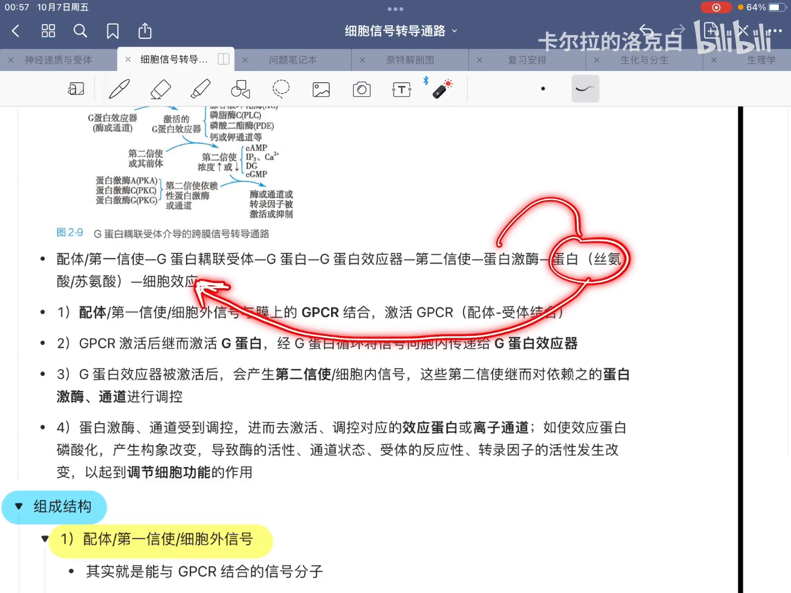

### 1.2 配体：本章只涉及体内信号传递的几类

GPCR 的配体种类极多，神经递质、激素等等都可以，但本章只讨论体内信号传递相关的几类：

- **单胺类**：儿茶酚胺（去甲肾上腺素、肾上腺素、多巴胺）以及 5-羟色胺；
- **胆碱类**：乙酰胆碱；
- **氨基酸类**：谷氨酸与 γ-氨基丁酸——谷氨酸是兴奋性神经递质，γ-氨基丁酸是抑制性氨基酸类神经递质；
- **多肽与蛋白质类**：几乎所有的多肽、蛋白质类递质和激素，包括下丘脑调节肽（各种"促某某激素释放激素"）、血管升压素（也叫抗利尿激素）和胰高血糖素。

有一个例外要单独记：**钠尿肽家族虽然属于多肽，但不走 GPCR 通路**，它走的是鸟苷酸环化酶受体所介导的通路，属于酶联型受体。

配体不同，作用的受体亚型就不同，偶联的 G 蛋白亚型也不同，下游的效应器、第二信使、蛋白激酶统统不一样。正因如此，一条 GPCR 大通路里还能分出三条小通路——配体不同，才要走不同的路。

[【跳转到 03:17】](https://www.bilibili.com/video/BV1Le4y1n7gy/?t=197)

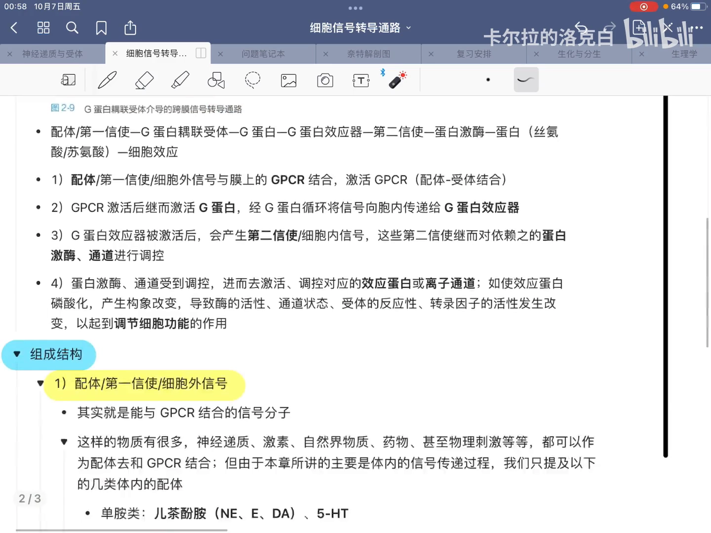

---

## 二、七次跨膜受体与它身后的开关：G 蛋白

### 2.1 GPCR：膜外接信号、膜内挂开关

G 蛋白偶联受体（GPCR）是一类存在于细胞膜上的**七次跨膜受体**：肽链在膜上前后穿行七次。它的**膜外部分负责结合配体，膜内部分负责与 G 蛋白偶联**。它的功能也很单一：自己被激活后，去激活与它偶联的 G 蛋白。

名字里的"G 蛋白偶联"就是字面意思——它膜内那一端常年挂着一个 G 蛋白。

### 2.2 G 蛋白：鸟苷酸结合蛋白，天然的开关

G 蛋白又叫**鸟苷酸结合蛋白**，是一个**异源三聚体**，由 α、β、γ 三个亚基组成：

- **α 亚基**能结合 GTP 或 GDP，并且具有 **GTP 酶活性**——既能抓 GTP，又能把 GTP 水解成 GDP。正因为它在"抓 GTP"和"抓 GDP"两种状态之间来回切换，G 蛋白才成了开关。
- **β、γ 亚基**平时绑在一起行动（βγ 复合物），本身也有活性，同样能激活下游效应器。

G 蛋白**没有活化**时：α、β、γ 三个亚基待在一起，此时 α 亚基上结合的是 GDP——即"αβγ 三聚体 + GDP"的非活化型。**一旦活化**：GDP 脱离，α 亚基同时与 β、γ 分离，改去结合 GTP。于是形成两部分：α-GTP 与 βγ。

[【跳转到 06:02】](https://www.bilibili.com/video/BV1Le4y1n7gy/?t=362)

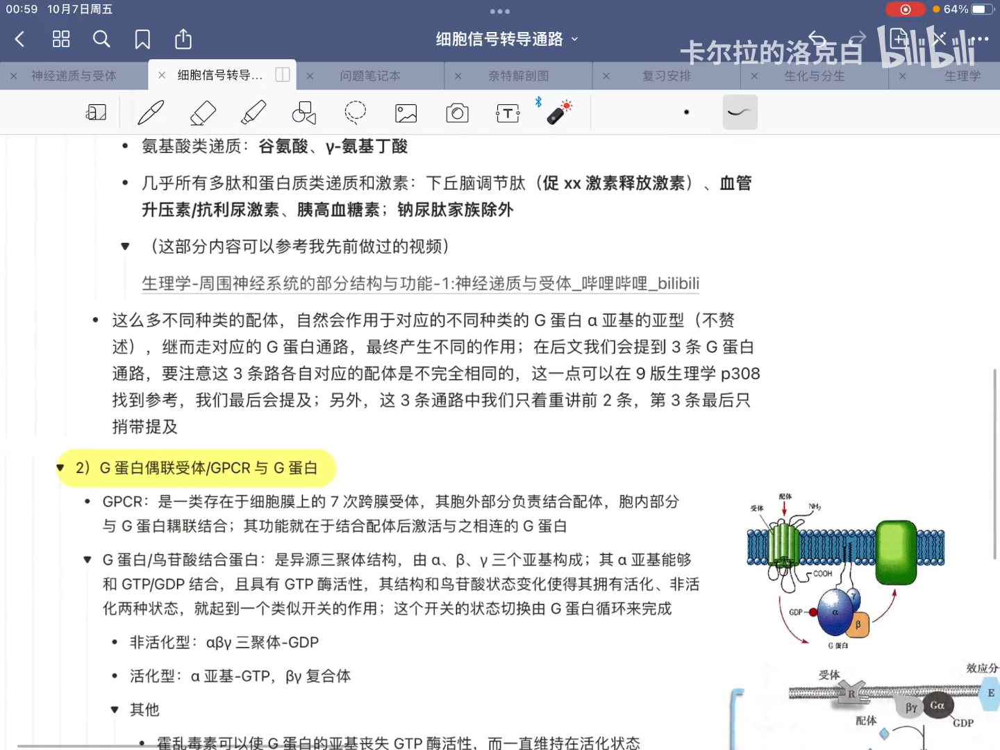

### 2.3 G 蛋白循环：活化与失活各走一趟

G 蛋白平时就偶联在受体上。把它的一圈循环拆开看：

1. **配体结合受体**：配体结合到 GPCR 上并把它激活；
2. **α 亚基换配体**：活化的受体使 G 蛋白 α 亚基与 GDP 的亲和力降低，α 亚基丢掉 GDP；
3. **结合 GTP 并分离**：α 亚基改去结合 GTP，并与 β、γ 亚基分离，形成活化型结构——这一切的起因只是配体与受体结合；
4. **激活效应器**：α-GTP 复合物与 βγ 复合物各自去激活它下游的 G 蛋白效应器。信号由此从细胞外的配体，变成细胞内 G 蛋白效应器的激活；
5. **水解 GTP 收尾**：效应器一被激活，α 亚基的 GTP 酶活性也被激活，把 GTP 水解成 GDP；α 亚基的亲和性随之一变，β 和 γ 又回到它身边，重新聚成 αβγ 三聚体，变回非活化型。

至此一圈结束。G 蛋白循环的意义就在于：**配体带来的信息被逐棒交到下游效应器手上**。

[【跳转到 09:33】](https://www.bilibili.com/video/BV1Le4y1n7gy/?t=573)

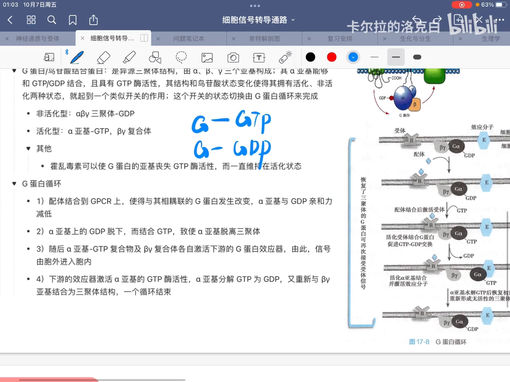

### 2.4 一个小知识点：霍乱毒素为什么让开关卡住

**霍乱毒素可以使 G 蛋白的 α 亚基丧失 GTP 酶活性**。失去 GTP 酶活性以后，GTP 没法被水解成 GDP，而 G 蛋白只有把 GTP 水解掉才能回到非活化型，于是它就一直停在活化型状态上——这正好反过来说明：**GTP 酶活性是这条通路"关机"的唯一出口**。

[【跳转到 08:58】](https://www.bilibili.com/video/BV1Le4y1n7gy/?t=538)

---

## 三、G 蛋白效应器：第二信使的产线

### 3.1 三类效应器，主角是效应酶

**G 蛋白效应器**包括效应酶、膜离子通道和膜转运蛋白等，这三种都可以被 G 蛋白循环激活。但本章最强调的是**效应酶**，因为后面三条通路几乎都围着它转。两条主要通路的效应酶一定要记住：

- **腺苷酸环化酶（AC/adenylyl cyclase）**；
- **磷脂酶 C（PLC/phospholipase C）**。

膜离子通道这类效应器要到第三条通路才登场。

[【跳转到 12:13】](https://www.bilibili.com/video/BV1Le4y1n7gy/?t=733)

### 3.2 两条产线：AC 造 cAMP，PLC 造 DAG 与 IP3

被激活的 G 蛋白通过 G 蛋白循环激活这两种效应酶，效应酶再去催化各自的底物，生成第二信使：

| 效应酶 | 底物 | 产物 | 产物身份 |
| --- | --- | --- | --- |
| 腺苷酸环化酶（AC） | ATP | 环磷酸腺苷（cAMP） | 第二信使 |
| 磷脂酶 C（PLC） | PIP2（磷脂酰肌醇-4,5-二磷酸） | 二酰甘油（DAG/甘油二酯）+ 三磷酸肌醇（IP3） | 两种第二信使 |

所以 G 蛋白效应器的作用一句话就能概括：**催化形成第二信使**。

[【跳转到 13:21】](https://www.bilibili.com/video/BV1Le4y1n7gy/?t=801)

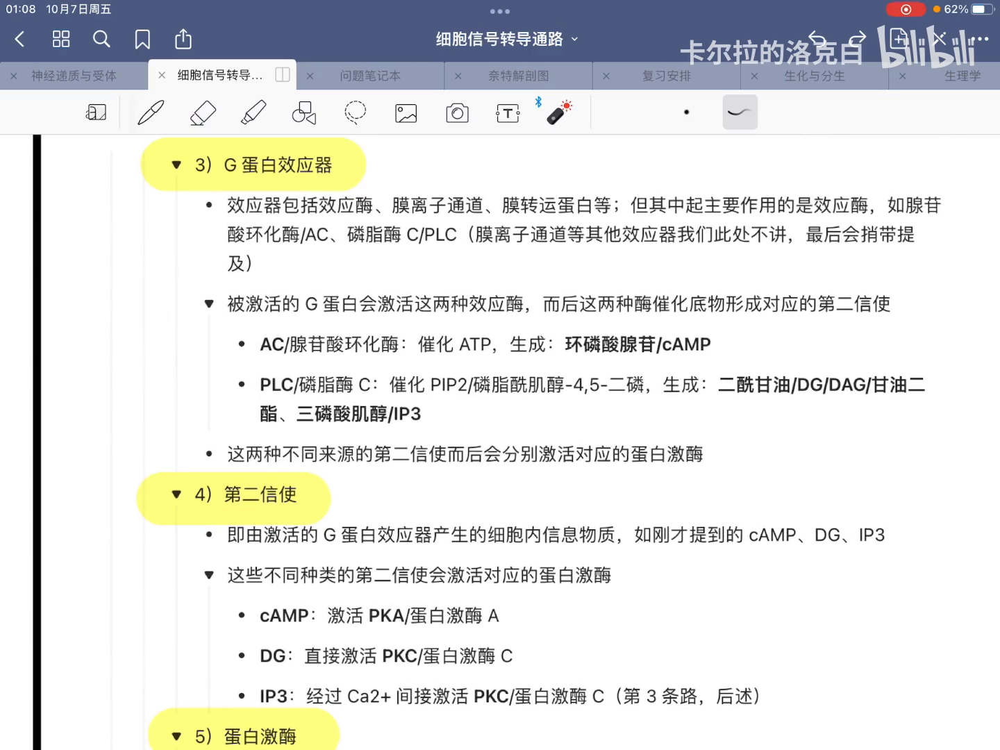

### 3.3 三种第二信使，两种蛋白激酶

第二信使是"细胞内信号"，它的主要任务是去激活蛋白激酶。三种第二信使的分工并不完全一样：

- **cAMP → 蛋白激酶 A（PKA）**：直接激活；
- **DAG → 蛋白激酶 C（PKC）**：直接激活；
- **IP3 → 蛋白激酶 C（PKC）**：先让胞内钙离子释放，再由钙离子**间接**激活 PKC。

这也是为什么后面要把"IP3 这条支路"单独拆出来讲——它中间绕了一个钙离子。

[【跳转到 14:32】](https://www.bilibili.com/video/BV1Le4y1n7gy/?t=872)

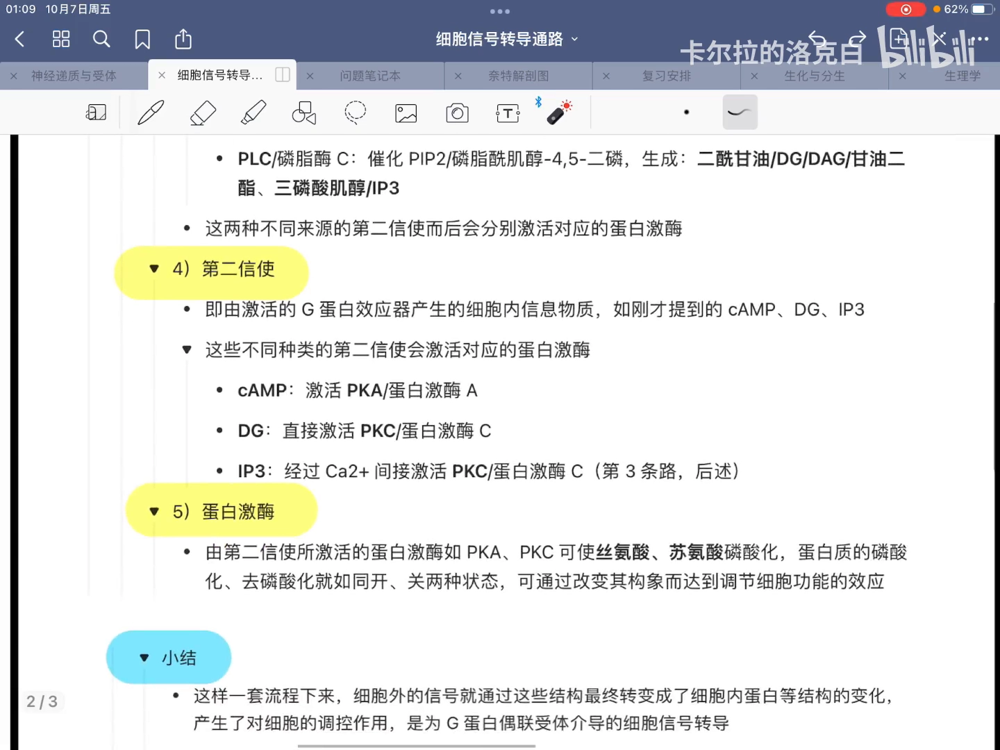

### 3.4 蛋白激酶如何收尾

第二信使激活对应的蛋白激酶以后，蛋白激酶去磷酸化**效应蛋白**——效应蛋白通常是含有丝氨酸和苏氨酸的蛋白。磷酸化让效应蛋白发生结构或功能上的改变，从而产生生物化学效应，最终把信号落到细胞的结构与调控层面。

[【跳转到 16:55】](https://www.bilibili.com/video/BV1Le4y1n7gy/?t=1015)

---

## 四、通路一：配体 → GPCR → G蛋白 → AC → cAMP → PKA

### 4.1 通路一的名字就是它的流程

第一条小通路的全名写成一条链就是：

```text
配体 → G蛋白偶联受体 → G蛋白 → 腺苷酸环化酶 → 环磷酸腺苷 → 蛋白激酶A → 效应蛋白
```

名字看着长，其实每个字都是已经讲过的环节：配体结合受体，受体激活 G 蛋白，G 蛋白经循环激活效应酶 AC，AC 催化 ATP 生成第二信使 cAMP，cAMP 激活 PKA，PKA 使效应蛋白上的丝氨酸、苏氨酸磷酸化。

[【跳转到 18:36】](https://www.bilibili.com/video/BV1Le4y1n7gy/?t=1116)

### 4.2 通路一的配体清单

这条通路的配体可以逐个点名：

- **乙酰胆碱**：作用于 M 受体中的 **M2、M4**；
- **儿茶酚胺**：去甲肾上腺素（作用于 α2 及 β1~β3 受体）、肾上腺素、多巴胺（多巴胺在这条通路里是存在的）；
- **抗利尿激素（ADH）**；
- **γ-氨基丁酸（GABA）**；
- **血管紧张素 II（AngII）**；
- **下丘脑调节肽**：促肾上腺皮质激素释放激素（CRH）、促肾上腺皮质激素（ACTH）、促性腺激素（FSH、LH）等，即各种"促某某激素释放激素/促某某激素"；
- **胰高血糖素**。

[【跳转到 20:01】](https://www.bilibili.com/video/BV1Le4y1n7gy/?t=1201) [【跳转到 21:33】](https://www.bilibili.com/video/BV1Le4y1n7gy/?t=1293)

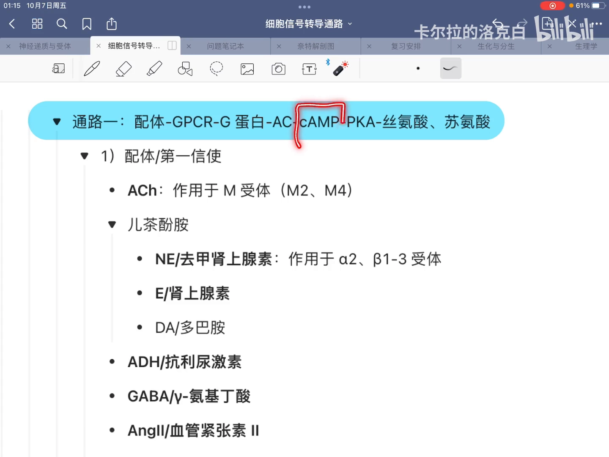

### 4.3 不背清单也能推：用一张表格反推配体

这张表把常见小分子递质的受体、第二信使、离子效应一一列了出来，所以完全可以反过来用：**先确定通路走的是哪个第二信使，再回表里找哪些受体对应这个第二信使，配体自然就出来了。**

以通路一为例，它的第二信使是 cAMP，回表里查找 ↑cAMP 一列，就能找出乙酰胆碱（M2、M4）、多巴胺（D1、D5 等）、去甲肾上腺素与肾上腺素（β1~β3）、5-羟色胺（部分亚型）、腺苷（A2A、A2B）等；谷氨酸、γ-氨基丁酸也在这条通路里出现。同理，哪些配体"表上有、但这一列没有"，就说明它不走这条通路——比如 ATP 就不在 cAMP 这一列，它走的是另一条通路。

[【跳转到 19:56】](https://www.bilibili.com/video/BV1Le4y1n7gy/?t=1196)

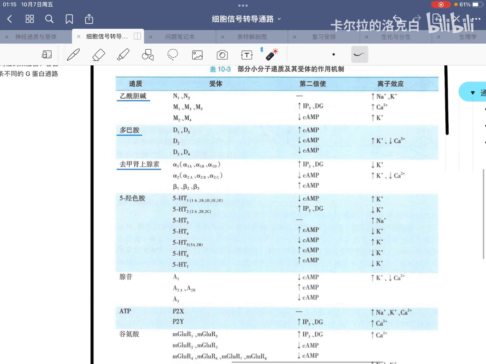

### 4.4 一个把通路"掐断"的开关：磷酸二酯酶

通路一中间必经 cAMP 这一环，而**磷酸二酯酶可以分解 cAMP**：把 cAMP 水解掉，整条通路就在中段断了，通路的作用随之被抑制。这是这条通路自带的一个负向调节点。

[【跳转到 22:23】](https://www.bilibili.com/video/BV1Le4y1n7gy/?t=1343)

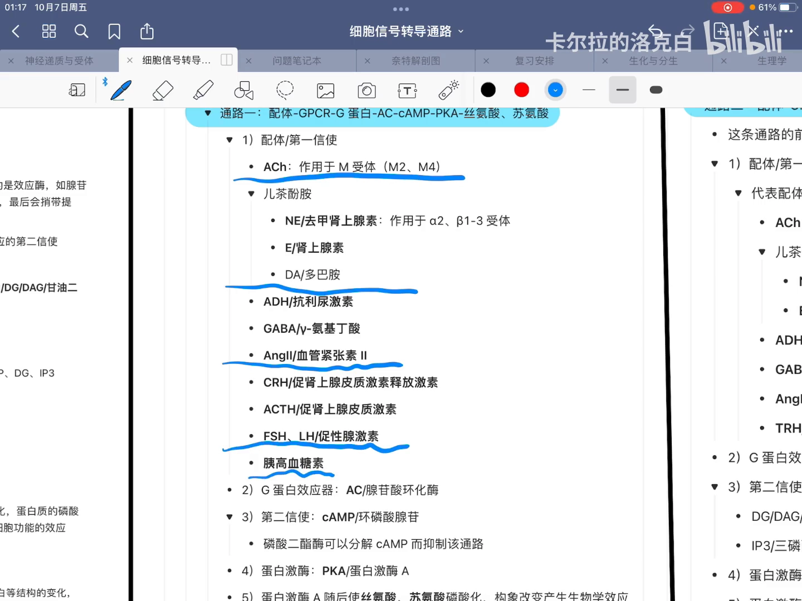

---

## 五、通路二：配体 → GPCR → G蛋白 → PLC → IP3/Ca²⁺ 与 DAG → PKC

### 5.1 前半段一样，到第二信使才分岔

第二条小通路的前三个环节与通路一完全相同（配体不同而已），区别从效应酶开始：

```text
配体 → G蛋白偶联受体 → G蛋白 → 磷脂酶C
                                 ├─ 三磷酸肌醇（IP3）→ Ca²⁺ → 间接激活 PKC
                                 └─ 二酰甘油（DAG） → 直接激活 PKC
```

效果酶换成 **PLC**，它分解底物 PIP2 生成 **IP3 和 DAG** 两种第二信使。到第二信使这一步，两条分支就必须分开了：**DAG 直接去激活 PKC；IP3 先往上走、去调节钙离子，再通过钙离子间接激活 PKC**。最终两条分支又汇到同一个蛋白激酶 C 上，PKC 再使效应蛋白的丝氨酸、苏氨酸磷酸化——前后套路与通路一是一致的。

[【跳转到 23:24】](https://www.bilibili.com/video/BV1Le4y1n7gy/?t=1404) [【跳转到 24:05】](https://www.bilibili.com/video/BV1Le4y1n7gy/?t=1445)

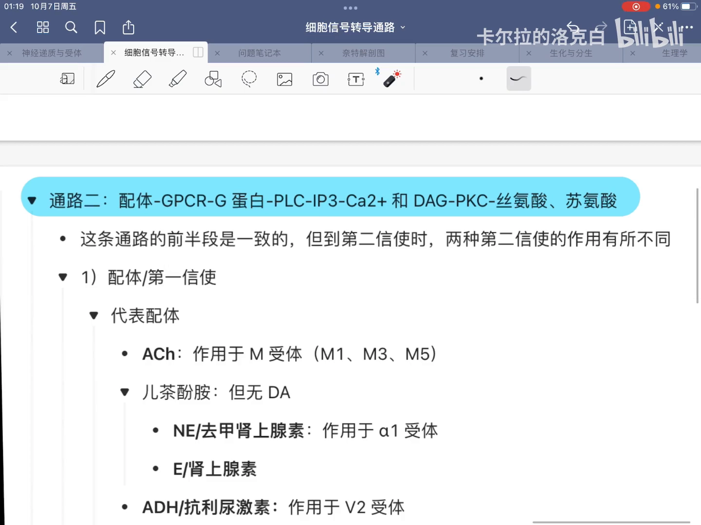

### 5.2 通路二的配体：和通路一差在哪里

同样可以用表格反推。通路二的第二信使是 **IP3 和 DAG**，回表里找 ↑IP3、DG 一列，得到：

- **乙酰胆碱**：此时作用的虽然还是 M 受体，但具体是 **M1、M3、M5**——和通路一的 M2、M4 正相反；
- **儿茶酚胺**：只有去甲肾上腺素和肾上腺素（作用 α1 受体），**没有多巴胺**；
- **抗利尿激素**（作用 V2 受体）、**γ-氨基丁酸**、**血管紧张素 II**；
- **促甲状腺激素释放激素（TRH）**。

两条通路的配体清单其实大部分重合，真正要盯住的是两处差异：**乙酰胆碱在两条通路里作用的受体亚型不同**（M2/M4 对 M1/M3/M5），以及**多巴胺只出现在通路一、不在通路二**。多巴胺在表里找不到 IP3、DAG 这两种第二信使，就说明它不能作为通路二的配体。

[【跳转到 25:47】](https://www.bilibili.com/video/BV1Le4y1n7gy/?t=1547) [【跳转到 26:29】](https://www.bilibili.com/video/BV1Le4y1n7gy/?t=1589)

---

## 六、通路三：Ca²⁺ 信号系统

第三条通路其实是第二条通路的分支，由 **IP3** 引入：

```text
IP3 → 内质网与肌浆网上的化学门控 Ca²⁺ 通道 → 胞内 Ca²⁺ 释放 → 钙信号系统
```

IP3 可以激活胞内**内质网和肌浆网**上的化学门控钙通道，引发胞内钙离子释放。这一段和心肌、骨骼肌里的情形很像：肌浆网本身就是一个钙库，把上面的钙通道打开，钙就被释放到胞质中，胞质钙浓度随之升高。

钙离子本身也可以当第二信使。它和"离子通道型受体通路"中泵入胞内的钙离子合并在一起，共同构成**钙离子信号系统**，发挥的作用包括：

- **间接激活 PKC**——与通路二殊途同归；
- **介导心肌、骨骼肌的收缩**：钙从肌浆网/内质网释放到胞质，引发肌丝滑行，进而引起肌细胞收缩。整个过程可以看成骨骼肌的兴奋-收缩偶联：信号过来 → 诱发钙释放 → 肌丝滑行 → 完成一次机械收缩，只是这里讲的是更深一层的分子机制；
- **改变膜电位**：离子的移动带电荷，会改变膜内外的电位；
- **激活钙调蛋白**：胞内的钙调蛋白被钙离子激活后，也能介导一系列生物学效应。

[【跳转到 29:01】](https://www.bilibili.com/video/BV1Le4y1n7gy/?t=1741) [【跳转到 31:02】](https://www.bilibili.com/video/BV1Le4y1n7gy/?t=1862)

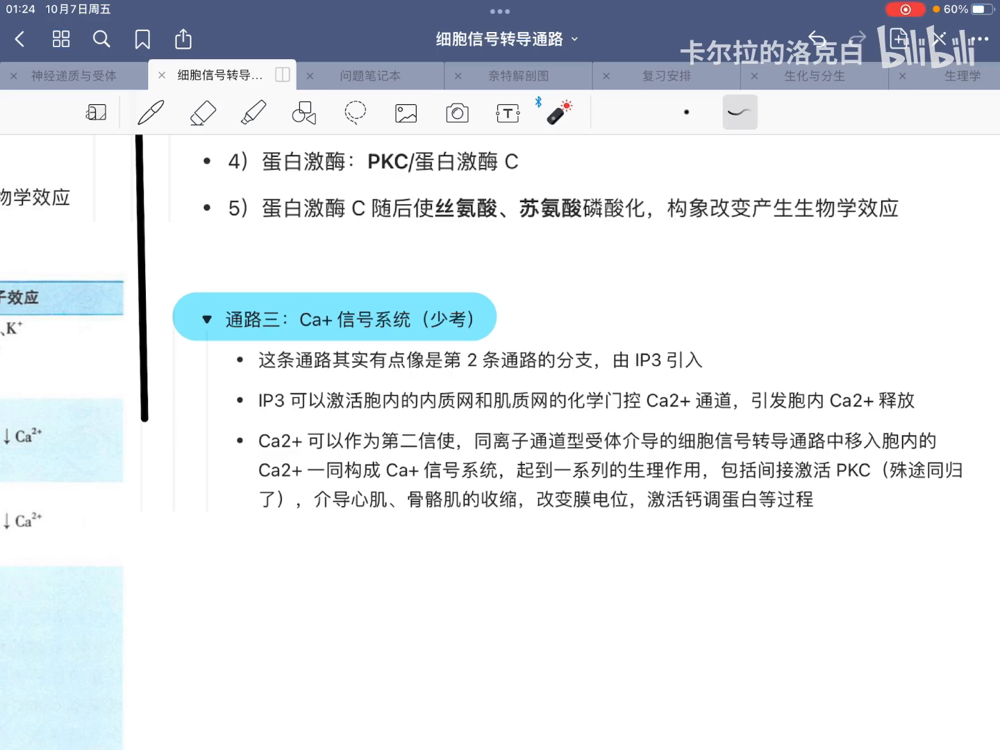

---

## 小结

- **通路骨架**：配体（第一信使）→ GPCR → G 蛋白 → G 蛋白效应器 → 第二信使 → 蛋白激酶 → 效应蛋白（丝氨酸/苏氨酸磷酸化）→ 细胞效应。
- **受体**：GPCR 是七次跨膜受体，膜外结合配体、膜内偶联 G 蛋白。
- **G 蛋白**：异源三聚体 αβγ；非活化型为 αβγ-GDP，活化型为 α-GTP + βγ。α 亚基兼有结合 GTP/GDP 的能力与 GTP 酶活性，因此成为开关。
- **G 蛋白循环**：配体激活受体 → α 亚基丢掉 GDP 结合 GTP 并与 βγ 分离 → α-GTP 与 βγ 各自激活效应器 → 效应器激活 α 亚基的 GTP 酶 → GTP 水解为 GDP → βγ 回归、恢复非活化型。霍乱毒素使 α 亚基失去 GTP 酶活性，G 蛋白就卡在活化型。
- **效应器**：效应酶、膜离子通道、膜转运蛋白；主角是效应酶 AC 与 PLC。
- **第二信使与蛋白激酶**：AC 造 cAMP → 激活 PKA；PLC 造 DAG（直接激活 PKC）与 IP3（经 Ca²⁺ 间接激活 PKC）。
- **三条小通路**：通路一（AC-cAMP-PKA）、通路二（PLC-IP3-Ca²⁺/DAG-PKC）、通路三（Ca²⁺ 信号系统，是通路二的分支）。三条通路的差别来自配体、受体亚型、G 蛋白亚基、效应器、第二信使与蛋白激酶的搭配不同。
- **记忆要点**：每条通路务必把"效应酶 → 第二信使 → 蛋白激酶"三者的对应关系锁死；配体清单可以用受体-第二信使对照表反推，不要硬背。

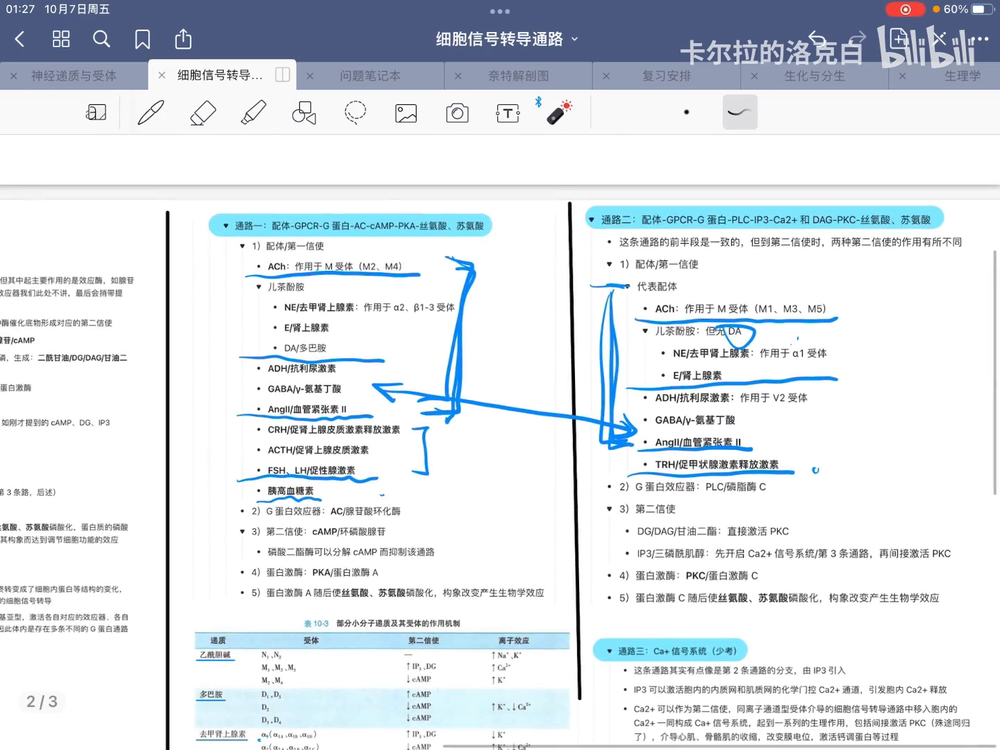

[【跳转到 31:52】](https://www.bilibili.com/video/BV1Le4y1n7gy/?t=1912)

## 关键术语速查

| 术语 | 一句话解释 |
| --- | --- |
| 配体 / 第一信使 | 细胞外的信号分子，如乙酰胆碱、去甲肾上腺素、胰高血糖素等 |
| GPCR | G 蛋白偶联受体，七次跨膜受体；膜外结合配体、膜内偶联 G 蛋白 |
| G 蛋白 | 鸟苷酸结合蛋白，αβγ 异源三聚体；靠 α 亚基结合 GTP/GDP 实现开关功能 |
| G 蛋白循环 | 受体激活 α 亚基换 GTP 与 βγ 分离，至 GTP 水解后重新聚合的一圈过程 |
| G 蛋白效应器 | 被活化 G 蛋白激活的下游分子，包括效应酶、膜离子通道、膜转运蛋白 |
| 腺苷酸环化酶（AC） | 效应酶，催化 ATP 生成 cAMP |
| 磷脂酶 C（PLC） | 效应酶，催化 PIP2 生成 DAG 与 IP3 |
| 第二信使 | 效应器催化产生的细胞内信号分子，主要是 cAMP、DAG、IP3 |
| 蛋白激酶 A（PKA） | 被 cAMP 激活的蛋白激酶 |
| 蛋白激酶 C（PKC） | 被 DAG 直接激活、被 IP3 经钙离子间接激活的蛋白激酶 |
| 磷酸二酯酶 | 分解 cAMP，可掐断 cAMP-PKA 通路的负向调节点 |
| Ca²⁺ 信号系统 | 由 IP3 打开内质网/肌浆网钙通道引发的胞内钙信号，可间接激活 PKC、介导肌细胞收缩等 |
| 霍乱毒素 | 使 G 蛋白 α 亚基丧失 GTP 酶活性，令 G 蛋白持续处于活化型 |
