# 受体酪氨酸激酶通路：从RTK二聚化到Ras、MAPK与PI3K-Akt

> 视频来源：[【信号通路】①受体酪氨酸激酶（RTK）介导的信号通路](https://www.bilibili.com/video/BV1GNBpYpEaX/)（Bilibili · -游离子-，约 26 分钟）
> 导读（100 字以内）：这支视频从 EGF 受体的经典实验讲起，一步步推出 RTK 的二聚化-转磷酸化模型，再沿着"接头蛋白 → Ras → 三条下游支路"把整条通路补全。本文按这条实验史的顺序重排；G 蛋白与 PLC/IP3/DAG 的细节见本节另一篇 GPCR 专文。

## 本讲要解决的核心问题（SCQA）

**背景**：细胞要靠生长因子这类信号决定自己分裂、分化还是停止生长，而这类信号的第一步，就是生长因子结合到细胞膜上的受体。

**冲突**：受体酪氨酸激酶（RTK）的通路图看起来像一张巨网——受体、接头蛋白、Ras、Raf、MEK、ERK、PI3K、Akt、PTEN、GSK-3β、Bad、caspase……名字太多，而且每个分子都同时出现在好几张图里。更麻烦的是：受体是怎么被"打开"的、信号又是怎么从膜上传到细胞核的，这两件事在教科书里往往一笔带过。

**疑问**：RTK 长什么样、凭什么既是受体又是酶？配体结合之后受体发生了什么？磷酸化的酪氨酸残基把信号传给谁，中间那些名字拗口的接头蛋白是干什么用的？Ras 这个"开关"如何开启，它下游又分出了哪几条支路，为什么其中每一步出错都可能指向肿瘤？

**回答（中心思想）**：整条通路可以按"受体怎么开 → 开关怎么拨 → 信号怎么落地"三层来理解。第一，**RTK 是单次跨膜蛋白，胞内段自带酪氨酸激酶结构域**，所以它既是受体又是酶；配体让两个受体分子形成二聚体，一个亚基去磷酸化另一个亚基的 C 端，这种**转磷酸化**在受体胞内段造出一排磷酸化酪氨酸。第二，**磷酸化酪氨酸是一排"停靠位点"**：含 SH2 结构域的下游蛋白（如 Src、PI3K、接头蛋白 Shc/Grb2）被它募集到膜上——磷酸化酪氨酸负责定位，旁边的侧翼序列决定谁被招募，因此不同受体能激活不同的下游信号；被募集来的 Grb2 把鸟苷酸交换因子 Sos 带到膜上，Sos 再把 **Ras** 从"GDP 结合的非活化型"拨成"GTP 结合的活化型"。第三，**Ras 是枢纽**，活化后至少分出三条支路：Raf-MEK-ERK（MAPK 级联，管增殖）、PI3K-PIP3-Akt（管存活与生长）、Ral（管细胞迁移）。这三条支路上任何一步被"卡在开的状态"，细胞增殖就会失控，这正是很多肿瘤的分子基础。

---

## 一、RTK 是什么：20 类受体，兼作酶的单次跨膜蛋白

### 1.1 两大类受体，共同的机制

人类基因组中大约有 **90 种蛋白激酶受体**，它们可以分为两大类：一类是**受体酪氨酸激酶（RTK）**，另一类是**细胞因子受体**。这两类受体家族有着相似的结构特征和作用机制，本节只讲前者。

目前已确定了 **20 种不同的 RTK 类别**，其中人类基因组编码的大部分都是**生长因子受体**，包括：

- 表皮生长因子（EGF）受体、成纤维细胞生长因子（FGF）受体、血管内皮生长因子（VEGF）受体、血小板衍生生长因子（PDGF）受体等——这些对细胞的增殖与分化有重要作用；
- 而 RYK、ROR 等受体则与 **Wnt 信号通路**相关。

[【跳转到 00:27】](https://www.bilibili.com/video/BV1GNBpYpEaX/?t=27)

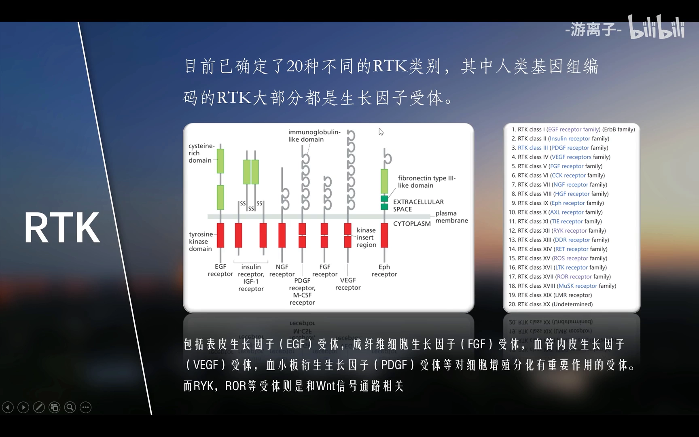

### 1.2 结构：胞外配体结合域 + 单次跨膜 + 胞内激酶域

绝大多数受体酪氨酸激酶都是**单次跨膜蛋白**：

- **N 端位于细胞外**——负责结合配体；
- **C 端位于细胞内**——负责往下游发信号；
- 中间的**疏水跨膜区**把两者连起来。

关键在胞内段：RTK 的胞内段**自身含有酪氨酸激酶结构域**（能催化蛋白上酪氨酸残基的磷酸化）。也就是说，这种受体**既是受体又是酶**——它不需要再找一个下游激酶来传信号，自己就能磷酸化别的东西。这一点是后面所有内容的基础。

[【跳转到 00:52】](https://www.bilibili.com/video/BV1GNBpYpEaX/?t=52)

---

## 二、EGF 受体：把 RTK 讲清楚的那个范式

### 2.1 为什么要研究 EGF 受体

**表皮生长因子（EGF）是第一个被发现的生长因子**，对多种上皮细胞具有促有丝分裂的作用。但它的受体很难拿到手：EGF 受体（EGF-R）和其他受体一样，在细胞内的表达水平非常低，分离纯化困难。

研究者的办法很巧：改用**高表达 EGF-R 的人表皮样癌细胞 A431**——这种细胞的 EGF-R 表达量比正常细胞高 100 倍。通过对 EGF-R 的分离纯化及氨基酸序列分析，研究者大致推断出：**当胞外结构域结合了 EGF，其胞内的激酶结构域会以某种方式被激活，之后再把信号传递到下游**。

[【跳转到 01:14】](https://www.bilibili.com/video/BV1GNBpYpEaX/?t=74)

### 2.2 ³²PO₄ 标记实验：EGF 受体确实是一种受体酪氨酸激酶

接下来的问题很自然：这种具有酪氨酸激酶活性的生长因子受体，究竟是怎么把信号从胞外传到胞内的？

实验设计是：把高表达 EGF-R 的 A431 细胞放在含 **³²PO₄** 的培养基中培养，然后暴露于 EGF，再用放射性标记的蛋白与**抗磷酸化酪氨酸抗血清**做免疫结合——这样只有被磷酸化的酪氨酸才会被标记出来。

实验结果：

- **凝胶电泳（图 A）**：没有 EGF 时看不到条带；加上 EGF 之后，EGF-R 位置出现明显条带。说明受体只有在 EGF 存在时才会被磷酸化。
- **二维电泳（图 B、C，分别为 without EGF 与 with EGF）**：磷酸化的丝氨酸、苏氨酸信号在有、无 EGF 的情况下没有明显变化；而**磷酸化酪氨酸的斑点信号变强**，且这些酪氨酸磷酸化中最显著的就是**受体分子本身**。

结论：**EGF 受体是一种受体酪氨酸激酶**——配体一来，受体自己就被酪氨酸磷酸化了。

[【跳转到 02:34】](https://www.bilibili.com/video/BV1GNBpYpEaX/?t=154)

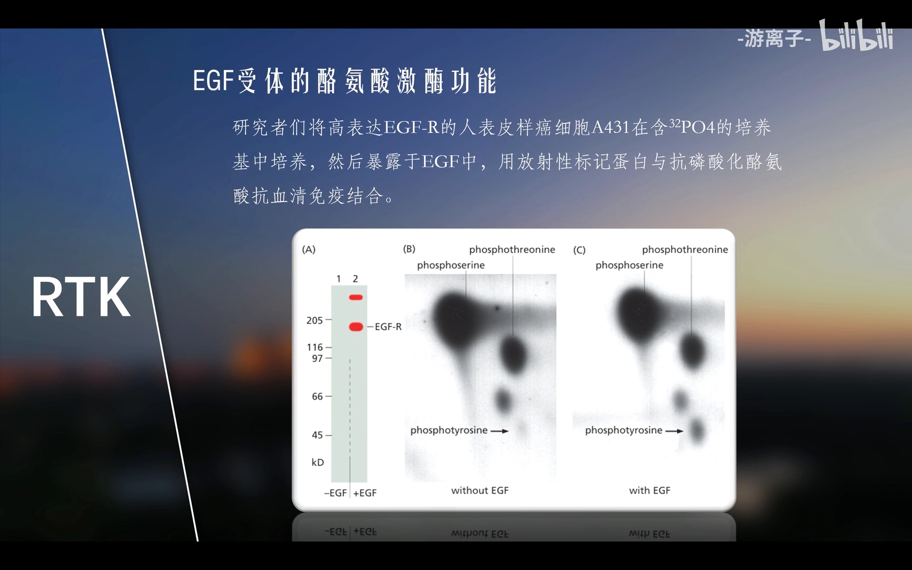

### 2.3 三个线索，推出"二聚化 + 转磷酸化"模型

单靠"受体自己被磷酸化"还画不出机制，于是研究者又找来了三个线索：

1. **受体本身会发生磷酸化**（就是上面的实验结果）；
2. **许多生长因子配体的结构是二聚体**；
3. **很多跨膜蛋白有类似 EGF 受体的结构，并且在质膜上具有横向流动性**——受体不是钉死在膜上的，可以在膜表面移动。

三个线索合起来提示了这样一个模型：

1. 没有配体时，EGF 受体在质膜表面**自由迁移**；
2. 两个受体分子相遇时会形成**同源二聚体**，但持续时间短暂；此时受体的胞外结构域发生构象改变，与生长因子配体的亲和力增强；
3. 受体与配体结合后，二聚体的稳定性增强，并激活**酪氨酸激酶（TK）结构域**；
4. 每个受体亚基去磷酸化另一个亚基的 C 端区域——这种双向的互相磷酸化被称为**转磷酸化作用（transphosphorylation）**。

顺带纠正一个常见说法：所谓"自磷酸化"其实名不副实，目前还不清楚单一的激酶分子到底能不能磷酸化自身。

在 EGF 受体中还观察到一个细节：**受体的自发二聚化实际上先于受体与配体的结合，但只有结合配体之后才会激发酪氨酸激酶活性**。这解释了为什么 EGF-R 过表达会出问题——**受体太多时，细胞会对周围低水平的 EGF 响应过度，这可能是癌细胞增殖的原因之一**。

[【跳转到 03:29】](https://www.bilibili.com/video/BV1GNBpYpEaX/?t=209) [【跳转到 04:29】](https://www.bilibili.com/video/BV1GNBpYpEaX/?t=269)

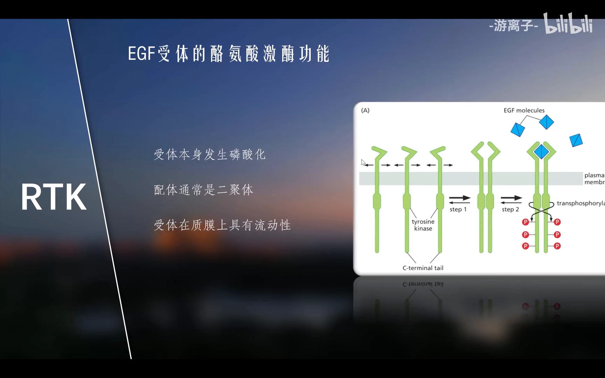

### 2.4 两个例外：配体非依赖的激活，与不二聚化的配体

模型之外还有反例，视频专门给了两个：

- **配体非依赖性的受体激活**：**Neu** 是人类表皮生长因子受体 2（HER2/ErbB2）的大鼠同源物；它的突变会让受体在没有配体的情况下也能稳定二聚化，由此不断激活下游信号。ErbB2 这个名字来源于和它同源的病毒癌基因——成红细胞白血病病毒癌基因；在啮齿动物中它叫 Neu，在人类中叫 HER2。
- **不是所有配体都会二聚化**：TGF-α 是 EGF 家族的一员，但它以**单体**形式分别结合到单体受体的胞外结构域上。从结构上看，两个 TGF-α 的结合位点相距非常远，所以两个配体不会自发二聚化，而是以单体形式与受体结合，再通过**远离配体结合部位的位点**发生空间构象改变，从而让受体二聚化。

[【跳转到 04:58】](https://www.bilibili.com/video/BV1GNBpYpEaX/?t=298) [【跳转到 05:34】](https://www.bilibili.com/video/BV1GNBpYpEaX/?t=334)

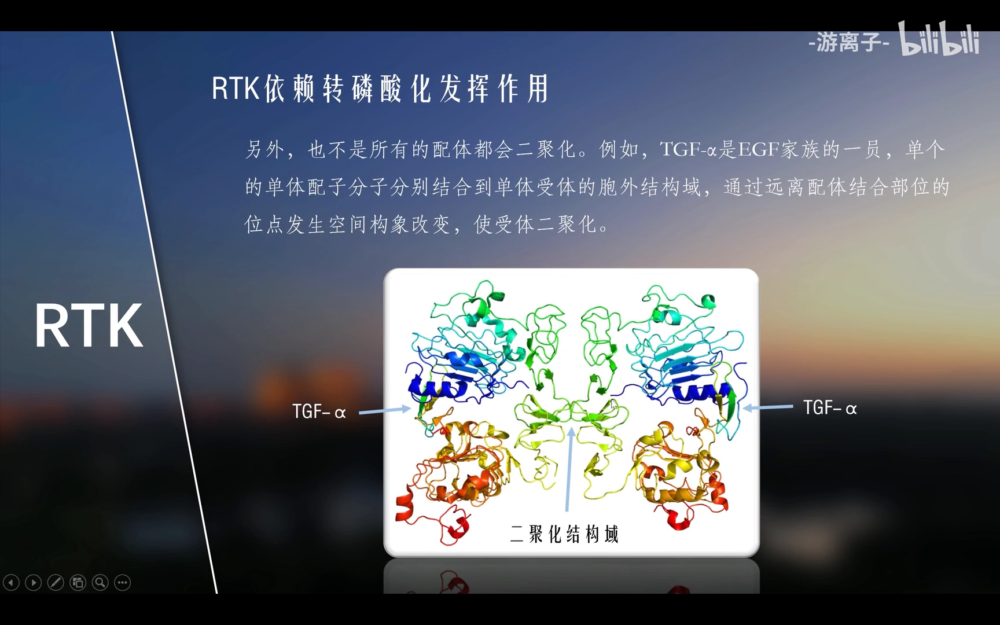

---

## 三、从受体到 Ras：接头蛋白如何把通路补全

### 3.1 问题：磷酸化的酪氨酸残基把信号传给谁

受体胞内段被磷酸化之后，信号并没有自动往下走。所以下一个问题是：**这些磷酸化的酪氨酸残基，究竟把信号传递给了谁？**

线索来自癌基因：研究者发现，**癌基因 ras 可以使细胞发生和 erbB 基因转化细胞相同的改变**。于是有了一个猜想——细胞内是否存在这样一条桥连的分子信号通路，让信号从 ErbB（RTK）传递到 Ras 蛋白？

```text
ErbB（RTK） → ? → Ras
```

[【跳转到 05:45】](https://www.bilibili.com/video/BV1GNBpYpEaX/?t=345)

### 3.2 Ras：一个插在膜上的小 G 蛋白开关

**Ras 蛋白**可以简单理解为：它的 C 端结合了一些脂类组成的**脂质尾巴**，这条尾巴插进细胞膜，把 Ras 固定在细胞膜的**胞质面**上。

Ras 类似于三聚体 G 蛋白，但是一种**小 G 蛋白**，起**二元开关**的作用：

- **非活化状态**：Ras 结合一个 **GDP**；
- **活化**：上游传来信号时，Ras 释放 GDP，随后结合一个 **GTP**，蛋白转为活化的构象；
- **回到非活化**：一小段时间后，Ras 自身的 GTP 酶发挥功能，把 GTP 水解成 GDP，Ras 再次回到非活化状态。

参与这一圈的两个调控蛋白也必须记住：

- **鸟嘌呤核苷酸交换因子（GEF）**：使 Ras 释放 GDP 而结合 GTP，即把 Ras 拨到活化型；
- **GTP 酶激活蛋白（GAP）**：使 Ras 从活化型回到非活化型。

正因为"GTP 酶水解"是唯一的关机出口，**致癌突变往往会阻断这一步**——GTP 水解不掉，Ras 就永远卡在开的状态。

[【跳转到 06:10】](https://www.bilibili.com/video/BV1GNBpYpEaX/?t=370) [【跳转到 07:03】](https://www.bilibili.com/video/BV1GNBpYpEaX/?t=423)

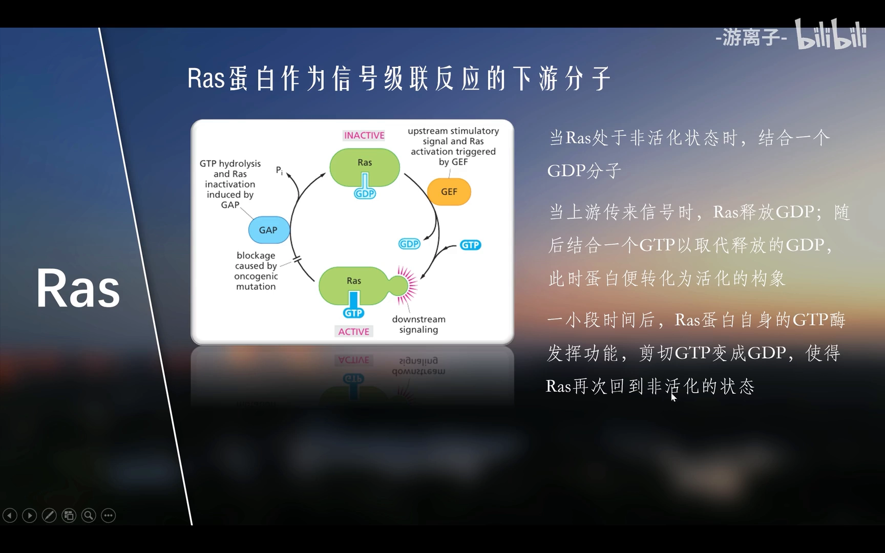

### 3.3 sevenless 与 Sos：找到 Ras 的上游激活因子

Ras 是怎么和整个信号网络连起来的？答案来自一个完全未预料到的领域——**果蝇眼部发育研究**。

果蝇里有一个重要基因叫 **sevenless**：顾名思义，缺失这个基因，果蝇复眼的每个小眼中**第七个细胞**都无法正常形成。测序后发现，sevenless 编码的蛋白含有受体酪氨酸激酶普遍存在的结构——它编码的蛋白是哺乳动物**成纤维细胞生长因子（FGF）受体的同源物**。

而 sevenless 通路上的一个下游蛋白叫 **Sos**，它参与激活 Ras 蛋白——**Sos 蛋白正是一种 GEF**。于是 Sos 就是长期以来在找的那个"能把 Ras 转成活性状态"的上游刺激因子。

[【跳转到 07:23】](https://www.bilibili.com/video/BV1GNBpYpEaX/?t=443) [【跳转到 07:48】](https://www.bilibili.com/video/BV1GNBpYpEaX/?t=468)

### 3.4 通路补全：RTK → Shc → Grb2 → Sos → Ras

有了 Sos，先前那条断掉的通路就能补上一段：**RTK → Sos → Ras**。

随后又陆续发现了其他中间分子，其中 **Shc** 和 **Grb2** 是通过遗传和生化筛选发现的，它们起**接头蛋白**的作用，即把**生长因子受体**和 **Sos** 连接起来。一系列研究最终给出这样一条通路：

```text
RTK → Shc → Grb2 → Sos → Ras
```

值得一提的是这条通路的"资历"：它的起源可以追溯到 6 亿多年前所有现代后生动物的共同祖先，那时就已经很完善；而且这条链上的每个蛋白都非常保守——一个门（如脊索动物门）的蛋白，可以和另一个门（如节肢动物门）的组分互换并重组，照样能形成一条有功能的信号通路。

[【跳转到 08:13】](https://www.bilibili.com/video/BV1GNBpYpEaX/?t=493) [【跳转到 08:38】](https://www.bilibili.com/video/BV1GNBpYpEaX/?t=518)

### 3.5 一个反常识的结论：重定位比激活更重要

回顾整条通路，视频反复强调的一点是受体的激酶活性。那么，**受体酪氨酸残基的磷酸化与信号传递之间真的很重要吗？这些蛋白质之间究竟是怎么作用的？**当时有两种猜测：

1. RTK 能磷酸化一系列靶蛋白（包括自身的转磷酸化），这样改变了蛋白质的构象而把它们激活；
2. 受体磷酸化后改变的是靶蛋白的**定位**，而不是它们的活性。

结果显示：**蛋白质的重新定位更加重要**。这一点在下一章的 Src 与 SH2 结构域上讲得最清楚——磷酸化酪氨酸并不直接"打开"某个酶，而是像一排停靠位点那样，把带 SH2 结构域的蛋白**从细胞质招募到膜上**。

[【跳转到 09:03】](https://www.bilibili.com/video/BV1GNBpYpEaX/?t=543)

---

## 四、读取磷酸化酪氨酸的密码：Src 与 SH2/SH3 结构域

### 4.1 Src：第一个被发现的原癌基因产物

**Src 蛋白由 src 基因编码**，这个基因最早在研究**劳氏肉瘤病毒（Rous sarcoma virus）**时被发现，**src 也是第一个被发现的原癌基因**。Src 蛋白很特别：它既能作为激酶去磷酸化其他蛋白，自身也可以作为底物被其他蛋白磷酸化或自磷酸化。

后来人们发现，Src 蛋白磷酸化的是底物蛋白的**酪氨酸残基**——这与正常细胞的情况不同：**正常细胞中 99% 的磷酸化残基是丝氨酸和苏氨酸**。由此得出一个相关结论：

> 在哺乳动物细胞中，通过酪氨酸磷酸化传递信号这种机制，主要出现在**促分裂原信号转导通路**中，即控制细胞增殖、分化、凋亡的信号；而其他信号转导途径涉及的磷酸化，基本上都依赖丝氨酸和苏氨酸。

[【跳转到 09:53】](https://www.bilibili.com/video/BV1GNBpYpEaX/?t=593) [【跳转到 10:35】](https://www.bilibili.com/video/BV1GNBpYpEaX/?t=635)

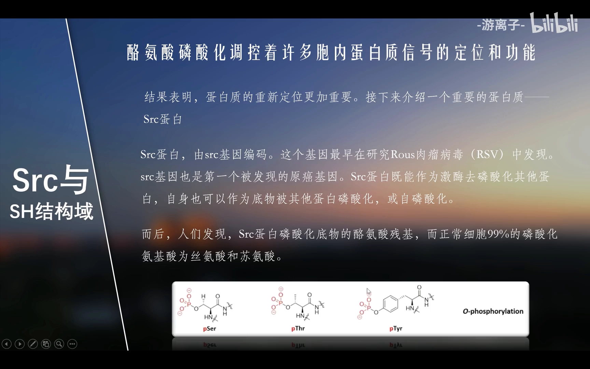

### 4.2 Src 的三个结构域：SH1 干活，SH2 认位点，SH3 认脯氨酸

Src 蛋白由几个功能模块拼成：

- **SH1**：催化结构域，负责磷酸化；
- **SH2**：作为"受体"发挥作用。它与**含磷酸化酪氨酸的多肽**结合，识别的是两部分——磷酸化酪氨酸本身，以及它 C 端一侧 3~6 个残基组成的特异性多肽。**磷酸化酪氨酸负责定位，侧翼的氨基酸序列则决定特异性**；
- **SH3**：特异性结合含**脯氨酸**序列的结构域；
- N 端还有一个 **14 碳的肉豆蔻酰基**，可以让 Src 附着在质膜上，但不能永久锚定。

这些 SH 结构域并不只在 Src 里出现，它们也存在于其他很多蛋白中，因此被统称为 **Src 同源结构域（SH1/SH2/SH3）**。

SH2 的"定位 + 特异性"这两重作用，正好回答了 RTK 如何产生特异性信号的问题：**PDGF 受体和 EGF 受体的胞内段有很多磷酸化酪氨酸，它们能够结合含不同 SH2 结构域的下游蛋白（如 Src、PI3K、PLC-γ、STAT3/5 等），因此激活的信号也不同**。而且因为 RTK 的胞内结构域就贴近细胞膜，被募集而来的含 SH2 结构域的蛋白也就贴近了质膜，可以直接与质膜相关蛋白或磷脂相互作用，产生一系列化学信号——例如 PI3K 去磷酸化细胞膜内的肌醇脂质。

[【跳转到 11:00】](https://www.bilibili.com/video/BV1GNBpYpEaX/?t=660) [【跳转到 12:15】](https://www.bilibili.com/video/BV1GNBpYpEaX/?t=735)

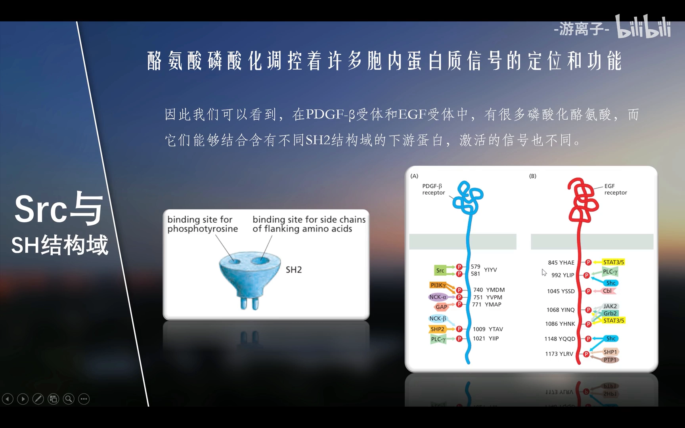

### 4.3 Src 的"锁"：分子内结合如何被解除

Src 靠一套**分子内互作**把自己锁住：

- SH2 结构域通常以**分子内**形式结合到邻近 C 端的 **530 位磷酸化酪氨酸（pY530）**上；
- SH3 结构域则结合到位**于激酶结构域 N 端与 SH2 结构域之间连接片段**的富含脯氨酸序列上。

这两种结合合起来，使位于 N 端与 C 端之间的 Src 蛋白激酶结构域的催化活性被阻断——研究者把这套结构称为**"插销-前夹开关"**。

解锁的过程是这样的：

1. 当 PDGF 受体被磷酸化后，它的一个磷酸化酪氨酸成为 Src 蛋白上 **SH2 的配体**；
2. SH2 因此从**分子内**结合模式转变为**分子间**结合模式；
3. 同时 Src 的 **SH3** 从分子内结合位点脱离，改去结合受体上富含脯氨酸的结构域；
4. 这些改变使 Src 蛋白上的**催化裂隙开启**；
5. 最后，**416 位酪氨酸（pY416）的磷酸化**使起阻止作用的活化环从催化裂隙上移开，于是产生了具有完全酪氨酸激酶活性的 Src 蛋白。

一句话总结：受体上的磷酸化酪氨酸只做了一件事——**把 Src 从"自我锁紧"的构象里拉开**。这就是前面说的"重定位比激活更重要"。

[【跳转到 12:45】](https://www.bilibili.com/video/BV1GNBpYpEaX/?t=765) [【跳转到 13:35】](https://www.bilibili.com/video/BV1GNBpYpEaX/?t=815)

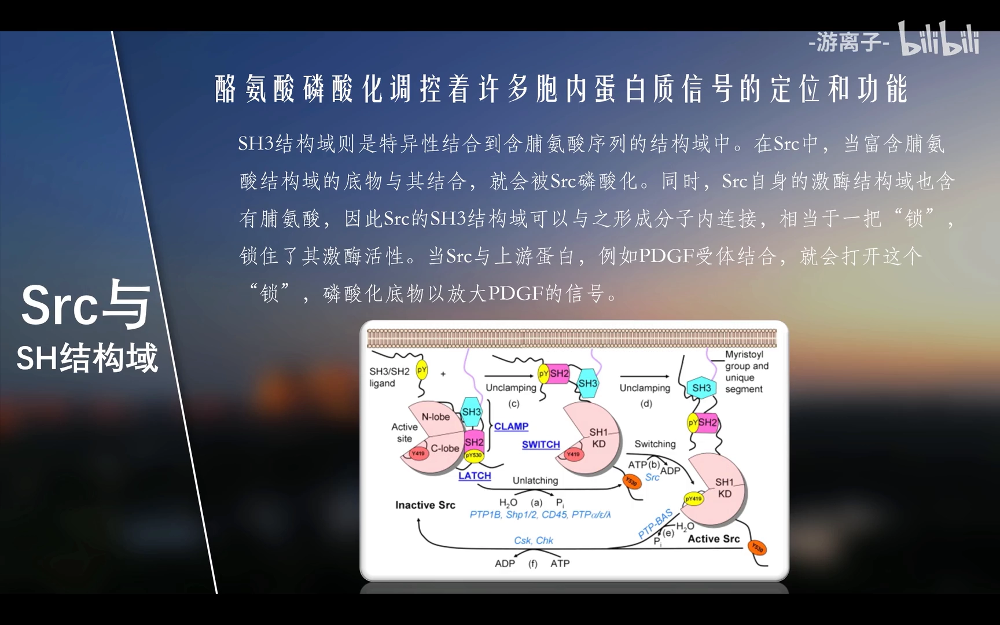

### 4.4 回到通路：Grb2 是怎么把 Sos 拉过来的

现在可以解释接头蛋白 Grb2 了。**Grb2 蛋白包含两个 SH3 和一个 SH2 结构域**：

- 它的 **SH3 结构域**对 Sos 中两个不同的富含脯氨酸序列具有亲和力——所以 Grb2 能抓住 Sos；
- 它的 **SH2 结构域**则可与众多生长因子受体的磷酸化酪氨酸结合，也可与其他桥连蛋白（如 Shc）的磷酸化酪氨酸结合——所以 Grb2 能被受体锚定在膜上。

于是整条通路在结构层面也说得通了：受体造出磷酸化酪氨酸 → Grb2 用 SH2 停靠上去 → Grb2 用 SH3 拽来 Sos → Sos 就地激活 Ras。

[【跳转到 14:32】](https://www.bilibili.com/video/BV1GNBpYpEaX/?t=872)

---

## 五、Ras 之后：三条下游支路

Ras 处于复杂信号级联的中心位置。它下游至少有**三条**主要支路：

| 支路 | 关键分子链 | 主要管什么 |
| --- | --- | --- |
| MAPK 级联 | Ras → Raf → MEK → ERK | 细胞增殖 |
| PI3K-Akt/PKB | Ras → PI3K → PIP3 → Akt/PKB | 抗凋亡、糖代谢、细胞生长 |
| Ral 对细胞骨架的调控 | Ras → RalGEF → RalA/RalB | 促进细胞迁移 |

[【跳转到 15:07】](https://www.bilibili.com/video/BV1GNBpYpEaX/?t=907)

### 5.1 支路一：MAPK 级联，一条三级激酶接力

第一个被发现的 Ras 效应分子是 **Raf 激酶**。和大多数细胞内蛋白激酶一样，Raf 磷酸化底物蛋白的**丝氨酸/苏氨酸**残基。Raf 的激活依赖一个前提——**向细胞膜的重定位**：Ras 一直被锚定在质膜上，一旦 Ras 被激活，它与 Raf 的亲和力将增加**三个数量级**，于是原本待在细胞质中的 Raf 被拉到质膜附近，进而被激活。

接下来的接力是：

```text
Ras → Raf → MEK → ERK1/ERK2
```

- **MEK** 是一种**双特异性激酶**：既能磷酸化丝氨酸、苏氨酸残基，又能磷酸化酪氨酸残基——它利用这一点去磷酸化下游的 ERK1 和 ERK2（胞外信号调控激酶）；
- 这条激酶级联通常被称为 **MAPK 通路**，全称是**促分裂原激活蛋白激酶**通路。命名规律是：ERK 为 **MAPK**，磷酸化 MAPK 的激酶为 **MAPKK**（这条通路里的 MEK），磷酸化 MAPKK 的激酶为 **MAPKKK**（这条通路里的 Raf）。

**ERK 一旦被激活**，就可以磷酸化其他底物：既可以直接磷酸化一些转录因子，也可以再磷酸化其他激酶，从而激活别的转录因子。

除了 ERK，哺乳动物的 MAPK 还包括两个亚家族——**JNK** 和 **p38**：ERK 被生长因子和有丝分裂原激活；JNK 和 p38 功能相似，与炎症、凋亡、生长都有关。因此哺乳动物中总共有**四条 MAPK 通路**。

[【跳转到 15:32】](https://www.bilibili.com/video/BV1GNBpYpEaX/?t=932) [【跳转到 16:22】](https://www.bilibili.com/video/BV1GNBpYpEaX/?t=982)

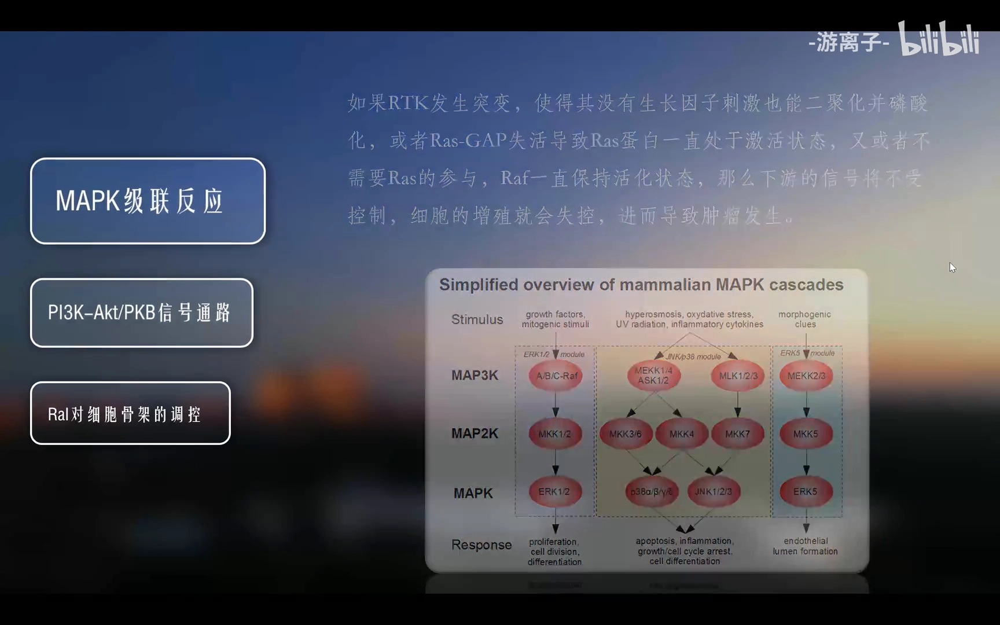

### 5.2 支路二：PI3K-Akt，从膜脂上来的一路信号

这条支路的主角不再是蛋白，而是**膜上的磷脂**。早期研究认为细胞膜的磷脂双分子层只是起屏障作用，后来的研究发现，一些膜相关的磷脂有与维持膜结构完全无关的功能。

- **磷脂酰肌醇（PI）**：一些磷脂的头部含有**肌醇**基团（肌醇是环己六醇），磷脂中甘油成分的一个羟基可以与肌醇一磷酸结合，形成磷脂酰肌醇。
- **PI 可被多种激酶在不同位置磷酸化修饰**：**磷脂酰肌醇 3-激酶（PI3K）**可特异性地把 **3 号位羟基**磷酸化。
- PI3K 最重要的底物是 **PIP2**（磷脂酰肌醇-4,5-二磷酸，即 4、5 号位两个羟基已被磷酸化）。经 PI3K 修饰后，**PIP2 转化为 PIP3**（3,4,5-三磷酸磷脂酰肌醇）。
- 这些磷酸肌醇与磷脂分离后具有水溶性，可以扩散到远离膜的位置去传递信号，所以**属于胞内的第二信使**。

PI3K 自身可以被两条上游线索激活：**一是被 Ras 蛋白激活，二是直接被生长因子受体的磷酸化酪氨酸激活**（因为 PI3K 中也含有 SH2 结构域）。PI3K 与 Ras 结合后也被定位到质膜附近，从而靠近它的底物 PIP2。

顺带一个衔接点：**PIP2 除了走 PI3K 这条路，还能被磷脂酶 C（PLC）切割**，生成 IP3 和二酰甘油（DAG）——IP3 可诱导钙离子从胞内钙库释放，DAG 可激活蛋白激酶 C。这条 PLC-IP3-Ca²⁺/DAG-PKC 支路的完整机制见本节《G蛋白偶联受体通路》一篇。

[【跳转到 18:16】](https://www.bilibili.com/video/BV1GNBpYpEaX/?t=1096) [【跳转到 19:03】](https://www.bilibili.com/video/BV1GNBpYpEaX/?t=1143) [【跳转到 19:53】](https://www.bilibili.com/video/BV1GNBpYpEaX/?t=1193)

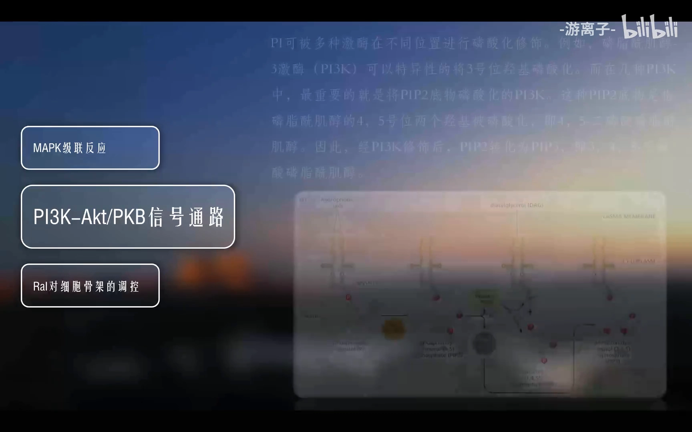

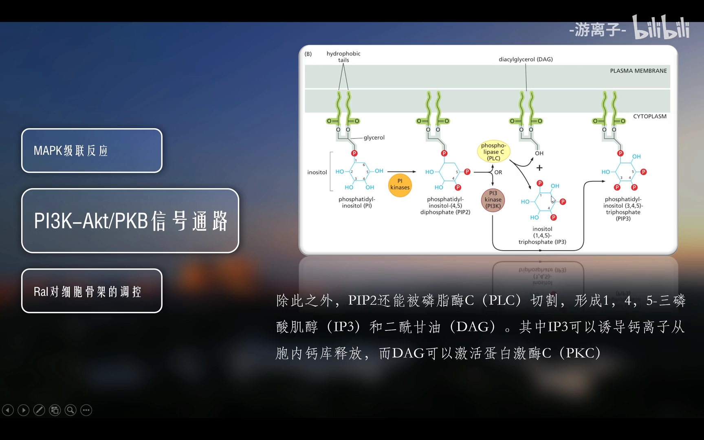

**Akt/PKB 是怎么被 PIP3 激活的？**很多与 PIP3 作用的蛋白都含有一个 **PH 结构域**（其名称来源于一种发现于血小板和白细胞中的蛋白质 pleckstrin）。**蛋白激酶 B（PKB）就含有 PH 结构域**，它又被叫作 **Akt**——这个名字来自它最初的发现方式：由逆转录病毒相关癌基因编码而被鉴定，其中 **AK** 指会发展为自发性胸腺淋巴瘤的 AKR 小鼠品系、**t** 指胸腺瘤（thymoma）。

Akt 的 PH 结构域与 PIP3 结合后，一旦被定位到细胞膜内表面，就会被 **PDK1、PDK2** 这两种激酶磷酸化而激活（图中标注为 PH domain 与 kinase domain 两部分）。

既然 PIP3 是这条支路的枢纽，**PTEN** 就成了天然刹车：**PTEN 能将 PI3K 在 3 号位添加的磷酸基团移除**，把 PIP3 变回 PIP2。因此在肿瘤细胞中，Akt/PKB 通路异常调控的两种可能机制是：**PI3K 过表达，或 PTEN 失活**。

Akt 的激活受到严密调控：正常情况下，停止生长的细胞内 PIP3 水平很低；一旦遇到分裂素，PIP3 水平会迅速上升。

[【跳转到 20:34】](https://www.bilibili.com/video/BV1GNBpYpEaX/?t=1234) [【跳转到 21:48】](https://www.bilibili.com/video/BV1GNBpYpEaX/?t=1308)

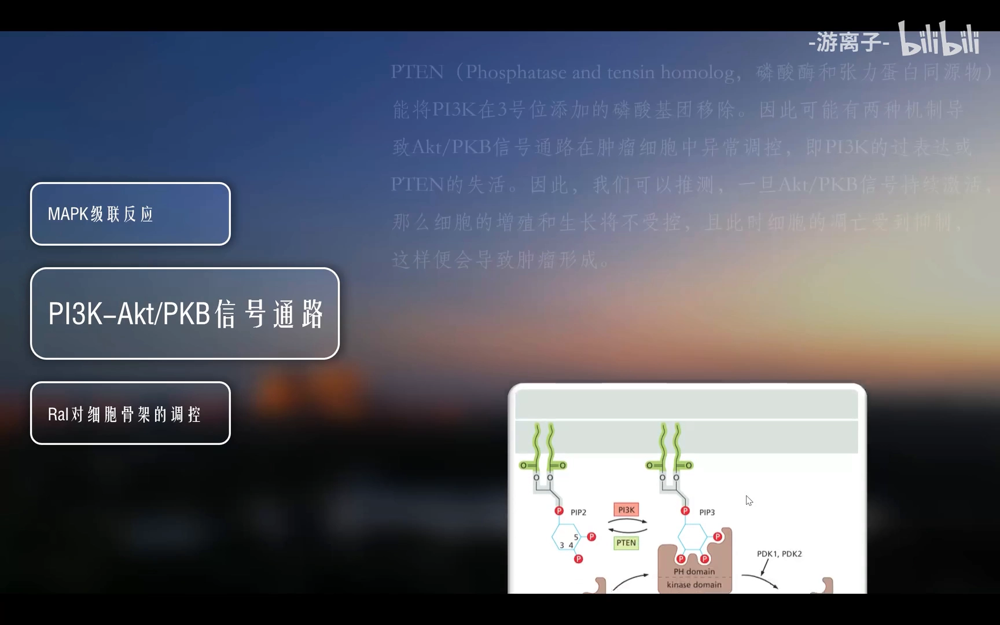

### 5.3 支路三：Ral，管细胞骨架与迁移

第三条支路通过 **Ras 的同源物 Ral** 起作用：Ral 和 Ras 之间的信号转导由 **RalGEF** 介导，RalGEF 与 Ras 结合后被定位到细胞膜内表面，进而激活 **RalA 和 RalB**，再进一步调节下游（其下游效应分子可连到 Cdc42、Rac，最终影响丝状伪足、片状伪足等骨架结构）。**Ral 蛋白主要在促进细胞迁移方面发挥重要作用。**

同一个 Ras 枢纽下还有一条与骨架相关的分支：**Rho 也是一种小 G 蛋白，Rho-GEF 也含有 PH 结构域**；当 Rho-GEF 与 PIP3 结合并被活化后，就如同 Sos 对 Ras 那样，它能把 GDP 解离下来并换上 GTP，从而激活 Rho——不同的是，**激活的 Rho 蛋白参与细胞骨架及胞外环境黏附结构的重建**。因此 PIP3 的下游通路也可以简单地分为两种。

[【跳转到 22:18】](https://www.bilibili.com/video/BV1GNBpYpEaX/?t=1338) [【跳转到 25:38】](https://www.bilibili.com/video/BV1GNBpYpEaX/?t=1538)

---

## 六、Akt 的工具箱：抗凋亡与促增殖是怎么做到的

被激活的 Akt 对一系列底物进行磷酸化，作用主要有三个方面：**一、减小细胞启动凋亡程序的可能性、促进细胞存活；二、刺激细胞增殖；三、刺激细胞生长**（狭义上的细胞体积增大）。下面看它具体动用了哪些"工具"。

### 6.1 抑制 Bad：把凋亡的外膜通道关上

**凋亡是一个依赖线粒体的复杂过程，细胞色素 C 是线粒体在凋亡过程中的核心参与者**。

- 参与凋亡的 **BCL-2 家族蛋白**能控制细胞色素 C 特异地通过线粒体外膜。人类基因组中已知能编码 **24 种** BCL-2 相关蛋白，其中 **6 种为抗凋亡、18 种为促凋亡**，**Bad 就是其中的促凋亡蛋白**。
- Bad 可以开启线粒体外膜的通道，使细胞色素 C 从线粒体逃逸到细胞质；在细胞质中它与 **Apaf-1** 蛋白形成复合物，成为**凋亡小体（apoptosome）**。
- 凋亡小体活化后先激活 **caspase-9**，caspase-9 再切割其他前体，形成 caspase 的链式反应；其中 **caspase-3、caspase-6、caspase-7 被称为"死亡执行者"**，因为它们能剪切核膜、细胞骨架等，最终把细胞拆成碎片。

**Akt/PKB 可以抑制促凋亡蛋白 Bad，从而抑制凋亡**——这正好卡在凋亡程序的最上游。总而言之，**Akt 可以抑制任何可能激活细胞凋亡程序的信号**。

[【跳转到 22:43】](https://www.bilibili.com/video/BV1GNBpYpEaX/?t=1363) [【跳转到 23:06】](https://www.bilibili.com/video/BV1GNBpYpEaX/?t=1386)

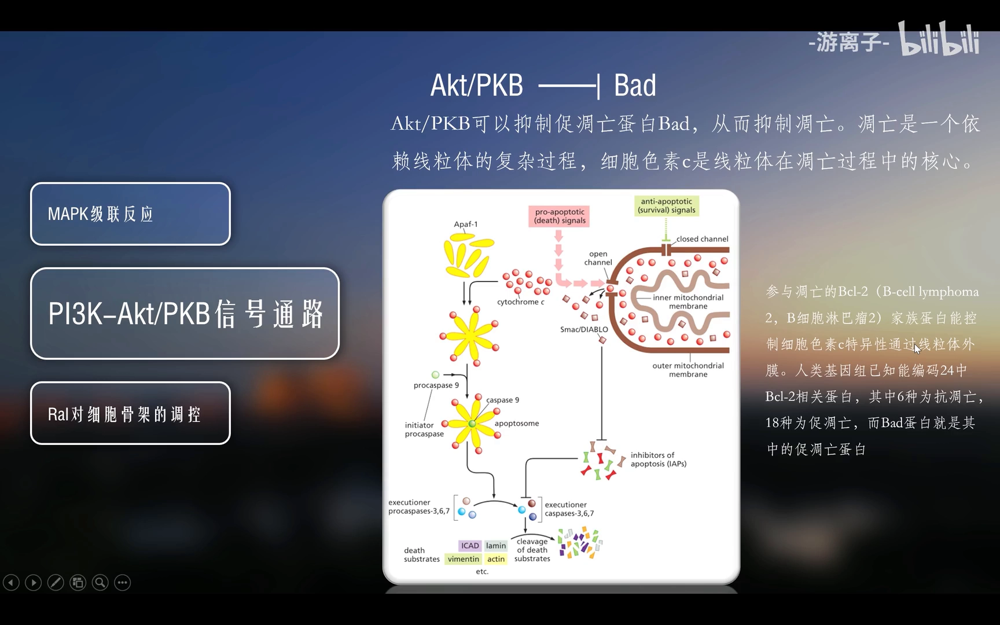

### 6.2 抑制 GSK-3β：β-catenin 与 cyclin D1 都留下了

另一个被 Akt 抑制的蛋白是 **GSK-3β**，它是一种多功能的丝氨酸/苏氨酸激酶。

- **β-catenin**：GSK-3β 可以降解 β-catenin（在降解复合物中磷酸化它，使其被泛素化降解），而 β-catenin 在细胞核内与 **TCF** 形成的转录复合物能激活多种靶基因。因此 **GSK-3β 被抑制后，β-catenin 就不会被降解，从而促进基因表达和细胞增殖**（这条通路会在 Wnt 信号通路中做详细解释）。
- **cyclin D1**：GSK-3β 被抑制后，细胞周期蛋白 cyclin D1 也不会被降解。cyclin D1 在细胞周期中促进细胞通过 G1 期的检查点（也就是 **R 点**）；若 cyclin D1 被降解，则无法磷酸化 **RB 蛋白**，细胞就无法继续进行有丝分裂。RB 蛋白未被磷酸化时会结合转录因子 **E2F**；被磷酸化之后，它就把 E2F 释放出来，促进细胞周期的进程。

[【跳转到 23:57】](https://www.bilibili.com/video/BV1GNBpYpEaX/?t=1437) [【跳转到 24:32】](https://www.bilibili.com/video/BV1GNBpYpEaX/?t=1472)

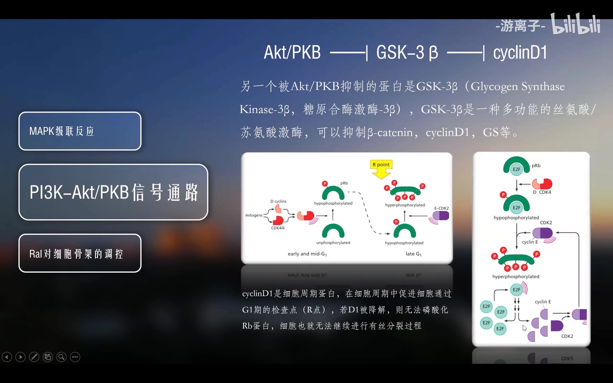

### 6.3 抑制 p21/p27：把细胞周期的刹车松开

**Akt 还能抑制 p21 和 p27 蛋白**。这两种蛋白都是 **CDK（细胞周期依赖性激酶）抑制分子**，作用是阻止细胞周期的进行。当 Akt 将其抑制，细胞周期就不再受控。

一个临床上的例子：**在人乳腺癌中，Akt 大量活化，使得绝大部分的 p27 被定位到细胞质**，p27 无法进入细胞核去调控 CDK，结果导致细胞恶性增殖。

[【跳转到 25:02】](https://www.bilibili.com/video/BV1GNBpYpEaX/?t=1502)

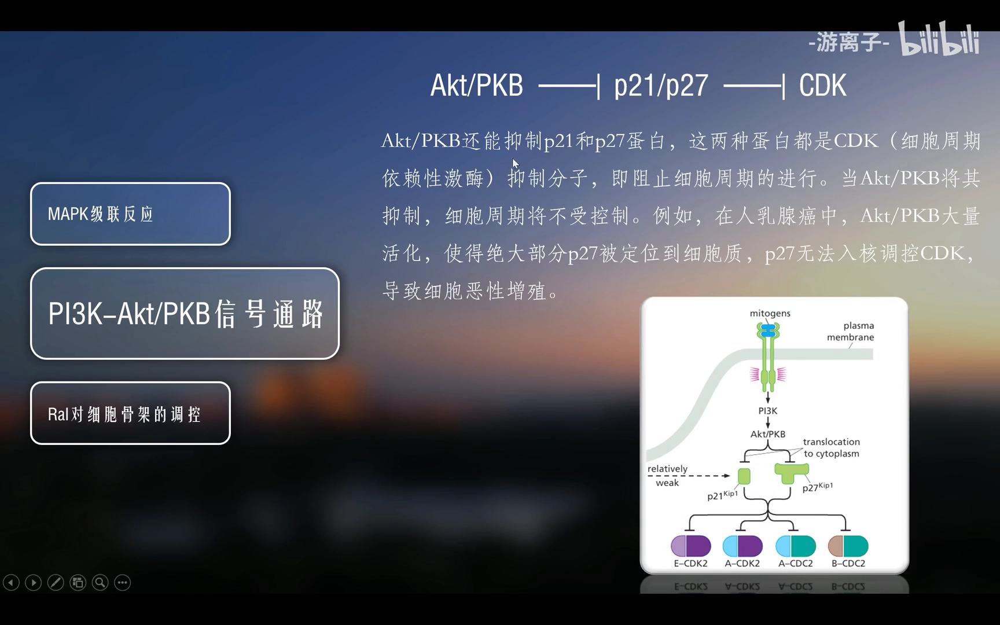

---

## 七、为什么这条通路是肿瘤的重灾区

把前面几章串起来，失控的路径就很清楚了。只要下列任何一处出问题，Ras 到下游的信号就会不受控，细胞增殖随之失控，导致肿瘤发生：

- **RTK 发生突变**，使得它没有生长因子刺激也能二聚化并磷酸化；
- **RasGAP 失活**，导致 Ras 蛋白一直处于激活状态（GTP 水解不掉）；
- **Raf 不需要 Ras 参与就保持活化状态**；
- 再加上 **PI3K 过表达或 PTEN 失活** 使 Akt/PKB 信号持续激活——此时细胞的增殖和生长不受控，而凋亡又受到抑制，便会促发肿瘤形成。

最后需要提醒的是，Ras 的实际网络比这张简图更大：**Ras 家族有 4 种蛋白质**（1 种 H-Ras、1 种 N-Ras、2 种 K-Ras），它们在细胞中的定位不同、作用方式也存在差异；而 **Raf、PI3K、RalGEF 也不包括所有的 Ras 效应蛋白**。

[【跳转到 17:25】](https://www.bilibili.com/video/BV1GNBpYpEaX/?t=1045) [【跳转到 26:08】](https://www.bilibili.com/video/BV1GNBpYpEaX/?t=1568)

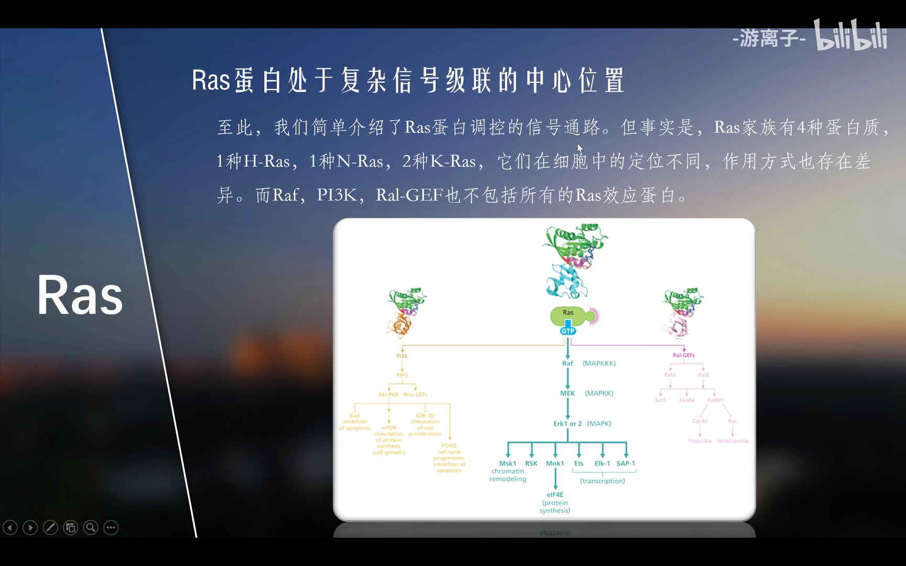

---

## 小结

- **RTK 的定位与身份**：人类基因组中约 90 种蛋白激酶受体，分 RTK 与细胞因子受体两类；RTK 已确定 20 个类别，人类的大部分是生长因子受体。结构上是单次跨膜蛋白（N 端胞外、C 端胞内），胞内段自带酪氨酸激酶结构域，**既是受体又是酶**。
- **激活机制**：配体（多为二聚体）使两个受体形成同源二聚体，激活 TK 结构域，两个亚基互相磷酸化对方 C 端——即**转磷酸化**。EGF 受体中自发二聚化先于配体结合，但只有结合配体才激发激酶活性；受体过表达会让细胞对低水平配体响应过度。
- **实验证据**：A431 细胞 + ³²PO₄ 标记 + 抗磷酸化酪氨酸抗血清，证明 EGF 受体被磷酸化的部位是酪氨酸，且最显著的就是受体自身。
- **反向案例**：Neu/HER2(ErbB2) 突变可在无配体时稳定二聚化；TGF-α 以单体结合单体受体，再通过远离结合位点的构象改变诱导二聚化。
- **磷酸化酪氨酸的作用是"定位"**：含 SH2 结构域的下游蛋白被募集到膜上；SH2 识别磷酸化酪氨酸（定位）与它 C 端 3~6 个残基（特异性），因此不同受体能激活不同信号。Src 的 SH2/SH3 分子内结合形成"插销-前夹开关"，被受体磷酸化酪氨酸竞争后解锁，再经 pY416 磷酸化完全激活。
- **接头蛋白**：Shc、Grb2 把受体与 Sos 连起来，Sos 是 GEF，负责把 Ras 从 GDP 型拨到 GTP 型；路径为 **RTK → Shc → Grb2 → Sos → Ras**。
- **Ras**：C 端脂质尾巴固定在膜胞质面的小 G 蛋白开关；GEF 开启、GAP 关闭，致癌突变会阻断 GTP 水解。
- **三条下游支路**：Raf-MEK-ERK（MAPK 级联，管增殖；Raf 需重定位到膜上）、PI3K-PIP3-Akt（管存活与生长，PTEN 是刹车）、Ral（经 RalGEF 激活 RalA/RalB，管迁移）。
- **Akt 的三个工具箱**：抑制 Bad（关掉线粒体外膜通道，阻断细胞色素 C 外流与凋亡小体-caspase 级联）、抑制 GSK-3β（β-catenin 与 cyclin D1 都不被降解）、抑制 p21/p27（松开细胞周期刹车）。
- **肿瘤**：RTK 突变、RasGAP 失活、Raf 自活化、PI3K 过表达或 PTEN 失活，都会让信号卡在"开"的状态。

## 关键术语速查

| 术语 | 一句话解释 |
| --- | --- |
| RTK（受体酪氨酸激酶） | 单次跨膜的膜受体，胞内段自带酪氨酸激酶结构域，既是受体又是酶 |
| 转磷酸化 | 二聚体中一个受体亚基磷酸化另一个亚基 C 端的双向磷酸化，与"自磷酸化"不同 |
| 生长因子受体 | RTK 中占比最大的一类，如 EGF、FGF、VEGF、PDGF 受体，管增殖与分化 |
| 磷酸化酪氨酸 | 受体胞内段被磷酸化的酪氨酸残基，作用是给下游蛋白提供停靠位点 |
| SH2 结构域 | 识别磷酸化酪氨酸及其侧翼序列的模块；磷酸化酪氨酸定位、侧翼序列定特异性 |
| SH3 结构域 | 结合富含脯氨酸序列的模块，如 Grb2 用它抓住 Sos |
| Src | src 基因产物、第一个被发现的原癌基因；有 SH1（催化）、SH2、SH3 与 N 端肉豆蔻酰基 |
| 插销-前夹开关 | Src 通过 SH2 分子内结合 pY530、SH3 结合脯氨酸序列自我抑制的结构 |
| Shc / Grb2 | 接头蛋白，把生长因子受体与 Sos 连接起来 |
| Sos | 一种 GEF（鸟嘌呤核苷酸交换因子），把 Ras 拨到 GTP 结合的活化型 |
| Ras | 固定在膜胞质面的小 G 蛋白开关；GTP 结合为开、GDP 结合为关 |
| GAP | GTP 酶激活蛋白，促使 Ras 把 GTP 水解为 GDP 而关闭 |
| Raf / MEK / ERK | MAPK 级联的三级激酶，分别是 MAPKKK、MAPKK 与 MAPK；Raf 激活需先重定位到质膜 |
| PIP2 / PIP3 | 磷脂酰肌醇-4,5-二磷酸与 3,4,5-三磷酸磷脂酰肌醇，后者是第二信使 |
| PI3K / PTEN | PI3K 把 PIP2 磷酸化成 PIP3；PTEN 去掉 3 位磷酸把 PIP3 变回 PIP2 |
| PH 结构域 | 结合 PIP3 的模块，Akt/PKB 靠它被招募到膜内表面 |
| Akt / PKB | 被 PDK1、PDK2 磷酸化激活的激酶，管存活、增殖与生长 |
| Bad / BCL-2 家族 | Bad 是促凋亡成员，开启线粒体外膜通道释放细胞色素 C |
| 凋亡小体 | 细胞色素 C 与 Apaf-1 形成的复合物，活化 caspase 级联 |
| GSK-3β | 被 Akt 抑制的激酶，会降解 β-catenin 与 cyclin D1 |
| p21 / p27 | CDK 抑制分子，被 Akt 抑制后细胞周期失去刹车 |
| Ral / RalGEF | Ras 的同源物小 G 蛋白及其交换因子，主要促进细胞迁移 |
